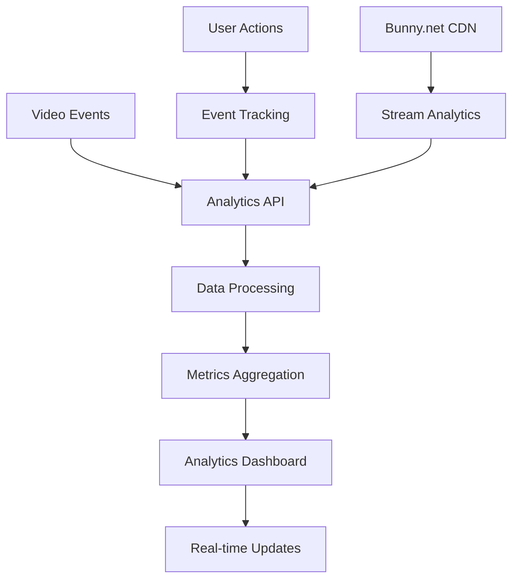

# Analytics Pipeline Architecture

## Overview

The Al Ummah Now analytics system provides comprehensive video performance tracking and creator insights through a modular, scalable architecture.

## Analytics Dashboard Features

### Core Metrics
- **Total Views**: Aggregate view count across all videos
- **Total Likes**: Sum of likes across all content
- **Total Comments**: Total engagement through comments
- **Subscribers**: Channel subscriber count
- **Total Videos**: Count of published content
- **Average Views per Video**: Performance indicator

### Advanced Analytics
- **Engagement Rate**: Calculated as (likes + comments + shares) / views
- **Performance Trends**: Time-series visualization of metrics
- **Top Performing Videos**: Ranked list of best-performing content
- **Watch Time Analytics**: Duration-based engagement metrics

## Architecture Components

### Frontend Components

```
src/components/analytics/
├── AnalyticsDashboard/
│   ├── index.tsx              # English LTR dashboard
│   └── rtl/index.tsx          # Arabic RTL dashboard
├── AnalyticsCard/
│   ├── index.tsx              # Metric display cards (LTR)
│   └── rtl/index.tsx          # Metric display cards (RTL)
└── MetricsChart/
    └── index.tsx              # Time-series visualization
```

### API Layer

```
src/lib/api/
├── analytics.ts               # Analytics API client
└── types.ts                   # Analytics type definitions
```

### Route Structure

```
/en/analytics                  # English analytics dashboard
/ar/analytics                  # Arabic analytics dashboard (RTL)
```

## Data Flow



## API Endpoints

### Analytics Summary
```
GET /api/analytics/summary
- Returns: AnalyticsSummary object
- Includes: Total metrics, engagement rate, top video
```

### Channel Analytics
```
GET /api/analytics/channels/{channelId}
- Returns: ChannelAnalyticsData object
- Includes: Channel metrics, top videos, recent trends
```

### Video Analytics
```
GET /api/analytics/videos/{videoId}
- Returns: VideoAnalyticsData object
- Includes: Video-specific performance metrics
```

### Time-Series Metrics
```
GET /api/analytics/metrics
- Returns: Array of AnalyticsMetrics
- Includes: Daily/weekly performance data
```

## Data Types

### Core Interfaces

```typescript
interface AnalyticsSummary {
  totalViews: number;
  totalLikes: number;
  totalComments: number;
  totalSubscribers: number;
  totalVideos: number;
  avgViewsPerVideo: number;
  engagementRate: number;
  topVideo: VideoAnalyticsData | null;
}

interface VideoAnalyticsData {
  videoId: string;
  title: string;
  views: number;
  likes: number;
  dislikes: number;
  comments: number;
  shares: number;
  watchTime: number;
  avgViewDuration: number;
  clickThroughRate: number;
  engagementRate: number;
  dateCreated: string;
}

interface AnalyticsMetrics {
  date: string;
  views: number;
  likes: number;
  comments: number;
  shares: number;
  subscribers: number;
  watchTime: number;
}
```

## Authentication & Authorization

- **User Authentication**: Required for personal analytics
- **Demo Mode**: Mock data available for unauthenticated users
- **Channel-based Access**: Users can only view analytics for their own channels

## Internationalization

### Bilingual Support
- **English (LTR)**: `/en/analytics`
- **Arabic (RTL)**: `/ar/analytics`

### Localized Components
- Date formatting respects locale
- Number formatting with proper separators
- RTL-aware chart layouts
- Translated metric labels

## Mock Data System

For development and demonstration:

```typescript
// Provides realistic mock data when API calls fail
private static getMockSummary(): AnalyticsSummary
private static getMockChannelAnalytics(channelId: string): ChannelAnalyticsData
private static getMockVideoAnalytics(videoId: string): VideoAnalyticsData
private static getMockMetrics(): AnalyticsMetrics[]
```

## Performance Optimizations

### Caching Strategy
- API responses cached for 5 minutes
- Progressive loading of heavy chart data
- Lazy loading of detailed video metrics

### Responsive Design
- Mobile-optimized card layouts
- Collapsible chart sections
- Touch-friendly interaction zones

## Future Enhancements

### Planned Features
- Real-time analytics updates via WebSocket
- Export functionality (PDF, CSV)
- Advanced filtering by date ranges
- Audience demographics breakdown
- Revenue analytics integration
- Comparative analytics (period over period)

### Integration Points
- **Bunny.net Analytics**: Stream-level metrics
- **Cloudflare Analytics**: Traffic and performance data
- **Custom Event Tracking**: User behavior analytics

## Implementation Notes

### Error Handling
- Graceful degradation when API unavailable
- Fallback to mock data in development
- User-friendly error messages

### Accessibility
- ARIA labels for chart elements
- Keyboard navigation support
- Screen reader compatibility
- High contrast mode support

### Security
- Channel-scoped data access
- Input validation on all parameters
- Rate limiting on analytics endpoints
- Audit logging for data access