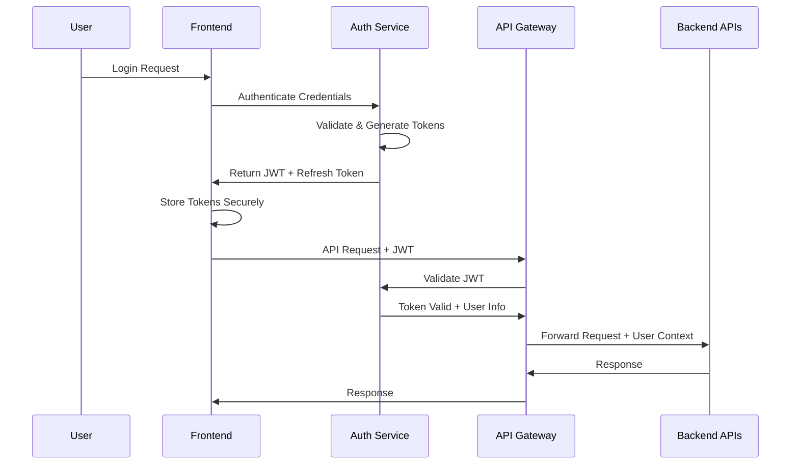

# Al Ummah Now - Technical Architecture

## System Architecture Overview

The Al Ummah Now platform is designed as a distributed microservices architecture deployed on Cloudflare infrastructure, with external media delivery via Bunny.net.

```
┌─────────────────────────────────────────────────────────────────┐
│                     Al Ummah Now Ecosystem                      │
├─────────────────────────────────────────────────────────────────┤
│                                                                 │
│  ┌─────────────────┐  ┌─────────────────┐  ┌─────────────────┐ │
│  │   Web Frontend  │  │  Mobile App     │  │   Admin Panel   │ │
│  │                 │  │                 │  │                 │ │
│  │  - Video Portal │  │  - iOS/Android  │  │  - Content Mgmt │ │
│  │  - News Site    │  │  - Native Video │  │  - User Mgmt    │ │
│  │  - Academy      │  │  - Offline Mode │  │  - Analytics    │ │
│  └─────────────────┘  └─────────────────┘  └─────────────────┘ │
│           │                     │                     │         │
├───────────┼─────────────────────┼─────────────────────┼─────────┤
│           │                     │                     │         │
│  ┌─────────────────────────────────────────────────────────────┐ │
│  │                    API Gateway                             │ │
│  │                                                            │ │
│  │  - Authentication & Authorization                         │ │
│  │  - Rate Limiting & Security                               │ │
│  │  - Request Routing & Load Balancing                       │ │
│  │  - API Versioning & Documentation                         │ │
│  └─────────────────────────────────────────────────────────────┘ │
│           │                     │                     │         │
├───────────┼─────────────────────┼─────────────────────┼─────────┤
│           │                     │                     │         │
│  ┌─────────────────┐  ┌─────────────────┐  ┌─────────────────┐ │
│  │   Video API     │  │   Auth Service  │  │   CMS API       │ │
│  │                 │  │                 │  │                 │ │
│  │  - Video CRUD   │  │  - User Auth    │  │  - Articles     │ │
│  │  - Comments     │  │  - Permissions  │  │  - News         │ │
│  │  - Playlists    │  │  - Sessions     │  │  - Editorial    │ │
│  │  - Analytics    │  │  - OAuth        │  │  - Publishing   │ │
│  └─────────────────┘  └─────────────────┘  └─────────────────┘ │
│           │                     │                     │         │
│  ┌─────────────────┐  ┌─────────────────┐  ┌─────────────────┐ │
│  │  Events Engine  │  │  Academy API    │  │   AI Service    │ │
│  │                 │  │                 │  │                 │ │
│  │  - Event Stream │  │  - Courses      │  │  - Chatbot      │ │
│  │  - Analytics    │  │  - Progress     │  │  - Recommendations│ │
│  │  - Recommendations│ │  - Certificates │  │  - Content AI   │ │
│  │  - Notifications│  │  - Assessments  │  │  - Moderation   │ │
│  └─────────────────┘  └─────────────────┘  └─────────────────┘ │
│           │                     │                     │         │
├───────────┼─────────────────────┼─────────────────────┼─────────┤
│           │                     │                     │         │
│  ┌─────────────────────────────────────────────────────────────┐ │
│  │                    Data Layer                              │ │
│  │                                                            │ │
│  │  ┌──────────────┐ ┌──────────────┐ ┌──────────────┐       │ │
│  │  │ Primary DB   │ │   Cache      │ │   Search     │       │ │
│  │  │              │ │              │ │              │       │ │
│  │  │ - User Data  │ │ - Sessions   │ │ - Content    │       │ │
│  │  │ - Videos     │ │ - API Cache  │ │ - Users      │       │ │
│  │  │ - Content    │ │ - Temp Data  │ │ - Analytics  │       │ │
│  │  └──────────────┘ └──────────────┘ └──────────────┘       │ │
│  └─────────────────────────────────────────────────────────────┘ │
│           │                     │                     │         │
├───────────┼─────────────────────┼─────────────────────┼─────────┤
│           │                     │                     │         │
│  ┌─────────────────────────────────────────────────────────────┐ │
│  │                External Services                           │ │
│  │                                                            │ │
│  │  ┌──────────────┐ ┌──────────────┐ ┌──────────────┐       │ │
│  │  │ Media CDN    │ │  Email       │ │  Monitoring  │       │ │
│  │  │              │ │              │ │              │       │ │
│  │  │ - Video      │ │ - Notifications│ │ - Logs      │       │ │
│  │  │ - Images     │ │ - Marketing  │ │ - Metrics    │       │ │
│  │  │ - Assets     │ │ - Support    │ │ - Alerts     │       │ │
│  │  └──────────────┘ └──────────────┘ └──────────────┘       │ │
│  └─────────────────────────────────────────────────────────────┘ │
└─────────────────────────────────────────────────────────────────┘
```

## Infrastructure Components

### Cloudflare Services

**Cloudflare Workers** (Compute Layer)
- Video Portal UI (Next.js via OpenNext)
- API Gateway and routing
- Authentication service
- Events processing
- Real-time features (WebSockets)

**Cloudflare Pages** (Static Hosting)
- News website frontend
- Admin dashboard
- Documentation sites
- Landing pages

**Cloudflare D1** (Database)
- User accounts and profiles
- Video metadata
- Comments and interactions
- Course and academy data
- Analytics data

**Cloudflare R2** (Object Storage)
- User uploaded files
- Generated thumbnails
- Course materials
- Backup data
- Static assets

**Cloudflare KV** (Key-Value Store)
- Session data
- Cache layer
- Configuration settings
- Temporary data

**Cloudflare Analytics**
- User behavior tracking
- Performance monitoring
- Business intelligence
- Real-time dashboards

### External Services

**Bunny.net** (Media Delivery)
- Video storage and transcoding
- Global CDN for video delivery
- Live streaming infrastructure
- Image optimization and delivery

**Email Service**
- User notifications
- Marketing campaigns
- System alerts
- Support communications

## Service Architecture Details

### 1. Video Portal UI (Current Repository)

**Technology Stack**:
- Next.js 15 with App Router
- TypeScript for type safety
- Tailwind CSS for styling
- Video.js for media playback
- OpenAuth for authentication

**Deployment**:
- Cloudflare Workers via OpenNext
- Static assets on Cloudflare CDN
- Edge-side rendering capabilities

**API Integration**:
```typescript
// API Client Architecture
const apiClient = new APIClient({
  baseURL: 'https://videos.api.alummahnow.net',
  headers: {
    'Authorization': `Bearer ${token}`,
    'channelId': userChannelId,
    'userId': userId
  }
});

// Usage
await apiClient.videos.list({ limit: 20 });
await apiClient.channels.getById(channelId);
await apiClient.playlists.create(playlistData);
```

### 2. Video API Service (AlUmmahNowVideos)

**Purpose**: Core video management and content delivery API

**Technology Stack**:
- Node.js with TypeScript
- Fastify or Express.js framework
- OpenAPI 3.0 specification
- Database ORM (Prisma or similar)

**Deployment**: Cloudflare Workers

**Core Endpoints**:
```
Video Management:
  GET    /api/videos                    - List videos with pagination
  GET    /api/videos/{id}               - Get video details
  POST   /api/videos                    - Create/upload video
  PUT    /api/videos/{id}               - Update video metadata
  DELETE /api/videos/{id}               - Delete video
  
Video Interactions:
  POST   /api/videos/{id}/like          - Like video
  DELETE /api/videos/{id}/like          - Remove like
  POST   /api/videos/{id}/dislike       - Dislike video
  DELETE /api/videos/{id}/dislike       - Remove dislike
  POST   /api/videos/{id}/view          - Record view
  
Comments:
  GET    /api/videos/{id}/comments      - Get comments
  POST   /api/videos/{id}/comments      - Add comment
  PUT    /api/videos/{id}/comments/{cid} - Update comment
  DELETE /api/videos/{id}/comments/{cid} - Delete comment
  
Upload:
  POST   /api/upload/initiate           - Start upload session
  POST   /api/upload/chunk              - Upload video chunk
  POST   /api/upload/complete           - Complete upload
  GET    /api/upload/status             - Check upload progress
```

**Database Schema**:
```sql
-- Core Tables
CREATE TABLE users (
  id UUID PRIMARY KEY,
  email VARCHAR(255) UNIQUE NOT NULL,
  display_name VARCHAR(100),
  avatar_url TEXT,
  created_at TIMESTAMP DEFAULT NOW(),
  updated_at TIMESTAMP DEFAULT NOW()
);

CREATE TABLE channels (
  id UUID PRIMARY KEY,
  user_id UUID REFERENCES users(id),
  name VARCHAR(100) NOT NULL,
  description TEXT,
  avatar_url TEXT,
  cover_url TEXT,
  is_main BOOLEAN DEFAULT false,
  subscribers_count INTEGER DEFAULT 0,
  videos_count INTEGER DEFAULT 0,
  created_at TIMESTAMP DEFAULT NOW(),
  updated_at TIMESTAMP DEFAULT NOW()
);

CREATE TABLE videos (
  id UUID PRIMARY KEY,
  title VARCHAR(255) NOT NULL,
  description TEXT,
  channel_id UUID REFERENCES channels(id),
  user_id UUID REFERENCES users(id),
  video_url TEXT NOT NULL,
  thumbnail_url TEXT,
  duration INTEGER, -- seconds
  views_count INTEGER DEFAULT 0,
  likes_count INTEGER DEFAULT 0,
  dislikes_count INTEGER DEFAULT 0,
  comments_count INTEGER DEFAULT 0,
  is_public BOOLEAN DEFAULT true,
  is_live BOOLEAN DEFAULT false,
  processing_status VARCHAR(50) DEFAULT 'pending',
  created_at TIMESTAMP DEFAULT NOW(),
  updated_at TIMESTAMP DEFAULT NOW()
);

CREATE TABLE comments (
  id UUID PRIMARY KEY,
  video_id UUID REFERENCES videos(id),
  user_id UUID REFERENCES users(id),
  channel_id UUID REFERENCES channels(id),
  text TEXT NOT NULL,
  likes_count INTEGER DEFAULT 0,
  dislikes_count INTEGER DEFAULT 0,
  replies_count INTEGER DEFAULT 0,
  parent_id UUID REFERENCES comments(id),
  is_edited BOOLEAN DEFAULT false,
  is_deleted BOOLEAN DEFAULT false,
  is_pinned BOOLEAN DEFAULT false,
  created_at TIMESTAMP DEFAULT NOW(),
  updated_at TIMESTAMP DEFAULT NOW()
);

CREATE TABLE playlists (
  id UUID PRIMARY KEY,
  title VARCHAR(255) NOT NULL,
  description TEXT,
  channel_id UUID REFERENCES channels(id),
  user_id UUID REFERENCES users(id),
  thumbnail_url TEXT,
  is_public BOOLEAN DEFAULT true,
  videos_count INTEGER DEFAULT 0,
  created_at TIMESTAMP DEFAULT NOW(),
  updated_at TIMESTAMP DEFAULT NOW()
);

-- Interaction Tables
CREATE TABLE video_likes (
  id UUID PRIMARY KEY,
  video_id UUID REFERENCES videos(id),
  user_id UUID REFERENCES users(id),
  created_at TIMESTAMP DEFAULT NOW(),
  UNIQUE(video_id, user_id)
);

CREATE TABLE video_dislikes (
  id UUID PRIMARY KEY,
  video_id UUID REFERENCES videos(id),
  user_id UUID REFERENCES users(id),
  created_at TIMESTAMP DEFAULT NOW(),
  UNIQUE(video_id, user_id)
);

CREATE TABLE subscriptions (
  id UUID PRIMARY KEY,
  subscriber_id UUID REFERENCES users(id),
  channel_id UUID REFERENCES channels(id),
  created_at TIMESTAMP DEFAULT NOW(),
  UNIQUE(subscriber_id, channel_id)
);

CREATE TABLE playlist_videos (
  id UUID PRIMARY KEY,
  playlist_id UUID REFERENCES playlists(id),
  video_id UUID REFERENCES videos(id),
  position INTEGER NOT NULL,
  added_at TIMESTAMP DEFAULT NOW(),
  UNIQUE(playlist_id, video_id)
);
```

### 3. Authentication Service (AlUmmahNowAuth)

**Purpose**: Centralized authentication and user management

**Technology Stack**:
- OpenAuth framework
- JWT tokens with refresh rotation
- OAuth 2.0 / OpenID Connect
- Multi-factor authentication support

**Core Features**:
```typescript
// Authentication Endpoints
POST   /auth/register                  - User registration
POST   /auth/login                     - User login
POST   /auth/logout                    - User logout
POST   /auth/refresh                   - Refresh tokens
POST   /auth/forgot-password           - Password reset request
POST   /auth/reset-password            - Password reset confirmation

// OAuth Integration
GET    /auth/oauth/{provider}          - OAuth login (Google, Apple)
GET    /auth/oauth/{provider}/callback - OAuth callback

// User Management
GET    /auth/me                        - Get current user
PUT    /auth/me                        - Update user profile
DELETE /auth/me                        - Delete user account
POST   /auth/change-password           - Change password
POST   /auth/enable-2fa                - Enable 2FA
POST   /auth/verify-2fa                - Verify 2FA token
```

### 4. Events Processor (AlUmmahNowProcessor)

**Purpose**: Real-time event processing, analytics, and recommendations

**Technology Stack**:
- Event-driven architecture
- Message queues (Cloudflare Queues)
- Real-time analytics processing
- Machine learning recommendations

**Event Types**:
```typescript
interface VideoViewEvent {
  type: 'video_view';
  userId?: string;
  videoId: string;
  sessionId: string;
  timestamp: Date;
  duration: number; // seconds watched
  quality: string;
  device: string;
}

interface UserInteractionEvent {
  type: 'user_interaction';
  userId: string;
  action: 'like' | 'dislike' | 'comment' | 'subscribe' | 'share';
  targetId: string; // video, channel, or comment ID
  targetType: 'video' | 'channel' | 'comment';
  timestamp: Date;
}

interface ContentUploadEvent {
  type: 'content_upload';
  userId: string;
  videoId: string;
  channelId: string;
  status: 'started' | 'processing' | 'completed' | 'failed';
  metadata: {
    title: string;
    duration: number;
    fileSize: number;
    format: string;
  };
  timestamp: Date;
}
```

### 5. CMS Backend (AlUmmahNowCMS)

**Purpose**: Content management for news, articles, and editorial content

**Features**:
- Article creation and editing
- Editorial workflow management
- Multi-language content support
- SEO optimization
- Publishing automation

### 6. Academy API (Future)

**Purpose**: Educational content and course management

**Features**:
- Course structure management
- Progress tracking
- Assessment and certification
- Learning analytics

## Security Architecture

### Authentication Flow



### Data Protection

**Encryption**:
- Data at rest: AES-256 encryption
- Data in transit: TLS 1.3
- Database: Column-level encryption for sensitive data

**Access Control**:
- Role-based access control (RBAC)
- API rate limiting
- Content-based permissions
- Geographic restrictions

### Content Security

**Upload Security**:
- File type validation
- Virus scanning
- Content filtering
- Size limitations

**Content Moderation**:
- AI-powered content analysis
- User reporting system
- Manual review workflow
- Automated flagging

## Performance Architecture

### Caching Strategy

**Multi-level Caching**:
```
Browser Cache (Client)
  ↓
CDN Cache (Cloudflare)
  ↓
Edge Cache (Workers KV)
  ↓
Application Cache (Redis/KV)
  ↓
Database
```

**Cache Invalidation**:
- Time-based expiration
- Event-driven invalidation
- Manual cache clearing
- Graceful degradation

### Video Delivery Optimization

**Adaptive Bitrate Streaming**:
- Multiple quality levels (360p, 720p, 1080p, 4K)
- Automatic quality switching
- Bandwidth optimization
- Device-specific optimization

**Global Distribution**:
- Bunny.net global CDN
- Edge locations worldwide
- Regional content optimization
- Reduced latency delivery

## Monitoring and Observability

### Metrics Collection

**Application Metrics**:
- Request latency and throughput
- Error rates and types
- User engagement metrics
- Content performance analytics

**Infrastructure Metrics**:
- CPU and memory usage
- Database performance
- Cache hit rates
- Network latency

### Logging Strategy

**Structured Logging**:
```json
{
  "timestamp": "2024-01-15T10:30:00Z",
  "level": "INFO",
  "service": "video-api",
  "request_id": "req_123456",
  "user_id": "user_789",
  "action": "video_upload",
  "video_id": "vid_abc123",
  "duration_ms": 1250,
  "status": "success"
}
```

### Alerting

**Alert Conditions**:
- High error rates (>5%)
- Slow response times (>2s)
- Database connection issues
- Video processing failures
- Security incidents

## Deployment Strategy

### Environment Management

**Development Environment**:
- Local development with Docker
- Feature branch deployments
- Automated testing pipeline

**Staging Environment**:
- Production-like configuration
- Integration testing
- Performance testing
- User acceptance testing

**Production Environment**:
- Blue-green deployments
- Canary releases
- Automated rollbacks
- Health checks

### CI/CD Pipeline

```yaml
# Example GitHub Actions workflow
name: Deploy to Production

on:
  push:
    branches: [main]

jobs:
  test:
    runs-on: ubuntu-latest
    steps:
      - uses: actions/checkout@v3
      - name: Run Tests
        run: npm test
      - name: Run E2E Tests
        run: npm run test:e2e

  build:
    needs: test
    runs-on: ubuntu-latest
    steps:
      - uses: actions/checkout@v3
      - name: Build Application
        run: npm run build
      - name: Upload Build Artifacts
        uses: actions/upload-artifact@v3

  deploy:
    needs: build
    runs-on: ubuntu-latest
    steps:
      - name: Deploy to Cloudflare
        run: wrangler deploy
```

This technical architecture provides a solid foundation for building a scalable, secure, and high-performance Islamic content platform that can grow with user demand and feature requirements.