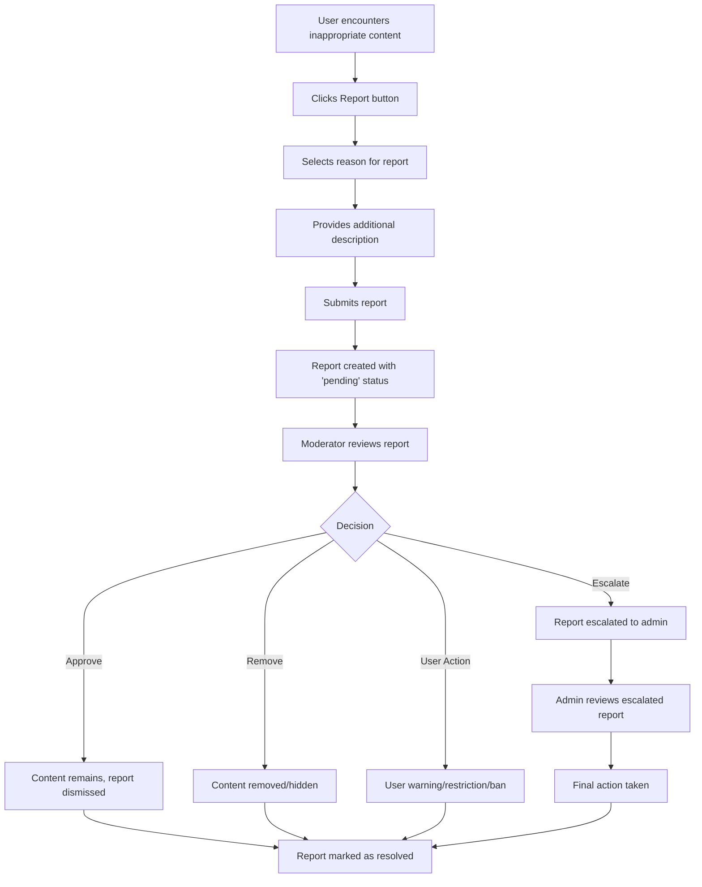
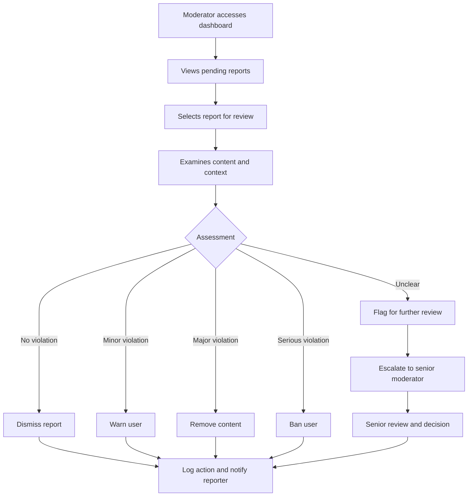
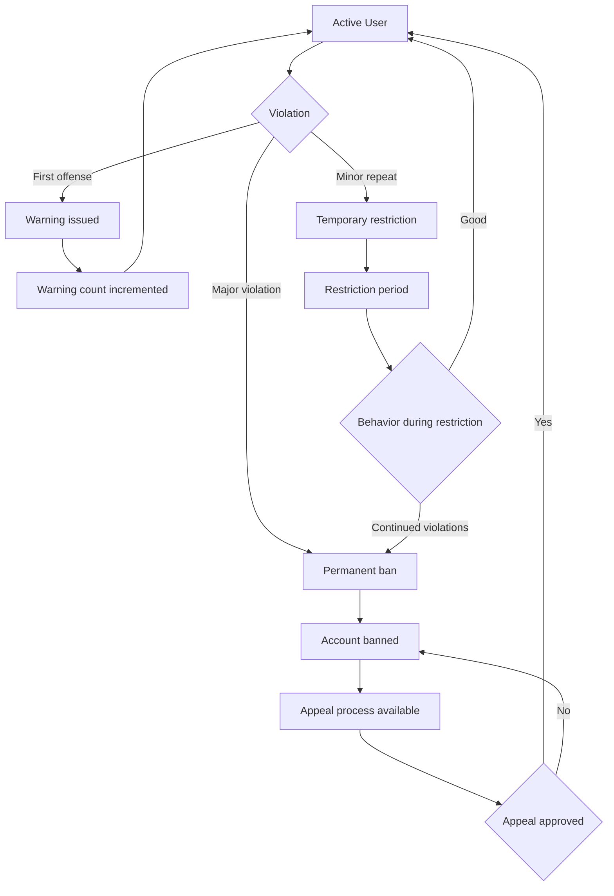

# Content Moderation System Documentation

## Overview

The Al Ummah Now platform includes a comprehensive content moderation system designed to maintain community standards and ensure appropriate content aligned with Islamic values. The system provides tools for administrators and moderators to review reported content, take appropriate actions, and manage user behavior.

## Architecture

### Components

1. **Moderation API** (`/src/lib/api/moderation.ts`)
   - Handles all moderation-related API calls
   - Manages reports, actions, and statistics
   - Provides mock data for development

2. **Admin Dashboard** (`/src/app/[locale]/moderation/`)
   - Main interface for moderators and administrators
   - Provides overview statistics and filtering capabilities
   - Available in both English (`/en/moderation`) and Arabic (`/ar/moderation`)

3. **Report Detail Pages** (`/src/app/[locale]/moderation/reports/[id]/`)
   - Detailed view of individual reports
   - Action forms for moderation decisions
   - History tracking of all actions taken

4. **User Reporting Component** (`/src/components/moderation/ReportContentButton.tsx`)
   - User-facing component for reporting inappropriate content
   - Can be embedded in video players, comment sections, etc.
   - Supports multiple content types (videos, comments, channels, playlists)

## Data Models

### Content Report
```typescript
interface ContentReport {
  id: string;
  reporterId: string;
  reporterName?: string;
  contentType: 'video' | 'comment' | 'channel' | 'playlist';
  contentId: string;
  contentTitle?: string;
  contentUrl?: string;
  reason: 'inappropriate_content' | 'spam' | 'harassment' | 'copyright' | 'violence' | 'hate_speech' | 'nudity' | 'misinformation' | 'other';
  customReason?: string;
  description?: string;
  status: 'pending' | 'in_review' | 'resolved' | 'dismissed' | 'escalated';
  priority: 'low' | 'medium' | 'high' | 'urgent';
  assignedTo?: string;
  assignedToName?: string;
  dateCreated: string;
  dateModified: string;
  dateResolved?: string;
  resolutionNotes?: string;
  moderationActions?: ModerationAction[];
}
```

### Moderation Action
```typescript
interface ModerationAction {
  id: string;
  reportId?: string;
  moderatorId: string;
  moderatorName?: string;
  contentType: 'video' | 'comment' | 'channel' | 'playlist' | 'user';
  contentId: string;
  actionType: 'approve' | 'remove' | 'hide' | 'warn_user' | 'restrict_user' | 'ban_user' | 'delete_content' | 'flag_for_review' | 'dismiss_report';
  reason?: string;
  notes?: string;
  isReversible: boolean;
  dateCreated: string;
  reversedBy?: string;
  reversedAt?: string;
  reversalReason?: string;
}
```

### User Moderation
```typescript
interface UserModeration {
  userId: string;
  userName?: string;
  email?: string;
  status: 'active' | 'warned' | 'restricted' | 'banned' | 'under_review';
  role: 'user' | 'moderator' | 'admin';
  warningsCount: number;
  restrictionsCount: number;
  bansCount: number;
  totalReports: number;
  lastAction?: string;
  lastActionDate?: string;
  dateCreated: string;
  dateModified: string;
}
```

## Workflow Diagrams

### Content Reporting Workflow



### Moderation Action Workflow



### User Status Management



## Access Control

### Role-Based Permissions

1. **Users**
   - Can report content
   - Can view their own report history
   - Cannot access moderation tools

2. **Moderators**
   - Can view and act on reports
   - Can issue warnings and temporary restrictions
   - Can remove or hide content
   - Cannot ban users permanently
   - Cannot access admin-only features

3. **Administrators**
   - Full access to all moderation tools
   - Can issue permanent bans
   - Can reverse moderation actions
   - Can manage moderator accounts
   - Can access system statistics and analytics

### Authentication Integration

The moderation system integrates with the existing OpenAuth authentication system:

```typescript
// Check user role in components
const isAuthorized = auth?.user && (auth.user.role === 'admin' || auth.user.role === 'moderator');

// Navigation menu shows moderation link only for authorized users
if (user.role === 'admin' || user.role === 'moderator') {
    items.push({ label: "Moderation", icon: "fa-shield-alt", href: "/en/moderation" });
}
```

## Integration Points

### Adding Report Buttons to Content

To add reporting functionality to any content component:

```tsx
import ReportContentButton from '@/components/moderation/ReportContentButton';

// In your component
<ReportContentButton
  contentType="video"
  contentId={video.id}
  contentTitle={video.title}
  className="text-red-600"
>
  <i className="fas fa-flag mr-1"></i>
  Report Video
</ReportContentButton>
```

### API Integration

The moderation API is designed to work with the existing API client pattern:

```typescript
import { ModerationAPI } from '@/lib/api/moderation';

// Create a report
const report = await ModerationAPI.createReport({
  contentType: 'video',
  contentId: 'video123',
  reason: 'inappropriate_content',
  description: 'Contains inappropriate language'
}, { userId: currentUser.id });

// Take moderation action
const action = await ModerationAPI.takeModerationAction({
  reportId: 'report123',
  contentType: 'video',
  contentId: 'video123',
  actionType: 'remove',
  reason: 'Violates community guidelines',
  notes: 'Content removed due to inappropriate language'
}, { userId: moderatorUser.id });
```

## Internationalization

The moderation system supports both English and Arabic:

- **English**: `/en/moderation/*`
- **Arabic**: `/ar/moderation/*` (with RTL support)

All user-facing text is localized, including:
- Dashboard labels and buttons
- Status and priority indicators
- Action types and reasons
- Error messages and notifications

## Islamic Values Alignment

The moderation system is designed with Islamic principles in mind:

1. **Community Trust**: Transparent process with clear guidelines
2. **Justice**: Fair review process with appeal mechanisms  
3. **Accountability**: All actions are logged and auditable
4. **Mercy**: Progressive discipline system with opportunities for reform
5. **Wisdom**: Multiple review levels for serious decisions

## Development and Testing

### Mock Data

The system includes comprehensive mock data for development:
- Sample reports with various statuses and priorities
- Mock moderation actions and history
- Statistics and analytics data
- User moderation information

### API Endpoints

When the backend is implemented, the following endpoints should be available:

- `GET /api/moderation/reports` - List reports with filtering
- `GET /api/moderation/reports/{id}` - Get specific report
- `POST /api/moderation/reports` - Create new report
- `POST /api/moderation/actions` - Take moderation action
- `GET /api/moderation/stats` - Get moderation statistics
- `GET /api/moderation/users/{userId}` - Get user moderation info

### Testing Considerations

1. **Role-based access testing**
2. **Form validation and error handling**
3. **Internationalization and RTL support**
4. **Responsive design across devices**
5. **Performance with large datasets**

## Future Enhancements

1. **Automated Content Filtering**
   - AI-powered content analysis
   - Automatic flagging of potentially problematic content
   - Integration with Islamic content guidelines

2. **Advanced Analytics**
   - Trend analysis of report types
   - Moderator performance metrics
   - Content compliance scoring

3. **Bulk Actions**
   - Mass processing of similar reports
   - Batch user management operations
   - Import/export of moderation data

4. **Real-time Notifications**
   - Instant alerts for urgent reports
   - WebSocket integration for live updates
   - Mobile push notifications for moderators

5. **Community Moderation**
   - Trusted user program
   - Peer review system
   - Community guidelines voting