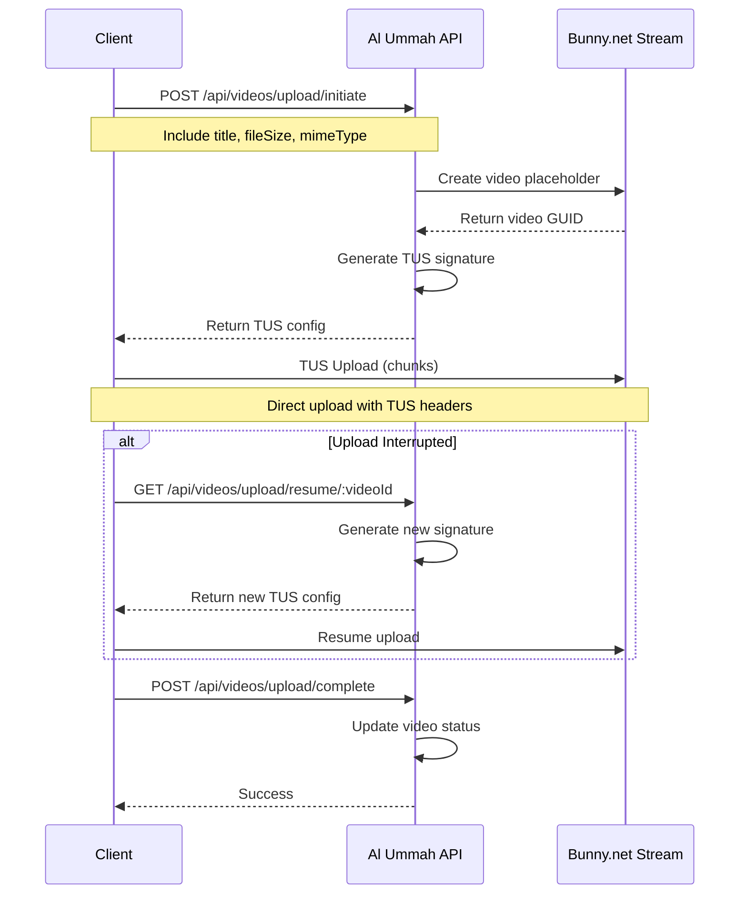

# TUS Resumable Upload Guide

## Overview

Al Ummah Now API now supports **TUS (Tus Resumable Upload Protocol)** for video uploads, providing:
- **Resumable uploads** - automatically resume interrupted uploads
- **Chunked transfers** - upload large files in smaller chunks
- **Progress tracking** - monitor upload progress in real-time
- **Native Bunny.net integration** - direct upload to Bunny.net Stream

## Architecture



## API Endpoints

### 1. Initiate Upload

**Endpoint:** `POST /api/videos/upload/initiate`

**Request:**
```json
{
  "title": "My Video",
  "description": "Video description",
  "fileSize": 104857600,  // Required: size in bytes
  "mimeType": "video/mp4", // Required: MIME type
  "isPublic": true,
  "tags": "tag1,tag2"
}
```

**Response:**
```json
{
  "success": true,
  "result": {
    "videoId": "abc-123-def",
    "tusEndpoint": "https://video.bunnycdn.com/tusupload",
    "tusHeaders": {
      "AuthorizationSignature": "a1b2c3d4...",
      "AuthorizationExpire": "1234567890",
      "LibraryId": "12345",
      "VideoId": "abc-123-def"
    },
    "expiresAt": "2024-01-01T12:00:00Z",
    "chunkSize": 5242880,  // 5MB
    "resumable": true
  }
}
```

### 2. Resume Upload

**Endpoint:** `GET /api/videos/upload/resume/:videoId`

Used when an upload was interrupted and needs to be resumed with a new authorization signature.

**Response:**
```json
{
  "success": true,
  "result": {
    "videoId": "abc-123-def",
    "tusEndpoint": "https://video.bunnycdn.com/tusupload",
    "tusHeaders": {
      "AuthorizationSignature": "new-signature...",
      "AuthorizationExpire": "1234567890",
      "LibraryId": "12345",
      "VideoId": "abc-123-def"
    },
    "expiresAt": "2024-01-01T13:00:00Z",
    "chunkSize": 5242880,
    "resumable": true,
    "videoMetadata": {
      "title": "My Video",
      "uploadStatus": "uploading",
      "fileSize": 104857600,
      "mimeType": "video/mp4"
    }
  }
}
```

### 3. Complete Upload

**Endpoint:** `POST /api/videos/upload/complete`

**Request:**
```json
{
  "videoId": "abc-123-def",
  "fileSize": 104857600,  // Optional: actual uploaded size
  "duration": 120          // Optional: video duration in seconds
}
```

**Response:**
```json
{
  "success": true,
  "result": {
    "videoId": "abc-123-def",
    "status": "processing",
    "message": "Upload completed successfully. Video is now being processed."
  }
}
```

## Client Implementation

### JavaScript/TypeScript with tus-js-client

```typescript
import * as tus from 'tus-js-client';

async function uploadVideo(file: File, token: string) {
  // Step 1: Initiate upload
  const initResponse = await fetch('/api/videos/upload/initiate', {
    method: 'POST',
    headers: {
      'Authorization': `Bearer ${token}`,
      'Content-Type': 'application/json',
    },
    body: JSON.stringify({
      title: file.name,
      fileSize: file.size,
      mimeType: file.type,
      isPublic: true,
    }),
  });

  const { result } = await initResponse.json();
  const { videoId, tusEndpoint, tusHeaders, chunkSize } = result;

  // Step 2: Create TUS upload
  const upload = new tus.Upload(file, {
    endpoint: tusEndpoint,
    headers: tusHeaders,
    chunkSize: chunkSize,
    retryDelays: [0, 3000, 5000, 10000, 20000],
    metadata: {
      filename: file.name,
      filetype: file.type,
    },
    onError: async (error) => {
      console.error("Upload failed:", error);

      // Try to resume with new signature
      const resumeResponse = await fetch(`/api/videos/upload/resume/${videoId}`, {
        headers: { 'Authorization': `Bearer ${token}` },
      });

      if (resumeResponse.ok) {
        const { result } = await resumeResponse.json();
        // Update headers and retry
        upload.options.headers = result.tusHeaders;
        upload.start();
      }
    },
    onProgress: (bytesUploaded, bytesTotal) => {
      const percentage = ((bytesUploaded / bytesTotal) * 100).toFixed(2);
      console.log(`Upload progress: ${percentage}%`);
    },
    onSuccess: async () => {
      console.log("Upload complete!");

      // Step 3: Mark upload as complete
      await fetch('/api/videos/upload/complete', {
        method: 'POST',
        headers: {
          'Authorization': `Bearer ${token}`,
          'Content-Type': 'application/json',
        },
        body: JSON.stringify({
          videoId: videoId,
          fileSize: file.size,
        }),
      });
    },
  });

  // Check for previous uploads to resume
  const previousUploads = await upload.findPreviousUploads();
  if (previousUploads.length > 0) {
    upload.resumeFromPreviousUpload(previousUploads[0]);
  }

  // Start the upload
  upload.start();

  return { upload, videoId };
}
```

### React Component Example

```tsx
import React, { useState } from 'react';
import * as tus from 'tus-js-client';

export function VideoUploader() {
  const [progress, setProgress] = useState(0);
  const [uploading, setUploading] = useState(false);
  const [error, setError] = useState<string | null>(null);

  const handleFileSelect = async (event: React.ChangeEvent<HTMLInputElement>) => {
    const file = event.target.files?.[0];
    if (!file) return;

    setUploading(true);
    setError(null);

    try {
      const { upload, videoId } = await uploadVideo(file, authToken);

      // Track progress
      upload.options.onProgress = (bytesUploaded, bytesTotal) => {
        setProgress((bytesUploaded / bytesTotal) * 100);
      };

      upload.options.onSuccess = () => {
        setUploading(false);
        console.log(`Video uploaded successfully: ${videoId}`);
      };

      upload.options.onError = (error) => {
        setUploading(false);
        setError(error.message);
      };

    } catch (err) {
      setUploading(false);
      setError(err.message);
    }
  };

  return (
    <div>
      <input
        type="file"
        accept="video/*"
        onChange={handleFileSelect}
        disabled={uploading}
      />

      {uploading && (
        <div>
          <progress value={progress} max="100" />
          <span>{progress.toFixed(2)}%</span>
        </div>
      )}

      {error && (
        <div className="error">
          Error: {error}
        </div>
      )}
    </div>
  );
}
```

## Features

### Automatic Resume

If an upload is interrupted (network failure, browser crash, etc.), the client can automatically resume:

1. The TUS client stores upload fingerprints in localStorage
2. On reconnection, it checks for previous uploads
3. It requests the upload offset from Bunny.net
4. Resumes from the last successful chunk

### Signature Expiration Handling

- TUS signatures expire after 1 hour by default
- If expired, call `/api/videos/upload/resume/:videoId` for a new signature
- The client can handle this automatically in the `onError` callback

### Progress Tracking

- Real-time byte-level progress updates
- Calculate percentage: `(bytesUploaded / bytesTotal) * 100`
- Can display speed, time remaining, etc.

### Error Recovery

The TUS protocol handles:
- Network interruptions
- Server errors (with retry delays)
- Partial chunk failures
- Connection timeouts

## Security

### Authentication
- All endpoints require JWT authentication
- User can only resume/complete their own uploads

### Signature Security
- Signatures are generated server-side using SHA-256
- Include library ID, API key, expiration, and video ID
- Expire after 1 hour (configurable)
- Never expose Bunny.net API key to client

### Rate Limiting
- Upload endpoints are rate-limited to prevent abuse
- Default limits can be configured per endpoint

## Best Practices

1. **Set appropriate chunk size**
   - 5MB (5242880 bytes) recommended for most connections
   - Smaller chunks (1MB) for mobile/unreliable connections
   - Larger chunks (10MB) for high-speed connections

2. **Handle expiration gracefully**
   ```javascript
   if (error.message.includes('expired') || error.status === 403) {
     // Refresh signature and retry
   }
   ```

3. **Provide user feedback**
   - Show upload progress bar
   - Display upload speed
   - Estimate time remaining
   - Allow pause/resume controls

4. **Clean up on cancellation**
   ```javascript
   upload.abort(); // Stop the upload
   // Optionally delete the incomplete video
   ```

5. **Validate before upload**
   - Check file size limits
   - Verify supported formats
   - Show preview if possible

## Troubleshooting

### Common Issues

1. **"Invalid signature" error**
   - Signature has expired (call resume endpoint)
   - Incorrect video ID
   - Clock skew between client and server

2. **"Video not found" on resume**
   - Video was deleted
   - Wrong video ID
   - User doesn't own the video

3. **Upload stalls**
   - Network issues
   - Chunk size too large
   - Server timeout

### Debug Tips

1. Enable verbose logging:
   ```javascript
   upload.options.onChunkComplete = (chunkSize, bytesAccepted, bytesTotal) => {
     console.log(`Chunk uploaded: ${chunkSize} bytes`);
   };
   ```

2. Monitor network requests in browser DevTools

3. Check Bunny.net Stream dashboard for video status

4. Verify JWT token hasn't expired

## Migration from Direct Upload

If migrating from the old direct upload method:

1. **Old method** (deprecated):
   ```javascript
   // Direct PUT to Bunny.net
   fetch(uploadUrl, {
     method: 'PUT',
     body: file,
   });
   ```

2. **New TUS method** (recommended):
   - Supports resume
   - Progress tracking
   - Better error handling
   - Automatic retry

## Support

For issues or questions:
1. Check the [test script](/apps/api-videos/test-tus-upload.sh)
2. Review [Bunny.net TUS documentation](https://docs.bunny.net/reference/tus-resumable-uploads)
3. Check API logs for detailed error messages