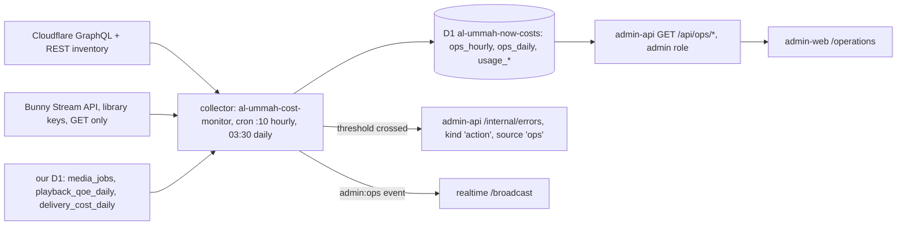

# Videos admin: platform analytics and live updates

**Status:** design, 2026-11-12. Two owner requests:

1. "Analytics should be pulled somehow into the videos admin."
2. "Anything that gets realtime data should use websockets in admin."

**Scope:** `apps/admin-web`, `apps/admin-api`, `apps/websocket-server`, and the producers that publish to them: `api-videos`, `media`, `processor`, and the collector described below. **Only Al Ummah Now resources** in Cloudflare account `0e4b6e7f…edc64f` are read, stored or shown.

**Relation to the cost-monitoring spec:** [`docs/cost-monitoring/README.md`](../cost-monitoring/README.md) (issues #268–#272) already designs the collector, attribution manifest, pricing, budgets and opt-in alerts. This doc **does not add a second pipeline**. It does three things:

- adds the *operational* metrics (errors, CPU, latency, backlog, cache hits, containers) to that collector;
- defines the first slice to build (Part A, §A.6);
- adds the live layer (Part B), which that spec doesn't cover.

Where the two docs differ, this one says so explicitly (§A.7).

---

## Part A: platform analytics in the admin

### A.1 What we pull, per environment (prod, stage, QA)

Environment comes from the attribution manifest (cost spec §3): the suffix rule, `-qa` / `-stage`. Every query is filtered to the manifest's names or ids. Where Cloudflare can't filter, rows for other projects are dropped in memory before anything is written.

| Area | Resources (prod names; `-qa` / `-stage` variants follow the suffix rule) | Source | Hourly metrics we keep |
| --- | --- | --- | --- |
| **Workers** | `videos`, `al-ummah-now-production` (web), `al-ummah-admin-web`, admin-api, `al-ummah-now-processor`, `al-ummah-scheduler`, `al-ummah-now-comms` (realtime), `al-ummah-now-media`, log-service | GraphQL `workersInvocationsAdaptive` (`scriptName_in`) | requests, errors (status ≠ success), subrequests, CPU time p50 and p99 (µs), wall time p99 |
| **D1** | `al-ummah-now-search`, `-reports`, `-notifications`, admin-api's DB, auth DB (read only) | `d1AnalyticsAdaptiveGroups` (`databaseId_in`), `d1StorageAdaptiveGroups` | rows read, rows written, read and write queries, query duration p50 and p99 (ms), storage bytes (daily max) |
| **R2** | `videos`, `channels`, `profiles`, `playlists`, `community-posts`, `subtitles`, `al-ummah-now-media`, `al-ummah-now-media-private`, `admin-backups`, `al-ummah-now-sourcemaps`, `al-ummah-now-messages` | `r2OperationsAdaptiveGroups` (`bucketName_in`), `r2StorageAdaptiveGroups` | Class A ops, Class B ops, egress bytes (`responseObjectSize`), stored bytes and object count (daily max) |
| **Queues** | `al-ummah-now-videos`, `al-ummah-now-transcode`, `al-ummah-now-moderation`, `al-ummah-now-admin-jobs`, `al-ummah-now-processing-check`, errors queue, contact mail queue, and the DLQs `al-ummah-now-dlq` and errors DLQ | `queueBacklogAdaptiveGroups` + `queueMessageOperationsAdaptiveGroups` (`queueId_in`) | backlog messages (avg and max), messages written, delivered and retried, plus DLQ depth |
| **Containers** | the `Transcoder` app of `al-ummah-now-media` | `containersMetricsAdaptiveGroups` if the token can read it; otherwise our own `media_jobs` (container seconds, peak concurrent) | instance-seconds, peak instances, vCPU and memory seconds |
| **CDN** | hosts `media(.qa/.stage).alummahnow.net`, `videos.`, `www.`, `admin.`, `realtime.` | zone `alummahnow.net`, `httpRequestsAdaptiveGroups` grouped by `clientRequestHTTPHost` and `cacheStatus` | requests, bytes, cache-hit ratio (`hit` ÷ cacheable), 4xx, 5xx |
| **Bunny** | the Stream library per env (QA and stage share one, split by the `[stage] ` title prefix) | Stream API with the **library keys we already store** (read only): `GET /library/{id}/statistics`, the video list for `storageSize` and `encodeProgress` | stored bytes, videos encoded today and encode failures, views and watch time (Bunny's count) |
| **Product** (already ours) | views, watch time, uploads, sign-ups | `analytics_rollups` (R2), `playback_qoe_daily` / `delivery_cost_daily` (SEARCH_DB), auth sign-ups | **not copied**: the Operations page links to them and reads `kpi_daily` (cost spec §4.4) for cost per 1K views |

**Bunny bandwidth and billing** need Bunny's *account* key (`/billing`, `/statistics`), and we don't hold it. Until the owner adds it (cost spec §2.3: Secrets Store `cost-monitor-bunny-key`, bound only to the collector), Bunny delivery bytes are **estimated** from our own playback records (viewer-hours × bitrate, as `media/costs.ts` already does) and labelled "estimated".

### A.2 Pipeline



- **Where it runs:** the cost spec's dedicated `al-ummah-cost-monitor` worker (spec §7.1): no public route, and it alone holds the token. It is **not** the scheduler (a critical publishing path) and **not** admin-api (which serves requests).
- **Token:** `media-cdn-api-token` from the Secrets Store. It is the CI token's copy, with Account Analytics Read and Zone Analytics Read, and api-videos already uses it as `MEDIA_ANALYTICS_TOKEN`. It gets bound to the collector until the least-privilege `al-ummah-cost-monitor-read` token (spec §2.5) exists, then swapped.
- **One collector covers all envs** (they share the account). QA runs a copy on recorded fixtures by default (spec Q4).
- **The browser never calls Cloudflare or Bunny.** admin-web reads only admin-api, and admin-api reads only our rollups.

**Tables** (migrations in `apps/cost-monitor/migrations`, next to the spec's `usage_*` tables):

```sql
-- one row per resource-hour; metric columns, not one row per metric, to keep 13 months small
ops_hourly(hour INTEGER, resource_id TEXT, kind TEXT /* worker|d1|r2|queue|container|host|bunny */,
           env TEXT, requests REAL, errors REAL, cpu_p50 REAL, cpu_p99 REAL, latency_p50 REAL, latency_p99 REAL,
           reads REAL, writes REAL, bytes REAL, stored_bytes REAL, backlog_avg REAL, backlog_max REAL,
           cache_hits REAL, cacheable REAL, instances_max REAL, instance_seconds REAL,
           PRIMARY KEY (hour, resource_id))
ops_daily(day TEXT, resource_id TEXT, kind TEXT, env TEXT, /* same columns, summed or maxed */ ...,
          cost_usd REAL, PRIMARY KEY (day, resource_id))
ops_thresholds(id TEXT PK, kind TEXT, metric TEXT, scope TEXT, op TEXT, value REAL, window_hours INTEGER,
               enabled INTEGER, updated_by TEXT, updated_at INTEGER)
```

**Retention:** `ops_hourly` and `ops_daily` are kept for **13 months** (this request). Size: about 120 manifest resources × 24 hours × 395 days ≈ 1.1M hourly rows of about 200 bytes, roughly 0.25 GB, well inside D1's limits. The daily cron prunes in batches of 5k.

**Cost guard:**

- One run asks **about 8 GraphQL queries**: Workers, D1, D1 storage, R2 operations, R2 storage, queues (backlog + operations in one request using aliases), the zone (by host and cache status), and containers. Each is batched across every resource with an `_in` filter and grouped by hour, over the last three hours (idempotent upsert covers analytics lag).
- The hourly cron makes about 200 queries a day, far below the 300 per 5 minutes limit. Bunny adds 1 statistics call per library per day plus a paged video list (only for encode counts) once an hour.
- **Live backlog** for the Delivery page doesn't come from GraphQL. It comes from our own `media_jobs` and `admin_jobs` rows (Part B), so no extra queries run per minute.
- The collector logs one summary line per run and samples at 0.1. Target: under $0.25 a month, reported as app `ops`.
- `Promise.allSettled` per dataset with 3 tries; a failed dataset marks the hour `partial` and the next run retries it.

### A.3 admin-api read API

All reads are guarded by a new permission `ops:read` (admins and super admins; moderators get 403, as cost spec decision 1).

| Endpoint | Returns |
| --- | --- |
| `GET /api/ops/overview?env=prod` | Tiles of that env: requests and error rate for 24h vs the previous 24h, CPU p99, D1 p99 latency, worst queue backlog, data age, the envs that have data, open alerts; plus `cost.spendMtd`, the month's spend across every source (the Costs page's budget figure, best effort) for the one-line pointer to Costs |
| `GET /api/ops/series?env&kind&resource&metric&range=24h\|7d\|30d\|13m` | Hourly points for ≤7 days, daily points beyond, ready for the shared chart (§A.4) |
| `GET /api/ops/resources?env&kind` | One row per resource with latest-day numbers and a 7-day sparkline (`kind` also `kv`, `do`) |
| `GET/PUT /api/ops/thresholds` | Threshold rules (PUT needs `ops:manage`, super admin; audited) |

### A.4 Pages

- **Operations** (`/operations`, nav group "Platform", next to Delivery and Errors). It needs `ops:read`.
  - **Usage and health of one environment, nothing else** (owner, 2026-11-21). The env switcher (Production / Stage / QA, links with `aria-current`) changes everything on the page: tiles, alerts, charts and the resources table. The pills list the envs that have collected data, plus the one open.
  - **No spend here.** Spend, the budget, the projection, the idle cost, the daily spend chart and the drivers are on **Costs** (`/costs`). Operations keeps one line: "Spend this month: $X — See Costs" (`ops-spend-link`). Before 2026-11-21 a spend block for every env filled the first screen, so switching env changed nothing visible above the fold ("the env buttons don't work"); `e2e/31-operations-env.spec.ts` now switches env and checks the tiles, the table and `aria-current`.
  - Tiles from `/overview`.
  - Tabs: Workers · Databases · Storage · Queues · CDN · Media (containers + Bunny).
  - Each tab has a chart per metric and a resource table.
  - Charts use the shared value-axis rules (`niceScale`, `compactNumber`, `chartLocale` from `packages/shared-types/src/chart-scale.ts`). The existing server-rendered SVG style of the Errors and Delivery charts is lifted into one shared admin chart component (`components/charts/TimeSeriesChart.tsx`), with the value axis on the reading side, time running from it, and a `<details>` table alternative.
  - **Costs** (`/costs`, `GET /api/costs`) holds every spend figure that used to be here: the budget meter with the forecast, the projected idle cost (vs $50, per env), where it goes per source (Cloudflare as billed, Bunny, transcoding, Workers AI, Resend, the plan, fixed and other costs), the stacked daily chart per env and source, the drivers table with jumps (`#drivers`), Cloudflare list price against billed per invoice line, and the fixed and other costs list. Cost alerts on the Errors page link to `/costs` (a jump to `/costs#drivers`). `GET /api/ops/costs` was removed.
  - **Product analytics:** a "Product" tab links to the existing views, watch time, uploads and sign-ups numbers (Studio analytics and the Delivery QoE), and shows cost per 1K views. They aren't duplicated.
- **Delivery page** (the R2 agent's): reads the live `admin:media` and `admin:queues` topics (Part B) for the per-video R2 status badge, "N running · M waiting · range min–max" (the admin's autoscaling range, with the `max_instances` ceiling beside it) and the transcode backlog. This doc supplies the data and the live layer. The page and its badges stay that agent's work.
- **Alerts** when a metric crosses a threshold. Defaults:
  - Worker error rate > 2% for 1 hour;
  - D1 p99 > 500 ms for 1 hour;
  - queue backlog > 1,000 or any DLQ message;
  - cache-hit ratio on the media host < 80% for 6 hours;
  - spend (admin-api hourly tick, `lib/opsCost.ts` `syncCostAlerts`, open set in `ops_cost_alerts`):
    the month's spend at 50%, 80% and 100% of the configured monthly budget and a projected month end over it
    (production admin only, keys `ops-cost:budget:<month>:<level>` / `ops-cost:projected:<month>`,
    resolved when the month turns); a daily spend jump per env total or per driver (yesterday or
    today so far at ≥ 2× the previous 7 days' average and ≥ $0.50 above it, $2 for a total; key
    `ops-cost:spike:<env>:<resource|total>`, every env), resolved when it clears.

  Each crossing becomes:
  1. an **Errors page item**: the collector posts a needs-action event to admin-api `/internal/errors` (`kind: 'action'`, `source: 'ops'`, `key: ops:<rule>:<resource>`) and resolves it with `resolveActionItems` when the metric recovers. This reuses the Errors page's Action needed queue (#821), dedupe and email limits;
  2. an **in-admin notification**: an `admin:ops` live event, shown as a toast and nav badge to signed-in admins (Part B).

  Email and subscriptions stay as in cost spec §6.2: opt-in only.

### A.5 Tests

- Collector:
  - unit tests run on sanitized GraphQL fixtures (our resources only);
  - a test checks that non-manifest rows never reach a write;
  - a test checks the query count per run stays ≤ 10;
  - threshold evaluation covers open → resolve.
- admin-api: role tests (moderator gets 403) and the series shape.
- admin-web: chart scale unit tests, plus a local E2E (`placement.ts` → local) on a seeded `ops_*` D1.

### A.6 First slice (what this work builds now)

1. **Collector skeleton** in `apps/cost-monitor`: Workers, D1, R2 and queues datasets; `ops_hourly` / `ops_daily`; thresholds that emit Errors-page items and `admin:ops` events.
2. **admin-api** `/api/ops/*`.
3. **Operations page** (held for owner OK; it touches admin pages).

These come later, in the order of cost spec Phases 1–3: CDN by host, containers, Bunny, pricing and cost per product, subscriptions and email.

### A.7 Differences from the cost spec

- **Hourly retention:** 13 months for `ops_hourly`, against the spec's 45 days for `usage_hourly`. The ops table is compact (columns per resource-hour).
- **Token:** the existing `media-cdn-api-token` serves until `al-ummah-cost-monitor-read` exists.
- **Threshold alerts:** they surface in the Errors page and through live events by default. **Delivery outside the admin** (email) stays opt-in.

---

### A.8 D1 capacity alerts (wiki AUN-D1-SCALING, D1-1)

The collector also watches every D1 database against Cloudflare's limits: 10 GB per database, 1 TB per account, and one query at a time per database. The limits are kept in `cost_settings` `d1_limits` (`maxDbBytes`, `accountBytes`), so a change is a setting, not a deploy.

- **Rules.** Migration `0004_d1_capacity.sql` adds four threshold metrics and seeds default rules:

  | Metric | Default rule | Measures |
  |---|---|---|
  | `storage_pct` | > 70% (`d1-storage-70`) and > 90% (`d1-storage-90`) | the database's size ÷ `maxDbBytes` |
  | `storage_days_to_70` | < 60 days (`d1-storage-forecast`) | days until the database reaches 70% of `maxDbBytes`. It is a least-squares slope of `ops_daily.stored_bytes` over 14 days and needs at least 7 days; there is no forecast when the database is not growing |
  | `busy_pct` | > 70% in every hour of a 3-hour window (`d1-busy-70`) | requests × p50 query time ÷ 1 hour. This is an estimate, because GraphQL exposes no total query time |
  | `account_storage_pct` | > 70% (`d1-account-storage-70`) | the account total ÷ `accountBytes` (kind `d1_account`) |

  The migration also adds `capacity` to `cost_alert_subscriptions.kind`, for the email that D1-1b sends.
- **Account total.** Every hourly run lists `GET /accounts/:id/d1/database` once, with paging, and stores the sum of `file_size` and the number of databases in `d1_account_storage (hour, …)`.
  - It counts other projects' databases, but never stores their names.
  - A failed listing is recorded in the run's detail and never fails the run.
  - The table is kept 396 days.
  - The `ops_*` tables are not touched: their `env` CHECK allows only production, stage and qa.
- **Errors items.** A crossing opens a needs-action item with key `ops:<rule>:<resource>`; the account total's resource id is `d1_account:all`.
  - The title starts with `Capacity:`.
  - The item links to `/costs#databases`, the Databases section added by D1-1b.
  - It resolves on recovery, like the other ops rules.

## Part B: live updates in the admin over WebSockets

### B.1 Today

- `components/content/jobs.tsx` (`useRefreshWhile`) and `AdminJobActions.tsx` (`RefreshWhileActive`) call `router.refresh()` every 3 s while a job runs.
- `UserAuthRequestsPanel`, `ChannelTransfer` and `contact/[id]/DeliveryRetry` poll with `setInterval`.
- The Errors, Processing, Delivery, Stale uploads and Moderation pages need a reload.

### B.2 Channels

`apps/websocket-server` gets an **admin channel type**: `admin:<topic>`. Each environment has its own realtime worker and issuer, so a QA token can't open prod's channels, and topics aren't prefixed with the env.

| Topic | Who may subscribe | Events (`data.kind`) | Producer |
| --- | --- | --- | --- |
| `admin:jobs` | admins | `job` {id, kind, status, progress?} (not its target) for purges, transfers, erasures, rebuilds, repairs | api-videos admin-jobs consumer |
| `admin:media` | admins | `job` {videoId, jobId, status, attempt, progress?, rungs? `[['720p','uploading',0.4], …]`, failure? {stage, error, attempt}}, `live` {transcoding, queued, maxTranscodes?, oldestQueuedAt?} | api-videos `/internal/media` (job status writes) |
| `admin:media` (playback) | admins | `qoe` {minute, bunny, r2, now} every 5 s at most: each touched minute's playback sums per provider and the plays going on now (§B.8) | realtime worker `qoe-live` object |
| `admin:queues` | admins | `backlog` {queue, messages} | transcode backlog from `media_jobs` (live); others from the collector (hourly) |
| `admin:uploads` | admins | `upload` {videoId, status, encodeProgress?} | api-videos processing / Bunny webhook path |
| `admin:errors` | admins | `error` {groupId, isNew, kind, app}, `counts` {open, actionNeeded} | admin-api errors ingest |
| `admin:moderation` | moderators and admins | `changed` {queue: reports \| ai \| contact \| authRequests}, `counts`? | api-videos (new report), admin-api (status changes) |
| `admin:restricted` | super admins | the `media`, `uploads` and `jobs` events about what only super admins see (a video under a takedown, a takedown's jobs), each with `of` (its topic) and the key `<topic>\|<key>`; the admin's live client follows it beside those topics and hands each event to its topic's listeners (refused to anyone else, who never got the event) | api-videos |
| `admin:live` | admins | `session` {id, channelId, provider, state: started \| stopped} | live layer (#867/#871; wired when those merge) |
| `admin:ops` | admins | `alert` {rule, resource, env, state}, `collected` {hour} | collector |

**Events are hints, not the source of truth.** A page that gets an event either patches what it shows (a job's status, a counter) or refetches its existing API. Missing an event is never wrong: on reconnect the client refetches once.

### B.3 Server rules (websocket-server)

- **Role check at subscribe.** On `authenticate`, the verified token's roles (`properties.roles`, the same claim admin-api reads) are normalized with `normalizeRoles` and stored in the socket attachment as a level: `admin`, `moderator` or none. That adds a few bytes and survives hibernation. Subscribing to `admin:<topic>` needs the topic's level from the shared `ADMIN_LIVE_TOPICS` table (`packages/shared-types`). Anything else gets `FORBIDDEN`. Unknown admin topics are refused.
- **Expiry and revocation:** the existing `expireAuthIfNeeded` drops every non-anonymous channel when the token expires, admin channels included. The client re-authenticates with a fresh token and subscribes again, and the role is re-checked then. Revoked sign-ins are refused through the existing revocation list.
- **Clients can never publish** into `admin:*`: `canPublish` refuses them. Only `/broadcast` (internal key) feeds them.
- **Coalescing (≤ 1 update per second per topic):** `/broadcast` items for `admin:*` don't go straight to the topic router. They go to a coalescer object `coalesce:admin:<topic>`, the same `WebSocketDurableObject` class, because releases ship with `wrangler versions upload` and can't add classes.
  - If the topic flushed more than 1 s ago and nothing is pending, the event goes out at once.
  - Otherwise it is held, and the latest event per `key` wins (`job:<id>`, `counts`, `backlog:<queue>`).
  - A DO alarm flushes at `lastFlush + 1000 ms` as **one** message, `{ type: 'admin.update', topic, events: [...] }`, at most 50 events. Beyond that a `{ kind: 'resync' }` tells clients to refetch.
- **Rate limits:** the existing per-IP connect limiter and per-user message limiter apply unchanged. An admin socket uses at most 8 of its 12 channel slots.

### B.4 Producer helper

`packages/shared-types/src/admin-live.ts` defines:

- the topic table and event types;
- `adminLiveItem(topic, event)` → a `/broadcast` item;
- `publishAdminLive(env, topic, events)`. It never throws, runs in `waitUntil`, and is a no-op without `WEBSOCKET_URL` or `INTERNAL_API_KEY`.

Producers already hold both bindings (api-videos, processor, admin-api, media).

### B.5 Client (admin-web)

- `GET /api/realtime/token`, a same-origin route (`sec-fetch-site` check, `no-store`), exchanges the admin's server-side access token via `POST /internal/ws-ticket` (`INTERNAL_API_KEY`) for a 60-second, single-use, user-bound opaque `wst_...` ticket and returns `{ url, token, expiresAt, ticketExpiresAt }` (the OpenAuth access token stays server-side, #230). The URL comes from the server's `REALTIME_URL` var, so there's no build-time client variable.
- `lib/live/admin-live.ts` is **one socket per tab**, shared by every hook. It doesn't need a provider, so the held shell's `layout.tsx` (#820) stays untouched.
  - It authenticates, then subscribes to the topics in use.
  - It reconnects with exponential backoff (1 s → 30 s, with jitter) and re-authenticates on `AUTH_EXPIRED`.
  - It goes quiet while the tab is hidden for more than 5 minutes, and resumes on focus.
- `useAdminLive(topics, onEvents, { poll, pollMs })`. When the socket isn't live for a topic (connecting, down, forbidden), it calls `poll` every `pollMs`; that's today's behaviour, kept as the fallback. On reconnect it calls `poll` once to catch up.
- Pages switch from timers to `useAdminLive`:
  - job panels and the Jobs page (`jobs.tsx`, `AdminJobActions.tsx`);
  - the Errors list counts;
  - Processing and Stale uploads;
  - the auth-requests panel;
  - the Delivery page hooks (the R2 agent consumes `admin:media` / `admin:queues`).

  The redesign files held in #820, #821, #822, #823 and #824 aren't rewritten. Where a held PR replaces a page, it calls the same hook.

### B.6 Tests

- **websocket-server:**
  - a non-admin token gets `FORBIDDEN` on `admin:*`;
  - a moderator gets `admin:moderation` but not `admin:jobs`;
  - clients can't publish to `admin:*`;
  - the coalescer sends 1 message for a burst within 1 s, latest per key wins, overflow sends `resync`;
  - after token expiry the admin channels are dropped.
- **shared-types:** the topic table, item building, and that `publishAdminLive` swallows failures.
- **admin-web:**
  - unit tests of the client manager (backoff schedule, re-auth, polling fallback while the socket is down) with a fake WebSocket;
  - a local E2E (placed `local` in `apps/web/e2e/test-utils/placement.ts`) that starts a job and sees its status change without a reload.

### B.7 PRs

1. This doc.
2. websocket-server admin channels + coalescer + the shared topic table (backend).
3. Producers: api-videos (jobs, media, uploads, reports) and admin-api (errors, moderation) (backend).
4. admin-web live client + token route + polling replaced (**admin pages: held for owner OK**).
5. Collector ops slice + admin-api `/api/ops/*` (backend).
6. Operations page (**admin pages: held for owner OK**).

### B.8 Live playback quality (Delivery page)

- **Heartbeats.** The web player sends `kind: 'heartbeat'` beacons with `live` (deltas since its last report):
  - every 30 s while the page is visible;
  - at once at the first frame, on an R2 → Bunny fallback, and on the first error.

  The final report carries the last deltas and ends the session. The daily rollup (`playback_qoe_daily`) still counts only the final report.
- **No D1 per beacon.** api-videos forwards the deltas to the realtime worker's `qoe-live` object (VIEW_COUNTER binding, same class). That object:
  - sums them per minute and per provider in memory;
  - writes the touched minutes to its own storage at most every 5 s, keeping 48 h;
  - counts the plays going on now per serving source: sessions whose last heartbeat, at most 75 s old, said they were playing.
- **Push.** Each flush sends one `qoe` event per touched minute on `admin:media`, oldest first, keyed `qoe:<minute>` (a beat in a minute's last seconds is flushed after it turns and still reaches its own minute, #1125); when only "now" changed, one event for the current minute.
- **Read.** The Delivery page reads `GET /api/media/qoe-live?minutes=60` (admin-api → `/internal/media/qoe-live`) when it loads, and every 30 s while the socket is down.

