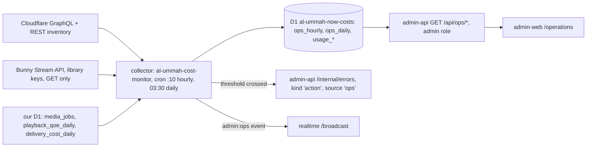

# Videos admin: platform analytics and live updates

**Status:** design, 2026-11-12. Two owner requests:

1. "Analytics should be pulled somehow into the videos admin."
2. "Anything that gets realtime data should use websockets in admin."

**Scope:** `apps/admin-web`, `apps/admin-api`, `apps/websocket-server`, and the producers that publish to them: `api-videos`, `media`, `processor`, and the collector described below. **Only Al Ummah Now resources** in Cloudflare account `0e4b6e7f…edc64f` are read, stored or shown.

**Relation to the cost-monitoring spec:** [`docs/cost-monitoring/README.md`](../cost-monitoring/README.md) (issues #268–#272) already designs the collector, attribution manifest, pricing, budgets and opt-in alerts. This doc **does not add a second pipeline**. It does three things:

- adds the *operational* metrics (errors, CPU, latency, backlog, cache hits, containers) to that collector;
- defines the first slice to build (Part A, §A.6);
- adds the live layer (Part B), which that spec doesn't cover.

Where the two docs differ, this one says so explicitly (§A.7).

---

## Part A: platform analytics in the admin

### A.1 What we pull, per environment (prod, stage, QA)

Environment comes from the attribution manifest (cost spec §3): the suffix rule, `-qa` / `-stage`. Every query is filtered to the manifest's names or ids. Where Cloudflare can't filter, rows for other projects are dropped in memory before anything is written.

| Area | Resources (prod names; `-qa` / `-stage` variants follow the suffix rule) | Source | Hourly metrics we keep |
| --- | --- | --- | --- |
| **Workers** | `videos`, `al-ummah-now-production` (web), `al-ummah-admin-web`, admin-api, `al-ummah-now-processor`, `al-ummah-scheduler`, `al-ummah-now-comms` (realtime), `al-ummah-now-media`, log-service | GraphQL `workersInvocationsAdaptive` (`scriptName_in`) | requests, errors (status ≠ success), subrequests, CPU time p50 and p99 (µs), wall time p99 |
| **D1** | `al-ummah-now-search`, `-reports`, `-notifications`, admin-api's DB, auth DB (read only) | `d1AnalyticsAdaptiveGroups` (`databaseId_in`), `d1StorageAdaptiveGroups` | rows read, rows written, read and write queries, query duration p50 and p99 (ms), storage bytes (daily max) |
| **R2** | `videos`, `channels`, `profiles`, `playlists`, `community-posts`, `subtitles`, `al-ummah-now-media`, `al-ummah-now-media-private`, `admin-backups`, `al-ummah-now-sourcemaps`, `al-ummah-now-messages` | `r2OperationsAdaptiveGroups` (`bucketName_in`), `r2StorageAdaptiveGroups` | Class A ops, Class B ops, egress bytes (`responseObjectSize`), stored bytes and object count (daily max) |
| **Queues** | `al-ummah-now-videos`, `al-ummah-now-transcode`, `al-ummah-now-moderation`, `al-ummah-now-admin-jobs`, `al-ummah-now-processing-check`, errors queue, contact mail queue, and the DLQs `al-ummah-now-dlq` and errors DLQ | `queueBacklogAdaptiveGroups` + `queueMessageOperationsAdaptiveGroups` (`queueId_in`) | backlog messages (avg and max), messages written, delivered and retried, plus DLQ depth |
| **Containers** | the `Transcoder` app of `al-ummah-now-media` | `containersMetricsAdaptiveGroups` if the token can read it; otherwise our own `media_jobs` (container seconds, peak concurrent) | instance-seconds, peak instances, vCPU and memory seconds |
| **CDN** | hosts `media(.qa/.stage).alummahnow.net`, `videos.`, `www.`, `admin.`, `realtime.` | zone `alummahnow.net`, `httpRequestsAdaptiveGroups` grouped by `clientRequestHTTPHost` and `cacheStatus` | requests, bytes, cache-hit ratio (`hit` ÷ cacheable), 4xx, 5xx |
| **Bunny** | the Stream library per env (QA and stage share one, split by the `[stage] ` title prefix) | Stream API with the **library keys we already store** (read only): `GET /library/{id}/statistics`, the video list for `storageSize` and `encodeProgress` | stored bytes, videos encoded today and encode failures, views and watch time (Bunny's count) |
| **Product** (already ours) | views, watch time, uploads, sign-ups | `analytics_rollups` (R2), `playback_qoe_daily` / `delivery_cost_daily` (SEARCH_DB), auth sign-ups | **not copied**: the Operations page links to them and reads `kpi_daily` (cost spec §4.4) for cost per 1K views |

**Bunny bandwidth and billing** need Bunny's *account* key (`/billing`, `/statistics`), and we don't hold it. Until the owner adds it (cost spec §2.3: Secrets Store `cost-monitor-bunny-key`, bound only to the collector), Bunny delivery bytes are **estimated** from our own playback records (viewer-hours × bitrate, as `media/costs.ts` already does) and labelled "estimated".

### A.2 Pipeline



- **Where it runs:** the cost spec's dedicated `al-ummah-cost-monitor` worker (spec §7.1): no public route, and it alone holds the token. It is **not** the scheduler (a critical publishing path) and **not** admin-api (which serves requests).
- **Token:** `media-cdn-api-token` from the Secrets Store. It is the CI token's copy, with Account Analytics Read and Zone Analytics Read, and api-videos already uses it as `MEDIA_ANALYTICS_TOKEN`. It gets bound to the collector until the least-privilege `al-ummah-cost-monitor-read` token (spec §2.5) exists, then swapped.
- **One collector covers all envs** (they share the account). QA runs a copy on recorded fixtures by default (spec Q4).
- **The browser never calls Cloudflare or Bunny.** admin-web reads only admin-api, and admin-api reads only our rollups.

**Tables** (migrations in `apps/cost-monitor/migrations`, next to the spec's `usage_*` tables):

```sql
-- one row per resource-hour; metric columns, not one row per metric, to keep 13 months small
ops_hourly(hour INTEGER, resource_id TEXT, kind TEXT /* worker|d1|r2|queue|container|host|bunny */,
           env TEXT, requests REAL, errors REAL, cpu_p50 REAL, cpu_p99 REAL, latency_p50 REAL, latency_p99 REAL,
           reads REAL, writes REAL, bytes REAL, stored_bytes REAL, backlog_avg REAL, backlog_max REAL,
           cache_hits REAL, cacheable REAL, instances_max REAL, instance_seconds REAL,
           PRIMARY KEY (hour, resource_id))
ops_daily(day TEXT, resource_id TEXT, kind TEXT, env TEXT, /* same columns, summed or maxed */ ...,
          cost_usd REAL, PRIMARY KEY (day, resource_id))
ops_thresholds(id TEXT PK, kind TEXT, metric TEXT, scope TEXT, op TEXT, value REAL, window_hours INTEGER,
               enabled INTEGER, updated_by TEXT, updated_at INTEGER)
```

**Retention:** `ops_hourly` and `ops_daily` are kept for **13 months** (this request). Size: about 120 manifest resources × 24 hours × 395 days ≈ 1.1M hourly rows of about 200 bytes, roughly 0.25 GB, well inside D1's limits. The daily cron prunes in batches of 5k.

**Cost guard:**

- One run asks **about 8 GraphQL queries**: Workers, D1, D1 storage, R2 operations, R2 storage, queues (backlog + operations in one request using aliases), the zone (by host and cache status), and containers. Each is batched across every resource with an `_in` filter and grouped by hour, over the last three hours (idempotent upsert covers analytics lag).
- The hourly cron makes about 200 queries a day, far below the 300 per 5 minutes limit. Bunny adds 1 statistics call per library per day plus a paged video list (only for encode counts) once an hour.
- **Live backlog** for the Delivery page doesn't come from GraphQL. It comes from our own `media_jobs` and `admin_jobs` rows (Part B), so no extra queries run per minute.
- The collector logs one summary line per run and samples at 0.1. Target: under $0.25 a month, reported as app `ops`.
- `Promise.allSettled` per dataset with 3 tries; a failed dataset marks the hour `partial` and the next run retries it.

### A.3 admin-api read API

All reads are guarded by a new permission `ops:read` (admins and super admins; moderators get 403, as cost spec decision 1).

| Endpoint | Returns |
| --- | --- |
| `GET /api/ops/overview?env=prod` | Tiles: requests and error rate for 24h vs the previous 24h, CPU p99, D1 p99 latency, worst queue backlog, cache-hit ratio, MTD cost estimate + linear and trailing projection against the **$500/month cap**, data age |
| `GET /api/ops/series?env&kind&resource&metric&range=24h\|7d\|30d\|13m` | Hourly points for ≤7 days, daily points beyond, ready for the shared chart (§A.4) |
| `GET /api/ops/resources?env&kind` | One row per resource with latest-day numbers and a 7-day sparkline |
| `GET/PUT /api/ops/thresholds` | Threshold rules (PUT needs `ops:manage`, super admin; audited) |

### A.4 Pages

- **Operations** (`/operations`, nav group "Platform", next to Delivery and Errors). It needs `ops:read`.
  - An env switcher (prod / stage / QA).
  - Tiles from `/overview`.
  - Tabs: Workers · Databases · Storage · Queues · CDN · Media (containers + Bunny).
  - Each tab has a chart per metric and a resource table.
  - Charts use the shared value-axis rules (`niceScale`, `compactNumber`, `chartLocale` from `packages/shared-types/src/chart-scale.ts`). The existing server-rendered SVG style of the Errors and Delivery charts is lifted into one shared admin chart component (`components/charts/TimeSeriesChart.tsx`), with the value axis on the reading side, time running from it, and a `<details>` table alternative.
  - **Cost next to usage:** each tab shows estimated $ for the month next to usage, plus a cap bar (MTD + projection against $500). Prices come from the vendored pricing (cost spec §1.1). Until that lands, the same list prices as `media/costs.ts` `PRICES` are used.
  - **Product analytics:** a "Product" tab links to the existing views, watch time, uploads and sign-ups numbers (Studio analytics and the Delivery QoE), and shows cost per 1K views. They aren't duplicated.
- **Delivery page** (the R2 agent's): reads the live `admin:media` and `admin:queues` topics (Part B) for the per-video R2 status badge, "transcoding now: N of max_instances" and the transcode backlog. This doc supplies the data and the live layer. The page and its badges stay that agent's work.
- **Alerts** when a metric crosses a threshold. Defaults:
  - Worker error rate > 2% for 1 hour;
  - D1 p99 > 500 ms for 1 hour;
  - queue backlog > 1,000 or any DLQ message;
  - cache-hit ratio on the media host < 80% for 6 hours;
  - projected month > $400 (80% of the cap).

  Each crossing becomes:
  1. an **Errors page item**: the collector posts a needs-action event to admin-api `/internal/errors` (`kind: 'action'`, `source: 'ops'`, `key: ops:<rule>:<resource>`) and resolves it with `resolveActionItems` when the metric recovers. This reuses the Errors page's Action needed queue (#821), dedupe and email limits;
  2. an **in-admin notification**: an `admin:ops` live event, shown as a toast and nav badge to signed-in admins (Part B).

  Email and subscriptions stay as in cost spec §6.2: opt-in only.

### A.5 Tests

- Collector:
  - unit tests run on sanitized GraphQL fixtures (our resources only);
  - a test checks that non-manifest rows never reach a write;
  - a test checks the query count per run stays ≤ 10;
  - threshold evaluation covers open → resolve.
- admin-api: role tests (moderator gets 403) and the series shape.
- admin-web: chart scale unit tests, plus a local E2E (`placement.ts` → local) on a seeded `ops_*` D1.

### A.6 First slice (what this work builds now)

1. **Collector skeleton** in `apps/cost-monitor`: Workers, D1, R2 and queues datasets; `ops_hourly` / `ops_daily`; thresholds that emit Errors-page items and `admin:ops` events.
2. **admin-api** `/api/ops/*`.
3. **Operations page** (held for owner OK; it touches admin pages).

These come later, in the order of cost spec Phases 1–3: CDN by host, containers, Bunny, pricing and cost per product, subscriptions and email.

### A.7 Differences from the cost spec

- **Hourly retention:** 13 months for `ops_hourly`, against the spec's 45 days for `usage_hourly`. The ops table is compact (columns per resource-hour).
- **Token:** the existing `media-cdn-api-token` serves until `al-ummah-cost-monitor-read` exists.
- **Threshold alerts:** they surface in the Errors page and through live events by default. **Delivery outside the admin** (email) stays opt-in.

---

## Part B: live updates in the admin over WebSockets

### B.1 Today

- `components/content/jobs.tsx` (`useRefreshWhile`) and `AdminJobActions.tsx` (`RefreshWhileActive`) call `router.refresh()` every 3 s while a job runs.
- `UserAuthRequestsPanel`, `ChannelTransfer` and `contact/[id]/DeliveryRetry` poll with `setInterval`.
- The Errors, Processing, Delivery, Stale uploads and Moderation pages need a reload.

### B.2 Channels

`apps/websocket-server` gets an **admin channel type**: `admin:<topic>`. Each environment has its own realtime worker and issuer, so a QA token can't open prod's channels, and topics aren't prefixed with the env.

| Topic | Who may subscribe | Events (`data.kind`) | Producer |
| --- | --- | --- | --- |
| `admin:jobs` | admins | `job` {id, kind, status, progress?, targetType, targetId} for purges, transfers, erasures, rebuilds, repairs | api-videos admin-jobs consumer |
| `admin:media` | admins | `transcode` {videoId, status, provider}, `transcoding` {running, max, queued} | api-videos `/internal/media` (job status writes) |
| `admin:queues` | admins | `backlog` {queue, messages} | transcode backlog from `media_jobs` (live); others from the collector (hourly) |
| `admin:uploads` | admins | `upload` {videoId, status, encodeProgress?} | api-videos processing / Bunny webhook path |
| `admin:errors` | admins | `error` {groupId, isNew, kind, app}, `counts` {open, actionNeeded} | admin-api errors ingest |
| `admin:moderation` | moderators and admins | `changed` {queue: reports \| ai \| contact \| authRequests}, `counts`? | api-videos (new report), admin-api (status changes) |
| `admin:live` | admins | `session` {id, channelId, provider, state: started \| stopped} | live layer (#867/#871; wired when those merge) |
| `admin:ops` | admins | `alert` {rule, resource, env, state}, `collected` {hour} | collector |

**Events are hints, not the source of truth.** A page that gets an event either patches what it shows (a job's status, a counter) or refetches its existing API. Missing an event is never wrong: on reconnect the client refetches once.

### B.3 Server rules (websocket-server)

- **Role check at subscribe.** On `authenticate`, the verified token's roles (`properties.roles`, the same claim admin-api reads) are normalized with `normalizeRoles` and stored in the socket attachment as a level: `admin`, `moderator` or none. That adds a few bytes and survives hibernation. Subscribing to `admin:<topic>` needs the topic's level from the shared `ADMIN_LIVE_TOPICS` table (`packages/shared-types`). Anything else gets `FORBIDDEN`. Unknown admin topics are refused.
- **Expiry and revocation:** the existing `expireAuthIfNeeded` drops every non-anonymous channel when the token expires, admin channels included. The client re-authenticates with a fresh token and subscribes again, and the role is re-checked then. Revoked sign-ins are refused through the existing revocation list.
- **Clients can never publish** into `admin:*`: `canPublish` refuses them. Only `/broadcast` (internal key) feeds them.
- **Coalescing (≤ 1 update per second per topic):** `/broadcast` items for `admin:*` don't go straight to the topic router. They go to a coalescer object `coalesce:admin:<topic>`, the same `WebSocketDurableObject` class, because releases ship with `wrangler versions upload` and can't add classes.
  - If the topic flushed more than 1 s ago and nothing is pending, the event goes out at once.
  - Otherwise it is held, and the latest event per `key` wins (`job:<id>`, `counts`, `backlog:<queue>`).
  - A DO alarm flushes at `lastFlush + 1000 ms` as **one** message, `{ type: 'admin.update', topic, events: [...] }`, at most 50 events. Beyond that a `{ kind: 'resync' }` tells clients to refetch.
- **Rate limits:** the existing per-IP connect limiter and per-user message limiter apply unchanged. An admin socket uses at most 8 of its 12 channel slots.

### B.4 Producer helper

`packages/shared-types/src/admin-live.ts` defines:

- the topic table and event types;
- `adminLiveItem(topic, event)` → a `/broadcast` item;
- `publishAdminLive(env, topic, events)`. It never throws, runs in `waitUntil`, and is a no-op without `WEBSOCKET_URL` or `INTERNAL_API_KEY`.

Producers already hold both bindings (api-videos, processor, admin-api, media).

### B.5 Client (admin-web)

- `GET /api/realtime/token`, a same-origin route (`sec-fetch-site` check, `no-store`), returns `{ url, token, expiresAt }` from the admin session. The URL comes from the server's `REALTIME_URL` var, so there's no build-time client variable.
- `lib/live/admin-live.ts` is **one socket per tab**, shared by every hook. It doesn't need a provider, so the held shell's `layout.tsx` (#820) stays untouched.
  - It authenticates, then subscribes to the topics in use.
  - It reconnects with exponential backoff (1 s → 30 s, with jitter) and re-authenticates on `AUTH_EXPIRED`.
  - It goes quiet while the tab is hidden for more than 5 minutes, and resumes on focus.
- `useAdminLive(topics, onEvents, { poll, pollMs })`. When the socket isn't live for a topic (connecting, down, forbidden), it calls `poll` every `pollMs`; that's today's behaviour, kept as the fallback. On reconnect it calls `poll` once to catch up.
- Pages switch from timers to `useAdminLive`:
  - job panels and the Jobs page (`jobs.tsx`, `AdminJobActions.tsx`);
  - the Errors list counts;
  - Processing and Stale uploads;
  - the auth-requests panel;
  - the Delivery page hooks (the R2 agent consumes `admin:media` / `admin:queues`).

  The redesign files held in #820, #821, #822, #823 and #824 aren't rewritten. Where a held PR replaces a page, it calls the same hook.

### B.6 Tests

- **websocket-server:**
  - a non-admin token gets `FORBIDDEN` on `admin:*`;
  - a moderator gets `admin:moderation` but not `admin:jobs`;
  - clients can't publish to `admin:*`;
  - the coalescer sends 1 message for a burst within 1 s, latest per key wins, overflow sends `resync`;
  - after token expiry the admin channels are dropped.
- **shared-types:** the topic table, item building, and that `publishAdminLive` swallows failures.
- **admin-web:**
  - unit tests of the client manager (backoff schedule, re-auth, polling fallback while the socket is down) with a fake WebSocket;
  - a local E2E (placed `local` in `apps/web/e2e/test-utils/placement.ts`) that starts a job and sees its status change without a reload.

### B.7 PRs

1. This doc.
2. websocket-server admin channels + coalescer + the shared topic table (backend).
3. Producers: api-videos (jobs, media, uploads, reports) and admin-api (errors, moderation) (backend).
4. admin-web live client + token route + polling replaced (**admin pages: held for owner OK**).
5. Collector ops slice + admin-api `/api/ops/*` (backend).
6. Operations page (**admin pages: held for owner OK**).
