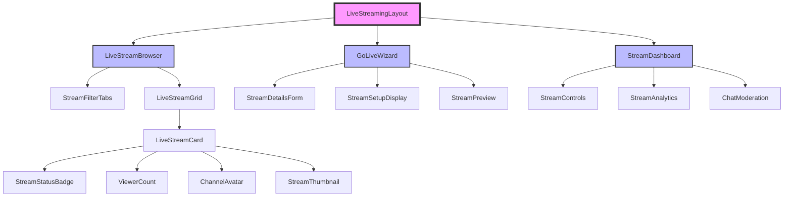

# ADR-001: Live Streaming UI Architecture

## Status
**Proposed** - Ready for implementation

## Context

Al Ummah Now is expanding its video platform to include live streaming capabilities. The backend API is already implemented with endpoints for creating, managing, and viewing live streams. We need to design a comprehensive frontend UI architecture that:

1. Integrates seamlessly with the existing bilingual (English/Arabic) Next.js application
2. Provides intuitive interfaces for both viewers and streamers
3. Maintains consistency with existing design patterns and components
4. Supports real-time updates via WebSocket connections
5. Handles RTMP streaming configuration for content creators
6. Works efficiently on Cloudflare Workers edge runtime

The existing codebase already has:
- LiveStreamsAPI client with all CRUD methods
- CustomVideoPlayer component with `isLive` prop support
- WebSocket infrastructure for real-time updates
- Bilingual routing pattern (`/en/*` and `/ar/*`)
- OpenAuth authentication system with JWT tokens

## Decision

We will implement a **component-based architecture** with clear separation of concerns, following these key design principles:

### 1. Component Architecture Pattern
- **Presentational Components**: Pure UI components focused on display logic
- **Container Components**: Smart components that handle data fetching and state management
- **Compound Components**: Complex UI patterns broken into composable sub-components
- **Bilingual Components**: Separate RTL variants for Arabic UI

### 2. State Management Strategy
- **Server State**: Managed via React Query (or SWR) for API data caching and synchronization
- **Client State**: Local component state with React hooks for UI interactions
- **Real-time State**: WebSocket connection managed at app level, consumed via context
- **Form State**: React Hook Form for complex multi-step forms

### 3. Routing Architecture
- **Parallel Routes**: `/en/live` and `/ar/live` for browsing streams
- **Protected Routes**: `/en/go-live` and `/ar/go-live` require authentication
- **Dynamic Routes**: `/en/live/[streamId]` for individual stream pages
- **Nested Layouts**: Shared layouts for live streaming sections

### 4. Data Flow Architecture
```
API → React Query Cache → Components → UI
         ↑                    ↓
    WebSocket Updates    User Actions
```

### 5. Progressive Enhancement
- **MVP First**: Core viewing experience works without JavaScript
- **Enhanced Features**: WebSocket updates, real-time chat, advanced controls
- **Graceful Degradation**: Fallback to polling if WebSocket fails

## Component Hierarchy



## File Structure

```
apps/web/src/
├── components/
│   ├── live-streaming/
│   │   ├── StreamStatusBadge/
│   │   │   ├── index.tsx              # LTR component
│   │   │   └── rtl/
│   │   │       └── index.tsx          # RTL component
│   │   ├── LiveStreamCard/
│   │   │   ├── index.tsx
│   │   │   └── rtl/
│   │   │       └── index.tsx
│   │   ├── ViewerCount/
│   │   │   ├── index.tsx              # Real-time viewer counter
│   │   │   └── rtl/
│   │   │       └── index.tsx
│   │   ├── StreamSetup/
│   │   │   ├── index.tsx              # RTMP URL/key display
│   │   │   ├── CopyButton.tsx         # Copy to clipboard
│   │   │   └── rtl/
│   │   │       └── index.tsx
│   │   ├── GoLiveForm/
│   │   │   ├── index.tsx              # Multi-step form container
│   │   │   ├── StreamDetailsStep.tsx  # Title, description, schedule
│   │   │   ├── StreamSetupStep.tsx    # RTMP configuration
│   │   │   ├── StreamPreviewStep.tsx  # Preview before going live
│   │   │   └── rtl/
│   │   │       ├── index.tsx
│   │   │       ├── StreamDetailsStep.tsx
│   │   │       ├── StreamSetupStep.tsx
│   │   │       └── StreamPreviewStep.tsx
│   │   ├── LiveStreamGrid/
│   │   │   ├── index.tsx              # Grid/list layout
│   │   │   ├── LoadingSkeleton.tsx    # Loading states
│   │   │   └── rtl/
│   │   │       └── index.tsx
│   │   ├── StreamFilterTabs/
│   │   │   ├── index.tsx              # Live Now/Scheduled/Past tabs
│   │   │   └── rtl/
│   │   │       └── index.tsx
│   │   ├── StreamDashboard/
│   │   │   ├── index.tsx              # Stream management dashboard
│   │   │   ├── StreamControls.tsx     # Start/End/Cancel buttons
│   │   │   ├── StreamAnalytics.tsx    # Viewer stats
│   │   │   ├── ChatModeration.tsx     # Chat management
│   │   │   └── rtl/
│   │   │       └── [...files]
│   │   └── hooks/
│   │       ├── useStreamStatus.ts     # WebSocket subscription for status
│   │       ├── useViewerCount.ts      # Real-time viewer updates
│   │       ├── useStreamForm.ts       # Form state management
│   │       └── useRTMPConfig.ts       # RTMP URL generation
│   │
│   └── ui/                             # Existing shared UI components
│       ├── button.tsx
│       ├── card.tsx
│       ├── badge.tsx
│       └── ...
│
├── app/
│   ├── en/
│   │   ├── live/
│   │   │   ├── layout.tsx              # Live streaming section layout
│   │   │   ├── page.tsx                # Browse live streams
│   │   │   └── [streamId]/
│   │   │       └── page.tsx            # Individual stream page
│   │   └── go-live/
│   │       ├── layout.tsx              # Creator layout (auth required)
│   │       └── page.tsx                # Stream creation wizard
│   │
│   └── ar/
│       ├── live/                       # Arabic mirror structure
│       │   ├── layout.tsx
│       │   ├── page.tsx
│       │   └── [streamId]/
│       │       └── page.tsx
│       └── go-live/
│           ├── layout.tsx
│           └── page.tsx
│
├── lib/
│   ├── api/
│   │   └── livestreams.ts             # Existing API client
│   ├── hooks/
│   │   ├── useStreams.ts              # React Query hooks for streams
│   │   └── useStreamWebSocket.ts      # WebSocket connection management
│   └── utils/
│       ├── rtmp.ts                    # RTMP URL utilities
│       └── stream-validation.ts       # Form validation schemas
│
└── interfaces/
    └── index.ts                        # Existing LiveStream interface
```

## Implementation Details

### 1. StreamStatusBadge Component
```typescript
interface StreamStatusBadgeProps {
  status: 'scheduled' | 'live' | 'ended' | 'cancelled';
  size?: 'sm' | 'md' | 'lg';
}

// Color mapping:
// - live: red (pulsing animation)
// - scheduled: blue
// - ended: gray
// - cancelled: yellow
```

### 2. LiveStreamCard Component
```typescript
interface LiveStreamCardProps {
  stream: LiveStream;
  layout?: 'grid' | 'list';
  onStreamClick?: (streamId: string) => void;
  showChannel?: boolean;
}

// Features:
// - Thumbnail with play overlay
// - Live indicator (red dot + "LIVE")
// - Viewer count (real-time updates)
// - Channel info (avatar + name)
// - Scheduled time for upcoming streams
// - Duration for past streams
```

### 3. GoLiveForm Multi-Step Wizard
```typescript
interface GoLiveFormState {
  step: 1 | 2 | 3;
  streamData: {
    title: string;
    description?: string;
    scheduledStartTime?: string;
    category?: string;
    tags?: string[];
    isPrivate: boolean;
    allowChat: boolean;
  };
  rtmpConfig?: {
    url: string;
    streamKey: string;
  };
  streamId?: string;
}

// Step 1: Stream Details
// Step 2: RTMP Setup (display URL + key)
// Step 3: Preview & Go Live
```

### 4. Real-time Updates via WebSocket
```typescript
// Channel subscriptions:
// - /live-streams/[streamId]/viewers - Viewer count updates
// - /live-streams/[streamId]/status - Status changes
// - /live-streams/[streamId]/chat - Chat messages (if enabled)

interface StreamWebSocketMessage {
  type: 'viewer_update' | 'status_change' | 'chat_message';
  streamId: string;
  data: any;
}
```

### 5. Responsive Design Breakpoints
```css
/* Mobile First Approach */
/* Mobile: 1 column grid */
/* Tablet (md): 2 columns */
/* Desktop (lg): 3 columns */
/* Wide (xl): 4 columns */
```

## Consequences

### Positive
- **Consistent UX**: Reuses existing components and patterns (Button, Card, Badge)
- **Type Safety**: Full TypeScript coverage with existing interfaces
- **Performance**: React Query caching reduces API calls
- **Real-time**: WebSocket integration provides live updates
- **Accessibility**: WCAG 2.1 AA compliant with ARIA labels and keyboard navigation
- **Scalable**: Component-based architecture allows incremental development
- **Bilingual**: Maintains existing RTL/LTR pattern for Arabic support
- **Edge-optimized**: Works efficiently on Cloudflare Workers

### Negative
- **Complexity**: Multi-step forms require careful state management
  - *Mitigation*: Use React Hook Form with Zod validation
- **WebSocket Dependency**: Real-time features require WebSocket connection
  - *Mitigation*: Fallback to polling for critical features
- **RTMP Learning Curve**: Users need to understand streaming software setup
  - *Mitigation*: Provide clear documentation and OBS Studio presets
- **Bundle Size**: Additional components increase JavaScript bundle
  - *Mitigation*: Code splitting and dynamic imports for creator features

## Alternatives Considered

### 1. Single-Page Application (SPA) for Live Section
- **Rejected**: Breaks consistency with existing Next.js App Router patterns
- Would require separate routing logic and lose SSR benefits

### 2. Embedded Third-Party Streaming UI
- **Rejected**: Loses control over UX and branding
- Difficult to maintain bilingual support
- Privacy and data sovereignty concerns

### 3. Server Components Only
- **Rejected**: Live streaming requires client-side interactivity
- WebSocket connections need client-side management
- Real-time updates not possible with pure SSR

### 4. Monolithic Stream Component
- **Rejected**: Reduces reusability and testability
- Harder to maintain bilingual variants
- Violates single responsibility principle

## Implementation Priority

### Phase 1: MVP (Week 1-2)
1. ✅ StreamStatusBadge component
2. ✅ LiveStreamCard component
3. ✅ LiveStreamGrid with loading states
4. ✅ /live browse page (Live Now tab only)
5. ✅ Basic ViewerCount (static display)

### Phase 2: Creator Tools (Week 2-3)
1. ⏳ GoLiveForm multi-step wizard
2. ⏳ StreamSetup with RTMP config display
3. ⏳ /go-live page with authentication
4. ⏳ Stream preview component
5. ⏳ Basic stream controls (Start/End)

### Phase 3: Enhanced Features (Week 3-4)
1. ⏳ Real-time viewer count via WebSocket
2. ⏳ StreamFilterTabs (Scheduled/Past)
3. ⏳ Stream search and filtering
4. ⏳ Category/tag filtering
5. ⏳ Pagination/infinite scroll

### Phase 4: Advanced Dashboard (Week 4-5)
1. ⏳ StreamDashboard for creators
2. ⏳ Stream analytics visualization
3. ⏳ Chat moderation interface
4. ⏳ Scheduled stream management
5. ⏳ Stream recording options

## Security Considerations

1. **RTMP Key Protection**: Never expose stream keys in client-side code
2. **Authentication**: All creator features require valid JWT tokens
3. **Rate Limiting**: Implement client-side throttling for API calls
4. **Input Validation**: Sanitize all user inputs with Zod schemas
5. **XSS Prevention**: Use React's built-in XSS protection
6. **CORS**: Ensure proper CORS headers for streaming endpoints

## Performance Optimizations

1. **Lazy Loading**: Dynamic imports for creator-only components
2. **Image Optimization**: Use Next.js Image component for thumbnails
3. **Caching Strategy**: React Query with stale-while-revalidate
4. **Virtualization**: Virtual scrolling for large stream lists
5. **Debouncing**: Debounce search and filter operations
6. **Memoization**: React.memo for expensive card renders

## Testing Strategy

1. **Unit Tests**: Component logic and hooks
2. **Integration Tests**: API client interactions
3. **E2E Tests**: Critical user flows (browse → view → go live)
4. **Visual Regression**: Screenshot tests for UI consistency
5. **Accessibility Tests**: Automated WCAG compliance checks
6. **Performance Tests**: Lighthouse scores and Core Web Vitals

## Monitoring & Analytics

1. **Error Tracking**: Sentry integration for runtime errors
2. **Performance Monitoring**: Web Vitals tracking
3. **User Analytics**: Stream engagement metrics
4. **A/B Testing**: Feature flag support for gradual rollout
5. **WebSocket Health**: Connection status monitoring

## Migration Notes

No migration required as this is a new feature. However:
1. Ensure shared types package includes LiveStream interface
2. Update CustomVideoPlayer to handle live stream URLs
3. Add WebSocket channels for live stream updates
4. Configure Bunny.net streaming credentials

## References

- [Next.js 15 App Router Documentation](https://nextjs.org/docs/app)
- [Cloudflare Workers WebSocket](https://developers.cloudflare.com/workers/runtime-apis/websockets/)
- [Bunny.net Streaming API](https://docs.bunny.net/docs/stream-api-overview)
- [React Query Documentation](https://tanstack.com/query/latest)
- [WCAG 2.1 Guidelines](https://www.w3.org/WAI/WCAG21/quickref/)

## Approval

- [ ] Frontend Team Lead
- [ ] Backend Team Lead
- [ ] Product Manager
- [ ] Security Review
- [ ] Accessibility Review

---

**Author**: System Architect
**Date**: 2025-11-06
**Version**: 1.0.0