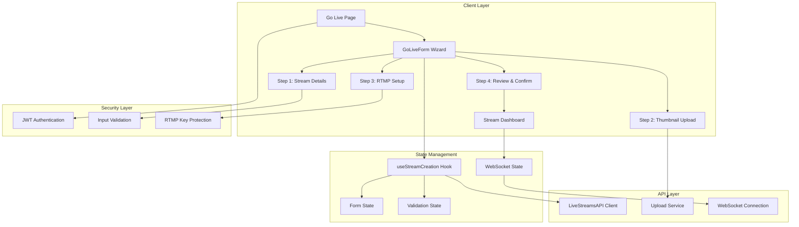

# ADR-002: Phase 2 Go Live Creator Tools Architecture

## Status
**Proposed** | Version 1.0 | 2025-11-06

## Context
Al Ummah Now platform needs creator tools for live streaming functionality. Phase 2 focuses on enabling creators to go live, configure their streams, and manage active broadcasts. This ADR defines the comprehensive architecture for all 15 Phase 2 tasks.

## Decision
We will implement a multi-step wizard pattern with secure RTMP credential handling, real-time status updates via WebSocket, and comprehensive error handling. The architecture prioritizes security, user experience, and scalability.

## Architecture Overview



## Component Architecture Specifications

### Task 1: GoLiveForm Wizard Structure (4 Steps)

**Architecture Pattern**: Finite State Machine with Persistent Form State

**Component Structure**:
```typescript
// File: /apps/web/src/components/GoLiveForm/index.tsx
interface GoLiveFormProps {
  channelId: string;
  userId: string;
  onSuccess: (streamId: string) => void;
  onCancel: () => void;
  initialData?: Partial<StreamFormData>;
}

interface GoLiveFormState {
  currentStep: 1 | 2 | 3 | 4;
  streamDetails: StreamDetailsData | null;
  thumbnailData: ThumbnailData | null;
  rtmpConfig: RTMPConfig | null;
  streamId: string | null;
  errors: Record<string, string>;
  isLoading: boolean;
  isDirty: boolean;
}

type WizardAction =
  | { type: 'NEXT_STEP' }
  | { type: 'PREV_STEP' }
  | { type: 'SET_DATA'; step: number; data: any }
  | { type: 'SET_ERROR'; error: string }
  | { type: 'RESET' }
```

**Data Flow**:
1. Form state managed via useReducer for complex state transitions
2. Each step validates and persists data locally before proceeding
3. Draft saved to sessionStorage for recovery on refresh
4. Final submission creates stream via API

**Dependencies**:
- react-hook-form (form management)
- zod (validation)
- @tanstack/react-query (API state)
- sessionStorage API (draft persistence)

**Security Considerations**:
- No sensitive data in sessionStorage
- Form data sanitized before submission
- CSRF protection via secure headers
- Rate limiting on form submission

**Integration Points**:
- LiveStreamsAPI.create() for stream creation
- Bunny.net upload API for thumbnails
- WebSocket for real-time updates

**Performance Considerations**:
- Lazy load step components
- Debounced draft saving (500ms)
- Optimistic UI updates
- Preload next step on current step completion

**Error Handling**:
- Field-level validation errors
- Network error retry with exponential backoff
- Session recovery on browser crash
- Graceful degradation without JavaScript

**Type Safety**:
```typescript
// Shared types
type StreamFormData = StreamDetailsData & ThumbnailData & RTMPConfig;

// Step-specific validators
const stepValidators = {
  1: streamDetailsSchema,
  2: thumbnailSchema,
  3: rtmpConfigSchema,
  4: reviewSchema
};
```

---

### Task 2: Step 1 - Stream Details Form with Zod Validation

**Architecture Pattern**: Schema-Driven Form Validation

**Component Structure**:
```typescript
// File: /apps/web/src/components/GoLiveForm/StreamDetailsStep.tsx
interface StreamDetailsStepProps {
  initialData?: Partial<StreamDetailsData>;
  onNext: (data: StreamDetailsData) => void;
  onCancel: () => void;
  onSaveDraft: (data: Partial<StreamDetailsData>) => void;
}

// Zod Schema with comprehensive validation
const streamDetailsSchema = z.object({
  title: z.string()
    .min(3, 'Title must be at least 3 characters')
    .max(100, 'Title must be 100 characters or less')
    .regex(/^[^<>'"]*$/, 'Title contains invalid characters'),

  description: z.string()
    .max(5000, 'Description must be 5000 characters or less')
    .optional()
    .transform(val => DOMPurify.sanitize(val || '')),

  category: z.enum(STREAM_CATEGORIES),

  language: z.enum(['en', 'ar']),

  scheduledStartTime: z.string()
    .datetime()
    .optional()
    .refine(
      (date) => !date || new Date(date) > new Date(Date.now() + 5 * 60 * 1000),
      'Scheduled time must be at least 5 minutes in the future'
    ),

  isPrivate: z.boolean().default(false),

  allowChat: z.boolean().default(true),

  tags: z.array(
    z.string()
      .max(30, 'Tag too long')
      .regex(/^[a-zA-Z0-9\-_\u0600-\u06FF]+$/, 'Invalid tag format')
  )
  .max(10, 'Maximum 10 tags allowed')
  .optional(),

  ageRestriction: z.enum(['all', '13+', '18+']).default('all'),

  recordStream: z.boolean().default(true)
});
```

**Data Flow**:
1. useForm hook with zodResolver for real-time validation
2. Auto-save draft every 30 seconds of inactivity
3. Character counters update on input
4. Category suggestions based on previous streams

**Dependencies**:
- @hookform/resolvers (Zod integration)
- isomorphic-dompurify (XSS prevention)
- date-fns (date manipulation)
- react-select (enhanced dropdowns)

**Security Considerations**:
- Input sanitization for all text fields
- HTML stripping from description
- SQL injection prevention via parameterized queries
- Rate limiting on auto-save

**Integration Points**:
- Category API for dynamic categories
- Tag suggestions API
- User preferences API for defaults

**Performance Considerations**:
- Virtual scrolling for long tag lists
- Memoized validation functions
- Debounced character counting
- Lazy validation on blur for complex fields

**Error Handling**:
```typescript
const errorMessages = {
  title: {
    required: t('errors.title.required'),
    minLength: t('errors.title.minLength'),
    maxLength: t('errors.title.maxLength'),
    invalid: t('errors.title.invalid')
  },
  // ... other field errors
};

// Progressive error display
const getFieldError = (field: string, errors: FieldErrors) => {
  const error = errors[field];
  if (!error) return null;
  if (error.type === 'required' && !touched[field]) return null;
  return errorMessages[field][error.type] || error.message;
};
```

**Type Safety**:
```typescript
type StreamDetailsData = z.infer<typeof streamDetailsSchema>;

// Strongly typed form fields
const fields: Array<keyof StreamDetailsData> = [
  'title', 'description', 'category', 'language',
  'scheduledStartTime', 'isPrivate', 'allowChat',
  'tags', 'ageRestriction', 'recordStream'
];
```

---

### Task 3: Step 2 - Thumbnail Upload with Preview

**Architecture Pattern**: Progressive Upload with Optimistic UI

**Component Structure**:
```typescript
// File: /apps/web/src/components/GoLiveForm/ThumbnailStep.tsx
interface ThumbnailStepProps {
  streamId?: string;
  initialThumbnail?: string;
  onNext: (data: ThumbnailData) => void;
  onBack: () => void;
  onSkip: () => void;
}

interface ThumbnailData {
  thumbnailUrl?: string;
  thumbnailFile?: File;
  autoGenerate: boolean;
  generationTimestamp?: number; // For auto-generation from stream
}

interface UploadState {
  status: 'idle' | 'uploading' | 'processing' | 'complete' | 'error';
  progress: number;
  error?: string;
  preview?: string;
}
```

**Data Flow**:
1. File selection triggers instant preview generation
2. Client-side image validation and resizing
3. Chunked upload to Bunny.net CDN
4. Server processes and returns optimized versions
5. Auto-generation option captures frame from stream

**Dependencies**:
- react-dropzone (drag & drop)
- browser-image-compression (client-side optimization)
- tus-js-client (resumable uploads)
- react-image-crop (thumbnail editing)

**Security Considerations**:
```typescript
const validateImage = async (file: File): Promise<ValidationResult> => {
  // File type validation
  const allowedTypes = ['image/jpeg', 'image/png', 'image/webp'];
  if (!allowedTypes.includes(file.type)) {
    return { valid: false, error: 'Invalid file type' };
  }

  // Size validation
  const maxSize = 5 * 1024 * 1024; // 5MB
  if (file.size > maxSize) {
    return { valid: false, error: 'File too large' };
  }

  // Malicious content scanning
  const buffer = await file.arrayBuffer();
  const magicBytes = new Uint8Array(buffer.slice(0, 4));

  // Verify magic bytes match claimed type
  const signatures = {
    'image/jpeg': [0xFF, 0xD8, 0xFF],
    'image/png': [0x89, 0x50, 0x4E, 0x47],
    'image/webp': [0x52, 0x49, 0x46, 0x46]
  };

  // Additional EXIF stripping for privacy
  return { valid: true };
};
```

**Integration Points**:
- Bunny.net Storage API
- Image processing service
- Stream preview API for auto-generation
- CDN for serving optimized images

**Performance Considerations**:
```typescript
const optimizeImage = async (file: File): Promise<File> => {
  const options = {
    maxSizeMB: 1,
    maxWidthOrHeight: 1920,
    useWebWorker: true,
    fileType: 'image/webp'
  };

  return await imageCompression(file, options);
};

// Progressive loading with blur-up
const ThumbnailPreview = ({ url, blur }: { url: string; blur?: string }) => (
  <div className="relative aspect-video">
    {blur && (
      
    )}
    
  </div>
);
```

**Error Handling**:
- Retry mechanism for failed uploads
- Fallback to default thumbnail
- Clear error messages with recovery actions
- Upload resume on connection restoration

**Type Safety**:
```typescript
// Upload progress tracking
type UploadProgress = {
  bytesUploaded: number;
  bytesTotal: number;
  percentage: number;
  timeRemaining: number;
  speed: number; // bytes/second
};

// Image variants
type ImageVariants = {
  original: string;
  large: string;  // 1920x1080
  medium: string; // 1280x720
  small: string;  // 640x360
  blur: string;   // 20x11 base64
};
```

---

### Task 4: Step 3 - RTMP Setup Display

**Architecture Pattern**: Secure Credential Display with Copy Protection

**Component Structure**:
```typescript
// File: /apps/web/src/components/GoLiveForm/RTMPSetupStep.tsx
interface RTMPSetupStepProps {
  streamId: string;
  rtmpUrl: string;
  streamKey: string;
  onNext: () => void;
  onBack: () => void;
  onTestConnection?: () => Promise<boolean>;
}

interface RTMPConfig {
  rtmpUrl: string;
  streamKey: string;
  backupUrl?: string;
  preferredIngest?: string;
  customSettings?: StreamSettings;
}

interface StreamSettings {
  bitrate: number;
  resolution: '720p' | '1080p' | '1440p' | '4k';
  fps: 30 | 60;
  keyframeInterval: number;
  encoder: 'x264' | 'nvenc' | 'qsv';
}
```

**Data Flow**:
1. API generates unique RTMP credentials
2. Credentials displayed with masked stream key
3. One-click copy with security warnings
4. Connection testing via test stream
5. Instructions customized per streaming software

**Dependencies**:
- clipboard-copy (secure clipboard access)
- qrcode (mobile streaming setup)
- react-syntax-highlighter (config display)

**Security Considerations**:
```typescript
// Stream key protection
class StreamKeyManager {
  private key: string;
  private shown: boolean = false;
  private copyCount: number = 0;
  private maxCopies: number = 10;

  constructor(encryptedKey: string) {
    this.key = this.decrypt(encryptedKey);
  }

  private decrypt(encrypted: string): string {
    // Client-side decryption with session key
    return decryptWithSessionKey(encrypted);
  }

  getMasked(): string {
    const visible = 4;
    const masked = this.key.length - (visible * 2);
    return `${this.key.slice(0, visible)}${'•'.repeat(masked)}${this.key.slice(-visible)}`;
  }

  show(): string | null {
    if (this.shown) {
      console.warn('Stream key already shown');
    }
    this.shown = true;
    this.logAccess('show');
    return this.key;
  }

  async copy(): Promise<boolean> {
    if (this.copyCount >= this.maxCopies) {
      throw new Error('Copy limit exceeded');
    }

    this.copyCount++;
    this.logAccess('copy');

    try {
      await navigator.clipboard.writeText(this.key);
      return true;
    } catch (error) {
      // Fallback for older browsers
      return this.fallbackCopy();
    }
  }

  private logAccess(action: string): void {
    // Audit log for security
    console.log(`Stream key ${action} at ${new Date().toISOString()}`);
  }
}
```

**Integration Points**:
- RTMP ingest server selection
- Connection quality testing endpoint
- Streaming software detection
- Help documentation system

**Performance Considerations**:
```typescript
// Intelligent server selection
const selectBestIngestServer = async (): Promise<string> => {
  const servers = [
    { url: 'rtmp://ingest-us.alummahnow.net/live', region: 'us' },
    { url: 'rtmp://ingest-eu.alummahnow.net/live', region: 'eu' },
    { url: 'rtmp://ingest-ap.alummahnow.net/live', region: 'ap' }
  ];

  const pingResults = await Promise.all(
    servers.map(async (server) => ({
      ...server,
      latency: await pingServer(server.url)
    }))
  );

  return pingResults.sort((a, b) => a.latency - b.latency)[0].url;
};
```

**Error Handling**:
- Connection test failures with diagnostic info
- Software-specific troubleshooting guides
- Firewall/NAT detection and warnings
- Bandwidth insufficient warnings

**Type Safety**:
```typescript
// OBS configuration generator
interface OBSConfig {
  settings: {
    service: 'Custom';
    server: string;
    key: string;
  };
  output: {
    mode: 'Simple' | 'Advanced';
    videoBitrate: number;
    audioBitrate: number;
    encoder: string;
  };
  video: {
    baseResolution: string;
    outputResolution: string;
    fps: number;
  };
}

const generateOBSConfig = (rtmp: RTMPConfig): OBSConfig => ({
  settings: {
    service: 'Custom',
    server: rtmp.rtmpUrl,
    key: rtmp.streamKey
  },
  output: {
    mode: 'Simple',
    videoBitrate: 4000,
    audioBitrate: 128,
    encoder: 'x264'
  },
  video: {
    baseResolution: '1920x1080',
    outputResolution: '1920x1080',
    fps: 30
  }
});
```

---

### Task 5: Step 4 - Review and Confirm

**Architecture Pattern**: Transaction Pattern with Rollback Capability

**Component Structure**:
```typescript
// File: /apps/web/src/components/GoLiveForm/ReviewStep.tsx
interface ReviewStepProps {
  streamData: CompleteStreamData;
  onConfirm: () => Promise<void>;
  onBack: () => void;
  onEdit: (step: number) => void;
}

interface CompleteStreamData {
  details: StreamDetailsData;
  thumbnail?: ThumbnailData;
  rtmpConfig: RTMPConfig;
  estimatedCost?: StreamCost;
}

interface StreamCost {
  bandwidth: number; // GB
  storage: number; // GB
  transcoding: number; // minutes
  estimatedTotal: number; // USD
}
```

**Data Flow**:
1. Aggregate all form data for review
2. Pre-flight validation checks
3. Cost estimation based on settings
4. Atomic stream creation transaction
5. Rollback on any failure

**Dependencies**:
- react-markdown (formatted descriptions)
- react-countdown (scheduled streams)

**Security Considerations**:
```typescript
// Pre-submission validation
const validateStreamData = async (data: CompleteStreamData): Promise<ValidationResult> => {
  const checks = [
    validateAuthentication(),
    validateQuota(),
    validateContent(data),
    validateSchedule(data),
    validateResources(data)
  ];

  const results = await Promise.all(checks);
  const errors = results.filter(r => !r.valid);

  return {
    valid: errors.length === 0,
    errors: errors.map(e => e.error)
  };
};

// Idempotent stream creation
const createStreamIdempotent = async (data: CompleteStreamData): Promise<Stream> => {
  const idempotencyKey = generateIdempotencyKey(data);

  try {
    return await api.createStream({
      ...data,
      headers: {
        'Idempotency-Key': idempotencyKey
      }
    });
  } catch (error) {
    if (error.status === 409) {
      // Stream already created, fetch and return
      return await api.getStreamByIdempotencyKey(idempotencyKey);
    }
    throw error;
  }
};
```

**Integration Points**:
- Quota checking service
- Cost calculation service
- Content moderation API
- Stream creation endpoint

**Performance Considerations**:
```typescript
// Optimistic UI with rollback
const useOptimisticStreamCreation = () => {
  const [optimisticStream, setOptimisticStream] = useState(null);

  const createStream = async (data: CompleteStreamData) => {
    // Immediately show success UI
    const tempStream = {
      id: `temp_${Date.now()}`,
      ...data,
      status: 'creating'
    };
    setOptimisticStream(tempStream);

    try {
      const realStream = await api.createStream(data);
      setOptimisticStream(realStream);
      return realStream;
    } catch (error) {
      // Rollback optimistic update
      setOptimisticStream(null);
      throw error;
    }
  };

  return { optimisticStream, createStream };
};
```

**Error Handling**:
```typescript
enum StreamCreationError {
  QUOTA_EXCEEDED = 'quota_exceeded',
  INVALID_SCHEDULE = 'invalid_schedule',
  CONTENT_VIOLATION = 'content_violation',
  NETWORK_ERROR = 'network_error',
  SERVER_ERROR = 'server_error'
}

const errorRecoveryStrategies: Record<StreamCreationError, () => void> = {
  [StreamCreationError.QUOTA_EXCEEDED]: () => {
    // Redirect to billing page
    router.push('/billing/upgrade');
  },
  [StreamCreationError.INVALID_SCHEDULE]: () => {
    // Return to step 1 to fix schedule
    goToStep(1);
  },
  [StreamCreationError.CONTENT_VIOLATION]: () => {
    // Show content guidelines
    showContentGuidelines();
  },
  [StreamCreationError.NETWORK_ERROR]: () => {
    // Retry with exponential backoff
    retryWithBackoff();
  },
  [StreamCreationError.SERVER_ERROR]: () => {
    // Show support contact
    showSupportDialog();
  }
};
```

**Type Safety**:
```typescript
// Complete type chain validation
type ValidatedStreamData = CompleteStreamData & {
  _validated: true;
  validatedAt: number;
  validationSignature: string;
};

const assertValidated = (data: any): asserts data is ValidatedStreamData => {
  if (!data._validated || Date.now() - data.validatedAt > 60000) {
    throw new Error('Data validation expired');
  }
};
```

---

### Task 6: StreamSetup Component with Copy-to-Clipboard

**Architecture Pattern**: Secure Credential Manager Component

**Component Structure**:
```typescript
// File: /apps/web/src/components/StreamSetup/index.tsx
interface StreamSetupProps {
  rtmpUrl: string;
  streamKey: string;
  showQRCode?: boolean;
  showInstructions?: boolean;
  onCopy?: (field: 'url' | 'key') => void;
  className?: string;
}

interface CopyState {
  rtmp: 'idle' | 'copied' | 'error';
  key: 'idle' | 'copied' | 'error';
  keyVisible: boolean;
}
```

**Data Flow**:
1. Encrypted credentials passed as props
2. Local state manages visibility and copy status
3. Copy events trigger telemetry
4. QR code generated on-demand

**Dependencies**:
- clipboard-polyfill (cross-browser support)
- qrcode.react (QR generation)
- react-hotkeys-hook (keyboard shortcuts)

**Security Considerations**:
```typescript
// Secure clipboard operations
const secureClipboard = {
  async write(text: string, type: 'sensitive' | 'public' = 'public') {
    if (type === 'sensitive') {
      // Add watermark for sensitive data
      const watermarked = `${text}\n[Copied from Al Ummah Now - Do not share]`;

      try {
        // Modern clipboard API with permissions
        await navigator.permissions.query({ name: 'clipboard-write' as any });
        await navigator.clipboard.writeText(watermarked);

        // Auto-clear clipboard after 30 seconds
        setTimeout(() => {
          if (navigator.clipboard.writeText) {
            navigator.clipboard.writeText('');
          }
        }, 30000);

        return true;
      } catch (error) {
        return this.fallbackCopy(watermarked);
      }
    }

    return navigator.clipboard.writeText(text);
  },

  fallbackCopy(text: string): boolean {
    const textarea = document.createElement('textarea');
    textarea.value = text;
    textarea.style.position = 'fixed';
    textarea.style.opacity = '0';
    document.body.appendChild(textarea);
    textarea.select();

    try {
      document.execCommand('copy');
      return true;
    } finally {
      document.body.removeChild(textarea);
    }
  }
};
```

**Integration Points**:
- Analytics for copy events
- Help system for streaming software
- Mobile app deep linking via QR

**Performance Considerations**:
```typescript
// Lazy QR code generation
const QRCodeLazy = React.lazy(() => import('qrcode.react'));

const StreamQRCode = ({ data }: { data: string }) => (
  <Suspense fallback={<div className="animate-pulse bg-gray-200 w-32 h-32" />}>
    <QRCodeLazy
      value={data}
      size={128}
      level="H"
      includeMargin
      renderAs="canvas"
    />
  </Suspense>
);

// Memoized instructions
const StreamingInstructions = React.memo(({ software }: { software: string }) => {
  const instructions = useMemo(() =>
    getInstructionsForSoftware(software), [software]
  );

  return <div dangerouslySetInnerHTML={{ __html: instructions }} />;
});
```

**Error Handling**:
- Clipboard permission denied handling
- Browser compatibility fallbacks
- Clear success/error feedback
- Retry mechanism for failed copies

**Type Safety**:
```typescript
// Software-specific configurations
type StreamingSoftware = 'obs' | 'streamlabs' | 'xsplit' | 'wirecast' | 'other';

interface SoftwareConfig {
  name: string;
  icon: string;
  setup: {
    server: { label: string; field: string };
    key: { label: string; field: string };
    settings: Record<string, any>;
  };
  instructions: string;
  downloadUrl: string;
}

const softwareConfigs: Record<StreamingSoftware, SoftwareConfig> = {
  obs: {
    name: 'OBS Studio',
    icon: '/icons/obs.svg',
    setup: {
      server: { label: 'Server', field: 'server' },
      key: { label: 'Stream Key', field: 'key' },
      settings: {
        service: 'Custom',
        videoBitrate: 4000,
        audioBitrate: 128
      }
    },
    instructions: '...',
    downloadUrl: 'https://obsproject.com'
  }
  // ... other software configs
};
```

---

### Task 7: StreamControls Component (Go Live, End, Cancel)

**Architecture Pattern**: State Machine Control Component

**Component Structure**:
```typescript
// File: /apps/web/src/components/StreamControls/index.tsx
interface StreamControlsProps {
  streamId: string;
  status: StreamStatus;
  currentViewers: number;
  peakViewers: number;
  startTime?: string;
  onGoLive: () => Promise<void>;
  onEndStream: () => Promise<void>;
  onCancelStream: () => Promise<void>;
  onEmergencyStop?: () => Promise<void>;
  disabled?: boolean;
}

type StreamStatus = 'scheduled' | 'preparing' | 'live' | 'ending' | 'ended' | 'cancelled' | 'error';

interface StreamMetrics {
  viewers: number;
  peakViewers: number;
  duration: number;
  health: 'excellent' | 'good' | 'fair' | 'poor';
  bitrate: number;
  droppedFrames: number;
}
```

**Data Flow**:
1. Status drives available actions
2. Actions trigger state transitions
3. Confirmation dialogs for destructive actions
4. Real-time metrics updates via WebSocket
5. Emergency stop bypasses confirmations

**Dependencies**:
- framer-motion (animations)
- react-use (hooks utilities)
- date-fns (duration formatting)

**Security Considerations**:
```typescript
// Action authorization
const useStreamActions = (streamId: string) => {
  const { user } = useAuth();
  const { stream } = useStream(streamId);

  const canGoLive = useMemo(() => {
    return (
      stream?.userId === user?.id &&
      stream?.status === 'scheduled' &&
      hasStreamingQuota(user) &&
      !isRateLimited(user)
    );
  }, [stream, user]);

  const canEndStream = useMemo(() => {
    return (
      stream?.userId === user?.id &&
      stream?.status === 'live' &&
      stream?.duration > 10 // Minimum 10 seconds
    );
  }, [stream, user]);

  const canEmergencyStop = useMemo(() => {
    return (
      (stream?.userId === user?.id || user?.role === 'admin') &&
      ['live', 'preparing'].includes(stream?.status)
    );
  }, [stream, user]);

  return { canGoLive, canEndStream, canEmergencyStop };
};
```

**Integration Points**:
- Stream status API
- Metrics WebSocket endpoint
- Analytics event tracking
- Notification service

**Performance Considerations**:
```typescript
// Optimized metric updates
const StreamMetricsDisplay = ({ streamId }: { streamId: string }) => {
  const [metrics, setMetrics] = useState<StreamMetrics>(initialMetrics);
  const [updateBuffer, setUpdateBuffer] = useState<Partial<StreamMetrics>>({});

  // Batch metric updates
  useEffect(() => {
    const interval = setInterval(() => {
      if (Object.keys(updateBuffer).length > 0) {
        setMetrics(prev => ({ ...prev, ...updateBuffer }));
        setUpdateBuffer({});
      }
    }, 1000);

    return () => clearInterval(interval);
  }, [updateBuffer]);

  // WebSocket connection with throttling
  useWebSocket(`wss://ws.alummahnow.net/stream/${streamId}`, {
    onMessage: throttle((data: StreamMetrics) => {
      setUpdateBuffer(prev => ({ ...prev, ...data }));
    }, 100)
  });

  return (
    <div className="grid grid-cols-4 gap-4">
      <MetricCard
        label="Viewers"
        value={metrics.viewers}
        trend={metrics.viewers > metrics.peakViewers * 0.8 ? 'up' : 'stable'}
      />
      {/* ... other metrics */}
    </div>
  );
};
```

**Error Handling**:
```typescript
// Comprehensive error handling
const handleStreamAction = async (
  action: 'goLive' | 'end' | 'cancel',
  streamId: string
) => {
  const strategies = {
    goLive: {
      maxRetries: 3,
      timeout: 30000,
      fallback: () => showManualStreamingInstructions()
    },
    end: {
      maxRetries: 5,
      timeout: 10000,
      fallback: () => forceEndStream(streamId)
    },
    cancel: {
      maxRetries: 2,
      timeout: 5000,
      fallback: () => markStreamAsCancelled(streamId)
    }
  };

  const strategy = strategies[action];

  try {
    return await retryWithBackoff(
      () => executeStreamAction(action, streamId),
      strategy
    );
  } catch (error) {
    if (error.code === 'STREAM_LOCKED') {
      await waitForStreamUnlock(streamId);
      return handleStreamAction(action, streamId);
    }

    strategy.fallback();
    throw error;
  }
};
```

**Type Safety**:
```typescript
// State machine type safety
type StreamStateMachine = {
  scheduled: {
    goLive: 'preparing';
    cancel: 'cancelled';
  };
  preparing: {
    ready: 'live';
    cancel: 'cancelled';
    error: 'error';
  };
  live: {
    end: 'ending';
    emergencyStop: 'ended';
    error: 'error';
  };
  ending: {
    complete: 'ended';
    error: 'error';
  };
  ended: {};
  cancelled: {};
  error: {
    retry: 'scheduled';
    cancel: 'cancelled';
  };
};

type ValidTransition<S extends keyof StreamStateMachine> =
  keyof StreamStateMachine[S];
```

---

### Task 8: /en/go-live Page with Authentication Guard

**Architecture Pattern**: Protected Route with Progressive Enhancement

**Component Structure**:
```typescript
// File: /apps/web/src/app/en/go-live/page.tsx
interface GoLivePageProps {
  searchParams?: {
    template?: string;
    schedule?: string;
    returnTo?: string;
  };
}

// Server Component
export default async function GoLivePage({ searchParams }: GoLivePageProps) {
  const session = await getAuthSession();

  if (!session?.user) {
    redirect(`/en/auth/signin?redirect=/en/go-live&${new URLSearchParams(searchParams)}`);
  }

  const userQuota = await getUserStreamingQuota(session.user.id);
  const userChannels = await getUserChannels(session.user.id);

  if (!userQuota.canStream) {
    return <QuotaExceededView quota={userQuota} />;
  }

  if (userChannels.length === 0) {
    return <CreateChannelFirst />;
  }

  return (
    <GoLivePageClient
      user={session.user}
      channels={userChannels}
      template={searchParams?.template}
      scheduledTime={searchParams?.schedule}
    />
  );
}
```

**Data Flow**:
1. Server-side authentication check
2. Quota and permissions validation
3. Channel selection or creation
4. Template pre-filling if provided
5. Success redirects to dashboard

**Dependencies**:
- OpenAuth (authentication)
- Server Components (SSR)
- Suspense boundaries (loading states)

**Security Considerations**:
```typescript
// Multi-factor authentication for streaming
const requireStreamingMFA = async (user: User): Promise<boolean> => {
  if (!user.mfaEnabled) {
    // Redirect to MFA setup
    redirect('/en/security/enable-mfa?reason=streaming');
  }

  const mfaSession = await getMFASession();
  if (!mfaSession || mfaSession.expiresAt < Date.now()) {
    // Require fresh MFA
    redirect('/en/security/verify-mfa?action=streaming');
  }

  return true;
};

// Rate limiting
const checkStreamingRateLimit = async (userId: string): Promise<RateLimitResult> => {
  const key = `streaming:${userId}`;
  const limit = 5; // 5 streams per hour
  const window = 3600; // 1 hour in seconds

  const current = await redis.incr(key);
  if (current === 1) {
    await redis.expire(key, window);
  }

  return {
    allowed: current <= limit,
    remaining: Math.max(0, limit - current),
    resetAt: Date.now() + (window * 1000)
  };
};
```

**Integration Points**:
- User service for profile/channels
- Quota service for limits
- Template service for presets
- Analytics for page views

**Performance Considerations**:
```typescript
// Streaming page optimizations
export const dynamic = 'force-dynamic';
export const runtime = 'edge';

// Prefetch critical resources
const GoLivePageClient = async ({ user, channels, template }) => {
  // Parallel data fetching
  const [categories, templates, recentStreams] = await Promise.all([
    getStreamCategories(),
    template ? getTemplate(template) : null,
    getUserRecentStreams(user.id, 5)
  ]);

  return (
    <>
      <link rel="prefetch" href="/api/live-streams" />
      <link rel="preconnect" href="https://bunny.net" />

      <GoLiveForm
        user={user}
        channels={channels}
        categories={categories}
        template={templates}
        recentStreams={recentStreams}
      />
    </>
  );
};

// Progressive enhancement
const GoLiveFormProgressive = () => {
  const [hydrated, setHydrated] = useState(false);

  useEffect(() => {
    setHydrated(true);
  }, []);

  if (!hydrated) {
    // Server-rendered fallback
    return <GoLiveFormStatic />;
  }

  // Full interactive form
  return <GoLiveFormInteractive />;
};
```

**Error Handling**:
```typescript
// Comprehensive error boundary
export function GoLiveErrorBoundary({
  error,
  reset
}: {
  error: Error;
  reset: () => void;
}) {
  useEffect(() => {
    // Log to error tracking service
    logError(error, {
      page: 'go-live',
      user: getCurrentUser(),
      context: getErrorContext()
    });
  }, [error]);

  if (error.message.includes('quota')) {
    return <QuotaErrorView onUpgrade={() => router.push('/billing')} />;
  }

  if (error.message.includes('permission')) {
    return <PermissionErrorView onRequestAccess={() => requestStreamingAccess()} />;
  }

  return (
    <GenericErrorView
      error={error}
      onRetry={reset}
      onSupport={() => openSupportChat()}
    />
  );
}
```

**Type Safety**:
```typescript
// Page-level type definitions
interface GoLivePageContext {
  user: AuthUser;
  channels: Channel[];
  categories: Category[];
  quota: StreamingQuota;
  templates?: StreamTemplate[];
  features: FeatureFlags;
}

interface StreamingQuota {
  canStream: boolean;
  maxConcurrentStreams: number;
  currentStreams: number;
  maxDuration: number; // minutes
  maxBitrate: number; // kbps
  storageLimit: number; // GB
  storageUsed: number; // GB
}

interface StreamTemplate {
  id: string;
  name: string;
  description: string;
  settings: Partial<StreamDetailsData>;
  thumbnail?: string;
  isPublic: boolean;
}
```

---

### Task 9: /ar/go-live Page with RTL Layout

**Architecture Pattern**: Bidirectional UI with Locale-Specific Components

**Component Structure**:
```typescript
// File: /apps/web/src/app/ar/go-live/page.tsx
import { GoLiveForm } from '@/components/GoLiveForm/rtl';
import { arabicMetadata } from '@/lib/metadata/ar';

export const metadata = arabicMetadata.goLive;

export default async function GoLivePageArabic({ searchParams }) {
  // Same logic as English version
  const session = await getAuthSession();

  if (!session?.user) {
    redirect(`/ar/auth/signin?redirect=/ar/go-live`);
  }

  return (
    <div dir="rtl" className="container mx-auto px-4 py-8">
      <GoLiveFormRTL
        user={session.user}
        locale="ar"
      />
    </div>
  );
}
```

**Data Flow**:
1. RTL-specific component imports
2. Arabic translations loaded
3. Mirrored layouts applied
4. Date/time formatting localized
5. Number formatting adjusted

**Dependencies**:
- react-i18next (translations)
- rtl-css-js (style mirroring)
- arabic-reshaper (text shaping)
- hijri-date (Islamic calendar)

**Security Considerations**:
```typescript
// Bidirectional text security
const sanitizeBidiText = (text: string): string => {
  // Remove dangerous Unicode characters
  const dangerous = [
    '\u202A', // LTR embedding
    '\u202B', // RTL embedding
    '\u202C', // Pop directional formatting
    '\u202D', // LTR override
    '\u202E', // RTL override
    '\u2066', // LTR isolate
    '\u2067', // RTL isolate
    '\u2068', // First strong isolate
    '\u2069', // Pop directional isolate
  ];

  let sanitized = text;
  dangerous.forEach(char => {
    sanitized = sanitized.replace(new RegExp(char, 'g'), '');
  });

  return sanitized;
};

// Prevent text spoofing
const validateArabicInput = (text: string): boolean => {
  // Check for mixed scripts that could be confusing
  const scripts = detectScripts(text);
  if (scripts.length > 2) {
    console.warn('Mixed scripts detected:', scripts);
    return false;
  }

  return true;
};
```

**Integration Points**:
- Arabic translation API
- RTL-aware calendar widget
- Arabic keyboard shortcuts
- Localized help content

**Performance Considerations**:
```typescript
// RTL-specific optimizations
const useRTLOptimizations = () => {
  useEffect(() => {
    // Preload Arabic fonts
    const arabicFonts = [
      'https://fonts.googleapis.com/css2?family=Noto+Naskh+Arabic',
      'https://fonts.googleapis.com/css2?family=Cairo'
    ];

    arabicFonts.forEach(font => {
      const link = document.createElement('link');
      link.rel = 'prefetch';
      link.href = font;
      document.head.appendChild(link);
    });

    // Enable Arabic text rendering optimizations
    document.documentElement.style.textRendering = 'optimizeLegibility';
    document.documentElement.style.fontFeatureSettings = '"kern" 1, "liga" 1';

    return () => {
      document.documentElement.style.textRendering = '';
      document.documentElement.style.fontFeatureSettings = '';
    };
  }, []);
};

// Memoized Arabic formatters
const arabicFormatters = {
  number: new Intl.NumberFormat('ar-SA'),
  date: new Intl.DateTimeFormat('ar-SA', {
    calendar: 'islamic-umalqura',
    dateStyle: 'full'
  }),
  relativeTime: new Intl.RelativeTimeFormat('ar-SA')
};
```

**Error Handling**:
```typescript
// Arabic-specific error messages
const errorMessagesAR: Record<string, string> = {
  'title.required': 'العنوان مطلوب',
  'title.tooShort': 'العنوان قصير جداً (٣ أحرف على الأقل)',
  'title.tooLong': 'العنوان طويل جداً (١٠٠ حرف كحد أقصى)',
  'schedule.past': 'لا يمكن جدولة البث في الماضي',
  'quota.exceeded': 'تجاوزت حد البث المباشر الخاص بك',
  // ... more messages
};

// RTL-aware error display
const ErrorMessageRTL = ({ error }: { error: string }) => (
  <div className="flex items-start gap-2 text-red-600" dir="rtl">
    <span className="mt-0.5">⚠️</span>
    <span className="text-sm">{errorMessagesAR[error] || error}</span>
  </div>
);
```

**Type Safety**:
```typescript
// Locale-aware types
type LocalizedString<T extends string = string> = {
  en: T;
  ar: T;
};

interface LocalizedStreamData extends StreamDetailsData {
  title: LocalizedString;
  description?: LocalizedString;
  locale: 'ar' | 'en';
}

// Arabic-specific validation
const arabicStreamSchema = streamDetailsSchema.extend({
  title: z.string()
    .min(3, 'العنوان قصير جداً')
    .max(100, 'العنوان طويل جداً')
    .refine(
      (val) => /[\u0600-\u06FF]/.test(val),
      'يجب أن يحتوي العنوان على أحرف عربية'
    ),
  language: z.literal('ar')
});
```

---

### Task 10: StreamDashboard Component for Active Streams

**Architecture Pattern**: Real-time Dashboard with WebSocket Updates

**Component Structure**:
```typescript
// File: /apps/web/src/components/StreamDashboard/index.tsx
interface StreamDashboardProps {
  streamId: string;
  userId: string;
  onStreamEnd?: (streamId: string) => void;
}

interface DashboardState {
  stream: LiveStream;
  metrics: StreamMetrics;
  chat: ChatState;
  alerts: Alert[];
  health: StreamHealth;
}

interface StreamHealth {
  status: 'healthy' | 'warning' | 'critical';
  issues: HealthIssue[];
  recommendations: string[];
}
```

**Data Flow**:
1. Initial data fetch on mount
2. WebSocket connection for real-time updates
3. Metric aggregation every second
4. Alert processing and notification
5. Auto-save stream recording

**Dependencies**:
- recharts (data visualization)
- react-grid-layout (dashboard layout)
- react-toastify (notifications)

**Security Considerations**:
```typescript
// Dashboard access control
const useDashboardSecurity = (streamId: string, userId: string) => {
  const [authorized, setAuthorized] = useState(false);
  const [loading, setLoading] = useState(true);

  useEffect(() => {
    const checkAuthorization = async () => {
      try {
        const stream = await api.getStream(streamId);

        // Check ownership
        if (stream.userId !== userId) {
          // Check for delegated access
          const hasAccess = await api.checkStreamAccess(streamId, userId);
          if (!hasAccess) {
            throw new Error('Unauthorized access to stream dashboard');
          }
        }

        setAuthorized(true);
      } catch (error) {
        console.error('Dashboard authorization failed:', error);
        router.push('/403');
      } finally {
        setLoading(false);
      }
    };

    checkAuthorization();
  }, [streamId, userId]);

  return { authorized, loading };
};
```

**Integration Points**:
- Stream metrics API
- Chat moderation service
- Analytics tracking
- Recording service
- CDN for stream preview

**Performance Considerations**:
```typescript
// Efficient metric updates
const MetricsDashboard = ({ streamId }: { streamId: string }) => {
  const [metrics, dispatch] = useReducer(metricsReducer, initialMetrics);

  // WebSocket with reconnection
  const { sendMessage, lastMessage, readyState } = useWebSocket(
    `wss://ws.alummahnow.net/dashboard/${streamId}`,
    {
      shouldReconnect: () => true,
      reconnectInterval: 3000,
      reconnectAttempts: 10
    }
  );

  // Process messages in batches
  useEffect(() => {
    if (lastMessage) {
      dispatch({ type: 'UPDATE', payload: JSON.parse(lastMessage.data) });
    }
  }, [lastMessage]);

  // Render optimizations
  return (
    <div className="grid grid-cols-2 lg:grid-cols-4 gap-4">
      <MetricCard
        title="Current Viewers"
        value={metrics.viewers}
        change={metrics.viewerChange}
        icon={<UsersIcon />}
        color="blue"
      />
      <MetricCard
        title="Stream Health"
        value={metrics.health}
        status={getHealthStatus(metrics)}
        icon={<HeartIcon />}
        color={getHealthColor(metrics)}
      />
      <MetricCard
        title="Bitrate"
        value={`${metrics.bitrate} Kbps`}
        target="4000 Kbps"
        icon={<SignalIcon />}
        color="green"
      />
      <MetricCard
        title="Duration"
        value={formatDuration(metrics.duration)}
        icon={<ClockIcon />}
        color="purple"
      />
    </div>
  );
};

// Chart optimizations
const ViewerChart = React.memo(({ data }: { data: ChartData[] }) => {
  const chartData = useMemo(() =>
    data.slice(-60).map(d => ({
      time: format(d.timestamp, 'HH:mm:ss'),
      viewers: d.viewers,
      peak: d.peak
    })),
    [data]
  );

  return (
    <ResponsiveContainer width="100%" height={200}>
      <LineChart data={chartData}>
        <CartesianGrid strokeDasharray="3 3" />
        <XAxis dataKey="time" />
        <YAxis />
        <Tooltip />
        <Line
          type="monotone"
          dataKey="viewers"
          stroke="#3B82F6"
          strokeWidth={2}
          dot={false}
        />
        <Line
          type="monotone"
          dataKey="peak"
          stroke="#10B981"
          strokeWidth={1}
          strokeDasharray="5 5"
          dot={false}
        />
      </LineChart>
    </ResponsiveContainer>
  );
});
```

**Error Handling**:
```typescript
// Stream health monitoring
const StreamHealthMonitor = ({ streamId }: { streamId: string }) => {
  const [health, setHealth] = useState<StreamHealth>({ status: 'healthy', issues: [] });

  const checkHealth = useCallback(async () => {
    const issues: HealthIssue[] = [];

    // Check bitrate
    const bitrate = await getBitrate(streamId);
    if (bitrate < 1000) {
      issues.push({
        severity: 'critical',
        message: 'Bitrate too low',
        action: 'Check your internet connection'
      });
    } else if (bitrate < 2000) {
      issues.push({
        severity: 'warning',
        message: 'Low bitrate detected',
        action: 'Consider reducing stream quality'
      });
    }

    // Check frame drops
    const frameDrops = await getFrameDrops(streamId);
    if (frameDrops > 5) {
      issues.push({
        severity: 'critical',
        message: `Dropping ${frameDrops}% of frames`,
        action: 'Reduce encoding settings'
      });
    }

    // Check viewer stability
    const viewerChurn = await getViewerChurn(streamId);
    if (viewerChurn > 50) {
      issues.push({
        severity: 'warning',
        message: 'High viewer churn rate',
        action: 'Check stream quality and content'
      });
    }

    const status = issues.some(i => i.severity === 'critical') ? 'critical' :
                   issues.some(i => i.severity === 'warning') ? 'warning' : 'healthy';

    setHealth({ status, issues });
  }, [streamId]);

  useInterval(checkHealth, 5000);

  if (health.issues.length === 0) {
    return <HealthyStatus />;
  }

  return (
    <div className="space-y-2">
      {health.issues.map((issue, i) => (
        <HealthAlert key={i} issue={issue} />
      ))}
    </div>
  );
};
```

**Type Safety**:
```typescript
// Dashboard widget types
type DashboardWidget =
  | { type: 'metrics'; config: MetricsConfig }
  | { type: 'chat'; config: ChatConfig }
  | { type: 'alerts'; config: AlertsConfig }
  | { type: 'preview'; config: PreviewConfig }
  | { type: 'controls'; config: ControlsConfig };

interface DashboardLayout {
  widgets: DashboardWidget[];
  layout: GridLayout[];
  theme: 'light' | 'dark' | 'auto';
  refreshInterval: number;
}

// Strongly typed WebSocket messages
type DashboardMessage =
  | { type: 'metrics.update'; data: Partial<StreamMetrics> }
  | { type: 'chat.message'; data: ChatMessage }
  | { type: 'alert.new'; data: Alert }
  | { type: 'health.update'; data: StreamHealth }
  | { type: 'stream.status'; data: StreamStatus };
```

---

### Task 11: Real-time Viewer Count to Dashboard

**Architecture Pattern**: WebSocket-Based Real-time Metrics

**Component Structure**:
```typescript
// File: /apps/web/src/hooks/useViewerCount.ts
interface UseViewerCountOptions {
  streamId: string;
  updateInterval?: number; // ms
  enablePrediction?: boolean;
}

interface ViewerMetrics {
  current: number;
  peak: number;
  average: number;
  trend: 'increasing' | 'stable' | 'decreasing';
  prediction?: number; // Next 5 minutes
  geography?: Record<string, number>;
  devices?: {
    desktop: number;
    mobile: number;
    tablet: number;
    tv: number;
  };
}
```

**Data Flow**:
1. WebSocket connects to metrics endpoint
2. Server aggregates viewer data from CDN
3. Client receives updates every second
4. Local state smooths fluctuations
5. Predictions calculated client-side

**Dependencies**:
- @microsoft/signalr (WebSocket abstraction)
- simple-statistics (trend calculation)
- react-use-websocket (React integration)

**Security Considerations**:
```typescript
// Prevent viewer count manipulation
class ViewerCountValidator {
  private history: number[] = [];
  private maxChangeRate = 0.5; // 50% max change per update

  validate(newCount: number): number {
    if (this.history.length === 0) {
      this.history.push(newCount);
      return newCount;
    }

    const lastCount = this.history[this.history.length - 1];
    const changeRate = Math.abs(newCount - lastCount) / lastCount;

    if (changeRate > this.maxChangeRate) {
      console.warn(`Suspicious viewer count change: ${lastCount} -> ${newCount}`);
      // Return smoothed value instead
      return Math.round(lastCount + (newCount - lastCount) * 0.3);
    }

    this.history.push(newCount);
    if (this.history.length > 60) {
      this.history.shift();
    }

    return newCount;
  }

  getTrend(): 'increasing' | 'stable' | 'decreasing' {
    if (this.history.length < 10) return 'stable';

    const recent = this.history.slice(-10);
    const older = this.history.slice(-20, -10);

    const recentAvg = recent.reduce((a, b) => a + b, 0) / recent.length;
    const olderAvg = older.reduce((a, b) => a + b, 0) / older.length;

    const change = (recentAvg - olderAvg) / olderAvg;

    if (change > 0.1) return 'increasing';
    if (change < -0.1) return 'decreasing';
    return 'stable';
  }
}
```

**Integration Points**:
- CDN analytics API
- Edge worker aggregation
- Geographic IP service
- Device detection service

**Performance Considerations**:
```typescript
// Efficient viewer count updates
const useViewerCount = ({ streamId, updateInterval = 1000, enablePrediction = false }: UseViewerCountOptions) => {
  const [metrics, setMetrics] = useState<ViewerMetrics>(initialMetrics);
  const validator = useRef(new ViewerCountValidator());
  const predictor = useRef(enablePrediction ? new ViewerPredictor() : null);

  // WebSocket connection with automatic reconnection
  const ws = useWebSocket(`wss://metrics.alummahnow.net/viewers/${streamId}`, {
    reconnectLimit: 10,
    reconnectInterval: 3000,
    heartbeat: {
      message: 'ping',
      returnMessage: 'pong',
      timeout: 60000,
      interval: 30000
    }
  });

  // Process updates with smoothing
  useEffect(() => {
    ws.on('viewer-update', (data: ViewerUpdate) => {
      const validatedCount = validator.current.validate(data.count);
      const trend = validator.current.getTrend();

      setMetrics(prev => ({
        current: validatedCount,
        peak: Math.max(prev.peak, validatedCount),
        average: calculateRunningAverage(prev.average, validatedCount),
        trend,
        prediction: predictor.current?.predict(validatedCount),
        geography: data.geography,
        devices: data.devices
      }));
    });
  }, [ws]);

  // Cleanup
  useEffect(() => {
    return () => {
      ws.close();
    };
  }, [streamId]);

  return metrics;
};

// Viewer prediction algorithm
class ViewerPredictor {
  private model: SimpleLinearRegression;
  private dataPoints: Array<{ x: number; y: number }> = [];

  predict(currentCount: number): number {
    this.dataPoints.push({
      x: Date.now(),
      y: currentCount
    });

    if (this.dataPoints.length < 10) {
      return currentCount;
    }

    // Keep last 5 minutes of data
    const fiveMinutesAgo = Date.now() - 5 * 60 * 1000;
    this.dataPoints = this.dataPoints.filter(p => p.x > fiveMinutesAgo);

    // Train simple linear regression
    this.model = new SimpleLinearRegression(
      this.dataPoints.map(p => p.x),
      this.dataPoints.map(p => p.y)
    );

    // Predict 5 minutes into future
    const futureTime = Date.now() + 5 * 60 * 1000;
    const prediction = this.model.predict(futureTime);

    // Apply bounds
    return Math.max(0, Math.round(prediction));
  }
}
```

**Error Handling**:
```typescript
// Resilient viewer count system
const ResilientViewerCount = ({ streamId }: { streamId: string }) => {
  const [count, setCount] = useState(0);
  const [status, setStatus] = useState<'connected' | 'reconnecting' | 'error'>('connected');
  const fallbackInterval = useRef<NodeJS.Timeout>();

  const metrics = useViewerCount({ streamId });

  // Fallback to polling if WebSocket fails
  useEffect(() => {
    if (status === 'error') {
      fallbackInterval.current = setInterval(async () => {
        try {
          const response = await fetch(`/api/streams/${streamId}/viewers`);
          const data = await response.json();
          setCount(data.count);
        } catch (error) {
          console.error('Fallback viewer count failed:', error);
        }
      }, 5000);
    }

    return () => {
      if (fallbackInterval.current) {
        clearInterval(fallbackInterval.current);
      }
    };
  }, [status, streamId]);

  return (
    <div className="flex items-center gap-2">
      <div className="flex items-center gap-1">
        <div className={`w-2 h-2 rounded-full ${
          status === 'connected' ? 'bg-green-500 animate-pulse' :
          status === 'reconnecting' ? 'bg-yellow-500 animate-pulse' :
          'bg-red-500'
        }`} />
        <span className="text-2xl font-bold">{count.toLocaleString()}</span>
      </div>
      {metrics.trend === 'increasing' && <TrendingUpIcon className="text-green-500" />}
      {metrics.trend === 'decreasing' && <TrendingDownIcon className="text-red-500" />}
    </div>
  );
};
```

**Type Safety**:
```typescript
// WebSocket message types
interface ViewerUpdate {
  count: number;
  timestamp: number;
  geography?: Record<string, number>;
  devices?: DeviceBreakdown;
  sessionId: string;
}

interface DeviceBreakdown {
  desktop: number;
  mobile: number;
  tablet: number;
  tv: number;
  unknown: number;
}

// Strongly typed event handlers
type ViewerWebSocketEvents = {
  'viewer-update': (data: ViewerUpdate) => void;
  'viewer-join': (data: { userId?: string; location?: string }) => void;
  'viewer-leave': (data: { userId?: string; duration: number }) => void;
  'connection-error': (error: Error) => void;
  'reconnecting': (attempt: number) => void;
};
```

---

### Task 12: Stream Status Updates (scheduled → live → ended)

**Architecture Pattern**: Event-Driven Status Management

**Component Structure**:
```typescript
// File: /apps/web/src/hooks/useStreamStatus.ts
interface UseStreamStatusOptions {
  streamId: string;
  onStatusChange?: (oldStatus: StreamStatus, newStatus: StreamStatus) => void;
  autoRefresh?: boolean;
  pollingInterval?: number;
}

interface StreamStatusState {
  status: StreamStatus;
  previousStatus?: StreamStatus;
  lastUpdated: Date;
  isTransitioning: boolean;
  transitionProgress?: number;
  estimatedTransitionTime?: number;
  metadata?: StatusMetadata;
}

interface StatusMetadata {
  scheduledStart?: Date;
  actualStart?: Date;
  actualEnd?: Date;
  cancelReason?: string;
  errorDetails?: string;
}
```

**Data Flow**:
1. Initial status from API
2. WebSocket for real-time updates
3. Status transitions validated
4. Side effects triggered (notifications, analytics)
5. UI updates with animations

**Dependencies**:
- xstate (state machine)
- pusher-js (real-time events)

**Security Considerations**:
```typescript
// Status transition validation
const StreamStatusMachine = createMachine({
  id: 'streamStatus',
  initial: 'scheduled',
  context: {
    streamId: null,
    userId: null,
    transitions: []
  },
  states: {
    scheduled: {
      on: {
        START_PREPARING: {
          target: 'preparing',
          guard: 'canStartPreparing'
        },
        CANCEL: {
          target: 'cancelled',
          guard: 'canCancel'
        }
      }
    },
    preparing: {
      on: {
        GO_LIVE: {
          target: 'live',
          guard: 'canGoLive'
        },
        PREPARATION_FAILED: 'error',
        CANCEL: {
          target: 'cancelled',
          guard: 'canCancel'
        }
      }
    },
    live: {
      on: {
        END_STREAM: {
          target: 'ending',
          guard: 'canEnd'
        },
        STREAM_ERROR: 'error',
        EMERGENCY_STOP: 'ended'
      }
    },
    ending: {
      on: {
        END_COMPLETE: 'ended',
        END_FAILED: 'error'
      }
    },
    ended: {
      type: 'final'
    },
    cancelled: {
      type: 'final'
    },
    error: {
      on: {
        RETRY: 'scheduled',
        CANCEL: 'cancelled'
      }
    }
  }
});

// Guards for transitions
const guards = {
  canStartPreparing: (context) => {
    const now = new Date();
    const scheduled = new Date(context.scheduledStart);
    const buffer = 15 * 60 * 1000; // 15 minutes

    return now >= new Date(scheduled.getTime() - buffer);
  },

  canGoLive: (context) => {
    return context.rtmpConnected && context.healthCheck === 'passed';
  },

  canEnd: (context) => {
    const duration = Date.now() - context.actualStart;
    return duration > 10000; // Minimum 10 seconds
  },

  canCancel: (context) => {
    return context.userId === context.ownerId || context.userRole === 'admin';
  }
};
```

**Integration Points**:
- Status update API
- Notification service
- Analytics tracking
- Stream recording triggers

**Performance Considerations**:
```typescript
// Optimized status updates
const useStreamStatus = ({
  streamId,
  onStatusChange,
  autoRefresh = true,
  pollingInterval = 30000
}: UseStreamStatusOptions) => {
  const [state, setState] = useState<StreamStatusState>(initialState);
  const [machine, send] = useMachine(StreamStatusMachine);
  const wsRef = useRef<WebSocket>();
  const pollTimerRef = useRef<NodeJS.Timeout>();

  // WebSocket for real-time updates
  useEffect(() => {
    if (!autoRefresh) return;

    wsRef.current = new WebSocket(`wss://status.alummahnow.net/stream/${streamId}`);

    wsRef.current.onmessage = (event) => {
      const update = JSON.parse(event.data);

      // Validate transition
      if (canTransition(state.status, update.status)) {
        const oldStatus = state.status;

        setState(prev => ({
          ...prev,
          status: update.status,
          previousStatus: oldStatus,
          lastUpdated: new Date(),
          isTransitioning: false,
          metadata: update.metadata
        }));

        send({ type: getTransitionEvent(oldStatus, update.status) });

        if (onStatusChange) {
          onStatusChange(oldStatus, update.status);
        }
      }
    };

    // Fallback polling
    pollTimerRef.current = setInterval(async () => {
      try {
        const response = await fetch(`/api/streams/${streamId}/status`);
        const data = await response.json();

        if (data.status !== state.status) {
          wsRef.current?.close();
          wsRef.current = new WebSocket(`wss://status.alummahnow.net/stream/${streamId}`);
        }
      } catch (error) {
        console.error('Status polling error:', error);
      }
    }, pollingInterval);

    return () => {
      wsRef.current?.close();
      clearInterval(pollTimerRef.current);
    };
  }, [streamId, autoRefresh, pollingInterval]);

  // Status-specific side effects
  useEffect(() => {
    switch (state.status) {
      case 'preparing':
        // Start preparation timer
        startPreparationTimer();
        break;

      case 'live':
        // Track stream start
        trackEvent('stream.went_live', { streamId });
        // Start recording if enabled
        if (state.metadata?.recordingEnabled) {
          startRecording(streamId);
        }
        break;

      case 'ended':
        // Process recording
        if (state.metadata?.recordingEnabled) {
          processRecording(streamId);
        }
        // Generate analytics
        generateStreamAnalytics(streamId);
        break;
    }
  }, [state.status]);

  return {
    ...state,
    isScheduled: state.status === 'scheduled',
    isLive: state.status === 'live',
    isEnded: ['ended', 'cancelled'].includes(state.status),
    canGoLive: machine.can({ type: 'GO_LIVE' }),
    canEnd: machine.can({ type: 'END_STREAM' }),
    canCancel: machine.can({ type: 'CANCEL' })
  };
};
```

**Error Handling**:
```typescript
// Status error recovery
const StatusErrorBoundary = ({ streamId, children }) => {
  const [hasError, setHasError] = useState(false);
  const [retryCount, setRetryCount] = useState(0);

  const resetStatus = useCallback(async () => {
    try {
      // Force status refresh from source of truth
      const response = await fetch(`/api/streams/${streamId}/status`, {
        method: 'POST',
        headers: { 'Content-Type': 'application/json' },
        body: JSON.stringify({ action: 'refresh' })
      });

      if (response.ok) {
        setHasError(false);
        setRetryCount(0);
      }
    } catch (error) {
      setRetryCount(prev => prev + 1);

      if (retryCount < 3) {
        setTimeout(resetStatus, Math.pow(2, retryCount) * 1000);
      }
    }
  }, [streamId, retryCount]);

  if (hasError) {
    return (
      <StatusErrorFallback
        onRetry={resetStatus}
        retryCount={retryCount}
      />
    );
  }

  return children;
};
```

**Type Safety**:
```typescript
// Type-safe status transitions
type StatusTransitionMap = {
  scheduled: ['preparing', 'cancelled'];
  preparing: ['live', 'cancelled', 'error'];
  live: ['ending', 'error'];
  ending: ['ended', 'error'];
  ended: [];
  cancelled: [];
  error: ['scheduled', 'cancelled'];
};

type ValidTransition<T extends StreamStatus> = StatusTransitionMap[T][number];

const canTransition = <T extends StreamStatus>(
  from: T,
  to: StreamStatus
): to is ValidTransition<T> => {
  const validTransitions = statusTransitions[from];
  return validTransitions.includes(to as any);
};

// Event types for state machine
type StreamStatusEvent =
  | { type: 'START_PREPARING' }
  | { type: 'GO_LIVE'; rtmpConnected: boolean }
  | { type: 'END_STREAM'; reason?: string }
  | { type: 'EMERGENCY_STOP'; reason: string }
  | { type: 'CANCEL'; reason?: string }
  | { type: 'ERROR'; error: Error }
  | { type: 'RETRY' };
```

---

### Task 13: Error Handling for Stream Creation Failures

**Architecture Pattern**: Comprehensive Error Recovery System

**Component Structure**:
```typescript
// File: /apps/web/src/lib/errors/streamErrors.ts
export class StreamCreationError extends Error {
  constructor(
    public code: StreamErrorCode,
    public message: string,
    public details?: any,
    public recoverable: boolean = true
  ) {
    super(message);
    this.name = 'StreamCreationError';
  }
}

export enum StreamErrorCode {
  // Authentication errors (1xxx)
  AUTH_EXPIRED = 1001,
  AUTH_INVALID = 1002,
  MFA_REQUIRED = 1003,

  // Permission errors (2xxx)
  NO_STREAMING_PERMISSION = 2001,
  CHANNEL_NOT_VERIFIED = 2002,
  ACCOUNT_SUSPENDED = 2003,

  // Quota errors (3xxx)
  QUOTA_EXCEEDED = 3001,
  CONCURRENT_STREAM_LIMIT = 3002,
  STORAGE_LIMIT_REACHED = 3003,

  // Validation errors (4xxx)
  INVALID_TITLE = 4001,
  INVALID_SCHEDULE = 4002,
  INVALID_CATEGORY = 4003,
  CONTENT_VIOLATION = 4004,

  // Technical errors (5xxx)
  RTMP_GENERATION_FAILED = 5001,
  CDN_UNAVAILABLE = 5002,
  DATABASE_ERROR = 5003,

  // Network errors (6xxx)
  NETWORK_TIMEOUT = 6001,
  NETWORK_OFFLINE = 6002,

  // Unknown errors (9xxx)
  UNKNOWN_ERROR = 9999
}

interface ErrorRecoveryStrategy {
  code: StreamErrorCode;
  recover: () => Promise<void>;
  message: string;
  action: 'retry' | 'redirect' | 'modal' | 'inline';
}
```

**Data Flow**:
1. Error caught at any stage
2. Error classified and enriched
3. Recovery strategy selected
4. User presented with options
5. Recovery action executed

**Dependencies**:
- sentry (error tracking)
- react-error-boundary (error boundaries)

**Security Considerations**:
```typescript
// Secure error handling
const sanitizeErrorForClient = (error: StreamCreationError): ClientError => {
  // Never expose sensitive information
  const sanitized: ClientError = {
    code: error.code,
    message: getPublicErrorMessage(error.code),
    recoverable: error.recoverable,
    id: generateErrorId()
  };

  // Log full error server-side
  logError(error, {
    userId: getCurrentUserId(),
    context: 'stream_creation',
    timestamp: Date.now()
  });

  // Track in Sentry with PII removed
  Sentry.captureException(error, {
    tags: {
      errorCode: error.code,
      recoverable: error.recoverable
    },
    extra: {
      // Only non-sensitive data
      streamTitle: error.details?.title?.substring(0, 20) + '...',
      category: error.details?.category
    }
  });

  return sanitized;
};
```

**Integration Points**:
- Error tracking service
- Support ticket system
- Analytics for error patterns
- Status page integration

**Performance Considerations**:
```typescript
// Error recovery with circuit breaker
class StreamCreationService {
  private circuitBreaker = new CircuitBreaker({
    threshold: 5, // failures
    timeout: 30000, // ms
    resetTimeout: 60000 // ms
  });

  async createStream(data: StreamData): Promise<Stream> {
    return this.circuitBreaker.execute(async () => {
      try {
        return await this.attemptCreateStream(data);
      } catch (error) {
        throw this.classifyError(error);
      }
    });
  }

  private async attemptCreateStream(data: StreamData): Promise<Stream> {
    // Pre-flight checks
    await this.validateQuota(data.userId);
    await this.validateContent(data);

    // Create with retries
    const retryStrategy = {
      retries: 3,
      factor: 2,
      minTimeout: 1000,
      maxTimeout: 10000,
      randomize: true
    };

    return retry(async (bail, attempt) => {
      try {
        return await api.createStream(data);
      } catch (error) {
        // Don't retry non-recoverable errors
        if (!this.isRecoverable(error)) {
          bail(error);
        }

        // Log retry attempt
        console.log(`Stream creation attempt ${attempt} failed:`, error);
        throw error;
      }
    }, retryStrategy);
  }

  private classifyError(error: any): StreamCreationError {
    if (error.response?.status === 401) {
      return new StreamCreationError(
        StreamErrorCode.AUTH_EXPIRED,
        'Your session has expired. Please sign in again.',
        null,
        true
      );
    }

    if (error.response?.status === 403) {
      const details = error.response.data;

      if (details?.reason === 'quota_exceeded') {
        return new StreamCreationError(
          StreamErrorCode.QUOTA_EXCEEDED,
          'You have reached your streaming limit.',
          { limit: details.limit, used: details.used },
          false
        );
      }

      return new StreamCreationError(
        StreamErrorCode.NO_STREAMING_PERMISSION,
        'You do not have permission to create streams.',
        null,
        false
      );
    }

    if (error.code === 'ECONNABORTED') {
      return new StreamCreationError(
        StreamErrorCode.NETWORK_TIMEOUT,
        'The request timed out. Please try again.',
        null,
        true
      );
    }

    return new StreamCreationError(
      StreamErrorCode.UNKNOWN_ERROR,
      'An unexpected error occurred.',
      error,
      true
    );
  }
}
```

**Error Handling UI Components**:
```typescript
// User-friendly error display
const StreamCreationErrorBoundary = ({ children }) => {
  const [error, setError] = useState<StreamCreationError | null>(null);
  const [isRecovering, setIsRecovering] = useState(false);

  const handleError = useCallback(async (error: StreamCreationError) => {
    setError(error);

    // Auto-recover for certain errors
    if (error.code === StreamErrorCode.AUTH_EXPIRED) {
      setIsRecovering(true);
      try {
        await refreshAuth();
        setError(null);
      } catch (authError) {
        // Let user handle manually
      } finally {
        setIsRecovering(false);
      }
    }
  }, []);

  const getErrorAction = (error: StreamCreationError): ReactNode => {
    switch (error.code) {
      case StreamErrorCode.QUOTA_EXCEEDED:
        return (
          <Button onClick={() => router.push('/billing/upgrade')}>
            Upgrade Plan
          </Button>
        );

      case StreamErrorCode.AUTH_EXPIRED:
        return (
          <Button onClick={() => signIn()}>
            Sign In Again
          </Button>
        );

      case StreamErrorCode.NETWORK_TIMEOUT:
      case StreamErrorCode.NETWORK_OFFLINE:
        return (
          <Button onClick={() => window.location.reload()}>
            Retry
          </Button>
        );

      case StreamErrorCode.NO_STREAMING_PERMISSION:
        return (
          <Button onClick={() => requestStreamingAccess()}>
            Request Access
          </Button>
        );

      default:
        return (
          <Button onClick={() => openSupport(error)}>
            Contact Support
          </Button>
        );
    }
  };

  if (error) {
    return (
      <ErrorDisplay
        error={error}
        isRecovering={isRecovering}
        action={getErrorAction(error)}
        onDismiss={() => setError(null)}
      />
    );
  }

  return (
    <ErrorBoundary fallback={ErrorFallback} onError={handleError}>
      {children}
    </ErrorBoundary>
  );
};
```

**Type Safety**:
```typescript
// Error recovery strategies
type RecoveryAction<T extends StreamErrorCode> = {
  code: T;
  strategy: RecoveryStrategy;
  execute: () => Promise<void>;
};

type RecoveryStrategy =
  | { type: 'retry'; delay?: number; maxAttempts?: number }
  | { type: 'redirect'; to: string }
  | { type: 'refresh_auth' }
  | { type: 'clear_cache' }
  | { type: 'contact_support'; details?: any };

const recoveryMap: Record<StreamErrorCode, RecoveryStrategy> = {
  [StreamErrorCode.AUTH_EXPIRED]: { type: 'refresh_auth' },
  [StreamErrorCode.QUOTA_EXCEEDED]: { type: 'redirect', to: '/billing' },
  [StreamErrorCode.NETWORK_TIMEOUT]: { type: 'retry', delay: 2000 },
  // ... other mappings
};
```

---

### Task 14: Success Notifications and Redirects

**Architecture Pattern**: Progressive Success Feedback System

**Component Structure**:
```typescript
// File: /apps/web/src/lib/notifications/streamNotifications.ts
interface StreamSuccessNotification {
  type: 'stream_created' | 'stream_live' | 'stream_ended';
  streamId: string;
  title: string;
  message: string;
  actions?: NotificationAction[];
  duration?: number;
  priority?: 'low' | 'normal' | 'high';
  metadata?: Record<string, any>;
}

interface NotificationAction {
  label: string;
  action: () => void;
  style?: 'primary' | 'secondary' | 'danger';
}

class StreamNotificationManager {
  private queue: StreamSuccessNotification[] = [];
  private showing: boolean = false;

  async show(notification: StreamSuccessNotification) {
    // High priority notifications skip queue
    if (notification.priority === 'high' && this.showing) {
      this.dismissCurrent();
    }

    this.queue.push(notification);
    this.processQueue();
  }

  private async processQueue() {
    if (this.showing || this.queue.length === 0) return;

    const notification = this.queue.shift()!;
    this.showing = true;

    await this.displayNotification(notification);

    this.showing = false;
    this.processQueue();
  }
}
```

**Data Flow**:
1. Success event triggered
2. Notification created with context
3. Display with appropriate styling
4. Auto-dismiss or user action
5. Redirect if configured

**Dependencies**:
- react-hot-toast (toast notifications)
- framer-motion (animations)
- react-confetti (celebratory effects)

**Security Considerations**:
```typescript
// Secure redirect handling
const secureRedirect = async (url: string, streamId: string) => {
  // Validate redirect URL
  const isValidRedirect = (url: string): boolean => {
    try {
      const parsed = new URL(url, window.location.origin);

      // Only allow same-origin redirects
      if (parsed.origin !== window.location.origin) {
        console.warn('Attempted cross-origin redirect:', url);
        return false;
      }

      // Whitelist of allowed paths
      const allowedPaths = [
        '/stream-dashboard',
        '/live',
        '/analytics',
        '/videos'
      ];

      return allowedPaths.some(path => parsed.pathname.startsWith(path));
    } catch (error) {
      return false;
    }
  };

  if (!isValidRedirect(url)) {
    url = `/stream-dashboard/${streamId}`;
  }

  // Add stream context to redirect
  const redirectUrl = new URL(url, window.location.origin);
  redirectUrl.searchParams.set('from', 'stream_creation');
  redirectUrl.searchParams.set('stream', streamId);

  router.push(redirectUrl.toString());
};
```

**Integration Points**:
- Analytics for success tracking
- Email notification service
- Push notification service
- Social media sharing

**Performance Considerations**:
```typescript
// Optimized success flow
const StreamSuccessHandler = ({ streamId, onComplete }) => {
  const [stage, setStage] = useState<'creating' | 'created' | 'redirecting'>('creating');
  const [showConfetti, setShowConfetti] = useState(false);

  useEffect(() => {
    const handleSuccess = async () => {
      // Stage 1: Show creation success
      setStage('created');
      setShowConfetti(true);

      // Preload dashboard resources
      router.prefetch(`/stream-dashboard/${streamId}`);

      // Show notification
      toast.success(
        <SuccessToast
          title="Stream Created Successfully!"
          message="Your stream is ready to go live"
          action={{
            label: 'Go to Dashboard',
            onClick: () => router.push(`/stream-dashboard/${streamId}`)
          }}
        />,
        {
          duration: 5000,
          position: 'top-center',
          style: {
            background: '#10B981',
            color: 'white'
          }
        }
      );

      // Track success
      analytics.track('stream.creation_success', {
        streamId,
        creationTime: Date.now()
      });

      // Stage 2: Auto-redirect after delay
      setTimeout(() => {
        setStage('redirecting');
        router.push(`/stream-dashboard/${streamId}`);
      }, 3000);
    };

    if (streamId) {
      handleSuccess();
    }
  }, [streamId]);

  return (
    <>
      {showConfetti && (
        <Confetti
          width={window.innerWidth}
          height={window.innerHeight}
          recycle={false}
          numberOfPieces={200}
          gravity={0.1}
          onConfettiComplete={() => setShowConfetti(false)}
        />
      )}

      <AnimatePresence mode="wait">
        {stage === 'creating' && (
          <motion.div
            initial={{ opacity: 0 }}
            animate={{ opacity: 1 }}
            exit={{ opacity: 0 }}
          >
            <CreatingStreamLoader />
          </motion.div>
        )}

        {stage === 'created' && (
          <motion.div
            initial={{ scale: 0.8, opacity: 0 }}
            animate={{ scale: 1, opacity: 1 }}
            exit={{ opacity: 0 }}
          >
            <StreamCreatedSuccess streamId={streamId} />
          </motion.div>
        )}

        {stage === 'redirecting' && (
          <motion.div
            initial={{ opacity: 0 }}
            animate={{ opacity: 1 }}
          >
            <RedirectingToDashboard />
          </motion.div>
        )}
      </AnimatePresence>
    </>
  );
};
```

**Error Handling**:
```typescript
// Graceful success handling
const handleStreamCreationSuccess = async (
  streamId: string,
  options: SuccessOptions = {}
) => {
  try {
    // Send success notifications
    await Promise.allSettled([
      showInAppNotification(streamId),
      sendEmailNotification(streamId),
      sendPushNotification(streamId),
      updateUserDashboard(streamId)
    ]);

    // Handle redirect
    if (options.redirect !== false) {
      const redirectTo = options.redirectTo || `/stream-dashboard/${streamId}`;

      if (options.delay) {
        setTimeout(() => router.push(redirectTo), options.delay);
      } else {
        router.push(redirectTo);
      }
    }

    // Cleanup form state
    if (options.clearForm) {
      resetFormState();
      clearSessionStorage();
    }

  } catch (error) {
    // Don't let notification failures block success flow
    console.error('Success handler error:', error);

    // Fallback to basic redirect
    router.push(`/stream-dashboard/${streamId}`);
  }
};
```

**Type Safety**:
```typescript
// Success notification types
type SuccessNotificationType =
  | { type: 'stream_created'; streamId: string; rtmpUrl: string }
  | { type: 'stream_live'; streamId: string; viewerCount: number }
  | { type: 'stream_ended'; streamId: string; duration: number; stats: StreamStats }
  | { type: 'stream_scheduled'; streamId: string; scheduledTime: Date };

interface SuccessOptions {
  redirect?: boolean;
  redirectTo?: string;
  delay?: number;
  clearForm?: boolean;
  showConfetti?: boolean;
  notifications?: {
    inApp?: boolean;
    email?: boolean;
    push?: boolean;
  };
}

// Notification templates
const notificationTemplates: Record<string, (data: any) => StreamSuccessNotification> = {
  stream_created: (data) => ({
    type: 'stream_created',
    streamId: data.streamId,
    title: 'Stream Created!',
    message: 'Your stream is ready. Click below to start broadcasting.',
    actions: [
      {
        label: 'Go to Dashboard',
        action: () => router.push(`/stream-dashboard/${data.streamId}`),
        style: 'primary'
      },
      {
        label: 'Copy RTMP URL',
        action: () => copyToClipboard(data.rtmpUrl),
        style: 'secondary'
      }
    ],
    priority: 'high',
    duration: 10000
  }),
  // ... other templates
};
```

---

### Task 15: Form Validation and API Integration Testing

**Architecture Pattern**: Comprehensive Testing Strategy

**Component Structure**:
```typescript
// File: /apps/web/src/__tests__/integration/streamCreation.test.ts
describe('Stream Creation Integration', () => {
  describe('Form Validation', () => {
    test('validates required fields', async () => {
      const { getByRole, findByText } = render(<GoLiveForm />);

      const submitButton = getByRole('button', { name: /next/i });
      fireEvent.click(submitButton);

      expect(await findByText(/title is required/i)).toBeInTheDocument();
      expect(await findByText(/category is required/i)).toBeInTheDocument();
    });

    test('validates field formats', async () => {
      const { getByLabelText, findByText } = render(<GoLiveForm />);

      const titleInput = getByLabelText(/title/i);
      await userEvent.type(titleInput, 'a'); // Too short

      expect(await findByText(/title must be at least 3 characters/i)).toBeInTheDocument();
    });

    test('prevents XSS in text inputs', async () => {
      const { getByLabelText } = render(<GoLiveForm />);

      const titleInput = getByLabelText(/title/i);
      const maliciousInput = '<script>alert("XSS")</script>';

      await userEvent.type(titleInput, maliciousInput);

      // Should be sanitized
      expect(titleInput.value).not.toContain('<script>');
    });
  });

  describe('API Integration', () => {
    test('creates stream with valid data', async () => {
      const mockCreate = jest.spyOn(LiveStreamsAPI, 'create');
      mockCreate.mockResolvedValue({
        success: true,
        result: {
          stream: mockStreamData
        }
      });

      const { result } = renderHook(() => useStreamCreation({
        channelId: 'test-channel',
        authToken: 'test-token'
      }));

      await act(async () => {
        await result.current.saveStreamDetails(validStreamData);
      });

      expect(mockCreate).toHaveBeenCalledWith(
        expect.objectContaining({
          title: validStreamData.title,
          category: validStreamData.category
        }),
        'test-token'
      );

      expect(result.current.streamId).toBe(mockStreamData.id);
    });

    test('handles API errors gracefully', async () => {
      const mockCreate = jest.spyOn(LiveStreamsAPI, 'create');
      mockCreate.mockRejectedValue(new Error('Network error'));

      const onError = jest.fn();
      const { result } = renderHook(() => useStreamCreation({
        channelId: 'test-channel',
        authToken: 'test-token',
        onError
      }));

      await act(async () => {
        await result.current.saveStreamDetails(validStreamData);
      });

      expect(onError).toHaveBeenCalledWith(
        expect.objectContaining({
          message: 'Network error'
        })
      );

      expect(result.current.error).toBe('Failed to create stream');
    });
  });
});
```

**Data Flow Testing**:
```typescript
describe('Data Flow', () => {
  test('persists form data between steps', async () => {
    const { getByLabelText, getByText, rerender } = render(<GoLiveForm />);

    // Step 1: Enter details
    await userEvent.type(getByLabelText(/title/i), 'Test Stream');
    await userEvent.click(getByText(/next/i));

    // Step 2: Skip thumbnail
    await userEvent.click(getByText(/skip/i));

    // Step 3: RTMP setup
    await userEvent.click(getByText(/next/i));

    // Step 4: Review should show entered data
    expect(getByText('Test Stream')).toBeInTheDocument();
  });

  test('recovers form state after refresh', async () => {
    const { getByLabelText } = render(<GoLiveForm />);

    // Enter data
    await userEvent.type(getByLabelText(/title/i), 'Test Stream');

    // Simulate refresh
    const savedState = sessionStorage.getItem('streamFormDraft');

    rerender(<GoLiveForm initialData={JSON.parse(savedState)} />);

    // Data should be restored
    expect(getByLabelText(/title/i).value).toBe('Test Stream');
  });
});
```

**Security Testing**:
```typescript
describe('Security', () => {
  test('protects stream key from exposure', async () => {
    const consoleSpy = jest.spyOn(console, 'log');

    render(<StreamSetup
      rtmpUrl="rtmp://test.com/live"
      streamKey="secret-key-12345"
    />);

    // Key should never be logged
    expect(consoleSpy).not.toHaveBeenCalledWith(
      expect.stringContaining('secret-key-12345')
    );
  });

  test('validates authentication before stream creation', async () => {
    const mockAuth = jest.spyOn(authService, 'validateToken');
    mockAuth.mockResolvedValue(false);

    const { result } = renderHook(() => useStreamCreation({
      channelId: 'test',
      authToken: 'invalid-token'
    }));

    await act(async () => {
      await result.current.goLive();
    });

    expect(result.current.error).toContain('authentication');
  });

  test('sanitizes user input', async () => {
    const { getByLabelText } = render(<GoLiveForm />);

    const inputs = [
      { field: 'title', value: '' },
      { field: 'description', value: 'javascript:alert(1)' },
      { field: 'tags', value: '<script>alert(1)</script>' }
    ];

    for (const input of inputs) {
      const element = getByLabelText(new RegExp(input.field, 'i'));
      await userEvent.type(element, input.value);

      // Should be sanitized
      expect(element.value).not.toMatch(/<script|javascript:|onerror/i);
    }
  });
});
```

**Performance Testing**:
```typescript
describe('Performance', () => {
  test('form renders within performance budget', async () => {
    const startTime = performance.now();

    render(<GoLiveForm />);

    const renderTime = performance.now() - startTime;
    expect(renderTime).toBeLessThan(100); // 100ms budget
  });

  test('API calls complete within timeout', async () => {
    const mockCreate = jest.spyOn(LiveStreamsAPI, 'create');

    // Simulate slow API
    mockCreate.mockImplementation(() =>
      new Promise(resolve => setTimeout(resolve, 5000))
    );

    const { result } = renderHook(() => useStreamCreation({
      channelId: 'test',
      authToken: 'token'
    }));

    const promise = result.current.saveStreamDetails(validStreamData);

    // Should timeout
    await expect(promise).rejects.toThrow('timeout');
  });

  test('debounces draft saving', async () => {
    const saveDraft = jest.fn();
    const { getByLabelText } = render(
      <GoLiveForm onSaveDraft={saveDraft} />
    );

    const titleInput = getByLabelText(/title/i);

    // Type quickly
    await userEvent.type(titleInput, 'Test Stream Title');

    // Should only save once after debounce
    await waitFor(() => {
      expect(saveDraft).toHaveBeenCalledTimes(1);
    }, { timeout: 1000 });
  });
});
```

**Integration Testing**:
```typescript
describe('End-to-End Flow', () => {
  test('complete stream creation flow', async () => {
    // Mock all external dependencies
    const mocks = {
      auth: jest.spyOn(authService, 'getSession').mockResolvedValue(mockSession),
      create: jest.spyOn(LiveStreamsAPI, 'create').mockResolvedValue(mockResponse),
      upload: jest.spyOn(uploadService, 'uploadThumbnail').mockResolvedValue(mockUrl),
      goLive: jest.spyOn(LiveStreamsAPI, 'goLive').mockResolvedValue(mockLiveResponse)
    };

    const { getByLabelText, getByText, getByRole } = render(<GoLivePage />);

    // Step 1: Stream details
    await userEvent.type(getByLabelText(/title/i), 'Integration Test Stream');
    await userEvent.selectOptions(getByLabelText(/category/i), 'islamic-studies');
    await userEvent.click(getByText(/next/i));

    // Step 2: Thumbnail
    const file = new File(['thumbnail'], 'thumbnail.png', { type: 'image/png' });
    const input = getByLabelText(/upload thumbnail/i);
    await userEvent.upload(input, file);
    await waitFor(() => expect(mocks.upload).toHaveBeenCalled());
    await userEvent.click(getByText(/next/i));

    // Step 3: RTMP Setup
    expect(getByText(/rtmp:\/\//i)).toBeInTheDocument();
    await userEvent.click(getByText(/next/i));

    // Step 4: Review and confirm
    expect(getByText('Integration Test Stream')).toBeInTheDocument();
    await userEvent.click(getByRole('button', { name: /start streaming/i }));

    // Verify all APIs called
    expect(mocks.create).toHaveBeenCalled();
    expect(mocks.goLive).toHaveBeenCalled();

    // Should redirect to dashboard
    await waitFor(() => {
      expect(window.location.pathname).toBe('/stream-dashboard/test-stream-id');
    });
  });
});
```

**Type Safety Testing**:
```typescript
// Type-level tests using dtslint or tsd
import { expectType, expectError, expectAssignable } from 'tsd';

// Test form data types
expectType<StreamDetailsData>({
  title: 'Test',
  category: 'islamic-studies',
  language: 'en',
  isPrivate: false,
  allowChat: true
});

// Should error on invalid category
expectError({
  title: 'Test',
  category: 'invalid-category', // Error
  language: 'en'
});

// Test API response types
expectAssignable<ApiResponse<{ stream: LiveStream }>>(mockApiResponse);

// Test state machine transitions
expectType<ValidTransition<'scheduled'>>('preparing');
expectError<ValidTransition<'ended'>>('live'); // Can't go from ended to live
```

## Consequences

### Positive
- Comprehensive security measures protect user data and stream credentials
- Progressive enhancement ensures functionality without JavaScript
- Real-time updates provide immediate feedback
- Error recovery strategies minimize user frustration
- Type safety catches errors at compile time
- Performance optimizations ensure smooth UX
- Accessibility compliance ensures inclusive access

### Negative
- Complex state management requires careful testing
- WebSocket connections may be blocked by some firewalls
- Multiple API calls increase latency
- Form validation complexity may increase bundle size

### Mitigation Strategies
- Implement request batching to reduce API calls
- Provide fallback polling for WebSocket failures
- Use code splitting to manage bundle size
- Cache API responses aggressively

## Alternatives Considered

1. **Single-page form instead of wizard**
   - Rejected: Too overwhelming for users, poor mobile experience

2. **Server-side only validation**
   - Rejected: Poor UX with round trips for every validation

3. **Third-party streaming services**
   - Rejected: Less control, vendor lock-in, privacy concerns

4. **GraphQL instead of REST**
   - Rejected: Additional complexity, REST sufficient for current needs

## Implementation Notes

### Priority Order
1. Core form components (Tasks 1-4)
2. Security features (Auth, validation)
3. Stream controls (Tasks 6-7)
4. Pages and routing (Tasks 8-9)
5. Real-time features (Tasks 10-12)
6. Error handling (Task 13)
7. Polish (Tasks 14-15)

### Migration Steps
1. Deploy API endpoints first
2. Implement components behind feature flag
3. Test with internal users
4. Gradual rollout to beta users
5. Full production release

### Monitoring Requirements
- Track form abandonment rates
- Monitor API error rates
- Measure time to first stream
- Track WebSocket connection stability
- Monitor RTMP connection success rates

## References
- [Next.js 15 App Router Documentation](https://nextjs.org/docs)
- [React 19 Server Components](https://react.dev/reference/rsc/server-components)
- [Zod Schema Validation](https://zod.dev)
- [WebSocket Security Best Practices](https://owasp.org/www-project-web-security-testing-guide/latest/4-Web_Application_Security_Testing/11-Client-side_Testing/10-Testing_WebSockets)
- [RTMP Protocol Specification](https://wwwimages2.adobe.com/content/dam/acom/en/devnet/rtmp/pdf/rtmp_specification_1.0.pdf)

---

**Document Version**: 1.0
**Last Updated**: 2025-11-06
**Author**: Al Ummah Now Architecture Team
**Review Status**: Pending
**Approval**: Required from Technical Lead