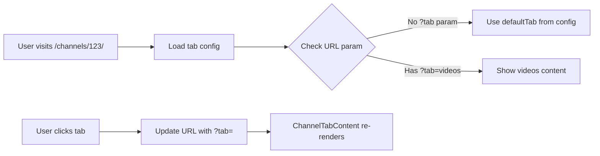

# ADR-003: Unified Channel Routing Architecture

## Status
**Accepted** - Implemented with Query Parameter Approach

## Context

Al Ummah Now platform currently has two competing approaches for channel page routing:

### Current Situation (Mixed Implementation)

1. **OLD Approach** (`/channel/[id]/`)
   - Now redirects to new route
   - Previously used query parameters (`?tab=videos`)
   - Client-side `ChannelTabContent` component
   - Database-driven tab configuration

2. **NEW Approach** (`/channels/[id]/`)
   - Server-side layout + individual page files
   - Route-based navigation (`/videos`, `/shorts`, etc.)
   - Static filesystem structure
   - Each tab is a separate Next.js page

### The Problem

We need to reconcile two critical requirements:
- **Dynamic Control**: Channel owners should control which tabs are visible and their order (stored in R2)
- **SEO & Performance**: Need proper URLs, server-side rendering, and optimal caching

The current implementation attempts both but creates complexity and maintenance burden.

## Decision

After careful consideration, we have adopted a **Query Parameter-Based Architecture with Database Control**. This decision prioritizes simplicity, maintainability, and dynamic flexibility over SEO optimization for tab-specific content.

### Architecture Pattern

```
/channels/[id]/              → Channel page (shows default tab)
/channels/[id]/?tab=videos   → Videos tab
/channels/[id]/?tab=shorts   → Shorts tab
/channels/[id]/?tab=live     → Live tab
/channels/[id]/?tab=playlists → Playlists tab
/channels/[id]/?tab=community → Community tab
/channels/[id]/?tab=about    → About tab
```

### Key Design Elements

1. **Query Parameter Navigation**
   - Single route handles all tabs via `?tab=` parameter
   - Simpler file structure (one page.tsx instead of many)
   - Dynamic content switching in `ChannelTabContent` component

2. **Database-Driven Configuration**
   - Tab configuration stored in R2 (`channel_tabs` bucket)
   - Controls visibility, order, custom names, and default tab
   - Fetched client-side for responsive updates

3. **Client-Side Tab Management**
   ```typescript
   // ChannelTabBar component
   const tabConfig = await getChannelTabConfig(channelId);
   const visibleTabs = tabConfig.tabs
     .filter(tab => tab.visible)
     .sort((a, b) => a.position - b.position);
   ```

4. **Unified Components**
   - `ChannelTabBar`: Renders navigation with database config
   - `ChannelTabContent`: Switches content based on query param
   - Single layout file manages header and structure

## Implementation Details

### 1. Tab Configuration Model (R2 Storage)
```typescript
interface ChannelTabConfig {
  channelId: string;
  defaultTab: string;        // Which tab to show at /channels/[id]/
  tabs: Array<{
    id: string;              // 'videos', 'shorts', etc.
    visible: boolean;        // Show/hide control
    position: number;        // Display order
    nameLocalized?: Record<string, string>; // Custom names
  }>;
}
```

### 2. File Structure
```
apps/web/src/app/[locale]/channels/[id]/
├── layout.tsx          # Shared layout (header, tabs navigation)
├── page.tsx           # Single page handles all tabs via query params
└── settings/          # Channel owner settings
    └── tabs/
        └── page.tsx   # Tab management UI

apps/web/src/components/ChannelTabs/
├── index.tsx          # ChannelTabBar component
├── ChannelTabContent.tsx # Dynamic content renderer
└── rtl/              # RTL variants
```

### 3. Navigation Flow



### 4. Component Architecture

```typescript
// ChannelTabBar: Navigation component
export function ChannelTabBar({ channelId }) {
  const [tabConfig, setTabConfig] = useState(null);

  useEffect(() => {
    // Fetch configuration from API
    const config = await getChannelTabConfig(channelId);
    setTabConfig(config);
  }, [channelId]);

  // Render only visible tabs in configured order
  const visibleTabs = tabConfig?.tabs
    .filter(tab => tab.visible)
    .sort((a, b) => a.position - b.position);
}

// ChannelTabContent: Content renderer
export function ChannelTabContent({ channelId }) {
  const searchParams = useSearchParams();
  const activeTab = searchParams.get('tab') || defaultTab;

  // Switch content based on activeTab
  return activeTab === 'videos' ? <VideosContent /> : ...
}
```

### 5. Default Tab Handling

```typescript
// In ChannelTabBar component
const effectiveDefaultTab = tabConfig?.defaultTab || 'home';
const activeTab = searchParams.get('tab') || effectiveDefaultTab;

// Remove tab param when clicking default tab
if (tab === effectiveDefaultTab) {
  params.delete('tab'); // Clean URL for default
} else {
  params.set('tab', tab);
}
```

## Consequences

### Positive

1. **Simplicity**
   - Single page component handles all tabs
   - Fewer files to maintain (one page.tsx vs many)
   - Centralized tab content logic

2. **Dynamic Flexibility**
   - Easy to add/remove tabs without file changes
   - Tab visibility updates instantly
   - Custom tab types can be added via database

3. **Developer Experience**
   - Clear component separation (navigation vs content)
   - Easy to understand flow
   - Consistent patterns across the app

4. **User Control**
   - Channel owners have full control over tabs
   - Real-time updates without deployment
   - Drag-and-drop reordering in settings

5. **Performance**
   - Single route can be cached effectively
   - Client-side navigation is instant
   - Smaller JavaScript bundle (fewer route components)

### Negative

1. **SEO Limitations**
   - Query parameters less optimal for search engines
   - All tabs share same base URL
   - Can't have tab-specific meta tags easily

2. **Browser History**
   - Query params create more history entries
   - Back button behavior less predictable
   - URL sharing includes parameter syntax

3. **Client-Side Loading**
   - Tab configuration fetched client-side
   - Initial render may show loading state
   - Potential flash of default tabs

## Alternatives Considered

### 1. Route-Based Architecture
**Pattern**: `/channels/123/videos`, `/channels/123/shorts`, etc.

**Rejected because:**
- Requires many page files (8+ per channel structure)
- Complex visibility checks in each page
- Harder to maintain consistency across tabs
- More difficult to add new tab types dynamically

**Why we initially considered it:**
- Better SEO with unique URLs per tab
- Cleaner URLs without query parameters
- Could leverage Next.js static optimization

### 2. Hybrid Approach (Routes + Database)
**Pattern**: Physical routes with database visibility control

**Rejected because:**
- Complexity of maintaining both systems
- Routes would exist even for hidden tabs (404 handling)
- Confusion between what's in code vs database

### 3. Pure Client-Side State
**Pattern**: React state without URL updates

**Rejected because:**
- No deep linking to specific tabs
- Loss of state on refresh
- Poor accessibility and SEO
- Can't share specific tab URLs

## Migration Strategy

### Phase 1: Foundation ✅ (Completed)
- Implemented `/channels/[id]/` route structure
- Added redirects from old `/channel/[id]/` routes
- Created tab configuration API endpoints
- Built `ChannelTabBar` and `ChannelTabContent` components

### Phase 2: Enhancement (Current)
1. Improve tab content for each type (videos, shorts, etc.)
2. Add actual data fetching for each tab
3. Implement empty states and loading states
4. Add pagination for content-heavy tabs

### Phase 3: SEO Optimization (Future)
1. Add structured data for channel pages
2. Implement server-side tab config loading (reduce flash)
3. Consider canonical URLs for tabs
4. Add sitemap entries for channels

### Phase 4: Advanced Features (Future)
1. Custom tabs support (external links, widgets)
2. A/B testing for tab arrangements
3. Analytics integration for tab usage
4. Personalized tab order based on user behavior

## Implementation Guidelines

### For Developers

1. **Tab Content Implementation**
   ```typescript
   // Add new tab content in ChannelTabContent.tsx
   {activeTab === 'newtab' && (
     <div role="tabpanel" id="tabpanel-newtab">
       <NewTabContent channelId={channelId} />
     </div>
   )}
   ```

2. **Visibility is Database-Driven**
   - Don't hardcode tab visibility
   - Always respect database configuration
   - Use fallback for failed API calls

3. **Handle Edge Cases**
   - Channel not found → 404
   - Tab config fails → Show default tabs
   - No content → Show empty state (not error)

### For Channel Owners

1. **Tab Management UI** at `/channels/[id]/settings/tabs`
2. **Visibility Control**: Show/hide tabs based on content
3. **Order Control**: Drag-and-drop reordering
4. **Default Tab**: Choose landing page for your channel

## Monitoring & Success Metrics

1. **Performance Metrics**
   - Page load time per tab
   - Time to First Byte (TTFB)
   - Client-side navigation speed

2. **SEO Metrics**
   - Indexed pages in Google Search Console
   - Click-through rates from search
   - Ranking for channel-related queries

3. **User Metrics**
   - Tab usage distribution
   - Bounce rates per tab
   - Navigation patterns

## Security Considerations

1. **Authorization**
   - Only channel owners can modify tab configuration
   - Verify ownership in API endpoints (`channelTabsUpdate.ts`)
   - Configuration changes are logged

2. **Performance**
   - Tab config cached client-side during session
   - API includes ETag headers for caching
   - Fallback to defaults prevents blocking failures

## Future Enhancements

1. **Custom Tabs** (Phase 2)
   - Allow channels to create custom tabs
   - Link to external content
   - Embed widgets or merchandise

2. **A/B Testing**
   - Test different tab orders
   - Measure engagement impact
   - Optimize for conversions

3. **Smart Defaults**
   - AI-powered tab recommendations
   - Auto-hide tabs with no content
   - Personalized tab order per viewer

## Decision Outcome

The **Query Parameter-Based Architecture with Database Control** was chosen for the following reasons:

1. **Simplicity Wins**: Maintaining one page file is simpler than 8+ separate route files
2. **Dynamic Control**: Database-driven configuration works seamlessly with query params
3. **Faster Development**: Easier to add new tab types without creating new files
4. **User Experience**: Channel owners get instant control without deployments

While this approach has SEO trade-offs compared to route-based URLs, we prioritize:
- Maintainability over perfect SEO for tab pages
- Dynamic flexibility over static optimization
- Developer velocity over marginal SEO gains

The main channel URL (`/channels/[id]/`) still provides good SEO, and most traffic will come through video pages rather than tab-specific URLs.

## References

- [Next.js App Router Documentation](https://nextjs.org/docs/app)
- [Al Ummah Now Channel Tabs API](/apps/api-videos/src/endpoints/channel/)
- [Channel Tab Configuration Types](/packages/shared-types/src/channel-tabs.ts)
- [Original Channel Implementation](https://github.com/meywd/AlUmmahNow/issues/23)

## Appendix: Implementation Examples

### Current Page Structure
```typescript
// apps/web/src/app/[locale]/channels/[id]/page.tsx
export default async function ChannelPage({ params }) {
  const { id } = await params;
  const channel = await getChannelById(id);

  if (!channel) {
    notFound();
  }

  // Single component handles all tab content
  return <ChannelTabContent channelId={id} />;
}
```

### Tab Bar Implementation
```typescript
// apps/web/src/components/ChannelTabs/index.tsx
export function ChannelTabBar({ channelId }) {
  const [tabConfig, setTabConfig] = useState(null);
  const searchParams = useSearchParams();
  const router = useRouter();

  // Fetch config on mount
  useEffect(() => {
    getChannelTabConfig(channelId).then(setTabConfig);
  }, [channelId]);

  // Handle tab click
  const handleTabClick = (tab: ChannelTab) => {
    const params = new URLSearchParams(searchParams);
    if (tab === tabConfig?.defaultTab) {
      params.delete('tab'); // Clean URL for default
    } else {
      params.set('tab', tab);
    }
    router.push(`${pathname}?${params.toString()}`);
  };

  // Render visible tabs
  const visibleTabs = tabConfig?.tabs
    .filter(t => t.visible)
    .sort((a, b) => a.position - b.position);

  return (
    <div className="tab-bar">
      {visibleTabs?.map(tab => (
        <button
          key={tab.id}
          onClick={() => handleTabClick(tab.id)}
          className={activeTab === tab.id ? 'active' : ''}
        >
          {tab.nameLocalized?.[locale] || tab.name}
        </button>
      ))}
    </div>
  );
}
```

### Tab Configuration Response
```json
{
  "channelId": "channel-123",
  "defaultTab": "home",
  "tabs": [
    {
      "id": "home",
      "name": "Home",
      "nameLocalized": { "en": "Home", "ar": "الرئيسية" },
      "type": "system",
      "visible": true,
      "position": 0
    },
    {
      "id": "videos",
      "name": "Videos",
      "nameLocalized": { "en": "Videos", "ar": "المرئيات" },
      "type": "system",
      "visible": true,
      "position": 1
    },
    {
      "id": "shorts",
      "name": "Shorts",
      "type": "system",
      "visible": false,  // Hidden by channel owner
      "position": 2
    }
  ],
  "version": 1,
  "dateCreated": "2024-11-20T10:00:00Z",
  "dateModified": "2024-11-20T10:00:00Z"
}
```

---

**Last Updated**: November 2024
**Author**: System Architect Agent
**Review Status**: Pending Implementation