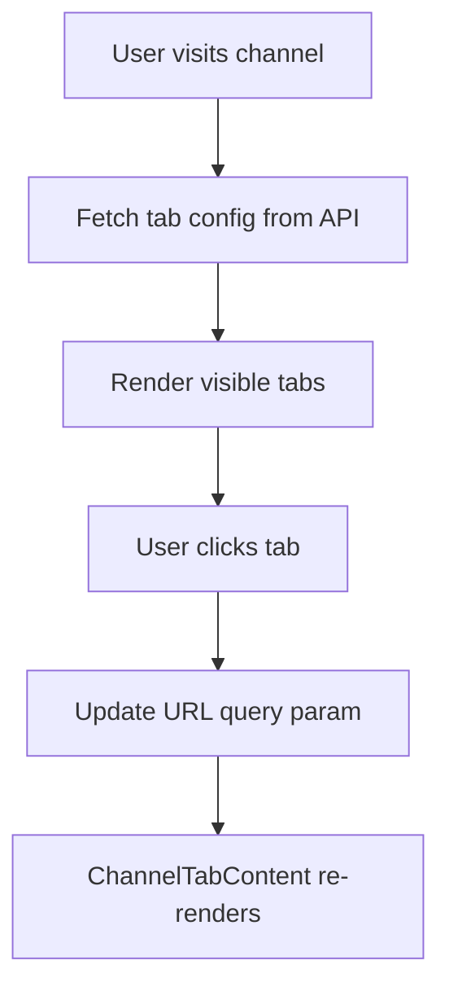

# Channel Routing Architecture Summary

## Executive Summary

Al Ummah Now has adopted a **query parameter-based routing system** for channel tabs, prioritizing simplicity and dynamic flexibility over SEO optimization for individual tab pages.

## Key Decision Points

### What We Chose: Query Parameters
- **URL Pattern**: `/channels/[id]/?tab=videos`
- **Single Page**: One `page.tsx` handles all tabs
- **Dynamic Switching**: Content changes based on `?tab=` parameter
- **Database Control**: Tab visibility/order from R2 storage

### What We Rejected: Route-Based
- **URL Pattern**: `/channels/[id]/videos` (separate routes)
- **Multiple Pages**: 8+ page files per channel structure
- **Static Routes**: Each tab as a Next.js page
- **Reason**: Too complex, harder to maintain

## Trade-off Analysis

### Advantages of Our Approach

| Aspect | Benefit |
|--------|---------|
| **Simplicity** | One page file vs 8+ files |
| **Maintainability** | Centralized logic, easier updates |
| **Flexibility** | Add/remove tabs without code changes |
| **Development Speed** | Faster to implement new features |
| **User Control** | Real-time tab management for channel owners |
| **Bundle Size** | Smaller JavaScript (fewer components) |

### Disadvantages We Accept

| Aspect | Trade-off | Mitigation |
|--------|-----------|------------|
| **SEO** | Query params less optimal | Main channel URL still indexed well |
| **URLs** | Less clean (`?tab=`) | Users rarely type URLs manually |
| **History** | More browser history entries | Acceptable UX trade-off |
| **Loading** | Client-side config fetch | Fast API, good fallbacks |

## Architecture Components

### 1. Layout Structure
```
/channels/[id]/
├── layout.tsx       # Channel header + tab bar
└── page.tsx        # Single page for all content
```

### 2. Component Hierarchy
```
ChannelLayout
├── ChannelHeader      # Banner, avatar, subscribe
├── ChannelTabBar      # Navigation (database-driven)
└── ChannelTabContent  # Dynamic content renderer
```

### 3. Data Flow


## Implementation Guidelines

### Adding a New Tab Type

1. **Update shared types** (`packages/shared-types/src/channel-tabs.ts`):
```typescript
// Add to DEFAULT_CHANNEL_TABS
{
  id: 'merchandise',
  name: 'Merchandise',
  nameLocalized: { en: 'Merchandise', ar: 'البضائع' },
  type: 'system',
  visible: false, // Hidden by default
  position: 8
}
```

2. **Add content to ChannelTabContent** (`ChannelTabContent.tsx`):
```typescript
{activeTab === 'merchandise' && (
  <div role="tabpanel" id="tabpanel-merchandise">
    <MerchandiseContent channelId={channelId} />
  </div>
)}
```

3. **Update translations** (`lib/i18n/translations/`):
```typescript
channel: {
  merchandise: 'Merchandise',
  // ...
}
```

### Database Configuration

Tab configurations are stored in R2:
- **Bucket**: `channel_tabs`
- **Key**: `channel-tabs/{channelId}`
- **Format**: JSON object with tabs array

Channel owners manage tabs at:
- `/channels/[id]/settings/tabs`

## Why This Architecture?

### Primary Reasons

1. **Reduced Complexity**
   - 1 page file instead of 8+
   - Easier to understand and maintain
   - Less chance of inconsistencies

2. **Dynamic Flexibility**
   - Database-driven without deployments
   - Channel owners have full control
   - Easy to add custom tab types later

3. **Development Velocity**
   - Faster to implement features
   - Simpler testing (one component)
   - Consistent patterns

### SEO Consideration

While route-based URLs (`/channels/123/videos`) are better for SEO, we determined:

- Most traffic comes through video pages, not channel tabs
- Channel main page (`/channels/123/`) provides sufficient SEO
- Trade-off is acceptable for the simplicity gained
- Can add structured data and sitemaps to compensate

## Future Enhancements

### Near Term
- Server-side tab config loading (reduce client-side flash)
- Improved empty states for each tab
- Actual content fetching (videos, playlists, etc.)
- Pagination for content-heavy tabs

### Long Term
- Custom tabs (external links, widgets)
- A/B testing tab arrangements
- Personalized tab order
- Analytics-driven optimizations

## Comparison with Industry

| Platform | Approach | URL Pattern |
|----------|----------|-------------|
| **YouTube** | Route-based | `/channel/ID/videos` |
| **Twitch** | Tab-based | `/channel/videos` (SPA) |
| **TikTok** | Query params | `/@user?tab=liked` |
| **Al Ummah Now** | Query params | `/channels/ID?tab=videos` |

We align more with TikTok's approach, prioritizing simplicity and dynamic control over YouTube's SEO-optimized structure.

## Conclusion

The query parameter-based architecture represents a pragmatic choice that:
- Simplifies development and maintenance
- Provides channel owners with dynamic control
- Accepts reasonable SEO trade-offs
- Enables faster feature development

This decision aligns with our platform's goals of being developer-friendly, user-controllable, and maintainable at scale.

---

**Architecture Decision**: ADR-003
**Status**: Accepted and Implemented
**Date**: November 2024