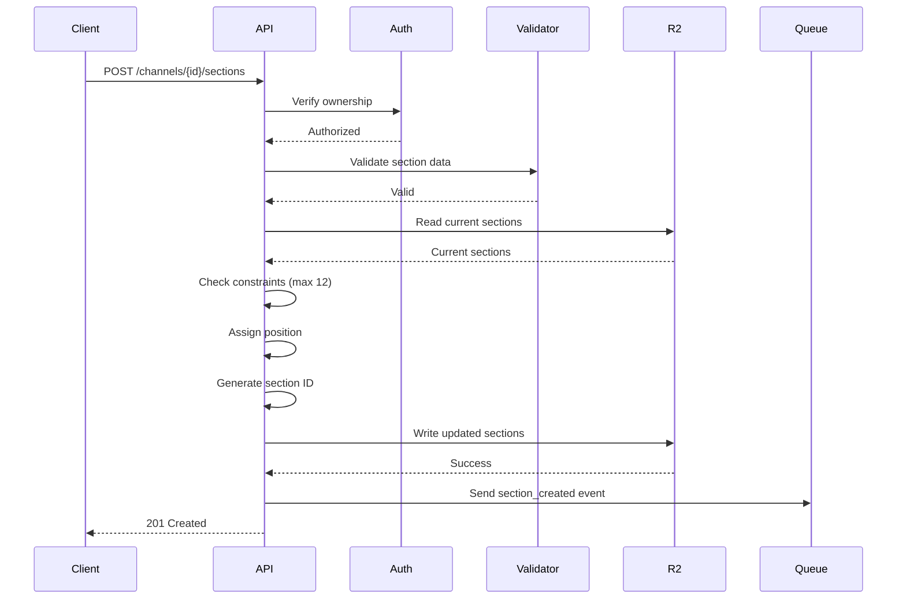
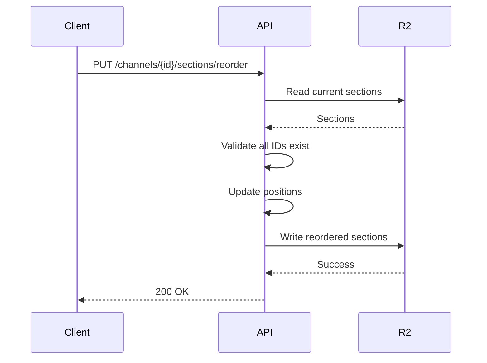
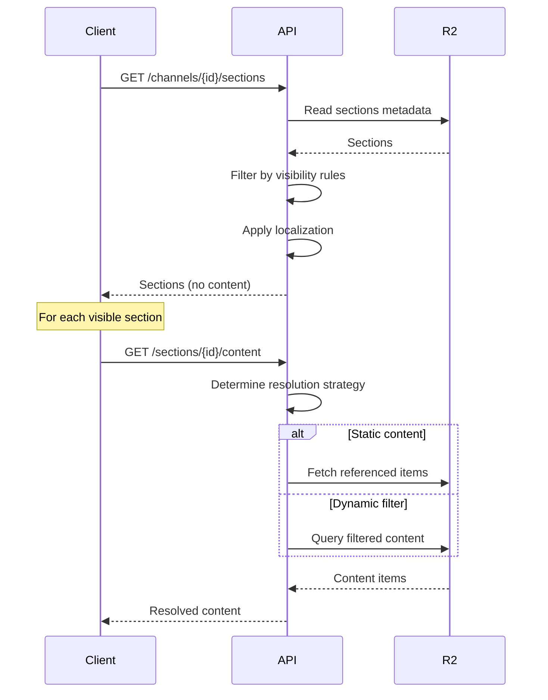

# Channel Sections Data Model

## Overview
This document defines the complete data model for the Channel Sections feature in Al Ummah Now, including JSON structures for R2 storage, relationships, and data flow.

## R2 Storage Structure

### 1. Primary Storage: Channel Sections Collection

**Path:** `channel-sections/by-channel/{channelId}/sections.json`

**Structure:**
```json
{
  "channelId": "ch_abc123",
  "sectionsVersion": "1.0",
  "lastModified": "2024-01-15T10:30:00Z",
  "sections": [
    {
      "id": "sect_xyz789",
      "channelId": "ch_abc123",
      "type": "recent_videos",
      "title": "Recent Uploads",
      "titleLocalized": {
        "ar": "التحميلات الأخيرة",
        "ur": "حالیہ اپ لوڈز"
      },
      "description": "Our latest video content",
      "descriptionLocalized": {
        "ar": "أحدث محتوى الفيديو لدينا"
      },
      "position": 1,
      "isEnabled": true,
      "contentReferences": [],
      "filter": {
        "dateRange": {
          "from": "30_days_ago"
        }
      },
      "displaySettings": {
        "itemCount": 12,
        "layout": "horizontal_list",
        "showDuration": true,
        "showViewCount": true,
        "showPublishDate": true
      },
      "visibility": {
        "subscribersOnly": false,
        "authenticatedOnly": false,
        "hideMobile": false,
        "hideDesktop": false
      },
      "dateCreated": "2024-01-01T00:00:00Z",
      "dateModified": "2024-01-15T10:30:00Z"
    },
    {
      "id": "sect_abc456",
      "channelId": "ch_abc123",
      "type": "single_playlist",
      "title": "Ramadan Series 2024",
      "titleLocalized": {
        "ar": "سلسلة رمضان 2024"
      },
      "position": 2,
      "isEnabled": true,
      "contentReferences": [
        {
          "type": "playlist",
          "id": "pl_ramadan2024",
          "customTitle": "Special Ramadan Lectures"
        }
      ],
      "displaySettings": {
        "itemCount": 10,
        "layout": "horizontal_list",
        "showDuration": true
      },
      "dateCreated": "2024-01-01T00:00:00Z",
      "dateModified": "2024-01-15T10:30:00Z"
    }
  ],
  "metadata": {
    "totalSections": 2,
    "enabledSections": 2,
    "lastReorderDate": "2024-01-15T10:30:00Z"
  }
}
```

### 2. Individual Section Storage (for atomic updates)

**Path:** `channel-sections/by-section/{sectionId}.json`

**Structure:**
```json
{
  "id": "sect_xyz789",
  "channelId": "ch_abc123",
  "type": "recent_videos",
  "title": "Recent Uploads",
  "position": 1,
  "isEnabled": true,
  "dateCreated": "2024-01-01T00:00:00Z",
  "dateModified": "2024-01-15T10:30:00Z",
  "updateHistory": [
    {
      "timestamp": "2024-01-15T10:30:00Z",
      "userId": "usr_editor123",
      "action": "update",
      "changes": ["title", "position"]
    }
  ]
}
```

### 3. Default Section Templates

**Path:** `channel-sections/templates/defaults.json`

**Structure:**
```json
{
  "version": "1.0",
  "templates": {
    "new_channel": {
      "id": "default_new",
      "name": "New Channel Default",
      "sections": [
        {
          "type": "channel_trailer",
          "title": "Welcome to Our Channel",
          "position": 1,
          "displaySettings": {
            "layout": "single",
            "autoPlay": false
          }
        },
        {
          "type": "recent_videos",
          "title": "Recent Videos",
          "position": 2,
          "filter": {
            "dateRange": {
              "from": "30_days_ago"
            }
          },
          "displaySettings": {
            "itemCount": 12,
            "layout": "grid"
          }
        },
        {
          "type": "popular_videos",
          "title": "Popular Videos",
          "position": 3,
          "displaySettings": {
            "itemCount": 10,
            "layout": "horizontal_list"
          }
        }
      ]
    },
    "islamic_scholar": {
      "id": "islamic_scholar",
      "name": "Islamic Scholar Channel",
      "sections": [
        {
          "type": "islamic_lectures",
          "title": "Latest Lectures",
          "position": 1
        },
        {
          "type": "quran_recitations",
          "title": "Quran Recitations",
          "position": 2
        },
        {
          "type": "single_playlist",
          "title": "Tafseer Series",
          "position": 3
        }
      ]
    },
    "quran_reciter": {
      "id": "quran_reciter",
      "name": "Quran Reciter Channel",
      "sections": [
        {
          "type": "quran_recitations",
          "title": "Complete Surahs",
          "position": 1
        },
        {
          "type": "single_playlist",
          "title": "Juz Amma Collection",
          "position": 2
        },
        {
          "type": "popular_videos",
          "title": "Most Listened",
          "position": 3
        }
      ]
    }
  }
}
```

## Relationships

### 1. Channel → Sections (One-to-Many)

```typescript
interface ChannelWithSections {
  channel: Channel;
  sections: ChannelSection[];
}

// Query pattern
async function getChannelWithSections(channelId: string) {
  const [channel, sectionsData] = await Promise.all([
    channelRepo.getObject(channelId),
    sectionsRepo.getObject(`by-channel/${channelId}/sections.json`)
  ]);

  return {
    channel,
    sections: sectionsData?.sections || []
  };
}
```

### 2. Section → Content (Dynamic Resolution)

```typescript
interface ResolvedSection {
  section: ChannelSection;
  content: VideoObject[] | Playlist[] | Channel[];
}

async function resolveSection(section: ChannelSection) {
  switch (section.type) {
    case ChannelSectionType.RECENT_VIDEOS:
      return resolveRecentVideos(section);
    case ChannelSectionType.SINGLE_PLAYLIST:
      return resolvePlaylist(section);
    case ChannelSectionType.FEATURED_CHANNELS:
      return resolveFeaturedChannels(section);
    // ... other types
  }
}
```

### 3. Content Reference Resolution

```typescript
// For static content references
async function resolveContentReferences(
  references: SectionContentReference[]
): Promise<any[]> {
  return Promise.all(
    references.map(async (ref) => {
      switch (ref.type) {
        case 'video':
          return videoRepo.getObject(ref.id);
        case 'playlist':
          return playlistRepo.getObject(ref.id);
        case 'channel':
          return channelRepo.getObject(ref.id);
      }
    })
  );
}

// For dynamic filters
async function resolveFilteredContent(
  channelId: string,
  filter: SectionFilter,
  limit: number
): Promise<VideoObject[]> {
  const allVideos = await videoRepo.listByChannel(channelId);

  return allVideos
    .filter(video => matchesFilter(video, filter))
    .sort((a, b) => sortByFilter(a, b, filter))
    .slice(0, limit);
}
```

## Data Flow

### 1. Creating a Channel Section



### 2. Reordering Sections



### 3. Loading Channel Page with Sections



## Migration Data Model

### Migration State Tracking

**Path:** `channel-sections/migration/state.json`

```json
{
  "migrationVersion": "1.0",
  "startedAt": "2024-01-01T00:00:00Z",
  "phase": "beta",
  "statistics": {
    "totalChannels": 10000,
    "migratedChannels": 2500,
    "failedChannels": 5,
    "pendingChannels": 7495
  },
  "betaChannels": [
    "ch_beta001",
    "ch_beta002"
  ],
  "lastProcessedChannelId": "ch_xyz123",
  "errors": []
}
```

### Channel Migration Record

**Path:** `channel-sections/migration/channels/{channelId}.json`

```json
{
  "channelId": "ch_abc123",
  "migratedAt": "2024-01-15T10:30:00Z",
  "sectionsCreated": 3,
  "migrationStrategy": "default_template",
  "template": "new_channel",
  "success": true,
  "errors": []
}
```

## Validation Rules

### Section Validation Schema (Zod)

```typescript
import { z } from 'zod';

export const ChannelSectionSchema = z.object({
  type: z.nativeEnum(ChannelSectionType),
  title: z.string().min(1).max(100),
  titleLocalized: z.record(z.string()).optional(),
  description: z.string().max(500).optional(),
  position: z.number().int().min(1),
  isEnabled: z.boolean().default(true),
  contentReferences: z.array(
    z.object({
      type: z.enum(['video', 'playlist', 'channel']),
      id: z.string(),
      customTitle: z.string().optional(),
      customDescription: z.string().optional()
    })
  ).max(100).optional(),
  filter: z.object({
    category: z.string().optional(),
    tags: z.array(z.string()).optional(),
    language: z.string().optional(),
    dateRange: z.object({
      from: z.string().optional(),
      to: z.string().optional()
    }).optional(),
    duration: z.object({
      min: z.number().optional(),
      max: z.number().optional()
    }).optional()
  }).optional(),
  displaySettings: z.object({
    itemCount: z.number().min(1).max(50).optional(),
    layout: z.enum(['horizontal_list', 'vertical_list', 'grid', 'single', 'carousel']).optional(),
    showDuration: z.boolean().optional(),
    showViewCount: z.boolean().optional(),
    showPublishDate: z.boolean().optional(),
    showChannelInfo: z.boolean().optional(),
    autoPlay: z.boolean().optional()
  }).optional()
});
```

## Performance Considerations

### Caching Strategy

```typescript
interface SectionCache {
  // Cache section metadata (1 hour TTL)
  sectionsMetadata: Map<string, {
    data: ChannelSection[];
    expires: number;
  }>;

  // Cache resolved content (5 minutes TTL for dynamic)
  resolvedContent: Map<string, {
    data: any[];
    expires: number;
    isDynamic: boolean;
  }>;
}

// KV Storage for edge caching
interface KVSectionCache {
  key: `sections:${string}`;
  value: string; // JSON stringified sections
  metadata: {
    expires: number;
    version: string;
  };
}
```

### Query Optimization

```typescript
// Batch content resolution
async function batchResolveContent(
  sections: ChannelSection[]
): Promise<Map<string, any[]>> {
  // Group by content type
  const videoIds = new Set<string>();
  const playlistIds = new Set<string>();
  const channelIds = new Set<string>();

  sections.forEach(section => {
    section.contentReferences?.forEach(ref => {
      switch (ref.type) {
        case 'video': videoIds.add(ref.id); break;
        case 'playlist': playlistIds.add(ref.id); break;
        case 'channel': channelIds.add(ref.id); break;
      }
    });
  });

  // Parallel batch fetch
  const [videos, playlists, channels] = await Promise.all([
    videoIds.size ? batchGetVideos([...videoIds]) : [],
    playlistIds.size ? batchGetPlaylists([...playlistIds]) : [],
    channelIds.size ? batchGetChannels([...channelIds]) : []
  ]);

  // Return indexed map
  return indexContent(videos, playlists, channels);
}
```

## Security Considerations

### Access Control

```typescript
interface SectionAccessControl {
  // Who can modify sections
  canModify(userId: string, channelId: string): Promise<boolean>;

  // Who can view sections
  canView(
    section: ChannelSection,
    viewer?: { userId: string; isSubscriber: boolean }
  ): boolean;

  // Content filtering based on viewer
  filterContent(
    content: any[],
    viewer?: { userId: string }
  ): any[];
}
```

### Rate Limiting

```typescript
interface SectionRateLimits {
  // Section operations per channel per hour
  createSection: 10;
  updateSection: 30;
  deleteSection: 10;
  reorderSections: 20;

  // Content resolution per viewer per minute
  resolveContent: 100;
}
```