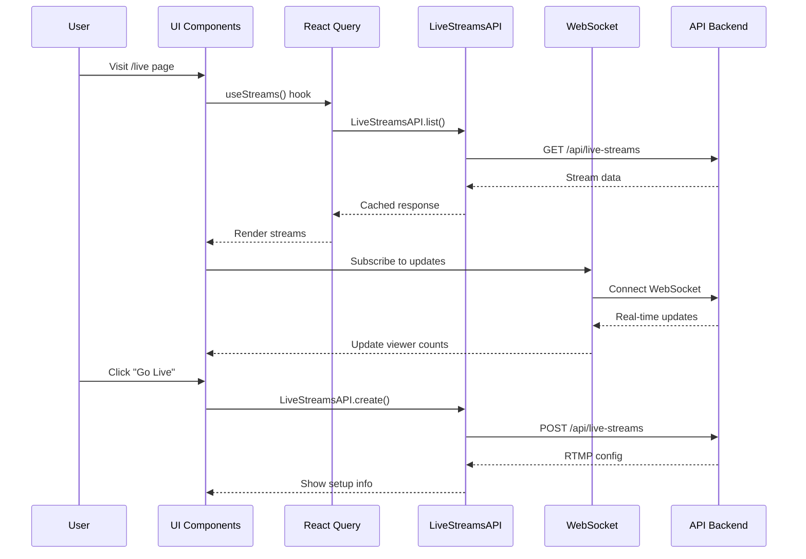
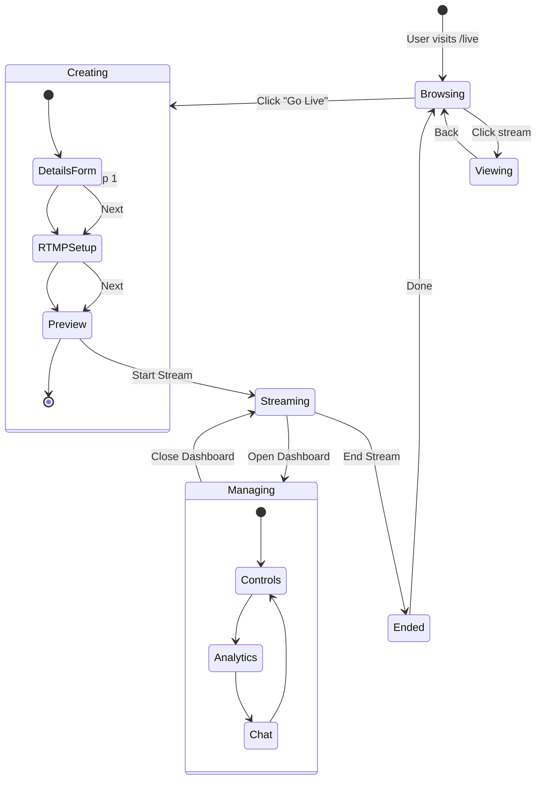

# Live Streaming UI Components - Implementation Guide

## Component Architecture Diagrams

### 1. Data Flow Architecture



### 2. Component State Management



## Component Implementation Examples

### 1. StreamStatusBadge Component

```typescript
// components/live-streaming/StreamStatusBadge/index.tsx
import React from 'react';
import { Badge } from '@/components/ui/badge';
import { cn } from '@/lib/utils';

export interface StreamStatusBadgeProps {
  status: 'scheduled' | 'live' | 'ended' | 'cancelled';
  size?: 'sm' | 'md' | 'lg';
  className?: string;
}

const statusConfig = {
  live: {
    label: 'LIVE',
    className: 'bg-red-500 text-white animate-pulse',
    dotClass: 'bg-white',
  },
  scheduled: {
    label: 'Scheduled',
    className: 'bg-blue-500 text-white',
    dotClass: 'bg-blue-200',
  },
  ended: {
    label: 'Ended',
    className: 'bg-gray-500 text-white',
    dotClass: 'bg-gray-300',
  },
  cancelled: {
    label: 'Cancelled',
    className: 'bg-yellow-500 text-white',
    dotClass: 'bg-yellow-200',
  },
};

const sizeConfig = {
  sm: 'text-xs px-2 py-0.5',
  md: 'text-sm px-2.5 py-1',
  lg: 'text-base px-3 py-1.5',
};

export const StreamStatusBadge: React.FC<StreamStatusBadgeProps> = ({
  status,
  size = 'md',
  className,
}) => {
  const config = statusConfig[status];

  return (
    <Badge
      className={cn(
        'inline-flex items-center gap-1 font-semibold',
        config.className,
        sizeConfig[size],
        className
      )}
    >
      {status === 'live' && (
        <span
          className={cn(
            'inline-block rounded-full',
            size === 'sm' ? 'w-1.5 h-1.5' : size === 'md' ? 'w-2 h-2' : 'w-2.5 h-2.5',
            config.dotClass
          )}
        />
      )}
      {config.label}
    </Badge>
  );
};
```

### 2. LiveStreamCard Component

```typescript
// components/live-streaming/LiveStreamCard/index.tsx
import React from 'react';
import Image from 'next/image';
import Link from 'next/link';
import { Card, CardContent } from '@/components/ui/card';
import { StreamStatusBadge } from '../StreamStatusBadge';
import { ViewerCount } from '../ViewerCount';
import { LiveStream } from '@/interfaces';
import { formatDistanceToNow } from 'date-fns';
import { Play, Calendar, Clock } from 'lucide-react';

export interface LiveStreamCardProps {
  stream: LiveStream;
  layout?: 'grid' | 'list';
  locale?: 'en' | 'ar';
  onStreamClick?: (streamId: string) => void;
  showChannel?: boolean;
}

export const LiveStreamCard: React.FC<LiveStreamCardProps> = ({
  stream,
  layout = 'grid',
  locale = 'en',
  onStreamClick,
  showChannel = true,
}) => {
  const handleClick = () => {
    onStreamClick?.(stream.id);
  };

  const streamUrl = `/${locale}/live/${stream.id}`;
  const isLive = stream.status === 'live';
  const isScheduled = stream.status === 'scheduled';

  const renderThumbnail = () => (
    <div className="relative aspect-video bg-gray-200 dark:bg-gray-800 overflow-hidden rounded-t-lg">
      <Image
        src={stream.thumbnailUrl || `/api/placeholder/640/360`}
        alt={stream.title}
        fill
        className="object-cover"
        sizes="(max-width: 768px) 100vw, (max-width: 1200px) 50vw, 33vw"
      />

      {/* Status Badge */}
      <div className="absolute top-2 left-2">
        <StreamStatusBadge status={stream.status} size="sm" />
      </div>

      {/* Viewer Count for Live Streams */}
      {isLive && (
        <div className="absolute bottom-2 right-2">
          <ViewerCount
            streamId={stream.id}
            initialCount={stream.currentViewers}
            size="sm"
          />
        </div>
      )}

      {/* Play Overlay */}
      {!isScheduled && (
        <div className="absolute inset-0 flex items-center justify-center bg-black/20 opacity-0 hover:opacity-100 transition-opacity">
          <div className="bg-black/60 rounded-full p-3">
            <Play className="w-8 h-8 text-white fill-white" />
          </div>
        </div>
      )}

      {/* Scheduled Time */}
      {isScheduled && stream.scheduledStartTime && (
        <div className="absolute bottom-2 left-2 bg-black/70 text-white px-2 py-1 rounded text-xs flex items-center gap-1">
          <Calendar className="w-3 h-3" />
          {new Date(stream.scheduledStartTime).toLocaleDateString(locale)}
        </div>
      )}
    </div>
  );

  const renderContent = () => (
    <CardContent className="p-4">
      <div className="space-y-2">
        {/* Title */}
        <h3 className="font-semibold line-clamp-2 text-sm">
          {stream.title}
        </h3>

        {/* Channel Info */}
        {showChannel && (
          <div className="flex items-center gap-2">
            <div className="w-6 h-6 rounded-full overflow-hidden bg-gray-300">
              {stream.channelAvatarUrl && (
                <Image
                  src={stream.channelAvatarUrl}
                  alt={stream.channelName || 'Channel'}
                  width={24}
                  height={24}
                />
              )}
            </div>
            <span className="text-xs text-gray-600 dark:text-gray-400">
              {stream.channelName}
            </span>
          </div>
        )}

        {/* Stream Info */}
        <div className="flex items-center gap-3 text-xs text-gray-500 dark:text-gray-400">
          {isLive ? (
            <>
              <span className="flex items-center gap-1">
                <Clock className="w-3 h-3" />
                Started {formatDistanceToNow(new Date(stream.actualStartTime!))} ago
              </span>
            </>
          ) : stream.status === 'ended' ? (
            <>
              <span>{stream.views.toLocaleString()} views</span>
              {stream.duration && (
                <span>
                  {Math.floor(stream.duration / 60)} min
                </span>
              )}
            </>
          ) : isScheduled ? (
            <span>
              Starts {formatDistanceToNow(new Date(stream.scheduledStartTime!))}
            </span>
          ) : null}
        </div>
      </div>
    </CardContent>
  );

  if (layout === 'list') {
    return (
      <Link href={streamUrl} onClick={handleClick}>
        <Card className="flex hover:shadow-lg transition-shadow cursor-pointer">
          <div className="w-48 flex-shrink-0">
            {renderThumbnail()}
          </div>
          <div className="flex-1">
            {renderContent()}
          </div>
        </Card>
      </Link>
    );
  }

  return (
    <Link href={streamUrl} onClick={handleClick}>
      <Card className="hover:shadow-lg transition-shadow cursor-pointer">
        {renderThumbnail()}
        {renderContent()}
      </Card>
    </Link>
  );
};
```

### 3. ViewerCount Component with WebSocket

```typescript
// components/live-streaming/ViewerCount/index.tsx
import React, { useEffect, useState } from 'react';
import { Users } from 'lucide-react';
import { cn } from '@/lib/utils';
import { useStreamWebSocket } from '@/lib/hooks/useStreamWebSocket';

export interface ViewerCountProps {
  streamId: string;
  initialCount?: number;
  size?: 'sm' | 'md' | 'lg';
  showIcon?: boolean;
  className?: string;
}

export const ViewerCount: React.FC<ViewerCountProps> = ({
  streamId,
  initialCount = 0,
  size = 'md',
  showIcon = true,
  className,
}) => {
  const [count, setCount] = useState(initialCount);
  const { subscribe, unsubscribe } = useStreamWebSocket();

  useEffect(() => {
    // Subscribe to viewer count updates
    const channel = `/live-streams/${streamId}/viewers`;

    const handleUpdate = (data: { viewers: number }) => {
      setCount(data.viewers);
    };

    subscribe(channel, handleUpdate);

    return () => {
      unsubscribe(channel, handleUpdate);
    };
  }, [streamId, subscribe, unsubscribe]);

  const sizeClasses = {
    sm: 'text-xs px-1.5 py-0.5',
    md: 'text-sm px-2 py-1',
    lg: 'text-base px-3 py-1.5',
  };

  const iconSizes = {
    sm: 'w-3 h-3',
    md: 'w-4 h-4',
    lg: 'w-5 h-5',
  };

  return (
    <div
      className={cn(
        'inline-flex items-center gap-1 bg-red-500/90 text-white rounded font-medium',
        sizeClasses[size],
        className
      )}
    >
      {showIcon && <Users className={iconSizes[size]} />}
      <span>{count.toLocaleString()}</span>
    </div>
  );
};
```

### 4. GoLiveForm Multi-Step Component

```typescript
// components/live-streaming/GoLiveForm/index.tsx
import React, { useState } from 'react';
import { useRouter } from 'next/navigation';
import { useAuth } from '@/components/AuthProvider/authContext';
import { LiveStreamsAPI } from '@/lib/api/livestreams';
import { StreamDetailsStep } from './StreamDetailsStep';
import { StreamSetupStep } from './StreamSetupStep';
import { StreamPreviewStep } from './StreamPreviewStep';
import { Button } from '@/components/ui/button';
import { ChevronLeft, ChevronRight } from 'lucide-react';
import { toast } from 'sonner';

export interface StreamFormData {
  title: string;
  description?: string;
  scheduledStartTime?: string;
  category?: string;
  tags?: string[];
  isPrivate: boolean;
  allowChat: boolean;
  language: 'en' | 'ar';
}

export const GoLiveForm: React.FC = () => {
  const router = useRouter();
  const { user, token } = useAuth();
  const [step, setStep] = useState(1);
  const [formData, setFormData] = useState<StreamFormData>({
    title: '',
    description: '',
    isPrivate: false,
    allowChat: true,
    language: 'en',
  });
  const [streamConfig, setStreamConfig] = useState<{
    id: string;
    rtmpUrl: string;
    streamKey: string;
  } | null>(null);
  const [isCreating, setIsCreating] = useState(false);

  const handleNext = async () => {
    if (step === 1) {
      // Validate form data
      if (!formData.title.trim()) {
        toast.error('Stream title is required');
        return;
      }

      // Create stream and get RTMP config
      setIsCreating(true);
      try {
        const response = await LiveStreamsAPI.create(
          {
            ...formData,
            channelId: user?.channelId || '', // Assume user has default channel
          },
          token!
        );

        if (response?.success && response.result) {
          const { stream } = response.result;
          setStreamConfig({
            id: stream.id,
            rtmpUrl: stream.rtmpUrl!,
            streamKey: stream.streamKey!,
          });
          setStep(2);
        } else {
          throw new Error('Failed to create stream');
        }
      } catch (error) {
        console.error('Error creating stream:', error);
        toast.error('Failed to create stream. Please try again.');
      } finally {
        setIsCreating(false);
      }
    } else if (step === 2) {
      setStep(3);
    }
  };

  const handleBack = () => {
    if (step > 1) {
      setStep(step - 1);
    }
  };

  const handleGoLive = async () => {
    if (!streamConfig) return;

    try {
      const response = await LiveStreamsAPI.goLive(streamConfig.id, token!);

      if (response?.success) {
        toast.success('You are now live!');
        router.push(`/en/live/${streamConfig.id}`);
      } else {
        throw new Error('Failed to go live');
      }
    } catch (error) {
      console.error('Error going live:', error);
      toast.error('Failed to go live. Please check your streaming software.');
    }
  };

  const steps = [
    { number: 1, title: 'Stream Details' },
    { number: 2, title: 'Setup Streaming' },
    { number: 3, title: 'Preview & Go Live' },
  ];

  return (
    <div className="max-w-4xl mx-auto p-6">
      {/* Progress Steps */}
      <div className="mb-8">
        <div className="flex items-center justify-between">
          {steps.map((s, index) => (
            <div
              key={s.number}
              className={cn(
                'flex items-center',
                index < steps.length - 1 && 'flex-1'
              )}
            >
              <div
                className={cn(
                  'flex items-center justify-center w-10 h-10 rounded-full border-2',
                  step >= s.number
                    ? 'bg-primary text-white border-primary'
                    : 'bg-gray-100 text-gray-400 border-gray-300'
                )}
              >
                {s.number}
              </div>
              <span
                className={cn(
                  'ml-3 text-sm font-medium',
                  step >= s.number ? 'text-primary' : 'text-gray-400'
                )}
              >
                {s.title}
              </span>
              {index < steps.length - 1 && (
                <div
                  className={cn(
                    'flex-1 h-0.5 mx-4',
                    step > s.number ? 'bg-primary' : 'bg-gray-300'
                  )}
                />
              )}
            </div>
          ))}
        </div>
      </div>

      {/* Step Content */}
      <div className="bg-white dark:bg-gray-800 rounded-lg shadow-lg p-8">
        {step === 1 && (
          <StreamDetailsStep
            data={formData}
            onChange={setFormData}
          />
        )}
        {step === 2 && streamConfig && (
          <StreamSetupStep
            rtmpUrl={streamConfig.rtmpUrl}
            streamKey={streamConfig.streamKey}
          />
        )}
        {step === 3 && streamConfig && (
          <StreamPreviewStep
            streamId={streamConfig.id}
            formData={formData}
          />
        )}
      </div>

      {/* Navigation */}
      <div className="flex justify-between mt-6">
        <Button
          variant="outline"
          onClick={handleBack}
          disabled={step === 1}
        >
          <ChevronLeft className="w-4 h-4 mr-2" />
          Back
        </Button>

        {step < 3 ? (
          <Button
            onClick={handleNext}
            disabled={isCreating}
          >
            {isCreating ? 'Creating...' : 'Next'}
            <ChevronRight className="w-4 h-4 ml-2" />
          </Button>
        ) : (
          <Button
            onClick={handleGoLive}
            className="bg-red-500 hover:bg-red-600"
          >
            Go Live
          </Button>
        )}
      </div>
    </div>
  );
};
```

### 5. Live Streams Browse Page

```typescript
// app/en/live/page.tsx
import React, { Suspense } from 'react';
import { LiveStreamBrowser } from '@/components/live-streaming/LiveStreamBrowser';

export const metadata = {
  title: 'Live Streams | Al Ummah Now',
  description: 'Watch live Islamic content and lectures',
};

export default function LivePage() {
  return (
    <div className="container mx-auto px-4 py-8">
      <div className="mb-8">
        <h1 className="text-3xl font-bold mb-2">Live Streams</h1>
        <p className="text-gray-600 dark:text-gray-400">
          Watch live Islamic content from scholars and educators around the world
        </p>
      </div>

      <Suspense fallback={<LiveStreamBrowserSkeleton />}>
        <LiveStreamBrowser locale="en" />
      </Suspense>
    </div>
  );
}

function LiveStreamBrowserSkeleton() {
  return (
    <div className="space-y-6">
      {/* Tab Skeleton */}
      <div className="flex gap-4 border-b">
        {[1, 2, 3].map((i) => (
          <div key={i} className="h-10 w-32 bg-gray-200 rounded animate-pulse" />
        ))}
      </div>

      {/* Grid Skeleton */}
      <div className="grid grid-cols-1 md:grid-cols-2 lg:grid-cols-3 xl:grid-cols-4 gap-6">
        {[...Array(8)].map((_, i) => (
          <div key={i} className="space-y-3">
            <div className="aspect-video bg-gray-200 rounded animate-pulse" />
            <div className="h-4 bg-gray-200 rounded w-3/4 animate-pulse" />
            <div className="h-3 bg-gray-200 rounded w-1/2 animate-pulse" />
          </div>
        ))}
      </div>
    </div>
  );
}
```

## Integration Points

### 1. With Existing VideoPlayer

```typescript
// When viewing a live stream, pass isLive prop
<CustomVideoPlayer
  videoId={stream.id}
  sources={[{
    src: stream.streamUrl, // HLS URL from Bunny.net
    type: 'application/x-mpegURL'
  }]}
  isLive={true}
  enableWebSocket={true} // For real-time viewer updates
  // ... other props
/>
```

### 2. With Authentication

```typescript
// Protected route wrapper
const ProtectedGoLive = () => {
  const { user, isAuthenticated } = useAuth();

  if (!isAuthenticated) {
    redirect('/en/login?redirect=/en/go-live');
  }

  return <GoLivePage />;
};
```

### 3. With WebSocket Server

```typescript
// WebSocket channels for live streams
const CHANNELS = {
  VIEWERS: (streamId: string) => `/live-streams/${streamId}/viewers`,
  STATUS: (streamId: string) => `/live-streams/${streamId}/status`,
  CHAT: (streamId: string) => `/live-streams/${streamId}/chat`,
};
```

## Error Handling

```typescript
// Common error scenarios and handling
const errorHandlers = {
  STREAM_NOT_FOUND: 'The stream you are looking for does not exist',
  RTMP_CONNECTION_FAILED: 'Failed to connect to streaming server. Check your streaming software settings',
  AUTHENTICATION_REQUIRED: 'You must be logged in to go live',
  INSUFFICIENT_PERMISSIONS: 'You do not have permission to stream',
  STREAM_ALREADY_LIVE: 'You already have an active stream',
  NETWORK_ERROR: 'Network error. Please check your connection',
};
```

## Accessibility Features

1. **ARIA Labels**: All interactive elements have proper labels
2. **Keyboard Navigation**: Full keyboard support with tab order
3. **Screen Reader**: Descriptive text for all visual elements
4. **Focus Management**: Proper focus handling in multi-step forms
5. **Color Contrast**: WCAG AA compliant color combinations
6. **Live Regions**: ARIA live regions for real-time updates

## Mobile Optimizations

1. **Touch Targets**: Minimum 44x44px touch targets
2. **Responsive Grid**: Adapts from 1 to 4 columns
3. **Swipe Gestures**: Support for swipe navigation in forms
4. **Reduced Motion**: Respects prefers-reduced-motion
5. **Bandwidth Detection**: Lower quality thumbnails on slow connections

## Performance Metrics

Target metrics for optimal user experience:
- **LCP**: < 2.5s (Largest Contentful Paint)
- **FID**: < 100ms (First Input Delay)
- **CLS**: < 0.1 (Cumulative Layout Shift)
- **TTI**: < 3.8s (Time to Interactive)

## Next Steps

1. Implement Phase 1 components (MVP)
2. Set up React Query for data fetching
3. Integrate WebSocket connection management
4. Add comprehensive error boundaries
5. Implement analytics tracking
6. Create E2E tests for critical flows
7. Conduct accessibility audit
8. Optimize bundle size with code splitting