# Video Upload Architecture

## Executive Summary

Al Ummah Now's video upload system implements a modern, serverless architecture using:
- **TUS Protocol** for resumable uploads
- **Signed URLs** for secure direct-to-CDN uploads
- **R2 Storage** for metadata persistence
- **Cloudflare Workers** for API endpoints
- **Bunny.net** for video streaming and encoding

This architecture prioritizes reliability, security, and scalability while minimizing operational complexity.

## System Context

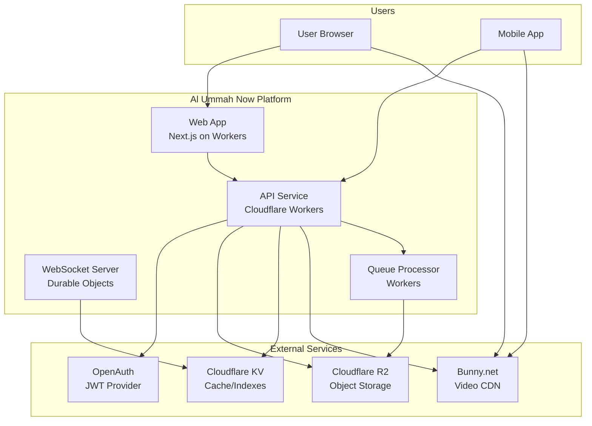

## Upload Flow Architecture

### High-Level Upload Flow

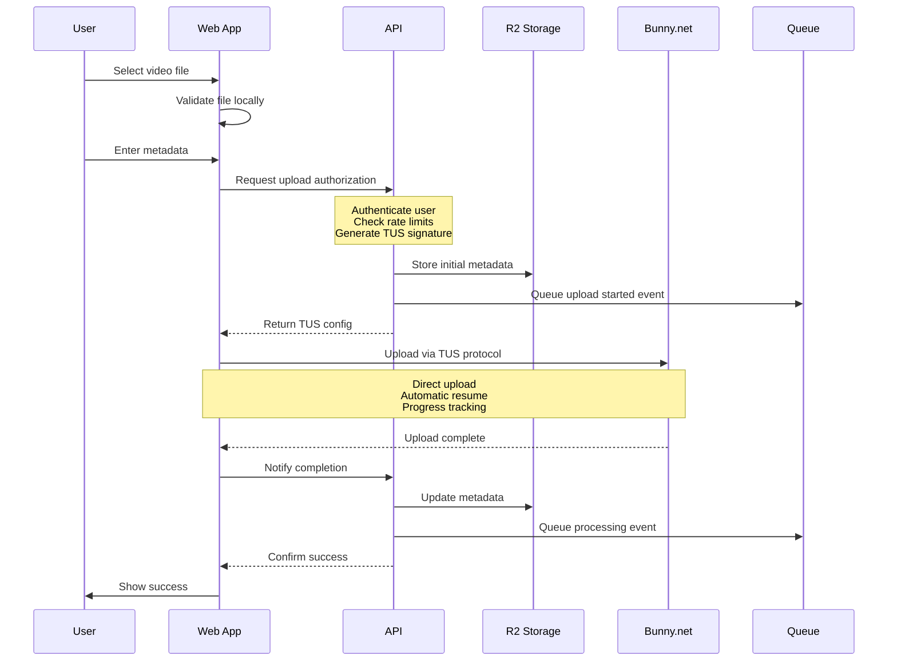

### Detailed Component Interactions

```mermaid
graph LR
    subgraph "Client Layer"
        UI[Upload UI]
        TUS[TUS Client]
        AUTH_C[Auth Context]
    end

    subgraph "API Layer"
        INIT[/upload/initiate]
        COMP[/upload/complete]
        STAT[/upload/status]
        MW[Auth Middleware]
        RL[Rate Limiter]
    end

    subgraph "Storage Layer"
        R2_V[R2: videos]
        R2_P[R2: profiles]
        KV_RL[KV: rate limits]
        KV_C[KV: cache]
    end

    subgraph "CDN Layer"
        TUS_E[TUS Endpoint]
        ENCODE[Encoding Pipeline]
        STREAM[Streaming CDN]
    end

    UI --> AUTH_C
    UI --> TUS
    AUTH_C --> MW
    TUS --> TUS_E

    INIT --> MW
    INIT --> RL
    RL --> KV_RL
    INIT --> R2_V

    COMP --> MW
    COMP --> R2_V

    STAT --> MW
    STAT --> R2_V
    STAT --> TUS_E

    TUS_E --> ENCODE
    ENCODE --> STREAM
```

## Data Flow

### Upload Initiation Data Flow

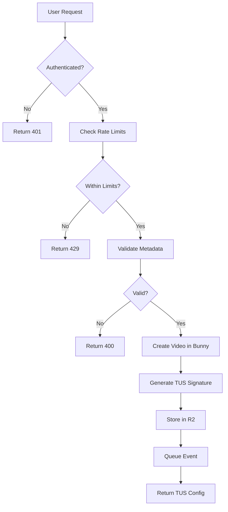

### TUS Upload Protocol Flow

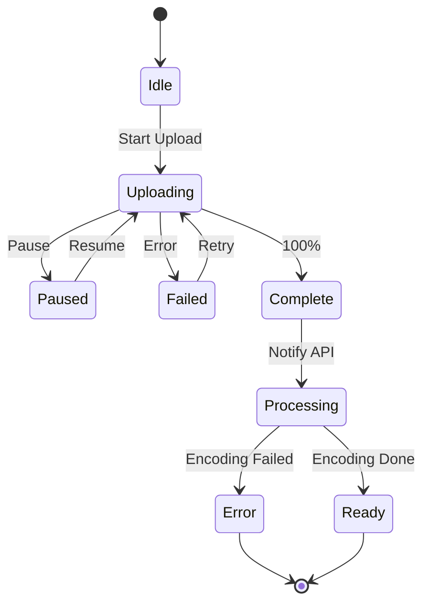

## Security Architecture

### Authentication & Authorization Flow

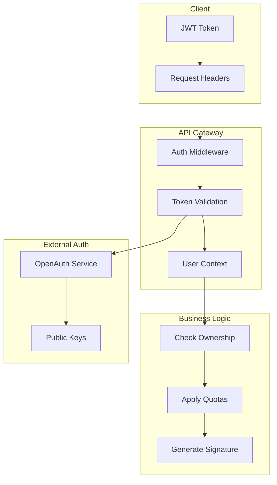

### Signed URL Security Model

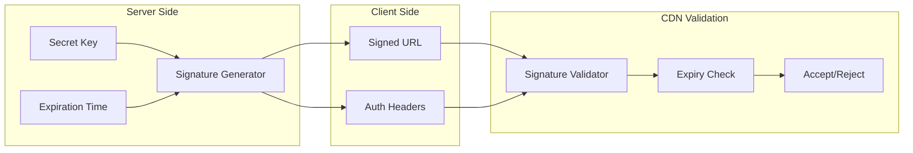

## Storage Architecture

### R2 Bucket Organization

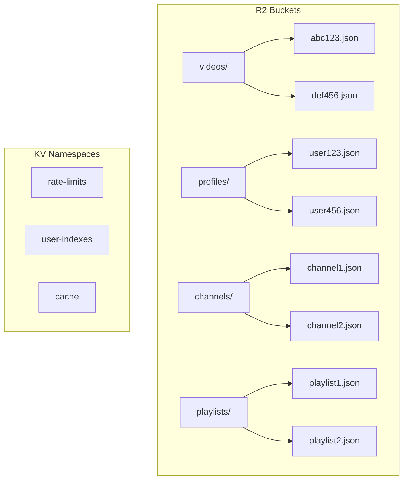

### Video Metadata Structure

```json
{
  "id": "uuid-v4",
  "title": "Video Title",
  "titleLocalized": {
    "en": "English Title",
    "ar": "العنوان بالعربية"
  },
  "description": "Description",
  "descriptionLocalized": {
    "en": "English description",
    "ar": "الوصف بالعربية"
  },
  "uploadMetadata": {
    "fileSize": 125000000,
    "mimeType": "video/mp4",
    "initiatedAt": "2025-11-20T10:00:00Z",
    "completedAt": "2025-11-20T10:15:00Z"
  },
  "processingMetadata": {
    "bunnyVideoId": "xyz789",
    "bunnyLibraryId": 12345,
    "encodingStatus": "complete",
    "availableResolutions": ["240p", "360p", "720p", "1080p"]
  },
  "engagement": {
    "views": 0,
    "likes": [],
    "dislikes": [],
    "comments": []
  },
  "permissions": {
    "isPublic": true,
    "allowComments": true,
    "allowDownload": false
  },
  "timestamps": {
    "createdAt": "2025-11-20T10:00:00Z",
    "updatedAt": "2025-11-20T10:15:00Z",
    "publishedAt": "2025-11-20T11:00:00Z"
  }
}
```

## Rate Limiting Architecture

### Rate Limit Enforcement

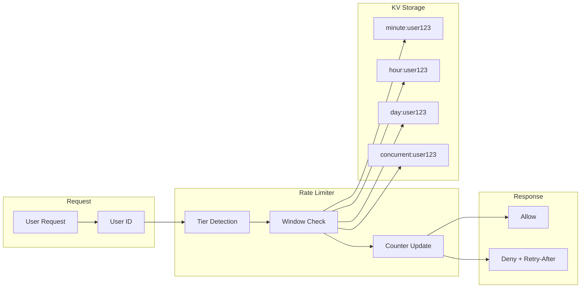

## Error Handling & Recovery

### Upload Failure Recovery Flow

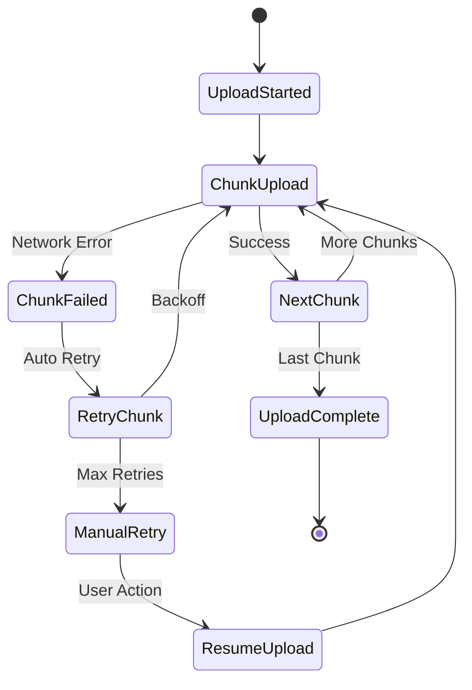

## Performance Optimization

### Caching Strategy

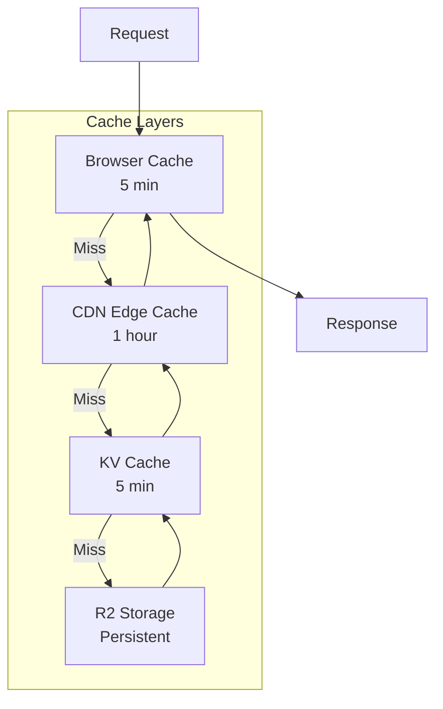

## Monitoring & Observability

### Key Metrics

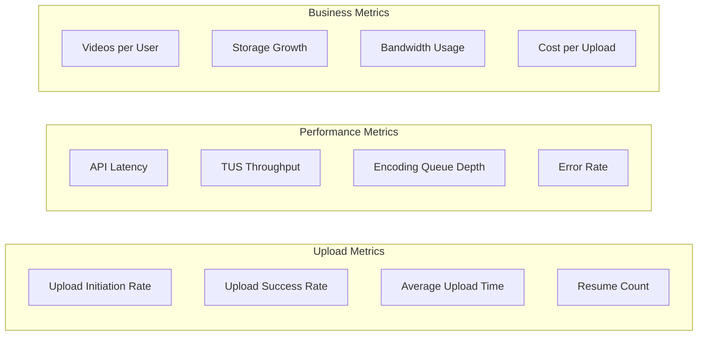

## Deployment Architecture

### Multi-Environment Setup

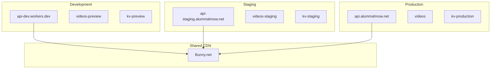

## Scalability Considerations

### Load Distribution

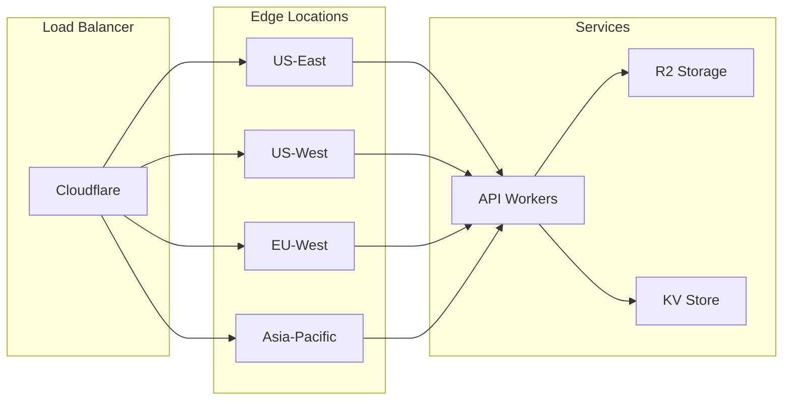

## Cost Model

### Upload Cost Breakdown

| Component | Unit Cost | Typical Usage | Monthly Cost |
|-----------|-----------|---------------|--------------|
| R2 Storage | $0.015/GB | 1TB | $15 |
| R2 Writes | $0.36/million | 10,000 uploads | $0.04 |
| R2 Reads | Free (10M) | 1M reads | $0 |
| KV Writes | $0.50/million | 100,000 | $0.05 |
| KV Reads | Free (10M) | 5M reads | $0 |
| Workers | $0.30/million | 500,000 | $0.15 |
| Bunny CDN | $0.01/GB | 500GB | $5 |
| **Total** | | | **~$20.24** |

## Future Enhancements

### Roadmap

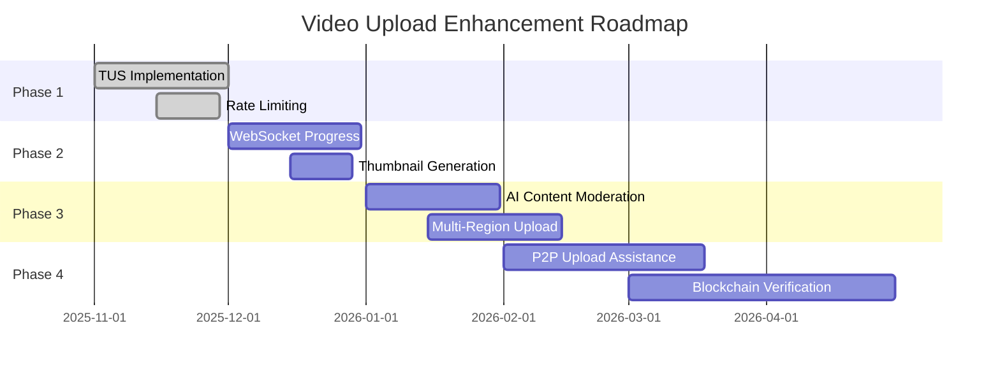

## References

- [TUS Protocol Specification](https://tus.io/)
- [Cloudflare Workers Documentation](https://developers.cloudflare.com/workers/)
- [Bunny.net API Documentation](https://docs.bunny.net/)
- [R2 Storage Documentation](https://developers.cloudflare.com/r2/)

## Related Documents

- [ADR 0001: Use TUS Protocol for Video Uploads](../adr/0001-use-tus-protocol-for-video-uploads.md)
- [ADR 0002: Signed URL Upload Architecture](../adr/0002-signed-url-upload-architecture.md)
- [ADR 0003: Tiered Rate Limiting](../adr/0003-tiered-rate-limiting-for-uploads.md)
- [ADR 0004: R2-Based Metadata Storage](../adr/0004-r2-based-video-metadata-storage.md)

---

*Last Updated: 2025-11-20*
*Version: 1.0*