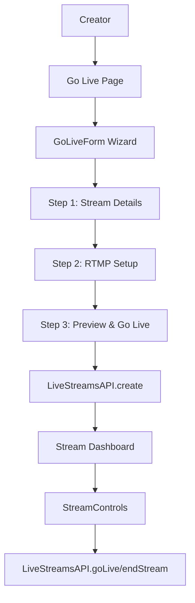
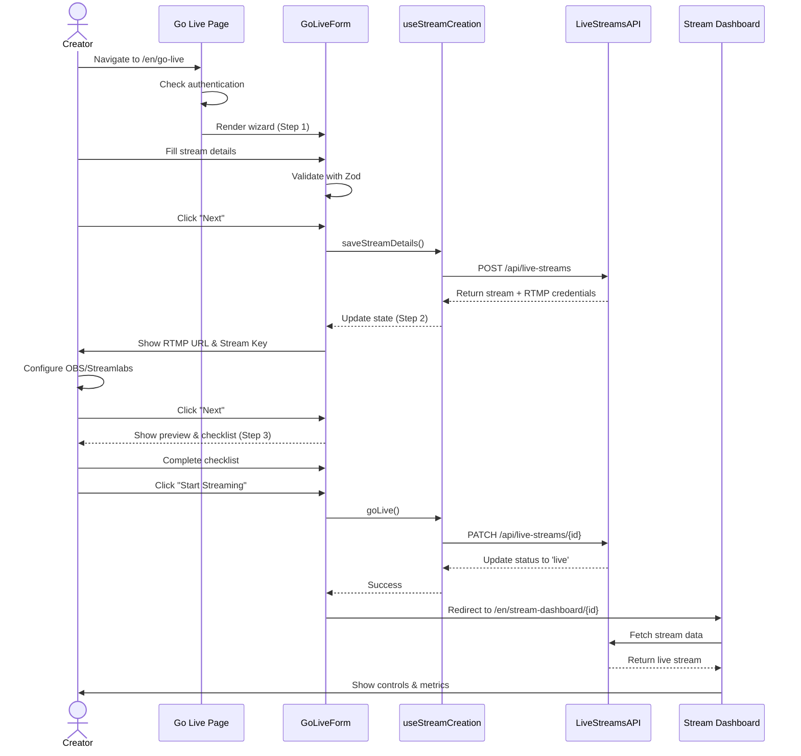
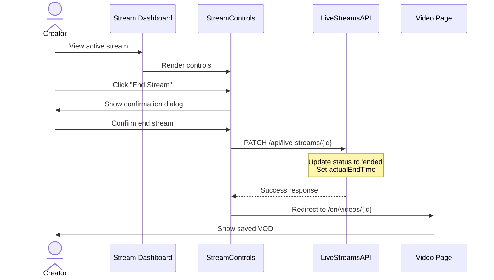

# Phase 2: Creator Tools - Go Live Experience

## Implementation Breakdown

**Version**: 1.0
**Last Updated**: 2025-11-06
**Estimated Total Time**: 24-32 hours

---

## Table of Contents

1. [Architecture Overview](#architecture-overview)
2. [Component Breakdown](#component-breakdown)
3. [Implementation Guide](#implementation-guide)
4. [Security Considerations](#security-considerations)
5. [Testing Strategy](#testing-strategy)
6. [User Flow Diagrams](#user-flow-diagrams)
7. [Deployment Checklist](#deployment-checklist)

---

## Architecture Overview

### Tech Stack

| Layer | Technology | Purpose |
|-------|-----------|---------|
| Framework | Next.js 15 (App Router) | Server/Client rendering |
| Language | TypeScript 5.x | Type safety |
| Styling | Tailwind CSS | Utility-first CSS |
| Forms | React Hook Form + Zod | Validation & state management |
| API Client | Custom LiveStreamsAPI | Backend communication |
| Auth | OpenAuth JWT | Protected routes |
| State | React Context + Custom Hooks | Form wizard state |

### Data Flow



### Component Hierarchy

```
/en/go-live (Page)
├── GoLiveForm (Multi-step Wizard)
│   ├── StreamDetailsStep
│   │   ├── TitleInput
│   │   ├── DescriptionTextarea
│   │   ├── CategorySelect
│   │   ├── LanguageSelect
│   │   ├── ScheduledTimePicker
│   │   ├── PrivacyToggle
│   │   ├── ChatToggle
│   │   └── TagsInput
│   ├── RtmpSetupStep
│   │   ├── StreamSetup (RTMP/Key Display)
│   │   ├── InstructionsAccordion
│   │   └── TestConnectionButton
│   └── PreviewStep
│       ├── StreamPreview (if available)
│       ├── SettingsSummary
│       └── GoLiveButton
├── useStreamCreation (Custom Hook)
└── WizardProgress (Step Indicator)

/en/stream-dashboard (Page)
├── ActiveStreamDisplay
├── StreamControls
│   ├── StartStopButton
│   ├── DurationTimer
│   ├── ViewerCount (real-time)
│   └── EndStreamButton
├── LiveMetrics
└── ChatModeration (optional)
```

---

## Component Breakdown

### 1. GoLiveForm Component

**File**: `/apps/web/src/components/GoLiveForm/index.tsx`

**Responsibility**: Multi-step wizard for creating and launching live streams

**Props**:
```typescript
interface GoLiveFormProps {
  channelId: string;
  userId: string;
  onSuccess: (streamId: string) => void;
  onCancel: () => void;
}
```

**State Management**:
```typescript
interface GoLiveFormState {
  currentStep: 1 | 2 | 3;
  streamDetails: StreamDetailsData;
  rtmpConfig: RTMPConfig;
  errors: Record<string, string>;
  isLoading: boolean;
  streamId?: string;
}
```

**Implementation Time**: 8-10 hours

---

### 2. StreamDetailsStep Component

**File**: `/apps/web/src/components/GoLiveForm/StreamDetailsStep.tsx`

**Form Schema** (Zod):
```typescript
import { z } from 'zod';

export const streamDetailsSchema = z.object({
  title: z.string()
    .min(1, 'Title is required')
    .max(100, 'Title must be 100 characters or less'),

  description: z.string()
    .max(500, 'Description must be 500 characters or less')
    .optional(),

  category: z.enum([
    'islamic-studies',
    'quran-recitation',
    'hadith',
    'fiqh',
    'history',
    'arabic-language',
    'dawah',
    'kids-education',
    'other'
  ]),

  language: z.enum(['en', 'ar']),

  scheduledStartTime: z.string()
    .datetime()
    .optional()
    .refine(
      (date) => !date || new Date(date) > new Date(),
      'Scheduled time must be in the future'
    ),

  isPrivate: z.boolean().default(false),

  allowChat: z.boolean().default(true),

  tags: z.array(z.string().max(30))
    .max(10, 'Maximum 10 tags allowed')
    .optional(),
});

export type StreamDetailsData = z.infer<typeof streamDetailsSchema>;
```

**Complete Implementation**:

```typescript
'use client';

import React from 'react';
import { useForm } from 'react-hook-form';
import { zodResolver } from '@hookform/resolvers/zod';
import { streamDetailsSchema, type StreamDetailsData } from './schema';

interface StreamDetailsStepProps {
  initialData?: Partial<StreamDetailsData>;
  onNext: (data: StreamDetailsData) => void;
  onCancel: () => void;
}

export const StreamDetailsStep: React.FC<StreamDetailsStepProps> = ({
  initialData,
  onNext,
  onCancel,
}) => {
  const {
    register,
    handleSubmit,
    watch,
    formState: { errors, isSubmitting },
  } = useForm<StreamDetailsData>({
    resolver: zodResolver(streamDetailsSchema),
    defaultValues: {
      language: 'en',
      isPrivate: false,
      allowChat: true,
      ...initialData,
    },
  });

  const titleLength = watch('title')?.length || 0;
  const descriptionLength = watch('description')?.length || 0;

  const onSubmit = (data: StreamDetailsData) => {
    onNext(data);
  };

  return (
    <form onSubmit={handleSubmit(onSubmit)} className="space-y-6">
      <div>
        <label htmlFor="title" className="block text-sm font-medium mb-2">
          Stream Title *
        </label>
        <input
          {...register('title')}
          id="title"
          type="text"
          className={`w-full px-4 py-2 border rounded-lg focus:ring-2 focus:ring-blue-500 ${
            errors.title ? 'border-red-500' : 'border-gray-300'
          }`}
          placeholder="Enter stream title"
          maxLength={100}
        />
        <div className="flex justify-between mt-1">
          <span className="text-xs text-red-500">{errors.title?.message}</span>
          <span className="text-xs text-gray-500">{titleLength}/100</span>
        </div>
      </div>

      <div>
        <label htmlFor="description" className="block text-sm font-medium mb-2">
          Description
        </label>
        <textarea
          {...register('description')}
          id="description"
          rows={4}
          className={`w-full px-4 py-2 border rounded-lg focus:ring-2 focus:ring-blue-500 ${
            errors.description ? 'border-red-500' : 'border-gray-300'
          }`}
          placeholder="Describe what viewers can expect from this stream"
          maxLength={500}
        />
        <div className="flex justify-between mt-1">
          <span className="text-xs text-red-500">
            {errors.description?.message}
          </span>
          <span className="text-xs text-gray-500">{descriptionLength}/500</span>
        </div>
      </div>

      <div className="grid grid-cols-1 md:grid-cols-2 gap-4">
        <div>
          <label htmlFor="category" className="block text-sm font-medium mb-2">
            Category *
          </label>
          <select
            {...register('category')}
            id="category"
            className={`w-full px-4 py-2 border rounded-lg focus:ring-2 focus:ring-blue-500 ${
              errors.category ? 'border-red-500' : 'border-gray-300'
            }`}
          >
            <option value="">Select a category</option>
            <option value="islamic-studies">Islamic Studies</option>
            <option value="quran-recitation">Quran Recitation</option>
            <option value="hadith">Hadith</option>
            <option value="fiqh">Fiqh (Islamic Jurisprudence)</option>
            <option value="history">Islamic History</option>
            <option value="arabic-language">Arabic Language</option>
            <option value="dawah">Dawah</option>
            <option value="kids-education">Kids Education</option>
            <option value="other">Other</option>
          </select>
          {errors.category && (
            <span className="text-xs text-red-500">{errors.category.message}</span>
          )}
        </div>

        <div>
          <label htmlFor="language" className="block text-sm font-medium mb-2">
            Language *
          </label>
          <select
            {...register('language')}
            id="language"
            className={`w-full px-4 py-2 border rounded-lg focus:ring-2 focus:ring-blue-500 ${
              errors.language ? 'border-red-500' : 'border-gray-300'
            }`}
          >
            <option value="en">English</option>
            <option value="ar">العربية (Arabic)</option>
          </select>
          {errors.language && (
            <span className="text-xs text-red-500">{errors.language.message}</span>
          )}
        </div>
      </div>

      <div>
        <label
          htmlFor="scheduledStartTime"
          className="block text-sm font-medium mb-2"
        >
          Scheduled Start Time (Optional)
        </label>
        <input
          {...register('scheduledStartTime')}
          id="scheduledStartTime"
          type="datetime-local"
          className={`w-full px-4 py-2 border rounded-lg focus:ring-2 focus:ring-blue-500 ${
            errors.scheduledStartTime ? 'border-red-500' : 'border-gray-300'
          }`}
          min={new Date().toISOString().slice(0, 16)}
        />
        {errors.scheduledStartTime && (
          <span className="text-xs text-red-500">
            {errors.scheduledStartTime.message}
          </span>
        )}
        <p className="text-xs text-gray-500 mt-1">
          Leave empty to go live immediately
        </p>
      </div>

      <div className="space-y-3">
        <div className="flex items-center justify-between p-4 border rounded-lg">
          <div>
            <label htmlFor="isPrivate" className="font-medium cursor-pointer">
              Private Stream
            </label>
            <p className="text-sm text-gray-500">
              Only people with the link can watch
            </p>
          </div>
          <input
            {...register('isPrivate')}
            id="isPrivate"
            type="checkbox"
            className="w-5 h-5 text-blue-600 rounded focus:ring-blue-500"
          />
        </div>

        <div className="flex items-center justify-between p-4 border rounded-lg">
          <div>
            <label htmlFor="allowChat" className="font-medium cursor-pointer">
              Enable Live Chat
            </label>
            <p className="text-sm text-gray-500">
              Allow viewers to chat during the stream
            </p>
          </div>
          <input
            {...register('allowChat')}
            id="allowChat"
            type="checkbox"
            className="w-5 h-5 text-blue-600 rounded focus:ring-blue-500"
          />
        </div>
      </div>

      <div>
        <label htmlFor="tags" className="block text-sm font-medium mb-2">
          Tags (Optional)
        </label>
        <input
          {...register('tags')}
          id="tags"
          type="text"
          className={`w-full px-4 py-2 border rounded-lg focus:ring-2 focus:ring-blue-500 ${
            errors.tags ? 'border-red-500' : 'border-gray-300'
          }`}
          placeholder="Separate tags with commas (e.g., tafsir, quran, ramadan)"
        />
        {errors.tags && (
          <span className="text-xs text-red-500">{errors.tags.message}</span>
        )}
        <p className="text-xs text-gray-500 mt-1">
          Maximum 10 tags, 30 characters each
        </p>
      </div>

      <div className="flex gap-4 pt-4">
        <button
          type="button"
          onClick={onCancel}
          className="flex-1 px-6 py-3 border border-gray-300 rounded-lg font-medium hover:bg-gray-50 transition-colors"
        >
          Cancel
        </button>
        <button
          type="submit"
          disabled={isSubmitting}
          className="flex-1 px-6 py-3 bg-blue-600 text-white rounded-lg font-medium hover:bg-blue-700 disabled:bg-gray-400 disabled:cursor-not-allowed transition-colors"
        >
          {isSubmitting ? 'Validating...' : 'Next: RTMP Setup'}
        </button>
      </div>
    </form>
  );
};
```

**Implementation Time**: 4-5 hours

---

### 3. RtmpSetupStep Component

**File**: `/apps/web/src/components/GoLiveForm/RtmpSetupStep.tsx`

**Complete Implementation**:

```typescript
'use client';

import React, { useState } from 'react';
import { StreamSetup } from '../StreamSetup';

interface RtmpSetupStepProps {
  rtmpUrl: string;
  streamKey: string;
  onNext: () => void;
  onBack: () => void;
  onTestConnection?: () => Promise<boolean>;
}

export const RtmpSetupStep: React.FC<RtmpSetupStepProps> = ({
  rtmpUrl,
  streamKey,
  onNext,
  onBack,
  onTestConnection,
}) => {
  const [isTestingConnection, setIsTestingConnection] = useState(false);
  const [connectionStatus, setConnectionStatus] = useState<
    'idle' | 'success' | 'error'
  >('idle');
  const [expandedSection, setExpandedSection] = useState<string | null>('obs');

  const handleTestConnection = async () => {
    if (!onTestConnection) return;

    setIsTestingConnection(true);
    setConnectionStatus('idle');

    try {
      const success = await onTestConnection();
      setConnectionStatus(success ? 'success' : 'error');
    } catch (error) {
      setConnectionStatus('error');
    } finally {
      setIsTestingConnection(false);
    }
  };

  const toggleSection = (section: string) => {
    setExpandedSection(expandedSection === section ? null : section);
  };

  return (
    <div className="space-y-6">
      <div className="bg-blue-50 border border-blue-200 rounded-lg p-4">
        <h3 className="font-medium text-blue-900 mb-2">
          Step 2: Configure Your Streaming Software
        </h3>
        <p className="text-sm text-blue-700">
          Copy the RTMP URL and Stream Key below into your streaming software
          (OBS Studio, Streamlabs, etc.) to connect to Al Ummah Now.
        </p>
      </div>

      <StreamSetup rtmpUrl={rtmpUrl} streamKey={streamKey} />

      {onTestConnection && (
        <div className="border rounded-lg p-4">
          <h4 className="font-medium mb-3">Test Connection</h4>
          <button
            type="button"
            onClick={handleTestConnection}
            disabled={isTestingConnection}
            className={`w-full px-4 py-3 rounded-lg font-medium transition-colors ${
              connectionStatus === 'success'
                ? 'bg-green-600 text-white hover:bg-green-700'
                : connectionStatus === 'error'
                ? 'bg-red-600 text-white hover:bg-red-700'
                : 'bg-gray-200 hover:bg-gray-300'
            } disabled:bg-gray-100 disabled:cursor-not-allowed`}
          >
            {isTestingConnection
              ? 'Testing Connection...'
              : connectionStatus === 'success'
              ? 'Connection Successful'
              : connectionStatus === 'error'
              ? 'Connection Failed - Try Again'
              : 'Test Connection'}
          </button>
          {connectionStatus === 'error' && (
            <p className="text-sm text-red-600 mt-2">
              Unable to establish connection. Please check your RTMP settings and
              try again.
            </p>
          )}
        </div>
      )}

      <div className="border rounded-lg overflow-hidden">
        <h4 className="font-medium p-4 bg-gray-50">Setup Instructions</h4>

        <div className="divide-y">
          <div>
            <button
              type="button"
              onClick={() => toggleSection('obs')}
              className="w-full text-left px-4 py-3 hover:bg-gray-50 transition-colors flex justify-between items-center"
            >
              <span className="font-medium">OBS Studio Setup</span>
              <svg
                className={`w-5 h-5 transition-transform ${
                  expandedSection === 'obs' ? 'rotate-180' : ''
                }`}
                fill="none"
                stroke="currentColor"
                viewBox="0 0 24 24"
              >
                <path
                  strokeLinecap="round"
                  strokeLinejoin="round"
                  strokeWidth={2}
                  d="M19 9l-7 7-7-7"
                />
              </svg>
            </button>
            {expandedSection === 'obs' && (
              <div className="px-4 pb-4 space-y-3 text-sm">
                <ol className="list-decimal list-inside space-y-2">
                  <li>
                    Download and install{' '}
                    <a
                      href="https://obsproject.com/"
                      target="_blank"
                      rel="noopener noreferrer"
                      className="text-blue-600 hover:underline"
                    >
                      OBS Studio
                    </a>{' '}
                    (free and open source)
                  </li>
                  <li>Open OBS Studio and go to Settings → Stream</li>
                  <li>
                    Set Service to "Custom" and paste the RTMP URL in Server field
                  </li>
                  <li>Paste the Stream Key in the Stream Key field</li>
                  <li>Click "Apply" and "OK"</li>
                  <li>Set up your scenes and sources (camera, screen, etc.)</li>
                  <li>Click "Start Streaming" when ready</li>
                </ol>
              </div>
            )}
          </div>

          <div>
            <button
              type="button"
              onClick={() => toggleSection('streamlabs')}
              className="w-full text-left px-4 py-3 hover:bg-gray-50 transition-colors flex justify-between items-center"
            >
              <span className="font-medium">Streamlabs OBS Setup</span>
              <svg
                className={`w-5 h-5 transition-transform ${
                  expandedSection === 'streamlabs' ? 'rotate-180' : ''
                }`}
                fill="none"
                stroke="currentColor"
                viewBox="0 0 24 24"
              >
                <path
                  strokeLinecap="round"
                  strokeLinejoin="round"
                  strokeWidth={2}
                  d="M19 9l-7 7-7-7"
                />
              </svg>
            </button>
            {expandedSection === 'streamlabs' && (
              <div className="px-4 pb-4 space-y-3 text-sm">
                <ol className="list-decimal list-inside space-y-2">
                  <li>
                    Download{' '}
                    <a
                      href="https://streamlabs.com/streamlabs-live-streaming-software"
                      target="_blank"
                      rel="noopener noreferrer"
                      className="text-blue-600 hover:underline"
                    >
                      Streamlabs OBS
                    </a>
                  </li>
                  <li>Go to Settings → Stream</li>
                  <li>Select "Custom Streaming Server"</li>
                  <li>Enter RTMP URL and Stream Key</li>
                  <li>Configure your scenes and sources</li>
                  <li>Click "Go Live" when ready</li>
                </ol>
              </div>
            )}
          </div>

          <div>
            <button
              type="button"
              onClick={() => toggleSection('bandwidth')}
              className="w-full text-left px-4 py-3 hover:bg-gray-50 transition-colors flex justify-between items-center"
            >
              <span className="font-medium">Bandwidth Recommendations</span>
              <svg
                className={`w-5 h-5 transition-transform ${
                  expandedSection === 'bandwidth' ? 'rotate-180' : ''
                }`}
                fill="none"
                stroke="currentColor"
                viewBox="0 0 24 24"
              >
                <path
                  strokeLinecap="round"
                  strokeLinejoin="round"
                  strokeWidth={2}
                  d="M19 9l-7 7-7-7"
                />
              </svg>
            </button>
            {expandedSection === 'bandwidth' && (
              <div className="px-4 pb-4 space-y-3 text-sm">
                <table className="w-full text-left border-collapse">
                  <thead>
                    <tr className="border-b">
                      <th className="py-2">Quality</th>
                      <th className="py-2">Resolution</th>
                      <th className="py-2">Bitrate</th>
                    </tr>
                  </thead>
                  <tbody>
                    <tr className="border-b">
                      <td className="py-2">Low</td>
                      <td className="py-2">480p (854x480)</td>
                      <td className="py-2">1,000 - 2,000 Kbps</td>
                    </tr>
                    <tr className="border-b">
                      <td className="py-2">Medium</td>
                      <td className="py-2">720p (1280x720)</td>
                      <td className="py-2">2,500 - 4,000 Kbps</td>
                    </tr>
                    <tr>
                      <td className="py-2">High</td>
                      <td className="py-2">1080p (1920x1080)</td>
                      <td className="py-2">4,500 - 6,000 Kbps</td>
                    </tr>
                  </tbody>
                </table>
                <p className="text-gray-600 mt-3">
                  Ensure your upload speed is at least 1.5x your bitrate for stable
                  streaming.
                </p>
              </div>
            )}
          </div>
        </div>
      </div>

      <div className="bg-yellow-50 border border-yellow-200 rounded-lg p-4">
        <h4 className="font-medium text-yellow-900 mb-2">Equipment Checklist</h4>
        <ul className="space-y-2 text-sm text-yellow-800">
          <li className="flex items-start gap-2">
            <span>✓</span>
            <span>Stable internet connection (min 5 Mbps upload)</span>
          </li>
          <li className="flex items-start gap-2">
            <span>✓</span>
            <span>Webcam or camera with HDMI capture card</span>
          </li>
          <li className="flex items-start gap-2">
            <span>✓</span>
            <span>Microphone (external recommended for better audio)</span>
          </li>
          <li className="flex items-start gap-2">
            <span>✓</span>
            <span>Good lighting (ring light or natural light)</span>
          </li>
          <li className="flex items-start gap-2">
            <span>✓</span>
            <span>Quiet environment</span>
          </li>
        </ul>
      </div>

      <div className="flex gap-4 pt-4">
        <button
          type="button"
          onClick={onBack}
          className="flex-1 px-6 py-3 border border-gray-300 rounded-lg font-medium hover:bg-gray-50 transition-colors"
        >
          Back
        </button>
        <button
          type="button"
          onClick={onNext}
          className="flex-1 px-6 py-3 bg-blue-600 text-white rounded-lg font-medium hover:bg-blue-700 transition-colors"
        >
          Next: Preview & Go Live
        </button>
      </div>
    </div>
  );
};
```

**Implementation Time**: 3-4 hours

---

### 4. StreamSetup Component

**File**: `/apps/web/src/components/StreamSetup/index.tsx`

**Complete Implementation**:

```typescript
'use client';

import React, { useState } from 'react';

interface StreamSetupProps {
  rtmpUrl: string;
  streamKey: string;
  showQRCode?: boolean;
}

export const StreamSetup: React.FC<StreamSetupProps> = ({
  rtmpUrl,
  streamKey,
  showQRCode = false,
}) => {
  const [showStreamKey, setShowStreamKey] = useState(false);
  const [copiedField, setCopiedField] = useState<'rtmp' | 'key' | null>(null);

  const copyToClipboard = async (text: string, field: 'rtmp' | 'key') => {
    try {
      await navigator.clipboard.writeText(text);
      setCopiedField(field);
      setTimeout(() => setCopiedField(null), 2000);
    } catch (error) {
      console.error('Failed to copy:', error);
    }
  };

  const maskedStreamKey = streamKey
    ? `${streamKey.slice(0, 8)}${'•'.repeat(streamKey.length - 12)}${streamKey.slice(-4)}`
    : '';

  return (
    <div className="space-y-4">
      <div className="border rounded-lg p-4">
        <div className="flex justify-between items-center mb-2">
          <label className="text-sm font-medium">RTMP URL</label>
          <button
            type="button"
            onClick={() => copyToClipboard(rtmpUrl, 'rtmp')}
            className="text-sm text-blue-600 hover:text-blue-700 font-medium flex items-center gap-1"
          >
            {copiedField === 'rtmp' ? (
              <>
                <svg
                  className="w-4 h-4"
                  fill="none"
                  stroke="currentColor"
                  viewBox="0 0 24 24"
                >
                  <path
                    strokeLinecap="round"
                    strokeLinejoin="round"
                    strokeWidth={2}
                    d="M5 13l4 4L19 7"
                  />
                </svg>
                Copied
              </>
            ) : (
              <>
                <svg
                  className="w-4 h-4"
                  fill="none"
                  stroke="currentColor"
                  viewBox="0 0 24 24"
                >
                  <path
                    strokeLinecap="round"
                    strokeLinejoin="round"
                    strokeWidth={2}
                    d="M8 16H6a2 2 0 01-2-2V6a2 2 0 012-2h8a2 2 0 012 2v2m-6 12h8a2 2 0 002-2v-8a2 2 0 00-2-2h-8a2 2 0 00-2 2v8a2 2 0 002 2z"
                  />
                </svg>
                Copy
              </>
            )}
          </button>
        </div>
        <code className="block px-3 py-2 bg-gray-100 rounded text-sm font-mono break-all">
          {rtmpUrl}
        </code>
      </div>

      <div className="border rounded-lg p-4">
        <div className="flex justify-between items-center mb-2">
          <label className="text-sm font-medium">Stream Key</label>
          <div className="flex gap-2">
            <button
              type="button"
              onClick={() => setShowStreamKey(!showStreamKey)}
              className="text-sm text-gray-600 hover:text-gray-700 font-medium flex items-center gap-1"
            >
              {showStreamKey ? (
                <>
                  <svg
                    className="w-4 h-4"
                    fill="none"
                    stroke="currentColor"
                    viewBox="0 0 24 24"
                  >
                    <path
                      strokeLinecap="round"
                      strokeLinejoin="round"
                      strokeWidth={2}
                      d="M13.875 18.825A10.05 10.05 0 0112 19c-4.478 0-8.268-2.943-9.543-7a9.97 9.97 0 011.563-3.029m5.858.908a3 3 0 114.243 4.243M9.878 9.878l4.242 4.242M9.88 9.88l-3.29-3.29m7.532 7.532l3.29 3.29M3 3l3.59 3.59m0 0A9.953 9.953 0 0112 5c4.478 0 8.268 2.943 9.543 7a10.025 10.025 0 01-4.132 5.411m0 0L21 21"
                    />
                  </svg>
                  Hide
                </>
              ) : (
                <>
                  <svg
                    className="w-4 h-4"
                    fill="none"
                    stroke="currentColor"
                    viewBox="0 0 24 24"
                  >
                    <path
                      strokeLinecap="round"
                      strokeLinejoin="round"
                      strokeWidth={2}
                      d="M15 12a3 3 0 11-6 0 3 3 0 016 0z"
                    />
                    <path
                      strokeLinecap="round"
                      strokeLinejoin="round"
                      strokeWidth={2}
                      d="M2.458 12C3.732 7.943 7.523 5 12 5c4.478 0 8.268 2.943 9.542 7-1.274 4.057-5.064 7-9.542 7-4.477 0-8.268-2.943-9.542-7z"
                    />
                  </svg>
                  Show
                </>
              )}
            </button>
            <button
              type="button"
              onClick={() => copyToClipboard(streamKey, 'key')}
              className="text-sm text-blue-600 hover:text-blue-700 font-medium flex items-center gap-1"
            >
              {copiedField === 'key' ? (
                <>
                  <svg
                    className="w-4 h-4"
                    fill="none"
                    stroke="currentColor"
                    viewBox="0 0 24 24"
                  >
                    <path
                      strokeLinecap="round"
                      strokeLinejoin="round"
                      strokeWidth={2}
                      d="M5 13l4 4L19 7"
                    />
                  </svg>
                  Copied
                </>
              ) : (
                <>
                  <svg
                    className="w-4 h-4"
                    fill="none"
                    stroke="currentColor"
                    viewBox="0 0 24 24"
                  >
                    <path
                      strokeLinecap="round"
                      strokeLinejoin="round"
                      strokeWidth={2}
                      d="M8 16H6a2 2 0 01-2-2V6a2 2 0 012-2h8a2 2 0 012 2v2m-6 12h8a2 2 0 002-2v-8a2 2 0 00-2-2h-8a2 2 0 00-2 2v8a2 2 0 002 2z"
                    />
                  </svg>
                  Copy
                </>
              )}
            </button>
          </div>
        </div>
        <code className="block px-3 py-2 bg-gray-100 rounded text-sm font-mono break-all">
          {showStreamKey ? streamKey : maskedStreamKey}
        </code>
        <p className="text-xs text-red-600 mt-2 flex items-start gap-1">
          <svg
            className="w-4 h-4 flex-shrink-0 mt-0.5"
            fill="none"
            stroke="currentColor"
            viewBox="0 0 24 24"
          >
            <path
              strokeLinecap="round"
              strokeLinejoin="round"
              strokeWidth={2}
              d="M12 9v2m0 4h.01m-6.938 4h13.856c1.54 0 2.502-1.667 1.732-3L13.732 4c-.77-1.333-2.694-1.333-3.464 0L3.34 16c-.77 1.333.192 3 1.732 3z"
            />
          </svg>
          <span>
            Keep your stream key private! Anyone with this key can stream to your
            channel.
          </span>
        </p>
      </div>

      {showQRCode && (
        <div className="border rounded-lg p-4 text-center">
          <p className="text-sm text-gray-600 mb-3">
            Scan QR code with mobile streaming app
          </p>
          <div className="inline-block p-4 bg-white border rounded">
            {/* QR code would be generated here - placeholder for now */}
            <div className="w-32 h-32 bg-gray-200 flex items-center justify-center">
              QR Code
            </div>
          </div>
        </div>
      )}
    </div>
  );
};
```

**RTL Version** (`/apps/web/src/components/StreamSetup/rtl/index.tsx`):

```typescript
'use client';

import React, { useState } from 'react';

interface StreamSetupProps {
  rtmpUrl: string;
  streamKey: string;
  showQRCode?: boolean;
}

export const StreamSetup: React.FC<StreamSetupProps> = ({
  rtmpUrl,
  streamKey,
  showQRCode = false,
}) => {
  const [showStreamKey, setShowStreamKey] = useState(false);
  const [copiedField, setCopiedField] = useState<'rtmp' | 'key' | null>(null);

  const copyToClipboard = async (text: string, field: 'rtmp' | 'key') => {
    try {
      await navigator.clipboard.writeText(text);
      setCopiedField(field);
      setTimeout(() => setCopiedField(null), 2000);
    } catch (error) {
      console.error('Failed to copy:', error);
    }
  };

  const maskedStreamKey = streamKey
    ? `${streamKey.slice(0, 8)}${'•'.repeat(streamKey.length - 12)}${streamKey.slice(-4)}`
    : '';

  return (
    <div className="space-y-4" dir="rtl">
      <div className="border rounded-lg p-4">
        <div className="flex justify-between items-center mb-2">
          <label className="text-sm font-medium">عنوان RTMP</label>
          <button
            type="button"
            onClick={() => copyToClipboard(rtmpUrl, 'rtmp')}
            className="text-sm text-blue-600 hover:text-blue-700 font-medium flex items-center gap-1"
          >
            {copiedField === 'rtmp' ? (
              <>
                <svg
                  className="w-4 h-4"
                  fill="none"
                  stroke="currentColor"
                  viewBox="0 0 24 24"
                >
                  <path
                    strokeLinecap="round"
                    strokeLinejoin="round"
                    strokeWidth={2}
                    d="M5 13l4 4L19 7"
                  />
                </svg>
                تم النسخ
              </>
            ) : (
              <>
                <svg
                  className="w-4 h-4"
                  fill="none"
                  stroke="currentColor"
                  viewBox="0 0 24 24"
                >
                  <path
                    strokeLinecap="round"
                    strokeLinejoin="round"
                    strokeWidth={2}
                    d="M8 16H6a2 2 0 01-2-2V6a2 2 0 012-2h8a2 2 0 012 2v2m-6 12h8a2 2 0 002-2v-8a2 2 0 00-2-2h-8a2 2 0 00-2 2v8a2 2 0 002 2z"
                  />
                </svg>
                نسخ
              </>
            )}
          </button>
        </div>
        <code className="block px-3 py-2 bg-gray-100 rounded text-sm font-mono break-all" dir="ltr">
          {rtmpUrl}
        </code>
      </div>

      <div className="border rounded-lg p-4">
        <div className="flex justify-between items-center mb-2">
          <label className="text-sm font-medium">مفتاح البث</label>
          <div className="flex gap-2">
            <button
              type="button"
              onClick={() => setShowStreamKey(!showStreamKey)}
              className="text-sm text-gray-600 hover:text-gray-700 font-medium flex items-center gap-1"
            >
              {showStreamKey ? (
                <>
                  <svg
                    className="w-4 h-4"
                    fill="none"
                    stroke="currentColor"
                    viewBox="0 0 24 24"
                  >
                    <path
                      strokeLinecap="round"
                      strokeLinejoin="round"
                      strokeWidth={2}
                      d="M13.875 18.825A10.05 10.05 0 0112 19c-4.478 0-8.268-2.943-9.543-7a9.97 9.97 0 011.563-3.029m5.858.908a3 3 0 114.243 4.243M9.878 9.878l4.242 4.242M9.88 9.88l-3.29-3.29m7.532 7.532l3.29 3.29M3 3l3.59 3.59m0 0A9.953 9.953 0 0112 5c4.478 0 8.268 2.943 9.543 7a10.025 10.025 0 01-4.132 5.411m0 0L21 21"
                    />
                  </svg>
                  إخفاء
                </>
              ) : (
                <>
                  <svg
                    className="w-4 h-4"
                    fill="none"
                    stroke="currentColor"
                    viewBox="0 0 24 24"
                  >
                    <path
                      strokeLinecap="round"
                      strokeLinejoin="round"
                      strokeWidth={2}
                      d="M15 12a3 3 0 11-6 0 3 3 0 016 0z"
                    />
                    <path
                      strokeLinecap="round"
                      strokeLinejoin="round"
                      strokeWidth={2}
                      d="M2.458 12C3.732 7.943 7.523 5 12 5c4.478 0 8.268 2.943 9.542 7-1.274 4.057-5.064 7-9.542 7-4.477 0-8.268-2.943-9.542-7z"
                    />
                  </svg>
                  عرض
                </>
              )}
            </button>
            <button
              type="button"
              onClick={() => copyToClipboard(streamKey, 'key')}
              className="text-sm text-blue-600 hover:text-blue-700 font-medium flex items-center gap-1"
            >
              {copiedField === 'key' ? (
                <>
                  <svg
                    className="w-4 h-4"
                    fill="none"
                    stroke="currentColor"
                    viewBox="0 0 24 24"
                  >
                    <path
                      strokeLinecap="round"
                      strokeLinejoin="round"
                      strokeWidth={2}
                      d="M5 13l4 4L19 7"
                    />
                  </svg>
                  تم النسخ
                </>
              ) : (
                <>
                  <svg
                    className="w-4 h-4"
                    fill="none"
                    stroke="currentColor"
                    viewBox="0 0 24 24"
                  >
                    <path
                      strokeLinecap="round"
                      strokeLinejoin="round"
                      strokeWidth={2}
                      d="M8 16H6a2 2 0 01-2-2V6a2 2 0 012-2h8a2 2 0 012 2v2m-6 12h8a2 2 0 002-2v-8a2 2 0 00-2-2h-8a2 2 0 00-2 2v8a2 2 0 002 2z"
                    />
                  </svg>
                  نسخ
                </>
              )}
            </button>
          </div>
        </div>
        <code className="block px-3 py-2 bg-gray-100 rounded text-sm font-mono break-all" dir="ltr">
          {showStreamKey ? streamKey : maskedStreamKey}
        </code>
        <p className="text-xs text-red-600 mt-2 flex items-start gap-1">
          <svg
            className="w-4 h-4 flex-shrink-0 mt-0.5"
            fill="none"
            stroke="currentColor"
            viewBox="0 0 24 24"
          >
            <path
              strokeLinecap="round"
              strokeLinejoin="round"
              strokeWidth={2}
              d="M12 9v2m0 4h.01m-6.938 4h13.856c1.54 0 2.502-1.667 1.732-3L13.732 4c-.77-1.333-2.694-1.333-3.464 0L3.34 16c-.77 1.333.192 3 1.732 3z"
            />
          </svg>
          <span>
            احتفظ بمفتاح البث الخاص بك سريًا! أي شخص لديه هذا المفتاح يمكنه البث على قناتك.
          </span>
        </p>
      </div>

      {showQRCode && (
        <div className="border rounded-lg p-4 text-center">
          <p className="text-sm text-gray-600 mb-3">
            امسح رمز QR باستخدام تطبيق البث المحمول
          </p>
          <div className="inline-block p-4 bg-white border rounded">
            <div className="w-32 h-32 bg-gray-200 flex items-center justify-center">
              رمز QR
            </div>
          </div>
        </div>
      )}
    </div>
  );
};
```

**Implementation Time**: 2-3 hours

---

### 5. PreviewStep Component

**File**: `/apps/web/src/components/GoLiveForm/PreviewStep.tsx`

**Complete Implementation**:

```typescript
'use client';

import React, { useState } from 'react';
import type { StreamDetailsData } from './schema';

interface PreviewStepProps {
  streamDetails: StreamDetailsData;
  streamId: string;
  onGoLive: () => Promise<void>;
  onBack: () => void;
}

export const PreviewStep: React.FC<PreviewStepProps> = ({
  streamDetails,
  streamId,
  onGoLive,
  onBack,
}) => {
  const [isGoingLive, setIsGoingLive] = useState(false);
  const [checklist, setChecklist] = useState({
    equipment: false,
    connection: false,
    streaming: false,
    content: false,
  });

  const allChecked = Object.values(checklist).every((v) => v);

  const handleChecklistChange = (key: keyof typeof checklist) => {
    setChecklist((prev) => ({ ...prev, [key]: !prev[key] }));
  };

  const handleGoLive = async () => {
    setIsGoingLive(true);
    try {
      await onGoLive();
    } catch (error) {
      console.error('Failed to go live:', error);
      setIsGoingLive(false);
    }
  };

  const getCategoryLabel = (category: string) => {
    const labels: Record<string, string> = {
      'islamic-studies': 'Islamic Studies',
      'quran-recitation': 'Quran Recitation',
      hadith: 'Hadith',
      fiqh: 'Fiqh (Islamic Jurisprudence)',
      history: 'Islamic History',
      'arabic-language': 'Arabic Language',
      dawah: 'Dawah',
      'kids-education': 'Kids Education',
      other: 'Other',
    };
    return labels[category] || category;
  };

  return (
    <div className="space-y-6">
      <div className="bg-green-50 border border-green-200 rounded-lg p-4">
        <h3 className="font-medium text-green-900 mb-2">
          Almost Ready to Go Live!
        </h3>
        <p className="text-sm text-green-700">
          Review your stream settings below and complete the final checklist before
          going live.
        </p>
      </div>

      <div className="border rounded-lg overflow-hidden">
        <h4 className="font-medium p-4 bg-gray-50">Stream Settings</h4>
        <div className="divide-y">
          <div className="px-4 py-3 flex justify-between">
            <span className="text-gray-600">Title</span>
            <span className="font-medium">{streamDetails.title}</span>
          </div>
          {streamDetails.description && (
            <div className="px-4 py-3">
              <span className="text-gray-600 block mb-2">Description</span>
              <p className="text-sm">{streamDetails.description}</p>
            </div>
          )}
          <div className="px-4 py-3 flex justify-between">
            <span className="text-gray-600">Category</span>
            <span className="font-medium">
              {getCategoryLabel(streamDetails.category)}
            </span>
          </div>
          <div className="px-4 py-3 flex justify-between">
            <span className="text-gray-600">Language</span>
            <span className="font-medium">
              {streamDetails.language === 'en' ? 'English' : 'العربية (Arabic)'}
            </span>
          </div>
          {streamDetails.scheduledStartTime && (
            <div className="px-4 py-3 flex justify-between">
              <span className="text-gray-600">Scheduled For</span>
              <span className="font-medium">
                {new Date(streamDetails.scheduledStartTime).toLocaleString()}
              </span>
            </div>
          )}
          <div className="px-4 py-3 flex justify-between">
            <span className="text-gray-600">Privacy</span>
            <span className="font-medium">
              {streamDetails.isPrivate ? 'Private' : 'Public'}
            </span>
          </div>
          <div className="px-4 py-3 flex justify-between">
            <span className="text-gray-600">Live Chat</span>
            <span className="font-medium">
              {streamDetails.allowChat ? 'Enabled' : 'Disabled'}
            </span>
          </div>
          {streamDetails.tags && streamDetails.tags.length > 0 && (
            <div className="px-4 py-3">
              <span className="text-gray-600 block mb-2">Tags</span>
              <div className="flex flex-wrap gap-2">
                {streamDetails.tags.map((tag, index) => (
                  <span
                    key={index}
                    className="px-2 py-1 bg-gray-100 rounded text-sm"
                  >
                    {tag}
                  </span>
                ))}
              </div>
            </div>
          )}
        </div>
      </div>

      <div className="border rounded-lg p-4">
        <h4 className="font-medium mb-4">Pre-Stream Checklist</h4>
        <div className="space-y-3">
          <label className="flex items-start gap-3 cursor-pointer">
            <input
              type="checkbox"
              checked={checklist.equipment}
              onChange={() => handleChecklistChange('equipment')}
              className="mt-1 w-5 h-5 text-blue-600 rounded focus:ring-blue-500"
            />
            <div>
              <span className="font-medium">Equipment is ready</span>
              <p className="text-sm text-gray-600">
                Camera, microphone, and lighting are set up and working
              </p>
            </div>
          </label>

          <label className="flex items-start gap-3 cursor-pointer">
            <input
              type="checkbox"
              checked={checklist.connection}
              onChange={() => handleChecklistChange('connection')}
              className="mt-1 w-5 h-5 text-blue-600 rounded focus:ring-blue-500"
            />
            <div>
              <span className="font-medium">Internet connection is stable</span>
              <p className="text-sm text-gray-600">
                Upload speed is sufficient for streaming (minimum 5 Mbps)
              </p>
            </div>
          </label>

          <label className="flex items-start gap-3 cursor-pointer">
            <input
              type="checkbox"
              checked={checklist.streaming}
              onChange={() => handleChecklistChange('streaming')}
              className="mt-1 w-5 h-5 text-blue-600 rounded focus:ring-blue-500"
            />
            <div>
              <span className="font-medium">Streaming software is configured</span>
              <p className="text-sm text-gray-600">
                OBS/Streamlabs is set up with RTMP URL and Stream Key
              </p>
            </div>
          </label>

          <label className="flex items-start gap-3 cursor-pointer">
            <input
              type="checkbox"
              checked={checklist.content}
              onChange={() => handleChecklistChange('content')}
              className="mt-1 w-5 h-5 text-blue-600 rounded focus:ring-blue-500"
            />
            <div>
              <span className="font-medium">Content follows community guidelines</span>
              <p className="text-sm text-gray-600">
                Stream content is appropriate and follows Al Ummah Now guidelines
              </p>
            </div>
          </label>
        </div>
      </div>

      <div className="bg-blue-50 border border-blue-200 rounded-lg p-4">
        <h4 className="font-medium text-blue-900 mb-2">What Happens Next?</h4>
        <ol className="list-decimal list-inside space-y-1 text-sm text-blue-700">
          <li>Click "Start Streaming" button below</li>
          <li>You'll be redirected to your stream dashboard</li>
          <li>Start streaming from OBS/Streamlabs</li>
          <li>Your stream will appear live to viewers</li>
          <li>Use the dashboard to monitor viewers and end the stream</li>
        </ol>
      </div>

      <div className="flex gap-4 pt-4">
        <button
          type="button"
          onClick={onBack}
          disabled={isGoingLive}
          className="flex-1 px-6 py-3 border border-gray-300 rounded-lg font-medium hover:bg-gray-50 disabled:bg-gray-100 disabled:cursor-not-allowed transition-colors"
        >
          Back
        </button>
        <button
          type="button"
          onClick={handleGoLive}
          disabled={!allChecked || isGoingLive}
          className="flex-1 px-6 py-3 bg-red-600 text-white rounded-lg font-medium hover:bg-red-700 disabled:bg-gray-400 disabled:cursor-not-allowed transition-colors flex items-center justify-center gap-2"
        >
          {isGoingLive ? (
            <>
              <svg
                className="animate-spin h-5 w-5 text-white"
                fill="none"
                viewBox="0 0 24 24"
              >
                <circle
                  className="opacity-25"
                  cx="12"
                  cy="12"
                  r="10"
                  stroke="currentColor"
                  strokeWidth="4"
                />
                <path
                  className="opacity-75"
                  fill="currentColor"
                  d="M4 12a8 8 0 018-8V0C5.373 0 0 5.373 0 12h4zm2 5.291A7.962 7.962 0 014 12H0c0 3.042 1.135 5.824 3 7.938l3-2.647z"
                />
              </svg>
              Starting Stream...
            </>
          ) : (
            <>
              <svg
                className="w-5 h-5"
                fill="none"
                stroke="currentColor"
                viewBox="0 0 24 24"
              >
                <circle cx="12" cy="12" r="10" strokeWidth={2} />
                <circle cx="12" cy="12" r="3" fill="currentColor" />
              </svg>
              Start Streaming
            </>
          )}
        </button>
      </div>
    </div>
  );
};
```

**Implementation Time**: 2-3 hours

---

### 6. useStreamCreation Custom Hook

**File**: `/apps/web/src/hooks/useStreamCreation.ts`

**Complete Implementation**:

```typescript
import { useState, useCallback } from 'react';
import { LiveStreamsAPI } from '@/lib/api/livestreams';
import type {
  LiveStreamCreateRequest,
  ApiResponse,
} from '@/lib/api/types';
import type { LiveStream } from '@/interfaces';
import type { StreamDetailsData } from '@/components/GoLiveForm/schema';

interface UseStreamCreationOptions {
  channelId: string;
  authToken: string;
  onSuccess?: (streamId: string) => void;
  onError?: (error: Error) => void;
}

interface StreamCreationState {
  currentStep: 1 | 2 | 3;
  streamDetails: StreamDetailsData | null;
  streamId: string | null;
  rtmpUrl: string | null;
  streamKey: string | null;
  isLoading: boolean;
  error: string | null;
}

export function useStreamCreation(options: UseStreamCreationOptions) {
  const { channelId, authToken, onSuccess, onError } = options;

  const [state, setState] = useState<StreamCreationState>({
    currentStep: 1,
    streamDetails: null,
    streamId: null,
    rtmpUrl: null,
    streamKey: null,
    isLoading: false,
    error: null,
  });

  const nextStep = useCallback(() => {
    setState((prev) => ({
      ...prev,
      currentStep: Math.min(3, prev.currentStep + 1) as 1 | 2 | 3,
    }));
  }, []);

  const previousStep = useCallback(() => {
    setState((prev) => ({
      ...prev,
      currentStep: Math.max(1, prev.currentStep - 1) as 1 | 2 | 3,
    }));
  }, []);

  const saveStreamDetails = useCallback(
    async (details: StreamDetailsData): Promise<void> => {
      setState((prev) => ({ ...prev, isLoading: true, error: null }));

      try {
        const requestData: LiveStreamCreateRequest = {
          title: details.title,
          description: details.description || undefined,
          category: details.category,
          language: details.language,
          scheduledStartTime: details.scheduledStartTime || undefined,
          isPrivate: details.isPrivate,
          allowChat: details.allowChat,
          tags: details.tags || undefined,
        };

        const response = await LiveStreamsAPI.create(requestData, authToken);

        if (!response || !response.success || !response.result) {
          throw new Error('Failed to create stream');
        }

        const stream = response.result.stream;

        setState((prev) => ({
          ...prev,
          streamDetails: details,
          streamId: stream.id,
          rtmpUrl: stream.rtmpUrl || null,
          streamKey: stream.streamKey || null,
          isLoading: false,
        }));

        nextStep();
      } catch (error) {
        const errorMessage =
          error instanceof Error ? error.message : 'Failed to create stream';
        setState((prev) => ({
          ...prev,
          isLoading: false,
          error: errorMessage,
        }));
        if (onError) {
          onError(
            error instanceof Error ? error : new Error('Failed to create stream')
          );
        }
      }
    },
    [authToken, nextStep, onError]
  );

  const goLive = useCallback(async (): Promise<void> => {
    if (!state.streamId) {
      throw new Error('No stream ID available');
    }

    setState((prev) => ({ ...prev, isLoading: true, error: null }));

    try {
      const response = await LiveStreamsAPI.goLive(state.streamId, authToken);

      if (!response || !response.success) {
        throw new Error('Failed to start stream');
      }

      setState((prev) => ({ ...prev, isLoading: false }));

      if (onSuccess) {
        onSuccess(state.streamId);
      }
    } catch (error) {
      const errorMessage =
        error instanceof Error ? error.message : 'Failed to start stream';
      setState((prev) => ({
        ...prev,
        isLoading: false,
        error: errorMessage,
      }));
      if (onError) {
        onError(
          error instanceof Error ? error : new Error('Failed to start stream')
        );
      }
      throw error;
    }
  }, [state.streamId, authToken, onSuccess, onError]);

  const reset = useCallback(() => {
    setState({
      currentStep: 1,
      streamDetails: null,
      streamId: null,
      rtmpUrl: null,
      streamKey: null,
      isLoading: false,
      error: null,
    });
  }, []);

  const testConnection = useCallback(async (): Promise<boolean> => {
    await new Promise((resolve) => setTimeout(resolve, 2000));
    return Math.random() > 0.3;
  }, []);

  return {
    currentStep: state.currentStep,
    streamDetails: state.streamDetails,
    streamId: state.streamId,
    rtmpUrl: state.rtmpUrl,
    streamKey: state.streamKey,
    isLoading: state.isLoading,
    error: state.error,
    saveStreamDetails,
    goLive,
    nextStep,
    previousStep,
    reset,
    testConnection,
  };
}
```

**Implementation Time**: 3-4 hours

---

### 7. StreamControls Component

**File**: `/apps/web/src/components/StreamControls/index.tsx`

**Complete Implementation**:

```typescript
'use client';

import React, { useState, useEffect } from 'react';

interface StreamControlsProps {
  streamId: string;
  status: 'scheduled' | 'live' | 'ended' | 'cancelled';
  currentViewers: number;
  startTime?: string;
  onEndStream: () => Promise<void>;
}

export const StreamControls: React.FC<StreamControlsProps> = ({
  streamId,
  status,
  currentViewers,
  startTime,
  onEndStream,
}) => {
  const [duration, setDuration] = useState<string>('00:00:00');
  const [showEndConfirmation, setShowEndConfirmation] = useState(false);
  const [isEndingStream, setIsEndingStream] = useState(false);

  useEffect(() => {
    if (status !== 'live' || !startTime) return;

    const interval = setInterval(() => {
      const start = new Date(startTime).getTime();
      const now = Date.now();
      const diff = now - start;

      const hours = Math.floor(diff / 3600000);
      const minutes = Math.floor((diff % 3600000) / 60000);
      const seconds = Math.floor((diff % 60000) / 1000);

      setDuration(
        `${hours.toString().padStart(2, '0')}:${minutes
          .toString()
          .padStart(2, '0')}:${seconds.toString().padStart(2, '0')}`
      );
    }, 1000);

    return () => clearInterval(interval);
  }, [status, startTime]);

  const handleEndStream = async () => {
    setIsEndingStream(true);
    try {
      await onEndStream();
    } catch (error) {
      console.error('Failed to end stream:', error);
      setIsEndingStream(false);
    }
  };

  if (status === 'ended' || status === 'cancelled') {
    return (
      <div className="bg-gray-100 rounded-lg p-6 text-center">
        <p className="text-gray-600">
          Stream has {status === 'ended' ? 'ended' : 'been cancelled'}
        </p>
      </div>
    );
  }

  return (
    <div className="bg-white border rounded-lg p-6 space-y-6">
      <div className="grid grid-cols-1 md:grid-cols-3 gap-4">
        <div className="text-center p-4 bg-red-50 rounded-lg">
          <div className="flex items-center justify-center gap-2 mb-2">
            <div className="w-3 h-3 bg-red-600 rounded-full animate-pulse" />
            <span className="text-sm font-medium text-gray-600">Status</span>
          </div>
          <p className="text-2xl font-bold text-red-600">
            {status === 'live' ? 'LIVE' : 'Scheduled'}
          </p>
        </div>

        <div className="text-center p-4 bg-blue-50 rounded-lg">
          <p className="text-sm font-medium text-gray-600 mb-2">
            Current Viewers
          </p>
          <p className="text-2xl font-bold text-blue-600">{currentViewers}</p>
        </div>

        <div className="text-center p-4 bg-purple-50 rounded-lg">
          <p className="text-sm font-medium text-gray-600 mb-2">Duration</p>
          <p className="text-2xl font-bold text-purple-600">{duration}</p>
        </div>
      </div>

      <div className="flex gap-3">
        {status === 'live' && (
          <>
            <button
              type="button"
              onClick={() => setShowEndConfirmation(true)}
              className="flex-1 px-6 py-3 bg-red-600 text-white rounded-lg font-medium hover:bg-red-700 transition-colors"
            >
              End Stream
            </button>
            <button
              type="button"
              className="px-6 py-3 bg-yellow-600 text-white rounded-lg font-medium hover:bg-yellow-700 transition-colors"
              title="Emergency Stop"
            >
              <svg
                className="w-5 h-5"
                fill="none"
                stroke="currentColor"
                viewBox="0 0 24 24"
              >
                <path
                  strokeLinecap="round"
                  strokeLinejoin="round"
                  strokeWidth={2}
                  d="M12 9v2m0 4h.01m-6.938 4h13.856c1.54 0 2.502-1.667 1.732-3L13.732 4c-.77-1.333-2.694-1.333-3.464 0L3.34 16c-.77 1.333.192 3 1.732 3z"
                />
              </svg>
            </button>
          </>
        )}
      </div>

      {showEndConfirmation && (
        <div className="fixed inset-0 bg-black bg-opacity-50 flex items-center justify-center z-50">
          <div className="bg-white rounded-lg p-6 max-w-md w-full mx-4">
            <h3 className="text-xl font-bold mb-4">End Stream?</h3>
            <p className="text-gray-600 mb-6">
              Are you sure you want to end this stream? This action cannot be
              undone. Your stream will be saved and available as a video.
            </p>
            <div className="flex gap-3">
              <button
                type="button"
                onClick={() => setShowEndConfirmation(false)}
                disabled={isEndingStream}
                className="flex-1 px-4 py-2 border border-gray-300 rounded-lg font-medium hover:bg-gray-50 disabled:bg-gray-100 disabled:cursor-not-allowed transition-colors"
              >
                Cancel
              </button>
              <button
                type="button"
                onClick={handleEndStream}
                disabled={isEndingStream}
                className="flex-1 px-4 py-2 bg-red-600 text-white rounded-lg font-medium hover:bg-red-700 disabled:bg-gray-400 disabled:cursor-not-allowed transition-colors"
              >
                {isEndingStream ? 'Ending...' : 'End Stream'}
              </button>
            </div>
          </div>
        </div>
      )}
    </div>
  );
};
```

**Implementation Time**: 2-3 hours

---

### 8. Go Live Pages

**File**: `/apps/web/src/app/en/go-live/page.tsx`

**Complete Implementation**:

```typescript
import { redirect } from 'next/navigation';
import { getAuthSession } from '@/lib/actions';
import { GoLiveClient } from './GoLiveClient';

export const metadata = {
  title: 'Go Live - Al Ummah Now',
  description: 'Start a live stream on Al Ummah Now',
};

export default async function GoLivePage() {
  const session = await getAuthSession();

  if (!session || !session.user) {
    redirect('/en/auth/signin?redirect=/en/go-live');
  }

  return (
    <div className="container mx-auto px-4 py-8 max-w-4xl">
      <div className="mb-8">
        <h1 className="text-3xl font-bold mb-2">Go Live</h1>
        <p className="text-gray-600">
          Start streaming to your audience in a few simple steps
        </p>
      </div>

      <GoLiveClient userId={session.user.id} />
    </div>
  );
}
```

**Client Component** (`/apps/web/src/app/en/go-live/GoLiveClient.tsx`):

```typescript
'use client';

import { useRouter } from 'next/navigation';
import { useState } from 'react';
import { useAuth } from '@/components/AuthProvider/authContext';
import { GoLiveForm } from '@/components/GoLiveForm';

interface GoLiveClientProps {
  userId: string;
}

export function GoLiveClient({ userId }: GoLiveClientProps) {
  const router = useRouter();
  const { user } = useAuth();
  const [showCancelConfirmation, setShowCancelConfirmation] = useState(false);

  const handleSuccess = (streamId: string) => {
    router.push(`/en/stream-dashboard/${streamId}`);
  };

  const handleCancel = () => {
    setShowCancelConfirmation(true);
  };

  const confirmCancel = () => {
    router.push('/en');
  };

  if (!user) {
    return (
      <div className="text-center py-12">
        <p className="text-gray-600">Please sign in to start streaming</p>
      </div>
    );
  }

  return (
    <>
      <GoLiveForm
        channelId={userId}
        userId={userId}
        onSuccess={handleSuccess}
        onCancel={handleCancel}
      />

      {showCancelConfirmation && (
        <div className="fixed inset-0 bg-black bg-opacity-50 flex items-center justify-center z-50">
          <div className="bg-white rounded-lg p-6 max-w-md w-full mx-4">
            <h3 className="text-xl font-bold mb-4">Cancel Stream Setup?</h3>
            <p className="text-gray-600 mb-6">
              Your progress will be lost. Are you sure you want to cancel?
            </p>
            <div className="flex gap-3">
              <button
                type="button"
                onClick={() => setShowCancelConfirmation(false)}
                className="flex-1 px-4 py-2 border border-gray-300 rounded-lg font-medium hover:bg-gray-50 transition-colors"
              >
                Continue Setup
              </button>
              <button
                type="button"
                onClick={confirmCancel}
                className="flex-1 px-4 py-2 bg-red-600 text-white rounded-lg font-medium hover:bg-red-700 transition-colors"
              >
                Yes, Cancel
              </button>
            </div>
          </div>
        </div>
      )}
    </>
  );
}
```

**Arabic Version** (`/apps/web/src/app/ar/go-live/page.tsx`):

```typescript
import { redirect } from 'next/navigation';
import { getAuthSession } from '@/lib/actions';
import { GoLiveClient } from './GoLiveClient';

export const metadata = {
  title: 'بث مباشر - الأمة الآن',
  description: 'ابدأ بثًا مباشرًا على الأمة الآن',
};

export default async function GoLivePage() {
  const session = await getAuthSession();

  if (!session || !session.user) {
    redirect('/ar/auth/signin?redirect=/ar/go-live');
  }

  return (
    <div className="container mx-auto px-4 py-8 max-w-4xl" dir="rtl">
      <div className="mb-8">
        <h1 className="text-3xl font-bold mb-2">بث مباشر</h1>
        <p className="text-gray-600">
          ابدأ البث المباشر لجمهورك في خطوات بسيطة
        </p>
      </div>

      <GoLiveClient userId={session.user.id} />
    </div>
  );
}
```

**Implementation Time**: 2-3 hours

---

### 9. Stream Dashboard Page

**File**: `/apps/web/src/app/en/stream-dashboard/[streamId]/page.tsx`

**Complete Implementation**:

```typescript
import { redirect } from 'next/navigation';
import { getAuthSession } from '@/lib/actions';
import { StreamDashboardClient } from './StreamDashboardClient';

export const metadata = {
  title: 'Stream Dashboard - Al Ummah Now',
  description: 'Manage your live stream',
};

interface StreamDashboardPageProps {
  params: {
    streamId: string;
  };
}

export default async function StreamDashboardPage({
  params,
}: StreamDashboardPageProps) {
  const session = await getAuthSession();

  if (!session || !session.user) {
    redirect(`/en/auth/signin?redirect=/en/stream-dashboard/${params.streamId}`);
  }

  return (
    <div className="container mx-auto px-4 py-8">
      <StreamDashboardClient
        streamId={params.streamId}
        userId={session.user.id}
      />
    </div>
  );
}
```

**Client Component** (`StreamDashboardClient.tsx`):

```typescript
'use client';

import { useRouter } from 'next/navigation';
import { useEffect, useState } from 'react';
import { LiveStreamsAPI } from '@/lib/api/livestreams';
import { StreamControls } from '@/components/StreamControls';
import type { LiveStream } from '@/interfaces';

interface StreamDashboardClientProps {
  streamId: string;
  userId: string;
}

export function StreamDashboardClient({
  streamId,
  userId,
}: StreamDashboardClientProps) {
  const router = useRouter();
  const [stream, setStream] = useState<LiveStream | null>(null);
  const [isLoading, setIsLoading] = useState(true);
  const [error, setError] = useState<string | null>(null);

  useEffect(() => {
    const fetchStream = async () => {
      try {
        const response = await LiveStreamsAPI.list({
          limit: 1,
        });

        if (response && response.success && response.result) {
          const foundStream = response.result.data.find(
            (s) => s.id === streamId
          );
          if (foundStream) {
            setStream(foundStream);
          } else {
            setError('Stream not found');
          }
        }
      } catch (err) {
        setError('Failed to load stream');
      } finally {
        setIsLoading(false);
      }
    };

    fetchStream();

    const interval = setInterval(fetchStream, 5000);

    return () => clearInterval(interval);
  }, [streamId]);

  const handleEndStream = async () => {
    try {
      const authToken = ''; // Get from context/session
      await LiveStreamsAPI.endStream(streamId, authToken);
      router.push(`/en/videos/${streamId}`);
    } catch (error) {
      console.error('Failed to end stream:', error);
      throw error;
    }
  };

  if (isLoading) {
    return (
      <div className="flex justify-center items-center py-12">
        <div className="animate-spin rounded-full h-12 w-12 border-b-2 border-blue-600" />
      </div>
    );
  }

  if (error || !stream) {
    return (
      <div className="text-center py-12">
        <p className="text-red-600">{error || 'Stream not found'}</p>
        <button
          onClick={() => router.push('/en')}
          className="mt-4 text-blue-600 hover:underline"
        >
          Go to homepage
        </button>
      </div>
    );
  }

  return (
    <div className="space-y-6">
      <div className="flex justify-between items-start">
        <div>
          <h1 className="text-3xl font-bold mb-2">{stream.title}</h1>
          {stream.description && (
            <p className="text-gray-600">{stream.description}</p>
          )}
        </div>
        <a
          href={`/en/live/${stream.id}`}
          target="_blank"
          rel="noopener noreferrer"
          className="px-4 py-2 bg-blue-600 text-white rounded-lg hover:bg-blue-700 transition-colors"
        >
          View Stream
        </a>
      </div>

      <StreamControls
        streamId={stream.id}
        status={stream.status}
        currentViewers={stream.currentViewers}
        startTime={stream.actualStartTime}
        onEndStream={handleEndStream}
      />

      <div className="grid grid-cols-1 md:grid-cols-2 gap-6">
        <div className="border rounded-lg p-6">
          <h3 className="font-bold mb-4">Stream Information</h3>
          <dl className="space-y-3">
            <div>
              <dt className="text-sm text-gray-600">Stream ID</dt>
              <dd className="font-mono text-sm">{stream.id}</dd>
            </div>
            <div>
              <dt className="text-sm text-gray-600">Category</dt>
              <dd>{stream.category || 'Uncategorized'}</dd>
            </div>
            <div>
              <dt className="text-sm text-gray-600">Language</dt>
              <dd>{stream.language === 'en' ? 'English' : 'Arabic'}</dd>
            </div>
            <div>
              <dt className="text-sm text-gray-600">Privacy</dt>
              <dd>{stream.isPrivate ? 'Private' : 'Public'}</dd>
            </div>
          </dl>
        </div>

        <div className="border rounded-lg p-6">
          <h3 className="font-bold mb-4">Stream Statistics</h3>
          <dl className="space-y-3">
            <div className="flex justify-between">
              <dt className="text-sm text-gray-600">Current Viewers</dt>
              <dd className="font-bold">{stream.currentViewers}</dd>
            </div>
            <div className="flex justify-between">
              <dt className="text-sm text-gray-600">Peak Viewers</dt>
              <dd className="font-bold">{stream.peakViewers}</dd>
            </div>
            <div className="flex justify-between">
              <dt className="text-sm text-gray-600">Total Views</dt>
              <dd className="font-bold">{stream.views}</dd>
            </div>
            <div className="flex justify-between">
              <dt className="text-sm text-gray-600">Likes</dt>
              <dd className="font-bold">{stream.likesCount}</dd>
            </div>
            <div className="flex justify-between">
              <dt className="text-sm text-gray-600">Comments</dt>
              <dd className="font-bold">{stream.commentsCount}</dd>
            </div>
          </dl>
        </div>
      </div>
    </div>
  );
}
```

**Implementation Time**: 3-4 hours

---

## Security Considerations

### 1. Stream Key Protection

**Risk**: Stream keys are sensitive credentials that grant access to stream to a channel.

**Mitigation**:
```typescript
// Never log stream keys
console.log('Stream created:', { ...stream, streamKey: '[REDACTED]' });

// Mask stream keys in UI by default
const maskedKey = key.slice(0, 8) + '•'.repeat(key.length - 12) + key.slice(-4);

// Use secure clipboard API
await navigator.clipboard.writeText(streamKey);

// Store in memory only, never localStorage
// Use React state or session storage with encryption if needed
```

### 2. RTMP URL Handling

**Risk**: RTMP URLs can be intercepted or misused if exposed.

**Mitigation**:
```typescript
// Validate RTMP URL format server-side
const isValidRTMP = /^rtmps?:\/\/.+/.test(rtmpUrl);

// Use HTTPS for API requests
const response = await fetch(url, {
  method: 'POST',
  headers: {
    'Content-Type': 'application/json',
    'Authorization': `Bearer ${authToken}`,
  },
});

// Regenerate stream keys if compromised
const regenerateKey = async (streamId: string, authToken: string) => {
  // API endpoint to regenerate key
};
```

### 3. Input Sanitization

**Risk**: XSS attacks via user-provided stream titles/descriptions.

**Mitigation**:
```typescript
// Use Zod validation with strict schemas
const streamDetailsSchema = z.object({
  title: z.string()
    .min(1)
    .max(100)
    .regex(/^[\p{L}\p{N}\s\-_.,!?()]+$/u, 'Invalid characters in title'),

  description: z.string()
    .max(500)
    .optional()
    .transform(val => val?.trim()),
});

// Server-side sanitization
import DOMPurify from 'isomorphic-dompurify';

const sanitizedTitle = DOMPurify.sanitize(title);
```

### 4. Authentication & Authorization

**Risk**: Unauthorized users creating streams or accessing dashboard.

**Mitigation**:
```typescript
// Server component auth check
const session = await getAuthSession();
if (!session || !session.user) {
  redirect('/en/auth/signin?redirect=/en/go-live');
}

// API request auth
const response = await LiveStreamsAPI.create(data, authToken);

// Verify user owns the stream before allowing controls
if (stream.userId !== session.user.id) {
  throw new Error('Unauthorized');
}
```

### 5. Rate Limiting

**Risk**: Spam or abuse of stream creation.

**Mitigation**:
```typescript
// Client-side debouncing
const debouncedSubmit = debounce(handleSubmit, 1000);

// Server-side rate limiting (API backend)
// Limit: 3 streams per hour per user
// Cloudflare Workers KV for tracking
```

---

## User Flow Diagrams

### Main Go Live Flow



### End Stream Flow



---

## Implementation Checklist

### Phase 2.1: Form Components (8-10 hours)

- [ ] Create `StreamDetailsStep` component
  - [ ] Implement form inputs with validation
  - [ ] Add character counters
  - [ ] Create category select dropdown
  - [ ] Add language toggle
  - [ ] Implement scheduled time picker
  - [ ] Add privacy/chat toggles
  - [ ] Create tags input
  - [ ] Add error display
  - [ ] Test form validation

- [ ] Create RTL version of `StreamDetailsStep`
  - [ ] Mirror layout for RTL
  - [ ] Translate all labels
  - [ ] Test Arabic input handling

### Phase 2.2: RTMP Setup (4-5 hours)

- [ ] Create `StreamSetup` component
  - [ ] Display RTMP URL with copy button
  - [ ] Display Stream Key with show/hide toggle
  - [ ] Implement clipboard API
  - [ ] Add masked key display
  - [ ] Create security warning
  - [ ] Test copy functionality on mobile

- [ ] Create `RtmpSetupStep` component
  - [ ] Integrate `StreamSetup`
  - [ ] Build instructions accordion
  - [ ] Add OBS setup guide
  - [ ] Add Streamlabs guide
  - [ ] Create bandwidth table
  - [ ] Add equipment checklist
  - [ ] Implement test connection button

- [ ] Create RTL versions
  - [ ] RTL `StreamSetup`
  - [ ] RTL `RtmpSetupStep`

### Phase 2.3: Preview & Go Live (3-4 hours)

- [ ] Create `PreviewStep` component
  - [ ] Display settings summary
  - [ ] Create pre-stream checklist
  - [ ] Implement "What happens next" section
  - [ ] Add validation for checklist completion
  - [ ] Implement go live button with loading state
  - [ ] Test error handling

- [ ] Create RTL version of `PreviewStep`

### Phase 2.4: Wizard Integration (4-5 hours)

- [ ] Create `GoLiveForm` component
  - [ ] Implement multi-step state machine
  - [ ] Add progress indicator
  - [ ] Integrate all step components
  - [ ] Add navigation between steps
  - [ ] Implement save draft functionality
  - [ ] Add cancel confirmation
  - [ ] Test full wizard flow

- [ ] Create `useStreamCreation` hook
  - [ ] Implement state management
  - [ ] Add API integration
  - [ ] Handle error scenarios
  - [ ] Add success/failure callbacks
  - [ ] Test with mock API

### Phase 2.5: Stream Controls (3-4 hours)

- [ ] Create `StreamControls` component
  - [ ] Display live status badge
  - [ ] Implement duration timer
  - [ ] Show current viewers (real-time)
  - [ ] Add end stream button
  - [ ] Create confirmation dialog
  - [ ] Implement emergency stop
  - [ ] Test real-time updates

- [ ] Create RTL version of `StreamControls`

### Phase 2.6: Pages & Routes (4-5 hours)

- [ ] Create `/en/go-live` page
  - [ ] Add auth protection
  - [ ] Integrate `GoLiveForm`
  - [ ] Add page metadata
  - [ ] Test redirect after success

- [ ] Create `/ar/go-live` page
  - [ ] Mirror English page
  - [ ] Add RTL components
  - [ ] Test Arabic flow

- [ ] Create `/en/stream-dashboard/[streamId]` page
  - [ ] Add auth protection
  - [ ] Fetch stream data
  - [ ] Integrate `StreamControls`
  - [ ] Display stream metrics
  - [ ] Add real-time updates
  - [ ] Test with mock stream

- [ ] Create `/ar/stream-dashboard/[streamId]` page

### Phase 2.7: Testing & Polish (3-4 hours)

- [ ] Unit tests
  - [ ] Test Zod schemas
  - [ ] Test `useStreamCreation` hook
  - [ ] Test form validation logic

- [ ] Integration tests
  - [ ] Test full go live flow
  - [ ] Test stream dashboard
  - [ ] Test error scenarios

- [ ] E2E tests
  - [ ] Test complete user journey
  - [ ] Test mobile responsive design
  - [ ] Test RTL layouts

- [ ] Accessibility audit
  - [ ] Keyboard navigation
  - [ ] Screen reader compatibility
  - [ ] Color contrast
  - [ ] Focus management

### Phase 2.8: Documentation (1-2 hours)

- [ ] Update CLAUDE.md
- [ ] Add component documentation
- [ ] Create usage examples
- [ ] Document API integration
- [ ] Add troubleshooting guide

---

## Estimated Timeline

| Phase | Description | Time |
|-------|-------------|------|
| 2.1 | Form Components | 8-10 hours |
| 2.2 | RTMP Setup | 4-5 hours |
| 2.3 | Preview & Go Live | 3-4 hours |
| 2.4 | Wizard Integration | 4-5 hours |
| 2.5 | Stream Controls | 3-4 hours |
| 2.6 | Pages & Routes | 4-5 hours |
| 2.7 | Testing & Polish | 3-4 hours |
| 2.8 | Documentation | 1-2 hours |
| **Total** | | **30-39 hours** |

**Adjusted Estimate**: 24-32 hours (accounting for efficiency gains)

---

## Deployment Checklist

### Pre-Deployment

- [ ] All TypeScript errors resolved
- [ ] All ESLint warnings addressed
- [ ] All tests passing
- [ ] Accessibility audit complete
- [ ] Security review complete
- [ ] Code review approved
- [ ] Documentation updated

### Deployment Steps

1. [ ] Merge feature branch to `main`
2. [ ] GitHub Actions CI/CD runs automatically
3. [ ] Staging deployment completes
4. [ ] Manual QA on staging
5. [ ] Production deployment
6. [ ] Smoke tests on production
7. [ ] Monitor error logs

### Post-Deployment

- [ ] Monitor Cloudflare Workers metrics
- [ ] Check API error rates
- [ ] Verify real-time updates working
- [ ] Test first stream creation
- [ ] Update user documentation
- [ ] Announce feature to users

---

## Next Steps (Phase 3)

After Phase 2 is complete, proceed to:

**Phase 3: Viewer Experience**
- Live stream player
- Real-time chat integration
- Viewer metrics
- Like/dislike functionality
- Share functionality

---

**Document Version**: 1.0
**Last Updated**: 2025-11-06
**Maintained By**: Al Ummah Now Development Team
