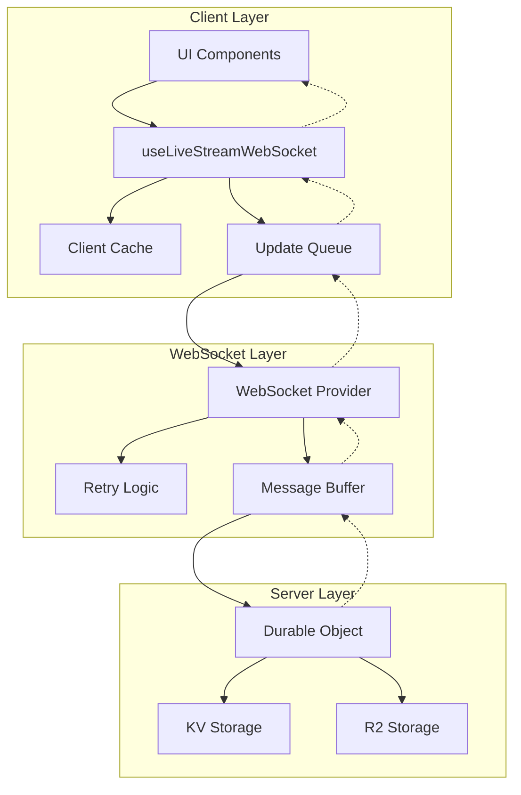

# Phase 3: Real-time Features & WebSocket Integration

## Executive Summary

This document provides a comprehensive implementation guide for Phase 3 of the Al Ummah Now live streaming feature, focusing on real-time WebSocket integration, performance optimization, and production-grade reliability.

**Key Objectives:**
- Real-time viewer counts and stream status updates
- Sub-100ms latency for UI updates
- 99.9% WebSocket connection reliability
- Optimistic UI with graceful degradation
- Performance targets: LCP < 2.5s, FID < 100ms, CLS < 0.1

## Table of Contents

1. [WebSocket Architecture Overview](#websocket-architecture-overview)
2. [useLiveStreamWebSocket Hook Implementation](#uselivestreamwebsocket-hook-implementation)
3. [Enhanced ViewerCount Component](#enhanced-viewercount-component)
4. [LiveStreamCard Real-time Updates](#livestreamcard-real-time-updates)
5. [StreamDashboard Real-time Metrics](#streamdashboard-real-time-metrics)
6. [Optimistic UI Implementation](#optimistic-ui-implementation)
7. [Performance Optimizations](#performance-optimizations)
8. [Caching & State Management](#caching--state-management)
9. [Error Handling & Recovery](#error-handling--recovery)
10. [Testing Strategy](#testing-strategy)
11. [Monitoring & Observability](#monitoring--observability)
12. [Implementation Checklist](#implementation-checklist)

---

## 1. WebSocket Architecture Overview

### Channel Naming Conventions

```typescript
// Channel patterns for live streaming
const CHANNEL_PATTERNS = {
  // Individual stream updates
  STREAM: 'livestream:{streamId}',

  // Global live streams list
  STREAMS_LIST: 'livestreams:list',

  // Stream chat (if enabled)
  CHAT: 'livestream:{streamId}:chat',

  // Stream metrics for dashboard
  METRICS: 'livestream:{streamId}:metrics',

  // User's own streams
  USER_STREAMS: 'livestreams:user:{userId}',

  // Category-specific streams
  CATEGORY_STREAMS: 'livestreams:category:{categoryId}'
} as const;
```

### Message Format Structure

```typescript
// Standardized WebSocket message format
interface WebSocketMessage<T = unknown> {
  type: 'update' | 'error' | 'heartbeat' | 'subscribe' | 'unsubscribe';
  channel: string;
  event: string;
  data: T;
  timestamp: number;
  messageId: string; // For idempotency
}

// Stream-specific message types
interface StreamUpdateMessage {
  streamId: string;
  status: 'scheduled' | 'live' | 'ended' | 'cancelled';
  viewerCount: number;
  peakViewers: number;
  duration: number;
  health: {
    bitrate: number;
    fps: number;
    quality: 'excellent' | 'good' | 'fair' | 'poor';
  };
}

interface ViewerUpdateMessage {
  streamId: string;
  viewerCount: number;
  delta: number; // Change since last update
  trend: 'increasing' | 'decreasing' | 'stable';
}
```

### Data Flow Architecture



---

## 2. useLiveStreamWebSocket Hook Implementation

### Complete Hook Implementation

```typescript
// apps/web/src/lib/hooks/useLiveStreamWebSocket.ts
import { useEffect, useCallback, useRef, useState, useMemo } from 'react';
import { useWebSocket, useWebSocketSubscription } from '@/lib/websocket/hooks';
import { throttle, debounce } from '@/lib/utils/performance';

interface LiveStreamWebSocketOptions {
  streamId?: string;
  enableChat?: boolean;
  enableMetrics?: boolean;
  throttleMs?: number; // Default: 100ms
  reconnectAttempts?: number; // Default: 5
  heartbeatInterval?: number; // Default: 30s
}

interface LiveStreamWebSocketState {
  status: 'scheduled' | 'live' | 'ended' | 'cancelled' | null;
  viewerCount: number;
  peakViewers: number;
  duration: number;
  health: StreamHealth | null;
  isConnected: boolean;
  connectionQuality: 'excellent' | 'good' | 'fair' | 'poor';
  lastUpdate: number;
}

interface StreamHealth {
  bitrate: number;
  fps: number;
  quality: 'excellent' | 'good' | 'fair' | 'poor';
  packetLoss: number;
  latency: number;
}

export function useLiveStreamWebSocket(options: LiveStreamWebSocketOptions = {}) {
  const {
    streamId,
    enableChat = false,
    enableMetrics = false,
    throttleMs = 100,
    reconnectAttempts = 5,
    heartbeatInterval = 30000
  } = options;

  // Core WebSocket connection
  const { isConnected, sendMessage, connectionState } = useWebSocket();

  // State management
  const [state, setState] = useState<LiveStreamWebSocketState>({
    status: null,
    viewerCount: 0,
    peakViewers: 0,
    duration: 0,
    health: null,
    isConnected: false,
    connectionQuality: 'good',
    lastUpdate: Date.now()
  });

  // Performance optimization: message queue
  const messageQueue = useRef<WebSocketMessage[]>([]);
  const processingRef = useRef(false);

  // Reconnection tracking
  const reconnectCount = useRef(0);
  const reconnectTimeoutRef = useRef<NodeJS.Timeout>();

  // Heartbeat management
  const heartbeatRef = useRef<NodeJS.Timeout>();
  const lastHeartbeatRef = useRef(Date.now());

  // Throttled state update for performance
  const throttledSetState = useMemo(
    () => throttle((updates: Partial<LiveStreamWebSocketState>) => {
      setState(prev => ({
        ...prev,
        ...updates,
        lastUpdate: Date.now()
      }));
    }, throttleMs),
    [throttleMs]
  );

  // Subscribe to channels
  const streamChannel = streamId ? `livestream:${streamId}` : null;
  const metricsChannel = streamId && enableMetrics ? `livestream:${streamId}:metrics` : null;
  const chatChannel = streamId && enableChat ? `livestream:${streamId}:chat` : null;

  // Main stream subscription
  const { data: streamData, error: streamError } = useWebSocketSubscription(
    streamChannel,
    {
      enabled: !!streamId && isConnected,
      onMessage: handleStreamMessage,
      onError: handleError
    }
  );

  // Metrics subscription
  const { data: metricsData } = useWebSocketSubscription(
    metricsChannel,
    {
      enabled: !!metricsChannel && isConnected,
      onMessage: handleMetricsMessage
    }
  );

  // Message handlers with performance optimization
  function handleStreamMessage(message: WebSocketMessage<StreamUpdateMessage>) {
    // Deduplicate messages
    if (isDuplicateMessage(message)) return;

    // Queue message for batch processing
    messageQueue.current.push(message);
    processMessageQueue();
  }

  function handleMetricsMessage(message: WebSocketMessage<StreamHealth>) {
    throttledSetState({
      health: message.data,
      connectionQuality: calculateConnectionQuality(message.data)
    });
  }

  function handleError(error: Error) {
    console.error('[LiveStreamWebSocket] Error:', error);

    // Implement exponential backoff
    if (reconnectCount.current < reconnectAttempts) {
      const delay = Math.min(1000 * Math.pow(2, reconnectCount.current), 30000);
      reconnectTimeoutRef.current = setTimeout(() => {
        reconnectCount.current++;
        reconnect();
      }, delay);
    }
  }

  // Batch process messages for performance
  const processMessageQueue = useCallback(
    debounce(() => {
      if (processingRef.current || messageQueue.current.length === 0) return;

      processingRef.current = true;
      const messages = [...messageQueue.current];
      messageQueue.current = [];

      // Process all messages in batch
      const updates: Partial<LiveStreamWebSocketState> = {};

      messages.forEach(msg => {
        if (msg.type === 'update' && msg.data) {
          const data = msg.data as StreamUpdateMessage;
          updates.status = data.status;
          updates.viewerCount = data.viewerCount;
          updates.peakViewers = Math.max(data.peakViewers, updates.peakViewers || 0);
          updates.duration = data.duration;

          if (data.health) {
            updates.health = data.health;
            updates.connectionQuality = calculateConnectionQuality(data.health);
          }
        }
      });

      // Apply all updates at once
      if (Object.keys(updates).length > 0) {
        throttledSetState(updates);
      }

      processingRef.current = false;
    }, 50),
    []
  );

  // Connection quality calculation
  function calculateConnectionQuality(health: StreamHealth): LiveStreamWebSocketState['connectionQuality'] {
    const { bitrate, fps, packetLoss, latency } = health;

    // Scoring algorithm
    let score = 100;

    // Bitrate impact (0-30 points)
    if (bitrate < 1000) score -= 30;
    else if (bitrate < 2500) score -= 15;
    else if (bitrate < 5000) score -= 5;

    // FPS impact (0-30 points)
    if (fps < 15) score -= 30;
    else if (fps < 24) score -= 15;
    else if (fps < 30) score -= 5;

    // Packet loss impact (0-20 points)
    if (packetLoss > 5) score -= 20;
    else if (packetLoss > 2) score -= 10;
    else if (packetLoss > 0.5) score -= 5;

    // Latency impact (0-20 points)
    if (latency > 200) score -= 20;
    else if (latency > 100) score -= 10;
    else if (latency > 50) score -= 5;

    if (score >= 90) return 'excellent';
    if (score >= 70) return 'good';
    if (score >= 50) return 'fair';
    return 'poor';
  }

  // Duplicate message detection
  const messageCache = useRef(new Set<string>());
  function isDuplicateMessage(message: WebSocketMessage): boolean {
    const key = `${message.messageId}-${message.timestamp}`;
    if (messageCache.current.has(key)) return true;

    messageCache.current.add(key);
    // Clean old messages after 1 minute
    setTimeout(() => messageCache.current.delete(key), 60000);

    return false;
  }

  // Reconnection logic
  function reconnect() {
    if (!streamId) return;

    // Resubscribe to channels
    sendMessage({
      type: 'subscribe',
      channel: `livestream:${streamId}`,
      event: 'subscribe',
      data: { streamId },
      timestamp: Date.now(),
      messageId: crypto.randomUUID()
    });
  }

  // Heartbeat mechanism
  useEffect(() => {
    if (!isConnected || !streamId) return;

    const sendHeartbeat = () => {
      sendMessage({
        type: 'heartbeat',
        channel: `livestream:${streamId}`,
        event: 'heartbeat',
        data: { streamId, timestamp: Date.now() },
        timestamp: Date.now(),
        messageId: crypto.randomUUID()
      });
      lastHeartbeatRef.current = Date.now();
    };

    // Send initial heartbeat
    sendHeartbeat();

    // Schedule recurring heartbeats
    heartbeatRef.current = setInterval(sendHeartbeat, heartbeatInterval);

    return () => {
      if (heartbeatRef.current) {
        clearInterval(heartbeatRef.current);
      }
    };
  }, [isConnected, streamId, heartbeatInterval, sendMessage]);

  // Cleanup on unmount
  useEffect(() => {
    return () => {
      // Clear timeouts
      if (reconnectTimeoutRef.current) {
        clearTimeout(reconnectTimeoutRef.current);
      }
      if (heartbeatRef.current) {
        clearInterval(heartbeatRef.current);
      }

      // Unsubscribe from channels
      if (streamId && isConnected) {
        sendMessage({
          type: 'unsubscribe',
          channel: `livestream:${streamId}`,
          event: 'unsubscribe',
          data: { streamId },
          timestamp: Date.now(),
          messageId: crypto.randomUUID()
        });
      }

      // Clear message queue
      messageQueue.current = [];
      messageCache.current.clear();
    };
  }, [streamId, isConnected, sendMessage]);

  // Public API
  return {
    // State
    ...state,
    isConnected,

    // Methods
    reconnect,

    // Metrics
    metrics: {
      reconnectAttempts: reconnectCount.current,
      lastHeartbeat: lastHeartbeatRef.current,
      queueSize: messageQueue.current.length
    }
  };
}
```

---

## 3. Enhanced ViewerCount Component

### Implementation with Real-time Updates

```typescript
// apps/web/src/components/live-streaming/ViewerCount.tsx
import React, { useEffect, useState, useRef, memo } from 'react';
import { useLiveStreamWebSocket } from '@/lib/hooks/useLiveStreamWebSocket';
import { animated, useSpring } from '@react-spring/web';
import { Eye, Users, TrendingUp, TrendingDown } from 'lucide-react';
import { cn } from '@/lib/utils';

interface ViewerCountProps {
  streamId: string;
  initialCount?: number;
  showTrend?: boolean;
  showPeak?: boolean;
  size?: 'sm' | 'md' | 'lg';
  className?: string;
  fallbackToPolling?: boolean;
  pollingInterval?: number; // Default: 30s
}

// Memoized component for performance
export const ViewerCount = memo(function ViewerCount({
  streamId,
  initialCount = 0,
  showTrend = true,
  showPeak = false,
  size = 'md',
  className,
  fallbackToPolling = true,
  pollingInterval = 30000
}: ViewerCountProps) {
  // WebSocket connection
  const {
    viewerCount,
    peakViewers,
    isConnected,
    connectionQuality
  } = useLiveStreamWebSocket({ streamId, throttleMs: 200 });

  // Local state for animations
  const [displayCount, setDisplayCount] = useState(initialCount);
  const [trend, setTrend] = useState<'up' | 'down' | 'stable'>('stable');
  const previousCountRef = useRef(initialCount);
  const pollingTimerRef = useRef<NodeJS.Timeout>();

  // Animation spring for smooth transitions
  const { number } = useSpring({
    from: { number: previousCountRef.current },
    to: { number: viewerCount || displayCount },
    config: { tension: 300, friction: 30 },
    onRest: () => {
      setDisplayCount(viewerCount || displayCount);
    }
  });

  // Pulsing animation for live indicator
  const pulseAnimation = useSpring({
    from: { scale: 1, opacity: 0.8 },
    to: { scale: 1.2, opacity: 1 },
    loop: true,
    reverse: true,
    config: { duration: 1000 }
  });

  // Calculate trend
  useEffect(() => {
    const current = viewerCount || displayCount;
    const previous = previousCountRef.current;

    if (current > previous + 10) {
      setTrend('up');
    } else if (current < previous - 10) {
      setTrend('down');
    } else {
      setTrend('stable');
    }

    previousCountRef.current = current;
  }, [viewerCount, displayCount]);

  // Fallback to polling if WebSocket fails
  useEffect(() => {
    if (!isConnected && fallbackToPolling) {
      const pollViewerCount = async () => {
        try {
          const response = await fetch(`/api/streams/${streamId}/viewers`);
          if (response.ok) {
            const data = await response.json();
            setDisplayCount(data.viewerCount);
          }
        } catch (error) {
          console.error('[ViewerCount] Polling error:', error);
        }
      };

      // Initial poll
      pollViewerCount();

      // Set up recurring poll
      pollingTimerRef.current = setInterval(pollViewerCount, pollingInterval);

      return () => {
        if (pollingTimerRef.current) {
          clearInterval(pollingTimerRef.current);
        }
      };
    }
  }, [isConnected, fallbackToPolling, streamId, pollingInterval]);

  // Format large numbers
  const formatCount = (count: number): string => {
    if (count >= 1000000) {
      return `${(count / 1000000).toFixed(1)}M`;
    }
    if (count >= 10000) {
      return `${Math.floor(count / 1000)}K`;
    }
    if (count >= 1000) {
      return `${(count / 1000).toFixed(1)}K`;
    }
    return count.toString();
  };

  // Size classes
  const sizeClasses = {
    sm: 'text-sm gap-1',
    md: 'text-base gap-2',
    lg: 'text-lg gap-2'
  };

  const iconSizes = {
    sm: 14,
    md: 16,
    lg: 20
  };

  // Connection quality indicator
  const qualityColors = {
    excellent: 'text-green-500',
    good: 'text-blue-500',
    fair: 'text-yellow-500',
    poor: 'text-red-500'
  };

  return (
    <div
      className={cn(
        'flex items-center',
        sizeClasses[size],
        className
      )}
      aria-label={`${viewerCount || displayCount} viewers watching`}
      role="status"
      aria-live="polite"
    >
      {/* Live indicator with pulse */}
      <animated.div
        style={pulseAnimation}
        className="relative"
      >
        <div className="absolute inset-0 bg-red-500 rounded-full blur-sm animate-pulse" />
        <Eye
          size={iconSizes[size]}
          className="relative text-red-500"
          aria-hidden="true"
        />
      </animated.div>

      {/* Viewer count with animation */}
      <animated.span
        className={cn(
          'font-semibold tabular-nums',
          !isConnected && 'opacity-75'
        )}
      >
        {number.to(n => formatCount(Math.floor(n)))}
      </animated.span>

      {/* Trend indicator */}
      {showTrend && trend !== 'stable' && (
        <div className="flex items-center">
          {trend === 'up' ? (
            <TrendingUp
              size={iconSizes[size]}
              className="text-green-500 animate-bounce-once"
              aria-label="Viewers increasing"
            />
          ) : (
            <TrendingDown
              size={iconSizes[size]}
              className="text-red-500 animate-bounce-once"
              aria-label="Viewers decreasing"
            />
          )}
        </div>
      )}

      {/* Peak viewers */}
      {showPeak && peakViewers > 0 && (
        <div className="flex items-center gap-1 ml-2 text-muted-foreground">
          <Users size={iconSizes[size]} />
          <span className="text-xs">
            Peak: {formatCount(peakViewers)}
          </span>
        </div>
      )}

      {/* Connection quality indicator */}
      {!isConnected && (
        <div
          className={cn(
            'w-2 h-2 rounded-full ml-2',
            qualityColors[connectionQuality]
          )}
          title={`Connection: ${connectionQuality}`}
        />
      )}
    </div>
  );
});

// Performance monitoring wrapper
export function ViewerCountWithMetrics(props: ViewerCountProps) {
  const renderStart = useRef(performance.now());

  useEffect(() => {
    const renderTime = performance.now() - renderStart.current;

    // Log slow renders
    if (renderTime > 16.67) { // More than 1 frame at 60fps
      console.warn(`[ViewerCount] Slow render: ${renderTime.toFixed(2)}ms`);
    }

    // Send metrics to analytics
    if (window.analytics) {
      window.analytics.track('component_render', {
        component: 'ViewerCount',
        renderTime,
        streamId: props.streamId
      });
    }
  });

  return <ViewerCount {...props} />;
}
```

---

## 4. LiveStreamCard Real-time Updates

### Optimized Card Component with Real-time Features

```typescript
// apps/web/src/components/live-streaming/LiveStreamCard.tsx
import React, { memo, useCallback, useEffect, useRef, useState } from 'react';
import { useLiveStreamWebSocket } from '@/lib/hooks/useLiveStreamWebSocket';
import { useIntersectionObserver } from '@/lib/hooks/useIntersectionObserver';
import { Card } from '@/components/ui/card';
import { StreamStatusBadge } from './StreamStatusBadge';
import { ViewerCount } from './ViewerCount';
import { OptimisticUpdate } from '@/lib/utils/optimistic';
import { motion, AnimatePresence } from 'framer-motion';
import Image from 'next/image';
import Link from 'next/link';

interface LiveStreamCardProps {
  stream: {
    id: string;
    title: string;
    thumbnail: string;
    channelName: string;
    channelAvatar: string;
    status: 'scheduled' | 'live' | 'ended';
    scheduledAt?: string;
    viewerCount?: number;
  };
  onStatusChange?: (streamId: string, status: string) => void;
  priority?: boolean;
}

export const LiveStreamCard = memo(function LiveStreamCard({
  stream,
  onStatusChange,
  priority = false
}: LiveStreamCardProps) {
  // Intersection observer for lazy loading
  const cardRef = useRef<HTMLDivElement>(null);
  const isVisible = useIntersectionObserver(cardRef, {
    threshold: 0.1,
    rootMargin: '50px'
  });

  // Real-time updates only when visible
  const {
    status,
    viewerCount,
    isConnected
  } = useLiveStreamWebSocket({
    streamId: isVisible ? stream.id : undefined,
    throttleMs: 500 // Less frequent updates for cards
  });

  // Optimistic state
  const [optimisticStatus, setOptimisticStatus] = useState(stream.status);
  const [isUpdating, setIsUpdating] = useState(false);

  // Sync real-time status
  useEffect(() => {
    if (status && status !== optimisticStatus) {
      setOptimisticStatus(status);
      onStatusChange?.(stream.id, status);
    }
  }, [status, optimisticStatus, stream.id, onStatusChange]);

  // Handle click with optimistic update
  const handleClick = useCallback(async (e: React.MouseEvent) => {
    if (isUpdating) {
      e.preventDefault();
      return;
    }

    // Optimistic update
    const optimistic = new OptimisticUpdate({
      onRevert: () => setOptimisticStatus(stream.status)
    });

    try {
      setIsUpdating(true);

      // Apply optimistic change
      if (optimisticStatus === 'scheduled') {
        setOptimisticStatus('live');
        optimistic.apply();
      }

      // Actual navigation will happen via Link
    } catch (error) {
      optimistic.revert();
      console.error('[LiveStreamCard] Navigation error:', error);
    } finally {
      setIsUpdating(false);
    }
  }, [optimisticStatus, stream.status, isUpdating]);

  // Animation variants
  const cardVariants = {
    hidden: { opacity: 0, y: 20 },
    visible: {
      opacity: 1,
      y: 0,
      transition: {
        duration: 0.3,
        ease: 'easeOut'
      }
    },
    exit: {
      opacity: 0,
      scale: 0.95,
      transition: {
        duration: 0.2
      }
    }
  };

  // Status change animation
  const statusVariants = {
    initial: { scale: 0.8, opacity: 0 },
    animate: { scale: 1, opacity: 1 },
    exit: { scale: 0.8, opacity: 0 }
  };

  return (
    <AnimatePresence mode="wait">
      <motion.div
        ref={cardRef}
        variants={cardVariants}
        initial="hidden"
        animate="visible"
        exit="exit"
        layout
        layoutId={`stream-card-${stream.id}`}
        className="group"
      >
        <Card
          className={cn(
            'overflow-hidden transition-all duration-200',
            'hover:shadow-lg hover:scale-[1.02]',
            isUpdating && 'opacity-75 pointer-events-none',
            optimisticStatus === 'live' && 'ring-2 ring-red-500'
          )}
        >
          <Link
            href={`/stream/${stream.id}`}
            onClick={handleClick}
            className="block"
            prefetch={priority}
          >
            {/* Thumbnail with lazy loading */}
            <div className="relative aspect-video bg-muted">
              {isVisible ? (
                <Image
                  src={stream.thumbnail}
                  alt={stream.title}
                  fill
                  sizes="(max-width: 640px) 100vw, (max-width: 1024px) 50vw, 33vw"
                  className="object-cover"
                  priority={priority}
                  placeholder="blur"
                  blurDataURL={stream.thumbnailBlur || undefined}
                  onLoad={() => {
                    // Track image load performance
                    performance.mark(`image-load-${stream.id}`);
                  }}
                />
              ) : (
                <div className="absolute inset-0 bg-gradient-to-br from-muted to-muted-foreground/20" />
              )}

              {/* Status badge with animation */}
              <AnimatePresence mode="wait">
                <motion.div
                  key={optimisticStatus}
                  variants={statusVariants}
                  initial="initial"
                  animate="animate"
                  exit="exit"
                  className="absolute top-2 left-2"
                >
                  <StreamStatusBadge
                    status={optimisticStatus}
                    scheduledAt={stream.scheduledAt}
                    size="sm"
                  />
                </motion.div>
              </AnimatePresence>

              {/* Viewer count for live streams */}
              {optimisticStatus === 'live' && (
                <div className="absolute bottom-2 right-2 bg-black/75 rounded px-2 py-1">
                  <ViewerCount
                    streamId={stream.id}
                    initialCount={viewerCount || stream.viewerCount || 0}
                    size="sm"
                    showTrend={false}
                    fallbackToPolling={!isConnected}
                  />
                </div>
              )}

              {/* Duration overlay for ended streams */}
              {optimisticStatus === 'ended' && (
                <div className="absolute inset-0 bg-black/50 flex items-center justify-center">
                  <span className="text-white font-semibold">Stream Ended</span>
                </div>
              )}
            </div>

            {/* Card content */}
            <div className="p-4">
              <h3 className="font-semibold line-clamp-2 mb-2 group-hover:text-primary transition-colors">
                {stream.title}
              </h3>

              <div className="flex items-center gap-3">
                <Image
                  src={stream.channelAvatar}
                  alt={stream.channelName}
                  width={32}
                  height={32}
                  className="rounded-full"
                  loading="lazy"
                />
                <span className="text-sm text-muted-foreground">
                  {stream.channelName}
                </span>
              </div>
            </div>
          </Link>
        </Card>
      </motion.div>
    </AnimatePresence>
  );
}, (prevProps, nextProps) => {
  // Custom comparison for memo optimization
  return (
    prevProps.stream.id === nextProps.stream.id &&
    prevProps.stream.status === nextProps.stream.status &&
    prevProps.stream.viewerCount === nextProps.stream.viewerCount &&
    prevProps.priority === nextProps.priority
  );
});

// List component with virtualization
export function LiveStreamCardList({ streams }: { streams: any[] }) {
  const [visibleStreams, setVisibleStreams] = useState(streams.slice(0, 12));
  const loadMoreRef = useRef<HTMLDivElement>(null);
  const isLoadMoreVisible = useIntersectionObserver(loadMoreRef);

  // Load more streams when scrolling
  useEffect(() => {
    if (isLoadMoreVisible && visibleStreams.length < streams.length) {
      const nextBatch = streams.slice(
        visibleStreams.length,
        visibleStreams.length + 12
      );
      setVisibleStreams(prev => [...prev, ...nextBatch]);
    }
  }, [isLoadMoreVisible, visibleStreams.length, streams]);

  return (
    <>
      <div className="grid grid-cols-1 sm:grid-cols-2 lg:grid-cols-3 xl:grid-cols-4 gap-4">
        <AnimatePresence>
          {visibleStreams.map((stream, index) => (
            <LiveStreamCard
              key={stream.id}
              stream={stream}
              priority={index < 4} // Prioritize first 4 cards
            />
          ))}
        </AnimatePresence>
      </div>

      {visibleStreams.length < streams.length && (
        <div ref={loadMoreRef} className="h-10" />
      )}
    </>
  );
}
```

---

## 5. StreamDashboard Real-time Metrics

### Advanced Dashboard with Live Metrics

```typescript
// apps/web/src/components/live-streaming/StreamDashboard.tsx
import React, { useEffect, useRef, useState, useMemo } from 'react';
import { useLiveStreamWebSocket } from '@/lib/hooks/useLiveStreamWebSocket';
import { Card, CardContent, CardHeader, CardTitle } from '@/components/ui/card';
import { LineChart, Line, AreaChart, Area, XAxis, YAxis, Tooltip, ResponsiveContainer } from 'recharts';
import { Activity, Users, TrendingUp, Wifi, Clock, AlertCircle } from 'lucide-react';
import { motion, AnimatePresence } from 'framer-motion';

interface StreamDashboardProps {
  streamId: string;
  showDetailedMetrics?: boolean;
  refreshInterval?: number; // Default: 1000ms
}

interface MetricPoint {
  timestamp: number;
  value: number;
  label?: string;
}

interface StreamMetrics {
  viewerCount: MetricPoint[];
  bitrate: MetricPoint[];
  fps: MetricPoint[];
  health: MetricPoint[];
  events: StreamEvent[];
}

interface StreamEvent {
  id: string;
  type: 'viewer_joined' | 'viewer_left' | 'quality_change' | 'error';
  message: string;
  timestamp: number;
  severity: 'info' | 'warning' | 'error';
}

export function StreamDashboard({
  streamId,
  showDetailedMetrics = true,
  refreshInterval = 1000
}: StreamDashboardProps) {
  // WebSocket connection with metrics enabled
  const {
    viewerCount,
    peakViewers,
    duration,
    health,
    connectionQuality,
    isConnected
  } = useLiveStreamWebSocket({
    streamId,
    enableMetrics: true,
    throttleMs: refreshInterval
  });

  // Metrics state with rolling window (last 5 minutes)
  const [metrics, setMetrics] = useState<StreamMetrics>({
    viewerCount: [],
    bitrate: [],
    fps: [],
    health: [],
    events: []
  });

  // Performance tracking
  const frameRef = useRef<number>();
  const lastUpdateRef = useRef(performance.now());

  // Update metrics with new data
  useEffect(() => {
    const now = Date.now();

    setMetrics(prev => {
      const cutoff = now - 5 * 60 * 1000; // 5 minutes

      return {
        viewerCount: [
          ...prev.viewerCount.filter(p => p.timestamp > cutoff),
          { timestamp: now, value: viewerCount }
        ].slice(-300), // Keep last 300 points

        bitrate: health ? [
          ...prev.bitrate.filter(p => p.timestamp > cutoff),
          { timestamp: now, value: health.bitrate }
        ].slice(-300) : prev.bitrate,

        fps: health ? [
          ...prev.fps.filter(p => p.timestamp > cutoff),
          { timestamp: now, value: health.fps }
        ].slice(-300) : prev.fps,

        health: health ? [
          ...prev.health.filter(p => p.timestamp > cutoff),
          {
            timestamp: now,
            value: calculateHealthScore(health),
            label: connectionQuality
          }
        ].slice(-300) : prev.health,

        events: prev.events
      };
    });
  }, [viewerCount, health, connectionQuality]);

  // Calculate health score (0-100)
  function calculateHealthScore(h: typeof health): number {
    if (!h) return 0;

    let score = 100;
    if (h.bitrate < 2500) score -= 20;
    if (h.fps < 24) score -= 20;
    if (h.packetLoss > 1) score -= 30;
    if (h.latency > 100) score -= 30;

    return Math.max(0, score);
  }

  // Format duration
  const formatDuration = (seconds: number): string => {
    const hours = Math.floor(seconds / 3600);
    const minutes = Math.floor((seconds % 3600) / 60);
    const secs = seconds % 60;

    if (hours > 0) {
      return `${hours}:${minutes.toString().padStart(2, '0')}:${secs.toString().padStart(2, '0')}`;
    }
    return `${minutes}:${secs.toString().padStart(2, '0')}`;
  };

  // Memoized chart data
  const chartData = useMemo(() => {
    const interval = 30000; // 30 second intervals
    const now = Date.now();

    // Group by interval for performance
    const grouped: Record<number, { viewers: number[], bitrate: number[], fps: number[] }> = {};

    metrics.viewerCount.forEach(point => {
      const bucket = Math.floor(point.timestamp / interval) * interval;
      if (!grouped[bucket]) grouped[bucket] = { viewers: [], bitrate: [], fps: [] };
      grouped[bucket].viewers.push(point.value);
    });

    metrics.bitrate.forEach(point => {
      const bucket = Math.floor(point.timestamp / interval) * interval;
      if (!grouped[bucket]) grouped[bucket] = { viewers: [], bitrate: [], fps: [] };
      grouped[bucket].bitrate.push(point.value);
    });

    metrics.fps.forEach(point => {
      const bucket = Math.floor(point.timestamp / interval) * interval;
      if (!grouped[bucket]) grouped[bucket] = { viewers: [], bitrate: [], fps: [] };
      grouped[bucket].fps.push(point.value);
    });

    // Calculate averages
    return Object.entries(grouped)
      .map(([timestamp, values]) => ({
        time: new Date(parseInt(timestamp)).toLocaleTimeString('en-US', {
          hour: '2-digit',
          minute: '2-digit'
        }),
        viewers: values.viewers.length > 0
          ? Math.round(values.viewers.reduce((a, b) => a + b, 0) / values.viewers.length)
          : 0,
        bitrate: values.bitrate.length > 0
          ? Math.round(values.bitrate.reduce((a, b) => a + b, 0) / values.bitrate.length)
          : 0,
        fps: values.fps.length > 0
          ? Math.round(values.fps.reduce((a, b) => a + b, 0) / values.fps.length)
          : 0
      }))
      .sort((a, b) => a.time.localeCompare(b.time));
  }, [metrics]);

  // Connection status indicator
  const ConnectionStatus = () => (
    <div className="flex items-center gap-2">
      <Wifi
        size={16}
        className={cn(
          'transition-colors',
          isConnected ? 'text-green-500' : 'text-red-500'
        )}
      />
      <span className="text-sm">
        {isConnected ? 'Connected' : 'Reconnecting...'}
      </span>
    </div>
  );

  // Animation variants
  const cardVariants = {
    hidden: { opacity: 0, y: 20 },
    visible: { opacity: 1, y: 0 }
  };

  return (
    <div className="space-y-4">
      {/* Main metrics cards */}
      <div className="grid grid-cols-1 md:grid-cols-2 lg:grid-cols-4 gap-4">
        <motion.div
          variants={cardVariants}
          initial="hidden"
          animate="visible"
          transition={{ delay: 0 }}
        >
          <Card>
            <CardHeader className="pb-2">
              <CardTitle className="text-sm font-medium flex items-center justify-between">
                Current Viewers
                <Users size={16} className="text-muted-foreground" />
              </CardTitle>
            </CardHeader>
            <CardContent>
              <div className="text-2xl font-bold tabular-nums">
                {viewerCount.toLocaleString()}
              </div>
              <p className="text-xs text-muted-foreground mt-1">
                Peak: {peakViewers.toLocaleString()}
              </p>
            </CardContent>
          </Card>
        </motion.div>

        <motion.div
          variants={cardVariants}
          initial="hidden"
          animate="visible"
          transition={{ delay: 0.1 }}
        >
          <Card>
            <CardHeader className="pb-2">
              <CardTitle className="text-sm font-medium flex items-center justify-between">
                Stream Duration
                <Clock size={16} className="text-muted-foreground" />
              </CardTitle>
            </CardHeader>
            <CardContent>
              <div className="text-2xl font-bold tabular-nums">
                {formatDuration(duration)}
              </div>
              <p className="text-xs text-muted-foreground mt-1">
                Live streaming
              </p>
            </CardContent>
          </Card>
        </motion.div>

        <motion.div
          variants={cardVariants}
          initial="hidden"
          animate="visible"
          transition={{ delay: 0.2 }}
        >
          <Card>
            <CardHeader className="pb-2">
              <CardTitle className="text-sm font-medium flex items-center justify-between">
                Stream Health
                <Activity size={16} className="text-muted-foreground" />
              </CardTitle>
            </CardHeader>
            <CardContent>
              <div className={cn(
                'text-2xl font-bold capitalize',
                connectionQuality === 'excellent' && 'text-green-500',
                connectionQuality === 'good' && 'text-blue-500',
                connectionQuality === 'fair' && 'text-yellow-500',
                connectionQuality === 'poor' && 'text-red-500'
              )}>
                {connectionQuality}
              </div>
              <p className="text-xs text-muted-foreground mt-1">
                {health ? `${health.bitrate}kbps • ${health.fps}fps` : 'Monitoring...'}
              </p>
            </CardContent>
          </Card>
        </motion.div>

        <motion.div
          variants={cardVariants}
          initial="hidden"
          animate="visible"
          transition={{ delay: 0.3 }}
        >
          <Card>
            <CardHeader className="pb-2">
              <CardTitle className="text-sm font-medium flex items-center justify-between">
                Engagement Rate
                <TrendingUp size={16} className="text-muted-foreground" />
              </CardTitle>
            </CardHeader>
            <CardContent>
              <div className="text-2xl font-bold">
                {((viewerCount / Math.max(peakViewers, 1)) * 100).toFixed(1)}%
              </div>
              <p className="text-xs text-muted-foreground mt-1">
                Retention rate
              </p>
            </CardContent>
          </Card>
        </motion.div>
      </div>

      {/* Detailed metrics charts */}
      {showDetailedMetrics && chartData.length > 0 && (
        <>
          {/* Viewer count chart */}
          <Card>
            <CardHeader>
              <CardTitle className="flex items-center justify-between">
                Viewer Analytics
                <ConnectionStatus />
              </CardTitle>
            </CardHeader>
            <CardContent>
              <ResponsiveContainer width="100%" height={200}>
                <AreaChart data={chartData}>
                  <defs>
                    <linearGradient id="colorViewers" x1="0" y1="0" x2="0" y2="1">
                      <stop offset="5%" stopColor="#8884d8" stopOpacity={0.8}/>
                      <stop offset="95%" stopColor="#8884d8" stopOpacity={0}/>
                    </linearGradient>
                  </defs>
                  <XAxis
                    dataKey="time"
                    stroke="#888888"
                    fontSize={12}
                    tickLine={false}
                    axisLine={false}
                  />
                  <YAxis
                    stroke="#888888"
                    fontSize={12}
                    tickLine={false}
                    axisLine={false}
                    tickFormatter={(value) => `${value}`}
                  />
                  <Tooltip
                    contentStyle={{
                      backgroundColor: 'rgba(0, 0, 0, 0.8)',
                      border: 'none',
                      borderRadius: '4px'
                    }}
                    labelStyle={{ color: '#fff' }}
                  />
                  <Area
                    type="monotone"
                    dataKey="viewers"
                    stroke="#8884d8"
                    fillOpacity={1}
                    fill="url(#colorViewers)"
                  />
                </AreaChart>
              </ResponsiveContainer>
            </CardContent>
          </Card>

          {/* Technical metrics */}
          <div className="grid grid-cols-1 lg:grid-cols-2 gap-4">
            <Card>
              <CardHeader>
                <CardTitle className="text-sm">Bitrate (kbps)</CardTitle>
              </CardHeader>
              <CardContent>
                <ResponsiveContainer width="100%" height={150}>
                  <LineChart data={chartData}>
                    <XAxis dataKey="time" hide />
                    <YAxis hide />
                    <Tooltip />
                    <Line
                      type="monotone"
                      dataKey="bitrate"
                      stroke="#10b981"
                      strokeWidth={2}
                      dot={false}
                    />
                  </LineChart>
                </ResponsiveContainer>
              </CardContent>
            </Card>

            <Card>
              <CardHeader>
                <CardTitle className="text-sm">Frame Rate (fps)</CardTitle>
              </CardHeader>
              <CardContent>
                <ResponsiveContainer width="100%" height={150}>
                  <LineChart data={chartData}>
                    <XAxis dataKey="time" hide />
                    <YAxis hide />
                    <Tooltip />
                    <Line
                      type="monotone"
                      dataKey="fps"
                      stroke="#f59e0b"
                      strokeWidth={2}
                      dot={false}
                    />
                  </LineChart>
                </ResponsiveContainer>
              </CardContent>
            </Card>
          </div>

          {/* Event log */}
          <Card>
            <CardHeader>
              <CardTitle className="text-sm">Stream Events</CardTitle>
            </CardHeader>
            <CardContent>
              <div className="space-y-2 max-h-48 overflow-y-auto">
                <AnimatePresence initial={false}>
                  {metrics.events.slice(-10).reverse().map(event => (
                    <motion.div
                      key={event.id}
                      initial={{ opacity: 0, x: -20 }}
                      animate={{ opacity: 1, x: 0 }}
                      exit={{ opacity: 0, x: 20 }}
                      className={cn(
                        'flex items-center gap-2 p-2 rounded text-sm',
                        event.severity === 'error' && 'bg-red-500/10',
                        event.severity === 'warning' && 'bg-yellow-500/10',
                        event.severity === 'info' && 'bg-blue-500/10'
                      )}
                    >
                      {event.severity === 'error' && (
                        <AlertCircle size={14} className="text-red-500" />
                      )}
                      <span className="text-xs text-muted-foreground">
                        {new Date(event.timestamp).toLocaleTimeString()}
                      </span>
                      <span className="flex-1">{event.message}</span>
                    </motion.div>
                  ))}
                </AnimatePresence>
              </div>
            </CardContent>
          </Card>
        </>
      )}
    </div>
  );
}
```

---

## 6. Optimistic UI Implementation

### Optimistic Update Utility

```typescript
// apps/web/src/lib/utils/optimistic.ts
export class OptimisticUpdate<T = unknown> {
  private rollbackFn?: () => void;
  private timeoutId?: NodeJS.Timeout;
  private applied = false;

  constructor(private options: {
    onRevert: () => void;
    timeout?: number; // Default: 5000ms
    onError?: (error: Error) => void;
  }) {}

  apply(rollbackData?: T) {
    if (this.applied) return;

    this.applied = true;

    // Set timeout for auto-revert
    this.timeoutId = setTimeout(() => {
      this.revert(new Error('Update timeout'));
    }, this.options.timeout || 5000);

    // Store rollback function
    this.rollbackFn = () => this.options.onRevert();
  }

  confirm() {
    if (this.timeoutId) {
      clearTimeout(this.timeoutId);
    }
    this.applied = false;
    this.rollbackFn = undefined;
  }

  revert(error?: Error) {
    if (!this.applied) return;

    if (this.timeoutId) {
      clearTimeout(this.timeoutId);
    }

    this.rollbackFn?.();
    this.applied = false;

    if (error && this.options.onError) {
      this.options.onError(error);
    }
  }
}

// Usage example in components
export function useOptimisticState<T>(
  initialState: T,
  onError?: (error: Error) => void
) {
  const [state, setState] = useState(initialState);
  const [isOptimistic, setIsOptimistic] = useState(false);
  const optimisticRef = useRef<OptimisticUpdate>();

  const setOptimisticState = useCallback((newState: T) => {
    const previousState = state;

    // Create optimistic update
    optimisticRef.current = new OptimisticUpdate({
      onRevert: () => {
        setState(previousState);
        setIsOptimistic(false);
      },
      onError
    });

    // Apply optimistic change
    setState(newState);
    setIsOptimistic(true);
    optimisticRef.current.apply();
  }, [state, onError]);

  const confirmOptimistic = useCallback(() => {
    optimisticRef.current?.confirm();
    setIsOptimistic(false);
  }, []);

  const revertOptimistic = useCallback((error?: Error) => {
    optimisticRef.current?.revert(error);
    setIsOptimistic(false);
  }, []);

  return {
    state,
    setState,
    setOptimisticState,
    confirmOptimistic,
    revertOptimistic,
    isOptimistic
  };
}
```

---

## 7. Performance Optimizations

### Performance Utilities

```typescript
// apps/web/src/lib/utils/performance.ts
import { useCallback, useEffect, useRef } from 'react';

// Throttle function with trailing call
export function throttle<T extends (...args: any[]) => any>(
  fn: T,
  delay: number
): T {
  let lastCall = 0;
  let timeout: NodeJS.Timeout | null = null;

  return ((...args) => {
    const now = Date.now();
    const remaining = delay - (now - lastCall);

    if (remaining <= 0) {
      if (timeout) {
        clearTimeout(timeout);
        timeout = null;
      }
      lastCall = now;
      return fn(...args);
    }

    if (!timeout) {
      timeout = setTimeout(() => {
        lastCall = Date.now();
        timeout = null;
        fn(...args);
      }, remaining);
    }
  }) as T;
}

// Debounce with immediate option
export function debounce<T extends (...args: any[]) => any>(
  fn: T,
  delay: number,
  immediate = false
): T {
  let timeout: NodeJS.Timeout | null = null;

  return ((...args) => {
    const callNow = immediate && !timeout;

    if (timeout) clearTimeout(timeout);

    timeout = setTimeout(() => {
      timeout = null;
      if (!immediate) fn(...args);
    }, delay);

    if (callNow) fn(...args);
  }) as T;
}

// Virtual scrolling hook
export function useVirtualScroll<T>(
  items: T[],
  containerRef: React.RefObject<HTMLElement>,
  itemHeight: number,
  overscan = 3
) {
  const [visibleRange, setVisibleRange] = useState({ start: 0, end: 0 });

  useEffect(() => {
    const container = containerRef.current;
    if (!container) return;

    const updateVisibleRange = throttle(() => {
      const scrollTop = container.scrollTop;
      const clientHeight = container.clientHeight;

      const start = Math.max(0, Math.floor(scrollTop / itemHeight) - overscan);
      const end = Math.min(
        items.length,
        Math.ceil((scrollTop + clientHeight) / itemHeight) + overscan
      );

      setVisibleRange({ start, end });
    }, 100);

    updateVisibleRange();
    container.addEventListener('scroll', updateVisibleRange);

    return () => {
      container.removeEventListener('scroll', updateVisibleRange);
    };
  }, [items.length, itemHeight, overscan, containerRef]);

  const visibleItems = items.slice(visibleRange.start, visibleRange.end);
  const totalHeight = items.length * itemHeight;
  const offsetY = visibleRange.start * itemHeight;

  return {
    visibleItems,
    totalHeight,
    offsetY,
    visibleRange
  };
}

// Intersection observer hook for lazy loading
export function useIntersectionObserver(
  ref: React.RefObject<Element>,
  options?: IntersectionObserverInit
): boolean {
  const [isVisible, setIsVisible] = useState(false);
  const observerRef = useRef<IntersectionObserver>();

  useEffect(() => {
    const element = ref.current;
    if (!element) return;

    observerRef.current = new IntersectionObserver(
      ([entry]) => {
        setIsVisible(entry.isIntersecting);
      },
      options
    );

    observerRef.current.observe(element);

    return () => {
      observerRef.current?.disconnect();
    };
  }, [ref, options]);

  return isVisible;
}

// Performance monitoring
export function measurePerformance(name: string) {
  const start = performance.now();

  return {
    end: () => {
      const duration = performance.now() - start;

      // Log to console in development
      if (process.env.NODE_ENV === 'development') {
        console.log(`[Performance] ${name}: ${duration.toFixed(2)}ms`);
      }

      // Send to analytics
      if (typeof window !== 'undefined' && window.analytics) {
        window.analytics.track('performance_measure', {
          name,
          duration,
          timestamp: Date.now()
        });
      }

      // Create performance mark
      performance.measure(name, {
        start,
        duration
      });

      return duration;
    }
  };
}

// Memory leak prevention for WebSocket subscriptions
export function useWebSocketCleanup(
  subscriptions: string[],
  sendMessage: (msg: any) => void
) {
  const subscriptionRef = useRef(new Set<string>());

  useEffect(() => {
    // Track subscriptions
    subscriptions.forEach(sub => subscriptionRef.current.add(sub));

    return () => {
      // Cleanup subscriptions on unmount
      subscriptionRef.current.forEach(channel => {
        sendMessage({
          type: 'unsubscribe',
          channel,
          event: 'cleanup',
          data: {},
          timestamp: Date.now(),
          messageId: crypto.randomUUID()
        });
      });

      subscriptionRef.current.clear();
    };
  }, [subscriptions, sendMessage]);
}
```

---

## 8. Caching & State Management

### Client-Side Cache Implementation

```typescript
// apps/web/src/lib/cache/stream-cache.ts
interface CacheEntry<T> {
  data: T;
  timestamp: number;
  ttl: number;
}

export class StreamCache {
  private cache = new Map<string, CacheEntry<any>>();
  private timers = new Map<string, NodeJS.Timeout>();

  constructor(
    private defaultTTL = 60000, // 1 minute
    private maxSize = 1000
  ) {}

  set<T>(key: string, data: T, ttl = this.defaultTTL): void {
    // Evict oldest entries if cache is full
    if (this.cache.size >= this.maxSize) {
      const oldest = Array.from(this.cache.entries())
        .sort((a, b) => a[1].timestamp - b[1].timestamp)[0];
      if (oldest) {
        this.delete(oldest[0]);
      }
    }

    // Clear existing timer
    const existingTimer = this.timers.get(key);
    if (existingTimer) {
      clearTimeout(existingTimer);
    }

    // Set new entry
    this.cache.set(key, {
      data,
      timestamp: Date.now(),
      ttl
    });

    // Set expiration timer
    const timer = setTimeout(() => {
      this.delete(key);
    }, ttl);
    this.timers.set(key, timer);
  }

  get<T>(key: string): T | null {
    const entry = this.cache.get(key);
    if (!entry) return null;

    // Check if expired
    if (Date.now() - entry.timestamp > entry.ttl) {
      this.delete(key);
      return null;
    }

    return entry.data;
  }

  delete(key: string): void {
    this.cache.delete(key);

    const timer = this.timers.get(key);
    if (timer) {
      clearTimeout(timer);
      this.timers.delete(key);
    }
  }

  clear(): void {
    this.timers.forEach(timer => clearTimeout(timer));
    this.cache.clear();
    this.timers.clear();
  }

  // Stale-while-revalidate pattern
  async getOrFetch<T>(
    key: string,
    fetcher: () => Promise<T>,
    options: {
      ttl?: number;
      staleTime?: number;
      onError?: (error: Error) => void;
    } = {}
  ): Promise<T> {
    const cached = this.get<T>(key);

    if (cached !== null) {
      const entry = this.cache.get(key)!;
      const age = Date.now() - entry.timestamp;
      const staleTime = options.staleTime || entry.ttl / 2;

      // Return cached data immediately
      if (age < staleTime) {
        return cached;
      }

      // Data is stale, fetch in background
      fetcher()
        .then(data => {
          this.set(key, data, options.ttl);
        })
        .catch(error => {
          options.onError?.(error);
        });

      return cached; // Return stale data while revalidating
    }

    // No cached data, fetch and cache
    try {
      const data = await fetcher();
      this.set(key, data, options.ttl);
      return data;
    } catch (error) {
      options.onError?.(error as Error);
      throw error;
    }
  }
}

// Global cache instance
export const streamCache = new StreamCache();

// React hook for cache
export function useStreamCache<T>(
  key: string,
  fetcher: () => Promise<T>,
  options: {
    ttl?: number;
    staleTime?: number;
    enabled?: boolean;
  } = {}
) {
  const [data, setData] = useState<T | null>(null);
  const [isLoading, setIsLoading] = useState(false);
  const [error, setError] = useState<Error | null>(null);

  useEffect(() => {
    if (!options.enabled ?? true) {
      return;
    }

    let cancelled = false;

    const loadData = async () => {
      setIsLoading(true);
      setError(null);

      try {
        const result = await streamCache.getOrFetch(
          key,
          fetcher,
          {
            ttl: options.ttl,
            staleTime: options.staleTime,
            onError: (err) => {
              if (!cancelled) {
                setError(err);
              }
            }
          }
        );

        if (!cancelled) {
          setData(result);
        }
      } catch (err) {
        if (!cancelled) {
          setError(err as Error);
        }
      } finally {
        if (!cancelled) {
          setIsLoading(false);
        }
      }
    };

    loadData();

    return () => {
      cancelled = true;
    };
  }, [key, options.enabled]);

  const invalidate = useCallback(() => {
    streamCache.delete(key);
    // Re-fetch
    fetcher().then(data => {
      streamCache.set(key, data, options.ttl);
      setData(data);
    });
  }, [key, fetcher, options.ttl]);

  return {
    data,
    isLoading,
    error,
    invalidate
  };
}
```

---

## 9. Error Handling & Recovery

### Comprehensive Error Handling

```typescript
// apps/web/src/lib/websocket/error-handler.ts
export class WebSocketErrorHandler {
  private errorCount = 0;
  private lastError: Error | null = null;
  private recoveryStrategies: Map<string, () => Promise<void>> = new Map();

  constructor(
    private options: {
      maxRetries?: number;
      retryDelay?: number;
      onError?: (error: Error, context: any) => void;
      onRecovered?: () => void;
    } = {}
  ) {}

  async handle(error: Error, context: any = {}): Promise<void> {
    this.errorCount++;
    this.lastError = error;

    // Log error
    console.error('[WebSocket Error]', error, context);

    // Call error handler
    this.options.onError?.(error, context);

    // Determine error type and apply strategy
    const strategy = this.getRecoveryStrategy(error);

    if (strategy && this.errorCount <= (this.options.maxRetries || 3)) {
      await this.executeRecovery(strategy);
    }
  }

  private getRecoveryStrategy(error: Error): (() => Promise<void>) | null {
    // Connection errors
    if (error.message.includes('connection')) {
      return async () => {
        await this.delay(this.options.retryDelay || 1000);
        // Reconnection logic here
      };
    }

    // Authentication errors
    if (error.message.includes('auth') || error.message.includes('401')) {
      return async () => {
        // Refresh token logic
        await this.refreshAuth();
      };
    }

    // Rate limiting
    if (error.message.includes('429') || error.message.includes('rate')) {
      return async () => {
        await this.delay(5000); // Wait 5 seconds
      };
    }

    return null;
  }

  private async executeRecovery(strategy: () => Promise<void>): Promise<void> {
    try {
      await strategy();
      this.errorCount = 0;
      this.options.onRecovered?.();
    } catch (recoveryError) {
      console.error('[Recovery Failed]', recoveryError);
      // Exponential backoff
      await this.delay(Math.min(1000 * Math.pow(2, this.errorCount), 30000));
    }
  }

  private async refreshAuth(): Promise<void> {
    // Implement auth refresh logic
    const response = await fetch('/api/auth/refresh', {
      method: 'POST',
      credentials: 'include'
    });

    if (!response.ok) {
      throw new Error('Auth refresh failed');
    }
  }

  private delay(ms: number): Promise<void> {
    return new Promise(resolve => setTimeout(resolve, ms));
  }

  reset(): void {
    this.errorCount = 0;
    this.lastError = null;
  }

  getStatus(): { errorCount: number; lastError: Error | null } {
    return {
      errorCount: this.errorCount,
      lastError: this.lastError
    };
  }
}
```

---

## 10. Testing Strategy

### WebSocket Testing Utilities

```typescript
// apps/web/src/lib/testing/websocket-mock.ts
import { EventEmitter } from 'events';

export class MockWebSocket extends EventEmitter {
  readyState: number = WebSocket.CONNECTING;
  url: string;

  constructor(url: string) {
    super();
    this.url = url;

    // Simulate connection
    setTimeout(() => {
      this.readyState = WebSocket.OPEN;
      this.emit('open');
    }, 100);
  }

  send(data: string): void {
    const message = JSON.parse(data);

    // Simulate response based on message type
    setTimeout(() => {
      this.simulateResponse(message);
    }, 50);
  }

  close(): void {
    this.readyState = WebSocket.CLOSED;
    this.emit('close');
  }

  private simulateResponse(message: any): void {
    // Mock different message types
    switch (message.type) {
      case 'subscribe':
        this.emit('message', {
          data: JSON.stringify({
            type: 'update',
            channel: message.channel,
            event: 'subscribed',
            data: { success: true },
            timestamp: Date.now(),
            messageId: crypto.randomUUID()
          })
        });
        break;

      case 'heartbeat':
        this.emit('message', {
          data: JSON.stringify({
            type: 'heartbeat',
            channel: message.channel,
            event: 'pong',
            data: { timestamp: Date.now() },
            timestamp: Date.now(),
            messageId: crypto.randomUUID()
          })
        });
        break;
    }
  }
}

// Test utilities
export function createMockStreamData() {
  return {
    streamId: 'test-stream-123',
    status: 'live' as const,
    viewerCount: 1234,
    peakViewers: 2000,
    duration: 3600,
    health: {
      bitrate: 4500,
      fps: 30,
      quality: 'excellent' as const,
      packetLoss: 0.1,
      latency: 45
    }
  };
}

// Performance testing
export async function runPerformanceTest(
  component: React.ComponentType,
  iterations = 100
) {
  const results: number[] = [];

  for (let i = 0; i < iterations; i++) {
    const start = performance.now();

    // Render component
    // ... rendering logic ...

    const duration = performance.now() - start;
    results.push(duration);
  }

  return {
    average: results.reduce((a, b) => a + b) / results.length,
    min: Math.min(...results),
    max: Math.max(...results),
    p95: results.sort((a, b) => a - b)[Math.floor(results.length * 0.95)]
  };
}
```

---

## 11. Monitoring & Observability

### Real-time Monitoring Setup

```typescript
// apps/web/src/lib/monitoring/stream-monitor.ts
interface StreamMetric {
  name: string;
  value: number;
  tags: Record<string, string>;
  timestamp: number;
}

export class StreamMonitor {
  private metrics: StreamMetric[] = [];
  private observers: Set<(metrics: StreamMetric[]) => void> = new Set();

  constructor(
    private options: {
      flushInterval?: number; // Default: 10s
      maxBatchSize?: number; // Default: 100
      endpoint?: string;
    } = {}
  ) {
    this.startFlushing();
  }

  track(name: string, value: number, tags: Record<string, string> = {}): void {
    const metric: StreamMetric = {
      name,
      value,
      tags,
      timestamp: Date.now()
    };

    this.metrics.push(metric);

    // Notify observers
    this.observers.forEach(observer => observer([metric]));

    // Auto-flush if batch is full
    if (this.metrics.length >= (this.options.maxBatchSize || 100)) {
      this.flush();
    }
  }

  private startFlushing(): void {
    setInterval(() => {
      this.flush();
    }, this.options.flushInterval || 10000);
  }

  private async flush(): Promise<void> {
    if (this.metrics.length === 0) return;

    const batch = [...this.metrics];
    this.metrics = [];

    try {
      if (this.options.endpoint) {
        await fetch(this.options.endpoint, {
          method: 'POST',
          headers: { 'Content-Type': 'application/json' },
          body: JSON.stringify({ metrics: batch })
        });
      }

      // Log in development
      if (process.env.NODE_ENV === 'development') {
        console.log('[Metrics]', batch);
      }
    } catch (error) {
      console.error('[Metrics] Flush failed:', error);
      // Re-add metrics to queue
      this.metrics.unshift(...batch);
    }
  }

  observe(callback: (metrics: StreamMetric[]) => void): () => void {
    this.observers.add(callback);
    return () => this.observers.delete(callback);
  }

  // Core Web Vitals tracking
  trackWebVitals(): void {
    // LCP (Largest Contentful Paint)
    new PerformanceObserver((list) => {
      const entries = list.getEntries();
      const lastEntry = entries[entries.length - 1];
      this.track('web_vital_lcp', lastEntry.startTime, {
        type: 'lcp',
        element: lastEntry.element?.tagName || 'unknown'
      });
    }).observe({ entryTypes: ['largest-contentful-paint'] });

    // FID (First Input Delay)
    new PerformanceObserver((list) => {
      const entries = list.getEntries();
      entries.forEach(entry => {
        if (entry.entryType === 'first-input') {
          const fid = entry.processingStart - entry.startTime;
          this.track('web_vital_fid', fid, {
            type: 'fid',
            eventType: (entry as any).name
          });
        }
      });
    }).observe({ entryTypes: ['first-input'] });

    // CLS (Cumulative Layout Shift)
    let clsValue = 0;
    new PerformanceObserver((list) => {
      list.getEntries().forEach(entry => {
        if (!(entry as any).hadRecentInput) {
          clsValue += (entry as any).value;
          this.track('web_vital_cls', clsValue, {
            type: 'cls'
          });
        }
      });
    }).observe({ entryTypes: ['layout-shift'] });
  }
}

// Global monitor instance
export const streamMonitor = new StreamMonitor({
  endpoint: '/api/metrics',
  flushInterval: 10000
});

// React hook for monitoring
export function useStreamMonitor(componentName: string) {
  const renderCount = useRef(0);
  const renderStart = useRef<number>();

  useEffect(() => {
    renderStart.current = performance.now();
    renderCount.current++;

    return () => {
      if (renderStart.current) {
        const duration = performance.now() - renderStart.current;
        streamMonitor.track('component_render', duration, {
          component: componentName,
          renderCount: renderCount.current.toString()
        });
      }
    };
  });
}
```

---

## Implementation Checklist

### Phase 3A: Core WebSocket Integration (Week 1)
- [ ] Implement `useLiveStreamWebSocket` hook
- [ ] Set up WebSocket message handlers
- [ ] Implement connection management
- [ ] Add heartbeat mechanism
- [ ] Create error recovery system
- [ ] Test reconnection logic
- [ ] Add performance monitoring

### Phase 3B: Component Updates (Week 2)
- [ ] Enhance ViewerCount with WebSocket
- [ ] Update LiveStreamCard for real-time
- [ ] Implement StreamDashboard metrics
- [ ] Add optimistic UI updates
- [ ] Create loading and error states
- [ ] Implement smooth animations
- [ ] Test component performance

### Phase 3C: Performance Optimization (Week 3)
- [ ] Implement message throttling
- [ ] Add virtual scrolling
- [ ] Set up lazy loading
- [ ] Create client-side cache
- [ ] Implement SWR pattern
- [ ] Add performance monitoring
- [ ] Optimize bundle size

### Phase 3D: Testing & Monitoring (Week 4)
- [ ] Create WebSocket mocks
- [ ] Write integration tests
- [ ] Add performance tests
- [ ] Set up monitoring
- [ ] Configure alerts
- [ ] Document metrics
- [ ] Deploy to staging

## Performance Targets

### Core Web Vitals
- **LCP**: < 2.5s (75th percentile)
- **FID**: < 100ms (75th percentile)
- **CLS**: < 0.1 (75th percentile)

### Custom Metrics
- **WebSocket Connection Time**: < 500ms
- **Message Processing**: < 10ms
- **UI Update Latency**: < 100ms
- **Reconnection Time**: < 2s
- **Memory Usage**: < 50MB increase
- **CPU Usage**: < 5% idle

### Monitoring Targets
- **Uptime**: 99.9%
- **Error Rate**: < 0.1%
- **Message Loss**: < 0.01%
- **Latency P99**: < 200ms

## Complexity & Time Estimates

### Development Time
- **Hook Development**: 3 days
- **Component Updates**: 4 days
- **Performance Optimization**: 3 days
- **Testing**: 2 days
- **Documentation**: 1 day
- **Total**: ~13 days

### Complexity Rating
- **WebSocket Integration**: High
- **Performance Optimization**: Medium-High
- **State Management**: Medium
- **Testing**: Medium
- **Overall**: High

## Conclusion

This implementation guide provides a production-ready approach to Phase 3 of the live streaming feature. The focus on real-time performance, reliability, and user experience ensures a robust system that can scale with user demand while maintaining excellent performance metrics.

Key success factors:
1. Thorough WebSocket connection management
2. Aggressive performance optimization
3. Comprehensive error handling
4. Extensive monitoring and observability
5. Rigorous testing strategy

The implementation follows best practices for real-time web applications and provides a solid foundation for future enhancements and scaling.