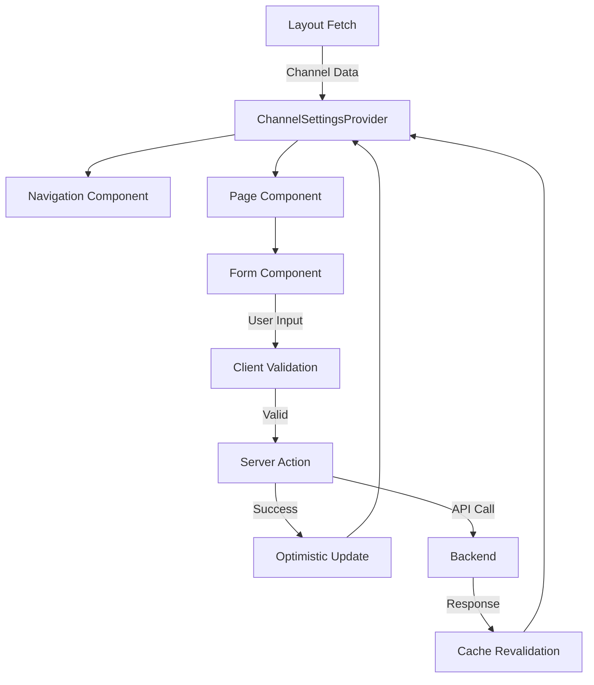

# Channel Settings Component Architecture

## Component Hierarchy

```
ChannelSettingsLayout (Server Component)
├── ChannelSettingsProvider (Client Component - Context)
├── ChannelSettingsHeader (Server Component)
│   ├── ChannelAvatar
│   ├── ChannelInfo
│   └── QuickStats
├── SettingsNavigation (Client Component)
│   ├── NavigationTab
│   └── MobileNavigationMenu
├── SettingsBreadcrumbs (Server Component)
└── {children} - Page Content
    ├── SettingsPageWrapper (Server Component)
    └── SettingsForm (Client Component)
```

## Core Components

### 1. ChannelSettingsLayout
**Location**: `/src/app/[locale]/settings/channel/[id]/layout.tsx`
**Type**: Server Component
**Purpose**: Main layout wrapper for all settings pages

```typescript
interface ChannelSettingsLayoutProps {
  children: React.ReactNode;
  params: { id: string; locale: string };
}

// Responsibilities:
- Fetch channel data once
- Check ownership permissions
- Provide channel context
- Handle loading/error states
- Setup consistent page structure
```

### 2. ChannelSettingsProvider
**Location**: `/src/components/channelSettings/ChannelSettingsProvider.tsx`
**Type**: Client Component
**Purpose**: Share channel data and settings state

```typescript
interface ChannelSettingsContextValue {
  channel: ChannelObject;
  locale: string;
  isOwner: boolean;
  updateChannel: (updates: Partial<ChannelObject>) => Promise<void>;
  refreshChannel: () => Promise<void>;
}

// Features:
- Optimistic updates
- Cache management
- Error handling
- Loading states
```

### 3. SettingsNavigation
**Location**: `/src/components/channelSettings/SettingsNavigation.tsx`
**Type**: Client Component
**Purpose**: Tab-based navigation with active state

```typescript
interface NavigationItem {
  id: string;
  label: string;
  href: string;
  icon: React.ComponentType;
  badge?: number;
  disabled?: boolean;
}

const navigationItems: NavigationItem[] = [
  {
    id: 'general',
    label: 'General',
    href: '/settings/channel/{id}/general',
    icon: SettingsIcon,
  },
  {
    id: 'videos',
    label: 'Videos',
    href: '/settings/channel/{id}/videos',
    icon: VideoIcon,
    badge: videoCount,
  },
  // ...
];

// Features:
- Active tab highlighting
- Mobile responsive (drawer on mobile)
- Keyboard navigation (arrow keys)
- Badge support for counts
- Disabled state for locked features
```

### 4. SettingsBreadcrumbs
**Location**: `/src/components/channelSettings/SettingsBreadcrumbs.tsx`
**Type**: Server Component
**Purpose**: Contextual breadcrumb navigation

```typescript
interface BreadcrumbItem {
  label: string;
  href?: string;
}

// Example output:
// Channels > Al Ummah Channel > Settings > General

// Features:
- Auto-generate from route
- i18n support
- Schema.org markup
- Mobile truncation
```

### 5. SettingsCard
**Location**: `/src/components/channelSettings/SettingsCard.tsx`
**Type**: Server Component
**Purpose**: Consistent card layout for settings sections

```typescript
interface SettingsCardProps {
  title: string;
  description?: string;
  icon?: React.ComponentType;
  children: React.ReactNode;
  actions?: React.ReactNode;
}

// Features:
- Consistent spacing
- Dark mode support
- Icon support
- Action buttons area
- Collapsible sections
```

### 6. SettingsFormField
**Location**: `/src/components/channelSettings/SettingsFormField.tsx`
**Type**: Client Component
**Purpose**: Reusable form field with validation

```typescript
interface SettingsFormFieldProps {
  label: string;
  name: string;
  type: 'text' | 'textarea' | 'select' | 'toggle' | 'image';
  value: any;
  onChange: (value: any) => void;
  error?: string;
  helpText?: string;
  required?: boolean;
  maxLength?: number;
  options?: { value: string; label: string }[];
}

// Features:
- Built-in validation
- Character counter
- Error messages
- Help text
- RTL support
- Accessibility labels
```

## Shared Utilities

### 1. Channel Settings Hooks
**Location**: `/src/hooks/useChannelSettings.ts`

```typescript
// useChannelSettings - Access channel context
export function useChannelSettings() {
  const context = useContext(ChannelSettingsContext);
  if (!context) {
    throw new Error('useChannelSettings must be used within ChannelSettingsProvider');
  }
  return context;
}

// useSettingsNavigation - Handle navigation state
export function useSettingsNavigation() {
  const pathname = usePathname();
  const activeTab = pathname.split('/').pop();
  return { activeTab, isActive: (tab: string) => activeTab === tab };
}

// useSettingsForm - Form management
export function useSettingsForm<T>(initialValues: T) {
  const [values, setValues] = useState(initialValues);
  const [errors, setErrors] = useState<Record<string, string>>({});
  const [isDirty, setIsDirty] = useState(false);
  // ... form logic
  return { values, errors, isDirty, handleChange, handleSubmit };
}
```

### 2. Settings Constants
**Location**: `/src/constants/channelSettings.ts`

```typescript
export const SETTINGS_SECTIONS = {
  GENERAL: 'general',
  VIDEOS: 'videos',
  TABS: 'tabs',
  SECTIONS: 'sections',
  COMMUNITY: 'community',
  ANALYTICS: 'analytics',
  MONETIZATION: 'monetization',
} as const;

export const SETTINGS_PERMISSIONS = {
  OWNER_ONLY: ['general', 'videos', 'monetization'],
  MODERATOR: ['community', 'analytics'],
  VIEWER: ['analytics'],
} as const;

export const SETTINGS_LIMITS = {
  NAME_MAX_LENGTH: 100,
  DESCRIPTION_MAX_LENGTH: 500,
  TAGS_MAX_COUNT: 10,
  SECTIONS_MAX_COUNT: 20,
} as const;
```

### 3. Settings Actions
**Location**: `/src/lib/actions/channelSettings.ts`

```typescript
// Server actions for settings updates
export async function updateChannelGeneral(
  channelId: string,
  data: GeneralSettingsData
): Promise<ChannelObject> {
  'use server';
  // Validation
  // API call
  // Cache revalidation
  // Return updated channel
}

export async function updateChannelTabs(
  channelId: string,
  tabs: ChannelTab[]
): Promise<void> {
  'use server';
  // Update tab configuration
}

export async function bulkUpdateVideos(
  channelId: string,
  videoIds: string[],
  updates: Partial<VideoObject>
): Promise<void> {
  'use server';
  // Bulk update videos
}
```

## Data Flow



## Implementation Priorities

### Phase 1: Core Infrastructure (Must Have)
1. ChannelSettingsLayout
2. ChannelSettingsProvider
3. SettingsNavigation
4. Basic routing structure

### Phase 2: Enhanced UX (Should Have)
1. SettingsBreadcrumbs
2. SettingsCard components
3. Form field components
4. Loading states

### Phase 3: Advanced Features (Nice to Have)
1. Keyboard navigation
2. Settings search
3. Bulk operations
4. Activity log
5. Undo/redo functionality

## Testing Strategy

### Unit Tests
- Component rendering
- Hook functionality
- Utility functions
- Form validation

### Integration Tests
- Navigation flow
- Data fetching
- Form submission
- Error handling

### E2E Tests
- Complete user journeys
- Permission checks
- Multi-language support
- Mobile responsiveness

## Performance Considerations

1. **Data Fetching**
   - Single fetch in layout
   - Streaming with Suspense
   - Partial revalidation

2. **Bundle Size**
   - Code split by route
   - Lazy load heavy components
   - Tree shake unused code

3. **Caching**
   - Server component caching
   - Client-side state
   - CDN for static assets

4. **Optimistic Updates**
   - Immediate UI feedback
   - Background sync
   - Conflict resolution

## Accessibility Requirements

- ARIA labels on all interactive elements
- Keyboard navigation support
- Screen reader announcements
- Focus management
- Color contrast compliance
- RTL language support
- Mobile touch targets (44x44 minimum)