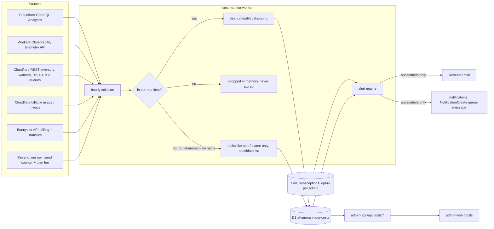

# Cost monitoring: usage, cost and alerts in the admin

**Status:** spec draft, revised with the owner's decisions of 2026-11-08 (§13). Nothing here is built yet.
**Scope:** only **Al Ummah Now's own** workers, buckets, databases, queues and namespaces in Cloudflare account `0e4b6e7f9faf280c3c9bf95995edc64f`, as listed in the attribution manifest (§3). Other Hamza Labs projects share the account (`cfcost-*`, zajel, tamma, maktaba, daleel, …). They are **never collected, stored or shown** (§3.2). Also in scope: Bunny.net (Stream: video storage, encoding and delivery) and Resend (email).
**Surface:** `admin.alummahnow.net` (apps `admin-web` and `admin-api`, Super Admin and Admin only) and a new scheduled collector worker. Phase 5 adds per-channel cost in the creator studio (§12).

---

## 0. Why this exists

In early November 2026, Workers Observability Logs reached **62.33M events month-to-date** (43M billable, **$25.80**), against an included allowance of 20M. Nobody noticed until the bill page showed it. The causes were QA workers and server-side JWKS/discovery fetches:

| Worker (Nov 1–8) | Invocations | App / env (per §3) |
| --- | --- | --- |
| `al-ummah-web-qa` | 3.4M | web / qa |
| `al-ummah-now-auth-tail` | 3.2M | auth / **shared**: the Baselime integration's tail consumer for prod and QA auth. AlUmmahNowAuth#213 detaches it (§3.3). |
| `al-ummah-now-auth-qa` | 3.2M | auth / qa |
| `videos-qa` | 1.9M | api / qa |

The tail worker's count matches `auth-qa` exactly because every `auth-qa` invocation also invokes its tail consumer. Each request is counted twice, and so are its logs. The dashboard should make that kind of multiplier obvious.

**Goal:** a spike like this triggers an alert **within 2 hours** of starting. The admin shows month-to-date (MTD) cost, a projection and a budget per app and environment, and splits Cloudflare from Bunny and Resend.

**Non-goals (Phases 0–4):** per-user cost, chargeback invoices, automatic remediation (for example disabling a worker), monitoring other Cloudflare accounts, and anything about the other Hamza Labs projects on this account. Per-channel cost for channel owners is Phase 5 (§12).

---

## 1. Integration choice

### Existing assets

| Asset | What it is | State |
| --- | --- | --- |
| **Hamza-Labs-Core/CloudFlareCostMonitor** (private) | Turborepo. `apps/api`: Hono worker with D1, KV, a sync queue and a 15-minute cron. GraphQL collectors for Workers, R2, KV, D1, Durable Objects (DO), Queues, Stream, Images, Vectorize and more (`services/cloudflare/metrics.ts`, about 2.3k lines). `apps/web`: React Router and Recharts dashboard. `packages/pricing` (`@cfcost/pricing`): pricing rules, calculator, free-tier and month-end projection, zero dependencies, with a standalone ESM bundle. | QA only (`cfcost-api-qa`, `cfcost-web-qa`). The production config still has placeholder ids. It is **multi-tenant** (email/password users, one encrypted CF token per user account, its own JWT). Last commit `baf6de0` (Nov 6 2026) extracted the pricing package. |
| **[Hamza-Labs-Core/cfctl](https://github.com/Hamza-Labs-Core/cfctl)** (internal), the "Cloudflare CLI" | Zero-dependency Node ≥ 20 CLI, v0.1.0, about 1.1k lines in `src/`. It covers the whole Cloudflare OpenAPI spec: 3,526 operations compiled into `catalog/operations.json` (spec 4.0.0, generated 2026-09-18) and refreshed with `cfctl ops update`. It has shortcuts for Workers, D1, R2, KV, Queues, Pages, DO, DNS and more, and `cfctl status` lists the whole account's resources in one call. Its agent contract: JSON output and errors, stable exit codes, `--dry-run`, and `CFCTL_READ_ONLY`. A safety classifier in `src/safety.js` treats GraphQL without `mutation`, read-only D1 SQL and a short list of known read POSTs as reads, and everything else as a write. Tests run the real binary against a local mock API (`test/cli.test.js`, `test/safety.test.js`). | `main` at `2ecaa6b` ("Initial commit: cfctl v0.1.0"). `@cfcost/pricing`'s README says a `cfctl costs` command consumes its bundle, but cfctl has **no `costs` command** yet. How we use it: §1.4. |

### Options

| | A. Use CloudFlareCostMonitor as a service (admin-api calls cfcost-api) | B. Vendor `@cfcost/pricing` and build a small collector in AlUmmahNow | C. Extend CloudFlareCostMonitor (attribution, alerts) and embed its UI |
| --- | --- | --- | --- |
| **Time to first number** | Fastest in theory (collectors exist) | Medium: reuse the pricing code and port only the GraphQL queries we need | Slow: two repos, two deploy pipelines |
| **Auth** | Bad fit. cfcost has its own users and JWT, and admin-api would need a service account and token bridging. Roles (Super Admin, Admin) would live in two places. | Native. admin-api already verifies OpenAuth tokens and has `hasAdminRole`. | Bad fit, same as A. An iframe or embedded UI also breaks RTL and our i18n. |
| **Multi-tenant** | Paid for, not needed: we monitor one account. Its per-user encrypted tokens add attack surface. | Single-tenant by design. One token, in the Secrets Store. | Same as A |
| **Attribution (app × env)** | Missing. It has groups and tags, but it doesn't know `apps.ts` or our naming. | First-class: a manifest in this repo, next to `scripts/release/apps.ts`. | Would have to be generic (rules engine) to stay useful to other tenants |
| **Alerts / digest** | Missing | Built here, using our Resend sender and notifications system | Built there, without our notifications system |
| **Ops** | Depends on a QA-only service in another org. A production deploy has never been done. | Our CI, our release pipeline, our `check:config` | Two repos to keep in step |
| **Maintenance** | Upstream drift on API shape | We own about 1–2k lines plus the vendored pricing (synced on purpose) | Highest |
| **Fixes to pricing** | Upstream only | Fix here, send upstream (§1.3) | Upstream |

### Recommendation: **B**

Vendor `@cfcost/pricing`, port the GraphQL query modules we need, and run a dedicated collector worker in this repo. Serve the data through admin-api and show it in admin-web.

Why: the hard, reusable part of CloudFlareCostMonitor is the pricing model and the GraphQL queries, and both copy over cleanly. What we need most (attribution to our apps and envs, alerts through our channels, our roles, Arabic and RTL) is exactly what cfcost lacks. Embedding it would mean bridging two auth systems to reach a multi-tenant service that has never run in production.

### 1.1 How to vendor

- Copy `packages/pricing/src` to `packages/cost-pricing/` (package name `@al-ummah/cost-pricing`). Add a `VENDORED.md` that records the upstream repo, commit (`baf6de0` today) and any local patches.
- `scripts/cost/sync-pricing.ts` re-copies from a given upstream commit and fails if local patches would be lost. Sync on purpose, not on every upstream commit.
- Port the upstream `test/bundle.test.mjs` cases to vitest, then add our golden cases (§9).
- Port only the query strings and normalizers we use from `apps/api/src/services/cloudflare/metrics.ts` (Workers, R2, D1, KV, Queues, DO), into `apps/cost-monitor/src/cf/queries/*.ts`. Don't port the sync orchestrator, users, groups, tags or the multi-tenant schema.

### 1.2 Gaps in `@cfcost/pricing` to close (found while reading it)

1. **No Workers Logs (Observability) pricing**, which is the product behind this month's spike. Add `workers_observability.events` (20M included per month, then $0.60 per million) and verify both numbers in Phase 0.
2. **Included amounts follow the Free plan in places** (the README lists KV at "100K reads/day"). The account is on Workers Paid, so included allowances must be plan-aware. Upstream has `services/plan-tier.ts`; use it, or hard-code Workers Paid with a test.
3. **Projection is linear over the whole MTD** (`projectUsage`: daily average × days in period). After a fix lands, that over-projects for the rest of the month. Add a trailing-7-day projection and show both (§4.4).
4. Check that DO SQLite storage, Queues operations (per 64 KB), Analytics Engine and R2 Infrequent Access are present and current. Add any that are missing.

### 1.3 Upstream

Send pricing fixes back to CloudFlareCostMonitor as PRs, so cfcost, cfctl and this admin price usage the same way. Nothing in AlUmmahNow waits on those PRs.

### 1.4 Where cfctl fits

cfctl is a **CLI for people and agents**. It doesn't run inside the collector. `src/config.js`, `src/catalog.js` and `src/execute.js` use `node:fs`, `node:os`, `homedir()` and stdin, and the catalog is a 3.2 MB JSON file loaded at startup. None of that belongs in a Worker that runs every hour. We use it in three places:

1. **As the reference for the collector's HTTP client.** `src/client.js` (about 100 lines) is already close to runtime-neutral:
   - plain `fetch`
   - retries on 429/5xx (5xx only for GET), honouring `Retry-After`
   - exponential backoff with jitter
   - both pagination schemes (`page`/`total_pages` and `cursor`)
   - a typed `ApiError`

   In Phase 1 the collector's `apps/cost-monitor/src/cf/client.ts` copies it with the same behaviour. Two changes: no `process.stderr` (use the repo `logger`), and also retry POST to `/graphql` on 5xx (GraphQL reads are idempotent).

   **Decided (owner):** in Phase 4 we send a Worker-friendly `cfctl/client` export upstream (no Node built-ins, with an injectable logger hook). The collector then swaps its copy for that file, vendored through a pinned-commit sync script as in §1.1, so both repos share one client.
2. **As the ops and Phase 0 tool**, run from a laptop with the read token and `CFCTL_READ_ONLY=1`:
   - `cfctl status` is the inventory snapshot used to fill and check the attribution manifest (§3). It lists workers, D1, R2, KV, queues, Pages, DO namespaces, Hyperdrive, Vectorize, Workflows, Containers and zones, and reports `"no permission"` for each product the token can't read, which also tests the token's scope (§2.5).
   - `cfctl api POST /graphql --body @q.json` runs and saves the GraphQL fixtures (§9).
   - `cfctl call billable-usage-get-v1-account-usage from=… to=…` tests reconciliation (§2.2).
   - `cfctl call telemetry.query --body @q.json` tests Workers Logs counts (§2.1).

   The runbook (`docs/cost-monitoring/RUNBOOK.md`) uses cfctl for spike investigation, for example `cfctl workers get <script>` to see a script's tail consumers and observability settings.
3. **As the catalog.** The catalog lists API operations, not account resources. Even so, it is how we found the endpoints this spec relies on, and it keeps them findable as Cloudflare adds products:
   - `billable-usage-get-v1-account-usage` (`GET /accounts/{id}/billable-usage?from&to`, alpha), `billable-usage-get-v1-account-usage-info`, and `billable-usage-v2-*` (`/accounts/{id}/billable/usage`, FOCUS v1.3 format, "alpha, restricted")
   - `usage-analytics-get-account-billing-usage` (`GET /accounts/{id}/billing/usage?metrics&since&until&time_delta`)
   - `telemetry.query`, `telemetry.keys.list` and `telemetry.values.list` (`/workers/observability/telemetry/*`)
   - an inventory list operation for each billable product (`cfctl ops search <product> list`)

   A weekly check (`scripts/cost/catalog-coverage.ts`, Phase 4) compares the catalog's billable-product tags with the products the collector covers and opens an issue when Cloudflare adds a product we don't price.

**Changes to send upstream to `Hamza-Labs-Core/cfctl` in Phase 4** (decided by the owner; none of them block Phases 0–3):
- `telemetry.query`, `telemetry.keys.list` and `telemetry.values.list` are POSTs that only read, but they aren't in `POST_READS` in `src/safety.js`. So `CFCTL_READ_ONLY=1` **blocks** them, and without read-only they need `--yes`. Add them, plus `GET /billable-usage` (already a read because it's a GET). `/billable/usage` POST is already listed.
- The GraphQL endpoint (`/graphql`) isn't in the OpenAPI catalog, so it's reachable only through `cfctl api`. Add a `cfctl graphql <file> --var k=v` shortcut, classified by the existing no-`mutation` rule.
- The Worker-friendly client export described above.
- The `cfctl costs` command named in `@cfcost/pricing`'s README doesn't exist. Either add it (usage from `billable-usage` or GraphQL, priced with the bundle), or correct that README.

---

## 2. Data sources and permissions



### 2.1 Cloudflare GraphQL Analytics (`https://api.cloudflare.com/client/v4/graphql`)

All queries are account-scoped (`viewer { accounts(filter: {accountTag}) { … } }`) and grouped by hour (`datetimeHour`) and by resource. Field names are confirmed against live responses in Phase 0, and the responses are saved as fixtures (§9).

**Only our resources.** Where a dataset supports an `_in` filter (`scriptName_in`, `bucketName_in`, `databaseId_in`, `namespaceId_in`, `queueId_in`; Phase 0 confirms which ones do), the query is filtered to the manifest's names and ids, so other projects' rows never leave Cloudflare. Where it doesn't, the normalizer drops non-manifest rows **in memory** before anything is written. Raw responses are never persisted or logged, and the saved fixtures are trimmed to our resources before they're committed. §3.2 covers account totals and the "looks like ours" check.

| Product | Dataset | Group by | Sums we keep |
| --- | --- | --- | --- |
| Workers | `workersInvocationsAdaptive` | `scriptName`, `datetimeHour`, `status` | `requests`, `errors`, `subrequests`, `cpuTimeUs` (or CPU quantiles × requests if the sum isn't exposed), `wallTime` |
| Workers Logs | *Not in GraphQL as far as we know.* Use the **Workers Observability telemetry query API**: `POST /accounts/{id}/workers/observability/telemetry/query` (cfctl catalog id `telemetry.query`), counting events grouped by `$metadata.service`. `telemetry.keys.list` and `telemetry.values.list` find the field names. | service, hour | `events` |
| R2 | `r2OperationsAdaptiveGroups`, `r2StorageAdaptiveGroups` | `bucketName`, `actionType` (mapped to Class A or B), hour | ops, `payloadSize`, `objectCount` (max per day) |
| D1 | `d1AnalyticsAdaptiveGroups`, `d1StorageAdaptiveGroups` | `databaseId`, hour | `rowsRead`, `rowsWritten`, `readQueries`, `writeQueries`, storage bytes |
| KV | `kvOperationsAdaptiveGroups`, `kvStorageAdaptiveGroups` | `namespaceId`, `actionType`, hour | reads, writes, deletes, lists, storage bytes |
| Queues | `queueMessageOperationsAdaptiveGroups` | `queueId`, `actionType`, hour | billable operations |
| Durable Objects | `durableObjectsInvocationsAdaptiveGroups`, `durableObjectsPeriodicGroups`, `durableObjectsStorageGroups` | `namespaceId`/`scriptName`, hour | requests, `activeTime` → GB-s, storage |
| Analytics Engine | (auth uses `auth_events_qa`) | dataset | data points written/read (if billed) |
| Stream / Images | Only if Phase 0 finds them in use. Video goes through Bunny today. | | |
| **Top paths** (drilldown only) | `httpRequestsAdaptiveGroups` on zone `alummahnow.net` | `clientRequestHTTPHost`, `clientRequestPath`, hour | `count` |

`httpRequestsAdaptiveGroups` explains the cause rather than the cost. Server-side JWKS and discovery fetches from our workers to `auth(.qa).alummahnow.net` show up as requests on that host, so the drilldown for a spike on `al-ummah-now-auth-qa` lists `/.well-known/jwks.json` and `/.well-known/openid-configuration` at the top. This dataset's query window is short, so the collector only runs it **on demand** (spike drilldown) and stores the top 50 paths per host per hour for 7 days. It doesn't run every hour.

If the telemetry API can't count events per script, use this fallback for Workers Logs: estimate `events ≈ invocations × events-per-invocation` for each script, calibrated weekly against the account's billable-usage figure. The dashboard labels the number "estimated".

### 2.2 Billing (Cloudflare)

- **Primary number = our estimate** (usage × vendored pricing). It's available hourly, per resource.
- **Reconciliation:** the OpenAPI spec (cfctl catalog) has three candidate endpoints. Phase 0 tries them in this order with the read token, using `cfctl call …`:
  1. `GET /accounts/{id}/billable-usage?from&to` (`billable-usage-get-v1-account-usage`, *alpha*). It returns billable usage for a period, the current billing period when called without parameters. `/billable-usage/info` returns coverage and subscription metadata, which tells us the billing anchor day (§4.4).
  2. `GET /accounts/{id}/billing/usage?metrics&since&until&time_delta` (`usage-analytics-get-account-billing-usage`): a time series per billable metric, Workers and KV included.
  3. `GET|POST /accounts/{id}/billable/usage` (v2, FOCUS v1.3 cost and usage records, *alpha, restricted*). It may not be enabled for our account.

  If one works, the collector reads it **daily** and the dashboard shows "estimate vs billed" per product. Whichever works becomes the source of truth for MTD, and our hourly estimate fills in the hours since the last daily read. If none works with an API token, a Super Admin uploads the monthly invoice or usage CSV in the admin (Phase 4), and the dashboard shows the drift for that month. Each endpoint's required permission (Billing Read?) is recorded in Phase 0 (Q5).
- The **0.67M gap** between 62.33M − 20M = 42.33M and "43M billable" has to be explained in Phase 0 (rounding up to whole millions, or a different snapshot time). The golden test (§9) must reproduce the billed figure.
- **Safety net now, without code:** in Phase 0, turn on Cloudflare's own *Usage Based Billing* notifications for the products that support them, starting with Workers.

### 2.3 Bunny.net

The platform uses **Bunny Stream** (`apps/api-videos/src/lib/bunny/stream.ts`): a library per environment with collections inside it. **Stage shares QA's library** and marks its titles with `BUNNY_NAME_PREFIX = "[stage] "`.

- `GET https://api.bunny.net/billing`: this month's charges and per-type charges (storage, bandwidth, Stream). Read daily.
- `GET https://api.bunny.net/statistics?dateFrom&dateTo&pullZone=`: bandwidth and requests per pull zone. Each Stream library has its own pull zone, so the manifest's library → env map attributes Bunny CDN cost per environment. QA and stage share one library, so their delivery cost is shown as `qa+stage`. Storage can be split by the `[stage] ` title prefix.
- `GET https://video.bunnycdn.com/library/{id}/statistics`: library-level views and watch time. This is also the base for per-channel cost in Phase 5 (§12).
- Phase 0 confirms that the Bunny account holds only Al Ummah Now libraries and zones. If it holds other projects' too, the manifest leaves them out, the same as in Cloudflare, and the account-level Bunny charges become "our share" by the §3.4 method.

**Bunny key (decided):**
- The collector needs Bunny's **account API key**, because `/billing` and `/statistics` accept nothing narrower.
- Like the other secrets, it is stored only in the Secrets Store (`cost-monitor-bunny-key`) and bound only to the scheduled `al-ummah-cost-monitor` worker, which has no public route. admin-api, admin-web and every other worker never get it.
- The collector's Bunny client only allows `GET` requests to a fixed path list (`/billing`, `/statistics`, `/videolibrary`, `/pullzone`, plus the Stream reads in §12). Any other method or path throws before a request is sent, and a unit test enforces this.
- Where Bunny offers a narrower key, we use it instead. Per-video Stream reads in Phase 5 use the **per-library Stream API key** (scoped to one library), not the account key.
- The account key is rotated every 90 days, with the same reminder as the CF token.

We found no blocker. Bunny has no read-only account key, so the method and path allowlist plus the isolated worker are how we limit it.

### 2.4 Resend

- Resend keys are either *full access* or *sending only*. Reading usage would need a full-access key, which can also delete domains, so **we don't read usage from Resend.**
- Instead, count sends where we make them. Auth sends sign-in and OTP email, and the collector will send alert email. Each sender writes one Analytics Engine data point per email (`email_sent{app,env,template}`). Cost = plan fee (manifest config) + overage price × sends above the plan's quota.
- The collector uses a **sending-only** key for alert email (`cost-monitor-resend-key`).

### 2.5 Cloudflare API token (least privilege)

One account-owned token, **`al-ummah-cost-monitor-read`**:

| Permission | Why |
| --- | --- |
| Account › Account Analytics › Read | GraphQL datasets above |
| Account › Workers Scripts › Read | inventory of scripts (names, tail consumers), only to match against the manifest and the "looks like ours" check |
| Account › Workers Observability › Read | Workers Logs counts (telemetry query) |
| Account › Workers R2 Storage › Read | bucket inventory |
| Account › D1 › Read | database inventory (id ↔ name) |
| Account › Workers KV Storage › Read | namespace inventory (id ↔ title) |
| Account › Queues › Read | queue inventory (id ↔ name) |
| Zone › Analytics › Read (zone `alummahnow.net` only) | `httpRequestsAdaptiveGroups` drilldown |
| Account › Billing › Read | **only if** Phase 0 shows billable usage needs it. It also exposes payment details, so leave it out if we can. |

No edit permissions at all. Restrict client IPs only if Workers egress ranges are documented, which they aren't today, so don't.

Cloudflare tokens can't be limited to individual workers or buckets. That's why §3.2 filters out other projects in our code, before storage.

**Storage:** Secrets Store `f8eddc9944d041919ed8dc7d08d32308` (the one admin-api already uses):
- `cost-monitor-cf-token`
- `cost-monitor-bunny-key`
- `cost-monitor-resend-key`

Each secret is bound **only** to the cost-monitor worker.

**Rotation:**
- The token is created with `expires_on` set 90 days out.
- The collector calls `GET /user/tokens/verify` once a day. It raises an alert 14 days before expiry and a critical alert on any 401 or 403.
- To rotate: create the new token, update the secret, check the next hourly run, then revoke the old token. The runbook goes into `docs/cost-monitoring/RUNBOOK.md` in Phase 1.
- The same 90-day reminder applies to the Bunny key (manual rotation in the Bunny dashboard).

---

## 3. Attribution: app × environment

### 3.1 Dimensions

- **app** (Al Ummah Now only): `web`, `api`, `processor`, `scheduler`, `realtime`, `admin`, `auth`, `profile`, `www`, `cms`, `log-service`, `ops` (the cost monitor itself). There's no `unattributed` or `hamza-labs` bucket: a resource is either in the manifest, and so belongs to one of these apps, or it's out of scope.
- **env:** `prod`, `stage`, `qa`, `preview` (PR previews), `dev`, `shared` (one resource serving several envs)
- **product** (pricing line): `workers`, `workers_logs`, `r2`, `d1`, `kv`, `queues`, `durable_objects`, `analytics_engine`, `bunny_storage`, `bunny_cdn`, `bunny_stream`, `resend`, `platform_fee`

### 3.2 Scope: the manifest decides (owner decision)

**In scope = listed in the manifest.** Nothing else is collected, stored or shown.

1. **Manifest entry** (exact name or id, or a manifest pattern such as `al-ummah-now-*-pr-<n>` for PR previews). The entry gives the app. The env comes from the entry, or else from the suffix:
   - `-qa` → qa
   - `-stage` or `-staging` → stage
   - `-preview` or `-pr-<n>` → preview
   - `-dev` → dev
   - no suffix → prod

   The suffix rule only assigns an **env** to something already in the manifest. It never brings a resource into scope.
2. **Not in the manifest** → out of scope. Its usage is dropped in memory (§2.1), with one exception (point 3).
3. **"Looks like ours" check.** This makes sure a new worker of ours isn't missed silently. The daily inventory sync tests every *unmatched* resource name (not in the manifest, and not on its `ignore` or `retired` lists) against a short list of patterns:
   - names starting `al-ummah`, `alummah` or `al-ummah-now`
   - names containing `alummahnow`
   - the base name of an existing manifest entry plus an env suffix (for example `videos-dev`, or `al-ummah-now-profile-preview`)
   - custom domains on `*.alummahnow.net` attached to an unmatched worker

   A match stores **only the name, kind and first-seen date** in `candidate_resources`. No usage is stored for it. It raises a `resource.candidate` alert (for subscribers) and shows a "possible missing manifest entry" banner on `/costs`. Once someone adds it to the manifest, the next run collects it, and the backfill can cover the time since it first appeared. If someone marks it "not ours" (Super Admin, audited), its name is added to the manifest's `ignore` list.
4. **Repo-side check.** A CI unit test reads every `apps/*/wrangler*.jsonc` in this repo (worker `name`s and bucket, database, queue and DO names) and fails if any of them is missing from the manifest. A new worker in this repo can't ship unmapped. Workers in AlUmmahNowAuth, CMS and UI are covered by the hand-written part and by the pattern check in point 3.

### 3.3 Manifest

`packages/cost-attribution/src/manifest.ts`, a typed data file with no runtime dependencies, shared by the collector, admin-api and the tests.

- **Generated part:** worker names for prod and stage come from `scripts/release/apps.ts` (`APPS[].production.name`, `APPS[].stage.name`). QA names come from each app's `wrangler.qa.jsonc`. A unit test fails if `apps.ts` gains an app that the manifest doesn't map, so the two can't drift.
- **Hand-written part:** resources from other repos, shared resources and Bunny pull zones.

Inventory as of today, from this repo's wrangler configs plus AlUmmahNowAuth, AlUmmahNowCMS and AlUmmahNowUI:

| app | prod | stage | qa | other |
| --- | --- | --- | --- | --- |
| web | `al-ummah-now-production` | `al-ummah-now-stage` | `al-ummah-web-qa` | `al-ummah-now-preview` (preview), `al-ummah-now-staging` (legacy stage?), `al-ummah-now-dev` (dev) |
| api | `videos` | `videos-stage` | `videos-qa` | D1 `al-ummah-now-search[-stage\|-qa]` |
| processor | `al-ummah-now-processor` | `…-stage` | `…-qa` | queue `al-ummah-now-videos[-stage\|-qa]`, D1 `al-ummah-now-notifications[-stage\|-qa]` |
| scheduler | `al-ummah-scheduler` | `…-stage` | `…-qa` | DO `SCHEDULER_LOCK`, R2 `scheduled-videos[-stage\|-qa]` |
| realtime | `al-ummah-now-comms` | `…-stage` | `…-qa` | DO `WEBSOCKET_DO`, R2 `al-ummah-now-messages[-stage\|-qa]` |
| admin | `al-ummah-admin-web`, `al-ummah-admin-api` | `…-stage` | `…-qa` | `al-ummah-admin-web-dev` (dev), D1 `al-ummah-now-reports[-stage\|-qa]` |
| auth | `al-ummah-now-auth`, `al-ummah-now-auth-admin`, `al-ummah-now-audit-consumer` | `…-stage` | `…-qa` | **`al-ummah-now-auth-tail` = shared** (Baselime tail consumer; follows AlUmmahNowAuth main, see below), D1 `al-ummah-now-d1[-stage\|-qa]`, queue `audit-events[-stage\|-qa]`, AE `auth_events*` |
| profile | `al-ummah-now-profile` | `…-stage` | `…-qa` | |
| www (repo AlUmmahNowUI, `www.alummahnow.net` and `alummahnow.net`) | `al-ummah-now-ui` (today) → `al-ummah-now-www` | `al-ummah-now-www-stage` | `al-ummah-now-www-qa` | KV `al-ummah-now-www-snapshot[-stage\|-qa]`; service binding to cms |
| cms (repo AlUmmahNowCMS, www's admin at `cms.alummahnow.net`) | `bknd` (today) → `al-ummah-now-cms` | `al-ummah-now-cms-stage` | `al-ummah-now-cms-qa` | D1 `al-ummah-now-cms[-stage\|-qa]`, R2 `al-ummah-now-cms[-stage\|-qa]` |
| api (shared storage) | R2 `videos`, `channels`, `profiles`, `playlists`, `subtitles`, `watch-history`, `community-posts`, `channel-sections`, `channel-tabs`, `global-settings`, `upload-defaults`, `reports` | `-stage` variants | `-qa` variants | `videos-preview`, `videos-staging` |
| api (Bunny) | Stream library (prod) and its pull zone | shares the QA library, `[stage] ` prefix | Stream library (qa) and its pull zone | library ids filled in during Phase 0 |

Not in the table, and so out of scope: `cfcost-*` and every other Hamza Labs project on the account.

**Shared resources.** R2 buckets are written by several apps (web, api, admin-api, scheduler all bind `videos`). Storage and operations are attributed to the **owning app** named in the manifest (`api` for the content buckets). The R2 dataset has no per-caller split, so we don't pretend to split it.

**www and cms (decided):** both are ours, with entries for prod, stage and QA.
- **Today:** prod runs `al-ummah-now-ui` and `bknd`, from the current `wrangler.json` on each repo's main.
- **v1:** the open PRs (AlUmmahNowUI#7, AlUmmahNowCMS#12) rename the workers to `al-ummah-now-www[-stage|-qa]` and `al-ummah-now-cms[-stage|-qa]`, and add the stage and QA resources (`docs/PLAN.md` in both repos).
- **In the manifest:** the old and new names both map to the same app and env, so cost carries across the rename. Once the old workers are deleted from the account, the old names move to a `retired` list. They stay retired so the "looks like ours" check doesn't flag them while history is still shown. The v1 names are added in Phase 1 whether or not those PRs have merged, because the manifest ignores names that don't exist yet.

**`al-ummah-now-auth-tail` (decided: follow AlUmmahNowAuth main):**
- **What it is:** the Baselime integration's tail worker. It runs once per auth invocation (prod and QA) and forwards sampled events to Baselime, which is now part of Workers Observability.
- **The fix in progress:** AlUmmahNowAuth#213, open as of 2026-11-08, sets `"tail_consumers": []` on QA and prod (stage already had none). It also sets `head_sampling_rate` to 0.1 on QA and stage for auth, profile, admin and audit-consumer. Deleting the worker from the account is left to the owner.
- **How the manifest follows it:**
  - **While `tail_consumers` on main still lists it:** the manifest keeps `al-ummah-now-auth-tail` as `auth/shared`. Its usage is split between prod and QA in proportion to `al-ummah-now-auth` versus `al-ummah-now-auth-qa` invocations in the same hour. That's exact for a tail consumer, and the UI marks the split as derived.
  - **Once #213 (or whatever replaces it) lands on main:** the entry stays only so the remaining cost is visible until it drops to zero, and the proportional split is removed. When the worker is deleted, the name moves to `retired`.
  - **If main instead introduces per-env tail workers** (for example `al-ummah-now-auth-tail-qa`): they get ordinary per-env entries, and the shared split is removed.
- **Keeping it in sync:** the Phase 1 manifest task records the AlUmmahNowAuth main commit it was checked against. The weekly drift report (§7.2) flags any `al-ummah-now-auth-tail*` that appears or disappears in the account, so the manifest can't fall behind main without someone noticing.

### 3.4 Account-level charges: only our share (owner decision)

Included allowances (for example 10M Workers requests or 20M log events) and the $5 Workers Paid fee belong to the **account**, which other projects share. We show **only Al Ummah Now's share**, using the **proportional usage method**. The dashboard states the method, in a tooltip and on a "How costs are calculated" page.

1. For each product, take the **account's** usage for the period. It comes from a separate GraphQL query with **no resource dimension** (an account-wide `sum` only, so no other project's per-worker rows are ever fetched), or from the billable-usage line (§2.2). Price it: `account_cost = max(0, account_usage − included) × price`. This total is **used in memory only** and never stored or shown.
2. **Our share of a product** = `account_cost × our_usage ÷ account_usage`. Only `our_usage` (per resource) and the resulting share are stored.
3. **Allocation inside Al Ummah Now:** our share of each product is split across app × env by each one's usage.
4. **Platform fee** ($5 Workers Paid): our share = `$5 × our share of the account's usage-based cost` for the month. If the whole account is still inside its allowances (cost $0), use our share of Workers requests instead. Shown as `platform_fee (our share)`, not split across apps.
5. **Bunny and Resend** need no split if Phase 0 confirms the accounts are ours alone. If not, the same proportional method applies.

What this means:
- When other projects use more, more of the allowance gets used up and our marginal cost rises. The proportional method shows that fairly, without revealing their numbers.
- **Included allowances:** the dashboard shows *our* usage as a % of the allowance, and a single derived **"account allowance projected to run out on <date>"** line with no other figures, because running out of the allowance changes our cost. The allowance alert uses the same derived date.
- **Reconciliation** (§2.2) compares *our share of the billed line* (the billed amount × our usage share) with our estimate, so the account invoice total isn't shown either.

---

## 4. Metrics and storage

### 4.1 D1 database `al-ummah-now-costs` (prod), plus `-qa`

Migrations live in `apps/cost-monitor/migrations`. Main tables:

```sql
-- our resources only (manifest-matched); app is NOT NULL, there is no 'unattributed'
cost_resources(id TEXT PK, kind TEXT, cf_id TEXT, name TEXT, app TEXT NOT NULL, env TEXT NOT NULL,
               env_source TEXT CHECK (env_source IN ('manifest','suffix')),
               first_seen INTEGER, last_seen INTEGER)

-- unmatched names that look like ours (§3.2 point 3): name only, no usage
candidate_resources(kind TEXT, name TEXT, matched_pattern TEXT, first_seen INTEGER, last_seen INTEGER,
                    status TEXT CHECK (status IN ('open','added','ignored')), decided_by TEXT, decided_at INTEGER,
                    PRIMARY KEY (kind, name))

-- hourly raw usage, idempotent upsert
usage_hourly(hour INTEGER, resource_id TEXT, product TEXT, metric TEXT, value REAL,
             PRIMARY KEY (hour, resource_id, metric))

-- daily rollup with allocated cost (the dashboard reads this)
usage_daily(day TEXT, app TEXT, env TEXT, product TEXT, metric TEXT, value REAL,
            cost_usd REAL, usage_share REAL, PRIMARY KEY (day, app, env, product, metric))

-- non-Cloudflare and reconciled amounts
vendor_costs_daily(day TEXT, vendor TEXT, line_item TEXT, env TEXT, amount_usd REAL,
                   source TEXT CHECK (source IN ('api','estimate','invoice')),
                   PRIMARY KEY (day, vendor, line_item, env))

kpi_daily(day TEXT PK, views INTEGER, active_users INTEGER, source TEXT)
top_paths_hourly(hour INTEGER, host TEXT, path TEXT, requests INTEGER, PRIMARY KEY (hour, host, path))

budgets(scope TEXT PK /* 'account' | 'env:qa' | 'app:web' | 'app:web/env:qa' */, monthly_usd REAL, updated_by TEXT, updated_at INTEGER)
alert_rules(id TEXT PK, kind TEXT, params_json TEXT, enabled INTEGER, updated_by TEXT, updated_at INTEGER)

-- opt-in alert subscriptions (§6.2). No rows = nobody gets anything.
alert_subscribers(user_id TEXT PK, email TEXT NOT NULL /* from the verified token, not typed in */,
                  locale TEXT CHECK (locale IN ('en','ar')), tz TEXT /* IANA, e.g. Asia/Riyadh */,
                  quiet_start TEXT, quiet_end TEXT /* HH:MM local, NULL = no quiet hours */,
                  role_verified_at INTEGER, paused INTEGER DEFAULT 0, created_at INTEGER, updated_at INTEGER)
alert_subscriptions(id TEXT PK, user_id TEXT NOT NULL REFERENCES alert_subscribers(user_id),
                    kind TEXT CHECK (kind IN ('budget','spike','allowance','digest','health','resource.candidate','vendor.bunny')),
                    scope TEXT /* NULL = all, or 'env:prod', 'app:web', 'app:web/env:qa' */,
                    min_severity TEXT CHECK (min_severity IN ('info','warn','critical')) DEFAULT 'warn',
                    via_email INTEGER NOT NULL, via_inapp INTEGER NOT NULL, CHECK (via_email + via_inapp >= 1),
                    created_at INTEGER, updated_at INTEGER, UNIQUE (user_id, kind, scope))
alert_deliveries(alert_id TEXT, user_id TEXT, channel TEXT, sent_at INTEGER, status TEXT, held_for_quiet INTEGER,
                 PRIMARY KEY (alert_id, user_id, channel, sent_at))
alerts(id TEXT PK, fingerprint TEXT, kind TEXT, severity TEXT, scope TEXT, state TEXT /* firing|resolved|acked|snoozed */,
       first_fired INTEGER, last_fired INTEGER, last_notified INTEGER, snooze_until INTEGER, payload_json TEXT)
collector_runs(id TEXT PK, kind TEXT, started INTEGER, finished INTEGER, status TEXT, hours_covered TEXT, datasets_json TEXT, error TEXT)
cost_audit(id TEXT PK, at INTEGER, actor_id TEXT, actor_email TEXT, action TEXT, before_json TEXT, after_json TEXT)
pricing_versions(version TEXT PK, upstream_commit TEXT, activated_at INTEGER)
```

**Size:** about 200 resources × about 4 metrics × 24 hours ≈ 19k `usage_hourly` rows per day, 45 days ≈ 860k rows. `usage_daily` is about 2k rows per day. That is well inside D1 limits, and per-hour writes stay in the low thousands of rows.

### 4.2 Retention

| Table | Kept for | Why |
| --- | --- | --- |
| `usage_hourly` | 45 days | MTD plus a 4-week spike baseline |
| `top_paths_hourly` | 7 days | drilldown only |
| `usage_daily`, `vendor_costs_daily`, `kpi_daily` | 25 months | year-over-year comparison |
| `alerts`, `alert_deliveries`, `cost_audit` | 13 months | |
| `alert_subscribers`, `alert_subscriptions` | until removed | deleted when the user unsubscribes or loses the admin role |
| `candidate_resources` | until decided, then 90 days | |
| `collector_runs` | 30 days | |

The daily cron prunes old rows in batches of 5k.

### 4.3 Backfill

`POST /internal/backfill?from=YYYY-MM-DD&to=…` on the collector (internal API key only; admin-web triggers it through admin-api for Super Admins). It walks day by day, one dataset at a time, inside the 300-queries-per-5-minutes GraphQL limit. It goes as far back as each dataset keeps data (Phase 0 records each dataset's retention). Target: the current and previous month at go-live, so the spike baseline and the month-over-month comparison work on day one. That includes **the Nov 1–8 spike**, which becomes the acceptance replay (§10).

### 4.4 Derived numbers

- **MTD cost:** Σ `usage_daily.cost_usd` for the billing month (calendar month, UTC; Phase 0 confirms the account's billing anchor day).
- **Projection:** two numbers, both shown.
  - *Linear*: MTD ÷ days elapsed × days in month. This is upstream `projectAccountCost`.
  - *Trailing*: MTD + (average of the last 7 full days × days left). This one drives the budget-overrun alerts, because it reacts to fixes and to new spikes.
- **Included allowance:** per product, *our* MTD usage as a % of the allowance, plus the derived **account exhaustion date** at the trailing rate (§3.4). No account totals are shown.
- **Unit economics:** cost per 1K views and cost per monthly active user (MAU) = prod cost ÷ (`kpi_daily.views` ÷ 1000) and ÷ MAU. QA and stage are left out of the numerator.
  - Source: the platform's analytics rollups (views) and auth's active-user counts. Phase 3 picks the exact source; see Q1.
  - Shown monthly and over the trailing 30 days.

---

## 5. Dashboard UX (admin-web)

A new top-level nav item **Costs** (`nav.costs`). Only Super Admins and Admins (`hasAdminRole`) see it. Moderators don't (§8).

| Route | Content |
| --- | --- |
| `/costs` **Overview** | Tiles: MTD total, our share (all vendors) · projected month-end (trailing, with linear in a tooltip) · budget and % used · allowance burn (our % and the account exhaustion date for the product closest to running out). Stacked area chart: daily cost by vendor this month, with last month as a dashed line. Table: env × vendor. Banners for firing alerts, for open `candidate_resources` ("possible missing manifest entry"), and for **"Nobody is subscribed to spike/budget/health alerts"** while no subscription of that kind exists. A "data as of HH:MM" badge, amber if the last successful run is more than 2h old. A "How costs are calculated" link explains the §3.4 method. |
| `/costs/products` | One card per product: usage, included remaining, exhaustion date, cost, and a sparkline. A product page shows hourly usage by app × env. |
| `/costs/apps` | Matrix with apps as rows and envs as columns. Each cell shows MTD cost, Δ versus last month, and usage share. Toggle between "allocated cost" and "usage share". Clicking a cell opens that app × env broken down by resource and product. |
| `/costs/movers` | Biggest increases and decreases over 24h, 7d and MTD versus last month, by resource and by app × env, ranked by $ impact on the projection. |
| `/costs/alerts` and `/costs/alerts/:id` | Alert list (firing, acked, resolved). The detail page is the **spike drilldown**: the hourly series against its baseline band; top scripts by invocations, logs and CPU at the spike hour; top paths for the relevant host (fetched on demand); tail consumers involved; and a "likely cause" line when a pattern matches (for example jwks/discovery paths or a tail multiplier). Buttons: Ack, Snooze 24h, Open in Cloudflare. |
| `/costs/subscriptions` **My alerts** (Super Admin and Admin, self-service) | Each admin manages only their own subscriptions. Toggles per kind (budget, spike, allowance, daily digest, health, possible missing resource, Bunny), each with an optional scope (env and/or app), a minimum severity, and channel checkboxes (email, in-app; at least one). Profile: language (English or Arabic), time zone (IANA picker, defaulting to the browser's), quiet hours. The email address is the one on the signed-in account and can't be edited. "Send test alert" sends one sample in the chosen language. **Nothing is checked by default.** |
| `/costs/settings` (Super Admin) | Budgets per scope, alert thresholds, pricing version, backfill trigger, candidate-resource decisions (add or ignore), CSV invoice upload (Phase 4). A read-only **Subscribers** list (who gets what, and through which channel) with a "Remove" action for offboarding, but no way to subscribe someone else. Every change goes to `cost_audit`. |

**Implementation notes**

- **Charts:** Recharts, as in cfcost. In RTL, pass `reversed` to the time X-axis and put the Y-axis on the right. Tooltips and legends follow `dir`.
- **Numbers:** `Intl.NumberFormat(locale, { style: 'currency', currency: 'USD' })`. Arabic digits follow the existing locale behaviour (see the notification badge, commit 756e984). Units such as "M requests" and "GB-month" get translation keys.
- **i18n:** add every string to `apps/admin-web/src/i18n/messages/en.ts` and `ar.ts`, under a `costs.*` namespace. Product names stay in English inside Arabic text where they are brand names (Cloudflare, R2, D1).
- **Data fetching:** use `@tanstack/react-query`, which admin-web already uses. Overview data has `staleTime` of 5 minutes, and nothing polls faster than once per minute.
- **Accessibility:** each chart has a table view toggle, and colours meet contrast in light and dark mode.

---

## 6. Alerting

### 6.1 Rules (defaults; Super Admins can edit them)

| Kind | Fires when | Default severity |
| --- | --- | --- |
| **budget.mtd** | MTD for a scope crosses 50%, 80% or 100% of its monthly budget | info / warn / critical |
| **budget.projected** | The trailing projection for a scope goes over its budget (checked hourly, re-notified at most daily) | warn; critical above 150% |
| **spike** | For a resource or app × env and a metric (invocations, log events, CPU, R2 ops, D1 rows): `value_h > max(k × baseline_h, baseline_h + floor)` for **2 consecutive hours**, or for 1 hour at ≥ 10× the baseline. On top of that, the projected monthly $ impact must be ≥ `min_impact`. | warn; critical if the impact ≥ $10/month |
| **allowance** | An included allowance is projected to run out before month end, or reaches 80% or 100% | warn |
| **resource.candidate** | The daily inventory finds an unmatched resource whose name looks like ours (§3.2 point 3) | info |
| **health: collector.stale** | No successful hourly run for 3 hours | critical |
| **health: token** | Token expires within 14 days, or a 401/403 | warn / critical |
| **vendor.bunny** | Bunny charges this month are above budget, or day-over-day bandwidth is ≥ 3× | warn |

**Baseline:** the median of the same metric for the same hour of day over the previous 7 days, ignoring hours already flagged as spikes. Defaults: `k = 3`, `floor` = 5,000 events per hour for invocations and logs, `min_impact` = $0.50 per month.

**Replaying the Nov 1–8 spike:** `al-ummah-web-qa` averaged about 17.7k invocations per hour (3.4M over 8 days), and log events scale with it. Unless its pre-spike baseline was already near that level, rule `spike` fires at the second elevated hour. Collection is hourly at :10 for hours that ended at least 10 minutes earlier, so the alert lands **about 70–130 minutes** after the spike starts. The replay test (§9) checks this against the backfilled data.

Rules decide when an alert **fires** and record it in `alerts`, whether or not anyone is subscribed. Subscriptions (§6.2) decide who is **told**.

### 6.2 Opt-in subscriptions (owner decision)

**Nobody receives anything by default.** An admin subscribes to the alerts they want on `/costs/subscriptions` (§5):

| Choice | Options |
| --- | --- |
| Kind | `budget`, `spike`, `allowance`, `digest`, `health` (collector stale, token), `resource.candidate`, `vendor.bunny` |
| Scope (optional) | all, or an env and/or app (for example only `prod`, or only `app:auth`) |
| Minimum severity | info / warn / critical (default warn; not used for the digest) |
| Channel | email, in-app, or both (at least one) |
| Per subscriber | language (en/ar), time zone (IANA), quiet hours |

**Rules**

- **Who can subscribe:** only Super Admins and Admins (checked by admin-api on every subscription write), and only for themselves. The email is taken from the verified token, so cost data can't be sent to an arbitrary address. A Super Admin can **remove** someone's subscriptions (offboarding) but can't create them for someone else.
- **Re-checking roles:**
  - `role_verified_at` is refreshed whenever the subscriber uses admin-web.
  - Each day, the collector re-checks every subscriber's roles through the auth service's internal admin API (Phase 0 confirms an endpoint, with `INTERNAL_API_KEY`). Anyone who has lost the admin role is unsubscribed (their rows are deleted) and audited as `subscription.revoked_by_system`.
  - If there's no such endpoint, a subscriber not re-verified for 30 days is **paused** until they next sign in to admin-web.
- **Audit:** every create, update, delete, pause, resume or system revoke writes a `cost_audit` row (`action = subscription.*`, actor, before and after), and so does each "send test alert".
- **Nobody subscribed:** firing alerts are still visible on `/costs` and `/costs/alerts`, and the "Nobody is subscribed to …" banner (§5) shows while a kind has no subscribers.
- **Delivery log:** every send, held, dropped or failed delivery is recorded in `alert_deliveries`. That powers dedupe and lets a Super Admin see who was told.

### 6.3 Channels

- **Email** via Resend (sending-only key), from `alerts@alummahnow.net`. The domain already sends auth mail; Phase 0 confirms the sender. Templates exist in English and Arabic, chosen by the subscriber's `locale`, with RTL markup for Arabic and times shown in the subscriber's `tz`. Every email links to `/costs/alerts/:id` and to `/costs/subscriptions` ("change what you receive").
- **In-app:**
  1. A banner and count badge on admin-web's Costs nav, read from `alerts`, is shown to every admin who opens Costs, subscribed or not. Seeing the dashboard isn't a notification.
  2. **Subscribers with `via_inapp`** also get a platform notification: a `NotificationCreate` queue message (processor writes it to `NOTIFICATIONS_DB`) to their `user_id`. That needs new key `costAlert` and category `admin` in `packages/shared-types/src/notifications.ts`, plus translations. `action_url` points to the admin page.
  3. The `admin` category isn't in the user's general notification settings. Opting in and out happens only through cost subscriptions.
  4. admin-web has no bell today. Q3 asks whether to add one or whether the videos-site bell is enough.

### 6.4 Dedupe, escalation, quiet hours

- **Fingerprint** = `kind + scope + metric + period`. The period is the month for budgets and the UTC day for spikes. A subscriber receives a fingerprint **once per channel**, even if more than one of their subscriptions matches it (for example `spike/all` and `spike/app:web`).
- **Escalation and repeats:** while an alert fires, notify again only when severity escalates, or after 24h if it's still firing and not acked. A firing alert can be acked or snoozed. Acks and snoozes are shared, so one admin acking stops the repeats for everyone, and they're audited.
- **Resolution:** an alert resolves after 3 clean hours (or a new period), and one "resolved" message is sent to whoever was told it fired.
- **Quiet hours** are per subscriber (none unless set; the UI suggests 22:00–07:00 in the subscriber's time zone). Email is held and folded into the next digest, or sent when quiet hours end if the subscriber has no digest, **except** critical alerts. In-app notifications are written right away.
- **Daily digest** (`digest` subscription) at 07:00 in each subscriber's time zone (the cron runs hourly and picks the subscribers whose 07:00 it is). It's limited to the subscription's scope, if one was set:
  - yesterday's cost by vendor and env
  - MTD, projection and budget
  - top 5 movers
  - alerts fired or resolved
  - allowance burn
  - collector health
  - open candidate resources

---

## 7. Ops

### 7.1 Where it runs: a new worker `apps/cost-monitor` (`al-ummah-cost-monitor`)

| Option | Verdict |
| --- | --- |
| Scheduler worker (already runs `* * * * *`) | **No.** It is a critical publishing path. Putting an account-wide analytics token and slow GraphQL calls next to scheduled publishing widens the blast radius and risks delaying publishes. |
| admin-api cron | **No.** admin-api serves requests. Keeping the token out of request-serving code means an admin-api bug can't leak it. |
| **New worker** | **Yes.** It holds the secrets, only runs crons and internal endpoints, and isn't routed publicly (`workers_dev: false`, no route; admin-api reaches it through a **service binding** for backfill and drilldown). Workers Paid adds no fee for another worker. |

admin-api binds the same D1 (`COSTS_DB`):
- **Reads** data tables.
- **Writes** only the config tables: `budgets`, `alert_rules`, `alert_subscribers`, `alert_subscriptions`, `candidate_resources` decisions, alert acks and snoozes, and `cost_audit`.
- **Never writes** usage tables. A unit test greps for that.

**Environments:**
- One prod collector covers all of our envs (prod, stage, QA, preview, dev), since they share the account.
- A QA deployment (`al-ummah-cost-monitor-qa`, D1 `al-ummah-now-costs-qa`) runs the same code, either on recorded fixtures (default) or against the live account every 6h, with alerts going only to QA subscribers. See Q4.
- Add the app to `scripts/release/apps.ts` with its required bindings so `check:config` guards it.

### 7.2 Crons

| Cron | Job |
| --- | --- |
| `10 * * * *` | Collect hours `H-3 … H-1` for manifest resources, plus account totals (in memory, §3.4). Re-collecting the last 3 hours is idempotent and covers analytics lag. Then roll up today, evaluate the alert rules, deliver to matching subscribers, and send digests to subscribers whose local 07:00 it is. |
| `30 3 * * *` | Inventory sync (manifest matching, the "looks like ours" check → `candidate_resources`), subscriber role re-check, Bunny billing and statistics, Resend counter rollup, billable-usage reconciliation (if available), token check, retention pruning |
| `0 4 * * 1` | Manifest drift report: manifest entries no longer in the account (deleted) |

### 7.3 Failure handling

- Each dataset is queried independently (`Promise.allSettled`), with 3 tries and exponential backoff that honours `Retry-After`. A failed dataset marks the hour `partial` in `collector_runs.datasets_json`, and the next run retries it automatically (the 3-hour window).
- GraphQL errors with `data: null` are failures. Errors that come with partial data are logged and still stored.
- **Dead-man check:** the hourly job's success is written to `collector_runs`. `collector.stale` is evaluated by **admin-api** whenever someone loads the dashboard, and by the daily cron, which is a separate trigger. For backup outside our code, Cloudflare's own usage notifications (§2.2) stay on.
- All logging goes through the repo's `logger` (the CLAUDE.md rule).
- **Never log tokens or full GraphQL responses.** Log only counts and timings.

### 7.4 Cost of the monitor itself

- **About 750 cron invocations a month** plus admin traffic.
- **About 15 GraphQL calls an hour.** Each run takes a few seconds of wall time but very little CPU, so Workers CPU cost rounds to $0.
- **D1:** about 20k rows written a day.
- **Observability:** the collector sets `head_sampling_rate: 0.1` and logs one summary line per run, so this month's lesson doesn't repeat here.
- **Target:** under $0.25 a month, and the monitor reports its own cost as app `ops`.

---

## 8. Security

1. **Who can see cost data (owner decision): Super Admin and Admin only.**
   - Every `/api/costs/*` route in admin-api requires `hasAdminRole`.
   - Settings writes require `super_admin`.
   - Subscription writes require `hasAdminRole` and apply only to the caller's own `user_id`.
   - **Moderators have no access at all:** 403 from every cost route, no nav item, no subscriptions, and no `costAlert` notifications. This is enforced on the server; hiding the UI doesn't count as protection.
   - Phase 5's creator view (§12) is separate: an owner sees only their own channel's cost, never platform cost.
2. **Other projects' data:** never collected, stored or shown (§3.2). Account totals are used in memory only (§3.4). A test checks that no row in any cost table names a resource outside the manifest, other than `candidate_resources` names.
3. **Caching:** responses send `Cache-Control: private, no-store`. Cost numbers never appear in static pages, public bundles or logs.
4. **Token scope:** read-only (§2.5) and bound only to the collector. The Bunny account key is GET-only through a path allowlist (§2.3). admin-api has no Cloudflare, Bunny or Resend credentials. The collector's internal endpoints require `INTERNAL_API_KEY` and are reachable only through the service binding.
5. **Audit:** every settings change, subscription change (including system revokes and pauses), ack, snooze, candidate decision, backfill and CSV upload writes a `cost_audit` row (actor id and email from the token, before and after values) and an info log line. Settings shows the last 100 entries.
6. **Email:** goes only to opted-in subscribers whose admin role was re-verified (§6.2), at the address on their account. Emails carry summary numbers and a link. The drilldown itself needs admin sign-in.
7. **Inputs:** budget and threshold inputs are validated with zod (range, type). CSV upload is size-capped (1 MB) and parsed without evaluating formulas.

---

## 9. Testing

| Layer | What |
| --- | --- |
| **Pricing (unit, vitest)** | Ported upstream cases, plus golden cases for each product we use: Workers requests and CPU over the included amount; **Workers Logs 62.33M → the billed $25.80** (and explaining the 42.33M vs 43M gap); R2 Class A/B and storage; D1 rows; KV; Queues; DO GB-s; allowance edges (exactly at the included amount, one unit over); month boundaries and leap February. |
| **Attribution and scope (unit)** | Every worker and resource name in the inventory table resolves to the expected app/env. Every `apps.ts` entry and every `apps/*/wrangler*.jsonc` name in this repo is in the manifest. Suffix edge cases (`videos-staging`, `al-ummah-now-staging`, `-pr-123`). www and cms: `al-ummah-now-ui` and `al-ummah-now-www` both resolve to `www/prod`, `bknd` and `al-ummah-now-cms` to `cms/prod`, and the `-stage`/`-qa` names to their envs. Retired names don't raise candidates. auth-tail proportional split while it's attached, no split once it's detached. **Scope:** a fixture inventory with `cfcost-api-qa`, `zajel-*`, `tamma-*`, `maktaba-*` and `daleel-*` produces zero stored rows for them. `al-ummah-now-newthing` and `videos-dev` (unmatched) go to `candidate_resources` with no usage. A name on the `ignore` list doesn't. |
| **Our-share method (unit)** | Proportional share with the account inside the allowance (share $0, usage % shown), at the allowance edge, and over it. Platform-fee split, including the $0-cost fallback. Totals are never written: a spy on D1 writes finds no account-level figure. |
| **Subscriptions (unit and integration)** | No subscriptions → firing alerts are recorded, nothing is delivered, and the banner shows. Scope filtering (env and app). Minimum severity. A subscriber with overlapping subscriptions gets one delivery per channel. Quiet hours per subscriber time zone (including a DST change). Language picks the template. Role revoke → subscription deleted and audited. Unverified for 30 days → paused. A moderator or a non-self `user_id` → 403. |
| **CF client (unit)** | Ported from cfctl together with its test approach: a local mock of the Cloudflare API (as in cfctl's `test/cli.test.js`). Checks page and cursor pagination, 429 with `Retry-After`, 5xx retry limits, a 403 mapped to a `token` alert, and `success: false` envelopes. |
| **GraphQL fixtures** | Sanitized live responses (captured with `cfctl api POST /graphql`) saved in Phase 0 under `apps/cost-monitor/test/fixtures/graphql/*.json`, one per dataset, including an error response, an empty response and partial data. Normalizers turn them into `usage_hourly` rows that match snapshots. A drift guard: the collector records the `errors` from each query in `collector_runs`, and the dashboard shows "dataset degraded". |
| **Alert engine (unit)** | Synthetic series: flat, diurnal, single spike, sustained spike, slow ramp (no spike alert, but budget.projected fires). **Replay of the backfilled Nov 1–8 data fires `spike` for `al-ummah-web-qa`, `al-ummah-now-auth-qa` and `al-ummah-now-auth-tail` within 2 collection hours of onset.** Dedupe: 48 hourly evaluations of a firing alert send ≤ 3 notifications. Quiet hours hold a warn and pass a critical. |
| **admin-api (integration)** | Miniflare D1 with seeded rows: role matrix (super_admin, admin, moderator, user, none) → 200 or 403 per route; settings writes create audit rows; admin-api has no route that writes usage tables. |
| **admin-web E2E (Playwright, `apps/admin-web/e2e`)** | Against QA with the seeded costs DB: an admin sees Overview tiles and the apps matrix; a moderator gets access-denied and the nav item is hidden; a Super Admin edits a budget and sees it in audit; an admin subscribes to spike alerts (email and in-app, Arabic, Asia/Riyadh), gets a test alert, and the change shows in audit; with no subscriptions, the "Nobody is subscribed" banner shows; the Arabic locale renders `dir="rtl"`, with a reversed chart axis and translated labels (screenshot); spike drilldown loads top paths. Seeding uses the existing QA seed scripts (`apps/web/e2e/seed`), extended. |
| **Email** | Render the en and ar templates to HTML snapshots. One QA send to a `@delivered.resend.dev` address checks delivery. |

---

## 10. Phased rollout

Every phase is blocked until the owner approves this spec. Phase 0 can start as soon as it is approved. The later phases run in order, though Phase 3 UI work can overlap with Phase 2.

### Phase 0: verify and put in a safety net (about 2 days)

- Create token `al-ummah-cost-monitor-read` (§2.5) and store it in the Secrets Store.
- Turn on Cloudflare's Usage Based Billing notifications (Workers and anything else offered) to the owner's email.
- Run everything with [cfctl](https://github.com/Hamza-Labs-Core/cfctl) and the read token, with `CFCTL_READ_ONLY=1` (§1.4):
  - `cfctl whoami`, then `cfctl status`: account inventory and scope check. Each product the token can't read shows `"no permission"`. Save the output as the starting point for the manifest.
  - `cfctl api POST /graphql --body @q.json` for every query in §2.1. Record the exact field names and each dataset's retention and query-window limits, and save sanitized fixtures.
- Prove a way to count Workers Logs per script with `cfctl call telemetry.query --body @q.json`, or document the fallback estimate. Read-only mode currently blocks this POST (§1.4), so run that one call without `CFCTL_READ_ONLY` and with `--dry-run` first.
- Try the billable-usage endpoints in the order given in §2.2 (`cfctl call billable-usage-get-v1-account-usage`, `cfctl call usage-analytics-get-account-billing-usage …`). Record which works and which permission it needs, and explain the 42.33M vs 43M gap from its line items.
- Record which GraphQL datasets accept `_in` filters on resource names or ids (§2.1), and check that a no-dimension account-wide `sum` query works for each product (§3.4).
- Check the Bunny billing and statistics endpoints, the Stream libraries and pull zones (ids per env), and confirm the Bunny account holds only Al Ummah Now. Check the Resend plan and quota.
- Find an auth-service endpoint for re-checking a user's roles (§6.2).
- **AC:**
  - An appendix (`docs/cost-monitoring/phase-0-findings.md`) lists every verified query and its fields.
  - The fixtures, trimmed to our resources, are committed.
  - The Workers Logs source is decided.
  - The stopgap notifications are on.

### Phase 1: collector, storage, attribution and a minimal overview

- `packages/cost-pricing` (vendored, with gap fixes 1–3 from §1.2) and `packages/cost-attribution` (manifest, the `apps.ts` and wrangler links, the scope filter, the "looks like ours" patterns and the `ignore` list).
- The our-share method (§3.4).
- `apps/cost-monitor` worker, D1 `al-ummah-now-costs` and migrations, the hourly cron, the daily inventory, backfill, runs and retention. Add it to `apps.ts`. The HTTP client is ported from cfctl's `src/client.js` (§1.4).
- If Phase 0 found a billable-usage endpoint that works, read it daily from Phase 1 on. Don't wait for Phase 4.
- admin-api `/api/costs/overview`, `/apps`, `/products`, guarded by role. admin-web `/costs` overview and apps matrix in English and Arabic.
- **AC:**
  - Our share of Workers requests and Workers Logs MTD is within ±5% of (Cloudflare billable usage × our usage share) for the same day.
  - No cost table holds a row for a non-manifest resource, other than candidate names. Every manifest resource has data.
  - A test worker named `al-ummah-now-probe-qa`, deployed to QA and not in the manifest, appears in `candidate_resources` within one daily run.
  - The current and previous month are backfilled.
  - A moderator gets 403.
  - The monitor's own cost shows under `ops`.

### Phase 2: alerts and digest

- Alert engine (all §6.1 rules), `alerts` table, dedupe, quiet hours.
- **Opt-in subscriptions:** `alert_subscribers`, `alert_subscriptions` and `alert_deliveries`, the `/costs/subscriptions` self-service page, the Super Admin subscribers list with remove, role re-check and pause, and full audit (§6.2).
- Resend email (en and ar, subscriber time zone).
- `costAlert` notifications through `NotificationCreate` for in-app subscribers, plus the admin-web banner and badge.
- Daily digest. Settings for budgets, rules and candidate decisions (Super Admin), with audit.
- **AC:**
  - With no subscriptions, nothing is delivered, and alerts and the "Nobody is subscribed" banner are visible.
  - With a spike subscription, the Nov 1–8 replay notifies the subscriber within 2 hours for the three spiking workers.
  - A test budget crossing sends exactly one email per threshold per subscriber.
  - Quiet hours hold a warn but not a critical.
  - Digests arrive at 07:00 subscriber-local in the chosen language.
  - A subscriber who loses the admin role stops receiving alerts within a day, and it's audited.
  - Every subscription change is in `cost_audit`.
  - `collector.stale` reaches `health` subscribers when the cron is disabled in QA.

### Phase 3: full dashboard and Bunny

- Product pages, movers, the spike drilldown (on-demand top paths, tail multiplier hint), unit economics (cost per 1K views and per MAU), chart and table toggles, RTL polish.
- Bunny billing and statistics collection, pull-zone attribution and the `vendor.bunny` rule.
- **AC:**
  - The drilldown for the Nov spike on `al-ummah-now-auth-qa` lists the JWKS/discovery paths at the top.
  - Bunny MTD on the overview matches the Bunny dashboard within ±2%.
  - Playwright E2E passes in both locales.

### Phase 4: Resend, reconciliation, upstream

- Resend send counters (AE data points in auth and the collector) and Resend cost.
- Estimate vs billed reconciliation: per-product drift view if the API was already wired in Phase 1, otherwise a CSV upload.
- Upstream:
  - Pricing PRs to CloudFlareCostMonitor.
  - cfctl PRs to `Hamza-Labs-Core/cfctl` (§1.4, approved by the owner): `telemetry.query`, `telemetry.keys.list` and `telemetry.values.list` classified as reads, a `graphql` shortcut, a Worker-friendly `cfctl/client` export, and a fix for the missing `costs` command. Once merged, the collector vendors `cfctl/client` and drops its own copy.
  - `scripts/cost/catalog-coverage.ts`, the weekly check for newly billable products.
- **AC:**
  - The overview shows every vendor.
  - The previous month's estimate is within ±3% of the invoice, or the drift is explained per line item.
  - The upstream PRs are opened.
  - After the cfctl PR merges, the collector runs on the shared client with the client tests green.

### Phase 5: per-channel cost for channel owners (later)

Specified in §12. It depends on #245 (prod videos have no `channelId` or owner yet) and on Phase 3's Bunny collection.

### Issues

One issue per phase, labelled `queue` and `blocked`. Phases 0–4 wait for owner approval of this spec. Phase 5 also waits for #245 and Phase 3. The issue numbers are listed in the PR description.

---

## 11. Open questions for the owner

1. **Unit economics source:** which numbers count as "views" and "active users": video analytics daily rollups and auth's MAU, or something else?
2. **Budgets:** starting monthly budgets per env (our share). Suggested: prod $X, stage $5, QA $10, total $Y.
3. **In-app channel:** is the videos-site bell (notifications system) plus an admin-web banner enough for in-app subscribers, or should admin-web get its own bell?
4. **QA collector:** fixtures only (default), or live account data every 6h?
5. **Billing permission:** if the billable-usage endpoints (§2.2) need `Billing: Read` (which also exposes payment details), is that acceptable, or should we reconcile by monthly CSV upload?
6. **Phase 5 display:** should channel owners see **estimated $** or only usage (GB stored, hours delivered)? The default in §12.6 is usage first, with estimated $ shown behind a flag until the numbers are trusted.

---

## 12. Phase 5: per-channel cost for channel owners

**Goal:** each channel owner sees what their own content costs to store, encode and deliver. Admins see the same numbers for every channel. Nobody sees another channel's numbers.

**Blocked on:**
- **#245**, which is open. All 369 prod video objects have `channelId: null` and a placeholder `userId`, so no video can be tied to a real channel or owner yet. Until it's fixed, every prod video falls into the `unassigned` bucket (§12.3) and creators see an empty state.
- Phase 3's Bunny collection.

### 12.1 Design: provider-neutral

Per-channel cost is computed in two steps, so the video provider can change without changing how we attribute cost:

1. **Provider totals (what we pay):** daily storage, delivery and encoding cost for the **prod** library or bucket, from the provider's billing and statistics.
2. **Per-video drivers (who caused it):**
   - bytes stored per video, from the provider's video listing
   - watch time per video, from **our own analytics rollups** (docs/analytics), which don't depend on the provider
   - encodes per video (upload and re-encode events)

Each provider total is split across videos in proportion to that video's driver, and videos roll up to channels through our ownership data. The channel costs plus the `unassigned` bucket add up exactly to the provider total.

```ts
// apps/cost-monitor/src/video-cost/source.ts
interface VideoCostSource {
  provider: 'bunny-stream' | 'cloudflare-stream' | 'r2';
  /** Provider totals for one UTC day, prod only. */
  dailyTotals(day: string): Promise<{ storageUsd: number; deliveryUsd: number; encodingUsd: number;
                                      deliveredBytes?: number; deliveredMinutes?: number }>;
  /** Every video in the prod library or bucket with its stored size on that day. */
  listVideos(day: string): Promise<Array<{ providerVideoId: string; bytesStored: number; minutesStored?: number;
                                           collectionId?: string }>>;
  /** Optional: exact per-video delivery when the provider exposes it (Cloudflare Stream does). */
  perVideoDelivery?(day: string): Promise<Map<string, { bytes?: number; minutes?: number }>>;
}
```

If `perVideoDelivery` exists, it replaces the watch-time driver for delivery.

### 12.2 Data sources

| | **Bunny Stream (now)** | **Cloudflare (later)** |
| --- | --- | --- |
| Storage total | Bunny billing per type (`/billing`, Stream storage) for the prod library, or library storage GB × the effective Stream storage rate | Stream: minutes stored × price; or R2: `r2StorageAdaptiveGroups` for the video bucket × price |
| Delivery total | Pull-zone statistics for the prod library's zone (`/statistics?pullZone=`) × the effective CDN rate | Stream: `streamMinutesViewedAdaptiveGroups` (minutes delivered, **per video uid**, so exact); R2 egress is free, but Workers and operations cost apply |
| Encoding total | Bunny Stream doesn't bill encoding as far as we know, so it's shown as "included". Phase 0 or Phase 5 confirms this. | Stream: included in minutes stored; Media Transformations or Workers if used |
| Per-video size | `GET video.bunnycdn.com/library/{id}/videos` (`storageSize`, `length`, `collectionId`), paginated daily | Stream video `size` and `duration`; R2 object sizes under the video's prefix |
| Per-video watch time | Our analytics rollups (provider-independent) | Same, or exact per-uid minutes |
| Channel cross-check | `channel.bunnyCollectionId` (`packages/shared-types/src/channel.ts`): a video's Bunny collection should match its channel | Stream `meta.channelId`, or the R2 key prefix |
| Credentials | **Per-library Stream API key** for the prod library, scoped to that one library (the existing secret, bound to the cost worker too); account key for `/billing` and `/statistics` (§2.3) | The same read-only CF token (Stream Read, Account Analytics Read) |

Mapping our video id to the provider id: video metadata holds the Bunny `guid` (the `playUrl` contains `{videoGuid}`). The collector keeps `video_provider_map(provider, provider_video_id, video_id)`, which also lets one video carry both ids during a migration.

### 12.3 Attribution rules

- **Prod only.** QA and stage libraries are excluded, and so are the `[stage] ` titles in the shared QA library.
- **video → channel → owner** comes from our ownership index (the D1 ownership index and video metadata, fixed by #245), **resolved per day**. If a video moves channel, each day goes to whichever channel owned it that day.
- **Unassigned:** videos without a valid `channelId` and owner, including every prod video until #245 is done, go to `unassigned`. Admins see it with a count. Creators never see it.
- **Deleted videos** stop accruing storage from their deletion day. Their past days stay with the channel.
- **Allocation:**
  - storage by bytes × days
  - delivery by watch seconds (or exact per-video delivery where the provider gives it)
  - encoding by encode events
  - Rounding residue goes to `unassigned`, so totals always reconcile.
- **Collection mismatch:** a video whose Bunny collection differs from its channel's `bunnyCollectionId` is still attributed by our ownership data, and it's flagged for admins (data quality), not shown to creators.

### 12.4 Storage and flow

- The collector writes `video_cost_daily(day, video_id, channel_id, bytes_stored, watch_seconds, storage_usd, delivery_usd, encoding_usd, source)` and `channel_cost_daily(day, channel_id, videos, gb_stored, watch_hours, storage_usd, delivery_usd, encoding_usd, source)` to the costs DB. Both are kept 13 months.
- Creators reach the data through **api-videos**, which serves the creator studio. To keep api-videos away from the admin cost database, the collector sends each channel's daily rows to api-videos's analytics store as a `ChannelCostRollup` queue message. The processor writes them next to the existing channel rollups. api-videos never binds `al-ummah-now-costs`.

### 12.5 Privacy

- An owner sees **only their own channels**, enforced in api-videos with the same owner check `/api/analytics` already uses. A request for another channel returns 404, not 403, so channel ids can't be probed.
- No platform totals, no other channels' figures, and no ranking against other channels.
- Admins (Super Admin, Admin) see every channel at `/costs/channels` in admin-web, including `unassigned`. Moderators see nothing.
- No per-viewer data is involved. Watch time is used as an aggregate per video per day.

### 12.6 UX in the creator studio (`apps/web`, `/[locale]/dashboard` and `/[locale]/analytics`)

- A new **"Usage & cost"** tab in channel analytics, with a month picker.
- Tiles: storage (GB, est. $), delivery (hours watched, GB delivered where known, est. $), encoding ("included" on Bunny).
- A daily stacked chart, and a per-video table (title, size, watch hours, est. $), sorted by cost and linking to each video's analytics.
- Default display is **usage first**. Estimated $ is shown only if Q6 approves it, behind a flag such as `studio.costs.dollars`.
- A short "How this is estimated" note: provider, allocation by size and watch time, daily refresh.
- Arabic and English with RTL charts, as in §5.
- **Empty state:** "Cost data appears once your videos are linked to your channel." This is what every creator sees until #245 is done.

### 12.7 Phase 5 acceptance criteria

- On QA, after the #245 migration has run on QA, the sum of channel costs plus `unassigned` equals the Bunny prod-library totals for each day, to the cent.
- An owner sees only their own channels, and another channel's id returns 404.
- Swapping in a fake `VideoCostSource` (a Cloudflare Stream fixture) needs no change outside `video-cost/sources/`.
- The studio tab passes Playwright in both locales.

---

## 13. Owner decisions (2026-11-08)

| # | Decision | Where it's applied |
| --- | --- | --- |
| 1 | **Moderators have no access** to cost data. Super Admin and Admin only. | §5, §8, §9, Phase 1 AC |
| 2 | **Alerts are opt-in.** Each admin subscribes to the kinds, scope, channels, language and time zone they want. Nobody gets anything by default, and subscription changes are audited. | §4.1 tables, §5 `/costs/subscriptions`, §6.2–6.4, §8, §9, Phase 2 |
| 3 | **Only Al Ummah Now's resources.** The manifest decides scope. Other Hamza Labs projects are never collected, stored or shown. A "looks like ours" check catches new workers of ours. For account-level fees we show only our share, using the proportional usage method. | Scope line, §2.1, §3.1–3.4, §4, §7.2, §8, §9 |
| 4 | **Phase 5: per-channel cost** for channel owners. Bunny now, swappable for Cloudflare later, depends on #245. | §12, Phase 5 issue |
| 5 | **Bunny key:** Secrets Store only, bound only to the scheduled cost worker (no public route), GET-only through a path allowlist, per-library keys where Bunny offers them. No blocker found. | §2.3, §8 |
| 6 | **cfctl changes go upstream** to `Hamza-Labs-Core/cfctl` in Phase 4 (telemetry reads, `graphql` shortcut, Worker-friendly client export), so both repos share one client. | §1.4, Phase 4 |
| 7 | **www and cms are ours** (closes the old `www` question). `www.alummahnow.net` is served by `al-ummah-now-ui` (repo AlUmmahNowUI), renamed `al-ummah-now-www` in v1. `bknd` (repo AlUmmahNowCMS), renamed `al-ummah-now-cms` in v1, is www's admin at `cms.alummahnow.net`. Both get manifest entries for prod, stage and QA. | §3.3 table and notes, §9 |
| 8 | **auth-tail follows AlUmmahNowAuth main** (closes the old auth-tail question). The cost-cut work decides it (AlUmmahNowAuth#213, open: detach the Baselime tail worker and sample QA and stage at 0.1). The manifest follows whatever lands on main: shared split while it's attached, no split after it's detached, per-env entries if it's split, retired after it's deleted. | §0, §3.3, §9 |
