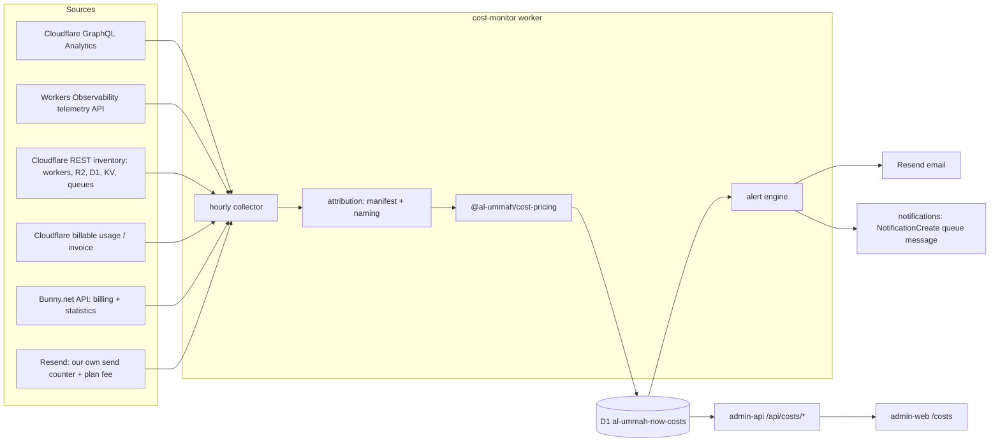

# Cost monitoring: usage, cost and alerts in the admin

**Status:** spec draft, waiting for owner review. Nothing here is built yet.
**Scope:** Cloudflare account `0e4b6e7f9faf280c3c9bf95995edc64f` (every Al Ummah Now worker, bucket and database, plus the Hamza Labs workers that share the account), Bunny.net (video storage and CDN) and Resend (email).
**Surface:** `admin.alummahnow.net` (apps `admin-web` and `admin-api`) and a new collector worker.

---

## 0. Why this exists

In early November 2026, Workers Observability Logs reached **62.33M events month-to-date** (43M billable, **$25.80**), against an included allowance of 20M. Nobody noticed until the bill page showed it. The causes were QA workers and server-side JWKS/discovery fetches:

| Worker (Nov 1–8) | Invocations | App / env (per §3) |
| --- | --- | --- |
| `al-ummah-web-qa` | 3.4M | web / qa |
| `al-ummah-now-auth-tail` | 3.2M | auth / **shared** (tail consumer of prod and QA auth) |
| `al-ummah-now-auth-qa` | 3.2M | auth / qa |
| `videos-qa` | 1.9M | api / qa |

The tail worker's count matches `auth-qa` exactly because every `auth-qa` invocation also invokes its tail consumer. Each request is counted twice, and so are its logs. The dashboard should make that kind of multiplier obvious.

**Goal:** a spike like this triggers an alert **within 2 hours** of starting. The admin shows month-to-date (MTD) cost, a projection and a budget per app and environment, and splits Cloudflare from Bunny and Resend.

**Non-goals (v1):** per-user or per-channel cost, chargeback invoices, automatic remediation (for example disabling a worker), and monitoring other Cloudflare accounts.

---

## 1. Integration choice

### Existing assets

| Asset | What it is | State |
| --- | --- | --- |
| **Hamza-Labs-Core/CloudFlareCostMonitor** (private) | Turborepo. `apps/api`: Hono worker with D1, KV, a sync queue and a 15-minute cron. GraphQL collectors for Workers, R2, KV, D1, Durable Objects (DO), Queues, Stream, Images, Vectorize and more (`services/cloudflare/metrics.ts`, about 2.3k lines). `apps/web`: React Router and Recharts dashboard. `packages/pricing` (`@cfcost/pricing`): pricing rules, calculator, free-tier and month-end projection, zero dependencies, with a standalone ESM bundle. | QA only (`cfcost-api-qa`, `cfcost-web-qa`). The production config still has placeholder ids. It is **multi-tenant** (email/password users, one encrypted CF token per user account, its own JWT). Last commit `baf6de0` (Nov 6 2026) extracted the pricing package. |
| **cfctl**, the "Cloudflare CLI" | Zero-dependency Node CLI covering the whole Cloudflare OpenAPI spec (3,526 operations), with an agent contract (JSON output, exit codes, `--dry-run`, `CFCTL_READ_ONLY`). GraphQL calls without `mutation` count as reads. `@cfcost/pricing` names it as a consumer (`cfctl costs`). | **Not on GitHub.** It exists only as a local git repo at `~/Code/Cloudflare cli` (one commit, `2ecaa6b`, "Initial commit: cfctl v0.1.0", no remote). This is why the org listing didn't show it. Its local tree has no `costs` command yet. See open question Q1. |

### Options

| | A. Use CloudFlareCostMonitor as a service (admin-api calls cfcost-api) | B. Vendor `@cfcost/pricing` and build a small collector in AlUmmahNow | C. Extend CloudFlareCostMonitor (attribution, alerts) and embed its UI |
| --- | --- | --- | --- |
| **Time to first number** | Fastest in theory (collectors exist) | Medium: reuse the pricing code and port only the GraphQL queries we need | Slow: two repos, two deploy pipelines |
| **Auth** | Bad fit. cfcost has its own users and JWT, and admin-api would need a service account and token bridging. Roles (Super Admin, Admin) would live in two places. | Native. admin-api already verifies OpenAuth tokens and has `hasAdminRole`. | Bad fit, same as A. An iframe or embedded UI also breaks RTL and our i18n. |
| **Multi-tenant** | Paid for, not needed: we monitor one account. Its per-user encrypted tokens add attack surface. | Single-tenant by design. One token, in the Secrets Store. | Same as A |
| **Attribution (app × env)** | Missing. It has groups and tags, but it doesn't know `apps.ts` or our naming. | First-class: a manifest in this repo, next to `scripts/release/apps.ts`. | Would have to be generic (rules engine) to stay useful to other tenants |
| **Alerts / digest** | Missing | Built here, using our Resend sender and notifications system | Built there, without our notifications system |
| **Ops** | Depends on a QA-only service in another org. A production deploy has never been done. | Our CI, our release pipeline, our `check:config` | Two repos to keep in step |
| **Maintenance** | Upstream drift on API shape | We own about 1–2k lines plus the vendored pricing (synced on purpose) | Highest |
| **Fixes to pricing** | Upstream only | Fix here, send upstream (§1.3) | Upstream |

### Recommendation: **B**

Vendor `@cfcost/pricing`, port the GraphQL query modules we need, and run a dedicated collector worker in this repo. Serve the data through admin-api and show it in admin-web.

Why: the hard, reusable part of CloudFlareCostMonitor is the pricing model and the GraphQL queries, and both copy over cleanly. What we need most (attribution to our apps and envs, alerts through our channels, our roles, Arabic and RTL) is exactly what cfcost lacks. Embedding it would mean bridging two auth systems to reach a multi-tenant service that has never run in production.

### 1.1 How to vendor

- Copy `packages/pricing/src` to `packages/cost-pricing/` (package name `@al-ummah/cost-pricing`). Add a `VENDORED.md` that records the upstream repo, commit (`baf6de0` today) and any local patches.
- `scripts/cost/sync-pricing.ts` re-copies from a given upstream commit and fails if local patches would be lost. Sync on purpose, not on every upstream commit.
- Port the upstream `test/bundle.test.mjs` cases to vitest, then add our golden cases (§9).
- Port only the query strings and normalizers we use from `apps/api/src/services/cloudflare/metrics.ts` (Workers, R2, D1, KV, Queues, DO), into `apps/cost-monitor/src/cf/queries/*.ts`. Don't port the sync orchestrator, users, groups, tags or the multi-tenant schema.

### 1.2 Gaps in `@cfcost/pricing` to close (found while reading it)

1. **No Workers Logs (Observability) pricing**, which is the product behind this month's spike. Add `workers_observability.events` (20M included per month, then $0.60 per million) and verify both numbers in Phase 0.
2. **Included amounts follow the Free plan in places** (the README lists KV at "100K reads/day"). The account is on Workers Paid, so included allowances must be plan-aware. Upstream has `services/plan-tier.ts`; use it, or hard-code Workers Paid with a test.
3. **Projection is linear over the whole MTD** (`projectUsage`: daily average × days in period). After a fix lands, that over-projects for the rest of the month. Add a trailing-7-day projection and show both (§4.4).
4. Check that DO SQLite storage, Queues operations (per 64 KB), Analytics Engine and R2 Infrequent Access are present and current. Add any that are missing.

### 1.3 Upstream

Send pricing fixes back to CloudFlareCostMonitor as PRs, so cfcost, cfctl and this admin price usage the same way. Nothing in AlUmmahNow waits on those PRs.

---

## 2. Data sources and permissions



### 2.1 Cloudflare GraphQL Analytics (`https://api.cloudflare.com/client/v4/graphql`)

All queries are account-scoped (`viewer { accounts(filter: {accountTag}) { … } }`) and grouped by hour (`datetimeHour`) and by resource. Field names are confirmed against live responses in Phase 0, and the responses are saved as fixtures (§9).

| Product | Dataset | Group by | Sums we keep |
| --- | --- | --- | --- |
| Workers | `workersInvocationsAdaptive` | `scriptName`, `datetimeHour`, `status` | `requests`, `errors`, `subrequests`, `cpuTimeUs` (or CPU quantiles × requests if the sum isn't exposed), `wallTime` |
| Workers Logs | *Not in GraphQL as far as we know.* Use the **Workers Observability telemetry query API** (`POST /accounts/{id}/workers/observability/telemetry/query`, count grouped by `$metadata.service`) | service, hour | `events` |
| R2 | `r2OperationsAdaptiveGroups`, `r2StorageAdaptiveGroups` | `bucketName`, `actionType` (mapped to Class A or B), hour | ops, `payloadSize`, `objectCount` (max per day) |
| D1 | `d1AnalyticsAdaptiveGroups`, `d1StorageAdaptiveGroups` | `databaseId`, hour | `rowsRead`, `rowsWritten`, `readQueries`, `writeQueries`, storage bytes |
| KV | `kvOperationsAdaptiveGroups`, `kvStorageAdaptiveGroups` | `namespaceId`, `actionType`, hour | reads, writes, deletes, lists, storage bytes |
| Queues | `queueMessageOperationsAdaptiveGroups` | `queueId`, `actionType`, hour | billable operations |
| Durable Objects | `durableObjectsInvocationsAdaptiveGroups`, `durableObjectsPeriodicGroups`, `durableObjectsStorageGroups` | `namespaceId`/`scriptName`, hour | requests, `activeTime` → GB-s, storage |
| Analytics Engine | (auth uses `auth_events_qa`) | dataset | data points written/read (if billed) |
| Stream / Images | Only if Phase 0 finds them in use. Video goes through Bunny today. | | |
| **Top paths** (drilldown only) | `httpRequestsAdaptiveGroups` on zone `alummahnow.net` | `clientRequestHTTPHost`, `clientRequestPath`, hour | `count` |

`httpRequestsAdaptiveGroups` explains the cause rather than the cost. Server-side JWKS and discovery fetches from our workers to `auth(.qa).alummahnow.net` show up as requests on that host, so the drilldown for a spike on `al-ummah-now-auth-qa` lists `/.well-known/jwks.json` and `/.well-known/openid-configuration` at the top. This dataset's query window is short, so the collector only runs it **on demand** (spike drilldown) and stores the top 50 paths per host per hour for 7 days. It doesn't run every hour.

If the telemetry API can't count events per script, use this fallback for Workers Logs: estimate `events ≈ invocations × events-per-invocation` for each script, calibrated weekly against the account's billable-usage figure. The dashboard labels the number "estimated".

### 2.2 Billing (Cloudflare)

- **Primary number = our estimate** (usage × vendored pricing). It's available hourly, per resource.
- **Reconciliation:** Phase 0 checks whether the account's billable usage (the dashboard page that showed 62.33M) is readable with an API token. If it is, the collector reads it daily and the dashboard shows "estimate vs billed". If it isn't, a Super Admin uploads the monthly invoice or usage CSV in the admin (Phase 4), and the dashboard shows the drift for that month.
- The **0.67M gap** between 62.33M − 20M = 42.33M and "43M billable" has to be explained in Phase 0 (rounding up to whole millions, or a different snapshot time). The golden test (§9) must reproduce the billed figure.
- **Safety net now, without code:** in Phase 0, turn on Cloudflare's own *Usage Based Billing* notifications for the products that support them, starting with Workers.

### 2.3 Bunny.net

- `GET https://api.bunny.net/billing`: account balance, this month's charges and per-type charges (storage, bandwidth, Stream). Read daily.
- `GET https://api.bunny.net/statistics?dateFrom&dateTo&pullZone=`: bandwidth and requests per pull zone, used to attribute Bunny cost per environment through a pull-zone map in the manifest.
- Stream library statistics, if a Stream library is in use (Phase 0 checks).
- **Permissions caveat:** a Bunny account API key is all-powerful, and as far as we know there is no read-only key. It lives **only** in the collector's Secrets Store binding. admin-api and admin-web never see it. See open question Q5.

### 2.4 Resend

- Resend keys are either *full access* or *sending only*. Reading usage would need a full-access key, which can also delete domains, so **we don't read usage from Resend.**
- Instead, count sends where we make them. Auth sends sign-in and OTP email, and the collector will send alert email. Each sender writes one Analytics Engine data point per email (`email_sent{app,env,template}`). Cost = plan fee (manifest config) + overage price × sends above the plan's quota.
- The collector uses a **sending-only** key for alert email (`cost-monitor-resend-key`).

### 2.5 Cloudflare API token (least privilege)

One account-owned token, **`al-ummah-cost-monitor-read`**:

| Permission | Why |
| --- | --- |
| Account › Account Analytics › Read | GraphQL datasets above |
| Account › Workers Scripts › Read | inventory of scripts (names, tail consumers) |
| Account › Workers Observability › Read | Workers Logs counts (telemetry query) |
| Account › Workers R2 Storage › Read | bucket inventory |
| Account › D1 › Read | database inventory (id ↔ name) |
| Account › Workers KV Storage › Read | namespace inventory (id ↔ title) |
| Account › Queues › Read | queue inventory (id ↔ name) |
| Zone › Analytics › Read (zone `alummahnow.net` only) | `httpRequestsAdaptiveGroups` drilldown |
| Account › Billing › Read | **only if** Phase 0 shows billable usage needs it. It also exposes payment details, so leave it out if we can. |

No edit permissions at all. Restrict client IPs only if Workers egress ranges are documented, which they aren't today, so don't.

**Storage:** Secrets Store `f8eddc9944d041919ed8dc7d08d32308` (the one admin-api already uses):
- `cost-monitor-cf-token`
- `cost-monitor-bunny-key`
- `cost-monitor-resend-key`

Each secret is bound **only** to the cost-monitor worker.

**Rotation:**
- The token is created with `expires_on` set 90 days out.
- The collector calls `GET /user/tokens/verify` once a day. It raises an alert 14 days before expiry and a critical alert on any 401 or 403.
- To rotate: create the new token, update the secret, check the next hourly run, then revoke the old token. The runbook goes into `docs/cost-monitoring/RUNBOOK.md` in Phase 1.
- The same 90-day reminder applies to the Bunny key (manual rotation in the Bunny dashboard).

---

## 3. Attribution: app × environment

### 3.1 Dimensions

- **app:**
  - Al Ummah Now: `web`, `api`, `processor`, `scheduler`, `realtime`, `admin`, `auth`, `profile`, `www`, `cms`, `log-service`, `ops` (the cost monitor itself)
  - Hamza Labs, same account: `hamza-labs` (for example `cfcost-api-qa`, `cfcost-web-qa`)
  - fallback: `unattributed`
- **env:** `prod`, `stage`, `qa`, `preview` (PR previews), `dev`, `shared` (one resource serving several envs)
- **product** (pricing line): `workers`, `workers_logs`, `r2`, `d1`, `kv`, `queues`, `durable_objects`, `analytics_engine`, `bunny_storage`, `bunny_cdn`, `bunny_stream`, `resend`, `platform_fee`

### 3.2 Resolution order

1. **Explicit manifest entry** (exact name or id). Always wins.
2. **Naming convention.** Strip the env suffix, then match the base name to an app:
   - `-qa` → qa
   - `-stage` or `-staging` → stage
   - `-preview` or `-pr-<n>` → preview
   - `-dev` → dev
   - no suffix → prod
3. Otherwise **`unattributed`**. The dashboard shows it as its own row, and an alert fires when unattributed cost goes over $1 per month (§6). That keeps the manifest honest.

### 3.3 Manifest

`packages/cost-attribution/src/manifest.ts`, a typed data file with no runtime dependencies, shared by the collector, admin-api and the tests.

- **Generated part:** worker names for prod and stage come from `scripts/release/apps.ts` (`APPS[].production.name`, `APPS[].stage.name`). QA names come from each app's `wrangler.qa.jsonc`. A unit test fails if `apps.ts` gains an app that the manifest doesn't map, so the two can't drift.
- **Hand-written part:** resources from other repos, shared resources and Bunny pull zones.

Inventory as of today, from this repo's wrangler configs plus AlUmmahNowAuth, AlUmmahNowCMS and AlUmmahNowUI:

| app | prod | stage | qa | other |
| --- | --- | --- | --- | --- |
| web | `al-ummah-now-production` | `al-ummah-now-stage` | `al-ummah-web-qa` | `al-ummah-now-preview` (preview), `al-ummah-now-staging` (legacy stage?), `al-ummah-now-dev` (dev) |
| api | `videos` | `videos-stage` | `videos-qa` | D1 `al-ummah-now-search[-stage\|-qa]` |
| processor | `al-ummah-now-processor` | `…-stage` | `…-qa` | queue `al-ummah-now-videos[-stage\|-qa]`, D1 `al-ummah-now-notifications[-stage\|-qa]` |
| scheduler | `al-ummah-scheduler` | `…-stage` | `…-qa` | DO `SCHEDULER_LOCK`, R2 `scheduled-videos[-stage\|-qa]` |
| realtime | `al-ummah-now-comms` | `…-stage` | `…-qa` | DO `WEBSOCKET_DO`, R2 `al-ummah-now-messages[-stage\|-qa]` |
| admin | `al-ummah-admin-web`, `al-ummah-admin-api` | `…-stage` | `…-qa` | `al-ummah-admin-web-dev` (dev), D1 `al-ummah-now-reports[-stage\|-qa]` |
| auth | `al-ummah-now-auth`, `al-ummah-now-auth-admin`, `al-ummah-now-audit-consumer` | `…-stage` | `…-qa` | **`al-ummah-now-auth-tail` = shared** (tail consumer of prod and QA auth), D1 `al-ummah-now-d1[-stage\|-qa]`, queue `audit-events[-stage\|-qa]`, AE `auth_events*` |
| profile | `al-ummah-now-profile` | `…-stage` | `…-qa` | |
| cms | `bknd` | | | D1 `al-ummah-now-cms`, R2 `al-ummah-now-cms` |
| www | `al-ummah-now-ui`? | | | see Q3 |
| api (shared storage) | R2 `videos`, `channels`, `profiles`, `playlists`, `subtitles`, `watch-history`, `community-posts`, `channel-sections`, `channel-tabs`, `global-settings`, `upload-defaults`, `reports` | `-stage` variants | `-qa` variants | `videos-preview`, `videos-staging` |
| hamza-labs | | | `cfcost-api-qa`, `cfcost-web-qa` | D1 `cfcost-db-qa`, queue `cfcost-sync-qa` |

**Shared resources.** R2 buckets are written by several apps (web, api, admin-api, scheduler all bind `videos`). Storage and operations are attributed to the **owning app** named in the manifest (`api` for the content buckets). The R2 dataset has no per-caller split, so we don't pretend to split it.

`al-ummah-now-auth-tail` stays `auth/shared`. Its invocations are split between prod and QA in proportion to `al-ummah-now-auth` versus `al-ummah-now-auth-qa` invocations in the same hour, which is exact for a tail consumer. The UI marks the split as derived. Q4 asks whether to give QA its own tail worker instead.

### 3.4 Allocating account-level charges

Included allowances (for example 10M Workers requests or 20M log events) and the $5 Workers Paid fee belong to the **account**, not to any one app. The rules:

1. Compute **account cost per product** with pricing: total usage − included, × price.
2. Allocate each product's cost to app × env **in proportion to usage share** in that period.
3. Show `platform_fee` as its own line, not allocated.

This keeps the parts adding up to the bill. Each row also shows its **usage share**, which stays meaningful while the account is still inside the free allowance and cost is $0.

---

## 4. Metrics and storage

### 4.1 D1 database `al-ummah-now-costs` (prod), plus `-qa`

Migrations live in `apps/cost-monitor/migrations`. Main tables:

```sql
-- resources seen in the account and how they were attributed
cost_resources(id TEXT PK, kind TEXT, cf_id TEXT, name TEXT, app TEXT, env TEXT,
               attribution TEXT CHECK (attribution IN ('manifest','convention','unattributed')),
               first_seen INTEGER, last_seen INTEGER)

-- hourly raw usage, idempotent upsert
usage_hourly(hour INTEGER, resource_id TEXT, product TEXT, metric TEXT, value REAL,
             PRIMARY KEY (hour, resource_id, metric))

-- daily rollup with allocated cost (the dashboard reads this)
usage_daily(day TEXT, app TEXT, env TEXT, product TEXT, metric TEXT, value REAL,
            cost_usd REAL, usage_share REAL, PRIMARY KEY (day, app, env, product, metric))

-- non-Cloudflare and reconciled amounts
vendor_costs_daily(day TEXT, vendor TEXT, line_item TEXT, env TEXT, amount_usd REAL,
                   source TEXT CHECK (source IN ('api','estimate','invoice')),
                   PRIMARY KEY (day, vendor, line_item, env))

kpi_daily(day TEXT PK, views INTEGER, active_users INTEGER, source TEXT)
top_paths_hourly(hour INTEGER, host TEXT, path TEXT, requests INTEGER, PRIMARY KEY (hour, host, path))

budgets(scope TEXT PK /* 'account' | 'env:qa' | 'app:web' | 'app:web/env:qa' */, monthly_usd REAL, updated_by TEXT, updated_at INTEGER)
alert_rules(id TEXT PK, kind TEXT, params_json TEXT, enabled INTEGER, updated_by TEXT, updated_at INTEGER)
alert_recipients(email TEXT PK, user_id TEXT, locale TEXT, tz TEXT, quiet_start TEXT, quiet_end TEXT, digest INTEGER)
alerts(id TEXT PK, fingerprint TEXT, kind TEXT, severity TEXT, scope TEXT, state TEXT /* firing|resolved|acked|snoozed */,
       first_fired INTEGER, last_fired INTEGER, last_notified INTEGER, snooze_until INTEGER, payload_json TEXT)
collector_runs(id TEXT PK, kind TEXT, started INTEGER, finished INTEGER, status TEXT, hours_covered TEXT, datasets_json TEXT, error TEXT)
cost_audit(id TEXT PK, at INTEGER, actor_id TEXT, actor_email TEXT, action TEXT, before_json TEXT, after_json TEXT)
pricing_versions(version TEXT PK, upstream_commit TEXT, activated_at INTEGER)
```

**Size:** about 200 resources × about 4 metrics × 24 hours ≈ 19k `usage_hourly` rows per day, 45 days ≈ 860k rows. `usage_daily` is about 2k rows per day. That is well inside D1 limits, and per-hour writes stay in the low thousands of rows.

### 4.2 Retention

| Table | Kept for | Why |
| --- | --- | --- |
| `usage_hourly` | 45 days | MTD plus a 4-week spike baseline |
| `top_paths_hourly` | 7 days | drilldown only |
| `usage_daily`, `vendor_costs_daily`, `kpi_daily` | 25 months | year-over-year comparison |
| `alerts`, `cost_audit` | 13 months | |
| `collector_runs` | 30 days | |

The daily cron prunes old rows in batches of 5k.

### 4.3 Backfill

`POST /internal/backfill?from=YYYY-MM-DD&to=…` on the collector (internal API key only; admin-web triggers it through admin-api for Super Admins). It walks day by day, one dataset at a time, inside the 300-queries-per-5-minutes GraphQL limit. It goes as far back as each dataset keeps data (Phase 0 records each dataset's retention). Target: the current and previous month at go-live, so the spike baseline and the month-over-month comparison work on day one. That includes **the Nov 1–8 spike**, which becomes the acceptance replay (§10).

### 4.4 Derived numbers

- **MTD cost:** Σ `usage_daily.cost_usd` for the billing month (calendar month, UTC; Phase 0 confirms the account's billing anchor day).
- **Projection:** two numbers, both shown.
  - *Linear*: MTD ÷ days elapsed × days in month. This is upstream `projectAccountCost`.
  - *Trailing*: MTD + (average of the last 7 full days × days left). This one drives the budget-overrun alerts, because it reacts to fixes and to new spikes.
- **Included allowance remaining:** per product, `included − account MTD usage`, plus a **projected exhaustion date** at the trailing rate.
- **Unit economics:** cost per 1K views and cost per monthly active user (MAU) = prod cost ÷ (`kpi_daily.views` ÷ 1000) and ÷ MAU. QA and stage are left out of the numerator.
  - Source: the platform's analytics rollups (views) and auth's active-user counts. Phase 3 picks the exact source; see Q6.
  - Shown monthly and over the trailing 30 days.

---

## 5. Dashboard UX (admin-web)

A new top-level nav item **Costs** (`nav.costs`). Only users with `hasAdminRole` see it (§8).

| Route | Content |
| --- | --- |
| `/costs` **Overview** | Tiles: MTD total (all vendors) · projected month-end (trailing, with linear in a tooltip) · budget and % used · allowance burn (the product closest to exhaustion). Stacked area chart: daily cost by vendor this month, with last month as a dashed line. Table: env × vendor. Banner for firing alerts. A "data as of HH:MM" badge, amber if the last successful run is more than 2h old. |
| `/costs/products` | One card per product: usage, included remaining, exhaustion date, cost, and a sparkline. A product page shows hourly usage by app × env. |
| `/costs/apps` | Matrix with apps as rows and envs as columns. Each cell shows MTD cost, Δ versus last month, and usage share. Toggle between "allocated cost" and "usage share". Clicking a cell opens that app × env broken down by resource and product. |
| `/costs/movers` | Biggest increases and decreases over 24h, 7d and MTD versus last month, by resource and by app × env, ranked by $ impact on the projection. |
| `/costs/alerts` and `/costs/alerts/:id` | Alert list (firing, acked, resolved). The detail page is the **spike drilldown**: the hourly series against its baseline band; top scripts by invocations, logs and CPU at the spike hour; top paths for the relevant host (fetched on demand); tail consumers involved; and a "likely cause" line when a pattern matches (for example jwks/discovery paths or a tail multiplier). Buttons: Ack, Snooze 24h, Open in Cloudflare. |
| `/costs/settings` (Super Admin) | Budgets per scope, alert thresholds, recipients (email, locale, time zone, quiet hours, digest yes/no), pricing version, backfill trigger, CSV invoice upload (Phase 4). Every change goes to `cost_audit`. |

**Implementation notes**

- **Charts:** Recharts, as in cfcost. In RTL, pass `reversed` to the time X-axis and put the Y-axis on the right. Tooltips and legends follow `dir`.
- **Numbers:** `Intl.NumberFormat(locale, { style: 'currency', currency: 'USD' })`. Arabic digits follow the existing locale behaviour (see the notification badge, commit 756e984). Units such as "M requests" and "GB-month" get translation keys.
- **i18n:** add every string to `apps/admin-web/src/i18n/messages/en.ts` and `ar.ts`, under a `costs.*` namespace. Product names stay in English inside Arabic text where they are brand names (Cloudflare, R2, D1).
- **Data fetching:** use `@tanstack/react-query`, which admin-web already uses. Overview data has `staleTime` of 5 minutes, and nothing polls faster than once per minute.
- **Accessibility:** each chart has a table view toggle, and colours meet contrast in light and dark mode.

---

## 6. Alerting

### 6.1 Rules (defaults; Super Admins can edit them)

| Kind | Fires when | Default severity |
| --- | --- | --- |
| **budget.mtd** | MTD for a scope crosses 50%, 80% or 100% of its monthly budget | info / warn / critical |
| **budget.projected** | The trailing projection for a scope goes over its budget (checked hourly, re-notified at most daily) | warn; critical above 150% |
| **spike** | For a resource or app × env and a metric (invocations, log events, CPU, R2 ops, D1 rows): `value_h > max(k × baseline_h, baseline_h + floor)` for **2 consecutive hours**, or for 1 hour at ≥ 10× the baseline. On top of that, the projected monthly $ impact must be ≥ `min_impact`. | warn; critical if the impact ≥ $10/month |
| **allowance** | An included allowance is projected to run out before month end, or reaches 80% or 100% | warn |
| **unattributed** | A new resource is unattributed, or unattributed MTD cost ≥ $1 | info |
| **collector.stale** | No successful hourly run for 3 hours | critical |
| **token** | Token expires within 14 days, or a 401/403 | warn / critical |
| **vendor.bunny** | Bunny charges this month are above budget, or day-over-day bandwidth is ≥ 3× | warn |

**Baseline:** the median of the same metric for the same hour of day over the previous 7 days, ignoring hours already flagged as spikes. Defaults: `k = 3`, `floor` = 5,000 events per hour for invocations and logs, `min_impact` = $0.50 per month.

**Replaying the Nov 1–8 spike:** `al-ummah-web-qa` averaged about 17.7k invocations per hour (3.4M over 8 days), and log events scale with it. Unless its pre-spike baseline was already near that level, rule `spike` fires at the second elevated hour. Collection is hourly at :10 for hours that ended at least 10 minutes earlier, so the alert lands **about 70–130 minutes** after the spike starts. The replay test (§9) checks this against the backfilled data.

### 6.2 Channels

- **Email** via Resend (sending-only key), from `alerts@alummahnow.net`. The domain already sends auth mail; Phase 0 confirms the sender. Templates exist in English and Arabic, chosen by `alert_recipients.locale`, with RTL markup for Arabic. Every email links to `/costs/alerts/:id`.
- **In-app:**
  1. A banner and count badge on admin-web's Costs nav, read from `alerts`. This is the main admin surface.
  2. The platform's notification system: send a `NotificationCreate` queue message (processor writes it to `NOTIFICATIONS_DB`) to each recipient's `user_id`. That needs new key `costAlert` and category `admin` in `packages/shared-types/src/notifications.ts`, plus translations, and `action_url` points to the admin page.
  3. Users can't turn off the `admin` category, and only alert recipients receive it.
  4. admin-web has no bell today. Q7 asks whether to add one or whether the videos-site bell is enough.

### 6.3 Dedupe, escalation, quiet hours

- **Fingerprint** = `kind + scope + metric + period`. The period is the month for budgets and the UTC day for spikes.
- **Escalation and repeats:** while an alert fires, notify again only when severity escalates, or after 24h if it's still firing and not acked. A firing alert can be acked or snoozed.
- **Resolution:** an alert resolves after 3 clean hours (or a new period), and one "resolved" message is sent.
- **Quiet hours** per recipient (default 22:00–07:00 in the recipient's time zone): email is held and folded into the next digest, **except** critical alerts. The in-app record is always written right away.
- **Daily digest** at 07:00 in each recipient's time zone (the cron runs hourly and picks the recipients whose 07:00 it is):
  - yesterday's cost by vendor and env
  - MTD, projection and budget
  - top 5 movers
  - alerts fired or resolved
  - allowance burn
  - collector health
  - Recipients can opt out of the digest.

---

## 7. Ops

### 7.1 Where it runs: a new worker `apps/cost-monitor` (`al-ummah-cost-monitor`)

| Option | Verdict |
| --- | --- |
| Scheduler worker (already runs `* * * * *`) | **No.** It is a critical publishing path. Putting an account-wide analytics token and slow GraphQL calls next to scheduled publishing widens the blast radius and risks delaying publishes. |
| admin-api cron | **No.** admin-api serves requests. Keeping the token out of request-serving code means an admin-api bug can't leak it. |
| **New worker** | **Yes.** It holds the secrets, only runs crons and internal endpoints, and isn't routed publicly (`workers_dev: false`, no route; admin-api reaches it through a **service binding** for backfill and drilldown). Workers Paid adds no fee for another worker. |

admin-api binds the same D1 (`COSTS_DB`):
- **Reads** data tables.
- **Writes** only the config tables: `budgets`, `alert_rules`, `alert_recipients`, alert acks and snoozes, and `cost_audit`.
- **Never writes** usage tables. A unit test greps for that.

**Environments:**
- One prod collector watches the whole account (all envs), since costs are account-wide.
- A QA deployment (`al-ummah-cost-monitor-qa`, D1 `al-ummah-now-costs-qa`) runs the same code, either on recorded fixtures (default) or against the live account every 6h with alerts sent only to the QA recipients list. See Q8.
- Add the app to `scripts/release/apps.ts` with its required bindings so `check:config` guards it.

### 7.2 Crons

| Cron | Job |
| --- | --- |
| `10 * * * *` | Collect hours `H-3 … H-1`. Re-collecting the last 3 hours is idempotent and covers analytics lag. Then roll up today, evaluate the alert rules, send notifications that are due, and send digests to recipients whose local 07:00 it is. |
| `30 3 * * *` | Inventory sync (new resources, attribution), Bunny billing and statistics, Resend counter rollup, billable-usage reconciliation (if available), token check, retention pruning |
| `0 4 * * 1` | Manifest drift report: resources in the manifest but missing from the account (deleted) |

### 7.3 Failure handling

- Each dataset is queried independently (`Promise.allSettled`), with 3 tries and exponential backoff that honours `Retry-After`. A failed dataset marks the hour `partial` in `collector_runs.datasets_json`, and the next run retries it automatically (the 3-hour window).
- GraphQL errors with `data: null` are failures. Errors that come with partial data are logged and still stored.
- **Dead-man check:** the hourly job's success is written to `collector_runs`. `collector.stale` is evaluated by **admin-api** whenever someone loads the dashboard, and by the daily cron, which is a separate trigger. For backup outside our code, Cloudflare's own usage notifications (§2.2) stay on.
- All logging goes through the repo's `logger` (the CLAUDE.md rule).
- **Never log tokens or full GraphQL responses.** Log only counts and timings.

### 7.4 Cost of the monitor itself

- **About 750 cron invocations a month** plus admin traffic.
- **About 15 GraphQL calls an hour.** Each run takes a few seconds of wall time but very little CPU, so Workers CPU cost rounds to $0.
- **D1:** about 20k rows written a day.
- **Observability:** the collector sets `head_sampling_rate: 0.1` and logs one summary line per run, so this month's lesson doesn't repeat here.
- **Target:** under $0.25 a month, and the monitor reports its own cost as app `ops`.

---

## 8. Security

1. **Who can see cost data**
   - Every `/api/costs/*` route in admin-api requires `hasAdminRole` (Super Admin or Admin).
   - Settings writes require `super_admin`.
   - **Moderators: no access** by default (Q2). Moderators get 403 from the API, and the nav item is hidden. This is enforced on the server; hiding the UI doesn't count as protection.
2. **Caching:** responses send `Cache-Control: private, no-store`. Cost numbers never appear in static pages, public bundles or logs.
3. **Token scope:** read-only (§2.5) and bound only to the collector. admin-api has no Cloudflare, Bunny or Resend credentials. The collector's internal endpoints require `INTERNAL_API_KEY` and are reachable only through the service binding.
4. **Audit:** every settings change, ack, snooze, backfill and CSV upload writes a `cost_audit` row (actor id and email from the token, before and after values) and an info log line. Settings shows the last 100 entries.
5. **Email:** only addresses in `alert_recipients` get mail, and only Super Admins can edit that list (audited). Emails carry summary numbers and a link. The drilldown itself needs admin sign-in.
6. **Inputs:** budget and threshold inputs are validated with zod (range, type). CSV upload is size-capped (1 MB) and parsed without evaluating formulas.

---

## 9. Testing

| Layer | What |
| --- | --- |
| **Pricing (unit, vitest)** | Ported upstream cases, plus golden cases for each product we use: Workers requests and CPU over the included amount; **Workers Logs 62.33M → the billed $25.80** (and explaining the 42.33M vs 43M gap); R2 Class A/B and storage; D1 rows; KV; Queues; DO GB-s; allowance edges (exactly at the included amount, one unit over); month boundaries and leap February. |
| **Attribution (unit)** | Every worker and resource name in the inventory table resolves to the expected app/env. Every `apps.ts` entry is mapped. Suffix edge cases (`videos-staging`, `al-ummah-now-staging`, `-pr-123`). auth-tail proportional split. |
| **GraphQL fixtures** | Sanitized live responses saved in Phase 0 under `apps/cost-monitor/test/fixtures/graphql/*.json`, one per dataset, including an error response, an empty response and partial data. Normalizers turn them into `usage_hourly` rows that match snapshots. A drift guard: the collector records the `errors` from each query in `collector_runs`, and the dashboard shows "dataset degraded". |
| **Alert engine (unit)** | Synthetic series: flat, diurnal, single spike, sustained spike, slow ramp (no spike alert, but budget.projected fires). **Replay of the backfilled Nov 1–8 data fires `spike` for `al-ummah-web-qa`, `al-ummah-now-auth-qa` and `al-ummah-now-auth-tail` within 2 collection hours of onset.** Dedupe: 48 hourly evaluations of a firing alert send ≤ 3 notifications. Quiet hours hold a warn and pass a critical. |
| **admin-api (integration)** | Miniflare D1 with seeded rows: role matrix (super_admin, admin, moderator, user, none) → 200 or 403 per route; settings writes create audit rows; admin-api has no route that writes usage tables. |
| **admin-web E2E (Playwright, `apps/admin-web/e2e`)** | Against QA with the seeded costs DB: an admin sees Overview tiles and the apps matrix; a moderator gets access-denied and the nav item is hidden; a Super Admin edits a budget and sees it in audit; the Arabic locale renders `dir="rtl"`, with a reversed chart axis and translated labels (screenshot); spike drilldown loads top paths. Seeding uses the existing QA seed scripts (`apps/web/e2e/seed`), extended. |
| **Email** | Render the en and ar templates to HTML snapshots. One QA send to a `@delivered.resend.dev` address checks delivery. |

---

## 10. Phased rollout

Every phase is blocked until the owner approves this spec. Phase 0 can start as soon as it is approved. The later phases run in order, though Phase 3 UI work can overlap with Phase 2.

### Phase 0: verify and put in a safety net (about 2 days)

- Create token `al-ummah-cost-monitor-read` (§2.5) and store it in the Secrets Store.
- Turn on Cloudflare's Usage Based Billing notifications (Workers and anything else offered) to the owner's email.
- Using cfctl (`CFCTL_READ_ONLY=1 cfctl call …/graphql`), run every query in §2.1. Record the exact field names, each dataset's retention and query-window limits, and save sanitized fixtures.
- Prove a way to count Workers Logs per script (telemetry API), or document the fallback estimate.
- Check whether billable usage can be read with a token, and explain the 42.33M vs 43M gap.
- Check the Bunny billing and statistics endpoints and the pull zone list. Check the Resend plan and quota.
- **AC:** an appendix (`docs/cost-monitoring/phase-0-findings.md`) lists every verified query and its fields, the fixtures are committed, the Workers Logs source is decided, and the stopgap notifications are on.

### Phase 1: collector, storage, attribution and a minimal overview

- `packages/cost-pricing` (vendored, with gap fixes 1–3 from §1.2) and `packages/cost-attribution` (manifest plus the `apps.ts` link).
- `apps/cost-monitor` worker, D1 `al-ummah-now-costs` and migrations, the hourly cron, the daily inventory, backfill, runs and retention. Add it to `apps.ts`.
- admin-api `/api/costs/overview`, `/apps`, `/products`, guarded by role. admin-web `/costs` overview and apps matrix in English and Arabic.
- **AC:**
  - Workers requests and Workers Logs MTD are within ±5% of Cloudflare's billable-usage page for the same day.
  - Every resource in the account is attributed or shown as unattributed.
  - The current and previous month are backfilled.
  - A moderator gets 403.
  - The monitor's own cost shows under `ops`.

### Phase 2: alerts and digest

- Alert engine (all §6.1 rules), `alerts` table, dedupe, quiet hours.
- Resend email (en and ar).
- `costAlert` notifications through `NotificationCreate`, plus the admin-web banner and badge.
- Daily digest. Settings for budgets, rules and recipients (Super Admin), with audit.
- **AC:**
  - The Nov 1–8 replay fires within 2 hours for the three spiking workers.
  - A test budget crossing sends exactly one email per threshold.
  - Quiet hours hold a warn but not a critical.
  - Digests arrive at 07:00 recipient-local in both languages.
  - `collector.stale` fires when the cron is disabled in QA.

### Phase 3: full dashboard and Bunny

- Product pages, movers, the spike drilldown (on-demand top paths, tail multiplier hint), unit economics (cost per 1K views and per MAU), chart and table toggles, RTL polish.
- Bunny billing and statistics collection, pull-zone attribution and the `vendor.bunny` rule.
- **AC:**
  - The drilldown for the Nov spike on `al-ummah-now-auth-qa` lists the JWKS/discovery paths at the top.
  - Bunny MTD on the overview matches the Bunny dashboard within ±2%.
  - Playwright E2E passes in both locales.

### Phase 4: Resend, reconciliation, upstream

- Resend send counters (AE data points in auth and the collector) and Resend cost.
- Estimate vs billed reconciliation: an API if Phase 0 found one, otherwise a CSV upload.
- Pricing PRs sent upstream to CloudFlareCostMonitor. Publish cfctl to GitHub (if the owner agrees, Q1).
- **AC:** the overview shows every vendor; the previous month's estimate is within ±3% of the invoice, or the drift is explained per line item; the upstream PR is opened.

### Issues

One issue per phase is created with labels `queue` and `blocked`, and each says it is blocked on owner approval of this spec. The issue numbers are listed in the PR description.

---

## 11. Open questions for the owner

1. **cfctl, the "Cloudflare CLI".** It isn't on GitHub. It's a local-only repo at `~/Code/Cloudflare cli` (one commit, no remote). Should it be pushed to `Hamza-Labs-Core/cfctl` (private?), so `@cfcost/pricing`'s `cfctl costs` consumer and our Phase 0 scripts reference something shared? Or is there another CLI repo you meant?
2. **Moderators:** no access to cost data (recommended), or a read-only Overview without $ amounts (usage only)?
3. **`www`:** which worker serves `www.alummahnow.net`? Is it `al-ummah-now-ui` (AlUmmahNowUI), the CMS (`bknd`), or the web worker?
4. **`al-ummah-now-auth-tail`:** keep one shared tail consumer (we split it by proportion), or create `al-ummah-now-auth-tail-qa` so QA cost is exact? Does QA need a tail consumer at all, since it doubles invocations and logs?
5. **Bunny key:** OK to store an all-powerful Bunny account key in the collector, or is there a sub-account or read-only option you want to use?
6. **Unit economics source:** which numbers count as "views" and "active users": video analytics daily rollups and auth's MAU, or something else?
7. **In-app channel:** is the videos-site bell (notifications system) plus an admin-web banner enough, or should admin-web get its own bell?
8. **QA collector:** fixtures only (default), or live account data every 6h?
9. **Budgets:** starting monthly budgets per env. Suggested: prod $X, stage $5, QA $10, account $Y. Who receives alerts, and in which time zone or language?
10. **Hamza Labs workers on this account** (`cfcost-*`, and any others): show them as `hamza-labs` and leave them out of Al Ummah Now totals, or move them to another account?
11. **Billing permission:** if billable usage needs `Billing: Read` (which also exposes payment details), is that acceptable, or should we reconcile by monthly CSV upload?
