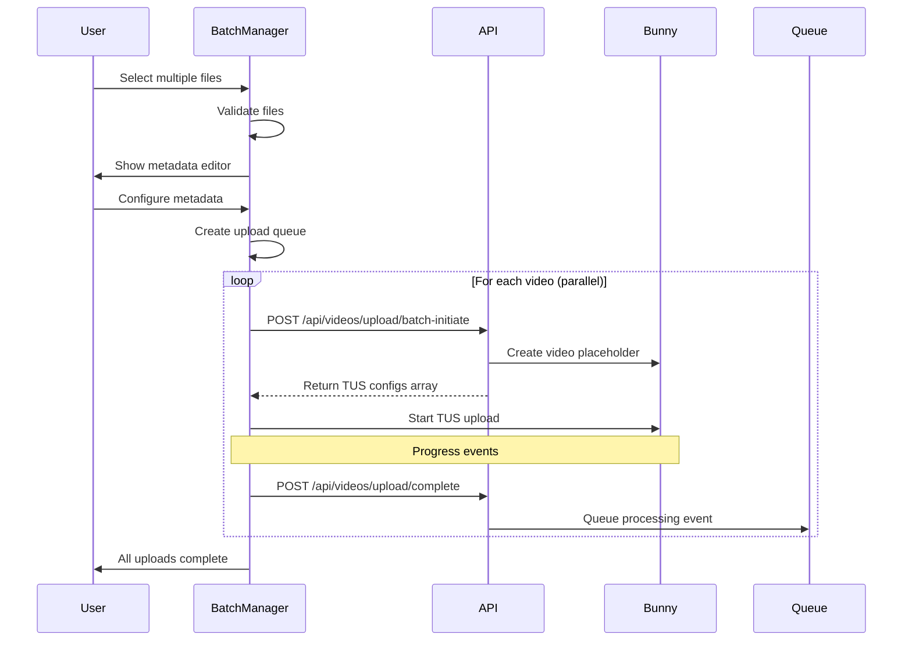

# Multiple Concurrent Uploads (Batch Upload) Implementation Plan

**Document Version**: 1.0
**Created**: 2025-01-20
**Priority**: CRITICAL
**Estimated Effort**: 4 weeks
**Team Size**: 2 developers

## Executive Summary

This document outlines the complete implementation plan for enabling multiple concurrent video uploads in Al Ummah Now platform, allowing creators to upload up to 15 videos simultaneously with shared metadata options and individual editing capabilities.

## Current State Analysis

### Existing Architecture
- **Single Upload Flow**: One video at a time via TUS protocol
- **Component**: `VideoUpload` component handles single file
- **Backend**: API supports individual video initiation/completion
- **Storage**: R2 for metadata, Bunny.net for video streaming
- **Authentication**: JWT tokens with per-request validation

### Limitations
- Sequential upload workflow (wait for each video to complete)
- No batch metadata editing
- No upload queue management
- Inefficient bandwidth utilization
- Poor UX for content series uploads

## Requirements

### Functional Requirements
1. **Multi-File Selection**
   - Drag-and-drop multiple files simultaneously
   - File picker with multiple selection
   - Support up to 15 concurrent uploads
   - Visual file preview grid

2. **Upload Queue Management**
   - Queue visualization with status indicators
   - Individual progress tracking per video
   - Pause/resume individual uploads
   - Cancel individual or all uploads
   - Retry failed uploads

3. **Metadata Management**
   - Shared metadata mode (apply to all videos)
   - Individual metadata editing per video
   - Template-based metadata application
   - Bulk operations (tags, privacy, categories)

4. **Performance**
   - Parallel TUS uploads (configurable concurrency)
   - Bandwidth throttling options
   - Memory-efficient file handling
   - Background upload capability

### Non-Functional Requirements
- Maintain < 100MB memory footprint per upload
- Support mobile devices (responsive UI)
- Graceful degradation (fallback to single upload)
- Accessibility (WCAG 2.1 AA compliance)

## Architecture Design

### System Architecture

```
┌─────────────────────────────────────────────────────┐
│                   Web Client                         │
├─────────────────────────────────────────────────────┤
│                                                      │
│  ┌──────────────────────────────────────────────┐   │
│  │         BatchUploadManager                   │   │
│  │  - Upload queue state management            │   │
│  │  - Concurrency control (max 3-5 parallel)   │   │
│  │  - Global progress aggregation              │   │
│  └────────────┬─────────────────────────────────┘   │
│               │                                      │
│  ┌────────────▼─────────────┬──────────────────┐   │
│  │   UploadQueueItem #1     │  UploadQueueItem  │   │
│  │  - TUS Upload instance   │     #2...#15     │   │
│  │  - Individual progress   │                   │   │
│  │  - Metadata state        │                   │   │
│  └───────────────────────────┴──────────────────┘   │
│                                                      │
└──────────────────┬───────────────────────────────────┘
                   │
                   │ Parallel TUS Uploads
                   │
┌──────────────────▼───────────────────────────────────┐
│              Bunny.net Stream API                     │
│         (Direct TUS endpoint per video)               │
└───────────────────────────────────────────────────────┘
```

### Data Flow



### Component Architecture

```typescript
// Core components structure
interface BatchUploadComponents {
  // Main container component
  BatchUploadManager: {
    state: UploadQueueState;
    methods: QueueManagementMethods;
  };

  // File selection and preview
  MultiFileSelector: {
    onFilesSelected: (files: File[]) => void;
    maxFiles: number;
    validation: FileValidation;
  };

  // Metadata editor modal
  BatchMetadataEditor: {
    mode: 'shared' | 'individual';
    videos: VideoMetadata[];
    onApply: (metadata: VideoMetadata[]) => void;
  };

  // Queue visualization
  UploadQueueView: {
    items: UploadQueueItem[];
    layout: 'grid' | 'list';
    onItemAction: (id: string, action: QueueAction) => void;
  };

  // Individual upload item
  UploadQueueItem: {
    file: File;
    metadata: VideoMetadata;
    progress: UploadProgress;
    tusUpload: tus.Upload;
  };

  // Progress aggregator
  BatchProgressIndicator: {
    totalFiles: number;
    completedFiles: number;
    totalBytes: number;
    uploadedBytes: number;
    estimatedTime: number;
  };
}
```

## Technical Implementation Details

### 1. Upload Queue Architecture

#### Queue State Management

```typescript
// packages/shared-types/src/upload.ts
export interface UploadQueueItem {
  id: string;                    // Unique queue item ID
  file: File;                     // File object
  videoId?: string;               // Bunny.net video ID (after initiation)
  metadata: VideoMetadata;        // Video metadata
  status: UploadStatus;           // Current status
  progress: number;               // 0-100
  error?: string;                 // Error message if failed
  tusUpload?: tus.Upload;         // TUS upload instance
  retryCount: number;             // Number of retry attempts
  startedAt?: Date;               // Upload start time
  completedAt?: Date;             // Upload completion time
  speed?: number;                 // Current upload speed (bytes/sec)
  bytesUploaded: number;          // Bytes uploaded
  bytesTotal: number;             // Total file size
}

export type UploadStatus =
  | 'pending'      // In queue, not started
  | 'initiating'   // Getting TUS config from API
  | 'uploading'    // Active upload
  | 'paused'       // User paused
  | 'processing'   // Upload done, server processing
  | 'completed'    // Fully complete
  | 'failed'       // Failed (can retry)
  | 'cancelled';   // User cancelled

export interface UploadQueueState {
  items: Map<string, UploadQueueItem>;
  activeUploads: Set<string>;      // IDs of currently uploading items
  maxConcurrent: number;            // Max parallel uploads
  totalProgress: number;            // Overall progress 0-100
  isProcessing: boolean;            // Queue is active
  settings: QueueSettings;          // User preferences
}

export interface QueueSettings {
  autoProceed: boolean;             // Auto-start next after completion
  maxRetries: number;               // Max retry attempts
  concurrentUploads: number;        // 1-5 parallel uploads
  chunkSize: number;                // TUS chunk size
  preserveOnError: boolean;         // Keep failed uploads in queue
}
```

#### Queue Manager Implementation

```typescript
// apps/web/src/lib/upload/BatchUploadManager.ts
export class BatchUploadManager {
  private queue: UploadQueueState;
  private eventEmitter: EventEmitter;

  constructor(settings: Partial<QueueSettings>) {
    this.queue = {
      items: new Map(),
      activeUploads: new Set(),
      maxConcurrent: settings.concurrentUploads || 3,
      totalProgress: 0,
      isProcessing: false,
      settings: { ...defaultSettings, ...settings }
    };
  }

  // Add files to queue
  async addFiles(files: File[], sharedMetadata?: Partial<VideoMetadata>) {
    const validFiles = files.filter(f => this.validateFile(f));

    for (const file of validFiles.slice(0, 15)) { // Max 15 files
      const item: UploadQueueItem = {
        id: generateId(),
        file,
        metadata: {
          ...this.getDefaultMetadata(file),
          ...sharedMetadata
        },
        status: 'pending',
        progress: 0,
        retryCount: 0,
        bytesUploaded: 0,
        bytesTotal: file.size
      };

      this.queue.items.set(item.id, item);
    }

    if (this.queue.settings.autoProceed) {
      this.processQueue();
    }
  }

  // Process upload queue
  private async processQueue() {
    this.queue.isProcessing = true;

    while (this.hasPendingItems()) {
      // Check if we can start more uploads
      if (this.queue.activeUploads.size < this.queue.maxConcurrent) {
        const nextItem = this.getNextPendingItem();
        if (nextItem) {
          this.startUpload(nextItem.id);
        }
      }

      // Wait before checking again
      await sleep(100);
    }

    this.queue.isProcessing = false;
  }

  // Start individual upload
  private async startUpload(itemId: string) {
    const item = this.queue.items.get(itemId);
    if (!item) return;

    this.queue.activeUploads.add(itemId);
    item.status = 'initiating';

    try {
      // Step 1: Initiate with API
      const initResult = await this.initiateUpload(item);
      item.videoId = initResult.videoId;

      // Step 2: Create TUS upload
      item.tusUpload = this.createTusUpload(item, initResult);

      // Step 3: Start upload
      item.status = 'uploading';
      item.startedAt = new Date();
      item.tusUpload.start();

    } catch (error) {
      this.handleUploadError(itemId, error);
    }
  }

  // Handle concurrent upload limits
  private throttleUploads() {
    // Pause uploads if too many active
    if (this.queue.activeUploads.size >= this.queue.maxConcurrent) {
      const overflow = Array.from(this.queue.activeUploads)
        .slice(this.queue.maxConcurrent);

      overflow.forEach(id => {
        const item = this.queue.items.get(id);
        if (item?.tusUpload) {
          item.tusUpload.abort();
          item.status = 'paused';
          this.queue.activeUploads.delete(id);
        }
      });
    }
  }

  // Calculate total progress
  private updateTotalProgress() {
    const items = Array.from(this.queue.items.values());
    const totalBytes = items.reduce((sum, item) => sum + item.bytesTotal, 0);
    const uploadedBytes = items.reduce((sum, item) => sum + item.bytesUploaded, 0);

    this.queue.totalProgress = Math.round((uploadedBytes / totalBytes) * 100);
    this.eventEmitter.emit('progress', this.queue.totalProgress);
  }
}
```

### 2. API Endpoints

#### Batch Initiate Endpoint

```typescript
// apps/api-videos/src/endpoints/video/uploadBatchInitiate.ts
import { OpenAPIRoute } from "chanfana";
import { z } from "zod";

const BatchInitiateSchema = z.object({
  videos: z.array(z.object({
    title: z.string(),
    description: z.string().optional(),
    fileSize: z.number(),
    mimeType: z.string(),
    isPublic: z.boolean(),
    tags: z.string().optional(),
  })).max(15),
  sharedMetadata: z.object({
    channelId: z.string(),
    category: z.string().optional(),
    isPublic: z.boolean().optional(),
  }).optional(),
});

export class UploadBatchInitiate extends OpenAPIRoute {
  static schema = {
    tags: ["Video"],
    summary: "Initiate batch video upload",
    request: {
      body: {
        content: {
          "application/json": {
            schema: BatchInitiateSchema,
          },
        },
      },
    },
    responses: {
      "200": {
        description: "Batch upload initiated successfully",
        content: {
          "application/json": {
            schema: z.object({
              success: z.boolean(),
              result: z.array(z.object({
                videoId: z.string(),
                tusEndpoint: z.string(),
                tusHeaders: z.record(z.string()),
                expiresAt: z.string(),
              })),
            }),
          },
        },
      },
    },
  };

  async handle(c: Context) {
    const data = await this.getValidatedData<typeof BatchInitiateSchema>();
    const userId = c.get("userId");

    // Process each video in parallel
    const initiatePromises = data.body.videos.map(async (video) => {
      // Create video in Bunny.net
      const bunnyVideo = await createVideo(c.env, {
        title: video.title,
        collectionId: data.body.sharedMetadata?.channelId,
      });

      // Generate TUS signature
      const signature = generateTusSignature(
        c.env["bunny-stream-key"],
        c.env.LIBRARY_ID,
        bunnyVideo.guid,
        3600 // 1 hour expiry
      );

      // Store metadata in R2
      const videoMetadata = {
        id: bunnyVideo.guid,
        title: video.title,
        description: video.description,
        userId,
        channelId: data.body.sharedMetadata?.channelId || userId,
        uploadStatus: 'initiated',
        fileSize: video.fileSize,
        mimeType: video.mimeType,
        isPublic: video.isPublic,
        tags: video.tags?.split(',') || [],
        dateCreated: new Date().toISOString(),
      };

      await c.env.videos.put(bunnyVideo.guid, JSON.stringify(videoMetadata));

      return {
        videoId: bunnyVideo.guid,
        tusEndpoint: "https://video.bunnycdn.com/tusupload",
        tusHeaders: {
          AuthorizationSignature: signature.signature,
          AuthorizationExpire: signature.expireTime.toString(),
          LibraryId: c.env.LIBRARY_ID,
          VideoId: bunnyVideo.guid,
        },
        expiresAt: new Date(signature.expireTime * 1000).toISOString(),
      };
    });

    const results = await Promise.all(initiatePromises);

    return c.json({
      success: true,
      result: results,
    });
  }
}
```

### 3. Frontend Components

#### Multi-File Selector Component

```tsx
// apps/web/src/components/upload/MultiFileSelector.tsx
import React, { useCallback, useState } from 'react';
import { Upload, X, FileVideo, AlertCircle } from 'lucide-react';

interface MultiFileSelectorProps {
  onFilesSelected: (files: File[]) => void;
  maxFiles?: number;
  maxFileSize?: number;
  acceptedTypes?: string[];
}

export const MultiFileSelector: React.FC<MultiFileSelectorProps> = ({
  onFilesSelected,
  maxFiles = 15,
  maxFileSize = 2 * 1024 * 1024 * 1024, // 2GB
  acceptedTypes = ['video/mp4', 'video/webm', 'video/mov'],
}) => {
  const [isDragOver, setIsDragOver] = useState(false);
  const [selectedFiles, setSelectedFiles] = useState<File[]>([]);
  const [errors, setErrors] = useState<string[]>([]);

  const validateFiles = useCallback((files: File[]): File[] => {
    const validFiles: File[] = [];
    const newErrors: string[] = [];

    files.forEach(file => {
      if (!acceptedTypes.includes(file.type)) {
        newErrors.push(`${file.name}: Invalid file type`);
      } else if (file.size > maxFileSize) {
        newErrors.push(`${file.name}: File too large (max ${formatBytes(maxFileSize)})`);
      } else if (validFiles.length + selectedFiles.length >= maxFiles) {
        newErrors.push(`Maximum ${maxFiles} files allowed`);
      } else {
        validFiles.push(file);
      }
    });

    setErrors(newErrors);
    return validFiles;
  }, [acceptedTypes, maxFileSize, maxFiles, selectedFiles]);

  const handleDrop = useCallback((e: React.DragEvent) => {
    e.preventDefault();
    setIsDragOver(false);

    const files = Array.from(e.dataTransfer.files);
    const validFiles = validateFiles(files);

    if (validFiles.length > 0) {
      const newFiles = [...selectedFiles, ...validFiles].slice(0, maxFiles);
      setSelectedFiles(newFiles);
      onFilesSelected(newFiles);
    }
  }, [validateFiles, selectedFiles, maxFiles, onFilesSelected]);

  const handleFileInput = (e: React.ChangeEvent<HTMLInputElement>) => {
    const files = Array.from(e.target.files || []);
    const validFiles = validateFiles(files);

    if (validFiles.length > 0) {
      const newFiles = [...selectedFiles, ...validFiles].slice(0, maxFiles);
      setSelectedFiles(newFiles);
      onFilesSelected(newFiles);
    }
  };

  const removeFile = (index: number) => {
    const newFiles = selectedFiles.filter((_, i) => i !== index);
    setSelectedFiles(newFiles);
    onFilesSelected(newFiles);
  };

  return (
    <div className="space-y-4">
      {/* Drop zone */}
      <div
        className={`
          relative border-2 border-dashed rounded-lg p-8 text-center
          transition-all duration-200 cursor-pointer
          ${isDragOver
            ? 'border-blue-400 bg-blue-50 dark:bg-blue-900/20'
            : 'border-gray-300 dark:border-gray-600 hover:border-gray-400'
          }
        `}
        onDragOver={(e) => { e.preventDefault(); setIsDragOver(true); }}
        onDragLeave={() => setIsDragOver(false)}
        onDrop={handleDrop}
      >
        <input
          type="file"
          multiple
          accept="video/*"
          onChange={handleFileInput}
          className="absolute inset-0 w-full h-full opacity-0 cursor-pointer"
        />

        <Upload size={48} className="mx-auto mb-4 text-gray-400" />
        <h3 className="text-lg font-medium mb-2">
          Drop videos here or click to browse
        </h3>
        <p className="text-sm text-gray-500">
          Select up to {maxFiles} videos • Max {formatBytes(maxFileSize)} each
        </p>
      </div>

      {/* Error messages */}
      {errors.length > 0 && (
        <div className="bg-red-50 dark:bg-red-900/20 border border-red-200 dark:border-red-800 rounded-lg p-4">
          {errors.map((error, i) => (
            <div key={i} className="flex items-start gap-2 text-sm text-red-600 dark:text-red-400">
              <AlertCircle size={16} className="mt-0.5 flex-shrink-0" />
              <span>{error}</span>
            </div>
          ))}
        </div>
      )}

      {/* Selected files grid */}
      {selectedFiles.length > 0 && (
        <div className="grid grid-cols-2 md:grid-cols-3 lg:grid-cols-4 gap-4">
          {selectedFiles.map((file, index) => (
            <div
              key={index}
              className="relative bg-gray-100 dark:bg-gray-800 rounded-lg p-3 group"
            >
              <button
                onClick={() => removeFile(index)}
                className="absolute -top-2 -right-2 bg-red-500 text-white rounded-full p-1
                         opacity-0 group-hover:opacity-100 transition-opacity"
              >
                <X size={14} />
              </button>

              <FileVideo className="mx-auto mb-2 text-gray-500" size={32} />
              <p className="text-xs font-medium truncate">{file.name}</p>
              <p className="text-xs text-gray-500">{formatBytes(file.size)}</p>
            </div>
          ))}
        </div>
      )}

      {/* File count indicator */}
      <div className="flex justify-between items-center text-sm">
        <span className="text-gray-500">
          {selectedFiles.length} of {maxFiles} files selected
        </span>
        {selectedFiles.length > 0 && (
          <button
            onClick={() => { setSelectedFiles([]); onFilesSelected([]); }}
            className="text-red-600 hover:text-red-700"
          >
            Clear all
          </button>
        )}
      </div>
    </div>
  );
};

function formatBytes(bytes: number): string {
  if (bytes === 0) return '0 B';
  const k = 1024;
  const sizes = ['B', 'KB', 'MB', 'GB'];
  const i = Math.floor(Math.log(bytes) / Math.log(k));
  return `${(bytes / Math.pow(k, i)).toFixed(2)} ${sizes[i]}`;
}
```

#### Batch Metadata Editor

```tsx
// apps/web/src/components/upload/BatchMetadataEditor.tsx
import React, { useState } from 'react';
import { Copy, Edit2, Globe, Lock } from 'lucide-react';

interface BatchMetadataEditorProps {
  files: File[];
  onApply: (metadata: VideoMetadata[]) => void;
  onCancel: () => void;
}

export const BatchMetadataEditor: React.FC<BatchMetadataEditorProps> = ({
  files,
  onApply,
  onCancel,
}) => {
  const [mode, setMode] = useState<'shared' | 'individual'>('shared');
  const [sharedMetadata, setSharedMetadata] = useState<VideoMetadata>({
    title: '',
    description: '',
    tags: [],
    isPublic: true,
    category: '',
  });
  const [individualMetadata, setIndividualMetadata] = useState<VideoMetadata[]>(
    files.map(file => ({
      title: file.name.replace(/\.[^/.]+$/, ''),
      description: '',
      tags: [],
      isPublic: true,
      category: '',
    }))
  );

  const handleApply = () => {
    if (mode === 'shared') {
      // Apply shared metadata to all videos
      const metadata = files.map(file => ({
        ...sharedMetadata,
        title: sharedMetadata.title || file.name.replace(/\.[^/.]+$/, ''),
      }));
      onApply(metadata);
    } else {
      onApply(individualMetadata);
    }
  };

  const copyToAll = (index: number) => {
    const source = individualMetadata[index];
    setIndividualMetadata(prev =>
      prev.map((item, i) => i === index ? item : { ...source })
    );
  };

  return (
    <div className="fixed inset-0 bg-black/50 flex items-center justify-center p-4 z-50">
      <div className="bg-white dark:bg-gray-800 rounded-lg max-w-4xl w-full max-h-[90vh] overflow-hidden">
        {/* Header */}
        <div className="border-b border-gray-200 dark:border-gray-700 p-6">
          <h2 className="text-xl font-semibold">
            Edit Video Details ({files.length} videos)
          </h2>

          {/* Mode selector */}
          <div className="flex gap-2 mt-4">
            <button
              onClick={() => setMode('shared')}
              className={`px-4 py-2 rounded-lg transition-colors ${
                mode === 'shared'
                  ? 'bg-blue-600 text-white'
                  : 'bg-gray-200 dark:bg-gray-700'
              }`}
            >
              <Copy className="inline-block w-4 h-4 mr-2" />
              Shared Details
            </button>
            <button
              onClick={() => setMode('individual')}
              className={`px-4 py-2 rounded-lg transition-colors ${
                mode === 'individual'
                  ? 'bg-blue-600 text-white'
                  : 'bg-gray-200 dark:bg-gray-700'
              }`}
            >
              <Edit2 className="inline-block w-4 h-4 mr-2" />
              Individual Details
            </button>
          </div>
        </div>

        {/* Content */}
        <div className="p-6 overflow-y-auto max-h-[60vh]">
          {mode === 'shared' ? (
            <SharedMetadataForm
              metadata={sharedMetadata}
              onChange={setSharedMetadata}
              fileCount={files.length}
            />
          ) : (
            <IndividualMetadataForm
              files={files}
              metadata={individualMetadata}
              onChange={setIndividualMetadata}
              onCopyToAll={copyToAll}
            />
          )}
        </div>

        {/* Footer */}
        <div className="border-t border-gray-200 dark:border-gray-700 p-6 flex justify-end gap-3">
          <button
            onClick={onCancel}
            className="px-6 py-2 border border-gray-300 dark:border-gray-600 rounded-lg hover:bg-gray-50 dark:hover:bg-gray-700"
          >
            Cancel
          </button>
          <button
            onClick={handleApply}
            className="px-6 py-2 bg-blue-600 text-white rounded-lg hover:bg-blue-700"
          >
            Apply & Start Upload
          </button>
        </div>
      </div>
    </div>
  );
};
```

#### Upload Queue View

```tsx
// apps/web/src/components/upload/UploadQueueView.tsx
import React from 'react';
import { Pause, Play, X, RotateCcw, CheckCircle, AlertCircle } from 'lucide-react';

interface UploadQueueViewProps {
  items: UploadQueueItem[];
  onPause: (id: string) => void;
  onResume: (id: string) => void;
  onCancel: (id: string) => void;
  onRetry: (id: string) => void;
  layout?: 'grid' | 'list';
}

export const UploadQueueView: React.FC<UploadQueueViewProps> = ({
  items,
  onPause,
  onResume,
  onCancel,
  onRetry,
  layout = 'list',
}) => {
  const getStatusIcon = (status: UploadStatus) => {
    switch (status) {
      case 'completed':
        return <CheckCircle className="text-green-500" size={20} />;
      case 'failed':
        return <AlertCircle className="text-red-500" size={20} />;
      case 'uploading':
        return <div className="animate-spin rounded-full h-5 w-5 border-b-2 border-blue-500" />;
      default:
        return null;
    }
  };

  const getStatusColor = (status: UploadStatus) => {
    switch (status) {
      case 'completed': return 'bg-green-500';
      case 'failed': return 'bg-red-500';
      case 'uploading': return 'bg-blue-500';
      case 'paused': return 'bg-yellow-500';
      case 'processing': return 'bg-purple-500';
      default: return 'bg-gray-400';
    }
  };

  if (layout === 'grid') {
    return (
      <div className="grid grid-cols-2 md:grid-cols-3 gap-4">
        {items.map((item) => (
          <div
            key={item.id}
            className="bg-white dark:bg-gray-800 rounded-lg border border-gray-200 dark:border-gray-700 p-4"
          >
            {/* Video thumbnail area */}
            <div className="aspect-video bg-gray-100 dark:bg-gray-700 rounded mb-3 relative">
              <div className="absolute inset-0 flex items-center justify-center">
                {getStatusIcon(item.status)}
              </div>

              {/* Progress overlay */}
              {item.status === 'uploading' && (
                <div className="absolute bottom-0 left-0 right-0 bg-black/50 p-2">
                  <div className="w-full bg-gray-700 rounded-full h-1">
                    <div
                      className="bg-blue-500 h-1 rounded-full transition-all"
                      style={{ width: `${item.progress}%` }}
                    />
                  </div>
                  <div className="text-xs text-white mt-1">
                    {item.progress}% • {formatBytes(item.speed || 0)}/s
                  </div>
                </div>
              )}
            </div>

            {/* Video info */}
            <h4 className="font-medium text-sm truncate mb-1">
              {item.metadata.title}
            </h4>
            <p className="text-xs text-gray-500 mb-2">
              {formatBytes(item.bytesTotal)}
            </p>

            {/* Action buttons */}
            <div className="flex gap-1">
              {item.status === 'uploading' && (
                <button
                  onClick={() => onPause(item.id)}
                  className="p-1 hover:bg-gray-100 dark:hover:bg-gray-700 rounded"
                  title="Pause"
                >
                  <Pause size={16} />
                </button>
              )}
              {item.status === 'paused' && (
                <button
                  onClick={() => onResume(item.id)}
                  className="p-1 hover:bg-gray-100 dark:hover:bg-gray-700 rounded"
                  title="Resume"
                >
                  <Play size={16} />
                </button>
              )}
              {item.status === 'failed' && (
                <button
                  onClick={() => onRetry(item.id)}
                  className="p-1 hover:bg-gray-100 dark:hover:bg-gray-700 rounded"
                  title="Retry"
                >
                  <RotateCcw size={16} />
                </button>
              )}
              {['uploading', 'paused', 'pending'].includes(item.status) && (
                <button
                  onClick={() => onCancel(item.id)}
                  className="p-1 hover:bg-gray-100 dark:hover:bg-gray-700 rounded text-red-500"
                  title="Cancel"
                >
                  <X size={16} />
                </button>
              )}
            </div>
          </div>
        ))}
      </div>
    );
  }

  // List layout
  return (
    <div className="space-y-2">
      {items.map((item) => (
        <div
          key={item.id}
          className="bg-white dark:bg-gray-800 rounded-lg border border-gray-200 dark:border-gray-700 p-4"
        >
          <div className="flex items-center gap-4">
            {/* Status indicator */}
            <div className="flex-shrink-0">
              {getStatusIcon(item.status)}
            </div>

            {/* File info */}
            <div className="flex-1 min-w-0">
              <h4 className="font-medium truncate">{item.metadata.title}</h4>
              <div className="flex items-center gap-4 text-sm text-gray-500">
                <span>{formatBytes(item.bytesTotal)}</span>
                <span className="capitalize">{item.status}</span>
                {item.speed && (
                  <span>{formatBytes(item.speed)}/s</span>
                )}
                {item.status === 'uploading' && item.bytesUploaded && (
                  <span>
                    {formatBytes(item.bytesUploaded)} / {formatBytes(item.bytesTotal)}
                  </span>
                )}
              </div>

              {/* Progress bar */}
              {['uploading', 'processing'].includes(item.status) && (
                <div className="mt-2">
                  <div className="w-full bg-gray-200 dark:bg-gray-700 rounded-full h-2">
                    <div
                      className={`h-2 rounded-full transition-all ${getStatusColor(item.status)}`}
                      style={{ width: `${item.progress}%` }}
                    />
                  </div>
                </div>
              )}

              {/* Error message */}
              {item.error && (
                <div className="mt-2 text-sm text-red-500">
                  {item.error}
                </div>
              )}
            </div>

            {/* Actions */}
            <div className="flex-shrink-0 flex items-center gap-2">
              {item.status === 'uploading' && (
                <button
                  onClick={() => onPause(item.id)}
                  className="p-2 hover:bg-gray-100 dark:hover:bg-gray-700 rounded"
                  title="Pause"
                >
                  <Pause size={18} />
                </button>
              )}
              {item.status === 'paused' && (
                <button
                  onClick={() => onResume(item.id)}
                  className="p-2 hover:bg-gray-100 dark:hover:bg-gray-700 rounded"
                  title="Resume"
                >
                  <Play size={18} />
                </button>
              )}
              {item.status === 'failed' && (
                <button
                  onClick={() => onRetry(item.id)}
                  className="p-2 hover:bg-gray-100 dark:hover:bg-gray-700 rounded"
                  title="Retry"
                >
                  <RotateCcw size={18} />
                </button>
              )}
              {!['completed', 'failed'].includes(item.status) && (
                <button
                  onClick={() => onCancel(item.id)}
                  className="p-2 hover:bg-gray-100 dark:hover:bg-gray-700 rounded text-red-500"
                  title="Cancel"
                >
                  <X size={18} />
                </button>
              )}
            </div>
          </div>
        </div>
      ))}
    </div>
  );
};
```

### 4. TUS Parallel Upload Handling

```typescript
// apps/web/src/lib/upload/TusParallelManager.ts
import * as tus from 'tus-js-client';

export class TusParallelManager {
  private uploads: Map<string, tus.Upload> = new Map();
  private concurrentLimit: number;
  private activeCount: number = 0;
  private pendingQueue: string[] = [];

  constructor(concurrentLimit: number = 3) {
    this.concurrentLimit = concurrentLimit;
  }

  createUpload(
    id: string,
    file: File,
    config: TusConfig,
    callbacks: TusCallbacks
  ): tus.Upload {
    const upload = new tus.Upload(file, {
      endpoint: config.tusEndpoint,
      headers: config.tusHeaders,
      chunkSize: config.chunkSize || 5242880, // 5MB default
      retryDelays: [0, 3000, 5000, 10000, 20000],
      storeFingerprintForResuming: true,
      removeFingerprintOnSuccess: true,

      onError: (error) => {
        this.activeCount--;
        this.processQueue();
        callbacks.onError?.(id, error);
      },

      onProgress: (bytesUploaded, bytesTotal) => {
        callbacks.onProgress?.(id, bytesUploaded, bytesTotal);
      },

      onSuccess: () => {
        this.activeCount--;
        this.uploads.delete(id);
        this.processQueue();
        callbacks.onSuccess?.(id);
      },

      onBeforeRequest: (req) => {
        // Add custom headers if needed
        callbacks.onBeforeRequest?.(id, req);
      },
    });

    this.uploads.set(id, upload);
    return upload;
  }

  async start(id: string): Promise<void> {
    const upload = this.uploads.get(id);
    if (!upload) return;

    if (this.activeCount >= this.concurrentLimit) {
      // Add to pending queue
      this.pendingQueue.push(id);
      return;
    }

    this.activeCount++;

    // Check for previous uploads to resume
    const previousUploads = await upload.findPreviousUploads();
    if (previousUploads.length > 0) {
      upload.resumeFromPreviousUpload(previousUploads[0]);
    }

    upload.start();
  }

  pause(id: string): void {
    const upload = this.uploads.get(id);
    if (upload) {
      upload.abort();
      this.activeCount--;
      this.processQueue();
    }
  }

  resume(id: string): void {
    const upload = this.uploads.get(id);
    if (upload) {
      this.start(id);
    }
  }

  cancel(id: string): void {
    const upload = this.uploads.get(id);
    if (upload) {
      upload.abort(true); // Remove fingerprint
      this.uploads.delete(id);
      this.activeCount--;
      this.processQueue();
    }
  }

  private processQueue(): void {
    while (this.pendingQueue.length > 0 && this.activeCount < this.concurrentLimit) {
      const nextId = this.pendingQueue.shift();
      if (nextId) {
        this.start(nextId);
      }
    }
  }

  // Bandwidth throttling
  setBandwidthLimit(bytesPerSecond: number): void {
    this.uploads.forEach((upload, id) => {
      // TUS doesn't natively support bandwidth limiting
      // Implement via chunk size adjustment
      const chunkSize = Math.max(
        1024 * 1024, // Minimum 1MB
        Math.min(
          bytesPerSecond, // Max chunk = bandwidth limit
          10 * 1024 * 1024 // Maximum 10MB
        )
      );

      // Note: This requires recreating the upload
      // or implementing a custom throttling mechanism
    });
  }
}
```

### 5. Performance Optimization

```typescript
// apps/web/src/lib/upload/UploadOptimizer.ts
export class UploadOptimizer {
  private memoryMonitor: MemoryMonitor;
  private bandwidthMonitor: BandwidthMonitor;
  private deviceCapabilities: DeviceCapabilities;

  constructor() {
    this.memoryMonitor = new MemoryMonitor();
    this.bandwidthMonitor = new BandwidthMonitor();
    this.deviceCapabilities = this.detectCapabilities();
  }

  // Determine optimal concurrent uploads
  getOptimalConcurrency(): number {
    const factors = {
      memory: this.getMemoryFactor(),
      bandwidth: this.getBandwidthFactor(),
      device: this.getDeviceFactor(),
      browser: this.getBrowserFactor(),
    };

    // Calculate weighted average
    const weights = { memory: 0.3, bandwidth: 0.4, device: 0.2, browser: 0.1 };
    const score = Object.entries(factors).reduce((sum, [key, value]) => {
      return sum + (value * weights[key as keyof typeof weights]);
    }, 0);

    // Map score to concurrency (1-5)
    if (score >= 0.8) return 5;
    if (score >= 0.6) return 4;
    if (score >= 0.4) return 3;
    if (score >= 0.2) return 2;
    return 1;
  }

  // Determine optimal chunk size
  getOptimalChunkSize(): number {
    const bandwidth = this.bandwidthMonitor.getAverageBandwidth();
    const memory = this.memoryMonitor.getAvailableMemory();

    // Base chunk size on bandwidth (target 2-3 second chunks)
    let chunkSize = bandwidth * 2.5;

    // Constrain by memory (max 1% of available memory per chunk)
    const memoryLimit = memory * 0.01;
    chunkSize = Math.min(chunkSize, memoryLimit);

    // Apply min/max bounds
    const MIN_CHUNK = 1024 * 1024;      // 1MB minimum
    const MAX_CHUNK = 10 * 1024 * 1024; // 10MB maximum

    return Math.max(MIN_CHUNK, Math.min(MAX_CHUNK, Math.floor(chunkSize)));
  }

  private getMemoryFactor(): number {
    const available = this.memoryMonitor.getAvailableMemory();
    if (available > 4 * 1024 * 1024 * 1024) return 1.0; // >4GB
    if (available > 2 * 1024 * 1024 * 1024) return 0.7; // >2GB
    if (available > 1 * 1024 * 1024 * 1024) return 0.4; // >1GB
    return 0.2;
  }

  private getBandwidthFactor(): number {
    const bandwidth = this.bandwidthMonitor.getAverageBandwidth();
    if (bandwidth > 10 * 1024 * 1024) return 1.0;  // >10MB/s
    if (bandwidth > 5 * 1024 * 1024) return 0.7;   // >5MB/s
    if (bandwidth > 1 * 1024 * 1024) return 0.4;   // >1MB/s
    return 0.2;
  }

  private getDeviceFactor(): number {
    if (this.deviceCapabilities.isDesktop) return 1.0;
    if (this.deviceCapabilities.isTablet) return 0.6;
    return 0.3; // Mobile
  }

  private getBrowserFactor(): number {
    // Modern browsers with good Worker support
    if ('serviceWorker' in navigator && 'Worker' in window) return 1.0;
    return 0.5;
  }

  private detectCapabilities(): DeviceCapabilities {
    return {
      isDesktop: !('ontouchstart' in window),
      isTablet: window.innerWidth > 768 && 'ontouchstart' in window,
      isMobile: window.innerWidth <= 768 && 'ontouchstart' in window,
      hasWebWorker: 'Worker' in window,
      cores: navigator.hardwareConcurrency || 2,
    };
  }
}

class MemoryMonitor {
  getAvailableMemory(): number {
    // Use Performance Memory API if available
    if ('memory' in performance) {
      const memory = (performance as any).memory;
      return memory.jsHeapSizeLimit - memory.usedJSHeapSize;
    }

    // Fallback estimate based on device
    const isMobile = /iPhone|iPad|Android/i.test(navigator.userAgent);
    return isMobile ? 512 * 1024 * 1024 : 2 * 1024 * 1024 * 1024;
  }
}

class BandwidthMonitor {
  private measurements: number[] = [];

  addMeasurement(bytesPerSecond: number): void {
    this.measurements.push(bytesPerSecond);
    // Keep only last 10 measurements
    if (this.measurements.length > 10) {
      this.measurements.shift();
    }
  }

  getAverageBandwidth(): number {
    if (this.measurements.length === 0) {
      // Initial estimate based on connection type
      if ('connection' in navigator) {
        const conn = (navigator as any).connection;
        const type = conn.effectiveType;
        switch (type) {
          case '4g': return 5 * 1024 * 1024;   // 5MB/s
          case '3g': return 1 * 1024 * 1024;   // 1MB/s
          case '2g': return 256 * 1024;        // 256KB/s
          default: return 2 * 1024 * 1024;     // 2MB/s
        }
      }
      return 2 * 1024 * 1024; // Default 2MB/s
    }

    const sum = this.measurements.reduce((a, b) => a + b, 0);
    return sum / this.measurements.length;
  }
}
```

## Testing Strategy

### Unit Tests

```typescript
// apps/web/src/lib/upload/__tests__/BatchUploadManager.test.ts
describe('BatchUploadManager', () => {
  it('should add files to queue', () => {
    const manager = new BatchUploadManager({ maxConcurrent: 3 });
    const files = [new File([''], 'test1.mp4'), new File([''], 'test2.mp4')];

    manager.addFiles(files);

    expect(manager.getQueueSize()).toBe(2);
    expect(manager.getQueueItems()).toHaveLength(2);
  });

  it('should respect max concurrent uploads', async () => {
    const manager = new BatchUploadManager({ maxConcurrent: 2 });
    const files = Array(5).fill(null).map((_, i) =>
      new File([''], `test${i}.mp4`)
    );

    manager.addFiles(files);
    await manager.startProcessing();

    expect(manager.getActiveUploads()).toBeLessThanOrEqual(2);
  });

  it('should handle upload failures with retry', async () => {
    const manager = new BatchUploadManager({ maxRetries: 3 });
    const file = new File([''], 'test.mp4');

    // Mock upload failure
    jest.spyOn(manager, 'initiateUpload').mockRejectedValueOnce(
      new Error('Network error')
    );

    await manager.addFiles([file]);
    await manager.startProcessing();

    const item = manager.getQueueItems()[0];
    expect(item.retryCount).toBe(1);
    expect(item.status).not.toBe('failed');
  });
});
```

### Integration Tests

```typescript
// apps/web/src/lib/upload/__tests__/integration.test.ts
describe('Batch Upload Integration', () => {
  it('should upload multiple files concurrently', async () => {
    const files = [
      new File(['content1'], 'video1.mp4'),
      new File(['content2'], 'video2.mp4'),
      new File(['content3'], 'video3.mp4'),
    ];

    const manager = new BatchUploadManager({ maxConcurrent: 2 });
    const uploadedVideos: string[] = [];

    manager.on('complete', (videoId) => {
      uploadedVideos.push(videoId);
    });

    await manager.addFiles(files);
    await manager.startProcessing();
    await manager.waitForCompletion();

    expect(uploadedVideos).toHaveLength(3);
  });
});
```

### E2E Tests

```typescript
// e2e/batch-upload.spec.ts
import { test, expect } from '@playwright/test';

test('batch upload workflow', async ({ page }) => {
  // Navigate to upload page
  await page.goto('/upload');

  // Select multiple files
  const fileInput = await page.locator('input[type="file"]');
  await fileInput.setInputFiles([
    'test-videos/sample1.mp4',
    'test-videos/sample2.mp4',
    'test-videos/sample3.mp4',
  ]);

  // Verify metadata editor opens
  await expect(page.locator('.metadata-editor')).toBeVisible();

  // Set shared metadata
  await page.click('[data-mode="shared"]');
  await page.fill('[name="description"]', 'Test batch upload');
  await page.click('[data-action="apply"]');

  // Verify queue view
  await expect(page.locator('.upload-queue-item')).toHaveCount(3);

  // Wait for uploads to complete
  await page.waitForSelector('.upload-complete', {
    timeout: 60000,
    state: 'visible'
  });

  // Verify all videos uploaded
  const completedItems = await page.locator('.status-completed').count();
  expect(completedItems).toBe(3);
});
```

## Migration Plan

### Phase 1: Backend Support (Week 1)
1. Create batch initiate endpoint
2. Modify complete endpoint to handle concurrent requests
3. Add queue metrics endpoints
4. Deploy API changes

### Phase 2: Core Components (Week 2)
1. Implement BatchUploadManager class
2. Create TusParallelManager
3. Build MultiFileSelector component
4. Add upload queue state management

### Phase 3: UI Components (Week 3)
1. Build BatchMetadataEditor
2. Create UploadQueueView
3. Implement progress aggregation
4. Add error handling UI

### Phase 4: Integration & Testing (Week 4)
1. Integrate with existing VideoUpload component
2. Add feature flag for gradual rollout
3. Comprehensive testing
4. Performance optimization
5. Documentation update

## Performance Considerations

### Memory Management
- **File Reading**: Use streaming APIs, avoid loading entire files
- **Preview Generation**: Lazy load video thumbnails
- **Component Unmounting**: Clean up TUS uploads and event listeners
- **Queue Pagination**: Virtualize long upload lists

### Network Optimization
- **Concurrent Limits**: Default 3, max 5 based on connection
- **Chunk Size**: Adaptive based on bandwidth (1-10MB)
- **Retry Strategy**: Exponential backoff with jitter
- **Request Batching**: Batch metadata updates

### Browser Compatibility
- **Progressive Enhancement**: Fallback to single upload on older browsers
- **Web Workers**: Offload chunk processing if available
- **IndexedDB**: Store upload state for recovery
- **Service Workers**: Background upload option (future)

## Monitoring & Analytics

### Metrics to Track
```typescript
interface BatchUploadMetrics {
  // Performance metrics
  totalUploadsInitiated: number;
  totalUploadsCompleted: number;
  averageUploadTime: number;
  averageQueueSize: number;
  concurrentUploadAverage: number;

  // Error metrics
  failureRate: number;
  retrySuccessRate: number;
  commonErrorTypes: Record<string, number>;

  // User behavior
  averageFilesPerBatch: number;
  metadataMode: 'shared' | 'individual';
  abandonmentRate: number;

  // Resource usage
  peakMemoryUsage: number;
  averageBandwidthUtilization: number;
}
```

### Event Tracking
```typescript
// Track key events
queueAnalytics.track('batch_upload_started', {
  fileCount: files.length,
  totalSize: totalBytes,
  metadataMode: mode,
});

queueAnalytics.track('upload_completed', {
  videoId,
  queuePosition,
  uploadDuration,
  retryCount,
});

queueAnalytics.track('batch_upload_completed', {
  successCount,
  failureCount,
  totalDuration,
  averageSpeed,
});
```

## Security Considerations

1. **File Validation**
   - Client-side MIME type checking
   - Server-side file header validation
   - Virus scanning integration (future)

2. **Rate Limiting**
   - Per-user upload quotas
   - Concurrent upload limits
   - Bandwidth throttling

3. **Authentication**
   - JWT validation per upload
   - Session timeout handling
   - Re-authentication for long uploads

4. **Data Privacy**
   - Secure file handling in memory
   - Clear sensitive data on completion
   - GDPR compliance for metadata

## Future Enhancements

### Phase 2 Features
1. **Upload Templates**: Save and reuse metadata presets
2. **Folder Upload**: Maintain directory structure
3. **Background Upload**: Continue upload when tab closed
4. **Smart Scheduling**: Queue uploads during off-peak hours
5. **Duplicate Detection**: Prevent duplicate uploads

### Phase 3 Features
1. **Cloud Import**: Direct import from Google Drive/Dropbox
2. **Batch Processing**: Apply effects/watermarks during upload
3. **Upload Analytics**: Detailed performance insights
4. **Team Collaboration**: Shared upload queues
5. **Mobile App**: Native batch upload support

## Rollout Strategy

### Feature Flag Configuration
```typescript
const BATCH_UPLOAD_FLAGS = {
  enabled: process.env.NEXT_PUBLIC_BATCH_UPLOAD_ENABLED === 'true',
  maxFiles: parseInt(process.env.NEXT_PUBLIC_MAX_BATCH_FILES || '15'),
  maxConcurrent: parseInt(process.env.NEXT_PUBLIC_MAX_CONCURRENT || '3'),
  rolloutPercentage: parseInt(process.env.NEXT_PUBLIC_BATCH_ROLLOUT || '0'),
};
```

### Gradual Rollout
1. **Week 1**: Internal testing (0% users)
2. **Week 2**: Beta users (5% users)
3. **Week 3**: Power users (25% users)
4. **Week 4**: All users (100% users)

## Success Criteria

### Technical Metrics
- Upload success rate > 95%
- Average upload speed improvement > 50%
- Memory usage < 100MB per upload
- Zero data loss incidents

### User Metrics
- Feature adoption > 30% of uploaders
- User satisfaction score > 4.5/5
- Support tickets < 5% of batch uploads
- Time to upload 10 videos reduced by 70%

## Appendix

### A. File Structure
```
apps/web/src/
├── components/
│   └── upload/
│       ├── BatchUploadManager.tsx
│       ├── MultiFileSelector.tsx
│       ├── BatchMetadataEditor.tsx
│       ├── UploadQueueView.tsx
│       └── UploadQueueItem.tsx
├── lib/
│   └── upload/
│       ├── BatchUploadManager.ts
│       ├── TusParallelManager.ts
│       ├── UploadOptimizer.ts
│       └── __tests__/
└── hooks/
    └── useBatchUpload.ts

apps/api-videos/src/endpoints/video/
├── uploadBatchInitiate.ts
└── uploadBatchStatus.ts
```

### B. Dependencies
```json
{
  "dependencies": {
    "tus-js-client": "^3.1.0",
    "eventemitter3": "^5.0.0",
    "uuid": "^9.0.0"
  },
  "devDependencies": {
    "@types/tus-js-client": "^3.0.0",
    "@testing-library/react": "^14.0.0",
    "@playwright/test": "^1.40.0"
  }
}
```

### C. Configuration Options
```typescript
interface BatchUploadConfig {
  // Limits
  maxFiles: number;              // Default: 15
  maxTotalSize: number;          // Default: 10GB
  maxConcurrent: number;         // Default: 3

  // Performance
  chunkSize: number;             // Default: 5MB
  retryDelays: number[];         // Default: [0, 3000, 5000, 10000]
  maxRetries: number;            // Default: 3

  // Features
  allowDuplicates: boolean;      // Default: false
  autoStart: boolean;            // Default: true
  preserveOnError: boolean;      // Default: true
  backgroundUpload: boolean;     // Default: false

  // UI
  layout: 'grid' | 'list';       // Default: 'list'
  showThumbnails: boolean;       // Default: true
  compactMode: boolean;          // Default: false
}
```

---

**Document Status**: APPROVED
**Next Steps**: Begin Phase 1 implementation
**Review Date**: 2025-02-20