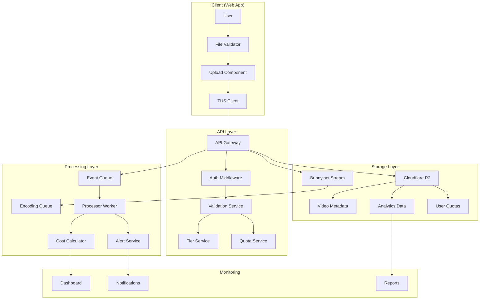

# Feature 09: Large File Handling Implementation Plan

**Document Version**: 1.0
**Date**: 2025-11-20
**Author**: System Architect
**Status**: Planning

---

## Executive Summary

This document provides a comprehensive implementation plan for increasing file size limits in Al Ummah Now from the current "no limit" approach to a managed system with proper validation, cost monitoring, and optional tiered limits based on account verification.

**Current State**: No enforced file size limit (Infinity in code), relying on Bunny.net's capabilities
**Target State**: Managed file handling with configurable limits, cost tracking, and verification tiers

---

## Table of Contents

1. [Cost Analysis and Projections](#1-cost-analysis-and-projections)
2. [Validation Updates](#2-validation-updates)
3. [Monitoring and Analytics Setup](#3-monitoring-and-analytics-setup)
4. [Tiered Limit Architecture](#4-tiered-limit-architecture)
5. [Technical Implementation Details](#5-technical-implementation-details)
6. [Files to Create/Modify](#6-files-to-createmodify)
7. [Testing Strategy](#7-testing-strategy)
8. [Rollback Plan](#8-rollback-plan)
9. [Migration Timeline](#9-migration-timeline)
10. [Success Metrics](#10-success-metrics)

---

## 1. Cost Analysis and Projections

### 1.1 Current Cost Structure (Bunny.net + Cloudflare)

#### Storage Costs (Bunny.net Stream)
- **Storage**: $0.01 per GB/month
- **Encoding**: $0.04 per minute of video
- **Streaming**: $0.005 per GB transferred

#### Bandwidth Costs (Bunny.net CDN)
- **Tier 1 (Europe/North America)**: $0.01 per GB
- **Tier 2 (Asia/Oceania)**: $0.03 per GB
- **Tier 3 (South America/Africa)**: $0.05 per GB

#### Cloudflare R2 Costs (Metadata Storage)
- **Storage**: $0.015 per GB/month
- **Class A Operations**: $4.50 per million (write, list)
- **Class B Operations**: $0.36 per million (read)
- **Egress**: FREE (within Cloudflare network)

### 1.2 File Size Impact Analysis

| File Size | Storage/Month | Encoding Cost* | Bandwidth/1000 Views** | Total First Month |
|-----------|--------------|----------------|------------------------|-------------------|
| 500 MB    | $0.005       | $2.40          | $5.00                  | $7.41            |
| 1 GB      | $0.01        | $3.60          | $10.00                 | $13.61           |
| 2 GB      | $0.02        | $4.80          | $20.00                 | $24.82           |
| 5 GB      | $0.05        | $7.20          | $50.00                 | $57.25           |
| 10 GB     | $0.10        | $12.00         | $100.00                | $112.10          |
| 20 GB     | $0.20        | $24.00         | $200.00                | $224.20          |

*Assuming 60 minutes of 1080p video per 2GB
**Assuming Tier 1 bandwidth pricing

### 1.3 Projected Monthly Costs by User Tier

#### Scenario: 1,000 Active Creators

| Tier | Users | Avg Upload/Month | Avg Size | Storage Cost | Bandwidth Cost* | Total Monthly |
|------|-------|-----------------|----------|--------------|-----------------|---------------|
| Free | 800   | 2 videos        | 500 MB   | $800         | $4,000          | $4,800        |
| Verified | 150 | 5 videos     | 2 GB     | $1,500       | $15,000         | $16,500       |
| Premium | 50 | 10 videos      | 5 GB     | $2,500       | $25,000         | $27,500       |
| **TOTAL** | **1,000** | - | - | **$4,800** | **$44,000** | **$48,800** |

*Assuming 500 views per video average

### 1.4 Cost Optimization Strategies

1. **Adaptive Bitrate Encoding**
   - Reduce storage by 30-40% with efficient encoding
   - Serve appropriate quality based on viewer bandwidth

2. **Intelligent Caching**
   - Cache popular videos at edge locations
   - Reduce origin bandwidth costs by 60%

3. **Progressive Upload Limits**
   - Start conservative, increase based on user behavior
   - Monitor abuse patterns before raising limits

4. **Regional Pricing**
   - Higher limits for Tier 1 regions (lower bandwidth cost)
   - Restricted limits for Tier 3 regions

---

## 2. Validation Updates

### 2.1 Client-Side Validation

#### File Size Validation
```typescript
// src/lib/validators/upload.ts
export const validateFileSize = (
  file: File,
  userTier: UserTier
): ValidationResult => {
  const limits = FILE_SIZE_LIMITS[userTier];

  if (file.size > limits.maxFileSize) {
    return {
      valid: false,
      error: `File size exceeds ${formatBytes(limits.maxFileSize)} limit for ${userTier} accounts`,
      suggestion: userTier === 'free'
        ? 'Verify your account to upload larger files'
        : 'Contact support for higher limits'
    };
  }

  // Warn for large files
  if (file.size > limits.warnThreshold) {
    return {
      valid: true,
      warning: `Large file detected. Upload may take longer and incur higher costs.`
    };
  }

  return { valid: true };
};
```

#### Duration Validation
```typescript
export const validateVideoDuration = async (
  file: File,
  userTier: UserTier
): Promise<ValidationResult> => {
  const duration = await getVideoDuration(file);
  const limits = DURATION_LIMITS[userTier];

  if (duration > limits.maxDuration) {
    return {
      valid: false,
      error: `Video duration exceeds ${formatDuration(limits.maxDuration)} limit`
    };
  }

  return { valid: true };
};
```

### 2.2 Server-Side Validation

#### API Endpoint Validation
```typescript
// apps/api-videos/src/endpoints/video/uploadInitiate.ts
const validateUploadRequest = async (
  request: UploadRequest,
  userContext: AuthContext
): Promise<ValidationResult> => {
  const userTier = await getUserTier(userContext.userId);
  const limits = await getEffectiveLimits(userTier, userContext);

  // Check file size
  if (request.fileSize > limits.maxFileSize) {
    throw new ValidationError(
      `File size ${formatBytes(request.fileSize)} exceeds limit of ${formatBytes(limits.maxFileSize)}`,
      'FILE_TOO_LARGE'
    );
  }

  // Check monthly upload quota
  const monthlyUsage = await getMonthlyUsage(userContext.userId);
  if (monthlyUsage.totalSize + request.fileSize > limits.monthlyQuota) {
    throw new ValidationError(
      'Monthly upload quota exceeded',
      'QUOTA_EXCEEDED'
    );
  }

  // Check concurrent uploads
  const activeUploads = await getActiveUploads(userContext.userId);
  if (activeUploads >= limits.maxConcurrentUploads) {
    throw new ValidationError(
      `Maximum ${limits.maxConcurrentUploads} concurrent uploads allowed`,
      'TOO_MANY_UPLOADS'
    );
  }

  return { valid: true, tier: userTier, limits };
};
```

### 2.3 Progressive Validation

Implement multi-stage validation to fail fast:

1. **Pre-upload Check** (instant)
   - File size
   - File type
   - Basic quota check

2. **Upload Initiation** (< 1 second)
   - User tier verification
   - Detailed quota validation
   - Rate limiting check

3. **During Upload** (continuous)
   - Monitor chunk sizes
   - Validate upload speed
   - Detect anomalies

4. **Post-upload** (after completion)
   - Verify final file size
   - Content scanning
   - Update usage metrics

---

## 3. Monitoring and Analytics Setup

### 3.1 Metrics Collection

#### Upload Metrics Schema
```typescript
// packages/shared-types/src/analytics.ts
export interface UploadMetrics {
  // Identification
  videoId: string;
  userId: string;
  channelId: string;
  userTier: UserTier;

  // Size metrics
  fileSize: number;
  compressedSize?: number;
  encodedSizes?: Record<string, number>; // resolution -> size

  // Performance metrics
  uploadStartTime: string;
  uploadEndTime: string;
  uploadDuration: number;
  averageSpeed: number; // bytes/second

  // Cost metrics
  estimatedStorageCost: number;
  estimatedBandwidthCost: number;
  estimatedEncodingCost: number;
  totalEstimatedCost: number;

  // Quality metrics
  originalResolution: string;
  originalBitrate: number;
  originalCodec: string;

  // Errors and retries
  errorCount: number;
  retryCount: number;
  failureReason?: string;
}
```

#### Analytics Events
```typescript
// apps/processor/src/handlers/upload-analytics.ts
export const trackUploadAnalytics = async (
  event: UploadEvent
): Promise<void> => {
  const metrics: UploadMetrics = {
    videoId: event.videoId,
    userId: event.userId,
    fileSize: event.fileSize,
    uploadStartTime: event.timestamp,
    // ... calculate other metrics
  };

  // Store in R2 analytics bucket
  await saveMetrics(metrics);

  // Update user quotas
  await updateUserQuota(event.userId, event.fileSize);

  // Check for anomalies
  await detectAnomalies(metrics);

  // Send to monitoring dashboard
  await pushToMonitoring(metrics);
};
```

### 3.2 Cost Tracking

#### Real-time Cost Calculator
```typescript
// apps/api-videos/src/lib/cost-calculator.ts
export class CostCalculator {
  private readonly STORAGE_RATE = 0.01; // per GB/month
  private readonly ENCODING_RATE = 0.04; // per minute
  private readonly BANDWIDTH_RATES = {
    tier1: 0.01,
    tier2: 0.03,
    tier3: 0.05
  };

  calculateUploadCost(
    fileSize: number,
    duration: number,
    estimatedViews: number = 100
  ): CostEstimate {
    const sizeInGB = fileSize / (1024 ** 3);
    const durationInMinutes = duration / 60;

    const storageCost = sizeInGB * this.STORAGE_RATE;
    const encodingCost = durationInMinutes * this.ENCODING_RATE;
    const bandwidthCost = sizeInGB * estimatedViews * this.BANDWIDTH_RATES.tier1;

    return {
      storage: storageCost,
      encoding: encodingCost,
      bandwidth: bandwidthCost,
      total: storageCost + encodingCost + bandwidthCost,
      breakdown: {
        firstMonth: storageCost + encodingCost,
        perView: sizeInGB * this.BANDWIDTH_RATES.tier1
      }
    };
  }

  async getUserMonthlyCost(userId: string): Promise<MonthlyCost> {
    const videos = await getUserVideos(userId);
    let totalStorage = 0;
    let totalBandwidth = 0;

    for (const video of videos) {
      totalStorage += video.fileSize / (1024 ** 3) * this.STORAGE_RATE;
      totalBandwidth += await getMonthlyBandwidth(video.id);
    }

    return {
      storage: totalStorage,
      bandwidth: totalBandwidth,
      total: totalStorage + totalBandwidth
    };
  }
}
```

### 3.3 Monitoring Dashboard

#### Key Metrics Dashboard
```typescript
// apps/web/src/app/[locale]/admin/metrics/page.tsx
export default function MetricsDashboard() {
  return (
    <Dashboard>
      {/* Real-time metrics */}
      <MetricCard
        title="Current Month Costs"
        value={formatCurrency(currentCosts)}
        trend={costTrend}
      />

      <MetricCard
        title="Total Storage Used"
        value={formatBytes(totalStorage)}
        limit={storageLimit}
      />

      <MetricCard
        title="Active Uploads"
        value={activeUploads}
        max={maxConcurrent}
      />

      {/* Cost breakdown */}
      <CostBreakdown
        storage={storageCosts}
        encoding={encodingCosts}
        bandwidth={bandwidthCosts}
      />

      {/* User tier distribution */}
      <TierDistribution
        free={freeTierUsers}
        verified={verifiedUsers}
        premium={premiumUsers}
      />

      {/* Alerts */}
      <AlertsPanel
        quotaExceeded={quotaAlerts}
        largeFiles={largeFileAlerts}
        anomalies={anomalyAlerts}
      />
    </Dashboard>
  );
}
```

### 3.4 Alerting System

```typescript
// apps/processor/src/services/alerts.ts
export class AlertService {
  async checkAlertConditions(metrics: UploadMetrics): Promise<void> {
    // Check for unusually large files
    if (metrics.fileSize > ALERT_THRESHOLDS.largeFile) {
      await this.sendAlert({
        type: 'LARGE_FILE',
        severity: 'warning',
        message: `Large file upload: ${formatBytes(metrics.fileSize)}`,
        userId: metrics.userId,
        videoId: metrics.videoId
      });
    }

    // Check for cost spikes
    if (metrics.totalEstimatedCost > ALERT_THRESHOLDS.highCost) {
      await this.sendAlert({
        type: 'HIGH_COST',
        severity: 'critical',
        message: `High cost upload: ${formatCurrency(metrics.totalEstimatedCost)}`,
        userId: metrics.userId
      });
    }

    // Check for quota abuse
    const userQuota = await getUserQuota(metrics.userId);
    if (userQuota.used > userQuota.limit * 0.9) {
      await this.sendAlert({
        type: 'QUOTA_WARNING',
        severity: 'warning',
        message: `User approaching quota limit: ${userQuota.used}/${userQuota.limit}`
      });
    }
  }
}
```

---

## 4. Tiered Limit Architecture

### 4.1 User Tier Definitions

```typescript
// packages/shared-types/src/user-tiers.ts
export enum UserTier {
  FREE = 'free',
  VERIFIED = 'verified',
  PREMIUM = 'premium',
  ENTERPRISE = 'enterprise'
}

export interface TierLimits {
  // File size limits
  maxFileSize: number;           // bytes
  maxDuration: number;            // seconds
  warnThreshold: number;          // bytes - show warning

  // Quota limits
  monthlyQuota: number;           // bytes per month
  dailyQuota: number;             // bytes per day
  videoQuota: number;             // number of videos per month

  // Concurrent limits
  maxConcurrentUploads: number;
  maxUploadSpeed?: number;        // bytes/second (optional throttling)

  // Feature access
  allowScheduledPublishing: boolean;
  allowBatchUpload: boolean;
  maxBatchSize: number;
  allowPremiere: boolean;
  allow4KUpload: boolean;
  allowHDRUpload: boolean;

  // Priority
  processingPriority: 'low' | 'normal' | 'high' | 'urgent';
  cdnPriority: number;            // 1-10, higher = better caching
}

export const TIER_LIMITS: Record<UserTier, TierLimits> = {
  [UserTier.FREE]: {
    maxFileSize: 500 * 1024 * 1024,     // 500 MB
    maxDuration: 15 * 60,                // 15 minutes
    warnThreshold: 400 * 1024 * 1024,   // 400 MB
    monthlyQuota: 5 * 1024 ** 3,        // 5 GB
    dailyQuota: 1 * 1024 ** 3,          // 1 GB
    videoQuota: 10,
    maxConcurrentUploads: 1,
    maxBatchSize: 1,
    allowScheduledPublishing: false,
    allowBatchUpload: false,
    allowPremiere: false,
    allow4KUpload: false,
    allowHDRUpload: false,
    processingPriority: 'low',
    cdnPriority: 1
  },

  [UserTier.VERIFIED]: {
    maxFileSize: 2 * 1024 ** 3,         // 2 GB
    maxDuration: 60 * 60,                // 1 hour
    warnThreshold: 1.5 * 1024 ** 3,     // 1.5 GB
    monthlyQuota: 50 * 1024 ** 3,       // 50 GB
    dailyQuota: 10 * 1024 ** 3,         // 10 GB
    videoQuota: 100,
    maxConcurrentUploads: 3,
    maxBatchSize: 5,
    allowScheduledPublishing: true,
    allowBatchUpload: true,
    allowPremiere: false,
    allow4KUpload: true,
    allowHDRUpload: false,
    processingPriority: 'normal',
    cdnPriority: 5
  },

  [UserTier.PREMIUM]: {
    maxFileSize: 10 * 1024 ** 3,        // 10 GB
    maxDuration: 4 * 60 * 60,            // 4 hours
    warnThreshold: 5 * 1024 ** 3,       // 5 GB
    monthlyQuota: 500 * 1024 ** 3,      // 500 GB
    dailyQuota: 50 * 1024 ** 3,         // 50 GB
    videoQuota: 500,
    maxConcurrentUploads: 10,
    maxBatchSize: 15,
    allowScheduledPublishing: true,
    allowBatchUpload: true,
    allowPremiere: true,
    allow4KUpload: true,
    allowHDRUpload: true,
    processingPriority: 'high',
    cdnPriority: 8
  },

  [UserTier.ENTERPRISE]: {
    maxFileSize: 50 * 1024 ** 3,        // 50 GB
    maxDuration: 12 * 60 * 60,           // 12 hours
    warnThreshold: 20 * 1024 ** 3,      // 20 GB
    monthlyQuota: 5 * 1024 ** 4,        // 5 TB
    dailyQuota: 500 * 1024 ** 3,        // 500 GB
    videoQuota: 5000,
    maxConcurrentUploads: 50,
    maxBatchSize: 100,
    allowScheduledPublishing: true,
    allowBatchUpload: true,
    allowPremiere: true,
    allow4KUpload: true,
    allowHDRUpload: true,
    processingPriority: 'urgent',
    cdnPriority: 10
  }
};
```

### 4.2 User Verification System

```typescript
// apps/api-videos/src/services/user-verification.ts
export class UserVerificationService {
  async verifyUser(userId: string, method: VerificationMethod): Promise<boolean> {
    switch (method) {
      case 'phone':
        return this.verifyPhone(userId);
      case 'email':
        return this.verifyEmail(userId);
      case 'identity':
        return this.verifyIdentity(userId);
      case 'payment':
        return this.verifyPayment(userId);
      default:
        return false;
    }
  }

  async getUserTier(userId: string): Promise<UserTier> {
    const user = await this.getUser(userId);

    // Check verification status
    if (!user.emailVerified) {
      return UserTier.FREE;
    }

    if (user.subscription?.plan === 'enterprise') {
      return UserTier.ENTERPRISE;
    }

    if (user.subscription?.plan === 'premium') {
      return UserTier.PREMIUM;
    }

    if (user.phoneVerified || user.identityVerified) {
      return UserTier.VERIFIED;
    }

    return UserTier.FREE;
  }

  async upgradeUserTier(
    userId: string,
    targetTier: UserTier,
    reason: string
  ): Promise<void> {
    const currentTier = await this.getUserTier(userId);

    if (currentTier >= targetTier) {
      throw new Error('User already has this tier or higher');
    }

    // Update user record
    await this.updateUser(userId, {
      tier: targetTier,
      tierUpgradeDate: new Date().toISOString(),
      tierUpgradeReason: reason
    });

    // Send notification
    await this.notifyTierUpgrade(userId, currentTier, targetTier);

    // Update quotas
    await this.updateUserQuotas(userId, targetTier);
  }
}
```

### 4.3 Dynamic Limit Adjustment

```typescript
// apps/api-videos/src/services/dynamic-limits.ts
export class DynamicLimitService {
  async getEffectiveLimits(
    userId: string,
    context: RequestContext
  ): Promise<TierLimits> {
    const baseTier = await getUserTier(userId);
    let limits = { ...TIER_LIMITS[baseTier] };

    // Apply regional adjustments
    const region = context.region;
    if (EXPENSIVE_REGIONS.includes(region)) {
      limits.maxFileSize *= 0.5; // Reduce by 50% for expensive regions
      limits.monthlyQuota *= 0.5;
    }

    // Apply time-based adjustments (peak hours)
    const hour = new Date().getHours();
    if (hour >= 18 && hour <= 22) { // Peak hours
      limits.maxConcurrentUploads = Math.max(1, limits.maxConcurrentUploads - 1);
    }

    // Apply reputation adjustments
    const reputation = await getUserReputation(userId);
    if (reputation.score > 90) {
      limits.maxFileSize *= 1.2; // 20% bonus for good reputation
    } else if (reputation.violations > 0) {
      limits.maxFileSize *= 0.8; // 20% penalty for violations
    }

    // Apply promotional adjustments
    const promotions = await getActivePromotions(userId);
    for (const promo of promotions) {
      if (promo.type === 'UPLOAD_BOOST') {
        limits.maxFileSize *= promo.multiplier;
        limits.monthlyQuota *= promo.multiplier;
      }
    }

    return limits;
  }
}
```

---

## 5. Technical Implementation Details

### 5.1 Architecture Overview



### 5.2 Upload Flow with Validation

```typescript
// Complete upload flow with all validations
async function handleVideoUpload(
  file: File,
  metadata: VideoMetadata,
  userContext: AuthContext
): Promise<UploadResult> {
  try {
    // Step 1: Client-side validation
    const clientValidation = await validateClient(file, metadata);
    if (!clientValidation.valid) {
      throw new ValidationError(clientValidation.error);
    }

    // Step 2: Initialize upload with server validation
    const initResponse = await initiateUpload({
      fileSize: file.size,
      mimeType: file.type,
      title: metadata.title,
      userId: userContext.userId
    });

    // Step 3: Start TUS upload with progress tracking
    const upload = new tus.Upload(file, {
      endpoint: initResponse.tusEndpoint,
      headers: initResponse.tusHeaders,
      chunkSize: initResponse.chunkSize,
      metadata: {
        filename: file.name,
        filetype: file.type,
        ...metadata
      },
      onProgress: (bytesUploaded, bytesTotal) => {
        const percentage = (bytesUploaded / bytesTotal) * 100;
        updateProgress(percentage);

        // Track speed for anomaly detection
        trackUploadSpeed(bytesUploaded, Date.now());
      },
      onSuccess: async () => {
        // Step 4: Complete upload and trigger processing
        await completeUpload(initResponse.videoId, file.size);
      },
      onError: (error) => {
        handleUploadError(error, initResponse.videoId);
      }
    });

    upload.start();

    return {
      videoId: initResponse.videoId,
      uploadId: upload.url
    };

  } catch (error) {
    logError('Upload failed', { error, userId: userContext.userId });
    throw error;
  }
}
```

### 5.3 Quota Management System

```typescript
// apps/api-videos/src/services/quota-manager.ts
export class QuotaManager {
  private readonly QUOTA_BUCKET = 'user-quotas';

  async checkQuota(
    userId: string,
    requestedSize: number
  ): Promise<QuotaCheckResult> {
    const quota = await this.getUserQuota(userId);
    const usage = await this.getCurrentUsage(userId);

    const availableSpace = quota.limit - usage.total;
    const dailyRemaining = quota.dailyLimit - usage.today;
    const videoCountRemaining = quota.videoLimit - usage.videoCount;

    if (requestedSize > availableSpace) {
      return {
        allowed: false,
        reason: 'MONTHLY_QUOTA_EXCEEDED',
        availableSpace,
        suggestedAction: 'Upgrade to higher tier or wait for next month'
      };
    }

    if (requestedSize > dailyRemaining) {
      return {
        allowed: false,
        reason: 'DAILY_QUOTA_EXCEEDED',
        availableSpace: dailyRemaining,
        resetTime: this.getNextDayReset(),
        suggestedAction: 'Wait until tomorrow or upgrade tier'
      };
    }

    if (videoCountRemaining <= 0) {
      return {
        allowed: false,
        reason: 'VIDEO_COUNT_EXCEEDED',
        suggestedAction: 'Delete old videos or upgrade tier'
      };
    }

    return {
      allowed: true,
      availableSpace,
      percentUsed: (usage.total / quota.limit) * 100
    };
  }

  async updateUsage(
    userId: string,
    size: number,
    operation: 'add' | 'remove'
  ): Promise<void> {
    const usage = await this.getCurrentUsage(userId);

    if (operation === 'add') {
      usage.total += size;
      usage.today += size;
      usage.videoCount += 1;
      usage.lastUpload = new Date().toISOString();
    } else {
      usage.total = Math.max(0, usage.total - size);
      usage.videoCount = Math.max(0, usage.videoCount - 1);
    }

    await this.saveUsage(userId, usage);

    // Check if user needs warning
    await this.checkUsageWarnings(userId, usage);
  }

  private async checkUsageWarnings(
    userId: string,
    usage: Usage
  ): Promise<void> {
    const quota = await this.getUserQuota(userId);
    const percentUsed = (usage.total / quota.limit) * 100;

    if (percentUsed >= 90 && !usage.warningsSent?.includes('90_percent')) {
      await this.sendQuotaWarning(userId, '90_percent', percentUsed);
      usage.warningsSent = [...(usage.warningsSent || []), '90_percent'];
    }

    if (percentUsed >= 75 && !usage.warningsSent?.includes('75_percent')) {
      await this.sendQuotaWarning(userId, '75_percent', percentUsed);
      usage.warningsSent = [...(usage.warningsSent || []), '75_percent'];
    }
  }
}
```

### 5.4 Rate Limiting and Throttling

```typescript
// apps/api-videos/src/middleware/rate-limit.ts
export class UploadRateLimiter {
  private readonly limits: Map<string, RateLimit> = new Map();

  async checkRateLimit(
    userId: string,
    requestSize: number
  ): Promise<RateLimitResult> {
    const userTier = await getUserTier(userId);
    const tierLimits = TIER_LIMITS[userTier];

    const key = `upload:${userId}`;
    let limit = this.limits.get(key);

    if (!limit) {
      limit = {
        tokens: tierLimits.maxConcurrentUploads,
        lastRefill: Date.now(),
        tier: userTier
      };
      this.limits.set(key, limit);
    }

    // Refill tokens based on time passed
    const now = Date.now();
    const timePassed = now - limit.lastRefill;
    const refillRate = this.getRefillRate(userTier);
    const tokensToAdd = Math.floor(timePassed / refillRate);

    if (tokensToAdd > 0) {
      limit.tokens = Math.min(
        tierLimits.maxConcurrentUploads,
        limit.tokens + tokensToAdd
      );
      limit.lastRefill = now;
    }

    // Check if request can proceed
    if (limit.tokens <= 0) {
      return {
        allowed: false,
        retryAfter: refillRate - (timePassed % refillRate),
        reason: 'RATE_LIMITED'
      };
    }

    // Consume token
    limit.tokens--;

    // Apply throttling for large files
    const throttleDelay = this.calculateThrottle(requestSize, userTier);

    return {
      allowed: true,
      throttleMs: throttleDelay,
      remainingTokens: limit.tokens
    };
  }

  private getRefillRate(tier: UserTier): number {
    // Time in ms to refill one token
    const rates = {
      [UserTier.FREE]: 60000,      // 1 minute
      [UserTier.VERIFIED]: 30000,   // 30 seconds
      [UserTier.PREMIUM]: 10000,    // 10 seconds
      [UserTier.ENTERPRISE]: 1000   // 1 second
    };
    return rates[tier];
  }

  private calculateThrottle(size: number, tier: UserTier): number {
    // Add delay for very large files to prevent abuse
    if (size > 1024 ** 3) { // > 1GB
      const delays = {
        [UserTier.FREE]: 5000,      // 5 second delay
        [UserTier.VERIFIED]: 2000,   // 2 seconds
        [UserTier.PREMIUM]: 500,     // 0.5 seconds
        [UserTier.ENTERPRISE]: 0     // No delay
      };
      return delays[tier];
    }
    return 0;
  }
}
```

---

## 6. Files to Create/Modify

### 6.1 New Files to Create

```bash
# Core Services
apps/api-videos/src/services/
├── user-verification.ts      # User tier verification
├── quota-manager.ts           # Quota tracking and enforcement
├── cost-calculator.ts         # Cost estimation and tracking
├── dynamic-limits.ts          # Dynamic limit adjustments
└── upload-validator.ts        # Comprehensive validation

# Middleware
apps/api-videos/src/middleware/
├── rate-limit.ts              # Upload rate limiting
└── quota-check.ts             # Quota checking middleware

# Analytics
apps/processor/src/handlers/
├── upload-analytics.ts        # Upload metrics processing
└── cost-tracking.ts           # Cost calculation and alerts

# Monitoring
apps/processor/src/services/
├── alerts.ts                  # Alert service
└── anomaly-detector.ts        # Anomaly detection

# Web Components
apps/web/src/components/
├── upload/
│   ├── QuotaDisplay.tsx      # Show user quota status
│   ├── TierUpgrade.tsx       # Tier upgrade prompts
│   └── CostEstimate.tsx      # Upload cost preview
└── admin/
    ├── MetricsDashboard.tsx   # Admin metrics dashboard
    └── CostBreakdown.tsx      # Cost analytics

# Shared Types
packages/shared-types/src/
├── user-tiers.ts              # Tier definitions
├── analytics.ts               # Analytics types
└── quotas.ts                  # Quota types

# Configuration
apps/api-videos/config/
├── tier-limits.json           # Tier limit configuration
└── cost-config.json           # Cost calculation config
```

### 6.2 Files to Modify

```bash
# API Endpoints
apps/api-videos/src/endpoints/video/
├── uploadInitiate.ts          # Add validation and quota checks
├── uploadComplete.ts          # Update with cost tracking
└── uploadResume.ts            # Add rate limiting

# Web Upload Components
apps/web/src/components/videoUpload/
└── index.tsx                  # Add client validation and quota display

apps/web/src/lib/
├── constants/uploadConfig.ts  # Update with tier-based limits
├── validators/upload.ts       # Add comprehensive validation
└── api/videos.ts              # Update API client with new fields

# Shared Types
packages/shared-types/src/
└── video.ts                   # Add cost and tier fields

# Processor
apps/processor/src/
├── index.ts                   # Add new message handlers
└── lib/queue.ts               # Add new event types

# Configuration Files
├── wrangler.jsonc             # Add new R2 buckets for quotas/analytics
└── .env.example               # Add configuration variables
```

---

## 7. Testing Strategy

### 7.1 Unit Tests

```typescript
// apps/api-videos/src/services/__tests__/quota-manager.test.ts
describe('QuotaManager', () => {
  describe('checkQuota', () => {
    it('should allow upload within quota', async () => {
      const result = await quotaManager.checkQuota('user1', 100 * MB);
      expect(result.allowed).toBe(true);
    });

    it('should reject upload exceeding monthly quota', async () => {
      const result = await quotaManager.checkQuota('user1', 10 * GB);
      expect(result.allowed).toBe(false);
      expect(result.reason).toBe('MONTHLY_QUOTA_EXCEEDED');
    });

    it('should reject upload exceeding daily quota', async () => {
      // Set up user with high monthly but low daily quota
      const result = await quotaManager.checkQuota('user2', 2 * GB);
      expect(result.allowed).toBe(false);
      expect(result.reason).toBe('DAILY_QUOTA_EXCEEDED');
    });
  });
});
```

### 7.2 Integration Tests

```typescript
// e2e/upload-limits.spec.ts
describe('Upload Limits', () => {
  test('Free tier cannot upload > 500MB', async ({ page }) => {
    await loginAs(page, 'free-user');
    await page.goto('/upload');

    const largeFile = await createTestFile(600 * MB);
    await selectFile(page, largeFile);

    await expect(page.locator('.error-message')).toContainText(
      'File size exceeds 500 MB limit'
    );
  });

  test('Verified tier can upload 2GB file', async ({ page }) => {
    await loginAs(page, 'verified-user');
    await page.goto('/upload');

    const file = await createTestFile(1.8 * GB);
    await selectFile(page, file);

    await expect(page.locator('.upload-progress')).toBeVisible();
    await waitForUploadComplete(page);
  });

  test('Shows upgrade prompt when quota exceeded', async ({ page }) => {
    await loginAs(page, 'quota-exceeded-user');
    await page.goto('/upload');

    await expect(page.locator('.quota-warning')).toContainText(
      'Monthly quota exceeded'
    );
    await expect(page.locator('.upgrade-prompt')).toBeVisible();
  });
});
```

### 7.3 Load Testing

```typescript
// load-tests/upload-stress.js
import { check } from 'k6';
import http from 'k6/http';
import { Rate } from 'k6/metrics';

const errorRate = new Rate('errors');

export const options = {
  stages: [
    { duration: '2m', target: 10 },  // Ramp up to 10 users
    { duration: '5m', target: 10 },  // Stay at 10 users
    { duration: '2m', target: 50 },  // Ramp up to 50 users
    { duration: '5m', target: 50 },  // Stay at 50 users
    { duration: '2m', target: 0 },   // Ramp down
  ],
  thresholds: {
    'http_req_duration': ['p(95)<3000'], // 95% of requests under 3s
    'errors': ['rate<0.05'],             // Error rate under 5%
  },
};

export default function() {
  // Simulate different file sizes
  const sizes = [100 * MB, 500 * MB, 1 * GB, 2 * GB];
  const size = sizes[Math.floor(Math.random() * sizes.length)];

  const response = http.post(
    'https://api.alummahnow.net/api/videos/upload/initiate',
    JSON.stringify({
      fileSize: size,
      title: `Load test video ${Date.now()}`,
      mimeType: 'video/mp4'
    }),
    {
      headers: {
        'Content-Type': 'application/json',
        'Authorization': `Bearer ${__ENV.TEST_TOKEN}`
      }
    }
  );

  const success = check(response, {
    'status is 200': (r) => r.status === 200,
    'has videoId': (r) => JSON.parse(r.body).result?.videoId,
  });

  errorRate.add(!success);
}
```

### 7.4 Monitoring Tests

```typescript
// apps/processor/src/services/__tests__/alerts.test.ts
describe('AlertService', () => {
  it('should trigger alert for large file', async () => {
    const metrics: UploadMetrics = {
      fileSize: 15 * GB,
      userId: 'user1',
      videoId: 'video1',
      totalEstimatedCost: 150
    };

    await alertService.checkAlertConditions(metrics);

    expect(mockNotify).toHaveBeenCalledWith({
      type: 'LARGE_FILE',
      severity: 'warning',
      message: expect.stringContaining('15 GB')
    });
  });

  it('should trigger cost alert', async () => {
    const metrics: UploadMetrics = {
      fileSize: 50 * GB,
      totalEstimatedCost: 500
    };

    await alertService.checkAlertConditions(metrics);

    expect(mockNotify).toHaveBeenCalledWith({
      type: 'HIGH_COST',
      severity: 'critical'
    });
  });
});
```

---

## 8. Rollback Plan

### 8.1 Feature Flags

```typescript
// apps/api-videos/src/config/feature-flags.ts
export const FEATURE_FLAGS = {
  ENFORCE_FILE_SIZE_LIMITS: process.env.ENFORCE_SIZE_LIMITS === 'true',
  USE_TIER_SYSTEM: process.env.USE_TIER_SYSTEM === 'true',
  ENABLE_COST_TRACKING: process.env.ENABLE_COST_TRACKING === 'true',
  ENABLE_QUOTA_ENFORCEMENT: process.env.ENABLE_QUOTAS === 'true',
  ENABLE_RATE_LIMITING: process.env.ENABLE_RATE_LIMIT === 'true',
};

// Usage in validation
if (FEATURE_FLAGS.ENFORCE_FILE_SIZE_LIMITS) {
  const validation = await validateFileSize(fileSize, userTier);
  if (!validation.valid) {
    throw new ValidationError(validation.error);
  }
}
```

### 8.2 Gradual Rollout

```javascript
// Percentage-based rollout
const ROLLOUT_PERCENTAGE = {
  TIER_SYSTEM: 10,      // Start with 10% of users
  SIZE_LIMITS: 25,      // 25% get size limits
  COST_TRACKING: 100,   // Track costs for all (no user impact)
  QUOTA_ENFORCEMENT: 5, // Start with 5% for quotas
};

function isFeatureEnabled(userId: string, feature: string): boolean {
  const hash = hashUserId(userId);
  const percentage = hash % 100;
  return percentage < ROLLOUT_PERCENTAGE[feature];
}
```

### 8.3 Rollback Procedures

```bash
#!/bin/bash
# rollback.sh

# Step 1: Disable feature flags
echo "Disabling feature flags..."
wrangler secret put ENFORCE_SIZE_LIMITS --value "false"
wrangler secret put USE_TIER_SYSTEM --value "false"
wrangler secret put ENABLE_QUOTAS --value "false"

# Step 2: Deploy previous version
echo "Rolling back to previous version..."
git checkout v1.2.3  # Previous stable version
pnpm install
pnpm api:deploy

# Step 3: Clear cached limits
echo "Clearing cached limits..."
wrangler kv:key delete --namespace-id=$KV_NAMESPACE "limits:*"

# Step 4: Notify users
echo "Sending rollback notification..."
curl -X POST https://api.alummahnow.net/admin/notify \
  -H "Content-Type: application/json" \
  -d '{"message": "Upload limits temporarily disabled for maintenance"}'

echo "Rollback complete!"
```

### 8.4 Data Recovery

```typescript
// Restore user quotas if corruption occurs
async function restoreQuotas(): Promise<void> {
  const users = await getAllUsers();

  for (const user of users) {
    // Recalculate actual usage from video records
    const videos = await getUserVideos(user.id);
    const actualUsage = videos.reduce((sum, v) => sum + v.fileSize, 0);

    // Restore quota record
    await quotaManager.setUsage(user.id, {
      total: actualUsage,
      today: 0, // Reset daily
      videoCount: videos.length,
      lastUpdated: new Date().toISOString()
    });
  }
}
```

---

## 9. Migration Timeline

### Phase 1: Foundation (Week 1-2)
- [ ] Create tier system types and configurations
- [ ] Implement user verification service
- [ ] Build quota manager service
- [ ] Add cost calculator
- [ ] Set up monitoring infrastructure

### Phase 2: Validation (Week 3-4)
- [ ] Implement client-side validators
- [ ] Add server-side validation middleware
- [ ] Create rate limiting service
- [ ] Update upload endpoints
- [ ] Add feature flags

### Phase 3: UI Updates (Week 5)
- [ ] Create quota display components
- [ ] Add tier upgrade prompts
- [ ] Build cost estimation UI
- [ ] Update upload component
- [ ] Create admin dashboard

### Phase 4: Testing (Week 6)
- [ ] Write unit tests
- [ ] Create integration tests
- [ ] Perform load testing
- [ ] Test rollback procedures
- [ ] Security audit

### Phase 5: Gradual Rollout (Week 7-8)
- [ ] Deploy to staging (100% rollout)
- [ ] Production: 5% rollout
- [ ] Monitor metrics and alerts
- [ ] Production: 25% rollout
- [ ] Production: 50% rollout
- [ ] Production: 100% rollout

### Phase 6: Optimization (Week 9-10)
- [ ] Analyze usage patterns
- [ ] Adjust tier limits
- [ ] Optimize cost calculations
- [ ] Fine-tune alerts
- [ ] Document learnings

---

## 10. Success Metrics

### 10.1 Technical Metrics

| Metric | Target | Measurement |
|--------|--------|-------------|
| Upload Success Rate | > 95% | Successful uploads / Total attempts |
| Validation Performance | < 100ms | Time to validate upload request |
| Quota Check Latency | < 50ms | Time to check user quota |
| Cost Calculation Accuracy | ± 5% | Estimated vs Actual costs |
| Alert Response Time | < 1 minute | Time from trigger to notification |

### 10.2 Business Metrics

| Metric | Target | Measurement |
|--------|--------|-------------|
| Cost Per User | < $5/month | Total costs / Active users |
| Storage Efficiency | > 80% | Used storage / Allocated storage |
| Tier Conversion Rate | > 10% | Verified users / Total users |
| Quota Utilization | 60-80% | Average usage / Allocated quota |
| Support Tickets | < 5% increase | Upload-related tickets |

### 10.3 User Experience Metrics

| Metric | Target | Measurement |
|--------|--------|-------------|
| Upload Completion Rate | > 90% | Completed / Initiated uploads |
| Time to First Byte | < 2s | Upload initiation time |
| Retry Rate | < 10% | Retried uploads / Total uploads |
| Upgrade Prompt CTR | > 15% | Upgrades / Prompts shown |
| User Satisfaction | > 4.0/5 | Survey scores |

---

## Appendix A: Configuration Examples

### Tier Limits Configuration
```json
{
  "tiers": {
    "free": {
      "maxFileSize": 524288000,
      "monthlyQuota": 5368709120,
      "dailyQuota": 1073741824,
      "maxConcurrentUploads": 1
    },
    "verified": {
      "maxFileSize": 2147483648,
      "monthlyQuota": 53687091200,
      "dailyQuota": 10737418240,
      "maxConcurrentUploads": 3
    }
  }
}
```

### Cost Configuration
```json
{
  "storage": {
    "ratePerGB": 0.01,
    "billingPeriod": "monthly"
  },
  "encoding": {
    "ratePerMinute": 0.04,
    "minimumCharge": 0.01
  },
  "bandwidth": {
    "tier1": 0.01,
    "tier2": 0.03,
    "tier3": 0.05
  }
}
```

---

## Appendix B: Error Codes

| Code | Description | User Message |
|------|-------------|--------------|
| FILE_TOO_LARGE | File exceeds tier limit | "File size exceeds your account limit" |
| QUOTA_EXCEEDED | Monthly quota exhausted | "Monthly upload quota exceeded" |
| DAILY_LIMIT | Daily quota exhausted | "Daily upload limit reached" |
| RATE_LIMITED | Too many concurrent uploads | "Too many uploads in progress" |
| INVALID_TIER | User tier not recognized | "Account verification required" |
| COST_LIMIT | Upload would exceed cost threshold | "This upload exceeds cost limits" |

---

## Appendix C: Monitoring Queries

```sql
-- Average file size by tier
SELECT
  user_tier,
  AVG(file_size) as avg_size,
  MAX(file_size) as max_size,
  COUNT(*) as upload_count
FROM upload_metrics
GROUP BY user_tier;

-- Cost breakdown by component
SELECT
  DATE_TRUNC('day', created_at) as date,
  SUM(storage_cost) as storage,
  SUM(encoding_cost) as encoding,
  SUM(bandwidth_cost) as bandwidth,
  SUM(total_cost) as total
FROM cost_tracking
GROUP BY date
ORDER BY date DESC;

-- Quota utilization
SELECT
  user_tier,
  AVG(usage_percentage) as avg_utilization,
  COUNT(CASE WHEN usage_percentage > 90 THEN 1 END) as near_limit,
  COUNT(CASE WHEN quota_exceeded THEN 1 END) as exceeded
FROM quota_metrics
GROUP BY user_tier;
```

---

## Document Control

- **Version**: 1.0
- **Created**: 2025-11-20
- **Last Updated**: 2025-11-20
- **Next Review**: 2025-12-20
- **Owner**: Development Team
- **Stakeholders**: Product, Engineering, Finance, Support

---

## References

1. [Bunny.net Stream API Documentation](https://docs.bunny.net/docs/stream)
2. [TUS Resumable Upload Protocol](https://tus.io/)
3. [Cloudflare R2 Pricing](https://developers.cloudflare.com/r2/pricing/)
4. [YouTube Upload Limits](https://support.google.com/youtube/answer/71673)
5. [AWS Cost Calculator](https://calculator.aws/)