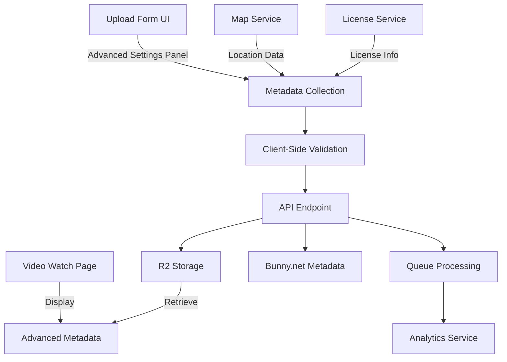

# Advanced Settings Feature Implementation Plan

**Document Version**: 1.0
**Date**: 2025-11-20
**Feature Priority**: MEDIUM (Phase 2)
**Estimated Effort**: 2 weeks
**Team Size**: 1-2 developers

---

## Executive Summary

The Advanced Settings feature adds rich metadata capabilities to the Al Ummah Now video platform, enabling creators to provide license information, geolocation data, recording dates, language specifications, and caption certification. This feature brings the platform closer to parity with YouTube's upload experience while adding Islamic-specific use cases such as Hajj video location tagging and historical archival footage dating.

**Key Components**:
- License type selection (Standard / Creative Commons)
- Video location with map-based picker
- Recording date (separate from upload date)
- Language selection with Islamic language support
- Caption certification for accessibility compliance

---

## Table of Contents

1. [Feature Requirements](#feature-requirements)
2. [Architecture Overview](#architecture-overview)
3. [Data Model Extensions](#data-model-extensions)
4. [UI Components](#ui-components)
5. [API Endpoints](#api-endpoints)
6. [Technical Implementation](#technical-implementation)
7. [Testing Strategy](#testing-strategy)
8. [Islamic Content Use Cases](#islamic-content-use-cases)
9. [Migration Plan](#migration-plan)
10. [Performance Considerations](#performance-considerations)
11. [Security Considerations](#security-considerations)
12. [Accessibility Requirements](#accessibility-requirements)
13. [Implementation Tasks](#implementation-tasks)
14. [Success Metrics](#success-metrics)

---

## Feature Requirements

### Functional Requirements

1. **License Type Selection**
   - Standard Al Ummah Now License (all rights reserved)
   - Creative Commons - Attribution (CC BY 4.0)
   - Creative Commons - Attribution-ShareAlike (CC BY-SA 4.0)
   - Creative Commons - Attribution-NonCommercial (CC BY-NC 4.0)
   - Creative Commons - Zero (CC0 - Public Domain)

2. **Video Location**
   - Interactive map picker (Leaflet or Mapbox)
   - Search by city/country/landmark
   - Special support for Islamic locations (Mecca, Medina, Jerusalem)
   - Privacy option to hide exact coordinates (city-level only)
   - Reverse geocoding for location names

3. **Recording Date**
   - Date/time picker for when video was recorded
   - Support for approximate dates (month/year only)
   - Historical date validation (not future dates)
   - Timezone support for accuracy
   - Display format respecting locale (Hijri calendar option)

4. **Language Selection**
   - Primary spoken language dropdown
   - Support for multiple languages (secondary)
   - Islamic language priorities: Arabic, Urdu, Turkish, Indonesian, Malay
   - RTL language detection
   - Affects recommendation algorithm

5. **Caption Certification**
   - Professional captions checkbox
   - Auto-generated captions flag
   - Community-contributed captions
   - No captions available
   - Legal compliance declaration

### Non-Functional Requirements

1. **Performance**: Advanced settings should not increase upload time by more than 2 seconds
2. **Storage**: Metadata should not exceed 5KB per video
3. **Compatibility**: All metadata must be backwards compatible with existing videos
4. **Localization**: All UI elements must support English/Arabic with RTL
5. **Mobile**: Full functionality on mobile devices with responsive design

---

## Architecture Overview

### System Components



### Technology Stack

| Component | Technology | Rationale |
|-----------|-----------|-----------|
| Map Integration | Leaflet + OpenStreetMap | Free, open-source, no API limits |
| Geocoding | Nominatim API | Free OpenStreetMap geocoding |
| Date Picker | React-DatePicker | Supports Hijri calendar |
| License Icons | Creative Commons SVGs | Official CC assets |
| Storage | Cloudflare R2 | Existing infrastructure |
| Validation | Zod schemas | Type-safe validation |

---

## Data Model Extensions

### Video Model Schema Updates

```typescript
// packages/shared-types/src/video.ts

export interface VideoAdvancedSettings {
  // License Information
  licenseType: VideoLicenseType;
  licenseVersion?: string; // e.g., "4.0" for CC licenses
  licenseUrl?: string; // Link to license details
  allowRemix?: boolean; // Quick flag for remix permissions

  // Location Data
  location?: VideoLocation;

  // Recording Information
  recordingDate?: string; // ISO 8601 date
  recordingDatePrecision?: 'exact' | 'day' | 'month' | 'year';
  recordingTimezone?: string; // IANA timezone

  // Language Settings
  primaryLanguage?: string; // ISO 639-1 code
  secondaryLanguages?: string[]; // Additional languages
  audioLanguage?: string; // Spoken language

  // Caption Information
  captionCertification?: CaptionCertificationType;
  captionLanguages?: string[]; // Available caption languages
  captionProvider?: string; // Who created captions
}

export interface VideoLocation {
  latitude?: number;
  longitude?: number;
  accuracy?: 'exact' | 'approximate' | 'city' | 'country';

  // Human-readable location
  placeName?: string; // e.g., "Masjid al-Haram"
  city?: string;
  region?: string; // State/province
  country?: string;
  countryCode?: string; // ISO 3166-1 alpha-2

  // Islamic location markers
  islamicSignificance?: IslamicLocationType;
  nearbyMosque?: string;

  // Privacy settings
  showOnMap?: boolean; // Display pin on map
  showInDescription?: boolean; // Show text location
}

export type VideoLicenseType =
  | 'standard' // All rights reserved
  | 'cc-by' // Creative Commons Attribution
  | 'cc-by-sa' // Attribution-ShareAlike
  | 'cc-by-nc' // Attribution-NonCommercial
  | 'cc-by-nc-sa' // Attribution-NonCommercial-ShareAlike
  | 'cc-by-nd' // Attribution-NoDerivatives
  | 'cc-by-nc-nd' // Attribution-NonCommercial-NoDerivatives
  | 'cc0' // Public Domain
  | 'waqf' // Islamic endowment (custom for platform);

export type IslamicLocationType =
  | 'mecca'
  | 'medina'
  | 'jerusalem'
  | 'mosque'
  | 'islamic-site'
  | 'hajj-route'
  | 'historical';

export type CaptionCertificationType =
  | 'professional' // Professionally created
  | 'auto-generated' // AI/ML generated
  | 'community' // User-contributed
  | 'verified' // Reviewed and verified
  | 'none'; // No captions

// Update main VideoObject interface
export interface VideoObject extends Timestamps {
  // ... existing fields ...

  // Advanced Settings (new)
  advancedSettings?: VideoAdvancedSettings;
}
```

### API Input Schemas

```typescript
// apps/api-videos/src/lib/model/input.ts

export const VideoAdvancedSettingsInput = z.object({
  // License
  licenseType: z.enum([
    'standard', 'cc-by', 'cc-by-sa', 'cc-by-nc',
    'cc-by-nc-sa', 'cc-by-nd', 'cc-by-nc-nd', 'cc0', 'waqf'
  ]).optional(),

  // Location
  location: z.object({
    latitude: z.number().min(-90).max(90).optional(),
    longitude: z.number().min(-180).max(180).optional(),
    accuracy: z.enum(['exact', 'approximate', 'city', 'country']).optional(),
    placeName: z.string().max(200).optional(),
    city: z.string().max(100).optional(),
    country: z.string().max(100).optional(),
    showOnMap: z.boolean().optional(),
    showInDescription: z.boolean().optional(),
  }).optional(),

  // Recording Date
  recordingDate: z.string().datetime().optional(),
  recordingDatePrecision: z.enum(['exact', 'day', 'month', 'year']).optional(),

  // Language
  primaryLanguage: z.string().length(2).optional(), // ISO 639-1
  secondaryLanguages: z.array(z.string().length(2)).max(5).optional(),

  // Captions
  captionCertification: z.enum([
    'professional', 'auto-generated', 'community', 'verified', 'none'
  ]).optional(),
});

// Update existing VideoUpdateInput
export const VideoUpdateInput = z.object({
  // ... existing fields ...
  advancedSettings: VideoAdvancedSettingsInput.optional(),
});
```

---

## UI Components

### 1. Advanced Settings Panel (Collapsible)

```typescript
// apps/web/src/components/videoUpload/AdvancedSettings.tsx

interface AdvancedSettingsProps {
  value: VideoAdvancedSettings;
  onChange: (settings: VideoAdvancedSettings) => void;
  disabled?: boolean;
}

export function AdvancedSettings({ value, onChange, disabled }: AdvancedSettingsProps) {
  const [isExpanded, setIsExpanded] = useState(false);

  return (
    <div className="border rounded-lg p-4 mt-4">
      <button
        onClick={() => setIsExpanded(!isExpanded)}
        className="flex items-center justify-between w-full"
      >
        <span className="font-medium flex items-center gap-2">
          <Settings size={16} />
          Advanced Settings
        </span>
        <ChevronDown className={`transform transition-transform ${
          isExpanded ? 'rotate-180' : ''
        }`} />
      </button>

      {isExpanded && (
        <div className="mt-4 space-y-6">
          <LicenseSelector value={value.licenseType} onChange={...} />
          <LocationPicker value={value.location} onChange={...} />
          <RecordingDatePicker value={value.recordingDate} onChange={...} />
          <LanguageSelector value={value.primaryLanguage} onChange={...} />
          <CaptionSettings value={value.captionCertification} onChange={...} />
        </div>
      )}
    </div>
  );
}
```

### 2. Location Picker Component

```typescript
// apps/web/src/components/videoUpload/LocationPicker.tsx

export function LocationPicker({ value, onChange }: LocationPickerProps) {
  const [showMap, setShowMap] = useState(false);
  const [searchQuery, setSearchQuery] = useState('');
  const [suggestions, setSuggestions] = useState<LocationSuggestion[]>([]);

  // Quick select for Islamic locations
  const islamicLocations = [
    { name: 'Masjid al-Haram, Mecca', lat: 21.4225, lng: 39.8262 },
    { name: 'Masjid an-Nabawi, Medina', lat: 24.4672, lng: 39.6111 },
    { name: 'Al-Aqsa Mosque, Jerusalem', lat: 31.7761, lng: 35.2358 },
  ];

  return (
    <div>
      <label className="block text-sm font-medium mb-2">
        Video Location
      </label>

      {/* Quick Select Islamic Locations */}
      <div className="flex gap-2 mb-3">
        {islamicLocations.map(loc => (
          <button
            key={loc.name}
            onClick={() => handleLocationSelect(loc)}
            className="text-xs px-2 py-1 bg-gray-100 rounded hover:bg-gray-200"
          >
            {loc.name.split(',')[0]}
          </button>
        ))}
      </div>

      {/* Search Input */}
      <div className="relative">
        <input
          type="text"
          placeholder="Search for a location..."
          value={searchQuery}
          onChange={handleSearch}
          className="w-full px-3 py-2 border rounded-md"
        />
        <MapPin className="absolute right-3 top-2.5" size={16} />
      </div>

      {/* Map Modal */}
      {showMap && (
        <LocationMapModal
          onSelect={handleMapSelect}
          initialLocation={value}
          onClose={() => setShowMap(false)}
        />
      )}

      {/* Privacy Options */}
      <div className="mt-3 space-y-2">
        <label className="flex items-center gap-2">
          <input type="checkbox" checked={value?.showOnMap} />
          <span className="text-sm">Show location on map</span>
        </label>
        <label className="flex items-center gap-2">
          <input type="checkbox" checked={value?.showInDescription} />
          <span className="text-sm">Display location in video description</span>
        </label>
      </div>
    </div>
  );
}
```

### 3. Map Modal Component

```typescript
// apps/web/src/components/videoUpload/LocationMapModal.tsx

export function LocationMapModal({ onSelect, initialLocation, onClose }: MapModalProps) {
  useEffect(() => {
    // Initialize Leaflet map
    const map = L.map('location-map').setView(
      [initialLocation?.latitude || 21.4225, initialLocation?.longitude || 39.8262],
      5
    );

    // Add OpenStreetMap tiles
    L.tileLayer('https://{s}.tile.openstreetmap.org/{z}/{x}/{y}.png', {
      attribution: '© OpenStreetMap contributors'
    }).addTo(map);

    // Add click handler
    map.on('click', (e) => {
      const { lat, lng } = e.latlng;
      reverseGeocode(lat, lng).then(location => {
        onSelect(location);
      });
    });

    return () => map.remove();
  }, []);

  return (
    <div className="fixed inset-0 bg-black/50 z-50 flex items-center justify-center">
      <div className="bg-white rounded-lg p-4 w-full max-w-3xl">
        <div className="flex justify-between items-center mb-4">
          <h3 className="font-semibold">Select Video Location</h3>
          <button onClick={onClose}>
            <X size={20} />
          </button>
        </div>
        <div id="location-map" className="h-96 rounded-lg" />
      </div>
    </div>
  );
}
```

### 4. License Selector Component

```typescript
// apps/web/src/components/videoUpload/LicenseSelector.tsx

const licenses = [
  {
    id: 'standard',
    name: 'Standard License',
    description: 'All rights reserved',
    icon: '©',
    allowRemix: false,
  },
  {
    id: 'cc-by',
    name: 'CC BY',
    description: 'Attribution required',
    icon: <CCByIcon />,
    allowRemix: true,
  },
  {
    id: 'cc-by-sa',
    name: 'CC BY-SA',
    description: 'Attribution + ShareAlike',
    icon: <CCBySaIcon />,
    allowRemix: true,
  },
  {
    id: 'cc-by-nc',
    name: 'CC BY-NC',
    description: 'Attribution + NonCommercial',
    icon: <CCByNcIcon />,
    allowRemix: true,
  },
  {
    id: 'cc0',
    name: 'CC0',
    description: 'Public Domain',
    icon: <CC0Icon />,
    allowRemix: true,
  },
  {
    id: 'waqf',
    name: 'Waqf',
    description: 'Islamic endowment for community benefit',
    icon: '🕌',
    allowRemix: true,
  },
];

export function LicenseSelector({ value, onChange }: LicenseSelectorProps) {
  const [showDetails, setShowDetails] = useState(false);

  return (
    <div>
      <label className="block text-sm font-medium mb-2">
        License Type
      </label>

      <select
        value={value || 'standard'}
        onChange={(e) => onChange(e.target.value as VideoLicenseType)}
        className="w-full px-3 py-2 border rounded-md"
      >
        {licenses.map(license => (
          <option key={license.id} value={license.id}>
            {license.name} - {license.description}
          </option>
        ))}
      </select>

      {value && value !== 'standard' && (
        <div className="mt-2 p-3 bg-blue-50 rounded-lg">
          <div className="flex items-center gap-2">
            {licenses.find(l => l.id === value)?.icon}
            <span className="text-sm font-medium">
              {licenses.find(l => l.id === value)?.name}
            </span>
          </div>
          <p className="text-xs text-gray-600 mt-1">
            {value === 'waqf'
              ? 'This content is dedicated as an Islamic endowment (waqf) for the benefit of the Muslim community.'
              : 'This license allows others to use your content under specific conditions.'}
          </p>
          <a
            href={getLicenseUrl(value)}
            target="_blank"
            className="text-xs text-blue-600 hover:underline mt-1 inline-block"
          >
            Learn more about this license →
          </a>
        </div>
      )}
    </div>
  );
}
```

### 5. Recording Date Picker

```typescript
// apps/web/src/components/videoUpload/RecordingDatePicker.tsx

export function RecordingDatePicker({ value, onChange }: DatePickerProps) {
  const [precision, setPrecision] = useState<'exact' | 'month' | 'year'>('exact');
  const [showHijri, setShowHijri] = useState(false);

  return (
    <div>
      <label className="block text-sm font-medium mb-2">
        Recording Date
      </label>

      <div className="flex gap-2 mb-2">
        {['exact', 'month', 'year'].map(p => (
          <button
            key={p}
            onClick={() => setPrecision(p as any)}
            className={`px-3 py-1 text-sm rounded ${
              precision === p
                ? 'bg-blue-600 text-white'
                : 'bg-gray-100 text-gray-700'
            }`}
          >
            {p.charAt(0).toUpperCase() + p.slice(1)}
          </button>
        ))}
      </div>

      {precision === 'exact' && (
        <DatePicker
          selected={value ? new Date(value) : undefined}
          onChange={(date) => onChange(date?.toISOString())}
          showTimeSelect
          timeFormat="HH:mm"
          dateFormat="yyyy-MM-dd HH:mm"
          maxDate={new Date()}
          className="w-full px-3 py-2 border rounded-md"
          placeholderText="When was this recorded?"
        />
      )}

      {precision === 'month' && (
        <MonthYearPicker
          value={value}
          onChange={onChange}
          maxDate={new Date()}
        />
      )}

      {precision === 'year' && (
        <YearPicker
          value={value}
          onChange={onChange}
          maxYear={new Date().getFullYear()}
        />
      )}

      {/* Hijri Calendar Display */}
      {value && (
        <div className="mt-2 text-sm text-gray-600">
          <label className="flex items-center gap-2">
            <input
              type="checkbox"
              checked={showHijri}
              onChange={(e) => setShowHijri(e.target.checked)}
            />
            Show Hijri date
          </label>
          {showHijri && (
            <p className="mt-1 font-medium">
              {convertToHijri(new Date(value))}
            </p>
          )}
        </div>
      )}
    </div>
  );
}
```

---

## API Endpoints

### 1. Update Video with Advanced Settings

```typescript
// apps/api-videos/src/endpoints/video/videoUpdate.ts

// Add to existing videoUpdate endpoint
const updatedVideo = {
  ...existingVideo,
  ...videoUpdateInput,
  advancedSettings: videoUpdateInput.advancedSettings
    ? {
        ...existingVideo.advancedSettings,
        ...videoUpdateInput.advancedSettings,
      }
    : existingVideo.advancedSettings,
  dateModified: new Date().toISOString(),
};
```

### 2. Geocoding Service Endpoint

```typescript
// apps/api-videos/src/endpoints/services/geocode.ts

export class GeocodeService extends OpenAPIRoute {
  schema = {
    tags: ["Services"],
    summary: "Geocode or reverse geocode locations",
    request: {
      query: z.object({
        q: z.string().optional(), // Forward geocode query
        lat: z.number().optional(), // Reverse geocode
        lng: z.number().optional(),
      }),
    },
    responses: {
      "200": {
        description: "Location data",
        content: {
          "application/json": {
            schema: z.object({
              success: Bool(),
              result: z.object({
                latitude: z.number(),
                longitude: z.number(),
                placeName: z.string(),
                city: z.string().optional(),
                country: z.string(),
                countryCode: z.string(),
              }),
            }),
          },
        },
      },
    },
  };

  async handle(c) {
    const { q, lat, lng } = await this.getValidatedData();

    if (q) {
      // Forward geocoding using Nominatim
      const response = await fetch(
        `https://nominatim.openstreetmap.org/search?` +
        `q=${encodeURIComponent(q)}&format=json&limit=1`
      );
      const data = await response.json();

      if (data.length > 0) {
        return {
          success: true,
          result: {
            latitude: parseFloat(data[0].lat),
            longitude: parseFloat(data[0].lon),
            placeName: data[0].display_name,
            // Parse additional fields from response
          },
        };
      }
    } else if (lat && lng) {
      // Reverse geocoding
      const response = await fetch(
        `https://nominatim.openstreetmap.org/reverse?` +
        `lat=${lat}&lon=${lng}&format=json`
      );
      const data = await response.json();

      return {
        success: true,
        result: {
          latitude: lat,
          longitude: lng,
          placeName: data.display_name,
          city: data.address?.city || data.address?.town,
          country: data.address?.country,
          countryCode: data.address?.country_code?.toUpperCase(),
        },
      };
    }

    return c.json({ success: false, error: "Invalid request" }, 400);
  }
}
```

---

## Technical Implementation

### Phase 1: Backend Infrastructure (3 days)

1. **Update TypeScript Types**
   - Add `VideoAdvancedSettings` interface to shared-types
   - Update `VideoObject` with optional `advancedSettings` field
   - Add enums for license types, location types, and caption types

2. **Update API Input Validation**
   - Create `VideoAdvancedSettingsInput` Zod schema
   - Update `VideoUpdateInput` to include advanced settings
   - Add validation rules for coordinates, dates, and language codes

3. **Update Storage Layer**
   - Ensure R2Repository handles nested advanced settings object
   - No schema migration needed (backwards compatible)
   - Test with existing videos (null advanced settings)

### Phase 2: Frontend Components (5 days)

1. **Build Core Components**
   - AdvancedSettings container (collapsible panel)
   - LicenseSelector with Creative Commons icons
   - LocationPicker with search and map modal
   - RecordingDatePicker with precision options
   - LanguageSelector with multi-language support
   - CaptionSettings with certification options

2. **Integrate Map Library**
   - Install Leaflet and React-Leaflet
   - Configure OpenStreetMap tiles
   - Implement click-to-select functionality
   - Add marker placement and movement

3. **Implement Geocoding**
   - Integration with Nominatim API
   - Forward geocoding (address → coordinates)
   - Reverse geocoding (coordinates → address)
   - Cache results in browser localStorage

### Phase 3: Upload Flow Integration (2 days)

1. **Modify Upload Component**
   - Add AdvancedSettings to upload form
   - Store settings in component state
   - Pass settings to upload API call
   - Preserve settings on upload retry

2. **Update Upload Endpoints**
   - Modify `uploadInitiate` to accept advanced settings
   - Update `uploadComplete` to save settings to R2
   - Ensure settings are included in video response

### Phase 4: Display Implementation (2 days)

1. **Video Watch Page**
   - Display license badge with link
   - Show recording date if different from upload
   - Display location on small map (if allowed)
   - Show language and caption info

2. **Search and Discovery**
   - Add location-based search filters
   - Filter by license type (e.g., remixable content)
   - Language-based recommendations
   - Recording date in search results

### Phase 5: Testing and Polish (2 days)

1. **Unit Tests**
   - Component rendering tests
   - Validation logic tests
   - API endpoint tests
   - Data transformation tests

2. **Integration Tests**
   - Full upload flow with advanced settings
   - Update existing video settings
   - Display settings on watch page
   - Search with advanced filters

3. **UI Polish**
   - Responsive design for mobile
   - RTL support for Arabic interface
   - Loading states and error handling
   - Tooltips and help text

---

## Testing Strategy

### Unit Tests

```typescript
// apps/web/src/components/videoUpload/__tests__/AdvancedSettings.test.tsx

describe('AdvancedSettings Component', () => {
  it('should render collapsed by default', () => {
    render(<AdvancedSettings value={{}} onChange={jest.fn()} />);
    expect(screen.queryByText('License Type')).not.toBeInTheDocument();
  });

  it('should expand when clicked', () => {
    render(<AdvancedSettings value={{}} onChange={jest.fn()} />);
    fireEvent.click(screen.getByText('Advanced Settings'));
    expect(screen.getByText('License Type')).toBeInTheDocument();
  });

  it('should validate coordinates', () => {
    const onChange = jest.fn();
    render(<LocationPicker value={{}} onChange={onChange} />);
    // Test invalid coordinates
    fireEvent.change(screen.getByLabelText('Latitude'), {
      target: { value: '91' } // Invalid: > 90
    });
    expect(onChange).not.toHaveBeenCalled();
  });

  it('should support RTL languages', () => {
    render(<LanguageSelector value="ar" onChange={jest.fn()} />);
    expect(screen.getByText('Arabic')).toHaveClass('rtl');
  });
});
```

### Integration Tests

```typescript
// apps/api-videos/src/endpoints/video/__tests__/advanced-settings.test.ts

describe('Advanced Settings API', () => {
  it('should save advanced settings with video', async () => {
    const response = await api.put('/api/videos/123', {
      advancedSettings: {
        licenseType: 'cc-by',
        location: {
          latitude: 21.4225,
          longitude: 39.8262,
          placeName: 'Mecca',
        },
        recordingDate: '2024-06-15T10:00:00Z',
        primaryLanguage: 'ar',
      },
    });

    expect(response.status).toBe(200);
    expect(response.data.result.video.advancedSettings).toMatchObject({
      licenseType: 'cc-by',
      location: expect.objectContaining({
        placeName: 'Mecca',
      }),
    });
  });

  it('should handle partial updates', async () => {
    // Update only license, preserve other settings
    const response = await api.put('/api/videos/123', {
      advancedSettings: {
        licenseType: 'cc0',
      },
    });

    expect(response.data.result.video.advancedSettings.location).toBeDefined();
  });
});
```

### E2E Tests

```typescript
// e2e/upload-advanced-settings.spec.ts

test('Upload video with advanced settings', async ({ page }) => {
  // Navigate to upload page
  await page.goto('/upload');

  // Select video file
  await page.setInputFiles('input[type="file"]', 'test-video.mp4');

  // Expand advanced settings
  await page.click('text=Advanced Settings');

  // Set license
  await page.selectOption('select[name="license"]', 'cc-by');

  // Set location
  await page.fill('input[placeholder="Search for a location"]', 'Masjid al-Haram');
  await page.click('text=Masjid al-Haram, Mecca');

  // Set recording date
  await page.fill('input[name="recordingDate"]', '2024-06-15');

  // Set language
  await page.selectOption('select[name="language"]', 'ar');

  // Upload
  await page.click('button:has-text("Upload")');

  // Verify settings displayed
  await page.waitForSelector('text=CC BY');
  await page.waitForSelector('text=Mecca, Saudi Arabia');
  await page.waitForSelector('text=Recorded: June 15, 2024');
});
```

---

## Islamic Content Use Cases

### 1. Hajj and Umrah Documentation

**Scenario**: Pilgrim documents their Hajj journey

**Advanced Settings Usage**:
- **Location**: Tag each video with specific Hajj sites (Mina, Arafat, Muzdalifah)
- **Recording Date**: Exact dates for each ritual (important for Hajj validity)
- **Language**: Multiple languages for international audience
- **License**: CC-BY to allow educational use
- **Captions**: Professional captions in multiple languages

**Benefits**:
- Future pilgrims can search videos by specific locations
- Educational institutions can use content with proper attribution
- Accessibility for hearing-impaired Muslims

### 2. Historical Islamic Archive

**Scenario**: Organization digitizing historical footage

**Advanced Settings Usage**:
- **Recording Date**: Approximate dates (year or decade only)
- **Location**: Historical Islamic sites that may have changed
- **License**: CC0 or Waqf for community benefit
- **Language**: Original language preservation
- **Captions**: Community-contributed translations

**Benefits**:
- Preserve Islamic history with proper context
- Allow researchers to find content by time period
- Enable remixing for documentaries

### 3. Quran Recitation Series

**Scenario**: Qari recording complete Quran recitation

**Advanced Settings Usage**:
- **Location**: Recording studio or mosque location
- **Recording Date**: Track recording sessions
- **Language**: Arabic with transliteration support
- **License**: Waqf (Islamic endowment)
- **Captions**: Verse-by-verse synchronized text

**Benefits**:
- Users can find recitations from specific mosques
- Waqf license ensures free community access
- Synchronized captions aid memorization

### 4. Islamic Lectures and Khutbahs

**Scenario**: Weekly Friday sermon recordings

**Advanced Settings Usage**:
- **Location**: Mosque location for local community
- **Recording Date**: Actual khutbah date (not upload date)
- **Language**: Primary language with subtitle options
- **License**: CC-BY-NC (no commercial use)
- **Captions**: Professional transcription

**Benefits**:
- Community members can find local khutbahs
- Proper dating for Islamic calendar events
- Non-commercial license protects content

### 5. Islamic Educational Content

**Scenario**: Online Islamic school materials

**Advanced Settings Usage**:
- **Location**: School or institution location
- **Recording Date**: Academic year tracking
- **Language**: Multi-language for diverse students
- **License**: CC-BY-SA (share-alike for education)
- **Captions**: Verified for accuracy

**Benefits**:
- Other educators can build upon content
- Students can search by language preference
- Accessibility compliance for education

---

## Migration Plan

### Phase 1: Soft Launch (Week 1)

1. **Deploy Backend Changes**
   - Update API with new fields (backwards compatible)
   - Existing videos have `advancedSettings: null`
   - No breaking changes

2. **Feature Flag**
   ```typescript
   const ADVANCED_SETTINGS_ENABLED = process.env.FEATURE_ADVANCED_SETTINGS === 'true';
   ```

3. **Beta Testing**
   - Enable for select content creators
   - Gather feedback on UI/UX
   - Monitor for issues

### Phase 2: Gradual Rollout (Week 2)

1. **Enable for New Uploads**
   - All new uploads see advanced settings (collapsed)
   - Existing videos can add settings via edit

2. **Analytics Tracking**
   ```typescript
   // Track usage
   trackEvent('advanced_settings_used', {
     licenseSet: !!settings.licenseType,
     locationSet: !!settings.location,
     recordingDateSet: !!settings.recordingDate,
     languageSet: !!settings.primaryLanguage,
     captionsSet: !!settings.captionCertification,
   });
   ```

3. **Documentation**
   - Update user guides
   - Create video tutorials
   - Add tooltips and help text

### Phase 3: Full Launch (Week 3)

1. **Enable for All Users**
   - Remove feature flag
   - Announce feature in platform

2. **Encourage Adoption**
   - Prompt users to add settings to existing videos
   - Highlight benefits (better discovery, licensing clarity)

3. **Monitor Metrics**
   - Adoption rate
   - Most used settings
   - Impact on discovery/engagement

---

## Performance Considerations

### 1. Metadata Size

**Concern**: Additional metadata increases storage

**Mitigation**:
- Compress location data (store only used fields)
- Limit text field lengths
- Use enums instead of strings where possible

**Estimated Impact**:
- Average additional size: 1-2 KB per video
- Maximum size (all fields): 5 KB
- R2 storage cost negligible

### 2. Map Loading

**Concern**: Leaflet library adds page weight

**Mitigation**:
- Lazy load map component only when needed
- Use dynamic imports
- Cache map tiles in browser

```typescript
const LocationMapModal = lazy(() => import('./LocationMapModal'));
```

### 3. Geocoding API Limits

**Concern**: Nominatim has rate limits

**Mitigation**:
- Cache geocoding results in KV store
- Implement client-side caching
- Rate limit per user (5 requests/minute)
- Fallback to manual entry if API unavailable

### 4. Upload Performance

**Concern**: Additional API calls during upload

**Mitigation**:
- Include advanced settings in initial upload call
- No additional round trips needed
- Validate client-side first

---

## Security Considerations

### 1. Location Privacy

**Risk**: Exposing exact filming locations

**Mitigation**:
- Privacy options (city-level only)
- Option to hide location completely
- Don't show exact coordinates to viewers
- Fuzzing for sensitive locations

### 2. License Abuse

**Risk**: False license claims

**Mitigation**:
- Clear license descriptions
- Links to official license texts
- Report mechanism for false claims
- Educational content about licensing

### 3. Input Validation

**Risk**: Malicious input in text fields

**Mitigation**:
- Strict Zod validation schemas
- Sanitize all text inputs
- Coordinate bounds checking
- Maximum field lengths

### 4. Map Security

**Risk**: XSS through map markers

**Mitigation**:
- Sanitize all location names
- Use Content Security Policy
- Validate coordinates server-side
- No user-generated map HTML

---

## Accessibility Requirements

### WCAG 2.1 Level AA Compliance

1. **Keyboard Navigation**
   - All controls keyboard accessible
   - Tab order logical
   - Map alternative for keyboard users

2. **Screen Reader Support**
   - Proper ARIA labels
   - Descriptive button text
   - Alternative text for license icons

3. **Color Contrast**
   - 4.5:1 for normal text
   - 3:1 for large text
   - Don't rely on color alone

4. **Focus Indicators**
   - Visible focus outlines
   - Skip links for map
   - Focus trap in modal

### Implementation

```typescript
// Accessible license selector
<select
  aria-label="Select video license type"
  aria-describedby="license-help"
>
  <option value="standard">Standard License - All rights reserved</option>
  {/* ... */}
</select>
<span id="license-help" className="sr-only">
  Choose how others can use your video content
</span>

// Accessible map alternative
<div role="group" aria-labelledby="location-heading">
  <h3 id="location-heading">Video Location</h3>
  <div aria-live="polite" aria-atomic="true">
    {selectedLocation && (
      <p>Selected: {selectedLocation.placeName}</p>
    )}
  </div>
  {/* Text input alternative to map */}
  <input
    type="text"
    aria-label="Enter location manually"
    placeholder="Type city or landmark name"
  />
</div>
```

---

## Implementation Tasks

### Week 1: Backend and Data Model

- [ ] Update shared-types with VideoAdvancedSettings interface
- [ ] Add license type, location type, and caption type enums
- [ ] Update VideoUpdateInput schema with advanced settings
- [ ] Create geocoding service endpoint
- [ ] Update video update endpoint to handle advanced settings
- [ ] Add feature flag for gradual rollout
- [ ] Test backwards compatibility with existing videos

### Week 2: Frontend Components

- [ ] Create AdvancedSettings container component
- [ ] Build LicenseSelector with CC icons
- [ ] Implement LocationPicker with search
- [ ] Create LocationMapModal with Leaflet
- [ ] Build RecordingDatePicker with precision options
- [ ] Create LanguageSelector with Islamic languages
- [ ] Build CaptionSettings component
- [ ] Add Hijri calendar conversion utility

### Week 3: Integration and Polish

- [ ] Integrate AdvancedSettings into upload form
- [ ] Update upload API calls with settings
- [ ] Display settings on video watch page
- [ ] Add location map to video page
- [ ] Implement search filters for advanced settings
- [ ] Create help documentation
- [ ] Add analytics tracking
- [ ] Perform accessibility audit

### Week 4: Testing and Launch

- [ ] Write unit tests for all components
- [ ] Create integration tests for API
- [ ] Perform E2E testing of upload flow
- [ ] Test on mobile devices
- [ ] Test RTL/Arabic interface
- [ ] Performance testing with maps
- [ ] Security review of inputs
- [ ] Gradual rollout to users

---

## Success Metrics

### Adoption Metrics (Target: 3 months)

| Metric | Target | Measurement |
|--------|--------|------------|
| Videos with advanced settings | 40% | Count of videos with non-null advancedSettings |
| License type set | 25% | Videos with non-standard license |
| Location data added | 30% | Videos with location coordinates |
| Recording date set | 20% | Videos with recording date different from upload |
| Language specified | 60% | Videos with primaryLanguage set |
| Captions certified | 15% | Videos with caption certification |

### Engagement Metrics

| Metric | Expected Impact | Measurement |
|--------|-----------------|------------|
| Location-based discovery | +20% CTR | Clicks from location search/filter |
| License-filtered search | +10% usage | Searches using license filter |
| Language matching | +15% watch time | Watch time for language-matched content |
| Remixable content | +5% derivatives | Videos created using CC content |

### Quality Metrics

| Metric | Target | Measurement |
|--------|--------|------------|
| Geocoding accuracy | 95% | Correct city/country identification |
| Map load time | <2s | Time to interactive for map modal |
| Settings save success | 99.9% | Successful updates with settings |
| No increase in upload time | ±2s | Upload duration comparison |

### Platform Growth Metrics

| Metric | Expected Impact | Rationale |
|--------|-----------------|-----------|
| Creator satisfaction | +10 NPS | Better metadata control |
| Educational institution adoption | +25% | License clarity for reuse |
| Accessibility compliance | 100% | WCAG 2.1 AA for all features |
| International growth | +15% | Better language discovery |

---

## Risk Assessment

### Technical Risks

| Risk | Probability | Impact | Mitigation |
|------|------------|---------|------------|
| Map library performance issues | Low | Medium | Lazy loading, caching |
| Geocoding API rate limits | Medium | Low | Caching, fallbacks |
| Storage size increase | Low | Low | Field limits, compression |
| Browser compatibility | Low | Medium | Progressive enhancement |

### Business Risks

| Risk | Probability | Impact | Mitigation |
|------|------------|---------|------------|
| Low adoption rate | Medium | Medium | Education, UI prominence |
| License confusion | Medium | Low | Clear explanations, help docs |
| Privacy concerns with location | Low | High | Privacy options, fuzzing |
| Complexity overwhelms users | Medium | Medium | Collapsed by default, tooltips |

---

## Future Enhancements

### Phase 2 Features (Next Quarter)

1. **Auto-Detection**
   - Auto-detect recording date from file metadata
   - Language detection from audio
   - Location from EXIF data (if available)

2. **Bulk Editing**
   - Apply settings to multiple videos
   - Template system for common settings
   - Import/export settings

3. **Advanced Location Features**
   - Route mapping for travel videos
   - Multiple locations per video
   - Location timeline for long videos

4. **License Marketplace**
   - Connect buyers with CC content
   - Automated attribution generation
   - Revenue sharing for CC-BY content

5. **AI Enhancements**
   - Auto-generate captions
   - Translate captions
   - Scene-based location detection

### Phase 3 Features (Future)

1. **Blockchain License Verification**
   - Immutable license records
   - Smart contracts for usage rights
   - Decentralized attribution tracking

2. **Virtual Location Tours**
   - 360° video support with locations
   - VR pilgrimage experiences
   - Interactive location exploration

3. **Advanced Analytics**
   - Geographic view distribution
   - Language preference analytics
   - License usage tracking

---

## Conclusion

The Advanced Settings feature represents a significant enhancement to the Al Ummah Now platform, bringing it closer to feature parity with YouTube while adding Islamic-specific capabilities. The implementation is designed to be:

- **Backwards compatible** - No breaking changes to existing videos
- **Progressive** - Users can adopt features gradually
- **Accessible** - Full WCAG 2.1 AA compliance
- **Performant** - Minimal impact on upload/load times
- **Secure** - Privacy-preserving location options

With careful implementation following this plan, the feature will provide content creators with rich metadata capabilities that enhance discovery, clarify usage rights, and preserve important context for Islamic content.

The phased approach allows for learning and iteration, ensuring that the most valuable aspects are prioritized and refined based on user feedback. The focus on Islamic use cases (Hajj documentation, historical preservation, educational content) differentiates this implementation from generic video platforms.

Success will be measured not just by adoption rates, but by the improvement in content discovery, the clarity of usage rights, and the platform's ability to serve as a comprehensive archive for Islamic content with full historical and geographic context.

---

**Document Prepared By**: System Architect
**Review Status**: Ready for Implementation
**Next Steps**:
1. Review and approve plan
2. Assign development resources
3. Begin Week 1 backend tasks
4. Set up feature flag infrastructure