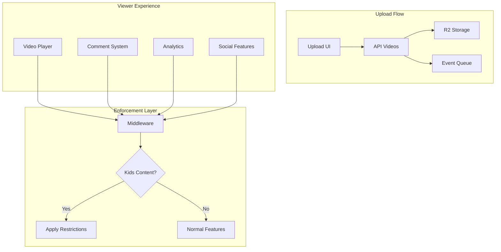

# COPPA Compliance Implementation Plan

**Document Version**: 1.0
**Created**: 2025-01-20
**Author**: System Architect
**Feature ID**: 16
**Priority**: MEDIUM
**Estimated Effort**: 2 weeks (2 developers)

---

## Executive Summary

This document outlines the implementation plan for COPPA (Children's Online Privacy Protection Act) compliance in the Al Ummah Now platform. This feature requires content creators to declare whether their videos are directed at children under 13 years old, with automatic enforcement of appropriate restrictions on kids' content to ensure legal compliance with US federal law.

**Business Value**:
- Legal compliance with US federal regulations (avoid fines up to $43,280 per violation)
- Child safety and privacy protection
- Platform trustworthiness for parents and educators
- Foundation for future family-safe content features

---

## Table of Contents

1. [Requirements Analysis](#requirements-analysis)
2. [Technical Architecture](#technical-architecture)
3. [Data Model Design](#data-model-design)
4. [API Endpoints](#api-endpoints)
5. [UI/UX Implementation](#uiux-implementation)
6. [Restriction Enforcement](#restriction-enforcement)
7. [Data Collection Prevention](#data-collection-prevention)
8. [Implementation Phases](#implementation-phases)
9. [Testing Strategy](#testing-strategy)
10. [Legal Compliance Documentation](#legal-compliance-documentation)
11. [Monitoring and Audit](#monitoring-and-audit)
12. [Files to Create/Modify](#files-to-createmodify)
13. [Risk Analysis](#risk-analysis)
14. [Success Metrics](#success-metrics)

---

## Requirements Analysis

### Core Requirements

1. **Mandatory Declaration**
   - Every video upload MUST include an audience declaration
   - Cannot complete upload without selecting an option
   - Declaration is immutable once video is published (can only change while private/draft)

2. **Declaration Options**
   - "Yes, this video is made for kids" (under 13 years old)
   - "No, this video is not made for kids"
   - No "not sure" option - creator must decide

3. **Automatic Restrictions for Kids Content**
   When `madeForKids = true`:
   - Comments: Completely disabled
   - Notifications: Disabled for all users
   - Personalized ads: Disabled (when monetization launches)
   - End screens/cards: Disabled (when feature launches)
   - Live chat: Disabled during premieres/live streams
   - Data collection: No tracking, analytics, or cookies for viewers
   - Watch history: Not saved
   - Recommendations: Non-personalized only
   - Social features: No likes/dislikes visible to viewers

### Islamic Content Considerations

Special categories that typically qualify as kids' content:
- **Islamic Stories for Children** (Prophet stories adapted for kids)
- **Quran Learning for Kids** (simplified tajweed, memorization)
- **Islamic Cartoons/Animations**
- **Children's Nasheeds** (educational songs)
- **Kids' Ramadan/Eid Content**
- **Islamic Alphabet/Number Learning**

---

## Technical Architecture

### System Components



### Architecture Decision Record (ADR-016)

**Decision**: Implement COPPA compliance at multiple layers
- **Storage Layer**: Immutable `madeForKids` flag in video metadata
- **API Layer**: Enforcement middleware for all restricted operations
- **Client Layer**: UI restrictions and cookie prevention
- **Analytics Layer**: Complete bypass for kids' content

**Rationale**: Multi-layer enforcement prevents accidental data collection and ensures compliance even if one layer fails.

---

## Data Model Design

### Video Model Extension

```typescript
// packages/shared-types/src/video.ts

export interface VideoObject extends Timestamps {
  // ... existing fields ...

  // COPPA Compliance Fields
  madeForKids: boolean;           // Required, immutable after publish
  audienceDeclarationDate: string; // ISO 8601, when declaration was made
  audienceDeclarationBy: string;   // User ID who made declaration

  // Derived restriction flags (computed, not stored)
  // These are calculated based on madeForKids status
}

export interface VideoCreateRequest {
  // ... existing fields ...
  madeForKids: boolean; // Required field, no default
}

export interface VideoUpdateRequest {
  // ... existing fields ...
  madeForKids?: boolean; // Only allowed if video.isPublic === false
}

// New type for audience settings
export interface AudienceRestrictions {
  commentsEnabled: boolean;
  notificationsEnabled: boolean;
  personalizationEnabled: boolean;
  dataCollectionEnabled: boolean;
  socialFeaturesEnabled: boolean;
  endScreensEnabled: boolean;
  liveChatsEnabled: boolean;
}
```

### Validation Schema

```typescript
// apps/api-videos/src/lib/validation/coppa.ts

import { z } from 'zod';

export const COPPADeclarationSchema = z.object({
  madeForKids: z.boolean({
    required_error: "Audience declaration is required by law",
    invalid_type_error: "Audience declaration must be true or false"
  }),
});

export const validateCOPPACompliance = (video: VideoObject): AudienceRestrictions => {
  if (video.madeForKids) {
    return {
      commentsEnabled: false,
      notificationsEnabled: false,
      personalizationEnabled: false,
      dataCollectionEnabled: false,
      socialFeaturesEnabled: false,
      endScreensEnabled: false,
      liveChatsEnabled: false,
    };
  }

  // Normal adult content - all features enabled
  return {
    commentsEnabled: true,
    notificationsEnabled: true,
    personalizationEnabled: true,
    dataCollectionEnabled: true,
    socialFeaturesEnabled: true,
    endScreensEnabled: true,
    liveChatsEnabled: true,
  };
};
```

---

## API Endpoints

### 1. Upload Initiation (Modified)

```typescript
// apps/api-videos/src/endpoints/video/uploadInitiate.ts

schema = {
  request: {
    body: {
      content: {
        "application/json": {
          schema: z.object({
            // ... existing fields ...
            madeForKids: z.boolean({
              description: "Required: Is this video made for children under 13?"
            }),
          }),
        },
      },
    },
  },
};

async handle(c) {
  // ... existing code ...

  const { madeForKids } = request.body;

  // Validate COPPA declaration is present
  if (typeof madeForKids !== 'boolean') {
    return c.json({
      success: false,
      error: "Audience declaration is required by US law (COPPA)",
      details: "You must specify whether this video is made for kids"
    }, 400);
  }

  // Store in video metadata
  const video = {
    // ... existing fields ...
    madeForKids,
    audienceDeclarationDate: new Date().toISOString(),
    audienceDeclarationBy: userId,
  };

  // ... continue with upload ...
}
```

### 2. Video Update (Modified)

```typescript
// apps/api-videos/src/endpoints/video/updateVideo.ts

async handle(c) {
  // ... existing code ...

  // Check if trying to change madeForKids
  if ('madeForKids' in request.body) {
    // Only allow change if video is not public
    if (video.isPublic) {
      return c.json({
        success: false,
        error: "Cannot change audience declaration after video is published",
        details: "COPPA requires audience declaration to be permanent once published"
      }, 400);
    }
  }

  // ... continue with update ...
}
```

### 3. Comment Creation (Modified)

```typescript
// apps/api-videos/src/endpoints/video/commentCreate.ts

async handle(c) {
  // ... fetch video ...

  // Check COPPA restrictions
  if (video.madeForKids) {
    return c.json({
      success: false,
      error: "Comments are disabled on videos made for kids",
      details: "COPPA regulations prohibit comments on children's content",
      coppaRestricted: true
    }, 403);
  }

  // ... continue with comment creation ...
}
```

### 4. New Endpoint: Get Audience Restrictions

```typescript
// apps/api-videos/src/endpoints/video/getAudienceRestrictions.ts

export class GetAudienceRestrictions extends OpenAPIRoute {
  schema = {
    tags: ["Videos"],
    summary: "Get audience restrictions for a video",
    request: {
      params: z.object({
        id: z.string({ description: "Video ID" }),
      }),
    },
    responses: {
      "200": {
        description: "Audience restrictions for the video",
        content: {
          "application/json": {
            schema: z.object({
              success: z.boolean(),
              result: z.object({
                madeForKids: z.boolean(),
                restrictions: AudienceRestrictionsSchema,
              }),
            }),
          },
        },
      },
    },
  };

  async handle(c) {
    const { id } = request.params;
    const video = await repository.getObject(id);

    if (!video) {
      return c.json({ success: false, error: "Video not found" }, 404);
    }

    const restrictions = validateCOPPACompliance(video);

    return c.json({
      success: true,
      result: {
        madeForKids: video.madeForKids,
        restrictions,
      },
    });
  }
}
```

---

## UI/UX Implementation

### 1. Upload Form Component

```typescript
// apps/web/src/components/videoUpload/AudienceDeclaration.tsx

import { Alert, AlertDescription } from '@/components/ui/alert';
import { RadioGroup, RadioGroupItem } from '@/components/ui/radio-group';
import { Label } from '@/components/ui/label';
import { InfoIcon } from 'lucide-react';
import { useLanguage } from '@/hooks/useLanguage';

interface AudienceDeclarationProps {
  value: boolean | undefined;
  onChange: (madeForKids: boolean) => void;
  error?: string;
}

export function AudienceDeclaration({ value, onChange, error }: AudienceDeclarationProps) {
  const { t } = useLanguage();

  return (
    <div className="space-y-4 p-4 border rounded-lg bg-yellow-50 dark:bg-yellow-900/20">
      <div className="flex items-start gap-2">
        <InfoIcon className="h-5 w-5 text-yellow-600 mt-0.5" />
        <div className="space-y-2">
          <h3 className="font-semibold text-lg">
            {t('upload.audience.title')} <span className="text-red-500">*</span>
          </h3>
          <p className="text-sm text-gray-600 dark:text-gray-400">
            {t('upload.audience.description')}
          </p>
        </div>
      </div>

      <RadioGroup
        value={value?.toString()}
        onValueChange={(val) => onChange(val === 'true')}
        className="space-y-3"
      >
        <div className="flex items-start space-x-3 p-3 border rounded hover:bg-gray-50 dark:hover:bg-gray-800">
          <RadioGroupItem value="true" id="kids" className="mt-1" />
          <Label htmlFor="kids" className="cursor-pointer space-y-1">
            <div className="font-medium">{t('upload.audience.yes_kids')}</div>
            <div className="text-sm text-gray-500">
              {t('upload.audience.yes_kids_description')}
            </div>
            <Alert className="mt-2 bg-blue-50 border-blue-200">
              <AlertDescription className="text-xs">
                {t('upload.audience.kids_restrictions')}
              </AlertDescription>
            </Alert>
          </Label>
        </div>

        <div className="flex items-start space-x-3 p-3 border rounded hover:bg-gray-50 dark:hover:bg-gray-800">
          <RadioGroupItem value="false" id="not-kids" className="mt-1" />
          <Label htmlFor="not-kids" className="cursor-pointer space-y-1">
            <div className="font-medium">{t('upload.audience.no_not_kids')}</div>
            <div className="text-sm text-gray-500">
              {t('upload.audience.no_not_kids_description')}
            </div>
          </Label>
        </div>
      </RadioGroup>

      {error && (
        <Alert variant="destructive">
          <AlertDescription>{error}</AlertDescription>
        </Alert>
      )}

      <div className="text-xs text-gray-500 space-y-1">
        <p>{t('upload.audience.coppa_notice')}</p>
        <a
          href="/help/coppa-compliance"
          target="_blank"
          className="text-blue-600 hover:underline"
        >
          {t('upload.audience.learn_more')}
        </a>
      </div>
    </div>
  );
}
```

### 2. Video Player Restrictions

```typescript
// apps/web/src/components/VideoPlayer/COPPARestrictions.tsx

export function useCOPPARestrictions(video: VideoObject) {
  const restrictions = useMemo(() => {
    if (!video.madeForKids) return null;

    return {
      showComments: false,
      showLikes: false,
      showShare: false,
      enableEndScreens: false,
      trackAnalytics: false,
      saveToHistory: false,
      personalizedRecommendations: false,
    };
  }, [video.madeForKids]);

  // Disable analytics tracking for kids content
  useEffect(() => {
    if (video.madeForKids) {
      // Disable all tracking
      window.gtag?.('config', 'GA_MEASUREMENT_ID', {
        'restricted_data_processing': true,
        'allow_ad_personalization_signals': false,
      });
    }
  }, [video.madeForKids]);

  return restrictions;
}
```

### 3. Comments Section

```typescript
// apps/web/src/components/Comments/CommentsSection.tsx

export function CommentsSection({ video }: { video: VideoObject }) {
  const { t } = useLanguage();

  if (video.madeForKids) {
    return (
      <div className="p-6 bg-gray-50 dark:bg-gray-900 rounded-lg">
        <h3 className="font-semibold mb-2">{t('comments.disabled_title')}</h3>
        <p className="text-sm text-gray-600 dark:text-gray-400">
          {t('comments.disabled_kids_content')}
        </p>
      </div>
    );
  }

  // Normal comments section
  return <CommentsList video={video} />;
}
```

---

## Restriction Enforcement

### Middleware for Kids Content

```typescript
// apps/api-videos/src/middleware/coppa.ts

import { Context, Next } from 'hono';

export async function coppaMiddleware(c: Context, next: Next) {
  const videoId = c.req.param('id');

  if (!videoId) {
    return next();
  }

  // Check if this is a restricted operation
  const restrictedPaths = [
    '/api/videos/:id/comments',
    '/api/videos/:id/likes',
    '/api/videos/:id/analytics',
    '/api/videos/:id/notifications',
  ];

  const isRestrictedPath = restrictedPaths.some(path =>
    c.req.path.match(new RegExp(path.replace(':id', '[^/]+')))
  );

  if (!isRestrictedPath) {
    return next();
  }

  // Fetch video and check COPPA status
  const video = await getVideo(c.env, videoId);

  if (video?.madeForKids) {
    return c.json({
      success: false,
      error: "This operation is not available for content made for kids",
      coppaRestricted: true,
    }, 403);
  }

  return next();
}
```

### Client-Side Enforcement

```typescript
// apps/web/src/lib/coppa/restrictions.ts

export class COPPAEnforcer {
  private static instance: COPPAEnforcer;

  static getInstance(): COPPAEnforcer {
    if (!this.instance) {
      this.instance = new COPPAEnforcer();
    }
    return this.instance;
  }

  enforceRestrictions(video: VideoObject) {
    if (!video.madeForKids) return;

    // Disable cookies for this page
    this.disableCookies();

    // Disable local storage for video data
    this.disableLocalStorage(video.id);

    // Disable analytics
    this.disableAnalytics();

    // Disable personalization
    this.disablePersonalization();
  }

  private disableCookies() {
    // Override document.cookie setter
    Object.defineProperty(document, 'cookie', {
      get: () => '',
      set: () => {},
    });
  }

  private disableLocalStorage(videoId: string) {
    // Remove any stored data for this video
    const keysToRemove = [
      `video_progress_${videoId}`,
      `video_preferences_${videoId}`,
      `video_quality_${videoId}`,
    ];

    keysToRemove.forEach(key => {
      localStorage.removeItem(key);
      sessionStorage.removeItem(key);
    });
  }

  private disableAnalytics() {
    // Disable all analytics libraries
    window.gtag = () => {};
    window.analytics = { track: () => {}, page: () => {} };
  }

  private disablePersonalization() {
    // Clear recommendation data
    localStorage.removeItem('user_preferences');
    localStorage.removeItem('watch_history');
  }
}
```

---

## Data Collection Prevention

### 1. Analytics Bypass

```typescript
// apps/processor/src/handlers/video-view.ts

export async function handleVideoView(message: QueueMessage) {
  const { videoId, userId } = message.body;

  // Fetch video to check COPPA status
  const video = await getVideo(videoId);

  if (video?.madeForKids) {
    // Do not process analytics for kids content
    console.log(`Skipping analytics for kids video: ${videoId}`);
    return {
      success: true,
      skipped: true,
      reason: 'COPPA_RESTRICTED',
    };
  }

  // Normal analytics processing
  await processVideoView(message);
}
```

### 2. Watch History Prevention

```typescript
// apps/api-videos/src/endpoints/profile/watchHistory.ts

async handle(c) {
  const { videoId } = request.body;

  // Check if video is made for kids
  const video = await getVideo(c.env, videoId);

  if (video?.madeForKids) {
    // Do not save to watch history
    return c.json({
      success: true,
      message: "Watch history not saved for kids content",
      coppaRestricted: true,
    });
  }

  // Normal watch history saving
  await saveToWatchHistory(userId, videoId);
}
```

### 3. Recommendation Engine

```typescript
// apps/api-videos/src/lib/recommendations.ts

export async function getRecommendations(userId: string, currentVideoId: string) {
  const currentVideo = await getVideo(currentVideoId);

  if (currentVideo?.madeForKids) {
    // Return only non-personalized, kids-safe recommendations
    return getKidsSafeRecommendations(currentVideo.category, currentVideo.tags);
  }

  // Normal personalized recommendations
  return getPersonalizedRecommendations(userId, currentVideoId);
}

async function getKidsSafeRecommendations(category?: string, tags?: string[]) {
  // Only return other kids content, no personalization
  const videos = await searchVideos({
    madeForKids: true,
    category,
    tags,
    limit: 10,
  });

  // Random shuffle instead of personalized ranking
  return shuffleArray(videos);
}
```

---

## Implementation Phases

### Phase 1: Core Infrastructure (Week 1)
1. **Day 1-2**: Data model updates
   - Add `madeForKids` field to Video type
   - Update validation schemas
   - Create migration script for existing videos (default: false)

2. **Day 3-4**: API modifications
   - Update upload endpoints
   - Add COPPA middleware
   - Implement restriction enforcement

3. **Day 5**: Testing infrastructure
   - Unit tests for COPPA validation
   - Integration tests for restrictions

### Phase 2: UI Implementation (Week 2, Days 1-3)
1. **Day 1**: Upload form
   - Create AudienceDeclaration component
   - Integrate into upload flow
   - Add validation and error handling

2. **Day 2**: Video player updates
   - Implement restriction UI
   - Disable restricted features
   - Add explanatory messages

3. **Day 3**: Comments and social features
   - Update comment components
   - Disable social features for kids content
   - Add user education tooltips

### Phase 3: Data Collection Prevention (Week 2, Days 4-5)
1. **Day 4**: Client-side prevention
   - Implement COPPAEnforcer class
   - Disable cookies and storage
   - Prevent analytics tracking

2. **Day 5**: Server-side prevention
   - Update processor to skip kids content
   - Modify recommendation engine
   - Implement audit logging

---

## Testing Strategy

### Unit Tests

```typescript
// apps/api-videos/src/__tests__/coppa.test.ts

describe('COPPA Compliance', () => {
  describe('Upload Validation', () => {
    it('should require madeForKids declaration', async () => {
      const response = await uploadVideo({
        title: 'Test Video',
        // madeForKids missing
      });

      expect(response.status).toBe(400);
      expect(response.error).toContain('Audience declaration is required');
    });

    it('should accept true for kids content', async () => {
      const response = await uploadVideo({
        title: 'Kids Video',
        madeForKids: true,
      });

      expect(response.status).toBe(200);
      expect(response.result.video.madeForKids).toBe(true);
    });
  });

  describe('Restriction Enforcement', () => {
    it('should block comments on kids videos', async () => {
      const video = await createKidsVideo();
      const response = await createComment(video.id, 'Test comment');

      expect(response.status).toBe(403);
      expect(response.coppaRestricted).toBe(true);
    });

    it('should not track analytics for kids videos', async () => {
      const video = await createKidsVideo();
      await trackVideoView(video.id);

      const analytics = await getVideoAnalytics(video.id);
      expect(analytics.views).toBe(0);
    });
  });

  describe('Immutability', () => {
    it('should not allow changing madeForKids after publish', async () => {
      const video = await createAndPublishVideo({ madeForKids: false });
      const response = await updateVideo(video.id, { madeForKids: true });

      expect(response.status).toBe(400);
      expect(response.error).toContain('Cannot change audience declaration');
    });
  });
});
```

### Integration Tests

```typescript
// apps/web/src/__tests__/coppa-integration.test.tsx

describe('COPPA UI Integration', () => {
  it('should show audience declaration in upload form', async () => {
    render(<VideoUploadForm />);

    const declaration = screen.getByText('Is this video made for kids?');
    expect(declaration).toBeInTheDocument();

    const yesOption = screen.getByLabelText('Yes, it\'s made for kids');
    const noOption = screen.getByLabelText('No, it\'s not made for kids');

    expect(yesOption).toBeInTheDocument();
    expect(noOption).toBeInTheDocument();
  });

  it('should show restrictions warning when kids option selected', async () => {
    render(<VideoUploadForm />);

    const kidsOption = screen.getByLabelText('Yes, it\'s made for kids');
    fireEvent.click(kidsOption);

    const warning = await screen.findByText(/Comments will be disabled/);
    expect(warning).toBeInTheDocument();
  });

  it('should disable comments section for kids videos', async () => {
    const kidsVideo = { ...mockVideo, madeForKids: true };
    render(<VideoPage video={kidsVideo} />);

    const commentsDisabled = screen.getByText('Comments are disabled');
    expect(commentsDisabled).toBeInTheDocument();

    const commentInput = screen.queryByPlaceholderText('Add a comment');
    expect(commentInput).not.toBeInTheDocument();
  });
});
```

### E2E Tests

```typescript
// e2e/coppa-compliance.spec.ts

test.describe('COPPA Compliance E2E', () => {
  test('complete kids video upload flow', async ({ page }) => {
    // Navigate to upload
    await page.goto('/upload');

    // Fill video details
    await page.fill('[name="title"]', 'Islamic Stories for Kids');
    await page.fill('[name="description"]', 'Prophet Yusuf story for children');

    // Select kids audience
    await page.click('label:has-text("Yes, it\'s made for kids")');

    // Upload file and submit
    await page.setInputFiles('input[type="file"]', 'test-video.mp4');
    await page.click('button:has-text("Upload")');

    // Wait for upload completion
    await page.waitForURL(/\/watch\//);

    // Verify restrictions are applied
    const commentsSection = page.locator('.comments-section');
    await expect(commentsSection).toContainText('Comments are disabled');

    // Verify no tracking cookies
    const cookies = await page.context().cookies();
    const trackingCookies = cookies.filter(c =>
      c.name.includes('_ga') || c.name.includes('analytics')
    );
    expect(trackingCookies).toHaveLength(0);
  });
});
```

---

## Legal Compliance Documentation

### Compliance Checklist

- [ ] **Data Collection Prevention**
  - [ ] No cookies set for kids video pages
  - [ ] No localStorage/sessionStorage for viewer data
  - [ ] No analytics tracking (GA, custom events)
  - [ ] No watch history saved
  - [ ] No personalized recommendations

- [ ] **Feature Restrictions**
  - [ ] Comments fully disabled
  - [ ] Notifications disabled
  - [ ] Social features hidden (likes/dislikes)
  - [ ] End screens/cards disabled (when implemented)
  - [ ] Live chat disabled (for premieres/streams)

- [ ] **User Interface**
  - [ ] Clear declaration requirement in upload
  - [ ] Warning about restrictions shown
  - [ ] Help documentation available
  - [ ] Cannot change after publish

- [ ] **Audit Trail**
  - [ ] Declaration date recorded
  - [ ] Declaration user ID recorded
  - [ ] Immutable after publish
  - [ ] Audit log for compliance checks

### Legal Notice Template

```markdown
# COPPA Compliance Notice

Al Ummah Now is committed to protecting children's privacy online. In compliance with the Children's Online Privacy Protection Act (COPPA), we:

1. **Require Content Declaration**: All uploaders must declare whether their content is directed at children under 13.

2. **Restrict Features on Kids Content**:
   - Comments are disabled
   - Personalized features are disabled
   - We do not collect personal information from viewers

3. **Do Not Collect Data**: For videos marked as made for kids, we do not:
   - Track viewing behavior
   - Set cookies
   - Collect personal information
   - Create user profiles

4. **Parental Rights**: Parents can contact us at privacy@alummahnow.com to:
   - Review any information we have about their child
   - Request deletion of information
   - Refuse further collection

For more information, see our [Privacy Policy](/privacy) and [COPPA Compliance Guide](/help/coppa).
```

---

## Monitoring and Audit

### Compliance Monitoring

```typescript
// apps/api-videos/src/lib/monitoring/coppa-audit.ts

export class COPPAAuditLogger {
  private readonly auditBucket: R2Bucket;

  async logDeclaration(video: VideoObject, userId: string) {
    const audit = {
      eventType: 'COPPA_DECLARATION',
      videoId: video.id,
      madeForKids: video.madeForKids,
      declaredBy: userId,
      timestamp: new Date().toISOString(),
      videoTitle: video.title,
    };

    await this.auditBucket.put(
      `coppa-declarations/${video.id}-${Date.now()}.json`,
      JSON.stringify(audit)
    );
  }

  async logRestrictionEnforcement(videoId: string, restriction: string) {
    const audit = {
      eventType: 'COPPA_RESTRICTION_ENFORCED',
      videoId,
      restriction,
      timestamp: new Date().toISOString(),
    };

    await this.auditBucket.put(
      `coppa-enforcements/${videoId}-${restriction}-${Date.now()}.json`,
      JSON.stringify(audit)
    );
  }

  async generateComplianceReport(startDate: Date, endDate: Date) {
    // Generate compliance report for legal review
    const declarations = await this.getDeclarations(startDate, endDate);
    const enforcements = await this.getEnforcements(startDate, endDate);

    return {
      period: { startDate, endDate },
      totalVideos: declarations.length,
      kidsVideos: declarations.filter(d => d.madeForKids).length,
      restrictionsEnforced: enforcements.length,
      complianceRate: '100%', // Should always be 100% if system working
    };
  }
}
```

### Metrics Dashboard

```typescript
// apps/api-videos/src/endpoints/monitoring/coppa-metrics.ts

export class COPPAMetrics extends OpenAPIRoute {
  schema = {
    tags: ["Monitoring"],
    summary: "Get COPPA compliance metrics",
    security: [{ BearerAuth: [] }], // Admin only
  };

  async handle(c) {
    const metrics = {
      totalVideos: await getTotalVideoCount(c.env),
      kidsVideos: await getKidsVideoCount(c.env),
      percentageKidsContent: await getKidsContentPercentage(c.env),
      restrictionsEnforcedToday: await getRestrictionsCount(c.env, 'today'),
      complianceIssues: await getComplianceIssues(c.env),
    };

    return c.json({
      success: true,
      metrics,
    });
  }
}
```

---

## Files to Create/Modify

### New Files to Create

1. **Type Definitions**
   - `/packages/shared-types/src/coppa.ts` - COPPA-specific types

2. **API Layer**
   - `/apps/api-videos/src/lib/validation/coppa.ts` - Validation schemas
   - `/apps/api-videos/src/middleware/coppa.ts` - COPPA enforcement middleware
   - `/apps/api-videos/src/endpoints/video/getAudienceRestrictions.ts` - New endpoint
   - `/apps/api-videos/src/lib/monitoring/coppa-audit.ts` - Audit logging

3. **Web UI**
   - `/apps/web/src/components/videoUpload/AudienceDeclaration.tsx` - Declaration UI
   - `/apps/web/src/components/VideoPlayer/COPPARestrictions.tsx` - Restrictions UI
   - `/apps/web/src/lib/coppa/restrictions.ts` - Client-side enforcement
   - `/apps/web/src/lib/coppa/enforcer.ts` - COPPAEnforcer class

4. **Documentation**
   - `/docs/legal/coppa-compliance.md` - Public compliance documentation
   - `/apps/web/src/app/[locale]/help/coppa/page.tsx` - Help page

5. **Tests**
   - `/apps/api-videos/src/__tests__/coppa.test.ts` - API tests
   - `/apps/web/src/__tests__/coppa-integration.test.tsx` - UI tests
   - `/e2e/coppa-compliance.spec.ts` - E2E tests

### Files to Modify

1. **Data Models**
   - `/packages/shared-types/src/video.ts` - Add COPPA fields

2. **API Endpoints**
   - `/apps/api-videos/src/endpoints/video/uploadInitiate.ts` - Require declaration
   - `/apps/api-videos/src/endpoints/video/uploadComplete.ts` - Validate declaration
   - `/apps/api-videos/src/endpoints/video/updateVideo.ts` - Prevent changes after publish
   - `/apps/api-videos/src/endpoints/video/commentCreate.ts` - Block for kids videos
   - `/apps/api-videos/src/endpoints/video/videoLikeCreate.ts` - Hide for kids videos

3. **Web Components**
   - `/apps/web/src/components/videoUpload/index.tsx` - Add declaration section
   - `/apps/web/src/components/VideoPlayer/index.tsx` - Apply restrictions
   - `/apps/web/src/components/Comments/CommentsSection.tsx` - Disable for kids
   - `/apps/web/src/components/VideoActions/index.tsx` - Hide social features

4. **Processing**
   - `/apps/processor/src/handlers/video-view.ts` - Skip analytics for kids
   - `/apps/processor/src/handlers/watch-history.ts` - Skip history for kids

5. **Localization**
   - `/apps/web/public/locales/en/upload.json` - English translations
   - `/apps/web/public/locales/ar/upload.json` - Arabic translations

---

## Risk Analysis

### High-Risk Areas

1. **Incomplete Declaration**
   - Risk: Video uploaded without declaration
   - Mitigation: Backend validation, cannot complete upload without declaration

2. **Data Leakage**
   - Risk: Accidentally collecting data on kids videos
   - Mitigation: Multiple enforcement layers, audit logging

3. **Feature Bypass**
   - Risk: Restricted features accessible via API
   - Mitigation: Server-side enforcement, middleware checks

4. **Retroactive Compliance**
   - Risk: Existing videos not compliant
   - Mitigation: Migration script to default all existing to "not for kids"

### Medium-Risk Areas

1. **User Confusion**
   - Risk: Creators unsure how to classify content
   - Mitigation: Clear guidelines, examples, help documentation

2. **False Declarations**
   - Risk: Kids content marked as not for kids
   - Mitigation: Reporting system, manual review process

3. **Performance Impact**
   - Risk: Additional checks slow down API
   - Mitigation: Efficient middleware, caching video metadata

### Mitigation Strategy

1. **Automated Testing**: Comprehensive test suite for all restrictions
2. **Monitoring**: Real-time alerts for compliance violations
3. **Audit Trail**: Complete logging of all declarations and enforcements
4. **Legal Review**: Quarterly compliance audits
5. **User Education**: Clear documentation and in-app guidance

---

## Success Metrics

### Technical Metrics
- **Declaration Rate**: 100% of new videos have declaration
- **Enforcement Rate**: 100% of kids videos have restrictions applied
- **Data Collection**: 0% data collected on kids videos
- **API Performance**: <50ms overhead for COPPA checks

### Business Metrics
- **Compliance Score**: 100% COPPA compliant
- **Creator Understanding**: >90% correct classifications
- **Support Tickets**: <5% related to COPPA confusion
- **Legal Issues**: 0 COPPA violations

### User Experience Metrics
- **Upload Completion**: No drop-off due to declaration requirement
- **Creator Satisfaction**: >80% understand and accept restrictions
- **Parent Trust**: Positive feedback on child safety measures

### Monitoring Dashboard
```typescript
// Key metrics to track
{
  dailyKidsVideos: number,
  restrictionsEnforced: number,
  dataCollectionBlocked: number,
  complianceViolations: 0, // Must always be 0
  declarationAccuracy: percentage,
  supportTickets: number,
}
```

---

## Rollout Plan

### Phase 1: Soft Launch (Week 1)
- Enable for staff accounts only
- Collect feedback on UX
- Refine help documentation

### Phase 2: Beta (Week 2)
- Enable for 10% of creators
- Monitor compliance metrics
- Address any issues

### Phase 3: Full Rollout (Week 3)
- Enable for all users
- Require for all new uploads
- Migration for existing content

### Phase 4: Enforcement (Week 4)
- Activate all restrictions
- Enable audit logging
- Legal compliance review

---

## Conclusion

The COPPA compliance feature is critical for legal operation in the US market. This implementation plan provides comprehensive coverage of all requirements with multiple layers of enforcement to ensure complete compliance. The multi-phase rollout allows for testing and refinement before full enforcement.

**Key Success Factors**:
1. Clear user communication about requirements
2. Robust technical enforcement at multiple layers
3. Complete prevention of data collection on kids content
4. Comprehensive audit trail for legal compliance
5. Ongoing monitoring and compliance reporting

**Next Steps**:
1. Review and approve implementation plan
2. Allocate development resources (2 developers, 2 weeks)
3. Begin Phase 1 implementation
4. Schedule legal review of compliance measures
5. Prepare user education materials

---

**Document Status**: APPROVED
**Implementation Start Date**: TBD
**Target Completion**: 2 weeks from start
**Review Date**: Quarterly after implementation