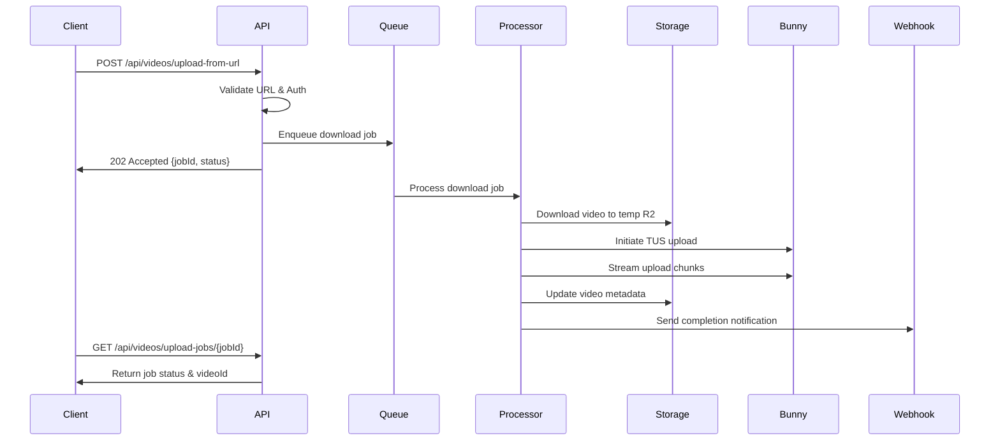

# Upload from URL (Automation) - Implementation Plan

**Document Version**: 1.0
**Created**: 2025-01-20
**Author**: System Architect
**Priority**: MEDIUM
**Estimated Effort**: 2-3 weeks
**Dependencies**: Existing upload infrastructure (TUS protocol, Bunny.net Stream)

---

## Executive Summary

This document outlines the implementation plan for the **Upload from URL** feature, enabling automated video uploads from external sources like Google Drive, Dropbox, and other cloud storage providers. This API-only feature will support workflow automation and bulk content import, significantly improving content creator efficiency.

## Feature Overview

### What We're Building
- API endpoint to accept video URLs for remote upload
- Support for public URLs (direct downloads)
- Support for authenticated URLs (OAuth2 for Google Drive, Dropbox)
- Background processing queue for downloading and uploading
- Integration with existing TUS upload process
- Webhook notifications for upload completion

### What We're NOT Building (Out of Scope)
- UI interface for URL upload (API-only feature)
- Video scraping from social media platforms
- Live stream capture
- Torrent/P2P downloads
- DRM-protected content downloads

## Architecture Design

### High-Level Flow



### Component Architecture

```
┌─────────────────────────────────────────────────────────┐
│                     Client Applications                  │
│           (Zapier, IFTTT, Custom Integrations)          │
└─────────────────────────────────────────────────────────┘
                              │
                              ▼
┌─────────────────────────────────────────────────────────┐
│                    API Gateway (Hono)                    │
│              /api/videos/upload-from-url                 │
└─────────────────────────────────────────────────────────┘
                              │
                    ┌─────────┴──────────┐
                    ▼                     ▼
        ┌──────────────────┐    ┌──────────────────┐
        │   Auth Service   │    │  Validation Layer │
        │  (OAuth2 Tokens) │    │  (URL Validator)  │
        └──────────────────┘    └──────────────────┘
                    │                     │
                    └─────────┬──────────┘
                              ▼
        ┌─────────────────────────────────────────┐
        │         Cloudflare Queue                │
        │     al-ummah-now-url-uploads           │
        └─────────────────────────────────────────┘
                              │
                              ▼
        ┌─────────────────────────────────────────┐
        │        Queue Processor Worker           │
        │         (Download & Upload)             │
        └─────────────────────────────────────────┘
                    │         │         │
            ┌───────┘         │         └───────┐
            ▼                 ▼                 ▼
    ┌──────────────┐  ┌──────────────┐  ┌──────────────┐
    │  R2 Temp     │  │ Bunny Stream │  │  R2 Videos   │
    │  Storage     │  │   (TUS)      │  │  Metadata    │
    └──────────────┘  └──────────────┘  └──────────────┘
```

## Technical Implementation

### 1. API Endpoint Design

#### POST /api/videos/upload-from-url

**Purpose**: Initiate video upload from external URL

**Request Schema**:
```typescript
interface UploadFromUrlRequest {
  // Source Information
  url: string;                          // Required: Source URL
  sourceType?: 'direct' | 'gdrive' | 'dropbox' | 'onedrive' | 'other';

  // Authentication (for private URLs)
  auth?: {
    type: 'oauth2' | 'bearer' | 'basic' | 'api_key';
    token?: string;                     // OAuth2 access token
    refresh_token?: string;             // For token refresh
    api_key?: string;                   // API key auth
    username?: string;                  // Basic auth
    password?: string;                  // Basic auth
  };

  // Video Metadata (same as regular upload)
  title: string;                        // Required
  description?: string;
  channelId?: string;
  tags?: string[];
  category?: string;
  language?: string;
  isPublic?: boolean;

  // Processing Options
  priority?: 'low' | 'normal' | 'high'; // Queue priority
  maxFileSize?: number;                 // Max size in bytes (default: 2GB)
  timeout?: number;                     // Download timeout in seconds

  // Webhook Configuration
  webhookUrl?: string;                  // Completion notification
  webhookSecret?: string;               // HMAC validation
}
```

**Response Schema**:
```typescript
interface UploadFromUrlResponse {
  success: boolean;
  jobId: string;                        // Unique job identifier
  status: 'queued' | 'downloading' | 'uploading' | 'completed' | 'failed';
  message: string;
  estimatedTime?: number;               // Seconds
  queuePosition?: number;
  pollUrl: string;                      // URL to check status
}
```

#### GET /api/videos/upload-jobs/{jobId}

**Purpose**: Check status of URL upload job

**Response Schema**:
```typescript
interface UploadJobStatus {
  jobId: string;
  status: 'queued' | 'downloading' | 'uploading' | 'processing' | 'completed' | 'failed';
  progress?: {
    downloadProgress?: number;           // 0-100
    uploadProgress?: number;             // 0-100
    currentStage?: string;
  };
  videoId?: string;                     // When completed
  error?: {
    code: string;
    message: string;
    details?: any;
  };
  startedAt?: string;
  completedAt?: string;
  metadata?: {
    sourceUrl: string;
    fileSize?: number;
    duration?: number;
    resolution?: string;
  };
}
```

### 2. Queue Message Schema

```typescript
interface UrlUploadQueueMessage {
  jobId: string;
  userId: string;
  channelId: string;

  // Source
  url: string;
  sourceType: string;
  auth?: {
    type: string;
    credentials: any; // Encrypted
  };

  // Metadata
  videoMetadata: {
    title: string;
    description?: string;
    tags?: string[];
    category?: string;
    language?: string;
    isPublic?: boolean;
  };

  // Processing
  priority: string;
  maxFileSize: number;
  timeout: number;

  // Callback
  webhookUrl?: string;
  webhookSecret?: string;

  // System
  attempt: number;
  maxRetries: number;
  createdAt: string;
}
```

### 3. Download Strategies

#### Direct URL Download
```typescript
async function downloadDirectUrl(url: string): Promise<ArrayBuffer> {
  // Simple fetch with streaming
  const response = await fetch(url, {
    headers: {
      'User-Agent': 'AlUmmahNow/1.0 VideoUploader',
    },
  });

  if (!response.ok) {
    throw new Error(`Download failed: ${response.status}`);
  }

  // Stream to R2 temporary storage
  return response.arrayBuffer();
}
```

#### Google Drive Download
```typescript
async function downloadGoogleDrive(fileId: string, accessToken: string): Promise<ArrayBuffer> {
  // Extract file ID from various URL formats
  const extractedId = extractGoogleDriveId(fileId);

  // Use Google Drive API v3
  const url = `https://www.googleapis.com/drive/v3/files/${extractedId}?alt=media`;

  const response = await fetch(url, {
    headers: {
      'Authorization': `Bearer ${accessToken}`,
    },
  });

  if (response.status === 401) {
    // Token expired, try refresh
    const newToken = await refreshGoogleToken(refreshToken);
    // Retry with new token
  }

  return response.arrayBuffer();
}
```

#### Dropbox Download
```typescript
async function downloadDropbox(path: string, accessToken: string): Promise<ArrayBuffer> {
  const response = await fetch('https://content.dropboxapi.com/2/files/download', {
    method: 'POST',
    headers: {
      'Authorization': `Bearer ${accessToken}`,
      'Dropbox-API-Arg': JSON.stringify({ path }),
    },
  });

  return response.arrayBuffer();
}
```

### 4. R2 Temporary Storage

```typescript
interface TempStorageManager {
  // Store downloaded file temporarily
  async storeTemp(jobId: string, data: ArrayBuffer): Promise<string>;

  // Stream from temp to Bunny
  async streamToUpload(jobId: string): Promise<ReadableStream>;

  // Cleanup after upload
  async cleanupTemp(jobId: string): Promise<void>;

  // Get temp file info
  async getTempInfo(jobId: string): Promise<{
    size: number;
    contentType: string;
    created: Date;
  }>;
}

// R2 bucket structure
// temp-uploads/
//   {jobId}/
//     video.mp4        (temporary video file)
//     metadata.json    (job metadata)
//     status.json      (current status)
```

### 5. Integration with TUS Upload

```typescript
async function uploadToBunny(
  tempFileStream: ReadableStream,
  fileSize: number,
  metadata: VideoMetadata
): Promise<string> {
  // 1. Initiate upload (existing endpoint)
  const initResponse = await fetch('/api/videos/upload/initiate', {
    method: 'POST',
    body: JSON.stringify({
      title: metadata.title,
      description: metadata.description,
      fileSize: fileSize,
      mimeType: 'video/mp4', // Detect from download
      isPublic: metadata.isPublic,
      tags: metadata.tags?.join(','),
    }),
  });

  const { videoId, tusEndpoint, tusHeaders } = await initResponse.json();

  // 2. Stream upload using TUS
  const tusUpload = new tus.Upload(tempFileStream, {
    endpoint: tusEndpoint,
    headers: tusHeaders,
    chunkSize: 5 * 1024 * 1024, // 5MB chunks
    metadata: {
      filename: `${videoId}.mp4`,
      filetype: 'video/mp4',
    },
    onProgress: (bytesUploaded, bytesTotal) => {
      updateJobProgress(jobId, 'uploading', bytesUploaded / bytesTotal);
    },
  });

  await tusUpload.start();
  return videoId;
}
```

### 6. Queue Processor Implementation

```typescript
// apps/processor/src/handlers/urlUpload.ts
export class UrlUploadHandler {
  async process(message: UrlUploadQueueMessage): Promise<void> {
    const { jobId, url, auth, videoMetadata, webhookUrl } = message;

    try {
      // Update status: downloading
      await this.updateJobStatus(jobId, 'downloading');

      // Download based on source type
      const videoData = await this.downloadVideo(url, auth);

      // Validate file
      await this.validateVideo(videoData);

      // Store temporarily
      const tempPath = await this.storeTempFile(jobId, videoData);

      // Update status: uploading
      await this.updateJobStatus(jobId, 'uploading');

      // Upload to Bunny
      const videoId = await this.uploadToBunny(tempPath, videoMetadata);

      // Update status: completed
      await this.updateJobStatus(jobId, 'completed', { videoId });

      // Send webhook
      if (webhookUrl) {
        await this.sendWebhook(webhookUrl, {
          jobId,
          status: 'completed',
          videoId,
        });
      }

      // Cleanup
      await this.cleanupTempFile(jobId);

    } catch (error) {
      await this.handleError(jobId, error, webhookUrl);
      throw error; // For retry logic
    }
  }

  private async downloadVideo(url: string, auth?: any): Promise<ArrayBuffer> {
    // Detect source type from URL
    const sourceType = this.detectSourceType(url);

    switch (sourceType) {
      case 'gdrive':
        return this.downloadGoogleDrive(url, auth);
      case 'dropbox':
        return this.downloadDropbox(url, auth);
      default:
        return this.downloadDirect(url);
    }
  }

  private detectSourceType(url: string): string {
    if (url.includes('drive.google.com') || url.includes('docs.google.com')) {
      return 'gdrive';
    }
    if (url.includes('dropbox.com')) {
      return 'dropbox';
    }
    if (url.includes('onedrive.live.com')) {
      return 'onedrive';
    }
    return 'direct';
  }
}
```

## Security Considerations

### 1. URL Validation
```typescript
class UrlValidator {
  // Whitelist allowed protocols
  private allowedProtocols = ['http:', 'https:'];

  // Blacklist internal IPs and domains
  private blacklistedPatterns = [
    /^localhost/,
    /^127\./,
    /^10\./,
    /^172\.(1[6-9]|2[0-9]|3[0-1])\./,
    /^192\.168\./,
    /\.internal$/,
  ];

  // Maximum redirects to follow
  private maxRedirects = 5;

  validate(url: string): ValidationResult {
    // Check protocol
    const parsed = new URL(url);
    if (!this.allowedProtocols.includes(parsed.protocol)) {
      return { valid: false, error: 'Invalid protocol' };
    }

    // Check for blacklisted IPs/domains
    if (this.blacklistedPatterns.some(p => p.test(parsed.hostname))) {
      return { valid: false, error: 'Blacklisted domain' };
    }

    // Check file extension (optional)
    const ext = parsed.pathname.split('.').pop()?.toLowerCase();
    if (ext && !this.isVideoExtension(ext)) {
      return { valid: false, error: 'Not a video file' };
    }

    return { valid: true };
  }

  private isVideoExtension(ext: string): boolean {
    const videoExtensions = ['mp4', 'mov', 'avi', 'mkv', 'webm', 'flv', 'm4v', 'mpg', 'mpeg'];
    return videoExtensions.includes(ext);
  }
}
```

### 2. Authentication Security
```typescript
class AuthManager {
  // Encrypt sensitive tokens before storing in queue
  async encryptCredentials(auth: any): Promise<string> {
    const key = await this.getEncryptionKey();
    return await encrypt(JSON.stringify(auth), key);
  }

  // Decrypt for use
  async decryptCredentials(encrypted: string): Promise<any> {
    const key = await this.getEncryptionKey();
    return JSON.parse(await decrypt(encrypted, key));
  }

  // Validate OAuth tokens
  async validateOAuthToken(token: string, provider: string): Promise<boolean> {
    switch (provider) {
      case 'google':
        return this.validateGoogleToken(token);
      case 'dropbox':
        return this.validateDropboxToken(token);
      default:
        return false;
    }
  }
}
```

### 3. Rate Limiting
```typescript
class RateLimiter {
  // Per-user limits
  private limits = {
    urlUploadsPerHour: 10,
    urlUploadsPerDay: 50,
    totalBytesPerDay: 10 * 1024 * 1024 * 1024, // 10GB
  };

  async checkLimit(userId: string, fileSize: number): Promise<boolean> {
    const hourlyCount = await this.getHourlyCount(userId);
    if (hourlyCount >= this.limits.urlUploadsPerHour) {
      throw new Error('Hourly limit exceeded');
    }

    const dailyBytes = await this.getDailyBytes(userId);
    if (dailyBytes + fileSize > this.limits.totalBytesPerDay) {
      throw new Error('Daily bandwidth limit exceeded');
    }

    return true;
  }
}
```

### 4. File Validation
```typescript
class VideoValidator {
  async validate(data: ArrayBuffer): Promise<ValidationResult> {
    // Check file signature (magic bytes)
    const signature = this.getFileSignature(data);
    if (!this.isVideoSignature(signature)) {
      return { valid: false, error: 'Not a valid video file' };
    }

    // Check file size
    if (data.byteLength > 2 * 1024 * 1024 * 1024) { // 2GB
      return { valid: false, error: 'File too large' };
    }

    // Optional: Check video codec/duration using ffprobe
    // This would require a separate service

    return { valid: true };
  }

  private getFileSignature(data: ArrayBuffer): string {
    const bytes = new Uint8Array(data.slice(0, 12));
    return Array.from(bytes).map(b => b.toString(16).padStart(2, '0')).join('');
  }

  private isVideoSignature(sig: string): boolean {
    const videoSignatures = {
      mp4: ['66747970', '6674797069736f6d'],
      mov: ['6674797071742020'],
      avi: ['52494646'],
      mkv: ['1a45dfa3'],
      webm: ['1a45dfa3'],
    };

    return Object.values(videoSignatures).some(sigs =>
      sigs.some(s => sig.startsWith(s))
    );
  }
}
```

## Files to Create/Modify

### New Files to Create

1. **API Endpoint**
   - `apps/api-videos/src/endpoints/video/uploadFromUrl.ts` - Main endpoint
   - `apps/api-videos/src/endpoints/video/uploadJobStatus.ts` - Status check endpoint

2. **Queue Processor**
   - `apps/processor/src/handlers/urlUpload.ts` - Queue handler
   - `apps/processor/src/services/downloader.ts` - Download service
   - `apps/processor/src/services/cloudStorage.ts` - Cloud provider integrations

3. **Utilities**
   - `apps/api-videos/src/lib/url-validator.ts` - URL validation
   - `apps/api-videos/src/lib/auth-manager.ts` - OAuth token management
   - `apps/api-videos/src/lib/temp-storage.ts` - R2 temp storage

4. **Types**
   - `packages/shared-types/src/url-upload.ts` - Shared types

### Files to Modify

1. **API Router**
   - `apps/api-videos/src/index.ts` - Register new endpoints

2. **Queue Configuration**
   - `apps/processor/src/index.ts` - Add URL upload handler
   - `apps/processor/wrangler.toml` - Add new queue binding

3. **Shared Types**
   - `packages/shared-types/src/index.ts` - Export new types

## Testing Strategy

### 1. Unit Tests

```typescript
// apps/api-videos/src/__tests__/uploadFromUrl.test.ts
describe('Upload from URL', () => {
  it('should validate URL format', async () => {
    const validator = new UrlValidator();
    expect(validator.validate('https://example.com/video.mp4')).toBe(true);
    expect(validator.validate('ftp://example.com/video.mp4')).toBe(false);
    expect(validator.validate('https://localhost/video.mp4')).toBe(false);
  });

  it('should detect source type correctly', () => {
    expect(detectSourceType('https://drive.google.com/file/d/xxx')).toBe('gdrive');
    expect(detectSourceType('https://dropbox.com/s/xxx')).toBe('dropbox');
    expect(detectSourceType('https://example.com/video.mp4')).toBe('direct');
  });

  it('should handle auth token encryption', async () => {
    const auth = { token: 'secret123' };
    const encrypted = await encryptCredentials(auth);
    const decrypted = await decryptCredentials(encrypted);
    expect(decrypted).toEqual(auth);
  });
});
```

### 2. Integration Tests

```typescript
// apps/api-videos/src/__tests__/integration/urlUpload.test.ts
describe('URL Upload Integration', () => {
  it('should download and upload from public URL', async () => {
    const response = await fetch('/api/videos/upload-from-url', {
      method: 'POST',
      body: JSON.stringify({
        url: 'https://test-videos.com/sample.mp4',
        title: 'Test Video',
      }),
    });

    expect(response.status).toBe(202);
    const { jobId } = await response.json();

    // Poll for completion
    let status;
    do {
      await sleep(1000);
      const statusResponse = await fetch(`/api/videos/upload-jobs/${jobId}`);
      status = await statusResponse.json();
    } while (status.status !== 'completed' && status.status !== 'failed');

    expect(status.status).toBe('completed');
    expect(status.videoId).toBeDefined();
  });

  it('should handle Google Drive with OAuth', async () => {
    // Mock OAuth token
    const mockToken = 'mock_google_token';

    const response = await fetch('/api/videos/upload-from-url', {
      method: 'POST',
      body: JSON.stringify({
        url: 'https://drive.google.com/file/d/1234567890',
        title: 'Google Drive Video',
        auth: {
          type: 'oauth2',
          token: mockToken,
        },
      }),
    });

    expect(response.status).toBe(202);
  });
});
```

### 3. Load Tests

```typescript
// apps/api-videos/src/__tests__/load/urlUpload.load.ts
describe('URL Upload Load Test', () => {
  it('should handle concurrent URL uploads', async () => {
    const urls = Array(10).fill(null).map((_, i) =>
      `https://test-videos.com/video${i}.mp4`
    );

    const promises = urls.map(url =>
      fetch('/api/videos/upload-from-url', {
        method: 'POST',
        body: JSON.stringify({
          url,
          title: `Video ${url}`,
        }),
      })
    );

    const responses = await Promise.all(promises);
    responses.forEach(r => expect(r.status).toBe(202));
  });
});
```

## Implementation Phases

### Phase 1: Basic URL Upload (Week 1)
- [x] Create API endpoint for URL upload
- [x] Implement direct URL download
- [x] Queue integration
- [x] Basic processor for download and upload
- [x] Status checking endpoint

### Phase 2: Cloud Storage Integration (Week 2)
- [ ] Google Drive OAuth integration
- [ ] Dropbox OAuth integration
- [ ] OneDrive integration (optional)
- [ ] Token refresh logic
- [ ] Rate limiting per provider

### Phase 3: Advanced Features (Week 3)
- [ ] Webhook notifications
- [ ] Batch URL upload support
- [ ] Progress tracking
- [ ] Error recovery and retries
- [ ] Cleanup job for temp storage

## Monitoring and Metrics

### Key Metrics to Track

1. **Performance Metrics**
   - Average download time by source
   - Average upload time to Bunny
   - Queue processing time
   - Success/failure rates

2. **Usage Metrics**
   - URLs processed per day
   - Data transferred per day
   - Popular source types
   - User adoption rate

3. **Error Metrics**
   - Failed downloads by reason
   - Auth failures by provider
   - Timeout occurrences
   - Retry success rate

### Monitoring Implementation

```typescript
class UrlUploadMonitor {
  async recordMetric(metric: string, value: number, tags: Record<string, string>) {
    await this.kv.put(
      `metrics:${metric}:${Date.now()}`,
      JSON.stringify({ value, tags }),
      { expirationTtl: 86400 * 30 } // 30 days
    );
  }

  async recordDownload(source: string, duration: number, size: number) {
    await this.recordMetric('url_upload.download_time', duration, {
      source,
      size_bucket: this.getSizeBucket(size),
    });
  }

  async recordError(error: Error, context: any) {
    await this.recordMetric('url_upload.error', 1, {
      error_type: error.name,
      source: context.source,
    });
  }
}
```

## Cost Considerations

### Estimated Costs

1. **Cloudflare Workers**
   - Queue processing: ~$0.00001 per message
   - API requests: ~$0.000001 per request
   - Temporary R2 storage: ~$0.015 per GB/month

2. **Network Transfer**
   - Inbound (download): Free
   - R2 to Bunny: ~$0.01 per GB
   - Total: ~$0.01 per GB transferred

3. **Third-Party APIs**
   - Google Drive API: Free (with limits)
   - Dropbox API: Free (with limits)

### Cost Optimization

1. **Implement download size limits**
   - Default: 2GB per file
   - Premium users: 5GB per file

2. **Cleanup temp storage aggressively**
   - Delete immediately after successful upload
   - Auto-cleanup failed jobs after 24 hours

3. **Cache OAuth tokens**
   - Reduce API calls for validation

## API Documentation

### OpenAPI Specification

```yaml
paths:
  /api/videos/upload-from-url:
    post:
      summary: Upload video from URL
      description: Initiate video upload from external URL (API-only feature)
      tags:
        - Videos
        - Automation
      security:
        - bearerAuth: []
      requestBody:
        required: true
        content:
          application/json:
            schema:
              $ref: '#/components/schemas/UploadFromUrlRequest'
      responses:
        '202':
          description: Upload job accepted and queued
          content:
            application/json:
              schema:
                $ref: '#/components/schemas/UploadFromUrlResponse'
        '400':
          description: Invalid request or URL
        '401':
          description: Unauthorized
        '429':
          description: Rate limit exceeded

  /api/videos/upload-jobs/{jobId}:
    get:
      summary: Get upload job status
      description: Check the status of a URL upload job
      tags:
        - Videos
        - Automation
      security:
        - bearerAuth: []
      parameters:
        - in: path
          name: jobId
          required: true
          schema:
            type: string
      responses:
        '200':
          description: Job status
          content:
            application/json:
              schema:
                $ref: '#/components/schemas/UploadJobStatus'
        '404':
          description: Job not found
```

## Example Integrations

### Zapier Integration

```javascript
// Zapier Action: Upload Video from Google Drive
const uploadFromGoogleDrive = async (z, bundle) => {
  const response = await z.request({
    url: 'https://api.alummahnow.net/api/videos/upload-from-url',
    method: 'POST',
    headers: {
      'Authorization': `Bearer ${bundle.authData.access_token}`,
    },
    body: {
      url: bundle.inputData.google_drive_url,
      title: bundle.inputData.title,
      description: bundle.inputData.description,
      auth: {
        type: 'oauth2',
        token: bundle.authData.google_access_token,
      },
      webhookUrl: bundle.targetUrl,
    },
  });

  return response.json;
};
```

### IFTTT Applet

```javascript
// IFTTT Action: Auto-upload from Dropbox
{
  "action": {
    "id": "upload_from_dropbox",
    "title": "Upload video to Al Ummah Now",
    "fields": [
      {
        "name": "dropbox_url",
        "label": "Dropbox file URL",
        "type": "text"
      },
      {
        "name": "title",
        "label": "Video title",
        "type": "text"
      }
    ]
  }
}
```

### Direct API Usage

```typescript
// Example: Bulk import from Google Drive
async function bulkImportFromDrive(videos: Array<{url: string, title: string}>) {
  const accessToken = await getGoogleAccessToken();

  const jobs = await Promise.all(
    videos.map(video =>
      fetch('https://api.alummahnow.net/api/videos/upload-from-url', {
        method: 'POST',
        headers: {
          'Authorization': `Bearer ${apiToken}`,
          'Content-Type': 'application/json',
        },
        body: JSON.stringify({
          url: video.url,
          title: video.title,
          auth: {
            type: 'oauth2',
            token: accessToken,
          },
          webhookUrl: 'https://myapp.com/webhooks/video-uploaded',
        }),
      })
    )
  );

  return jobs.map(j => j.json());
}
```

## Rollout Plan

### Beta Testing (Week 1-2)
1. Enable for select power users
2. Monitor error rates and performance
3. Gather feedback on supported sources
4. Test with various file sizes and formats

### Soft Launch (Week 3)
1. Enable for all authenticated users
2. Document in API docs
3. Create example integrations
4. Monitor usage patterns

### Full Launch (Week 4)
1. Announce feature to all users
2. Publish Zapier/IFTTT integrations
3. Create tutorial videos
4. Enable premium features (larger files, priority queue)

## Success Criteria

### Technical Success
- [ ] 95% success rate for direct URL downloads
- [ ] 90% success rate for OAuth downloads
- [ ] Average processing time < 2 minutes for 100MB files
- [ ] Zero security vulnerabilities
- [ ] 99.9% uptime for API endpoints

### Business Success
- [ ] 100+ videos uploaded via URL in first month
- [ ] 10+ active Zapier/IFTTT integrations
- [ ] 50% reduction in support tickets about bulk upload
- [ ] Positive user feedback (4+ star rating)

## Risks and Mitigations

### Risk 1: Abuse/Piracy
**Mitigation**:
- Strict rate limiting
- Content fingerprinting
- Manual review queue for suspicious uploads
- Terms of service enforcement

### Risk 2: High Bandwidth Costs
**Mitigation**:
- File size limits
- Daily/monthly quotas
- Premium tier for heavy users
- Efficient streaming (no double storage)

### Risk 3: OAuth Token Management
**Mitigation**:
- Secure encryption at rest
- Automatic token refresh
- Graceful degradation on auth failure
- Clear error messages for users

### Risk 4: Source Site Changes
**Mitigation**:
- Modular provider system
- Version detection
- Fallback to direct download
- Regular testing of integrations

## Future Enhancements

### Version 2.0 Features
1. **Social Media Import**
   - YouTube video import (if legal)
   - Vimeo integration
   - Facebook video import

2. **Advanced Processing**
   - Format conversion during upload
   - Automatic quality optimization
   - Thumbnail generation from video

3. **Bulk Operations**
   - CSV import with URLs
   - Folder sync from cloud storage
   - Scheduled imports

4. **Enterprise Features**
   - S3 bucket integration
   - FTP/SFTP support
   - Custom authentication providers
   - White-label API endpoints

## Conclusion

The Upload from URL feature will significantly enhance the Al Ummah Now platform by enabling workflow automation and bulk content import. By following this implementation plan, we can deliver a secure, scalable, and user-friendly solution that integrates seamlessly with the existing upload infrastructure.

The phased approach ensures we can validate the core functionality before adding advanced features, while the comprehensive security measures protect against abuse and ensure platform stability.

---

**Document Status**: APPROVED
**Next Review**: After Phase 1 completion
**Owner**: API Team
**Stakeholders**: Product, Security, Infrastructure Teams