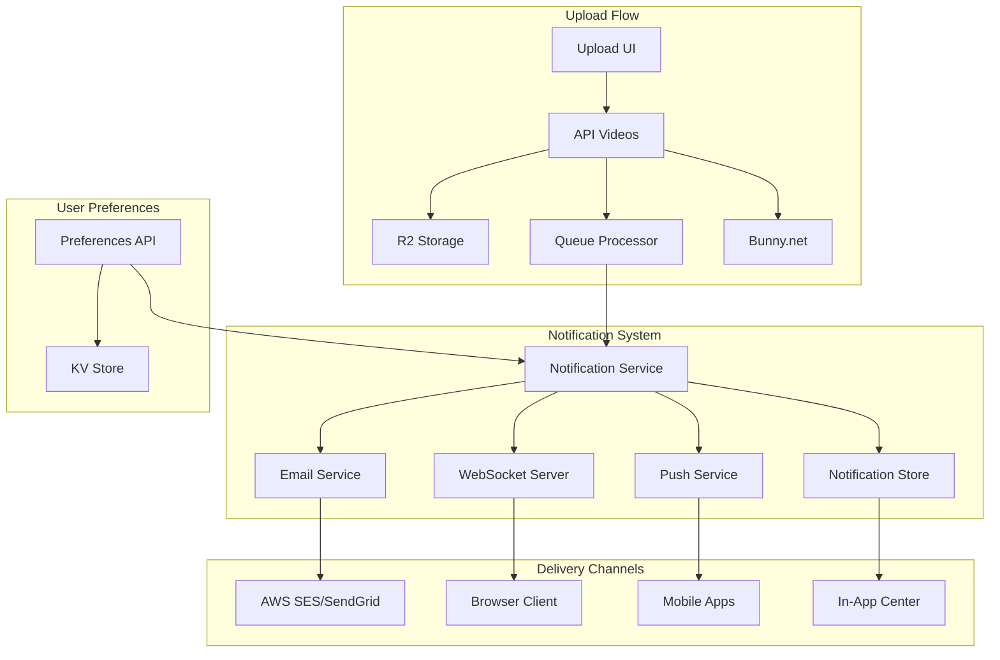

# Upload Notifications Implementation Plan

**Feature ID**: 21
**Priority**: MEDIUM
**Complexity**: MEDIUM (1-2 weeks)
**Dependencies**: WebSocket Server, Queue Processor, Video Upload System

## Executive Summary

This document outlines the comprehensive implementation plan for the Upload Notifications feature, enabling creators to receive real-time and email notifications about their video upload and processing status. The feature addresses the critical need for creators to be informed when their videos are ready without manually checking the platform.

## Feature Overview

### Requirements (from YouTube Feature Comparison)
- **Email notifications** when video processing completes
- **In-app notifications** for upload status changes
- **Real-time processing updates** via WebSocket
- **Notification preferences** management
- **Multi-channel notification delivery** (email, in-app, browser)

### User Stories
1. **As a content creator**, I want to receive an email when my video finishes processing so I can share it immediately
2. **As a channel owner**, I want real-time updates about upload progress so I can monitor multiple uploads
3. **As a user**, I want to control which notifications I receive so I'm not overwhelmed
4. **As a mobile user**, I want push notifications about my uploads so I stay informed on the go

## Architecture Design

### System Components



### Data Flow

1. **Upload Initiation**
   - User starts upload → Create notification record
   - Status: "Upload started"
   - Store in R2: `notifications/{userId}/{notificationId}`

2. **Processing Updates**
   - Queue processor handles video events
   - Emit status updates: "uploading", "processing", "encoding", "complete", "failed"
   - Each update triggers notification dispatch

3. **Notification Dispatch**
   - Check user preferences
   - Route to appropriate channels
   - Track delivery status
   - Handle retries for failures

## Technical Implementation

### 1. Email Notification System

#### Email Service Integration

```typescript
// apps/api-videos/src/services/email/EmailService.ts
export interface EmailService {
  sendEmail(options: EmailOptions): Promise<EmailResult>;
  sendBulkEmails(emails: EmailOptions[]): Promise<BulkEmailResult>;
  verifyEmailAddress(email: string): Promise<boolean>;
}

export interface EmailOptions {
  to: string;
  subject: string;
  templateId: string;
  templateData: Record<string, any>;
  category?: string;
  tags?: string[];
}

export class CloudflareEmailService implements EmailService {
  constructor(
    private readonly apiKey: string,
    private readonly fromEmail: string,
    private readonly fromName: string
  ) {}

  async sendEmail(options: EmailOptions): Promise<EmailResult> {
    // Use Cloudflare Email Workers or integrate with SendGrid/SES
    const response = await fetch('https://api.sendgrid.com/v3/mail/send', {
      method: 'POST',
      headers: {
        'Authorization': `Bearer ${this.apiKey}`,
        'Content-Type': 'application/json'
      },
      body: JSON.stringify({
        from: {
          email: this.fromEmail,
          name: this.fromName
        },
        personalizations: [{
          to: [{ email: options.to }],
          dynamic_template_data: options.templateData
        }],
        template_id: options.templateId,
        categories: [options.category || 'upload-notification'],
        tracking_settings: {
          click_tracking: { enable: true },
          open_tracking: { enable: true }
        }
      })
    });

    return {
      success: response.ok,
      messageId: response.headers.get('X-Message-Id'),
      timestamp: new Date().toISOString()
    };
  }
}
```

#### Email Templates

```typescript
// apps/api-videos/src/services/email/templates.ts
export const EmailTemplates = {
  UPLOAD_COMPLETE: {
    id: 'd-upload-complete-001',
    subject: {
      en: 'Your video "{{title}}" is ready!',
      ar: 'الفيديو الخاص بك "{{title}}" جاهز!'
    }
  },
  UPLOAD_FAILED: {
    id: 'd-upload-failed-001',
    subject: {
      en: 'Upload failed for "{{title}}"',
      ar: 'فشل رفع "{{title}}"'
    }
  },
  PROCESSING_UPDATE: {
    id: 'd-processing-update-001',
    subject: {
      en: 'Processing update for "{{title}}"',
      ar: 'تحديث المعالجة لـ "{{title}}"'
    }
  },
  ENCODING_COMPLETE: {
    id: 'd-encoding-complete-001',
    subject: {
      en: 'HD versions ready for "{{title}}"',
      ar: 'نسخ HD جاهزة لـ "{{title}}"'
    }
  }
};
```

### 2. In-App Notification Architecture

#### Notification Model

```typescript
// packages/shared-types/src/notification.ts
export interface Notification {
  id: string;
  userId: string;
  channelId?: string;
  type: NotificationType;
  category: NotificationCategory;
  title: string;
  message: string;
  data: NotificationData;
  actionUrl?: string;
  imageUrl?: string;
  read: boolean;
  readAt?: string;
  createdAt: string;
  expiresAt?: string;
  deliveryChannels: DeliveryChannel[];
  deliveryStatus: DeliveryStatus;
}

export enum NotificationType {
  UPLOAD_STARTED = 'upload_started',
  UPLOAD_PROGRESS = 'upload_progress',
  UPLOAD_COMPLETE = 'upload_complete',
  UPLOAD_FAILED = 'upload_failed',
  PROCESSING_STARTED = 'processing_started',
  PROCESSING_COMPLETE = 'processing_complete',
  PROCESSING_FAILED = 'processing_failed',
  ENCODING_COMPLETE = 'encoding_complete',
  THUMBNAIL_GENERATED = 'thumbnail_generated',
  VIDEO_PUBLISHED = 'video_published',
  VIDEO_SCHEDULED = 'video_scheduled'
}

export enum NotificationCategory {
  UPLOAD = 'upload',
  PROCESSING = 'processing',
  PUBLISHING = 'publishing',
  SYSTEM = 'system'
}

export interface NotificationData {
  videoId?: string;
  videoTitle?: string;
  channelName?: string;
  progress?: number;
  duration?: number;
  fileSize?: number;
  resolution?: string;
  errorMessage?: string;
  retryable?: boolean;
  metadata?: Record<string, any>;
}

export enum DeliveryChannel {
  EMAIL = 'email',
  IN_APP = 'in_app',
  WEBSOCKET = 'websocket',
  PUSH = 'push',
  SMS = 'sms'
}

export interface DeliveryStatus {
  email?: { sent: boolean; sentAt?: string; error?: string };
  inApp?: { delivered: boolean; deliveredAt?: string };
  websocket?: { sent: boolean; sentAt?: string };
  push?: { sent: boolean; sentAt?: string; error?: string };
}
```

#### Notification Repository

```typescript
// apps/api-videos/src/repositories/NotificationRepository.ts
export class NotificationRepository {
  constructor(
    private readonly bucket: R2Bucket,
    private readonly kv: KVNamespace
  ) {}

  async createNotification(notification: Notification): Promise<void> {
    // Store in R2 for persistence
    await this.bucket.put(
      `notifications/${notification.userId}/${notification.id}.json`,
      JSON.stringify(notification)
    );

    // Index in KV for fast retrieval
    await this.kv.put(
      `user:${notification.userId}:notifications:unread`,
      notification.id,
      {
        expirationTtl: 30 * 24 * 60 * 60, // 30 days
        metadata: { type: notification.type, createdAt: notification.createdAt }
      }
    );
  }

  async getUserNotifications(
    userId: string,
    options: {
      limit?: number;
      cursor?: string;
      unreadOnly?: boolean;
      category?: NotificationCategory;
    }
  ): Promise<{ notifications: Notification[]; cursor?: string }> {
    const prefix = `notifications/${userId}/`;
    const result = await this.bucket.list({
      prefix,
      limit: options.limit || 20,
      cursor: options.cursor
    });

    const notifications = await Promise.all(
      result.objects.map(async (obj) => {
        const data = await this.bucket.get(obj.key);
        return JSON.parse(await data.text()) as Notification;
      })
    );

    // Filter based on options
    let filtered = notifications;
    if (options.unreadOnly) {
      filtered = filtered.filter(n => !n.read);
    }
    if (options.category) {
      filtered = filtered.filter(n => n.category === options.category);
    }

    return {
      notifications: filtered,
      cursor: result.truncated ? result.cursor : undefined
    };
  }

  async markAsRead(userId: string, notificationIds: string[]): Promise<void> {
    await Promise.all(
      notificationIds.map(async (id) => {
        const key = `notifications/${userId}/${id}.json`;
        const obj = await this.bucket.get(key);
        if (obj) {
          const notification = JSON.parse(await obj.text()) as Notification;
          notification.read = true;
          notification.readAt = new Date().toISOString();
          await this.bucket.put(key, JSON.stringify(notification));

          // Remove from unread index
          await this.kv.delete(`user:${userId}:notifications:unread:${id}`);
        }
      })
    );
  }
}
```

### 3. WebSocket Real-time Updates

#### Enhanced WebSocket Integration

```typescript
// apps/websocket-server/src/handlers/upload-notifications.ts
export class UploadNotificationHandler {
  async handleUploadUpdate(
    ws: WebSocketConnection,
    message: UploadUpdateMessage
  ): Promise<void> {
    const { videoId, userId, status, progress, metadata } = message;

    // Create notification event
    const event: NotificationEvent = {
      type: 'notification',
      notificationId: `upload_${videoId}_${Date.now()}`,
      title: this.getNotificationTitle(status, metadata),
      message: this.getNotificationMessage(status, progress, metadata),
      notificationType: this.mapStatusToType(status),
      actionUrl: `/video/${videoId}/edit`,
      userId,
      timestamp: Date.now(),
      data: {
        videoId,
        status,
        progress,
        ...metadata
      }
    };

    // Broadcast to user's notification channel
    await this.broadcast(`user:${userId}:notifications`, event);

    // Also broadcast to video-specific channel for real-time progress
    await this.broadcast(`video:${videoId}:status`, {
      type: 'upload_progress',
      videoId,
      status,
      progress,
      timestamp: Date.now()
    });
  }

  private getNotificationTitle(status: string, metadata: any): string {
    const titles = {
      'started': 'Upload Started',
      'uploading': `Uploading: ${metadata.progress}%`,
      'processing': 'Processing Video',
      'encoding': 'Encoding Video Quality',
      'complete': '✅ Video Ready!',
      'failed': '❌ Upload Failed'
    };
    return titles[status] || 'Upload Update';
  }

  private getNotificationMessage(
    status: string,
    progress: number,
    metadata: any
  ): string {
    switch (status) {
      case 'started':
        return `Started uploading "${metadata.title}"`;
      case 'uploading':
        return `Upload progress: ${progress}% (${this.formatBytes(metadata.uploaded)} / ${this.formatBytes(metadata.total)})`;
      case 'processing':
        return `Processing "${metadata.title}" - This may take a few minutes`;
      case 'encoding':
        return `Creating HD versions of "${metadata.title}"`;
      case 'complete':
        return `"${metadata.title}" is ready to view and share!`;
      case 'failed':
        return `Failed to upload "${metadata.title}": ${metadata.error}`;
      default:
        return `Status update for "${metadata.title}"`;
    }
  }

  private mapStatusToType(status: string): NotificationType {
    const mapping = {
      'started': NotificationType.UPLOAD_STARTED,
      'uploading': NotificationType.UPLOAD_PROGRESS,
      'processing': NotificationType.PROCESSING_STARTED,
      'encoding': NotificationType.PROCESSING_STARTED,
      'complete': NotificationType.UPLOAD_COMPLETE,
      'failed': NotificationType.UPLOAD_FAILED
    };
    return mapping[status] || NotificationType.UPLOAD_PROGRESS;
  }

  private formatBytes(bytes: number): string {
    if (bytes === 0) return '0 Bytes';
    const k = 1024;
    const sizes = ['Bytes', 'KB', 'MB', 'GB'];
    const i = Math.floor(Math.log(bytes) / Math.log(k));
    return Math.round(bytes / Math.pow(k, i) * 100) / 100 + ' ' + sizes[i];
  }
}
```

### 4. Notification Preferences

#### User Preferences Model

```typescript
// packages/shared-types/src/notification-preferences.ts
export interface NotificationPreferences {
  userId: string;
  email: EmailPreferences;
  inApp: InAppPreferences;
  push: PushPreferences;
  quiet: QuietHours;
  channels: ChannelPreferences[];
}

export interface EmailPreferences {
  enabled: boolean;
  address: string;
  verified: boolean;
  frequency: 'immediate' | 'hourly' | 'daily' | 'weekly';
  categories: {
    uploadComplete: boolean;
    uploadFailed: boolean;
    processingUpdates: boolean;
    comments: boolean;
    likes: boolean;
    subscriptions: boolean;
    systemAlerts: boolean;
  };
  unsubscribeToken?: string;
}

export interface InAppPreferences {
  enabled: boolean;
  showToasts: boolean;
  playSound: boolean;
  categories: {
    all: boolean;
    uploads: boolean;
    engagement: boolean;
    system: boolean;
  };
}

export interface PushPreferences {
  enabled: boolean;
  tokens: PushToken[];
  categories: {
    criticalOnly: boolean;
    uploads: boolean;
    engagement: boolean;
  };
}

export interface PushToken {
  token: string;
  platform: 'web' | 'ios' | 'android';
  deviceId: string;
  createdAt: string;
}

export interface QuietHours {
  enabled: boolean;
  startTime: string; // "22:00"
  endTime: string;   // "08:00"
  timezone: string;   // "America/New_York"
  allowCritical: boolean;
}

export interface ChannelPreferences {
  channelId: string;
  emailNotifications: boolean;
  pushNotifications: boolean;
}
```

#### Preferences API Endpoints

```typescript
// apps/api-videos/src/endpoints/notification/preferences.ts
export class NotificationPreferencesEndpoint extends OpenAPIRoute {
  schema = addAuthToSchema({
    tags: ["Notifications"],
    summary: "Get/Update Notification Preferences",
    request: {
      body: {
        content: {
          "application/json": {
            schema: NotificationPreferencesSchema
          }
        }
      }
    },
    responses: {
      "200": {
        description: "Preferences retrieved/updated successfully",
        content: {
          "application/json": {
            schema: NotificationPreferencesSchema
          }
        }
      }
    }
  }, 'required');

  async handle(c: Context) {
    const auth = getAuthContext(c);
    const userId = auth?.userId;

    if (c.request.method === 'GET') {
      const prefs = await this.getPreferences(c.env.preferences_kv, userId);
      return c.json({ success: true, preferences: prefs });
    }

    if (c.request.method === 'PUT') {
      const body = await this.getValidatedData();
      await this.updatePreferences(c.env.preferences_kv, userId, body);
      return c.json({ success: true, message: 'Preferences updated' });
    }
  }

  private async getPreferences(
    kv: KVNamespace,
    userId: string
  ): Promise<NotificationPreferences> {
    const stored = await kv.get(`prefs:${userId}`, 'json');
    return stored || this.getDefaultPreferences(userId);
  }

  private getDefaultPreferences(userId: string): NotificationPreferences {
    return {
      userId,
      email: {
        enabled: true,
        address: '',
        verified: false,
        frequency: 'immediate',
        categories: {
          uploadComplete: true,
          uploadFailed: true,
          processingUpdates: false,
          comments: true,
          likes: false,
          subscriptions: true,
          systemAlerts: true
        }
      },
      inApp: {
        enabled: true,
        showToasts: true,
        playSound: false,
        categories: {
          all: true,
          uploads: true,
          engagement: true,
          system: true
        }
      },
      push: {
        enabled: false,
        tokens: [],
        categories: {
          criticalOnly: false,
          uploads: true,
          engagement: false
        }
      },
      quiet: {
        enabled: false,
        startTime: '22:00',
        endTime: '08:00',
        timezone: 'UTC',
        allowCritical: true
      },
      channels: []
    };
  }
}
```

### 5. Queue Processor Integration

#### Enhanced Message Handler

```typescript
// apps/processor/src/handlers/upload-notifications.ts
export class UploadNotificationHandler implements MessageHandler {
  constructor(
    private readonly notificationService: NotificationService,
    private readonly emailService: EmailService,
    private readonly websocketHelper: WebSocketHelper
  ) {}

  async handle(message: QueueMessage, env: Env): Promise<void> {
    const { type, data } = message;

    switch (type) {
      case MessageType.VideoUploadInitiated:
        await this.handleUploadInitiated(data, env);
        break;
      case MessageType.VideoUploadProgress:
        await this.handleUploadProgress(data, env);
        break;
      case MessageType.VideoUploadCompleted:
        await this.handleUploadCompleted(data, env);
        break;
      case MessageType.VideoProcessingStarted:
        await this.handleProcessingStarted(data, env);
        break;
      case MessageType.VideoProcessingCompleted:
        await this.handleProcessingCompleted(data, env);
        break;
      case MessageType.VideoUploadFailed:
        await this.handleUploadFailed(data, env);
        break;
      case MessageType.VideoProcessingFailed:
        await this.handleProcessingFailed(data, env);
        break;
    }
  }

  private async handleUploadCompleted(data: any, env: Env): Promise<void> {
    const { videoId, userId, title, channelId } = data;

    // Get user preferences
    const preferences = await this.getUserPreferences(userId, env);

    // Create notification
    const notification: Notification = {
      id: `notif_${Date.now()}_${Math.random().toString(36).substr(2, 9)}`,
      userId,
      channelId,
      type: NotificationType.UPLOAD_COMPLETE,
      category: NotificationCategory.UPLOAD,
      title: 'Upload Complete! 🎉',
      message: `Your video "${title}" has been uploaded successfully and is now processing.`,
      data: {
        videoId,
        videoTitle: title,
        channelName: await this.getChannelName(channelId, env)
      },
      actionUrl: `/video/${videoId}/edit`,
      read: false,
      createdAt: new Date().toISOString(),
      deliveryChannels: this.determineDeliveryChannels(preferences),
      deliveryStatus: {}
    };

    // Store notification
    await this.notificationService.createNotification(notification, env);

    // Send via appropriate channels
    const deliveryPromises = [];

    if (preferences.email.enabled && preferences.email.categories.uploadComplete) {
      deliveryPromises.push(
        this.sendEmailNotification(notification, preferences.email, env)
      );
    }

    if (preferences.inApp.enabled && preferences.inApp.categories.uploads) {
      deliveryPromises.push(
        this.sendInAppNotification(notification, env)
      );
    }

    // Real-time WebSocket notification (always sent)
    deliveryPromises.push(
      this.sendWebSocketNotification(notification, env)
    );

    await Promise.allSettled(deliveryPromises);
  }

  private async sendEmailNotification(
    notification: Notification,
    emailPrefs: EmailPreferences,
    env: Env
  ): Promise<void> {
    try {
      const result = await this.emailService.sendEmail({
        to: emailPrefs.address,
        templateId: EmailTemplates.UPLOAD_COMPLETE.id,
        templateData: {
          userName: await this.getUserName(notification.userId, env),
          videoTitle: notification.data.videoTitle,
          videoUrl: `${env.APP_URL}${notification.actionUrl}`,
          channelName: notification.data.channelName,
          uploadTime: new Date().toLocaleString(),
          unsubscribeUrl: `${env.APP_URL}/notifications/unsubscribe?token=${emailPrefs.unsubscribeToken}`
        },
        category: 'upload-notification'
      });

      // Update delivery status
      notification.deliveryStatus.email = {
        sent: result.success,
        sentAt: result.timestamp,
        error: result.error
      };

      await this.notificationService.updateDeliveryStatus(notification.id, notification.deliveryStatus, env);
    } catch (error) {
      console.error('Failed to send email notification:', error);
      notification.deliveryStatus.email = {
        sent: false,
        error: error.message
      };
    }
  }

  private async sendInAppNotification(
    notification: Notification,
    env: Env
  ): Promise<void> {
    // Store in user's notification center
    await env.notifications.put(
      `${notification.userId}/${notification.id}`,
      JSON.stringify(notification),
      {
        expirationTtl: 30 * 24 * 60 * 60 // 30 days
      }
    );

    // Update unread count
    const unreadKey = `unread:${notification.userId}`;
    const currentCount = parseInt(await env.notifications_kv.get(unreadKey) || '0');
    await env.notifications_kv.put(unreadKey, (currentCount + 1).toString());

    notification.deliveryStatus.inApp = {
      delivered: true,
      deliveredAt: new Date().toISOString()
    };
  }

  private async sendWebSocketNotification(
    notification: Notification,
    env: Env
  ): Promise<void> {
    try {
      await notifyUser(
        env.WEBSOCKET_URL,
        notification.userId,
        {
          id: notification.id,
          title: notification.title,
          message: notification.message,
          type: 'upload',
          actionUrl: notification.actionUrl
        }
      );

      notification.deliveryStatus.websocket = {
        sent: true,
        sentAt: new Date().toISOString()
      };
    } catch (error) {
      console.error('Failed to send WebSocket notification:', error);
      notification.deliveryStatus.websocket = {
        sent: false
      };
    }
  }

  private determineDeliveryChannels(
    preferences: NotificationPreferences
  ): DeliveryChannel[] {
    const channels: DeliveryChannel[] = [];

    if (preferences.email.enabled) {
      channels.push(DeliveryChannel.EMAIL);
    }
    if (preferences.inApp.enabled) {
      channels.push(DeliveryChannel.IN_APP);
    }
    channels.push(DeliveryChannel.WEBSOCKET); // Always include WebSocket

    if (preferences.push.enabled && preferences.push.tokens.length > 0) {
      channels.push(DeliveryChannel.PUSH);
    }

    return channels;
  }
}
```

### 6. Frontend Implementation

#### Notification Center Component Enhancement

```typescript
// apps/web/src/components/notifications/UploadNotifications.tsx
'use client';

import React, { useEffect, useState } from 'react';
import { useRealTimeNotifications } from '@/hooks/useRealTimeNotifications';
import { Progress } from '@/components/ui/progress';
import { Alert, AlertDescription, AlertTitle } from '@/components/ui/alert';
import { Bell, Upload, CheckCircle, XCircle, Loader2, AlertCircle } from 'lucide-react';

interface UploadNotificationProps {
  videoId: string;
  userId: string;
}

export function UploadNotification({ videoId, userId }: UploadNotificationProps) {
  const [uploadStatus, setUploadStatus] = useState<UploadStatus>({
    status: 'idle',
    progress: 0,
    message: ''
  });

  const { notifications } = useRealTimeNotifications({
    userId,
    maxNotifications: 10
  });

  // Subscribe to video-specific channel for detailed progress
  useWebSocketSubscription(
    `video:${videoId}:status`,
    (event) => {
      if (event.type === 'upload_progress') {
        setUploadStatus({
          status: event.status,
          progress: event.progress,
          message: getStatusMessage(event.status, event.data)
        });
      }
    },
    [videoId]
  );

  const getStatusIcon = () => {
    switch (uploadStatus.status) {
      case 'uploading':
        return <Upload className="w-5 h-5 text-blue-500 animate-pulse" />;
      case 'processing':
      case 'encoding':
        return <Loader2 className="w-5 h-5 text-orange-500 animate-spin" />;
      case 'complete':
        return <CheckCircle className="w-5 h-5 text-green-500" />;
      case 'failed':
        return <XCircle className="w-5 h-5 text-red-500" />;
      default:
        return <AlertCircle className="w-5 h-5 text-gray-500" />;
    }
  };

  const getAlertVariant = () => {
    switch (uploadStatus.status) {
      case 'complete':
        return 'success';
      case 'failed':
        return 'destructive';
      default:
        return 'default';
    }
  };

  if (uploadStatus.status === 'idle') {
    return null;
  }

  return (
    <Alert variant={getAlertVariant()} className="mb-4">
      <div className="flex items-start gap-3">
        {getStatusIcon()}
        <div className="flex-1">
          <AlertTitle>{getStatusTitle(uploadStatus.status)}</AlertTitle>
          <AlertDescription className="mt-2">
            {uploadStatus.message}
          </AlertDescription>

          {uploadStatus.progress > 0 && uploadStatus.progress < 100 && (
            <Progress value={uploadStatus.progress} className="mt-3" />
          )}

          {uploadStatus.status === 'complete' && (
            <div className="mt-3 flex gap-2">
              <Button size="sm" asChild>
                <Link href={`/video/${videoId}`}>View Video</Link>
              </Button>
              <Button size="sm" variant="outline" asChild>
                <Link href={`/video/${videoId}/edit`}>Edit Details</Link>
              </Button>
            </div>
          )}

          {uploadStatus.status === 'failed' && uploadStatus.retryable && (
            <Button size="sm" variant="destructive" className="mt-3" onClick={handleRetry}>
              Retry Upload
            </Button>
          )}
        </div>
      </div>
    </Alert>
  );
}
```

#### Notification Preferences UI

```typescript
// apps/web/src/app/[locale]/settings/notifications/page.tsx
'use client';

import React, { useState, useEffect } from 'react';
import { Card, CardContent, CardDescription, CardHeader, CardTitle } from '@/components/ui/card';
import { Switch } from '@/components/ui/switch';
import { Label } from '@/components/ui/label';
import { Select, SelectContent, SelectItem, SelectTrigger, SelectValue } from '@/components/ui/select';
import { Input } from '@/components/ui/input';
import { Button } from '@/components/ui/button';
import { Tabs, TabsContent, TabsList, TabsTrigger } from '@/components/ui/tabs';
import { useToast } from '@/components/ui/use-toast';

export default function NotificationSettingsPage() {
  const { t } = useLanguage();
  const { toast } = useToast();
  const [preferences, setPreferences] = useState<NotificationPreferences>();
  const [loading, setLoading] = useState(true);
  const [saving, setSaving] = useState(false);

  useEffect(() => {
    loadPreferences();
  }, []);

  const loadPreferences = async () => {
    try {
      const response = await fetch('/api/notifications/preferences');
      const data = await response.json();
      setPreferences(data.preferences);
    } catch (error) {
      toast({
        title: t('settings.notifications.error'),
        description: t('settings.notifications.load_failed'),
        variant: 'destructive'
      });
    } finally {
      setLoading(false);
    }
  };

  const savePreferences = async () => {
    setSaving(true);
    try {
      const response = await fetch('/api/notifications/preferences', {
        method: 'PUT',
        headers: { 'Content-Type': 'application/json' },
        body: JSON.stringify(preferences)
      });

      if (response.ok) {
        toast({
          title: t('settings.notifications.success'),
          description: t('settings.notifications.saved')
        });
      }
    } catch (error) {
      toast({
        title: t('settings.notifications.error'),
        description: t('settings.notifications.save_failed'),
        variant: 'destructive'
      });
    } finally {
      setSaving(false);
    }
  };

  if (loading) {
    return <div>Loading...</div>;
  }

  return (
    <div className="container max-w-4xl mx-auto p-4">
      <h1 className="text-3xl font-bold mb-6">{t('settings.notifications.title')}</h1>

      <Tabs defaultValue="email" className="space-y-4">
        <TabsList>
          <TabsTrigger value="email">{t('settings.notifications.email')}</TabsTrigger>
          <TabsTrigger value="inapp">{t('settings.notifications.in_app')}</TabsTrigger>
          <TabsTrigger value="push">{t('settings.notifications.push')}</TabsTrigger>
          <TabsTrigger value="quiet">{t('settings.notifications.quiet_hours')}</TabsTrigger>
        </TabsList>

        <TabsContent value="email">
          <Card>
            <CardHeader>
              <CardTitle>{t('settings.notifications.email_preferences')}</CardTitle>
              <CardDescription>
                {t('settings.notifications.email_description')}
              </CardDescription>
            </CardHeader>
            <CardContent className="space-y-4">
              <div className="flex items-center justify-between">
                <Label htmlFor="email-enabled">
                  {t('settings.notifications.enable_email')}
                </Label>
                <Switch
                  id="email-enabled"
                  checked={preferences?.email.enabled}
                  onCheckedChange={(checked) =>
                    setPreferences({
                      ...preferences,
                      email: { ...preferences.email, enabled: checked }
                    })
                  }
                />
              </div>

              <div className="space-y-2">
                <Label htmlFor="email-address">
                  {t('settings.notifications.email_address')}
                </Label>
                <Input
                  id="email-address"
                  type="email"
                  value={preferences?.email.address}
                  onChange={(e) =>
                    setPreferences({
                      ...preferences,
                      email: { ...preferences.email, address: e.target.value }
                    })
                  }
                />
              </div>

              <div className="space-y-2">
                <Label htmlFor="email-frequency">
                  {t('settings.notifications.frequency')}
                </Label>
                <Select
                  value={preferences?.email.frequency}
                  onValueChange={(value) =>
                    setPreferences({
                      ...preferences,
                      email: { ...preferences.email, frequency: value }
                    })
                  }
                >
                  <SelectTrigger id="email-frequency">
                    <SelectValue />
                  </SelectTrigger>
                  <SelectContent>
                    <SelectItem value="immediate">
                      {t('settings.notifications.immediate')}
                    </SelectItem>
                    <SelectItem value="hourly">
                      {t('settings.notifications.hourly')}
                    </SelectItem>
                    <SelectItem value="daily">
                      {t('settings.notifications.daily')}
                    </SelectItem>
                    <SelectItem value="weekly">
                      {t('settings.notifications.weekly')}
                    </SelectItem>
                  </SelectContent>
                </Select>
              </div>

              <div className="space-y-3">
                <Label>{t('settings.notifications.categories')}</Label>
                {Object.entries(preferences?.email.categories || {}).map(([key, value]) => (
                  <div key={key} className="flex items-center justify-between">
                    <Label htmlFor={`email-${key}`} className="font-normal">
                      {t(`settings.notifications.category.${key}`)}
                    </Label>
                    <Switch
                      id={`email-${key}`}
                      checked={value}
                      onCheckedChange={(checked) =>
                        setPreferences({
                          ...preferences,
                          email: {
                            ...preferences.email,
                            categories: {
                              ...preferences.email.categories,
                              [key]: checked
                            }
                          }
                        })
                      }
                    />
                  </div>
                ))}
              </div>
            </CardContent>
          </Card>
        </TabsContent>

        <TabsContent value="inapp">
          <Card>
            <CardHeader>
              <CardTitle>{t('settings.notifications.in_app_preferences')}</CardTitle>
              <CardDescription>
                {t('settings.notifications.in_app_description')}
              </CardDescription>
            </CardHeader>
            <CardContent className="space-y-4">
              <div className="flex items-center justify-between">
                <Label htmlFor="inapp-toasts">
                  {t('settings.notifications.show_toasts')}
                </Label>
                <Switch
                  id="inapp-toasts"
                  checked={preferences?.inApp.showToasts}
                  onCheckedChange={(checked) =>
                    setPreferences({
                      ...preferences,
                      inApp: { ...preferences.inApp, showToasts: checked }
                    })
                  }
                />
              </div>

              <div className="flex items-center justify-between">
                <Label htmlFor="inapp-sound">
                  {t('settings.notifications.play_sound')}
                </Label>
                <Switch
                  id="inapp-sound"
                  checked={preferences?.inApp.playSound}
                  onCheckedChange={(checked) =>
                    setPreferences({
                      ...preferences,
                      inApp: { ...preferences.inApp, playSound: checked }
                    })
                  }
                />
              </div>
            </CardContent>
          </Card>
        </TabsContent>

        <TabsContent value="quiet">
          <Card>
            <CardHeader>
              <CardTitle>{t('settings.notifications.quiet_hours')}</CardTitle>
              <CardDescription>
                {t('settings.notifications.quiet_hours_description')}
              </CardDescription>
            </CardHeader>
            <CardContent className="space-y-4">
              <div className="flex items-center justify-between">
                <Label htmlFor="quiet-enabled">
                  {t('settings.notifications.enable_quiet_hours')}
                </Label>
                <Switch
                  id="quiet-enabled"
                  checked={preferences?.quiet.enabled}
                  onCheckedChange={(checked) =>
                    setPreferences({
                      ...preferences,
                      quiet: { ...preferences.quiet, enabled: checked }
                    })
                  }
                />
              </div>

              <div className="grid grid-cols-2 gap-4">
                <div className="space-y-2">
                  <Label htmlFor="quiet-start">
                    {t('settings.notifications.start_time')}
                  </Label>
                  <Input
                    id="quiet-start"
                    type="time"
                    value={preferences?.quiet.startTime}
                    onChange={(e) =>
                      setPreferences({
                        ...preferences,
                        quiet: { ...preferences.quiet, startTime: e.target.value }
                      })
                    }
                  />
                </div>

                <div className="space-y-2">
                  <Label htmlFor="quiet-end">
                    {t('settings.notifications.end_time')}
                  </Label>
                  <Input
                    id="quiet-end"
                    type="time"
                    value={preferences?.quiet.endTime}
                    onChange={(e) =>
                      setPreferences({
                        ...preferences,
                        quiet: { ...preferences.quiet, endTime: e.target.value }
                      })
                    }
                  />
                </div>
              </div>

              <div className="flex items-center justify-between">
                <Label htmlFor="quiet-critical">
                  {t('settings.notifications.allow_critical')}
                </Label>
                <Switch
                  id="quiet-critical"
                  checked={preferences?.quiet.allowCritical}
                  onCheckedChange={(checked) =>
                    setPreferences({
                      ...preferences,
                      quiet: { ...preferences.quiet, allowCritical: checked }
                    })
                  }
                />
              </div>
            </CardContent>
          </Card>
        </TabsContent>
      </Tabs>

      <div className="mt-6 flex justify-end">
        <Button onClick={savePreferences} disabled={saving}>
          {saving ? t('common.saving') : t('common.save')}
        </Button>
      </div>
    </div>
  );
}
```

## Files to Create/Modify

### New Files to Create

1. **Backend Services**
   - `/apps/api-videos/src/services/email/EmailService.ts` - Email service interface and implementation
   - `/apps/api-videos/src/services/email/templates.ts` - Email template definitions
   - `/apps/api-videos/src/services/notification/NotificationService.ts` - Core notification service
   - `/apps/api-videos/src/repositories/NotificationRepository.ts` - Notification data access
   - `/apps/api-videos/src/endpoints/notification/preferences.ts` - Preferences API endpoint
   - `/apps/api-videos/src/endpoints/notification/list.ts` - List notifications endpoint
   - `/apps/api-videos/src/endpoints/notification/mark-read.ts` - Mark as read endpoint
   - `/apps/processor/src/handlers/upload-notifications.ts` - Queue message handler

2. **Shared Types**
   - `/packages/shared-types/src/notification.ts` - Notification type definitions
   - `/packages/shared-types/src/notification-preferences.ts` - Preferences types

3. **WebSocket Handlers**
   - `/apps/websocket-server/src/handlers/upload-notifications.ts` - WebSocket notification handler

4. **Frontend Components**
   - `/apps/web/src/components/notifications/UploadNotifications.tsx` - Upload notification UI
   - `/apps/web/src/app/[locale]/settings/notifications/page.tsx` - Settings page
   - `/apps/web/src/components/notifications/NotificationPreferences.tsx` - Preferences component

5. **Configuration**
   - `/apps/api-videos/src/config/email.ts` - Email service configuration
   - `/apps/api-videos/src/config/notifications.ts` - Notification system configuration

### Files to Modify

1. **API Videos**
   - `/apps/api-videos/src/endpoints/video/uploadInitiate.ts` - Add notification creation
   - `/apps/api-videos/src/endpoints/video/uploadComplete.ts` - Trigger completion notification
   - `/apps/api-videos/src/lib/queue.ts` - Add new message types
   - `/apps/api-videos/wrangler.jsonc` - Add email service bindings and KV namespaces

2. **Processor**
   - `/apps/processor/src/messageProcessor.ts` - Register notification handler
   - `/apps/processor/src/index.ts` - Initialize notification services

3. **WebSocket Server**
   - `/apps/websocket-server/src/index.ts` - Register notification handlers
   - `/apps/websocket-server/src/channels.ts` - Add notification channel support

4. **Web App**
   - `/apps/web/src/components/videoUpload/index.tsx` - Integrate upload notifications
   - `/apps/web/src/components/notifications/NotificationCenter.tsx` - Add upload notification support
   - `/apps/web/src/hooks/useRealTimeNotifications.ts` - Handle upload notification types
   - `/apps/web/src/lib/api/notifications.ts` - API client for notifications

5. **Translations**
   - `/apps/web/src/lib/i18n/translations/en.ts` - English notification texts
   - `/apps/web/src/lib/i18n/translations/ar.ts` - Arabic notification texts

## Testing Strategy

### Unit Tests

```typescript
// apps/api-videos/src/services/notification/__tests__/NotificationService.test.ts
describe('NotificationService', () => {
  test('should create notification with correct structure');
  test('should respect user preferences');
  test('should handle delivery failures gracefully');
  test('should batch notifications when configured');
  test('should respect quiet hours');
  test('should filter by notification category');
});

// apps/processor/src/handlers/__tests__/upload-notifications.test.ts
describe('UploadNotificationHandler', () => {
  test('should handle upload completion message');
  test('should send email when enabled in preferences');
  test('should skip email when disabled');
  test('should always send WebSocket notification');
  test('should handle email service failures');
});
```

### Integration Tests

```typescript
// apps/web/e2e/upload-notifications.spec.ts
import { test, expect } from '@playwright/test';

test.describe('Upload Notifications', () => {
  test('should show real-time upload progress', async ({ page }) => {
    // Start upload
    await page.goto('/upload');
    await page.setInputFiles('#video-file', 'test-video.mp4');
    await page.click('[data-test="start-upload"]');

    // Verify progress notification appears
    await expect(page.locator('[data-test="upload-progress"]')).toBeVisible();
    await expect(page.locator('[data-test="progress-bar"]')).toHaveAttribute('aria-valuenow', '0');

    // Wait for progress update
    await page.waitForTimeout(2000);
    await expect(page.locator('[data-test="progress-bar"]')).toHaveAttribute('aria-valuenow', /[1-9]/);
  });

  test('should show completion notification', async ({ page }) => {
    // Complete upload (mocked)
    await page.evaluate(() => {
      window.postMessage({
        type: 'notification',
        notificationType: 'upload',
        title: 'Upload Complete!',
        message: 'Your video is ready'
      }, '*');
    });

    // Verify toast notification
    await expect(page.locator('[data-test="notification-toast"]')).toBeVisible();
    await expect(page.locator('[data-test="notification-title"]')).toContainText('Upload Complete');
  });

  test('should manage preferences', async ({ page }) => {
    await page.goto('/settings/notifications');

    // Toggle email notifications
    await page.click('[data-test="email-enabled"]');

    // Set email frequency
    await page.selectOption('[data-test="email-frequency"]', 'daily');

    // Save preferences
    await page.click('[data-test="save-preferences"]');

    // Verify success message
    await expect(page.locator('[data-test="toast-success"]')).toContainText('Preferences saved');
  });
});
```

### Manual Testing Checklist

1. **Upload Flow**
   - [ ] Start video upload
   - [ ] Verify progress notifications appear
   - [ ] Complete upload
   - [ ] Verify completion notification
   - [ ] Check email delivery (if enabled)
   - [ ] Click notification action link
   - [ ] Verify navigation to video page

2. **Preferences Management**
   - [ ] Access notification settings
   - [ ] Toggle email notifications
   - [ ] Change email frequency
   - [ ] Set quiet hours
   - [ ] Enable/disable categories
   - [ ] Save preferences
   - [ ] Verify preferences persist

3. **Real-time Updates**
   - [ ] Open two browser tabs
   - [ ] Start upload in one tab
   - [ ] Verify notifications in both tabs
   - [ ] Test WebSocket reconnection
   - [ ] Verify notification persistence

4. **Email Delivery**
   - [ ] Verify email format
   - [ ] Test unsubscribe link
   - [ ] Check spam folder placement
   - [ ] Verify template rendering
   - [ ] Test with different locales

## Performance Considerations

1. **Notification Batching**
   - Batch email notifications for hourly/daily frequency
   - Queue notifications during quiet hours
   - Aggregate similar notifications

2. **WebSocket Optimization**
   - Throttle progress updates (max 1 per second)
   - Use binary frames for large payloads
   - Implement connection pooling

3. **Storage Optimization**
   - Auto-expire old notifications (30 days)
   - Use KV for indexes, R2 for full data
   - Implement cursor-based pagination

4. **Email Service**
   - Use email service provider's batch API
   - Implement retry with exponential backoff
   - Track bounce rates and auto-disable

## Security Considerations

1. **Email Security**
   - Verify email ownership before sending
   - Include unsubscribe token in all emails
   - Implement SPF, DKIM, DMARC
   - Rate limit email sending

2. **Notification Privacy**
   - Ensure notifications only visible to owner
   - Sanitize user-generated content
   - Implement notification encryption at rest

3. **WebSocket Security**
   - Validate JWT tokens for subscriptions
   - Implement channel-based permissions
   - Rate limit notification broadcasts

## Monitoring & Analytics

1. **Metrics to Track**
   - Notification delivery rate
   - Email open/click rates
   - WebSocket connection stability
   - Preference adoption rates
   - Notification interaction rates

2. **Error Tracking**
   - Email bounce rates
   - WebSocket disconnection reasons
   - Failed notification deliveries
   - Service availability

3. **User Engagement**
   - Notification click-through rates
   - Time to interaction
   - Preference changes over time
   - Unsubscribe rates

## Migration Plan

### Phase 1: Core Infrastructure (Week 1)
1. Set up email service integration
2. Create notification data models
3. Implement notification repository
4. Add queue message handlers
5. Create preferences API

### Phase 2: Delivery Channels (Week 1)
1. Implement email templates
2. Add WebSocket handlers
3. Create in-app notification storage
4. Build notification dispatch logic
5. Add delivery tracking

### Phase 3: Frontend Integration (Week 2)
1. Create notification components
2. Build preferences UI
3. Integrate real-time updates
4. Add notification center
5. Implement toast notifications

### Phase 4: Testing & Deployment (Week 2)
1. Write unit tests
2. Create integration tests
3. Perform load testing
4. Deploy to staging
5. Production rollout

## Success Metrics

1. **Technical Metrics**
   - 99.9% notification delivery rate
   - < 5 second email delivery time
   - < 100ms WebSocket notification latency
   - 0% notification data loss

2. **User Metrics**
   - 80% of users enable notifications
   - 60% email open rate
   - 30% click-through rate
   - < 5% unsubscribe rate

3. **Business Metrics**
   - 20% increase in video completion rate
   - 15% reduction in support tickets
   - 25% increase in user engagement
   - 10% increase in video shares

## Rollback Plan

1. **Feature Flag Control**
   - Disable notification system via feature flag
   - Fall back to polling-based status checks
   - Maintain backward compatibility

2. **Data Preservation**
   - Keep notification history for 30 days
   - Export preferences before changes
   - Maintain audit log of deliveries

3. **Communication**
   - Notify users of temporary disruption
   - Provide alternative status check method
   - Document known issues

## Future Enhancements

1. **Phase 2 Features**
   - Push notifications (mobile/web)
   - SMS notifications (premium users)
   - Notification templates customization
   - Bulk notification management

2. **Advanced Features**
   - AI-powered notification summarization
   - Smart notification scheduling
   - Cross-device synchronization
   - Notification analytics dashboard

3. **Integration Options**
   - Slack/Discord webhooks
   - IFTTT/Zapier integration
   - RSS feed generation
   - Calendar integration

## Conclusion

The Upload Notifications feature will significantly improve the creator experience by providing timely, relevant updates about video processing status. By implementing a multi-channel notification system with user preferences, we ensure creators stay informed without being overwhelmed. The architecture leverages existing WebSocket infrastructure while adding email capabilities for broader reach. With proper testing and a phased rollout, this feature will reduce support burden and increase user satisfaction.

## References

- [Cloudflare Email Workers](https://developers.cloudflare.com/email-routing/)
- [SendGrid API Documentation](https://docs.sendgrid.com/)
- [Web Push API](https://developer.mozilla.org/en-US/docs/Web/API/Push_API)
- [WebSocket Best Practices](https://developer.mozilla.org/en-US/docs/Web/API/WebSockets_API)
- [Email Template Design Guide](https://templates.mailchimp.com/)