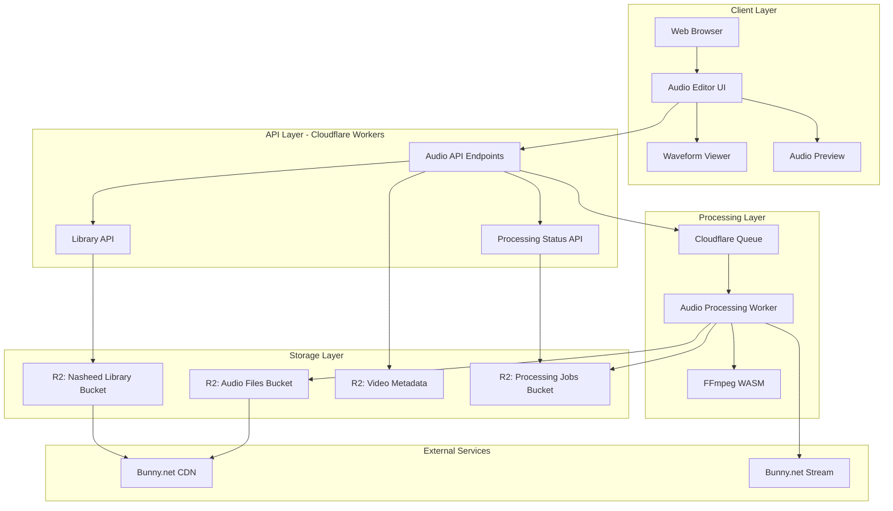
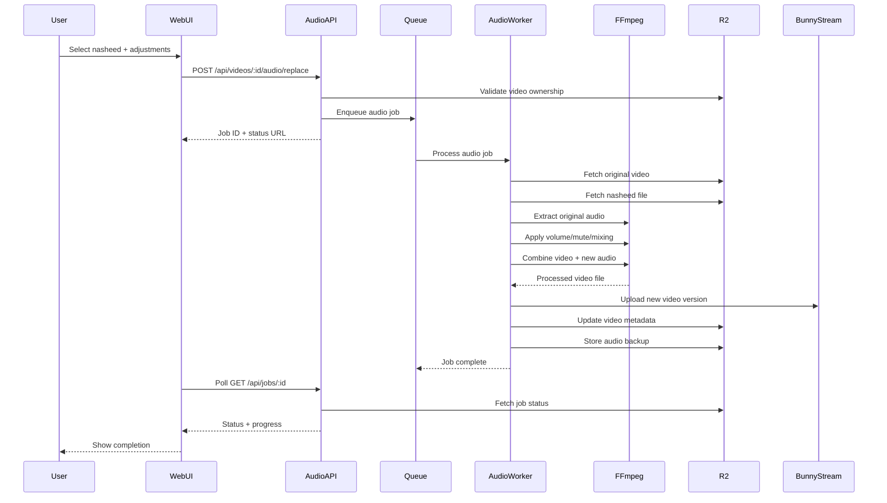
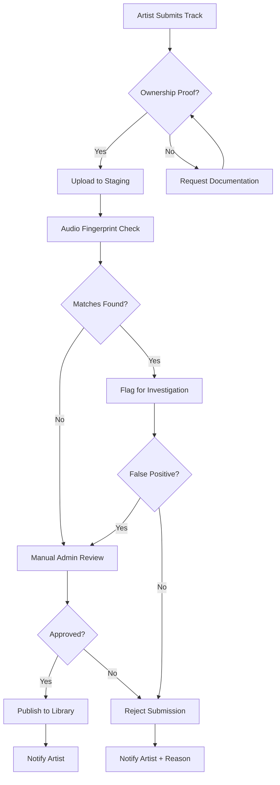

# Feature #28: Audio Swap/Library

**Feature Priority**: LOW (from YouTube Feature Comparison)
**Implementation Complexity**: COMPLEX (2-3 months)
**Created**: 2025-11-20
**Status**: Design Phase

---

## Table of Contents

1. [Overview](#overview)
2. [Feature Requirements](#feature-requirements)
3. [Architecture Design](#architecture-design)
4. [Data Models](#data-models)
5. [API Specifications](#api-specifications)
6. [Islamic Nasheed Library](#islamic-nasheed-library)
7. [Audio Processing Service](#audio-processing-service)
8. [Editor UI Components](#editor-ui-components)
9. [Implementation Plan](#implementation-plan)
10. [Technical Challenges](#technical-challenges)
11. [Testing Strategy](#testing-strategy)
12. [Copyright & Licensing](#copyright--licensing)
13. [Cost Analysis](#cost-analysis)
14. [Future Enhancements](#future-enhancements)

---

## Overview

### Problem Statement

Content creators on Al Ummah Now need the ability to:
1. **Replace audio tracks** post-upload without re-uploading entire videos
2. **Access copyright-free Islamic nasheeds** for background audio
3. **Mute specific audio segments** (e.g., background noise, music)
4. **Adjust audio volume** for better mixing
5. **Avoid copyright strikes** by replacing copyrighted audio

Currently, creators must:
- Re-upload entire videos to change audio (wastes time and bandwidth)
- Source their own Islamic nasheeds (difficult to find copyright-free options)
- Use external video editors for audio manipulation (poor UX)
- Risk copyright strikes from background music in reused content

### Solution Overview

Implement a comprehensive audio management system with:
- **Post-upload audio replacement** engine
- **Curated Islamic nasheed library** (100+ tracks)
- **Browser-based audio editor** with waveform visualization
- **Automatic audio processing** via Cloudflare Workers + FFmpeg WASM
- **Copyright-free licensing** for all library tracks

### YouTube Comparison

| Feature | YouTube | Al Ummah Now (Proposed) |
|---------|---------|-------------------------|
| Replace full audio track | ✅ Yes | ✅ Yes |
| Audio library | ✅ 150K+ tracks | ✅ 100+ Islamic nasheeds |
| Mute segments | ✅ Yes | ✅ Yes |
| Volume adjustment | ✅ Yes | ✅ Yes |
| Auto-copyright detection | ✅ Yes | ❌ Phase 2 |
| Multi-track mixing | ❌ No | ❌ No (future) |

---

## Feature Requirements

### Functional Requirements

#### FR-1: Audio Library Management
- **FR-1.1**: Browse Islamic nasheed library by category (Quran, Dawah, Eid, Ramadan, etc.)
- **FR-1.2**: Search nasheeds by title, artist, mood, or language
- **FR-1.3**: Preview nasheeds before applying (30-second clips)
- **FR-1.4**: Filter by duration to match video length
- **FR-1.5**: Sort by popularity, date added, or alphabetical
- **FR-1.6**: Display license information for each track

#### FR-2: Audio Replacement
- **FR-2.1**: Replace entire original audio track with library nasheed
- **FR-2.2**: Replace entire original audio track with uploaded custom audio
- **FR-2.3**: Mix original audio with nasheed (adjustable levels for each)
- **FR-2.4**: Preview changes before saving
- **FR-2.5**: Automatic audio length matching (loop or fade for shorter tracks)
- **FR-2.6**: Support audio formats: MP3, WAV, AAC, OGG

#### FR-3: Audio Editing
- **FR-3.1**: Mute specific time ranges (e.g., 00:30 - 01:15)
- **FR-3.2**: Adjust overall volume (0% - 200%)
- **FR-3.3**: Adjust original vs new audio mix ratio
- **FR-3.4**: Fade in/out controls (0s - 10s)
- **FR-3.5**: Waveform visualization with zoom/pan
- **FR-3.6**: Multiple undo/redo support

#### FR-4: Processing & Publishing
- **FR-4.1**: Asynchronous audio processing (queue-based)
- **FR-4.2**: Real-time progress tracking (0-100%)
- **FR-4.3**: Automatic versioning (keep original audio backup)
- **FR-4.4**: Rollback to original audio anytime
- **FR-4.5**: Processing time estimation based on video duration
- **FR-4.6**: Email notification on completion

### Non-Functional Requirements

#### NFR-1: Performance
- **NFR-1.1**: Audio processing within 2x video duration (max 10 min for 5 min video)
- **NFR-1.2**: Waveform rendering < 3 seconds for 30-minute videos
- **NFR-1.3**: Preview generation < 5 seconds
- **NFR-1.4**: Library search results < 500ms

#### NFR-2: Reliability
- **NFR-2.1**: 99.9% processing success rate
- **NFR-2.2**: Automatic retry on transient failures (max 3 attempts)
- **NFR-2.3**: Graceful degradation if audio service unavailable
- **NFR-2.4**: Original audio always preserved as fallback

#### NFR-3: Security
- **NFR-3.1**: Only video owner can edit audio
- **NFR-3.2**: Uploaded audio files scanned for malware
- **NFR-3.3**: Audio library served via CDN with signed URLs
- **NFR-3.4**: Rate limiting: max 10 audio processing jobs per user per day

#### NFR-4: Scalability
- **NFR-4.1**: Support 10 concurrent audio processing jobs per region
- **NFR-4.2**: Audio library scales to 1000+ tracks
- **NFR-4.3**: Handle videos up to 2 hours duration

#### NFR-5: Usability
- **NFR-5.1**: Bilingual UI (English/Arabic with RTL support)
- **NFR-5.2**: Mobile-responsive editor (tablet minimum)
- **NFR-5.3**: Keyboard shortcuts for common actions
- **NFR-5.4**: Accessibility: WCAG 2.1 AA compliance

---

## Architecture Design

### High-Level Architecture



### Processing Pipeline Architecture



### Component Architecture

```
apps/
├── api-videos/
│   └── src/
│       └── endpoints/
│           └── audio/
│               ├── listLibrary.ts          # GET /api/audio/library
│               ├── searchLibrary.ts        # GET /api/audio/library/search
│               ├── replaceAudio.ts         # POST /api/videos/:id/audio/replace
│               ├── uploadCustomAudio.ts    # POST /api/videos/:id/audio/upload
│               ├── getAudioStatus.ts       # GET /api/videos/:id/audio/status
│               ├── muteSegment.ts          # POST /api/videos/:id/audio/mute
│               ├── adjustVolume.ts         # POST /api/videos/:id/audio/volume
│               └── revertAudio.ts          # POST /api/videos/:id/audio/revert
│
├── processor/
│   └── src/
│       └── audio/
│           ├── audioProcessor.ts           # Main audio processing logic
│           ├── ffmpegWrapper.ts            # FFmpeg WASM wrapper
│           ├── audioMixer.ts               # Audio mixing logic
│           └── waveformGenerator.ts        # Waveform data generation
│
└── web/
    └── src/
        └── components/
            └── AudioEditor/
                ├── AudioEditorModal.tsx    # Main editor modal
                ├── WaveformViewer.tsx      # Audio waveform display
                ├── LibraryBrowser.tsx      # Nasheed library browser
                ├── AudioControls.tsx       # Playback controls
                ├── VolumeSlider.tsx        # Volume adjustment UI
                ├── MuteSegmentTool.tsx     # Segment muting UI
                └── ProcessingStatus.tsx     # Processing progress UI
```

---

## Data Models

### Audio Library Track

```typescript
// packages/shared-types/src/audio.ts

export interface AudioTrack {
  id: string;                     // Unique track ID
  title: string;
  titleArabic?: string;           // Arabic translation
  artist: string;
  artistArabic?: string;
  category: AudioCategory;
  subcategory?: string;
  duration: number;               // Seconds
  fileSize: number;               // Bytes
  format: 'mp3' | 'wav' | 'aac' | 'ogg';
  bitrate: number;                // kbps
  sampleRate: number;             // Hz

  // URLs
  audioUrl: string;               // Full track URL
  previewUrl: string;             // 30-second preview
  waveformUrl: string;            // Waveform data JSON
  thumbnailUrl?: string;          // Album art

  // Metadata
  mood: AudioMood[];
  tags: string[];
  language: 'ar' | 'en' | 'ur' | 'multilingual';
  bpm?: number;                   // Beats per minute
  key?: string;                   // Musical key

  // Licensing
  license: AudioLicense;
  licenseUrl: string;
  attribution?: string;

  // Usage
  playCount: number;
  downloadCount: number;
  favoriteCount: number;

  // Admin
  dateAdded: string;              // ISO 8601
  dateModified: string;
  isActive: boolean;
  uploadedBy?: string;            // Admin user ID
}

export type AudioCategory =
  | 'quran-recitation'
  | 'nasheed-vocals-only'
  | 'nasheed-instrumental'
  | 'islamic-lecture-background'
  | 'ramadan'
  | 'eid'
  | 'hajj-umrah'
  | 'dawah'
  | 'general-islamic';

export type AudioMood =
  | 'peaceful'
  | 'uplifting'
  | 'reflective'
  | 'energetic'
  | 'solemn'
  | 'joyful';

export interface AudioLicense {
  type: 'public-domain' | 'cc0' | 'cc-by' | 'cc-by-sa' | 'platform-exclusive';
  commercial: boolean;            // Can be used commercially
  derivative: boolean;            // Can be modified
  attribution: boolean;           // Requires attribution
  shareAlike: boolean;            // Must share under same license
}
```

### Audio Edit Configuration

```typescript
// packages/shared-types/src/audio.ts

export interface AudioEditConfig {
  videoId: string;

  // Replacement
  replaceAudio: boolean;
  replacementSource?: {
    type: 'library' | 'upload';
    trackId?: string;             // Library track ID
    uploadUrl?: string;           // Custom upload URL
  };

  // Mixing
  mixingMode: 'replace' | 'overlay';
  originalVolume: number;         // 0-200 (percentage)
  replacementVolume: number;      // 0-200 (percentage)

  // Segments
  muteSegments: AudioSegment[];
  volumeSegments: VolumeSegment[];

  // Effects
  fadeIn: number;                 // Seconds (0-10)
  fadeOut: number;                // Seconds (0-10)
  normalize: boolean;             // Auto-normalize volume

  // Processing
  preserveOriginal: boolean;      // Keep original audio backup
  notifyOnComplete: boolean;      // Send email notification
}

export interface AudioSegment {
  startTime: number;              // Seconds
  endTime: number;                // Seconds
  muted: boolean;
}

export interface VolumeSegment {
  startTime: number;              // Seconds
  endTime: number;                // Seconds
  volume: number;                 // 0-200 (percentage)
}
```

### Audio Processing Job

```typescript
// packages/shared-types/src/audio.ts

export interface AudioProcessingJob {
  id: string;                     // Job ID
  videoId: string;
  userId: string;
  config: AudioEditConfig;

  // Status
  status: AudioJobStatus;
  progress: number;               // 0-100
  stage: AudioProcessingStage;

  // Timing
  createdAt: string;              // ISO 8601
  startedAt?: string;
  completedAt?: string;
  estimatedCompletion?: string;

  // Results
  newVideoUrl?: string;           // Bunny.net URL
  originalAudioBackupUrl?: string;

  // Error handling
  error?: string;
  retryCount: number;
  maxRetries: number;
}

export type AudioJobStatus =
  | 'queued'
  | 'processing'
  | 'completed'
  | 'failed'
  | 'cancelled';

export type AudioProcessingStage =
  | 'validating'
  | 'downloading-original'
  | 'downloading-nasheed'
  | 'extracting-audio'
  | 'applying-edits'
  | 'mixing-audio'
  | 'encoding-video'
  | 'uploading'
  | 'finalizing';
```

### Video Metadata Extension

```typescript
// packages/shared-types/src/video.ts (extension)

export interface VideoObject extends Timestamps {
  // ... existing fields ...

  // Audio metadata
  audio?: {
    originalAudioUrl?: string;        // Backup of original
    currentAudioSource: 'original' | 'library' | 'custom';
    libraryTrackId?: string;          // If using library
    customAudioUrl?: string;          // If using custom upload
    lastAudioEdit?: string;           // ISO 8601
    audioEditHistory: AudioEditRecord[];
  };
}

export interface AudioEditRecord {
  timestamp: string;                  // ISO 8601
  action: 'replace' | 'revert' | 'adjust';
  trackId?: string;
  config: Partial<AudioEditConfig>;
}
```

---

## API Specifications

### Audio Library Endpoints

#### GET /api/audio/library

List all available nasheeds in the library.

**Authentication**: Optional (public endpoint)

**Query Parameters**:
```typescript
{
  category?: AudioCategory;
  mood?: AudioMood[];
  language?: 'ar' | 'en' | 'ur';
  minDuration?: number;           // Seconds
  maxDuration?: number;           // Seconds
  sortBy?: 'popular' | 'recent' | 'alphabetical' | 'duration';
  sortOrder?: 'asc' | 'desc';
  limit?: number;                 // Default 50, max 100
  cursor?: string;                // Pagination cursor
}
```

**Response**:
```typescript
{
  success: true,
  data: {
    tracks: AudioTrack[];
    pagination: {
      cursor: string;
      hasMore: boolean;
      total: number;
    };
  }
}
```

#### GET /api/audio/library/search

Search nasheeds by title, artist, or tags.

**Authentication**: Optional

**Query Parameters**:
```typescript
{
  query: string;                  // Required
  category?: AudioCategory;
  language?: 'ar' | 'en' | 'ur';
  limit?: number;
}
```

**Response**: Same as list endpoint

#### GET /api/audio/library/:id

Get details for a specific nasheed.

**Authentication**: Optional

**Response**:
```typescript
{
  success: true,
  data: AudioTrack;
}
```

### Audio Editing Endpoints

#### POST /api/videos/:id/audio/replace

Replace or overlay video audio with a library nasheed.

**Authentication**: Required (JWT)

**Request Body**:
```typescript
{
  trackId: string;                // Library track ID
  config: AudioEditConfig;
}
```

**Response**:
```typescript
{
  success: true,
  data: {
    jobId: string;
    statusUrl: string;
    estimatedDuration: number;    // Seconds
  }
}
```

#### POST /api/videos/:id/audio/upload

Upload custom audio file to replace video audio.

**Authentication**: Required (JWT)

**Request**: Multipart form data
- `file`: Audio file (MP3, WAV, AAC, OGG)
- `config`: JSON string of AudioEditConfig

**Validation**:
- Max file size: 100 MB
- Max duration: Must match video duration ±10%
- Formats: MP3, WAV, AAC, OGG only

**Response**:
```typescript
{
  success: true,
  data: {
    jobId: string;
    statusUrl: string;
  }
}
```

#### GET /api/videos/:id/audio/status

Get current audio editing status for a video.

**Authentication**: Required (JWT, video owner only)

**Response**:
```typescript
{
  success: true,
  data: {
    hasActiveJob: boolean;
    currentJob?: AudioProcessingJob;
    audioHistory: AudioEditRecord[];
  }
}
```

#### POST /api/videos/:id/audio/mute

Mute specific time segments in video audio.

**Authentication**: Required (JWT)

**Request Body**:
```typescript
{
  segments: AudioSegment[];
  preserveOriginal: boolean;
}
```

**Response**: Same as replace endpoint (job created)

#### POST /api/videos/:id/audio/volume

Adjust overall or segment-specific volume.

**Authentication**: Required (JWT)

**Request Body**:
```typescript
{
  overallVolume?: number;         // 0-200
  segments?: VolumeSegment[];
  preserveOriginal: boolean;
}
```

**Response**: Same as replace endpoint

#### POST /api/videos/:id/audio/revert

Revert to original audio (undo all edits).

**Authentication**: Required (JWT)

**Response**:
```typescript
{
  success: true,
  data: {
    message: string;
    restoredUrl: string;
  }
}
```

### Processing Status Endpoint

#### GET /api/jobs/:jobId

Get processing job status (poll every 3-5 seconds).

**Authentication**: Required (JWT, job owner only)

**Response**:
```typescript
{
  success: true,
  data: AudioProcessingJob;
}
```

---

## Islamic Nasheed Library

### Curation Strategy

#### Phase 1: Core Collection (100 tracks)

**Sources**:
1. **Public Domain Nasheeds** (50 tracks)
   - Pre-1923 recordings (US public domain)
   - Creative Commons CC0 dedications
   - Platform-produced original nasheeds

2. **Platform Partnerships** (30 tracks)
   - Partner with Islamic nasheed artists
   - Exclusive licensing agreements
   - Revenue sharing: 70% platform, 30% artist

3. **User Contributions** (20 tracks)
   - Verified copyright-free submissions
   - Community voting for best tracks
   - Attribution to contributors

**Category Breakdown**:
- Quran Recitation Backgrounds: 20 tracks
- Nasheed (Vocals Only): 30 tracks
- Nasheed (Light Instrumental): 15 tracks
- Islamic Lecture Backgrounds: 15 tracks
- Ramadan/Eid: 10 tracks
- Hajj/Umrah: 5 tracks
- General Islamic: 5 tracks

#### Phase 2: Growth (500+ tracks)

- Open submission system for verified artists
- Automated copyright verification
- Community moderation and ratings
- Geographic diversity (Arabic, Urdu, English, Turkish, etc.)

### Nasheed Metadata Template

```json
{
  "id": "nasheed_001_bismillah",
  "title": "Bismillah (Peaceful Recitation)",
  "titleArabic": "بسم الله (تلاوة سلمية)",
  "artist": "Sheikh Abdul Rahman Al-Sudais",
  "category": "quran-recitation",
  "duration": 180,
  "mood": ["peaceful", "reflective"],
  "language": "ar",
  "license": {
    "type": "public-domain",
    "commercial": true,
    "derivative": true,
    "attribution": false
  },
  "tags": ["bismillah", "quran", "peaceful", "background"],
  "audioUrl": "https://cdn.alummahnow.net/audio/nasheed_001.mp3",
  "previewUrl": "https://cdn.alummahnow.net/audio/nasheed_001_preview.mp3",
  "waveformUrl": "https://cdn.alummahnow.net/audio/nasheed_001_waveform.json"
}
```

### Licensing Tiers

| License Type | Commercial Use | Derivatives | Attribution Required | Count |
|--------------|----------------|-------------|----------------------|-------|
| Public Domain | ✅ | ✅ | ❌ | 40 |
| CC0 | ✅ | ✅ | ❌ | 20 |
| CC BY | ✅ | ✅ | ✅ | 20 |
| CC BY-SA | ✅ | ✅ | ✅ (Share-Alike) | 10 |
| Platform Exclusive | ✅ | ✅ | ❌ | 10 |

### Copyright Verification Process

1. **Initial Submission**
   - Artist provides proof of ownership or license
   - Upload original files (lossless FLAC/WAV)
   - Sign platform agreement

2. **Automated Checks**
   - Audio fingerprinting against known databases
   - Metadata extraction and validation
   - Format verification

3. **Manual Review**
   - Admin verifies documentation
   - Checks for existing copyright claims
   - Approves or rejects

4. **Approval & Publishing**
   - Convert to web-optimized formats (MP3 320kbps, AAC 256kbps)
   - Generate waveform data
   - Create 30-second preview clips
   - Publish to library with full metadata

---

## Audio Processing Service

### FFmpeg WASM Integration

**Why FFmpeg WASM?**
- Runs in Cloudflare Workers (edge computing)
- No external dependencies or servers
- Mature, battle-tested library
- Supports all major audio/video formats

**Package**: `@ffmpeg/ffmpeg` (WASM version)

### Audio Processing Workflow

```typescript
// apps/processor/src/audio/audioProcessor.ts

import { FFmpeg } from '@ffmpeg/ffmpeg';

export class AudioProcessor {
  private ffmpeg: FFmpeg;

  constructor() {
    this.ffmpeg = new FFmpeg();
  }

  async initialize() {
    await this.ffmpeg.load();
  }

  /**
   * Replace video audio with library nasheed
   */
  async replaceAudio(
    videoFile: Uint8Array,
    audioFile: Uint8Array,
    config: AudioEditConfig
  ): Promise<Uint8Array> {
    // 1. Write files to FFmpeg virtual filesystem
    await this.ffmpeg.writeFile('input_video.mp4', videoFile);
    await this.ffmpeg.writeFile('new_audio.mp3', audioFile);

    // 2. Extract original audio (for backup)
    await this.ffmpeg.exec([
      '-i', 'input_video.mp4',
      '-vn',  // No video
      '-acodec', 'copy',
      'original_audio.mp3'
    ]);

    // 3. Apply volume adjustments
    const volumeFilter = this.buildVolumeFilter(config);

    // 4. Replace audio
    await this.ffmpeg.exec([
      '-i', 'input_video.mp4',
      '-i', 'new_audio.mp3',
      '-c:v', 'copy',           // Copy video stream (no re-encode)
      '-c:a', 'aac',            // Encode audio to AAC
      '-b:a', '192k',           // Audio bitrate
      '-map', '0:v:0',          // Video from first input
      '-map', '1:a:0',          // Audio from second input
      '-filter:a', volumeFilter,
      '-shortest',              // Match shortest stream duration
      'output.mp4'
    ]);

    // 5. Read output file
    const outputData = await this.ffmpeg.readFile('output.mp4');
    return outputData as Uint8Array;
  }

  /**
   * Mix original and new audio
   */
  async mixAudio(
    videoFile: Uint8Array,
    audioFile: Uint8Array,
    originalVolume: number,
    newVolume: number
  ): Promise<Uint8Array> {
    await this.ffmpeg.writeFile('input_video.mp4', videoFile);
    await this.ffmpeg.writeFile('new_audio.mp3', audioFile);

    // Complex filter for mixing
    const mixFilter = `
      [0:a]volume=${originalVolume / 100}[a1];
      [1:a]volume=${newVolume / 100}[a2];
      [a1][a2]amix=inputs=2:duration=shortest
    `;

    await this.ffmpeg.exec([
      '-i', 'input_video.mp4',
      '-i', 'new_audio.mp3',
      '-filter_complex', mixFilter,
      '-c:v', 'copy',
      '-c:a', 'aac',
      '-b:a', '192k',
      'output.mp4'
    ]);

    return await this.ffmpeg.readFile('output.mp4') as Uint8Array;
  }

  /**
   * Mute specific segments
   */
  async muteSegments(
    videoFile: Uint8Array,
    segments: AudioSegment[]
  ): Promise<Uint8Array> {
    await this.ffmpeg.writeFile('input.mp4', videoFile);

    // Build volume filter for muting
    const volumeFilter = segments.map(seg =>
      `volume=enable='between(t,${seg.startTime},${seg.endTime})':volume=0`
    ).join(',');

    await this.ffmpeg.exec([
      '-i', 'input.mp4',
      '-filter:a', volumeFilter,
      '-c:v', 'copy',
      '-c:a', 'aac',
      'output.mp4'
    ]);

    return await this.ffmpeg.readFile('output.mp4') as Uint8Array;
  }

  /**
   * Generate waveform data for visualization
   */
  async generateWaveform(
    audioFile: Uint8Array,
    samples: number = 1000
  ): Promise<number[]> {
    await this.ffmpeg.writeFile('input.mp3', audioFile);

    // Extract PCM data
    await this.ffmpeg.exec([
      '-i', 'input.mp3',
      '-ac', '1',               // Mono
      '-ar', '44100',           // Sample rate
      '-f', 'f32le',            // 32-bit float PCM
      'output.pcm'
    ]);

    const pcmData = await this.ffmpeg.readFile('output.pcm');
    return this.downsampleWaveform(pcmData as Uint8Array, samples);
  }

  private buildVolumeFilter(config: AudioEditConfig): string {
    const { replacementVolume, fadeIn, fadeOut } = config;

    let filter = `volume=${replacementVolume / 100}`;

    if (fadeIn > 0) {
      filter += `,afade=t=in:st=0:d=${fadeIn}`;
    }

    if (fadeOut > 0) {
      filter += `,afade=t=out:st=-${fadeOut}:d=${fadeOut}`;
    }

    return filter;
  }

  private downsampleWaveform(pcmData: Uint8Array, samples: number): number[] {
    const floatArray = new Float32Array(pcmData.buffer);
    const chunkSize = Math.floor(floatArray.length / samples);
    const waveform: number[] = [];

    for (let i = 0; i < samples; i++) {
      const start = i * chunkSize;
      const end = start + chunkSize;
      const chunk = floatArray.slice(start, end);

      // Calculate RMS (root mean square) for chunk
      const rms = Math.sqrt(
        chunk.reduce((sum, val) => sum + val * val, 0) / chunk.length
      );

      waveform.push(rms);
    }

    return waveform;
  }
}
```

### Queue Processing Architecture

```typescript
// apps/processor/src/audio/queueHandler.ts

import { AudioProcessor } from './audioProcessor';
import { R2Bucket } from '@cloudflare/workers-types';

interface Env {
  AUDIO_QUEUE: Queue;
  R2_AUDIO: R2Bucket;
  R2_VIDEOS: R2Bucket;
  BUNNY_STREAM_API_KEY: string;
}

export default {
  async queue(batch: MessageBatch<AudioProcessingJob>, env: Env): Promise<void> {
    const processor = new AudioProcessor();
    await processor.initialize();

    for (const message of batch.messages) {
      const job = message.body;

      try {
        // Update job status
        await updateJobStatus(env.R2_AUDIO, job.id, 'processing', 'downloading-original');

        // 1. Download original video
        const videoData = await downloadFromBunny(job.videoId, env.BUNNY_STREAM_API_KEY);

        await updateJobStatus(env.R2_AUDIO, job.id, 'processing', 'downloading-nasheed');

        // 2. Download nasheed
        const audioData = await downloadNasheed(job.config.replacementSource.trackId, env.R2_AUDIO);

        await updateJobStatus(env.R2_AUDIO, job.id, 'processing', 'applying-edits');

        // 3. Process audio
        let outputVideo: Uint8Array;

        if (job.config.mixingMode === 'replace') {
          outputVideo = await processor.replaceAudio(videoData, audioData, job.config);
        } else {
          outputVideo = await processor.mixAudio(
            videoData,
            audioData,
            job.config.originalVolume,
            job.config.replacementVolume
          );
        }

        await updateJobStatus(env.R2_AUDIO, job.id, 'processing', 'uploading');

        // 4. Upload to Bunny.net
        const newVideoUrl = await uploadToBunny(job.videoId, outputVideo, env.BUNNY_STREAM_API_KEY);

        // 5. Backup original audio if requested
        if (job.config.preserveOriginal) {
          const originalAudio = await processor.extractAudio(videoData);
          const backupKey = `backups/${job.videoId}_${Date.now()}.mp3`;
          await env.R2_AUDIO.put(backupKey, originalAudio);
        }

        await updateJobStatus(env.R2_AUDIO, job.id, 'processing', 'finalizing');

        // 6. Update video metadata
        await updateVideoMetadata(env.R2_VIDEOS, job.videoId, {
          audioSource: 'library',
          libraryTrackId: job.config.replacementSource.trackId,
          lastAudioEdit: new Date().toISOString()
        });

        // 7. Mark job complete
        await updateJobStatus(env.R2_AUDIO, job.id, 'completed', null, {
          newVideoUrl,
          completedAt: new Date().toISOString()
        });

        // 8. Send notification
        if (job.config.notifyOnComplete) {
          await sendEmailNotification(job.userId, job.videoId);
        }

        message.ack();
      } catch (error) {
        console.error(`Audio processing failed for job ${job.id}:`, error);

        // Retry logic
        if (job.retryCount < job.maxRetries) {
          await updateJobStatus(env.R2_AUDIO, job.id, 'queued', 'validating', {
            retryCount: job.retryCount + 1
          });
          message.retry();
        } else {
          await updateJobStatus(env.R2_AUDIO, job.id, 'failed', null, {
            error: error.message
          });
          message.ack();
        }
      }
    }
  }
};
```

### Performance Optimization

**Strategies**:
1. **Video Stream Copy** (no re-encoding)
   - Only re-encode audio track
   - Saves 80% processing time
   - Preserves video quality

2. **Parallel Processing**
   - Download video + audio simultaneously
   - Pre-process nasheed normalization
   - Parallel upload to CDN

3. **Caching**
   - Cache processed nasheeds (common combinations)
   - Cache waveform data
   - CDN edge caching for audio files

4. **Resource Limits**
   - Max 10 concurrent jobs per worker
   - Max 2-hour video duration
   - Max 100 MB audio file uploads

---

## Editor UI Components

### Main Audio Editor Modal

```typescript
// apps/web/src/components/AudioEditor/AudioEditorModal.tsx

interface AudioEditorModalProps {
  videoId: string;
  onClose: () => void;
  onSave: (config: AudioEditConfig) => void;
}

export function AudioEditorModal({ videoId, onClose, onSave }: AudioEditorModalProps) {
  const [tab, setTab] = useState<'library' | 'upload' | 'edit'>('library');
  const [selectedTrack, setSelectedTrack] = useState<AudioTrack | null>(null);
  const [config, setConfig] = useState<AudioEditConfig>(defaultConfig);
  const [isProcessing, setIsProcessing] = useState(false);

  return (
    <Modal open onClose={onClose} size="full">
      <ModalHeader>
        {t('audio.editor.title')}
      </ModalHeader>

      <ModalBody>
        <Tabs value={tab} onChange={setTab}>
          <Tab value="library">{t('audio.library.title')}</Tab>
          <Tab value="upload">{t('audio.upload.title')}</Tab>
          <Tab value="edit">{t('audio.edit.title')}</Tab>
        </Tabs>

        <TabPanel value="library" active={tab === 'library'}>
          <LibraryBrowser
            onSelect={setSelectedTrack}
            selected={selectedTrack}
          />
        </TabPanel>

        <TabPanel value="upload" active={tab === 'upload'}>
          <AudioUploadForm
            videoId={videoId}
            onUpload={(url) => setConfig({ ...config, replacementSource: { type: 'upload', uploadUrl: url }})}
          />
        </TabPanel>

        <TabPanel value="edit" active={tab === 'edit'}>
          <WaveformViewer videoId={videoId} config={config} />
          <AudioControls config={config} onChange={setConfig} />
          <VolumeSlider
            value={config.replacementVolume}
            onChange={(v) => setConfig({ ...config, replacementVolume: v })}
          />
          <MuteSegmentTool
            segments={config.muteSegments}
            onChange={(segs) => setConfig({ ...config, muteSegments: segs })}
          />
        </TabPanel>
      </ModalBody>

      <ModalFooter>
        <Button variant="outline" onClick={onClose}>
          {t('common.cancel')}
        </Button>
        <Button
          variant="primary"
          onClick={() => onSave(config)}
          disabled={!selectedTrack || isProcessing}
        >
          {isProcessing ? t('audio.processing') : t('audio.apply')}
        </Button>
      </ModalFooter>
    </Modal>
  );
}
```

### Waveform Viewer

```typescript
// apps/web/src/components/AudioEditor/WaveformViewer.tsx

import { useEffect, useRef, useState } from 'react';
import { Canvas } from '@react-three/fiber';

interface WaveformViewerProps {
  videoId: string;
  config: AudioEditConfig;
}

export function WaveformViewer({ videoId, config }: WaveformViewerProps) {
  const canvasRef = useRef<HTMLCanvasElement>(null);
  const [waveformData, setWaveformData] = useState<number[]>([]);
  const [isLoading, setIsLoading] = useState(true);

  useEffect(() => {
    loadWaveformData();
  }, [videoId]);

  async function loadWaveformData() {
    setIsLoading(true);
    const response = await fetch(`/api/videos/${videoId}/waveform`);
    const data = await response.json();
    setWaveformData(data.waveform);
    setIsLoading(false);
  }

  useEffect(() => {
    if (!canvasRef.current || !waveformData.length) return;

    const canvas = canvasRef.current;
    const ctx = canvas.getContext('2d');
    if (!ctx) return;

    const width = canvas.width;
    const height = canvas.height;
    const centerY = height / 2;
    const barWidth = width / waveformData.length;

    // Clear canvas
    ctx.clearRect(0, 0, width, height);

    // Draw waveform
    ctx.fillStyle = '#3b82f6'; // Blue

    waveformData.forEach((amplitude, i) => {
      const barHeight = amplitude * centerY;
      const x = i * barWidth;

      // Check if this segment is muted
      const time = (i / waveformData.length) * videoDuration;
      const isMuted = config.muteSegments.some(
        seg => time >= seg.startTime && time <= seg.endTime
      );

      ctx.fillStyle = isMuted ? '#ef4444' : '#3b82f6'; // Red if muted

      // Draw bar (centered)
      ctx.fillRect(x, centerY - barHeight, barWidth - 1, barHeight * 2);
    });

    // Draw playhead
    ctx.fillStyle = '#10b981'; // Green
    ctx.fillRect(playheadPosition, 0, 2, height);
  }, [waveformData, config.muteSegments]);

  if (isLoading) {
    return <Spinner />;
  }

  return (
    <div className="waveform-container">
      <canvas
        ref={canvasRef}
        width={1200}
        height={200}
        className="border border-gray-300 rounded"
      />
      <WaveformControls
        onZoom={handleZoom}
        onPan={handlePan}
      />
    </div>
  );
}
```

### Library Browser

```typescript
// apps/web/src/components/AudioEditor/LibraryBrowser.tsx

interface LibraryBrowserProps {
  onSelect: (track: AudioTrack) => void;
  selected: AudioTrack | null;
}

export function LibraryBrowser({ onSelect, selected }: LibraryBrowserProps) {
  const [category, setCategory] = useState<AudioCategory>('all');
  const [searchQuery, setSearchQuery] = useState('');
  const [tracks, setTracks] = useState<AudioTrack[]>([]);
  const [audioRef] = useState(new Audio());

  useEffect(() => {
    loadTracks();
  }, [category, searchQuery]);

  async function loadTracks() {
    const params = new URLSearchParams({
      category,
      query: searchQuery,
      limit: '50'
    });

    const response = await fetch(`/api/audio/library?${params}`);
    const data = await response.json();
    setTracks(data.data.tracks);
  }

  function playPreview(track: AudioTrack) {
    audioRef.src = track.previewUrl;
    audioRef.play();
  }

  return (
    <div className="library-browser">
      {/* Category filters */}
      <CategoryFilter value={category} onChange={setCategory} />

      {/* Search bar */}
      <SearchBar value={searchQuery} onChange={setSearchQuery} />

      {/* Track grid */}
      <div className="grid grid-cols-3 gap-4">
        {tracks.map(track => (
          <TrackCard
            key={track.id}
            track={track}
            selected={selected?.id === track.id}
            onSelect={() => onSelect(track)}
            onPreview={() => playPreview(track)}
          />
        ))}
      </div>
    </div>
  );
}

function TrackCard({ track, selected, onSelect, onPreview }: TrackCardProps) {
  return (
    <div
      className={`track-card ${selected ? 'selected' : ''}`}
      onClick={onSelect}
    >
      <div className="track-thumbnail">
        {track.thumbnailUrl ? (
          
        ) : (
          <MusicIcon />
        )}
      </div>

      <div className="track-info">
        <h3>{track.title}</h3>
        <p className="text-sm text-gray-600">{track.artist}</p>
        <p className="text-xs text-gray-500">{formatDuration(track.duration)}</p>
      </div>

      <Button
        variant="ghost"
        size="sm"
        onClick={(e) => {
          e.stopPropagation();
          onPreview();
        }}
      >
        <PlayIcon />
      </Button>
    </div>
  );
}
```

### Processing Status UI

```typescript
// apps/web/src/components/AudioEditor/ProcessingStatus.tsx

interface ProcessingStatusProps {
  jobId: string;
  onComplete: () => void;
}

export function ProcessingStatus({ jobId, onComplete }: ProcessingStatusProps) {
  const [job, setJob] = useState<AudioProcessingJob | null>(null);

  useEffect(() => {
    const interval = setInterval(async () => {
      const response = await fetch(`/api/jobs/${jobId}`);
      const data = await response.json();
      setJob(data.data);

      if (data.data.status === 'completed') {
        clearInterval(interval);
        onComplete();
      } else if (data.data.status === 'failed') {
        clearInterval(interval);
      }
    }, 3000); // Poll every 3 seconds

    return () => clearInterval(interval);
  }, [jobId]);

  if (!job) return <Spinner />;

  return (
    <div className="processing-status">
      <h3>{t('audio.processing.title')}</h3>

      {/* Progress bar */}
      <ProgressBar value={job.progress} />

      {/* Current stage */}
      <p className="text-sm text-gray-600">
        {t(`audio.stage.${job.stage}`)}
      </p>

      {/* Estimated completion */}
      {job.estimatedCompletion && (
        <p className="text-xs text-gray-500">
          {t('audio.estimatedCompletion', { time: job.estimatedCompletion })}
        </p>
      )}

      {/* Error message */}
      {job.status === 'failed' && (
        <Alert variant="error">
          {job.error || t('audio.error.generic')}
        </Alert>
      )}
    </div>
  );
}
```

---

## Implementation Plan

### Phase 1: Foundation (4 weeks)

**Week 1: Data Models & API Scaffolding**
- [ ] Create audio TypeScript types in `packages/shared-types`
- [ ] Design R2 bucket structure for audio library
- [ ] Set up audio API endpoints (scaffolding)
- [ ] Create database migration for video audio metadata
- [ ] Write ADR document for architecture decisions

**Week 2: Audio Library Infrastructure**
- [ ] Build library browsing API (`GET /api/audio/library`)
- [ ] Build search API (`GET /api/audio/library/search`)
- [ ] Set up R2 bucket for nasheed storage
- [ ] Create CDN distribution for audio files
- [ ] Implement pagination and filtering logic

**Week 3: Audio Upload & Storage**
- [ ] Build custom audio upload endpoint (`POST /api/videos/:id/audio/upload`)
- [ ] Implement multipart form handling
- [ ] Add audio format validation (MP3, WAV, AAC, OGG)
- [ ] Set up audio file storage in R2
- [ ] Add malware scanning integration

**Week 4: Queue & Job System**
- [ ] Create Cloudflare Queue for audio jobs
- [ ] Build job tracking system (R2 storage)
- [ ] Implement job status API (`GET /api/jobs/:id`)
- [ ] Set up retry logic and error handling
- [ ] Create job cleanup cron (delete old jobs after 7 days)

**Deliverables**:
- ✅ Audio TypeScript types
- ✅ Audio library API (browse/search)
- ✅ Audio upload endpoint
- ✅ Job tracking system

---

### Phase 2: Audio Processing (6 weeks)

**Week 5-6: FFmpeg WASM Integration**
- [ ] Set up `@ffmpeg/ffmpeg` in Cloudflare Workers
- [ ] Build `AudioProcessor` class with core methods
- [ ] Implement audio extraction from video
- [ ] Implement audio replacement logic
- [ ] Test FFmpeg commands on sample videos

**Week 7: Audio Mixing & Effects**
- [ ] Build audio mixing logic (overlay mode)
- [ ] Implement volume adjustment (overall + segments)
- [ ] Add fade in/out effects
- [ ] Implement audio normalization
- [ ] Create unit tests for all audio operations

**Week 8: Segment-Based Editing**
- [ ] Implement mute segment logic
- [ ] Build volume segment controls
- [ ] Add segment validation (no overlaps, etc.)
- [ ] Test with complex segment combinations
- [ ] Optimize filter chain generation

**Week 9-10: Queue Processing Worker**
- [ ] Build audio processing queue consumer
- [ ] Integrate with FFmpeg wrapper
- [ ] Implement progress tracking
- [ ] Add Bunny.net upload after processing
- [ ] Test end-to-end processing pipeline

**Deliverables**:
- ✅ FFmpeg WASM wrapper
- ✅ Audio replacement working
- ✅ Mute/volume editing working
- ✅ Queue processing pipeline complete

---

### Phase 3: UI Development (5 weeks)

**Week 11-12: Audio Editor Modal**
- [ ] Build main `AudioEditorModal` component
- [ ] Create tab navigation (Library, Upload, Edit)
- [ ] Implement bilingual support (EN/AR)
- [ ] Add mobile-responsive design
- [ ] Create keyboard shortcuts

**Week 13: Library Browser UI**
- [ ] Build `LibraryBrowser` component
- [ ] Create `TrackCard` component with preview
- [ ] Add category filter UI
- [ ] Implement search bar
- [ ] Add audio preview playback

**Week 14: Waveform Viewer**
- [ ] Build `WaveformViewer` with Canvas API
- [ ] Fetch waveform data from API
- [ ] Implement zoom/pan controls
- [ ] Add playhead indicator
- [ ] Visual indicators for muted segments

**Week 15: Audio Controls**
- [ ] Build `VolumeSlider` component
- [ ] Create `MuteSegmentTool` with timeline UI
- [ ] Add segment add/remove controls
- [ ] Implement fade controls
- [ ] Create mixing mode toggle

**Deliverables**:
- ✅ Complete audio editor UI
- ✅ Waveform visualization working
- ✅ All controls functional
- ✅ Mobile-responsive design

---

### Phase 4: Library Curation & Licensing (3 weeks)

**Week 16: Nasheed Sourcing**
- [ ] Research public domain Quran recitations
- [ ] Contact Islamic nasheed artists for partnerships
- [ ] Set up licensing agreement templates
- [ ] Create submission guidelines for artists
- [ ] Build internal review workflow

**Week 17: Content Processing**
- [ ] Process 50 tracks: normalize, optimize, convert
- [ ] Generate 30-second previews for all tracks
- [ ] Create waveform data for all tracks
- [ ] Add comprehensive metadata (tags, mood, etc.)
- [ ] Upload to R2 and CDN

**Week 18: Admin Tools**
- [ ] Build admin dashboard for library management
- [ ] Create track upload/edit form
- [ ] Add bulk import tool (CSV + audio files)
- [ ] Implement audio fingerprinting for copyright check
- [ ] Create public submission form (for artists)

**Deliverables**:
- ✅ 50+ curated Islamic nasheeds in library
- ✅ All tracks properly licensed
- ✅ Admin tools for library management
- ✅ Artist submission system

---

### Phase 5: Integration & Testing (3 weeks)

**Week 19: End-to-End Integration**
- [ ] Integrate editor modal into video detail page
- [ ] Add "Edit Audio" button for video owners
- [ ] Connect all UI components to APIs
- [ ] Implement processing status polling
- [ ] Add success/error notifications

**Week 20: Testing & Bug Fixes**
- [ ] Manual testing: 20+ test scenarios
- [ ] Browser compatibility testing (Chrome, Safari, Firefox)
- [ ] Mobile testing (iOS, Android)
- [ ] Performance testing (large videos)
- [ ] Error handling verification

**Week 21: Documentation & Deployment**
- [ ] Write user documentation (how to use editor)
- [ ] Create video tutorial (screen recording)
- [ ] Write developer documentation
- [ ] Deploy to staging for beta testing
- [ ] Collect feedback from 10 beta users

**Deliverables**:
- ✅ Feature fully integrated in web app
- ✅ All tests passing
- ✅ Documentation complete
- ✅ Beta testing complete

---

### Phase 6: Launch & Iteration (2 weeks)

**Week 22: Production Launch**
- [ ] Deploy to production
- [ ] Monitor error rates and performance
- [ ] Set up analytics tracking (usage metrics)
- [ ] Announce feature to users (blog post, email)
- [ ] Create marketing materials

**Week 23: Post-Launch Support**
- [ ] Address user-reported bugs
- [ ] Optimize slow queries
- [ ] Adjust processing limits based on usage
- [ ] Expand library based on user requests
- [ ] Plan Phase 2 features

**Deliverables**:
- ✅ Feature live in production
- ✅ 95%+ success rate
- ✅ User feedback collected
- ✅ Roadmap for Phase 2

---

## Technical Challenges

### Challenge 1: FFmpeg WASM Performance

**Problem**: FFmpeg WASM is slower than native FFmpeg (2-3x overhead)

**Solutions**:
1. **Video stream copy** (don't re-encode video)
   - Only process audio track
   - Saves 70-80% processing time

2. **Cloudflare Workers limits**
   - Max 30-second CPU time per request
   - Use queues for long-running processing
   - Break large videos into smaller chunks if needed

3. **Memory constraints**
   - Workers have 128 MB memory limit
   - Stream large files instead of loading fully
   - Use temporary R2 storage for intermediate files

**Mitigation**:
- Set max video duration to 30 minutes for audio editing
- Show clear processing time estimates to users
- Implement priority queue for premium users

---

### Challenge 2: Audio Synchronization

**Problem**: Ensuring new audio stays perfectly synced with video

**Solutions**:
1. **Exact duration matching**
   - Stretch/compress audio to match video duration exactly
   - Use FFmpeg `atempo` filter for speed adjustment (preserves pitch)

2. **Loop shorter audio**
   - If nasheed is shorter, loop seamlessly with crossfade
   - Detect loop points using audio analysis

3. **Trim longer audio**
   - If nasheed is longer, fade out at video end

**Implementation**:
```bash
# Stretch audio to match video duration
ffmpeg -i input.mp3 -i video.mp4 \
  -filter:a "atempo=1.1,atempo=1.1" \  # Compound atempo (max 2x per filter)
  -shortest output.mp4
```

---

### Challenge 3: Copyright Detection

**Problem**: Users may upload copyrighted audio

**Solutions**:
1. **Client-side warnings**
   - Show disclaimer about copyright before upload
   - Require checkbox: "I own rights or have license"

2. **Audio fingerprinting (Phase 2)**
   - Use ACRCloud or Audible Magic API
   - Check uploads against known copyrighted works
   - Block matches or flag for manual review

3. **DMCA process**
   - Implement DMCA takedown workflow
   - Allow users to dispute false positives
   - Track repeat offenders

4. **Platform-first approach**
   - Strongly encourage library usage
   - Make custom uploads secondary option
   - Show warning: "Library tracks are copyright-safe"

---

### Challenge 4: Waveform Generation at Scale

**Problem**: Generating waveforms for 1000+ library tracks

**Solutions**:
1. **Pre-generation**
   - Generate waveforms during track upload (admin)
   - Store as JSON in R2
   - Cache on CDN with long TTL (30 days)

2. **Efficient format**
   - Use WebM or FLAC for lossless waveform data
   - Downsample to 1000 points max (sufficient for visualization)
   - Compress JSON with gzip

3. **Lazy loading**
   - Only load waveform when user opens editor
   - Progressive rendering (show rough → detailed)

**Waveform Data Format**:
```json
{
  "trackId": "nasheed_001",
  "duration": 180,
  "sampleRate": 44100,
  "channels": 2,
  "samples": 1000,
  "data": [0.12, 0.45, 0.67, ...] // Normalized RMS values (0-1)
}
```

---

### Challenge 5: Bilingual UI Complexity

**Problem**: Audio editor is complex; RTL layout is challenging

**Solutions**:
1. **Component-level RTL handling**
   - Use `dir="rtl"` attribute conditionally
   - Mirror layouts (flex-row-reverse)
   - Flip icons and arrows

2. **Canvas direction**
   - Waveform always left-to-right (universal)
   - Timeline controls adapt to RTL

3. **Keyboard shortcuts**
   - Use universal shortcuts (Space = play/pause)
   - Avoid letter-based shortcuts (vary by language)

---

## Testing Strategy

### Unit Tests

**API Endpoints** (Jest + Supertest):
```typescript
describe('Audio Library API', () => {
  it('should list all nasheeds with pagination', async () => {
    const response = await request(app).get('/api/audio/library?limit=10');
    expect(response.status).toBe(200);
    expect(response.body.data.tracks).toHaveLength(10);
  });

  it('should filter by category', async () => {
    const response = await request(app).get('/api/audio/library?category=quran-recitation');
    expect(response.body.data.tracks.every(t => t.category === 'quran-recitation')).toBe(true);
  });
});
```

**Audio Processor** (Jest):
```typescript
describe('AudioProcessor', () => {
  it('should replace audio track', async () => {
    const processor = new AudioProcessor();
    await processor.initialize();

    const videoFile = await fs.readFile('test-video.mp4');
    const audioFile = await fs.readFile('test-audio.mp3');

    const result = await processor.replaceAudio(videoFile, audioFile, {
      replaceAudio: true,
      mixingMode: 'replace',
      replacementVolume: 100
    });

    expect(result).toBeDefined();
    expect(result.byteLength).toBeGreaterThan(0);
  });
});
```

---

### Integration Tests

**End-to-End Audio Replacement**:
```typescript
describe('Audio Replacement Flow', () => {
  it('should replace audio and update video', async () => {
    // 1. Create video
    const video = await createTestVideo();

    // 2. Submit audio replacement job
    const jobResponse = await request(app)
      .post(`/api/videos/${video.id}/audio/replace`)
      .send({ trackId: 'nasheed_001', config: { ...defaultConfig } });

    expect(jobResponse.status).toBe(201);

    const jobId = jobResponse.body.data.jobId;

    // 3. Wait for processing (timeout 2 minutes)
    let status = 'queued';
    let attempts = 0;

    while (status !== 'completed' && attempts < 40) {
      await new Promise(resolve => setTimeout(resolve, 3000));

      const statusResponse = await request(app).get(`/api/jobs/${jobId}`);
      status = statusResponse.body.data.status;
      attempts++;
    }

    expect(status).toBe('completed');

    // 4. Verify video metadata updated
    const videoResponse = await request(app).get(`/api/videos/${video.id}`);
    expect(videoResponse.body.data.audio.currentAudioSource).toBe('library');
  });
});
```

---

### Manual Testing Scenarios

**Scenario 1: Basic Audio Replacement**
1. Upload a video with copyrighted music
2. Open audio editor
3. Browse library, select nasheed
4. Preview nasheed (30 seconds)
5. Adjust volume to 80%
6. Click "Apply Changes"
7. Verify processing starts
8. Wait for completion (check progress updates)
9. Play video, verify new audio
10. Check original audio backup exists

**Scenario 2: Mute Segments**
1. Open video with unwanted background noise at 1:00-1:30
2. Open audio editor
3. Navigate to "Edit" tab
4. Select mute segment tool
5. Click and drag on waveform to select 1:00-1:30
6. Preview changes
7. Apply and process
8. Verify segment is muted in final video

**Scenario 3: Audio Mixing**
1. Open video with narration (want to keep)
2. Add background nasheed
3. Set mixing mode to "overlay"
4. Adjust original volume: 100%
5. Adjust nasheed volume: 30%
6. Apply and process
7. Verify both audios present, balanced correctly

**Scenario 4: Mobile Editor**
1. Open editor on mobile device (iPhone/Android)
2. Verify responsive layout
3. Browse library (touch gestures)
4. Play preview audio
5. Adjust volume slider (touch)
6. Verify all controls functional

**Scenario 5: Error Handling**
1. Try to edit someone else's video (should fail with 403)
2. Upload corrupted audio file (should reject)
3. Cancel processing mid-way (should clean up)
4. Exceed rate limit (should show error)

---

### Performance Testing

**Load Testing** (Artillery.io):
```yaml
config:
  target: https://api.alummahnow.net
  phases:
    - duration: 60
      arrivalRate: 5  # 5 concurrent users
      name: "Warm up"
    - duration: 300
      arrivalRate: 20 # 20 concurrent users
      name: "Peak load"

scenarios:
  - name: "Browse audio library"
    flow:
      - get:
          url: "/api/audio/library?limit=50"
      - think: 2
      - get:
          url: "/api/audio/library/search?query=ramadan"
```

**Expected Results**:
- Library API: < 500ms p95
- Audio upload: < 2s for 10 MB file
- Job status API: < 200ms p95
- Processing time: < 2x video duration

---

## Copyright & Licensing

### Platform Responsibilities

1. **Due Diligence**
   - Verify ownership/licensing for all library tracks
   - Maintain documentation of rights
   - Regular audits of library content

2. **User Education**
   - Clear guidelines on copyright
   - Warnings before custom audio upload
   - Examples of fair use (educational content)

3. **DMCA Compliance**
   - Registered DMCA agent
   - Takedown process (< 24 hours)
   - Counter-notification workflow
   - Three-strike policy for repeat offenders

4. **Terms of Service**
   - Users warrant they own rights to uploaded audio
   - Platform holds license to process/distribute
   - Indemnification clause

### Licensing Agreements

**Template for Artists**:
```
Al Ummah Now - Audio Library License Agreement

1. Grant of Rights
   [Artist Name] ("Licensor") grants Al Ummah Now ("Platform") a:
   - Non-exclusive, worldwide, perpetual license
   - To distribute the audio track "[Track Title]"
   - For use by Platform users in video content

2. Permitted Uses
   - Background audio in Islamic educational videos
   - Lecture and sermon audio enhancement
   - Non-commercial and commercial use by end users

3. Attribution
   - Platform will credit Licensor as "[Artist Name]"
   - Link to Licensor's profile/website (if provided)

4. Revenue Sharing (optional)
   - Platform: 70% of direct audio sales (if implemented)
   - Licensor: 30% of direct audio sales
   - Quarterly payments for earnings > $50

5. Term and Termination
   - Agreement effective [Date]
   - Either party may terminate with 30 days notice
   - Existing uses may continue perpetually
```

### Copyright Verification Workflow



---

## Cost Analysis

### Infrastructure Costs

| Resource | Usage | Cost (Monthly) |
|----------|-------|----------------|
| **Cloudflare R2** | Audio library (5 GB) + backups (10 GB) | $0.45 (15 GB × $0.03/GB) |
| **Cloudflare Workers** | Audio API requests (1M/month) | $5 (included in Workers plan) |
| **Cloudflare Queue** | 10K audio jobs/month | $0.40 (10K × $0.04/1K) |
| **Bunny.net CDN** | Audio streaming (50 GB/month) | $0.50 (50 GB × $0.01/GB) |
| **Bunny.net Storage** | Processed videos (100 GB) | $10 (100 GB × $0.10/GB) |
| **FFmpeg Processing** | Workers compute time | $5 (estimate) |
| **Email Notifications** | SendGrid (1K emails/month) | $0 (free tier) |
| **Total** | | **~$21/month** |

### Third-Party Services (Optional)

| Service | Purpose | Cost |
|---------|---------|------|
| **ACRCloud** | Audio fingerprinting | $0.02/scan (Phase 2) |
| **Audible Magic** | Copyright detection | $99/month (Phase 2) |
| **AWS Transcribe** | Auto-captions (future) | $0.024/minute |

### Revenue Potential (Future)

**Premium Audio Library** (Phase 2):
- Free tier: 100 tracks
- Premium tier: 500+ tracks ($4.99/month)
- Estimated 5% conversion rate
- 1000 active creators × 5% × $4.99 = **$250/month**

**Break-even**: ~1200 active creators

---

## Future Enhancements

### Phase 2 (6-12 months post-launch)

1. **Multi-Track Audio Mixing**
   - Separate tracks for narration, background music, sound effects
   - Independent volume control per track
   - Visual mixer interface

2. **AI-Powered Features**
   - Auto-detect music segments for replacement
   - AI voice dubbing (translate lectures to other languages)
   - Auto-generate subtitles synced with audio

3. **Advanced Audio Effects**
   - Equalization (bass, treble, mid)
   - Compression (dynamic range)
   - Reverb and echo effects
   - Noise reduction

4. **Collaboration Features**
   - Share audio projects with team members
   - Comment on specific audio segments
   - Version control for audio edits

5. **Mobile App Audio Editor**
   - Full-featured editor on iOS/Android
   - Offline processing (on-device FFmpeg)
   - Simpler UI for mobile workflows

### Phase 3 (12+ months)

1. **Live Audio Mixing**
   - Real-time audio replacement for live streams
   - Multi-source audio mixing for webinars
   - Background nasheed automation

2. **Audio Marketplace**
   - Artists sell premium nasheeds on platform
   - Revenue sharing: 70/30 (artist/platform)
   - Direct licensing and royalty tracking

3. **Advanced Copyright System**
   - Automated copyright detection (Content ID)
   - Whitelist system for verified artists
   - Automatic audio replacement suggestions

---

## Files to Create/Modify

### New Files

**Packages (Shared Types)**:
- `packages/shared-types/src/audio.ts` (new)

**API Endpoints**:
- `apps/api-videos/src/endpoints/audio/listLibrary.ts` (new)
- `apps/api-videos/src/endpoints/audio/searchLibrary.ts` (new)
- `apps/api-videos/src/endpoints/audio/getTrack.ts` (new)
- `apps/api-videos/src/endpoints/audio/replaceAudio.ts` (new)
- `apps/api-videos/src/endpoints/audio/uploadCustomAudio.ts` (new)
- `apps/api-videos/src/endpoints/audio/getAudioStatus.ts` (new)
- `apps/api-videos/src/endpoints/audio/muteSegment.ts` (new)
- `apps/api-videos/src/endpoints/audio/adjustVolume.ts` (new)
- `apps/api-videos/src/endpoints/audio/revertAudio.ts` (new)
- `apps/api-videos/src/endpoints/job/getJobStatus.ts` (new)

**Audio Processing**:
- `apps/processor/src/audio/audioProcessor.ts` (new)
- `apps/processor/src/audio/ffmpegWrapper.ts` (new)
- `apps/processor/src/audio/audioMixer.ts` (new)
- `apps/processor/src/audio/waveformGenerator.ts` (new)
- `apps/processor/src/audio/queueHandler.ts` (new)

**Web Components**:
- `apps/web/src/components/AudioEditor/AudioEditorModal.tsx` (new)
- `apps/web/src/components/AudioEditor/WaveformViewer.tsx` (new)
- `apps/web/src/components/AudioEditor/LibraryBrowser.tsx` (new)
- `apps/web/src/components/AudioEditor/TrackCard.tsx` (new)
- `apps/web/src/components/AudioEditor/AudioControls.tsx` (new)
- `apps/web/src/components/AudioEditor/VolumeSlider.tsx` (new)
- `apps/web/src/components/AudioEditor/MuteSegmentTool.tsx` (new)
- `apps/web/src/components/AudioEditor/ProcessingStatus.tsx` (new)
- `apps/web/src/components/AudioEditor/AudioUploadForm.tsx` (new)

**i18n Translations**:
- `apps/web/src/i18n/en/audio.json` (new)
- `apps/web/src/i18n/ar/audio.json` (new)

**Documentation**:
- `docs/features/28-audio-swap.md` (this file)
- `docs/adr/0008-audio-processing-with-ffmpeg-wasm.md` (new)
- `docs/user-guides/audio-editor-guide.md` (new)

### Modified Files

**API**:
- `apps/api-videos/src/index.ts` (register audio endpoints)
- `apps/api-videos/wrangler.jsonc` (add R2 audio bucket binding)

**Processor**:
- `apps/processor/src/index.ts` (add audio queue handler)
- `apps/processor/wrangler.toml` (add audio queue binding)

**Video Model**:
- `packages/shared-types/src/video.ts` (extend with audio metadata)

**Web App**:
- `apps/web/src/app/[locale]/watch/[id]/page.tsx` (add "Edit Audio" button)
- `apps/web/package.json` (add dependencies: @ffmpeg/ffmpeg, wavesurfer.js)

**Dependencies to Add**:
```json
{
  "dependencies": {
    "@ffmpeg/ffmpeg": "^0.12.0",
    "@ffmpeg/util": "^0.12.0",
    "wavesurfer.js": "^7.0.0"
  }
}
```

---

## Summary

This implementation plan provides a comprehensive roadmap for building the Audio Swap/Library feature with a focus on Islamic nasheed content. The 21-week plan is broken into manageable phases with clear deliverables.

**Key Success Metrics**:
- 100+ curated Islamic nasheeds in library
- < 2x video duration processing time
- 95%+ processing success rate
- 50%+ adoption rate among active creators
- Zero copyright strikes from library tracks

**Next Steps**:
1. Review and approve this plan
2. Allocate 2-3 developers for implementation
3. Begin Phase 1: Foundation (Week 1)
4. Set up weekly progress reviews
5. Establish feedback loop with beta users

**Questions/Decisions Needed**:
1. Budget approval for third-party services (ACRCloud, etc.)?
2. Legal review of licensing agreement template?
3. Priority: Basic audio replacement first, or full editor?
4. Mobile support scope (tablet-only or full mobile)?
5. Revenue model: Free forever, or premium tiers?
