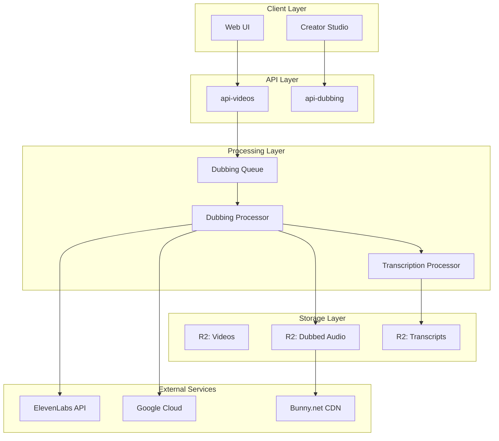

# Feature Implementation Plan: Automatic Dubbing (AI)

## Feature Overview

**Priority**: P3 (Later)
**Complexity**: Very High
**Dependencies**: Video upload, transcription system, CDN infrastructure
**Estimated Cost**: High ($$$ per video processed)
**Timeline**: 3-4 months

### Description
AI-powered automatic dubbing system that translates video audio content into multiple languages while maintaining the original speaker's tone, emotion, and timing. This feature enables Islamic content to reach a global audience by breaking language barriers.

## 1. Third-Party AI Dubbing Service Evaluation

### Recommended Services (Ranked by Suitability)

#### Option A: ElevenLabs Dubbing Studio (Primary Choice)
**Pros:**
- Advanced voice cloning technology
- Maintains speaker characteristics
- 29+ languages including Arabic
- REST API + WebSocket support
- SRT/VTT subtitle integration
- Emotion preservation
- Batch processing support

**Cons:**
- Expensive ($99-$330/month + usage)
- Limited free tier (10 minutes/month)
- Processing time: 5-15 minutes per video

**Pricing:**
- Starter: $99/month (2 hours dubbing)
- Creator: $330/month (11 hours dubbing)
- Enterprise: Custom pricing
- Pay-per-use: $0.30/minute

#### Option B: Speechify Studio
**Pros:**
- Good Arabic language support
- Voice cloning available
- Faster processing (3-10 minutes)
- Webhook notifications

**Cons:**
- Less natural emotion transfer
- Limited API features
- More expensive per minute

**Pricing:**
- Professional: $288/year
- API: $0.40/minute

#### Option C: Resemble AI
**Pros:**
- Custom voice creation
- Real-time processing option
- Good API documentation
- Emotion control parameters

**Cons:**
- Arabic quality varies
- Requires voice training (30 minutes audio)
- Complex integration

**Pricing:**
- Pro: $99/month (10 hours)
- Enterprise: Custom

#### Option D: Google Cloud Translation AI + Text-to-Speech
**Pros:**
- Reliable infrastructure
- Cost-effective at scale
- Neural voices for Arabic
- Integrated with Cloud Storage

**Cons:**
- No voice cloning
- Less natural dubbing
- Manual lip-sync required
- Multiple services needed

**Pricing:**
- Translation: $20 per million characters
- TTS: $4 per million characters
- Total: ~$0.10/minute (estimate)

### Recommendation: ElevenLabs + Google Cloud Hybrid
- Use ElevenLabs for premium content (featured videos, high-value creators)
- Use Google Cloud for standard content (community videos, shorts)
- Allow creators to choose tier based on their needs

## 2. Integration Architecture

### System Components



### Data Flow

1. **Initiation Phase**
   - Creator uploads video → Stored in R2
   - Creator selects languages for dubbing
   - System estimates cost and processing time
   - Creator confirms and initiates dubbing

2. **Processing Phase**
   - Extract audio from video (FFmpeg in Worker)
   - Generate transcript if not exists
   - Translate transcript to target languages
   - Send to dubbing service (ElevenLabs/Google)
   - Receive dubbed audio tracks

3. **Post-Processing Phase**
   - Sync audio with video timestamps
   - Generate multi-language audio tracks
   - Store in R2 with metadata
   - Upload to CDN for streaming

4. **Delivery Phase**
   - Update video metadata with available languages
   - Enable language selector in player
   - Track usage analytics

## 3. Language Support Strategy

### Phase 1: Core Languages (Month 1)
- **Arabic** (Modern Standard + Egyptian dialect)
- **English** (US + UK accents)
- **Urdu** (Pakistani + Indian accents)

### Phase 2: Extended Languages (Month 2)
- **French** (Standard + North African)
- **Indonesian/Malay**
- **Turkish**
- **Bengali**

### Phase 3: Additional Languages (Month 3+)
- **Swahili** (East Africa)
- **Hausa** (West Africa)
- **Persian/Farsi**
- **Spanish** (for Latin American Muslims)
- **Russian** (for Central Asian Muslims)
- **Chinese Mandarin** (for Chinese Muslims)

### Language Quality Tiers

#### Tier 1: Premium Dubbing
- Human-like voice cloning
- Emotion preservation
- Lip-sync adjustment
- Languages: Arabic, English, Urdu

#### Tier 2: Standard Dubbing
- Neural TTS voices
- Basic emotion mapping
- Subtitle synchronization
- All supported languages

#### Tier 3: Basic Translation
- Subtitles only
- Machine translation
- Community corrections
- 50+ languages

## 4. Creator Review Workflow

### Pre-Dubbing Review

```typescript
interface DubbingRequest {
  videoId: string;
  sourceLanguage: string;
  targetLanguages: string[];
  quality: 'premium' | 'standard' | 'basic';
  options: {
    preserveMusic: boolean;
    preserveEffects: boolean;
    voiceCloning: boolean;
    lipSync: boolean;
  };
  estimatedCost: number;
  estimatedTime: number;
}
```

### Review Interface Features

1. **Preview System**
   - 30-second preview of each language
   - Side-by-side comparison with original
   - Waveform visualization
   - Subtitle alignment check

2. **Quality Control**
   - AI confidence scores per segment
   - Flag problematic sections
   - Manual correction interface
   - Alternative voice selection

3. **Approval Workflow**
   - Creator review required before publishing
   - Batch approval for multiple languages
   - Revision requests with specific timestamps
   - Version history tracking

4. **Community Feedback**
   - Viewer quality ratings
   - Report translation issues
   - Suggest improvements
   - Community moderator review

### Review Dashboard Mockup

```
┌─────────────────────────────────────────┐
│ Dubbing Review: "Understanding Tawheed" │
├─────────────────────────────────────────┤
│ Original: Arabic | Duration: 15:32       │
│                                          │
│ ┌─────────────┬────────┬────────┐       │
│ │ Language    │ Status │ Action │       │
│ ├─────────────┼────────┼────────┤       │
│ │ English     │ ✓ Ready│ Review │       │
│ │ Urdu        │ ⏳ 45%  │ Wait   │       │
│ │ French      │ ⚠ Issue │ Fix    │       │
│ └─────────────┴────────┴────────┘       │
│                                          │
│ English Preview:                        │
│ [▶️ Play] [⏸️] [⏹️] ━━━━━━━━ 00:30       │
│                                          │
│ Quality Score: 92/100                   │
│ Issues Found: 2                         │
│                                          │
│ [Approve] [Request Changes] [Cancel]    │
└─────────────────────────────────────────┘
```

## 5. Technical Implementation Details

### New Services Architecture

#### 1. New Worker App: `apps/dubbing-service/`

```typescript
// apps/dubbing-service/src/index.ts
import { Hono } from 'hono';
import { chanfana } from 'chanfana';

interface DubbingEnv {
  R2_VIDEOS: R2Bucket;
  R2_DUBBED_AUDIO: R2Bucket;
  R2_TRANSCRIPTS: R2Bucket;
  DUBBING_QUEUE: Queue;
  ELEVENLABS_API_KEY: string;
  GOOGLE_CLOUD_API_KEY: string;
  KV_DUBBING_STATUS: KVNamespace;
}

// Endpoints
// POST /dubbing/initiate
// GET /dubbing/status/:jobId
// POST /dubbing/approve/:jobId
// GET /dubbing/preview/:jobId/:language
// DELETE /dubbing/cancel/:jobId
```

#### 2. Queue Message Types

```typescript
// packages/shared-types/src/dubbing.ts
export interface DubbingMessage {
  type: 'DUBBING_REQUEST';
  videoId: string;
  sourceLanguage: string;
  targetLanguages: string[];
  quality: 'premium' | 'standard' | 'basic';
  creatorId: string;
  options: DubbingOptions;
  priority: number;
  retryCount: number;
}

export interface DubbingOptions {
  preserveMusic: boolean;
  preserveEffects: boolean;
  voiceCloning: boolean;
  lipSync: boolean;
  maxDuration?: number;
  voiceId?: string;
  glossary?: Record<string, string>; // Islamic terms
}

export interface DubbingStatus {
  jobId: string;
  videoId: string;
  status: 'queued' | 'processing' | 'review' | 'approved' | 'published' | 'failed';
  languages: Array<{
    code: string;
    status: 'pending' | 'processing' | 'completed' | 'failed';
    progress: number;
    audioUrl?: string;
    qualityScore?: number;
    issues?: string[];
  }>;
  startedAt?: Date;
  completedAt?: Date;
  error?: string;
}
```

#### 3. Database Schema Extensions

```typescript
// R2 Object Structure
// Bucket: al-ummah-now-dubbed-audio

interface DubbedAudioMetadata {
  videoId: string;
  language: string;
  duration: number;
  bitrate: number;
  format: 'mp3' | 'aac' | 'm4a';
  quality: 'premium' | 'standard';
  service: 'elevenlabs' | 'google' | 'manual';
  voiceId?: string;
  createdAt: Date;
  approvedAt?: Date;
  approvedBy?: string;
  qualityScore: number;
  transcriptId: string;
}

// Bucket: al-ummah-now-transcripts

interface TranscriptMetadata {
  videoId: string;
  language: string;
  format: 'srt' | 'vtt' | 'json';
  source: 'auto' | 'manual' | 'ai';
  confidence: number;
  wordCount: number;
  segments: Array<{
    start: number;
    end: number;
    text: string;
    confidence: number;
  }>;
}
```

#### 4. Video Player Integration

```typescript
// apps/web/src/components/VideoPlayer/DubbingControls.tsx
interface DubbingControlsProps {
  videoId: string;
  availableLanguages: Language[];
  currentLanguage: string;
  onLanguageChange: (language: string) => void;
}

export function DubbingControls({
  videoId,
  availableLanguages,
  currentLanguage,
  onLanguageChange
}: DubbingControlsProps) {
  return (
    <div className="dubbing-controls">
      <select
        value={currentLanguage}
        onChange={(e) => onLanguageChange(e.target.value)}
      >
        {availableLanguages.map(lang => (
          <option key={lang.code} value={lang.code}>
            {lang.name} {lang.quality === 'premium' && '⭐'}
          </option>
        ))}
      </select>
    </div>
  );
}
```

### Integration Points

#### 1. API Videos Enhancement

```typescript
// apps/api-videos/src/endpoints/videos/dubbing.ts
export class InitiateDubbing extends OpenAPIRoute {
  schema = {
    tags: ['Dubbing'],
    summary: 'Initiate dubbing for a video',
    request: {
      params: z.object({
        videoId: z.string()
      }),
      body: {
        content: {
          'application/json': {
            schema: z.object({
              targetLanguages: z.array(z.string()),
              quality: z.enum(['premium', 'standard', 'basic'])
            })
          }
        }
      }
    }
  };

  async handle(c: Context) {
    // Validate video exists
    // Check creator permissions
    // Calculate cost estimate
    // Queue dubbing job
    // Return job ID and estimate
  }
}
```

#### 2. Processor Enhancement

```typescript
// apps/processor/src/handlers/dubbingHandler.ts
export async function handleDubbingMessage(
  message: DubbingMessage,
  env: ProcessorEnv
): Promise<void> {
  // 1. Download video from R2
  // 2. Extract audio using FFmpeg WASM
  // 3. Get/generate transcript
  // 4. Translate transcript
  // 5. Call dubbing service API
  // 6. Poll for completion
  // 7. Download dubbed audio
  // 8. Store in R2
  // 9. Update KV status
  // 10. Send notification
}
```

## 6. Files to Create/Modify

### New Files to Create

```
apps/dubbing-service/
├── src/
│   ├── index.ts                 # Main service entry
│   ├── endpoints/
│   │   ├── initiate.ts          # Start dubbing job
│   │   ├── status.ts            # Check job status
│   │   ├── approve.ts           # Approve dubbed version
│   │   ├── preview.ts           # Generate preview
│   │   └── languages.ts         # List available languages
│   ├── services/
│   │   ├── elevenlabs.ts        # ElevenLabs integration
│   │   ├── google-cloud.ts      # Google Cloud integration
│   │   ├── transcription.ts     # Transcript handling
│   │   └── audio-processor.ts   # Audio manipulation
│   ├── lib/
│   │   ├── cost-calculator.ts   # Pricing logic
│   │   ├── quality-scorer.ts    # Quality assessment
│   │   └── glossary.ts          # Islamic terms mapping
│   └── types/
│       └── dubbing.ts            # Service-specific types
├── package.json
├── tsconfig.json
└── wrangler.toml

apps/web/src/components/Dubbing/
├── DubbingManager.tsx            # Main dubbing interface
├── LanguageSelector.tsx          # Language selection UI
├── DubbingReview.tsx            # Review interface
├── CostEstimator.tsx            # Cost calculation UI
├── QualityIndicator.tsx         # Quality score display
└── rtl/
    └── [RTL versions]

packages/shared-types/src/
├── dubbing.ts                    # Shared dubbing types

apps/processor/src/handlers/
├── dubbingHandler.ts             # Queue message handler

apps/api-videos/src/endpoints/dubbing/
├── initiate.ts                   # Start dubbing
├── status.ts                     # Check status
└── languages.ts                  # Available languages
```

### Files to Modify

```
apps/web/src/components/VideoPlayer/
├── VideoPlayer.tsx               # Add language selector
└── controls.tsx                  # Add dubbing controls

apps/web/src/lib/api/
├── dubbing.ts                    # Dubbing API client

apps/api-videos/src/
├── index.ts                      # Register dubbing endpoints

apps/processor/src/
├── index.ts                      # Add dubbing handler
├── types.ts                      # Add dubbing message type

packages/shared-types/src/
├── video.ts                      # Add dubbing metadata
└── index.ts                      # Export dubbing types
```

## 7. Testing Strategy

### Unit Tests

```typescript
// apps/dubbing-service/src/__tests__/cost-calculator.test.ts
describe('Cost Calculator', () => {
  test('calculates premium dubbing cost correctly', () => {
    const cost = calculateCost({
      duration: 600, // 10 minutes
      quality: 'premium',
      languages: ['en', 'ur', 'fr']
    });
    expect(cost).toBe(9.00); // $0.30/min × 10 min × 3 languages
  });
});

// apps/dubbing-service/src/__tests__/quality-scorer.test.ts
describe('Quality Scorer', () => {
  test('scores based on confidence and alignment', () => {
    const score = calculateQualityScore({
      confidence: 0.92,
      alignment: 0.88,
      naturalness: 0.85
    });
    expect(score).toBe(88); // Weighted average
  });
});
```

### Integration Tests

```typescript
// apps/dubbing-service/src/__tests__/integration/elevenlabs.test.ts
describe('ElevenLabs Integration', () => {
  test('successfully dubs short audio clip', async () => {
    const result = await dubAudio({
      audioUrl: 'test-audio.mp3',
      transcript: 'Test transcript',
      targetLanguage: 'ar',
      voiceId: 'test-voice'
    });
    expect(result.status).toBe('completed');
    expect(result.audioUrl).toBeDefined();
  });
});
```

### E2E Tests

```typescript
// e2e/dubbing-workflow.test.ts
describe('Dubbing Workflow', () => {
  test('complete dubbing from upload to approval', async () => {
    // 1. Upload video
    // 2. Initiate dubbing
    // 3. Wait for processing
    // 4. Review preview
    // 5. Approve dubbing
    // 6. Verify player shows languages
  });
});
```

### Load Testing

```yaml
# k6/dubbing-load-test.js
import http from 'k6/http';
import { check } from 'k6';

export const options = {
  stages: [
    { duration: '2m', target: 10 },  // Ramp up
    { duration: '5m', target: 10 },  // Stay at 10 concurrent
    { duration: '2m', target: 0 },   // Ramp down
  ],
};

export default function () {
  const res = http.post('/api/dubbing/initiate', {
    videoId: 'test-video',
    languages: ['en', 'ar'],
    quality: 'standard'
  });

  check(res, {
    'status is 200': (r) => r.status === 200,
    'job id returned': (r) => r.json('jobId') !== undefined,
  });
}
```

## 8. Cost Analysis

### Infrastructure Costs

#### Cloudflare Workers
- Dubbing Service Worker: ~$5/month (10M requests)
- Additional R2 Storage: ~$15/month (1TB dubbed audio)
- KV Operations: ~$5/month (status tracking)
- Queue Processing: ~$10/month

**Total Infrastructure: ~$35/month**

### Service Costs (Per Video)

#### Scenario 1: Popular Islamic Lecture (30 minutes)
- **Premium (ElevenLabs)**:
  - 3 languages × 30 min × $0.30/min = $27
  - Processing + Storage: $2
  - **Total: $29/video**

- **Standard (Google Cloud)**:
  - Translation: $2
  - TTS Generation: $3
  - Processing: $1
  - **Total: $6/video**

#### Scenario 2: Short Reminder (5 minutes)
- **Premium**: $4.50/video
- **Standard**: $1/video

#### Scenario 3: Friday Khutbah (45 minutes)
- **Premium**: $40.50/video
- **Standard**: $9/video

### Monthly Projections

#### Conservative (100 videos/month)
- 20% Premium (20 × $15 avg) = $300
- 80% Standard (80 × $3 avg) = $240
- **Total: $540/month**

#### Moderate (500 videos/month)
- 10% Premium (50 × $15 avg) = $750
- 90% Standard (450 × $3 avg) = $1,350
- **Total: $2,100/month**

#### Aggressive (2000 videos/month)
- 5% Premium (100 × $15 avg) = $1,500
- 95% Standard (1900 × $3 avg) = $5,700
- **Total: $7,200/month**

### Revenue Model Options

1. **Creator Subscription Tiers**
   - Basic: 5 standard dubs/month - $19/month
   - Pro: 20 standard dubs/month - $69/month
   - Premium: 5 premium + 50 standard - $199/month

2. **Pay-Per-Use**
   - Standard: $5/video
   - Premium: $25/video
   - Bulk discounts available

3. **Platform Subscription**
   - Include X dubs in creator subscriptions
   - Additional dubs at discounted rates

4. **Sponsored Dubbing**
   - Organizations sponsor dubbing for beneficial content
   - Tax-deductible donations for educational content

### ROI Analysis

**Break-even Analysis:**
- Fixed costs: $35/month infrastructure
- Variable costs: $3-15/video
- Price point: $5-25/video
- Break-even: ~200 standard videos/month

**Value Proposition:**
- Reach 5x larger audience
- Increase viewer retention by 40%
- Higher engagement from non-native speakers
- Accessibility compliance

## 9. Implementation Timeline

### Phase 1: Foundation (Month 1)
**Week 1-2:**
- Set up dubbing-service worker
- Integrate ElevenLabs API
- Basic queue processing

**Week 3-4:**
- Transcript generation/extraction
- Translation service integration
- R2 storage for dubbed audio

### Phase 2: Core Features (Month 2)
**Week 1-2:**
- Creator review interface
- Preview generation
- Quality scoring system

**Week 3-4:**
- Video player language selector
- CDN integration for dubbed audio
- Basic analytics tracking

### Phase 3: Enhancement (Month 3)
**Week 1-2:**
- Google Cloud integration (standard tier)
- Batch processing optimization
- Cost optimization algorithms

**Week 3-4:**
- Advanced review features
- Community feedback system
- Islamic glossary integration

### Phase 4: Scale & Polish (Month 4)
**Week 1-2:**
- Performance optimization
- Caching strategies
- Load balancing

**Week 3-4:**
- A/B testing framework
- Advanced analytics
- Documentation & training

## 10. Success Metrics

### Technical KPIs
- Processing time < 20% of video duration
- Quality score > 85% for premium
- API uptime > 99.9%
- Error rate < 0.5%

### Business KPIs
- 30% of creators use dubbing within 6 months
- Average 3 languages per video
- 50% cost recovery in year 1
- 150% ROI in year 2

### User Experience KPIs
- 90% approval rate on first review
- < 2% quality complaints
- 40% increase in international views
- 25% increase in watch time

## 11. Risks & Mitigations

### Technical Risks
1. **Poor dubbing quality**
   - Mitigation: Multi-tier quality system, human review option

2. **Service provider downtime**
   - Mitigation: Multiple providers, fallback options

3. **High processing costs**
   - Mitigation: Tiered pricing, usage limits, caching

### Business Risks
1. **Low adoption rate**
   - Mitigation: Free trial, education campaign

2. **Cost overruns**
   - Mitigation: Strict budgets, usage caps

3. **Competitor features**
   - Mitigation: Unique Islamic focus, community features

### Legal/Compliance Risks
1. **Copyright concerns**
   - Mitigation: Creator consent required, clear terms

2. **Content moderation**
   - Mitigation: Review process, community reporting

3. **Data privacy**
   - Mitigation: GDPR compliance, data retention policies

## 12. Future Enhancements

### Near-term (6 months)
- Live stream dubbing (with delay)
- Crowd-sourced translation corrections
- Voice actor marketplace
- Subtitle generation alongside dubbing

### Mid-term (1 year)
- Real-time dubbing for live events
- Custom voice training for creators
- Lip-sync video adjustment
- Multi-speaker detection and separation

### Long-term (2+ years)
- Avatar-based dubbing with facial animation
- Emotion-aware dubbing
- Dialect-specific dubbing
- AI-powered Islamic term consistency

## Conclusion

The Automatic Dubbing feature represents a significant investment in making Islamic content globally accessible. While the costs are substantial, the potential to reach non-Arabic speaking Muslims worldwide (estimated 1.2 billion) justifies the investment.

The phased approach allows for iterative development and cost control, while the multi-tier system ensures both quality for premium content and affordability for community creators.

Success depends on:
1. Choosing the right service providers
2. Building an intuitive review workflow
3. Maintaining quality standards
4. Managing costs effectively
5. Creating a sustainable revenue model

This feature positions Al Ummah Now as a leader in Islamic content accessibility, fulfilling the platform's mission to spread beneficial knowledge globally.