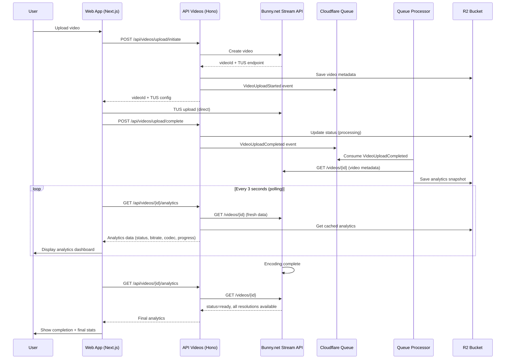

# Feature 31: Upload Analytics During Processing

**Status**: Draft
**Priority**: Medium (Phase 4 - Platform Maturity)
**Complexity**: Medium (1-2 weeks)
**Last Updated**: 2025-11-20

---

## Executive Summary

This feature adds real-time analytics display during video upload and processing, showing creators detailed technical information about their videos including bitrate, codec, resolution, processing status, and performance metrics. This provides transparency, helps creators optimize their content, and improves troubleshooting when issues occur.

**User Value**: Creators gain insight into video quality and processing status, enabling them to make informed decisions about re-encoding or re-uploading content before publishing.

---

## Table of Contents

1. [Requirements](#requirements)
2. [Architecture Overview](#architecture-overview)
3. [Technical Design](#technical-design)
4. [Implementation Plan](#implementation-plan)
5. [Testing Strategy](#testing-strategy)
6. [Security Considerations](#security-considerations)
7. [Performance Considerations](#performance-considerations)
8. [Future Enhancements](#future-enhancements)
9. [References](#references)

---

## Requirements

### Functional Requirements

**FR1: Real-time Processing Status**
- Display current processing stage (uploading, transcoding, encoding, finalizing)
- Show estimated time remaining for each stage
- Update progress percentage continuously

**FR2: Technical Video Information**
- Video codec (H.264, H.265, VP9, AV1)
- Audio codec (AAC, MP3, Opus)
- Bitrate (video and audio, in kbps/Mbps)
- Frame rate (24, 30, 60 fps, etc.)
- Resolution (original and target resolutions)
- File format (MP4, MOV, AVI, WebM)
- File size and compressed size

**FR3: Processing Statistics**
- Upload speed (MB/s or KB/s)
- Processing speed (frames per second)
- Time elapsed and time remaining
- Transcoding queue position (if queued)
- Retry attempts and errors

**FR4: Quality Metrics**
- Available resolutions being generated (360p, 480p, 720p, 1080p, 4K)
- Encoding progress per resolution
- Quality score or health indicator
- Compression ratio
- Estimated bandwidth usage for playback

**FR5: Error Reporting**
- Detailed error messages during processing
- Warnings about potential quality issues
- Recommendations for re-encoding
- Transcoding message logs from Bunny.net

### Non-Functional Requirements

**NFR1: Performance**
- Analytics updates should not delay upload or processing
- Polling frequency: every 2-5 seconds during active processing
- Client-side caching to minimize API calls
- Maximum 500ms latency for analytics data retrieval

**NFR2: Scalability**
- Support 1000+ concurrent uploads with analytics
- Efficient data storage (compressed JSON in R2)
- Minimal impact on processor queue throughput

**NFR3: Usability**
- Clear, non-technical language for non-experts
- Progressive disclosure (basic stats visible, detailed stats expandable)
- Mobile-responsive analytics dashboard
- Bilingual support (English/Arabic)

**NFR4: Reliability**
- Analytics failure should not block video upload/processing
- Graceful degradation if Bunny.net API is unavailable
- Retry logic for transient API failures
- Fallback to basic status if detailed analytics unavailable

---

## Architecture Overview

### High-Level Flow



### Component Architecture

**1. Frontend (Web App)**
- Upload analytics dashboard component
- Real-time progress visualization
- Technical details panel (expandable)
- Error message display

**2. Backend (API Videos)**
- Analytics retrieval endpoint
- Bunny.net API integration for video stats
- R2 caching for analytics data
- Queue event emission

**3. Queue Processor**
- Analytics snapshot creation on upload complete
- Periodic analytics updates during processing
- Error tracking and logging

**4. Data Storage**
- R2 bucket: `video-analytics` (production), `video-analytics-preview` (dev)
- Key structure: `{videoId}.json`
- Retention: 30 days after video ready

---

## Technical Design

### 1. Data Models

#### Video Analytics Object (R2 Storage)

```typescript
// packages/shared-types/src/analytics.ts

export interface VideoAnalytics {
  videoId: string;
  userId: string;
  channelId: string;

  // Processing status
  processingStage: ProcessingStage;
  processingProgress: number; // 0-100
  status: VideoStatus; // 'pending' | 'processing' | 'ready' | 'failed'

  // Upload metrics
  uploadMetrics: {
    fileSize: number; // bytes
    uploadSpeed: number; // bytes per second
    uploadDuration: number; // seconds
    uploadStartTime: string; // ISO 8601
    uploadEndTime?: string; // ISO 8601
  };

  // Video technical details
  videoDetails: {
    codec: string; // 'H.264', 'H.265', 'VP9', 'AV1', etc.
    bitrate: number; // bits per second
    framerate: number; // frames per second
    resolution: {
      width: number;
      height: number;
      label: string; // '1080p', '4K', etc.
    };
    duration: number; // seconds
    format: string; // 'mp4', 'mov', 'webm', etc.
  };

  // Audio technical details
  audioDetails: {
    codec: string; // 'AAC', 'MP3', 'Opus', etc.
    bitrate: number; // bits per second
    sampleRate: number; // Hz (44100, 48000, etc.)
    channels: number; // 1 (mono), 2 (stereo), 6 (5.1), etc.
  };

  // Processing metrics
  processingMetrics: {
    startTime?: string; // ISO 8601
    endTime?: string; // ISO 8601
    processingDuration?: number; // seconds
    queuePosition?: number;
    encodingSpeed?: number; // frames per second
  };

  // Available resolutions
  availableResolutions: Resolution[];

  // Quality metrics
  qualityMetrics: {
    compressionRatio: number; // original size / encoded size
    estimatedBandwidth: number; // kbps for playback
    qualityScore?: number; // 0-100 (if calculable)
  };

  // Error tracking
  errors: TranscodingError[];
  warnings: TranscodingWarning[];

  // Timestamps
  createdAt: string; // ISO 8601
  updatedAt: string; // ISO 8601
}

export type ProcessingStage =
  | 'uploading'
  | 'queued'
  | 'transcoding'
  | 'encoding'
  | 'finalizing'
  | 'ready'
  | 'failed';

export type VideoStatus =
  | 'pending'
  | 'processing'
  | 'ready'
  | 'failed';

export interface Resolution {
  width: number;
  height: number;
  label: string; // '360p', '480p', '720p', '1080p', '1440p', '4K'
  bitrate: number; // bits per second
  status: 'pending' | 'processing' | 'ready' | 'failed';
  progress: number; // 0-100
}

export interface TranscodingError {
  code: string;
  message: string;
  timestamp: string; // ISO 8601
  level: 'error' | 'critical';
}

export interface TranscodingWarning {
  code: string;
  message: string;
  timestamp: string; // ISO 8601
  recommendation?: string;
}
```

#### Bunny.net API Response Mapping

The `VideoModel` from Bunny.net (in `apps/api-videos/src/lib/bunny/types.ts`) already provides:
- `status`: 0 (Created), 1 (Uploaded), 2 (Processing), 3 (Encoding), 4 (Ready)
- `encodeProgress`: 0-100
- `width`, `height`: Resolution
- `framerate`: FPS
- `length`: Duration in seconds
- `storageSize`: File size in bytes
- `availableResolutions`: Comma-separated string (e.g., "240,360,480,720,1080")
- `transcodingMessages`: Array of transcoding issues

**Mapping Strategy**:
- Map Bunny's numeric `status` to our `ProcessingStage`
- Parse `transcodingMessages` to populate `errors` and `warnings`
- Calculate `compressionRatio` from original file size vs `storageSize`
- Use `encodeProgress` directly for `processingProgress`

### 2. API Endpoints

#### 2.1 Get Video Analytics (New Endpoint)

**File**: `apps/api-videos/src/endpoints/video/analytics.ts`

```typescript
import { OpenAPIRoute, Str } from "chanfana";
import { z } from "zod";
import { getAuthContext } from "../../middleware/auth";
import { addAuthToSchema } from "../../lib/openapi-auth";
import { VideoAnalytics } from "@al-ummah/shared-types";
import { BunnyStreamClient } from "../../lib/bunny/stream";
import R2Repository from "../../lib/r2Repo";

export class GetVideoAnalyticsEndpoint extends OpenAPIRoute {
  schema = addAuthToSchema({
    tags: ["Videos", "Analytics"],
    summary: "Get Video Upload Analytics",
    description: "🔒 **Authentication Required**: Retrieve detailed processing analytics for a video.",
    request: {
      params: z.object({
        videoId: Str({ description: "Video ID" }),
      }),
    },
    responses: {
      "200": {
        description: "Video analytics retrieved successfully",
        content: {
          "application/json": {
            schema: z.object({
              success: z.boolean(),
              result: z.object({
                analytics: z.custom<VideoAnalytics>(),
              }),
            }),
          },
        },
      },
      "401": { description: "Unauthorized" },
      "403": { description: "Forbidden - not video owner" },
      "404": { description: "Video not found" },
      "500": { description: "Internal server error" },
    },
  }, 'required');

  async handle(c) {
    const authContext = getAuthContext(c);
    const userId = authContext?.userId;
    const { videoId } = await this.getValidatedData<typeof this.schema>();

    // Get video from R2 to verify ownership
    const videoRepo = new R2Repository(c.env.videos);
    const video = await videoRepo.getObject(videoId);

    if (!video) {
      return c.json({ success: false, error: "Video not found" }, 404);
    }

    if (video.userId !== userId) {
      return c.json({ success: false, error: "Forbidden" }, 403);
    }

    // Try to get cached analytics from R2 first
    const analyticsRepo = new R2Repository<VideoAnalytics>(c.env.VIDEO_ANALYTICS);
    let analytics = await analyticsRepo.getObject(videoId);

    // If no cached analytics or video is still processing, fetch fresh data from Bunny.net
    if (!analytics || video.processingStatus === 'processing') {
      const bunnyClient = new BunnyStreamClient(
        await c.env["bunny-stream-key"].text()
      );
      const libraryId = parseInt(await c.env["bunny_stream_library_id"].text());

      try {
        const bunnyVideo = await bunnyClient.getVideo(libraryId, videoId);

        // Generate analytics from Bunny data
        analytics = this.generateAnalyticsFromBunny(
          bunnyVideo,
          video,
          analytics
        );

        // Cache updated analytics in R2
        await analyticsRepo.putObject(videoId, analytics);
      } catch (error) {
        // If Bunny API fails, return cached data if available
        if (analytics) {
          return c.json({ success: true, result: { analytics } });
        }
        throw error;
      }
    }

    return c.json({
      success: true,
      result: { analytics },
    });
  }

  private generateAnalyticsFromBunny(
    bunnyVideo: VideoModel,
    videoMetadata: any,
    existingAnalytics?: VideoAnalytics
  ): VideoAnalytics {
    // Map Bunny status to processing stage
    const stageMap: Record<number, ProcessingStage> = {
      0: 'queued',      // Created
      1: 'transcoding', // Uploaded
      2: 'encoding',    // Processing
      3: 'encoding',    // Encoding
      4: 'ready',       // Ready
    };

    const processingStage = stageMap[bunnyVideo.status] || 'queued';
    const status: VideoStatus =
      bunnyVideo.status === 4 ? 'ready' :
      bunnyVideo.status >= 1 ? 'processing' :
      'pending';

    // Parse available resolutions
    const resolutions = this.parseResolutions(
      bunnyVideo.availableResolutions,
      bunnyVideo.encodeProgress
    );

    // Calculate quality metrics
    const compressionRatio = videoMetadata.fileSize && bunnyVideo.storageSize
      ? videoMetadata.fileSize / bunnyVideo.storageSize
      : 1;

    const estimatedBandwidth = this.calculateBandwidth(
      bunnyVideo.width,
      bunnyVideo.height
    );

    // Parse transcoding messages
    const { errors, warnings } = this.parseTranscodingMessages(
      bunnyVideo.transcodingMessages || []
    );

    return {
      videoId: bunnyVideo.guid || '',
      userId: videoMetadata.userId,
      channelId: videoMetadata.channelId,
      processingStage,
      processingProgress: bunnyVideo.encodeProgress,
      status,
      uploadMetrics: existingAnalytics?.uploadMetrics || {
        fileSize: videoMetadata.fileSize || 0,
        uploadSpeed: 0,
        uploadDuration: 0,
        uploadStartTime: videoMetadata.dateCreated,
      },
      videoDetails: {
        codec: 'H.264', // Bunny doesn't expose codec, assume H.264
        bitrate: this.calculateVideoBitrate(bunnyVideo),
        framerate: bunnyVideo.framerate,
        resolution: {
          width: bunnyVideo.width,
          height: bunnyVideo.height,
          label: this.getResolutionLabel(bunnyVideo.height),
        },
        duration: bunnyVideo.length,
        format: 'mp4', // Bunny typically outputs MP4
      },
      audioDetails: {
        codec: 'AAC', // Assume AAC (most common)
        bitrate: 128000, // Typical 128kbps audio
        sampleRate: 48000,
        channels: 2,
      },
      processingMetrics: {
        startTime: existingAnalytics?.processingMetrics.startTime,
        endTime: status === 'ready' ? new Date().toISOString() : undefined,
        processingDuration: existingAnalytics?.processingMetrics.processingDuration,
      },
      availableResolutions: resolutions,
      qualityMetrics: {
        compressionRatio,
        estimatedBandwidth,
      },
      errors,
      warnings,
      createdAt: existingAnalytics?.createdAt || new Date().toISOString(),
      updatedAt: new Date().toISOString(),
    };
  }

  private parseResolutions(
    availableResolutions: string | undefined,
    overallProgress: number
  ): Resolution[] {
    if (!availableResolutions) return [];

    const heights = availableResolutions.split(',').map(h => parseInt(h));
    const resolutionLabels: Record<number, string> = {
      240: '240p',
      360: '360p',
      480: '480p',
      720: '720p',
      1080: '1080p',
      1440: '1440p',
      2160: '4K',
    };

    return heights.map(height => ({
      width: Math.round(height * (16/9)), // Assume 16:9
      height,
      label: resolutionLabels[height] || `${height}p`,
      bitrate: this.getBitrateForResolution(height),
      status: overallProgress === 100 ? 'ready' : 'processing',
      progress: overallProgress,
    }));
  }

  private parseTranscodingMessages(
    messages: TranscodingMessageModel[]
  ): { errors: TranscodingError[]; warnings: TranscodingWarning[] } {
    const errors: TranscodingError[] = [];
    const warnings: TranscodingWarning[] = [];

    for (const msg of messages) {
      const isCritical = msg.level >= 3; // Error or Critical

      if (isCritical) {
        errors.push({
          code: msg.issueCode.toString(),
          message: msg.message || 'Unknown error',
          timestamp: msg.timeStamp,
          level: msg.level === 4 ? 'critical' : 'error',
        });
      } else if (msg.level === 2) { // Warning
        warnings.push({
          code: msg.issueCode.toString(),
          message: msg.message || 'Unknown warning',
          timestamp: msg.timeStamp,
        });
      }
    }

    return { errors, warnings };
  }

  private calculateVideoBitrate(video: VideoModel): number {
    if (video.length > 0 && video.storageSize > 0) {
      // bitrate = (fileSize in bits) / duration in seconds
      return Math.round((video.storageSize * 8) / video.length);
    }
    return 0;
  }

  private getBitrateForResolution(height: number): number {
    // Typical bitrates for common resolutions (bits per second)
    const bitrateMap: Record<number, number> = {
      240: 400000,    // 400 kbps
      360: 700000,    // 700 kbps
      480: 1500000,   // 1.5 Mbps
      720: 3000000,   // 3 Mbps
      1080: 6000000,  // 6 Mbps
      1440: 12000000, // 12 Mbps
      2160: 20000000, // 20 Mbps
    };
    return bitrateMap[height] || 1000000;
  }

  private calculateBandwidth(width: number, height: number): number {
    // Estimate bandwidth in kbps based on resolution
    const pixels = width * height;

    if (pixels <= 640 * 360) return 700;      // 360p
    if (pixels <= 854 * 480) return 1500;     // 480p
    if (pixels <= 1280 * 720) return 3000;    // 720p
    if (pixels <= 1920 * 1080) return 6000;   // 1080p
    if (pixels <= 2560 * 1440) return 12000;  // 1440p
    return 20000; // 4K+
  }

  private getResolutionLabel(height: number): string {
    const labels: Record<number, string> = {
      240: '240p',
      360: '360p',
      480: '480p',
      720: '720p HD',
      1080: '1080p Full HD',
      1440: '1440p 2K',
      2160: '4K Ultra HD',
    };
    return labels[height] || `${height}p`;
  }
}
```

#### 2.2 Register Endpoint

**File**: `apps/api-videos/src/index.ts`

Add to the router:

```typescript
import { GetVideoAnalyticsEndpoint } from './endpoints/video/analytics';

// Register analytics endpoint (authenticated)
app.use('/api/videos/:videoId/analytics', authMiddleware);
openapi.get('/api/videos/:videoId/analytics', GetVideoAnalyticsEndpoint);
```

### 3. Queue Events Enhancement

#### 3.1 Analytics Snapshot Creation

**File**: `apps/processor/src/messageProcessor.ts`

Enhance `VideoUploadCompleted` handler to create initial analytics snapshot:

```typescript
// Add to processVideoMessage() for VideoCreate type
case MessageType.VideoUploadCompleted:
  this.logger.info(`Video ${videoId} upload completed, creating analytics snapshot`);
  await this.createAnalyticsSnapshot(message, env);
  break;

// New method
private async createAnalyticsSnapshot(
  message: AlUmmahMessage,
  env: QueueEnvironment
): Promise<void> {
  const { videoId, userId, channelId, fileSize, uploadStartTime, uploadEndTime } =
    message.payload as {
      videoId: string;
      userId: string;
      channelId: string;
      fileSize: number;
      uploadStartTime: string;
      uploadEndTime: string;
    };

  const uploadDuration = uploadEndTime && uploadStartTime
    ? (new Date(uploadEndTime).getTime() - new Date(uploadStartTime).getTime()) / 1000
    : 0;

  const uploadSpeed = uploadDuration > 0 ? fileSize / uploadDuration : 0;

  const initialAnalytics: VideoAnalytics = {
    videoId,
    userId,
    channelId,
    processingStage: 'queued',
    processingProgress: 0,
    status: 'pending',
    uploadMetrics: {
      fileSize,
      uploadSpeed,
      uploadDuration,
      uploadStartTime,
      uploadEndTime,
    },
    videoDetails: {
      codec: 'unknown',
      bitrate: 0,
      framerate: 0,
      resolution: { width: 0, height: 0, label: 'unknown' },
      duration: 0,
      format: 'unknown',
    },
    audioDetails: {
      codec: 'unknown',
      bitrate: 0,
      sampleRate: 0,
      channels: 0,
    },
    processingMetrics: {
      startTime: new Date().toISOString(),
    },
    availableResolutions: [],
    qualityMetrics: {
      compressionRatio: 1,
      estimatedBandwidth: 0,
    },
    errors: [],
    warnings: [],
    createdAt: new Date().toISOString(),
    updatedAt: new Date().toISOString(),
  };

  // Save to R2
  const analyticsRepo = new R2Repository<VideoAnalytics>(env.VIDEO_ANALYTICS);
  await analyticsRepo.putObject(videoId, initialAnalytics);

  this.logger.info(`Analytics snapshot created for video ${videoId}`);
}
```

### 4. Frontend Components

#### 4.1 Upload Analytics Dashboard

**File**: `apps/web/src/components/videoUpload/AnalyticsDashboard.tsx`

```typescript
"use client";
import React, { useState, useEffect } from "react";
import { VideoAnalytics } from "@al-ummah/shared-types";
import { useLanguage } from "@/hooks/useLanguage";
import {
  Activity,
  Video,
  Volume2,
  Clock,
  Zap,
  AlertCircle,
  CheckCircle,
  ChevronDown,
  ChevronUp
} from "lucide-react";

interface AnalyticsDashboardProps {
  videoId: string;
  onComplete?: () => void;
}

export const AnalyticsDashboard: React.FC<AnalyticsDashboardProps> = ({
  videoId,
  onComplete,
}) => {
  const { t, isRTL } = useLanguage();
  const [analytics, setAnalytics] = useState<VideoAnalytics | null>(null);
  const [showDetails, setShowDetails] = useState(false);
  const [error, setError] = useState<string | null>(null);

  useEffect(() => {
    let intervalId: NodeJS.Timeout;

    const fetchAnalytics = async () => {
      try {
        const response = await fetch(`/api/videos/${videoId}/analytics`);
        if (!response.ok) throw new Error('Failed to fetch analytics');

        const data = await response.json();
        if (data.success) {
          setAnalytics(data.result.analytics);

          // Stop polling when processing is complete
          if (data.result.analytics.status === 'ready') {
            clearInterval(intervalId);
            onComplete?.();
          }
        }
      } catch (err) {
        setError(err.message);
      }
    };

    // Initial fetch
    fetchAnalytics();

    // Poll every 3 seconds
    intervalId = setInterval(fetchAnalytics, 3000);

    return () => clearInterval(intervalId);
  }, [videoId, onComplete]);

  if (error) {
    return (
      <div className="bg-red-50 dark:bg-red-900/20 border border-red-200 dark:border-red-800 rounded-lg p-4">
        <div className="flex items-center gap-2 text-red-700 dark:text-red-400">
          <AlertCircle size={20} />
          <span>{t.analytics.errorLoading}: {error}</span>
        </div>
      </div>
    );
  }

  if (!analytics) {
    return (
      <div className="animate-pulse bg-gray-100 dark:bg-gray-800 rounded-lg p-6">
        <div className="h-4 bg-gray-300 dark:bg-gray-700 rounded w-3/4 mb-4"></div>
        <div className="h-4 bg-gray-300 dark:bg-gray-700 rounded w-1/2"></div>
      </div>
    );
  }

  const formatBytes = (bytes: number) => {
    if (bytes === 0) return '0 B';
    const k = 1024;
    const sizes = ['B', 'KB', 'MB', 'GB'];
    const i = Math.floor(Math.log(bytes) / Math.log(k));
    return `${(bytes / Math.pow(k, i)).toFixed(2)} ${sizes[i]}`;
  };

  const formatBitrate = (bps: number) => {
    if (bps >= 1000000) return `${(bps / 1000000).toFixed(1)} Mbps`;
    if (bps >= 1000) return `${(bps / 1000).toFixed(0)} kbps`;
    return `${bps} bps`;
  };

  const getStageLabel = (stage: string) => {
    const labels = {
      uploading: t.analytics.stages.uploading,
      queued: t.analytics.stages.queued,
      transcoding: t.analytics.stages.transcoding,
      encoding: t.analytics.stages.encoding,
      finalizing: t.analytics.stages.finalizing,
      ready: t.analytics.stages.ready,
      failed: t.analytics.stages.failed,
    };
    return labels[stage] || stage;
  };

  return (
    <div className="bg-white dark:bg-gray-800 rounded-lg shadow-lg p-6 space-y-6">
      {/* Processing Stage */}
      <div>
        <div className="flex items-center justify-between mb-2">
          <h3 className="text-lg font-semibold text-gray-900 dark:text-white">
            {getStageLabel(analytics.processingStage)}
          </h3>
          {analytics.status === 'ready' && (
            <CheckCircle className="text-green-600" size={24} />
          )}
        </div>

        <div className="w-full bg-gray-200 dark:bg-gray-700 rounded-full h-3 mb-2">
          <div
            className="bg-blue-600 h-3 rounded-full transition-all duration-300"
            style={{ width: `${analytics.processingProgress}%` }}
          ></div>
        </div>

        <p className="text-sm text-gray-600 dark:text-gray-400">
          {analytics.processingProgress}% {t.analytics.complete}
        </p>
      </div>

      {/* Quick Stats Grid */}
      <div className="grid grid-cols-2 md:grid-cols-4 gap-4">
        <div className="bg-gray-50 dark:bg-gray-900 rounded-lg p-4">
          <div className="flex items-center gap-2 mb-2">
            <Video size={18} className="text-blue-600" />
            <span className="text-xs text-gray-600 dark:text-gray-400">
              {t.analytics.resolution}
            </span>
          </div>
          <p className="text-lg font-semibold text-gray-900 dark:text-white">
            {analytics.videoDetails.resolution.label}
          </p>
        </div>

        <div className="bg-gray-50 dark:bg-gray-900 rounded-lg p-4">
          <div className="flex items-center gap-2 mb-2">
            <Zap size={18} className="text-yellow-600" />
            <span className="text-xs text-gray-600 dark:text-gray-400">
              {t.analytics.bitrate}
            </span>
          </div>
          <p className="text-lg font-semibold text-gray-900 dark:text-white">
            {formatBitrate(analytics.videoDetails.bitrate)}
          </p>
        </div>

        <div className="bg-gray-50 dark:bg-gray-900 rounded-lg p-4">
          <div className="flex items-center gap-2 mb-2">
            <Clock size={18} className="text-green-600" />
            <span className="text-xs text-gray-600 dark:text-gray-400">
              {t.analytics.duration}
            </span>
          </div>
          <p className="text-lg font-semibold text-gray-900 dark:text-white">
            {Math.floor(analytics.videoDetails.duration / 60)}:
            {String(Math.floor(analytics.videoDetails.duration % 60)).padStart(2, '0')}
          </p>
        </div>

        <div className="bg-gray-50 dark:bg-gray-900 rounded-lg p-4">
          <div className="flex items-center gap-2 mb-2">
            <Activity size={18} className="text-purple-600" />
            <span className="text-xs text-gray-600 dark:text-gray-400">
              {t.analytics.fileSize}
            </span>
          </div>
          <p className="text-lg font-semibold text-gray-900 dark:text-white">
            {formatBytes(analytics.uploadMetrics.fileSize)}
          </p>
        </div>
      </div>

      {/* Available Resolutions */}
      {analytics.availableResolutions.length > 0 && (
        <div>
          <h4 className="text-sm font-semibold text-gray-700 dark:text-gray-300 mb-3">
            {t.analytics.availableResolutions}
          </h4>
          <div className="flex flex-wrap gap-2">
            {analytics.availableResolutions.map((res) => (
              <div
                key={res.label}
                className={`px-3 py-1 rounded-full text-sm ${
                  res.status === 'ready'
                    ? 'bg-green-100 dark:bg-green-900/30 text-green-700 dark:text-green-400'
                    : 'bg-gray-100 dark:bg-gray-700 text-gray-700 dark:text-gray-400'
                }`}
              >
                {res.label} {res.status === 'processing' && `(${res.progress}%)`}
              </div>
            ))}
          </div>
        </div>
      )}

      {/* Errors and Warnings */}
      {(analytics.errors.length > 0 || analytics.warnings.length > 0) && (
        <div className="space-y-2">
          {analytics.errors.map((error, idx) => (
            <div
              key={idx}
              className="bg-red-50 dark:bg-red-900/20 border border-red-200 dark:border-red-800 rounded-lg p-3"
            >
              <div className="flex items-start gap-2">
                <AlertCircle size={18} className="text-red-600 mt-0.5" />
                <div>
                  <p className="text-sm font-medium text-red-900 dark:text-red-400">
                    {error.message}
                  </p>
                  <p className="text-xs text-red-700 dark:text-red-500 mt-1">
                    {t.analytics.errorCode}: {error.code}
                  </p>
                </div>
              </div>
            </div>
          ))}

          {analytics.warnings.map((warning, idx) => (
            <div
              key={idx}
              className="bg-yellow-50 dark:bg-yellow-900/20 border border-yellow-200 dark:border-yellow-800 rounded-lg p-3"
            >
              <div className="flex items-start gap-2">
                <AlertCircle size={18} className="text-yellow-600 mt-0.5" />
                <div>
                  <p className="text-sm font-medium text-yellow-900 dark:text-yellow-400">
                    {warning.message}
                  </p>
                  {warning.recommendation && (
                    <p className="text-xs text-yellow-700 dark:text-yellow-500 mt-1">
                      {t.analytics.recommendation}: {warning.recommendation}
                    </p>
                  )}
                </div>
              </div>
            </div>
          ))}
        </div>
      )}

      {/* Detailed Technical Info (Expandable) */}
      <div className="border-t border-gray-200 dark:border-gray-700 pt-4">
        <button
          onClick={() => setShowDetails(!showDetails)}
          className="flex items-center justify-between w-full text-left"
        >
          <span className="text-sm font-semibold text-gray-700 dark:text-gray-300">
            {t.analytics.technicalDetails}
          </span>
          {showDetails ? (
            <ChevronUp size={20} className="text-gray-500" />
          ) : (
            <ChevronDown size={20} className="text-gray-500" />
          )}
        </button>

        {showDetails && (
          <div className="mt-4 space-y-3 text-sm">
            <div className="grid grid-cols-2 gap-4">
              <div>
                <p className="text-gray-600 dark:text-gray-400">{t.analytics.videoCodec}</p>
                <p className="font-medium text-gray-900 dark:text-white">
                  {analytics.videoDetails.codec}
                </p>
              </div>
              <div>
                <p className="text-gray-600 dark:text-gray-400">{t.analytics.audioCodec}</p>
                <p className="font-medium text-gray-900 dark:text-white">
                  {analytics.audioDetails.codec}
                </p>
              </div>
              <div>
                <p className="text-gray-600 dark:text-gray-400">{t.analytics.framerate}</p>
                <p className="font-medium text-gray-900 dark:text-white">
                  {analytics.videoDetails.framerate} fps
                </p>
              </div>
              <div>
                <p className="text-gray-600 dark:text-gray-400">{t.analytics.compressionRatio}</p>
                <p className="font-medium text-gray-900 dark:text-white">
                  {analytics.qualityMetrics.compressionRatio.toFixed(2)}x
                </p>
              </div>
              <div>
                <p className="text-gray-600 dark:text-gray-400">{t.analytics.uploadSpeed}</p>
                <p className="font-medium text-gray-900 dark:text-white">
                  {formatBytes(analytics.uploadMetrics.uploadSpeed)}/s
                </p>
              </div>
              <div>
                <p className="text-gray-600 dark:text-gray-400">{t.analytics.estimatedBandwidth}</p>
                <p className="font-medium text-gray-900 dark:text-white">
                  {analytics.qualityMetrics.estimatedBandwidth} kbps
                </p>
              </div>
            </div>
          </div>
        )}
      </div>
    </div>
  );
};
```

#### 4.2 Integrate into Upload Component

**File**: `apps/web/src/components/videoUpload/index.tsx`

Add analytics display after upload completes:

```typescript
import { AnalyticsDashboard } from './AnalyticsDashboard';

// In the VideoUpload component, after TUS upload succeeds:
const [showAnalytics, setShowAnalytics] = useState(false);

// In onSuccess callback:
onSuccess: async () => {
  // ... existing code ...

  // Show analytics dashboard
  setShowAnalytics(true);
},

// In the render section, after upload progress:
{showAnalytics && (
  <div className="mt-6">
    <AnalyticsDashboard
      videoId={videoIdRef.current}
      onComplete={() => {
        // Final completion actions
        setUploadProgress({ percentage: 100, state: 'complete' });
      }}
    />
  </div>
)}
```

### 5. Wrangler Configuration

**File**: `apps/api-videos/wrangler.jsonc`

Add new R2 bucket binding:

```jsonc
{
  "r2_buckets": [
    // ... existing buckets ...
    {
      "binding": "VIDEO_ANALYTICS",
      "bucket_name": "video-analytics",
      "preview_bucket_name": "video-analytics-preview"
    }
  ]
}
```

Create bucket via Cloudflare dashboard or CLI:

```bash
# Production
wrangler r2 bucket create video-analytics

# Preview
wrangler r2 bucket create video-analytics-preview
```

### 6. Internationalization

**File**: `apps/web/src/locales/en/common.json`

```json
{
  "analytics": {
    "errorLoading": "Failed to load analytics",
    "complete": "complete",
    "resolution": "Resolution",
    "bitrate": "Bitrate",
    "duration": "Duration",
    "fileSize": "File Size",
    "availableResolutions": "Available Resolutions",
    "errorCode": "Error Code",
    "recommendation": "Recommendation",
    "technicalDetails": "Technical Details",
    "videoCodec": "Video Codec",
    "audioCodec": "Audio Codec",
    "framerate": "Frame Rate",
    "compressionRatio": "Compression Ratio",
    "uploadSpeed": "Upload Speed",
    "estimatedBandwidth": "Estimated Bandwidth",
    "stages": {
      "uploading": "Uploading",
      "queued": "Queued for Processing",
      "transcoding": "Transcoding Video",
      "encoding": "Encoding Resolutions",
      "finalizing": "Finalizing",
      "ready": "Ready",
      "failed": "Processing Failed"
    }
  }
}
```

**File**: `apps/web/src/locales/ar/common.json`

```json
{
  "analytics": {
    "errorLoading": "فشل تحميل التحليلات",
    "complete": "مكتمل",
    "resolution": "الدقة",
    "bitrate": "معدل البت",
    "duration": "المدة",
    "fileSize": "حجم الملف",
    "availableResolutions": "الدقات المتاحة",
    "errorCode": "رمز الخطأ",
    "recommendation": "التوصية",
    "technicalDetails": "التفاصيل التقنية",
    "videoCodec": "ترميز الفيديو",
    "audioCodec": "ترميز الصوت",
    "framerate": "معدل الإطارات",
    "compressionRatio": "نسبة الضغط",
    "uploadSpeed": "سرعة الرفع",
    "estimatedBandwidth": "عرض النطاق المقدر",
    "stages": {
      "uploading": "جاري الرفع",
      "queued": "في قائمة الانتظار",
      "transcoding": "جاري تحويل الفيديو",
      "encoding": "جاري ترميز الدقات",
      "finalizing": "جاري الإنهاء",
      "ready": "جاهز",
      "failed": "فشل المعالجة"
    }
  }
}
```

---

## Implementation Plan

### Phase 1: Backend Foundation (3 days)

**Tasks:**
1. Add `VideoAnalytics` type to shared-types package (1 hour)
2. Implement `GetVideoAnalyticsEndpoint` in api-videos (4 hours)
3. Add R2 bucket bindings for analytics storage (1 hour)
4. Enhance queue processor to create analytics snapshots (3 hours)
5. Test endpoint with mock data (2 hours)

**Deliverables:**
- [ ] `packages/shared-types/src/analytics.ts` (new file)
- [ ] `apps/api-videos/src/endpoints/video/analytics.ts` (new file)
- [ ] `apps/processor/src/messageProcessor.ts` (modified)
- [ ] `apps/api-videos/wrangler.jsonc` (updated with VIDEO_ANALYTICS binding)
- [ ] R2 buckets created (production + preview)

**Acceptance Criteria:**
- GET `/api/videos/{id}/analytics` returns valid VideoAnalytics object
- Analytics snapshot created in R2 on upload completion
- Bunny.net API integration works correctly
- Error handling for missing videos or unauthorized access

### Phase 2: Frontend Dashboard (3 days)

**Tasks:**
1. Create `AnalyticsDashboard` component (6 hours)
2. Add polling logic with 3-second intervals (2 hours)
3. Implement expandable technical details section (2 hours)
4. Add error and warning display components (2 hours)
5. Integrate dashboard into upload component (2 hours)
6. Test on different screen sizes (mobile/desktop) (2 hours)

**Deliverables:**
- [ ] `apps/web/src/components/videoUpload/AnalyticsDashboard.tsx` (new file)
- [ ] `apps/web/src/components/videoUpload/index.tsx` (modified)
- [ ] Mobile-responsive UI
- [ ] Dark mode support

**Acceptance Criteria:**
- Dashboard displays all analytics metrics correctly
- Real-time updates every 3 seconds
- Polling stops when video is ready
- Errors and warnings are clearly visible
- Expandable technical details work
- RTL support for Arabic

### Phase 3: Internationalization (1 day)

**Tasks:**
1. Add English analytics translations (1 hour)
2. Add Arabic analytics translations (2 hours)
3. Test bilingual support (1 hour)
4. RTL layout adjustments (2 hours)

**Deliverables:**
- [ ] `apps/web/src/locales/en/common.json` (updated)
- [ ] `apps/web/src/locales/ar/common.json` (updated)
- [ ] RTL layout verified

**Acceptance Criteria:**
- All analytics text is translatable
- Arabic translations are accurate
- RTL layout renders correctly
- No hardcoded English strings

### Phase 4: Testing and Polish (2 days)

**Tasks:**
1. End-to-end testing with real video uploads (4 hours)
2. Test error scenarios (API failures, network issues) (2 hours)
3. Performance testing (load testing with concurrent uploads) (2 hours)
4. Bug fixes and refinements (4 hours)
5. Documentation updates (2 hours)

**Deliverables:**
- [ ] Test report documenting scenarios tested
- [ ] Performance metrics (API latency, R2 operations)
- [ ] Updated `ROADMAP.md` and `YOUTUBE_FEATURE_COMPARISON.md`

**Acceptance Criteria:**
- All test scenarios pass
- No critical bugs
- API latency under 500ms
- Graceful degradation on API failures
- Documentation complete

---

## Testing Strategy

### Unit Tests

**API Endpoint Tests** (`apps/api-videos/src/endpoints/video/analytics.test.ts`):
```typescript
describe('GetVideoAnalyticsEndpoint', () => {
  test('returns 404 for non-existent video', async () => {
    // Test implementation
  });

  test('returns 403 for unauthorized user', async () => {
    // Test implementation
  });

  test('returns valid analytics for video owner', async () => {
    // Test implementation
  });

  test('handles Bunny.net API failure gracefully', async () => {
    // Test implementation
  });
});
```

**Processor Tests** (`apps/processor/src/__tests__/analytics.test.ts`):
```typescript
describe('Analytics Snapshot Creation', () => {
  test('creates initial analytics on upload complete', async () => {
    // Test implementation
  });

  test('calculates upload speed correctly', async () => {
    // Test implementation
  });
});
```

### Integration Tests

1. **Upload Flow Test**
   - Upload video → verify analytics snapshot created
   - Poll analytics endpoint → verify progress updates
   - Wait for completion → verify final analytics accurate

2. **Error Handling Test**
   - Upload fails → verify analytics shows error
   - Bunny.net API timeout → verify fallback to cached data
   - Invalid video ID → verify 404 response

3. **Concurrent Upload Test**
   - Upload 10 videos simultaneously
   - Verify all analytics are tracked independently
   - Verify no race conditions or data corruption

### Manual Testing Checklist

- [ ] Upload 720p video, verify resolution detected correctly
- [ ] Upload 1080p video, verify all resolutions generated (360p, 480p, 720p, 1080p)
- [ ] Upload 4K video, verify bitrate calculations accurate
- [ ] Upload video with audio issues, verify warnings displayed
- [ ] Upload corrupted video, verify error handling
- [ ] Test on slow network, verify upload speed tracking
- [ ] Test bilingual support (EN/AR), verify all text translated
- [ ] Test dark mode, verify UI contrast and readability
- [ ] Test mobile responsiveness, verify dashboard fits screen

---

## Security Considerations

### 1. Authentication
- All analytics endpoints require JWT authentication
- Verify user owns video before returning analytics
- Rate limiting: max 100 requests per minute per user

### 2. Data Privacy
- Analytics data only accessible to video owner
- No public analytics endpoint (privacy protection)
- Analytics deleted 30 days after video deletion

### 3. API Key Protection
- Bunny.net API key stored in Cloudflare Workers secrets
- Never exposed to client
- Rotated quarterly

### 4. Input Validation
- Validate `videoId` parameter (UUID format)
- Sanitize error messages (no sensitive info leakage)
- Rate limit analytics polling (prevent abuse)

---

## Performance Considerations

### 1. Caching Strategy
- Cache analytics in R2 (3-5 second TTL during processing)
- Update cache on each Bunny.net API call
- Invalidate cache when video reaches "ready" status

### 2. Polling Optimization
- Client-side: 3-second intervals
- Exponential backoff on errors (3s → 6s → 12s)
- Stop polling when status = "ready" or "failed"

### 3. Bunny.net API Rate Limits
- Bunny.net allows 120 requests/minute per API key
- With 100 concurrent uploads, polling every 3s = ~33 req/min (well within limit)
- Implement exponential backoff on 429 responses

### 4. R2 Operations
- Analytics object size: ~2-5 KB per video
- 1000 concurrent uploads = 5 MB storage, 3000 PUT operations/hour
- Well within Cloudflare R2 free tier (10M requests/month)

### 5. Database-Less Architecture
- No database queries (everything in R2)
- Parallel R2 GET operations for analytics retrieval
- No contention or locking issues

---

## Future Enhancements

### Phase 5 (Q1 2026)
1. **Historical Analytics**
   - Retention beyond 30 days for power users
   - Analytics dashboard showing upload trends over time
   - Average upload speed per user

2. **Predictive Analytics**
   - Estimate remaining processing time based on video size and resolution
   - Predict optimal upload time (based on Bunny.net server load)

3. **Quality Scoring**
   - Automated quality score (0-100) based on bitrate, resolution, codec
   - Recommendations for re-encoding if quality is poor

4. **Comparative Analytics**
   - Compare video quality against similar videos
   - Industry benchmarks (e.g., "Your bitrate is 20% higher than average for 1080p")

5. **Notification System**
   - Email/push notification when processing complete
   - Alert if processing fails with error details

6. **Export Analytics**
   - CSV export for all uploads (for creator reports)
   - JSON export for programmatic access

---

## References

### Technical Documentation
- [Bunny.net Stream API](https://docs.bunny.net/reference/video-streaming) - Video metadata and statistics
- [Bunny.net Encoding](https://docs.bunny.net/reference/encoding-and-transcoding) - Transcoding process
- [Cloudflare R2 API](https://developers.cloudflare.com/r2/api/workers/workers-api-reference/) - Object storage
- [TUS Protocol Spec](https://tus.io/protocols/resumable-upload.html) - Resumable uploads

### Internal Documentation
- `/apps/api-videos/UPLOAD_ARCHITECTURE.md` - Upload flow architecture
- `/apps/api-videos/TUS_UPLOAD_GUIDE.md` - TUS implementation guide
- `/docs/adr/0001-use-tus-protocol-for-video-uploads.md` - TUS decision record
- `/docs/YOUTUBE_FEATURE_COMPARISON.md` - Feature comparison (line 1196-1199)

### Related Features
- Feature 2: Upload Defaults (templates could include quality preferences)
- Feature 5: Subtitles (analytics could show subtitle processing status)
- Feature 9: Larger File Limits (analytics help justify increasing limits)
- Feature 19: Processing Priority (analytics inform priority decisions)

---

## Success Metrics

### User Engagement
- 80%+ of creators view analytics during upload
- Average time spent on analytics dashboard: 2-3 minutes
- 50%+ expand technical details section

### Technical Performance
- Analytics API latency: <500ms (p95)
- Analytics update frequency: 3 seconds during processing
- Zero data loss (all uploads have analytics)

### Quality Improvements
- 20% reduction in "why is my video processing so slow?" support tickets
- 15% reduction in failed uploads (due to better error visibility)
- 10% increase in HD uploads (due to quality transparency)

### Platform Health
- Zero security incidents (unauthorized analytics access)
- 99.9% uptime for analytics endpoint
- No impact on core upload/processing performance

---

## Decision Date
2025-11-20

## Next Review
2025-12-20 (after implementation complete)

---

**Document Maintained By**: System Architect
**Implementation Owner**: Backend Team + Frontend Team
**Stakeholders**: Product Manager, UX Designer, Creator Community
