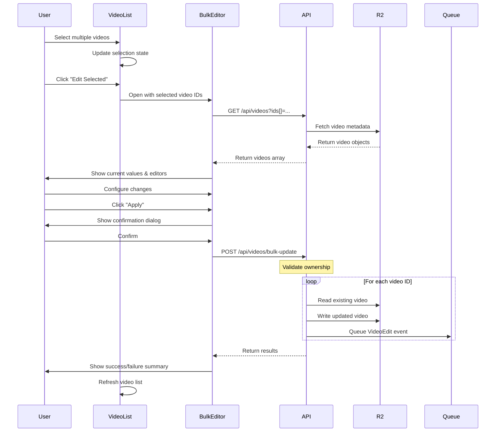

# Bulk Editing (Multiple Video Management) Implementation Plan

**Document Version**: 1.0
**Created**: 2025-01-20
**Priority**: MEDIUM
**Estimated Effort**: 3 weeks
**Team Size**: 2 developers

## Executive Summary

This document outlines the complete implementation plan for enabling bulk editing of video metadata in Al Ummah Now platform. This feature allows creators to edit multiple videos simultaneously, performing batch operations on privacy settings, categories, tags, descriptions, and other metadata fields. This is essential for content creators managing large video libraries and content series.

## Current State Analysis

### Existing Architecture
- **Single Video Editing**: Edit one video at a time via `/watch/[id]/edit` page
- **API Endpoint**: `PATCH /api/videos/:id` for individual video updates
- **Component**: Individual video edit forms in the web app
- **Storage**: R2 for video metadata, Bunny.net for video streaming
- **Authentication**: JWT tokens with per-request validation

### Limitations
- No multi-select capability in video lists
- No batch metadata update operations
- Must edit each video individually (time-consuming)
- No way to apply changes to multiple videos at once
- Inefficient for managing content series or bulk privacy changes
- No progress tracking for batch operations

### User Pain Points
- **Time-Consuming**: Updating 20 lecture series videos requires 20 separate edit operations
- **Error-Prone**: Manual repetition leads to inconsistent metadata
- **Privacy Management**: Cannot quickly make all videos in a series public/private
- **Category Assignment**: Cannot bulk-assign Islamic categories to imported content
- **Tag Updates**: Adding new tags to existing content series is tedious
- **No Undo**: Cannot easily revert bulk changes

## Requirements

### Functional Requirements

#### 1. Video Selection
- Multi-select checkboxes on video list pages
- "Select All" / "Deselect All" functionality
- Filter-based selection (e.g., "select all unlisted videos")
- Persistent selection across pagination
- Visual indication of selected videos count
- Maximum 100 videos per batch operation

#### 2. Bulk Edit Modal
- Centralized editor for selected videos
- Field-specific editing modes:
  - **Replace**: Overwrite existing values
  - **Append**: Add to existing values (tags, description)
  - **Clear**: Remove values
- Preview of changes before applying
- Validation with error messages
- Progress indicator during save operation

#### 3. Editable Fields
- **Privacy**: Public/Private toggle
- **Category**: Islamic content categories dropdown
- **Tags**: Add/remove tags (append or replace mode)
- **Description**: Replace or append text
- **Language**: Primary language selection
- **Thumbnail**: Bulk thumbnail replacement (optional)
- **Localized Titles**: Bulk translation updates (optional)

#### 4. Batch Operations
- Apply changes to all selected videos in parallel
- Atomic operations (all succeed or all fail)
- Rollback capability on errors
- Progress tracking with percentage completion
- Detailed success/failure reporting per video

#### 5. Safety Features
- Confirmation dialog before applying changes
- Preview mode showing before/after comparison
- Undo functionality (time-limited)
- Audit log of bulk changes
- Restricted to video owners only

### Non-Functional Requirements
- Batch operations complete in < 30 seconds for 100 videos
- Maintain data consistency during concurrent edits
- Support mobile/tablet interfaces
- Accessible keyboard navigation (WCAG 2.1 AA)
- Graceful degradation for large selections

## Architecture Design

### System Architecture

```
┌─────────────────────────────────────────────────────┐
│                   Web Client                         │
├─────────────────────────────────────────────────────┤
│                                                      │
│  ┌──────────────────────────────────────────────┐   │
│  │      Video List with Multi-Select            │   │
│  │  - Checkboxes on each video card             │   │
│  │  - Bulk action toolbar (sticky)              │   │
│  │  - Selected count indicator                  │   │
│  └────────────┬─────────────────────────────────┘   │
│               │                                      │
│               │ Opens on "Edit Selected"             │
│               │                                      │
│  ┌────────────▼─────────────────────────────────┐   │
│  │       Bulk Edit Modal                        │   │
│  │  - Field editors (privacy, category, tags)   │   │
│  │  - Edit mode selectors (replace/append)      │   │
│  │  - Preview changes                           │   │
│  │  - Apply button                              │   │
│  └────────────┬─────────────────────────────────┘   │
│               │                                      │
│               │ Batch API Requests                   │
│               │                                      │
└───────────────┼──────────────────────────────────────┘
                │
                │ POST /api/videos/bulk-update
                │ (Parallel PATCH requests)
                │
┌───────────────▼──────────────────────────────────────┐
│           API Videos Backend                          │
│  ┌────────────────────────────────────────────────┐  │
│  │    Bulk Update Endpoint                        │  │
│  │  - Validate ownership for all videos          │  │
│  │  - Apply changes in parallel                  │  │
│  │  - Return success/failure per video           │  │
│  └────────────┬───────────────────────────────────┘  │
│               │                                       │
│               ▼                                       │
│  ┌──────────────────────────────────────────────┐   │
│  │         R2 Repository                        │   │
│  │  - Batch read operations                     │   │
│  │  - Batch write operations                    │   │
│  │  - Transaction-like semantics                │   │
│  └──────────────────────────────────────────────┘   │
└───────────────────────────────────────────────────────┘
```

### Data Flow



### Component Architecture

```typescript
// Core component structure
interface BulkEditComponents {
  // Video list with selection
  VideoListWithSelection: {
    videos: VideoObject[];
    selectedIds: Set<string>;
    onSelectionChange: (ids: Set<string>) => void;
    onBulkEdit: () => void;
  };

  // Selection toolbar (sticky)
  BulkActionToolbar: {
    selectedCount: number;
    onEdit: () => void;
    onDelete: () => void;
    onClearSelection: () => void;
  };

  // Bulk edit modal
  BulkEditModal: {
    videoIds: string[];
    videos: VideoObject[];
    onApply: (changes: BulkChanges) => Promise<BulkResult>;
    onCancel: () => void;
  };

  // Field editors
  BulkFieldEditor: {
    field: EditableField;
    mode: 'replace' | 'append' | 'clear';
    currentValues: any[];
    onChange: (value: any) => void;
  };

  // Preview & confirmation
  BulkPreview: {
    changes: BulkChanges;
    videos: VideoObject[];
    onConfirm: () => void;
    onCancel: () => void;
  };

  // Progress tracker
  BulkProgress: {
    total: number;
    completed: number;
    failed: number;
    currentVideo: string;
  };

  // Results summary
  BulkResultSummary: {
    results: BulkResult;
    onClose: () => void;
    onUndo: () => void; // Optional
  };
}
```

## Technical Implementation Details

### 1. Data Models

#### Bulk Edit Types

```typescript
// packages/shared-types/src/bulk-edit.ts

export interface BulkEditRequest {
  videoIds: string[];          // Videos to update (max 100)
  changes: BulkChanges;         // Changes to apply
  mode: EditMode;               // How to apply changes
}

export interface BulkChanges {
  isPublic?: boolean;           // Privacy setting
  category?: string;            // Islamic category
  tags?: string[];              // Tags to add/remove/replace
  description?: string;         // Description to replace/append
  descriptionLocalized?: Record<string, string>;
  language?: string;            // Primary language
  titleLocalized?: Record<string, string>; // Optional bulk translation
}

export type EditMode =
  | 'replace'   // Overwrite existing values
  | 'append'    // Add to existing values (tags, description)
  | 'clear';    // Remove values

export interface BulkResult {
  success: boolean;
  totalRequested: number;
  totalSucceeded: number;
  totalFailed: number;
  results: VideoUpdateResult[];
  errors?: BulkError[];
}

export interface VideoUpdateResult {
  videoId: string;
  success: boolean;
  error?: string;
  video?: VideoObject; // Updated video on success
}

export interface BulkError {
  videoId: string;
  videoTitle: string;
  error: string;
  code: ErrorCode;
}

export type ErrorCode =
  | 'NOT_FOUND'
  | 'UNAUTHORIZED'
  | 'VALIDATION_ERROR'
  | 'SERVER_ERROR';

export interface BulkEditState {
  selectedVideoIds: Set<string>;
  isEditing: boolean;
  changes: Partial<BulkChanges>;
  mode: Record<keyof BulkChanges, EditMode>;
  isApplying: boolean;
  progress: BulkProgress;
}

export interface BulkProgress {
  total: number;
  completed: number;
  failed: number;
  currentVideoId?: string;
  percentage: number;
}
```

### 2. API Endpoints

#### Bulk Update Endpoint

```typescript
// apps/api-videos/src/endpoints/video/bulkUpdate.ts
import { OpenAPIRoute } from "chanfana";
import { z } from "zod";
import { BulkEditRequest, BulkResult, VideoUpdateResult } from "@al-ummah/shared-types";
import { addAuthToSchema } from "../../lib/openapi-auth";
import { getAuthContext } from "../../middleware/auth";
import R2Repository from "../../lib/r2Repo";
import Queue, { MessageType } from "../../lib/queue";

const BulkUpdateSchema = z.object({
  videoIds: z.array(z.string()).min(1).max(100),
  changes: z.object({
    isPublic: z.boolean().optional(),
    category: z.string().optional(),
    tags: z.array(z.string()).optional(),
    description: z.string().optional(),
    descriptionLocalized: z.record(z.string()).optional(),
    language: z.string().optional(),
    titleLocalized: z.record(z.string()).optional(),
  }),
  mode: z.object({
    tags: z.enum(['replace', 'append', 'clear']).optional(),
    description: z.enum(['replace', 'append', 'clear']).optional(),
  }).optional(),
});

export class VideoBulkUpdate extends OpenAPIRoute {
  schema = addAuthToSchema({
    tags: ["Videos"],
    summary: "Bulk update multiple videos",
    description: "Update metadata for multiple videos at once. Maximum 100 videos per request.",
    request: {
      body: {
        content: {
          "application/json": {
            schema: BulkUpdateSchema,
          },
        },
      },
    },
    responses: {
      "200": {
        description: "Bulk update completed (may contain partial failures)",
        content: {
          "application/json": {
            schema: z.object({
              success: z.boolean(),
              result: z.object({
                totalRequested: z.number(),
                totalSucceeded: z.number(),
                totalFailed: z.number(),
                results: z.array(z.object({
                  videoId: z.string(),
                  success: z.boolean(),
                  error: z.string().optional(),
                })),
              }),
            }),
          },
        },
      },
      "400": {
        description: "Bad request - invalid input",
      },
      "401": {
        description: "Unauthorized - authentication required",
      },
      "403": {
        description: "Forbidden - insufficient permissions",
      },
    },
  }, 'required');

  async handle(c) {
    const data = await this.getValidatedData<typeof BulkUpdateSchema>();
    const authContext = getAuthContext(c);
    const userId = authContext?.userId;

    if (!userId) {
      return c.json({
        success: false,
        error: "Authentication required"
      }, 401);
    }

    const { videoIds, changes, mode } = data.body;

    // Get video repository
    const bucket = c.env.videos;
    const repository = new R2Repository(bucket);
    const queue = new Queue();

    // Process each video
    const results: VideoUpdateResult[] = [];
    let succeededCount = 0;
    let failedCount = 0;

    // Use Promise.allSettled for parallel processing
    const updatePromises = videoIds.map(async (videoId) => {
      try {
        // 1. Fetch existing video
        const existingVideo = await repository.getObject(videoId);

        if (!existingVideo) {
          throw new Error('Video not found');
        }

        // 2. Verify ownership
        if (existingVideo.userId !== userId) {
          throw new Error('You do not own this video');
        }

        // 3. Apply changes based on mode
        const updatedVideo = {
          ...existingVideo,
          dateModified: new Date().toISOString(),
        };

        // Apply privacy change
        if (changes.isPublic !== undefined) {
          updatedVideo.isPublic = changes.isPublic;
        }

        // Apply category change
        if (changes.category !== undefined) {
          updatedVideo.category = changes.category;
        }

        // Apply language change
        if (changes.language !== undefined) {
          updatedVideo.language = changes.language;
        }

        // Apply tags based on mode
        if (changes.tags !== undefined) {
          const tagsMode = mode?.tags || 'replace';
          switch (tagsMode) {
            case 'replace':
              updatedVideo.tags = changes.tags;
              break;
            case 'append':
              updatedVideo.tags = [
                ...(existingVideo.tags || []),
                ...changes.tags.filter(t => !existingVideo.tags?.includes(t))
              ];
              break;
            case 'clear':
              updatedVideo.tags = [];
              break;
          }
        }

        // Apply description based on mode
        if (changes.description !== undefined) {
          const descMode = mode?.description || 'replace';
          switch (descMode) {
            case 'replace':
              updatedVideo.description = changes.description;
              break;
            case 'append':
              updatedVideo.description = existingVideo.description
                ? `${existingVideo.description}\n\n${changes.description}`
                : changes.description;
              break;
            case 'clear':
              updatedVideo.description = '';
              break;
          }
        }

        // Apply localized descriptions
        if (changes.descriptionLocalized !== undefined) {
          updatedVideo.descriptionLocalized = {
            ...existingVideo.descriptionLocalized,
            ...changes.descriptionLocalized,
          };
        }

        // Apply localized titles
        if (changes.titleLocalized !== undefined) {
          updatedVideo.titleLocalized = {
            ...existingVideo.titleLocalized,
            ...changes.titleLocalized,
          };
        }

        // 4. Save updated video
        await repository.putObject(videoId, updatedVideo);

        // 5. Queue event
        await queue.send(MessageType.VideoEdit, {
          videoId,
          userId,
          channelId: existingVideo.channelId || userId,
          timestamp: new Date().toISOString(),
          bulkEdit: true,
        });

        return {
          videoId,
          success: true,
        };

      } catch (error: any) {
        return {
          videoId,
          success: false,
          error: error.message || 'Unknown error',
        };
      }
    });

    // Wait for all updates to complete
    const settledResults = await Promise.allSettled(updatePromises);

    // Process results
    settledResults.forEach((result) => {
      if (result.status === 'fulfilled') {
        results.push(result.value);
        if (result.value.success) {
          succeededCount++;
        } else {
          failedCount++;
        }
      } else {
        failedCount++;
        results.push({
          videoId: 'unknown',
          success: false,
          error: result.reason?.message || 'Promise rejected',
        });
      }
    });

    // Return aggregated results
    return c.json({
      success: succeededCount > 0,
      result: {
        totalRequested: videoIds.length,
        totalSucceeded: succeededCount,
        totalFailed: failedCount,
        results,
      },
    });
  }
}
```

#### Batch Fetch Endpoint (for preview)

```typescript
// apps/api-videos/src/endpoints/video/bulkFetch.ts
import { OpenAPIRoute } from "chanfana";
import { z } from "zod";
import { addAuthToSchema } from "../../lib/openapi-auth";
import { getAuthContext } from "../../middleware/auth";
import R2Repository from "../../lib/r2Repo";
import { transformVideoToView } from "../../lib/transformations";

const BulkFetchSchema = z.object({
  videoIds: z.array(z.string()).min(1).max(100),
});

export class VideoBulkFetch extends OpenAPIRoute {
  schema = addAuthToSchema({
    tags: ["Videos"],
    summary: "Fetch multiple videos by IDs",
    description: "Retrieve metadata for multiple videos (max 100)",
    request: {
      body: {
        content: {
          "application/json": {
            schema: BulkFetchSchema,
          },
        },
      },
    },
    responses: {
      "200": {
        description: "Videos fetched successfully",
      },
    },
  }, 'required');

  async handle(c) {
    const data = await this.getValidatedData<typeof BulkFetchSchema>();
    const authContext = getAuthContext(c);
    const userId = authContext?.userId;

    if (!userId) {
      return c.json({
        success: false,
        error: "Authentication required"
      }, 401);
    }

    const { videoIds } = data.body;
    const bucket = c.env.videos;
    const repository = new R2Repository(bucket);

    // Fetch all videos in parallel
    const videoPromises = videoIds.map(id => repository.getObject(id));
    const videos = await Promise.all(videoPromises);

    // Filter out nulls and transform
    const validVideos = videos
      .filter(v => v !== null)
      .filter(v => v.userId === userId) // Only return user's own videos
      .map(v => transformVideoToView(v));

    return c.json({
      success: true,
      result: {
        videos: validVideos,
      },
    });
  }
}
```

### 3. Frontend Components

#### Video List with Multi-Select

```tsx
// apps/web/src/components/video/VideoListWithSelection.tsx
import React, { useState, useMemo } from 'react';
import { VideoObject } from '@al-ummah/shared-types';
import { Check, Edit, Trash2, X } from 'lucide-react';
import { useLanguage } from '@/hooks/useLanguage';

interface VideoListWithSelectionProps {
  videos: VideoObject[];
  onBulkEdit: (videoIds: string[]) => void;
  onBulkDelete?: (videoIds: string[]) => void;
}

export const VideoListWithSelection: React.FC<VideoListWithSelectionProps> = ({
  videos,
  onBulkEdit,
  onBulkDelete,
}) => {
  const { t } = useLanguage();
  const [selectedIds, setSelectedIds] = useState<Set<string>>(new Set());
  const [isSelectMode, setIsSelectMode] = useState(false);

  const toggleSelection = (videoId: string) => {
    setSelectedIds(prev => {
      const newSet = new Set(prev);
      if (newSet.has(videoId)) {
        newSet.delete(videoId);
      } else {
        newSet.add(videoId);
      }
      return newSet;
    });
  };

  const selectAll = () => {
    setSelectedIds(new Set(videos.map(v => v.id)));
  };

  const clearSelection = () => {
    setSelectedIds(new Set());
    setIsSelectMode(false);
  };

  const handleBulkEdit = () => {
    if (selectedIds.size > 0) {
      onBulkEdit(Array.from(selectedIds));
    }
  };

  const handleBulkDelete = () => {
    if (selectedIds.size > 0 && onBulkDelete) {
      onBulkDelete(Array.from(selectedIds));
    }
  };

  return (
    <div className="space-y-4">
      {/* Action header */}
      <div className="flex items-center justify-between">
        <div className="flex items-center gap-4">
          <h2 className="text-xl font-semibold">
            {t.video.myVideos}
          </h2>
          <span className="text-sm text-gray-500">
            {videos.length} {t.video.totalVideos}
          </span>
        </div>

        <button
          onClick={() => setIsSelectMode(!isSelectMode)}
          className="px-4 py-2 text-sm border border-gray-300 dark:border-gray-600 rounded-lg hover:bg-gray-50 dark:hover:bg-gray-700"
        >
          {isSelectMode ? t.common.cancelSelection : t.common.selectMultiple}
        </button>
      </div>

      {/* Bulk action toolbar (sticky when scrolling) */}
      {selectedIds.size > 0 && (
        <div className="sticky top-0 z-10 bg-blue-50 dark:bg-blue-900/20 border border-blue-200 dark:border-blue-800 rounded-lg p-4 flex items-center justify-between">
          <div className="flex items-center gap-4">
            <span className="font-medium">
              {selectedIds.size} {t.video.videosSelected}
            </span>
            <button
              onClick={clearSelection}
              className="text-sm text-gray-600 dark:text-gray-400 hover:text-gray-800 dark:hover:text-gray-200 flex items-center gap-1"
            >
              <X size={16} />
              {t.common.clearSelection}
            </button>
          </div>

          <div className="flex items-center gap-2">
            <button
              onClick={handleBulkEdit}
              className="px-4 py-2 bg-blue-600 text-white rounded-lg hover:bg-blue-700 flex items-center gap-2"
            >
              <Edit size={16} />
              {t.video.bulkEdit}
            </button>
            {onBulkDelete && (
              <button
                onClick={handleBulkDelete}
                className="px-4 py-2 bg-red-600 text-white rounded-lg hover:bg-red-700 flex items-center gap-2"
              >
                <Trash2 size={16} />
                {t.common.delete}
              </button>
            )}
          </div>
        </div>
      )}

      {/* Quick select all */}
      {isSelectMode && selectedIds.size === 0 && (
        <div className="bg-gray-50 dark:bg-gray-800 border border-gray-200 dark:border-gray-700 rounded-lg p-3">
          <button
            onClick={selectAll}
            className="text-sm text-blue-600 hover:text-blue-700 dark:text-blue-400"
          >
            {t.common.selectAll} ({videos.length})
          </button>
        </div>
      )}

      {/* Video grid */}
      <div className="grid grid-cols-1 md:grid-cols-2 lg:grid-cols-3 xl:grid-cols-4 gap-4">
        {videos.map((video) => (
          <div
            key={video.id}
            className={`
              relative bg-white dark:bg-gray-800 rounded-lg border transition-all
              ${selectedIds.has(video.id)
                ? 'border-blue-500 ring-2 ring-blue-200 dark:ring-blue-800'
                : 'border-gray-200 dark:border-gray-700'
              }
              ${isSelectMode ? 'cursor-pointer' : ''}
            `}
            onClick={() => isSelectMode && toggleSelection(video.id)}
          >
            {/* Selection checkbox overlay */}
            {isSelectMode && (
              <div className="absolute top-2 left-2 z-10">
                <div
                  className={`
                    w-6 h-6 rounded-md border-2 flex items-center justify-center
                    ${selectedIds.has(video.id)
                      ? 'bg-blue-600 border-blue-600'
                      : 'bg-white dark:bg-gray-700 border-gray-300 dark:border-gray-600'
                    }
                  `}
                >
                  {selectedIds.has(video.id) && (
                    <Check size={16} className="text-white" />
                  )}
                </div>
              </div>
            )}

            {/* Video thumbnail */}
            <div className="aspect-video bg-gray-100 dark:bg-gray-700 rounded-t-lg overflow-hidden">
              
            </div>

            {/* Video info */}
            <div className="p-3 space-y-1">
              <h3 className="font-medium text-sm line-clamp-2">
                {video.title}
              </h3>
              <div className="flex items-center gap-2 text-xs text-gray-500">
                <span>{video.views || 0} {t.video.views}</span>
                <span>•</span>
                <span>{video.isPublic ? t.video.public : t.video.private}</span>
              </div>
            </div>
          </div>
        ))}
      </div>
    </div>
  );
};
```

#### Bulk Edit Modal

```tsx
// apps/web/src/components/video/BulkEditModal.tsx
import React, { useState, useEffect } from 'react';
import { VideoObject, BulkChanges, BulkResult, EditMode } from '@al-ummah/shared-types';
import { X, AlertCircle, CheckCircle, Loader } from 'lucide-react';
import { useLanguage } from '@/hooks/useLanguage';
import { bulkUpdateVideos, bulkFetchVideos } from '@/lib/api/videos';

interface BulkEditModalProps {
  videoIds: string[];
  onClose: () => void;
  onSuccess: (result: BulkResult) => void;
}

export const BulkEditModal: React.FC<BulkEditModalProps> = ({
  videoIds,
  onClose,
  onSuccess,
}) => {
  const { t } = useLanguage();
  const [videos, setVideos] = useState<VideoObject[]>([]);
  const [isLoading, setIsLoading] = useState(true);
  const [isApplying, setIsApplying] = useState(false);
  const [error, setError] = useState<string | null>(null);

  const [changes, setChanges] = useState<Partial<BulkChanges>>({});
  const [modes, setModes] = useState<Record<string, EditMode>>({
    tags: 'append',
    description: 'append',
  });

  const [showConfirm, setShowConfirm] = useState(false);

  // Fetch videos on mount
  useEffect(() => {
    const fetchVideos = async () => {
      setIsLoading(true);
      try {
        const result = await bulkFetchVideos(videoIds);
        if (result.success) {
          setVideos(result.videos);
        } else {
          setError(result.error || 'Failed to fetch videos');
        }
      } catch (err: any) {
        setError(err.message);
      } finally {
        setIsLoading(false);
      }
    };

    fetchVideos();
  }, [videoIds]);

  const handleApply = async () => {
    // Validate at least one change
    if (Object.keys(changes).length === 0) {
      setError(t.bulkEdit.noChangesError);
      return;
    }

    setIsApplying(true);
    setError(null);

    try {
      const result = await bulkUpdateVideos({
        videoIds,
        changes,
        mode: modes,
      });

      if (result.success) {
        onSuccess(result.result);
      } else {
        setError(result.error || 'Bulk update failed');
      }
    } catch (err: any) {
      setError(err.message);
    } finally {
      setIsApplying(false);
      setShowConfirm(false);
    }
  };

  if (isLoading) {
    return (
      <div className="fixed inset-0 bg-black/50 flex items-center justify-center z-50">
        <div className="bg-white dark:bg-gray-800 rounded-lg p-8">
          <Loader className="animate-spin text-blue-600" size={32} />
          <p className="mt-4 text-gray-600 dark:text-gray-400">
            {t.common.loading}...
          </p>
        </div>
      </div>
    );
  }

  return (
    <div className="fixed inset-0 bg-black/50 flex items-center justify-center p-4 z-50 overflow-y-auto">
      <div className="bg-white dark:bg-gray-800 rounded-lg max-w-3xl w-full max-h-[90vh] overflow-hidden flex flex-col">
        {/* Header */}
        <div className="border-b border-gray-200 dark:border-gray-700 p-6 flex items-center justify-between">
          <div>
            <h2 className="text-xl font-semibold">
              {t.bulkEdit.title}
            </h2>
            <p className="text-sm text-gray-500 mt-1">
              {t.bulkEdit.editing} {videoIds.length} {t.video.videos}
            </p>
          </div>
          <button
            onClick={onClose}
            disabled={isApplying}
            className="text-gray-400 hover:text-gray-600 dark:hover:text-gray-300"
          >
            <X size={24} />
          </button>
        </div>

        {/* Content */}
        <div className="p-6 overflow-y-auto flex-1 space-y-6">
          {/* Error message */}
          {error && (
            <div className="bg-red-50 dark:bg-red-900/20 border border-red-200 dark:border-red-800 rounded-lg p-4 flex items-start gap-2">
              <AlertCircle className="text-red-600 flex-shrink-0" size={20} />
              <p className="text-sm text-red-600 dark:text-red-400">{error}</p>
            </div>
          )}

          {/* Privacy Setting */}
          <div className="space-y-2">
            <label className="flex items-center gap-2">
              <input
                type="checkbox"
                checked={changes.isPublic !== undefined}
                onChange={(e) => {
                  if (e.target.checked) {
                    setChanges(prev => ({ ...prev, isPublic: true }));
                  } else {
                    const { isPublic, ...rest } = changes;
                    setChanges(rest);
                  }
                }}
                className="rounded"
              />
              <span className="font-medium">{t.video.changePrivacy}</span>
            </label>

            {changes.isPublic !== undefined && (
              <div className="ml-6 flex gap-2">
                <button
                  onClick={() => setChanges(prev => ({ ...prev, isPublic: true }))}
                  className={`px-4 py-2 rounded-lg transition-colors ${
                    changes.isPublic
                      ? 'bg-blue-600 text-white'
                      : 'bg-gray-200 dark:bg-gray-700'
                  }`}
                >
                  {t.video.public}
                </button>
                <button
                  onClick={() => setChanges(prev => ({ ...prev, isPublic: false }))}
                  className={`px-4 py-2 rounded-lg transition-colors ${
                    changes.isPublic === false
                      ? 'bg-blue-600 text-white'
                      : 'bg-gray-200 dark:bg-gray-700'
                  }`}
                >
                  {t.video.private}
                </button>
              </div>
            )}
          </div>

          {/* Category */}
          <div className="space-y-2">
            <label className="flex items-center gap-2">
              <input
                type="checkbox"
                checked={changes.category !== undefined}
                onChange={(e) => {
                  if (e.target.checked) {
                    setChanges(prev => ({ ...prev, category: '' }));
                  } else {
                    const { category, ...rest } = changes;
                    setChanges(rest);
                  }
                }}
                className="rounded"
              />
              <span className="font-medium">{t.video.changeCategory}</span>
            </label>

            {changes.category !== undefined && (
              <select
                value={changes.category}
                onChange={(e) => setChanges(prev => ({ ...prev, category: e.target.value }))}
                className="ml-6 w-full max-w-md px-3 py-2 border border-gray-300 dark:border-gray-600 rounded-lg dark:bg-gray-700"
              >
                <option value="">{t.video.selectCategory}</option>
                <option value="quran-recitation">{t.category.quranRecitation}</option>
                <option value="quran-tafsir">{t.category.quranTafsir}</option>
                <option value="hadith">{t.category.hadith}</option>
                <option value="seerah">{t.category.seerah}</option>
                <option value="fiqh">{t.category.fiqh}</option>
                <option value="aqeedah">{t.category.aqeedah}</option>
                <option value="dawah">{t.category.dawah}</option>
                <option value="khutbah">{t.category.khutbah}</option>
                <option value="lecture">{t.category.lecture}</option>
                <option value="nasheed">{t.category.nasheed}</option>
              </select>
            )}
          </div>

          {/* Tags */}
          <div className="space-y-2">
            <label className="flex items-center gap-2">
              <input
                type="checkbox"
                checked={changes.tags !== undefined}
                onChange={(e) => {
                  if (e.target.checked) {
                    setChanges(prev => ({ ...prev, tags: [] }));
                  } else {
                    const { tags, ...rest } = changes;
                    setChanges(rest);
                  }
                }}
                className="rounded"
              />
              <span className="font-medium">{t.video.changeTags}</span>
            </label>

            {changes.tags !== undefined && (
              <div className="ml-6 space-y-2">
                {/* Mode selector */}
                <div className="flex gap-2">
                  <button
                    onClick={() => setModes(prev => ({ ...prev, tags: 'replace' }))}
                    className={`px-3 py-1 text-sm rounded ${
                      modes.tags === 'replace'
                        ? 'bg-blue-600 text-white'
                        : 'bg-gray-200 dark:bg-gray-700'
                    }`}
                  >
                    {t.bulkEdit.replace}
                  </button>
                  <button
                    onClick={() => setModes(prev => ({ ...prev, tags: 'append' }))}
                    className={`px-3 py-1 text-sm rounded ${
                      modes.tags === 'append'
                        ? 'bg-blue-600 text-white'
                        : 'bg-gray-200 dark:bg-gray-700'
                    }`}
                  >
                    {t.bulkEdit.append}
                  </button>
                  <button
                    onClick={() => setModes(prev => ({ ...prev, tags: 'clear' }))}
                    className={`px-3 py-1 text-sm rounded ${
                      modes.tags === 'clear'
                        ? 'bg-blue-600 text-white'
                        : 'bg-gray-200 dark:bg-gray-700'
                    }`}
                  >
                    {t.bulkEdit.clear}
                  </button>
                </div>

                {/* Tag input */}
                {modes.tags !== 'clear' && (
                  <input
                    type="text"
                    placeholder={t.video.tagsPlaceholder}
                    value={changes.tags?.join(', ') || ''}
                    onChange={(e) => {
                      const tags = e.target.value.split(',').map(t => t.trim()).filter(Boolean);
                      setChanges(prev => ({ ...prev, tags }));
                    }}
                    className="w-full px-3 py-2 border border-gray-300 dark:border-gray-600 rounded-lg dark:bg-gray-700"
                  />
                )}

                <p className="text-xs text-gray-500">
                  {modes.tags === 'replace' && t.bulkEdit.tagsReplaceHelp}
                  {modes.tags === 'append' && t.bulkEdit.tagsAppendHelp}
                  {modes.tags === 'clear' && t.bulkEdit.tagsClearHelp}
                </p>
              </div>
            )}
          </div>

          {/* Description */}
          <div className="space-y-2">
            <label className="flex items-center gap-2">
              <input
                type="checkbox"
                checked={changes.description !== undefined}
                onChange={(e) => {
                  if (e.target.checked) {
                    setChanges(prev => ({ ...prev, description: '' }));
                  } else {
                    const { description, ...rest } = changes;
                    setChanges(rest);
                  }
                }}
                className="rounded"
              />
              <span className="font-medium">{t.video.changeDescription}</span>
            </label>

            {changes.description !== undefined && (
              <div className="ml-6 space-y-2">
                {/* Mode selector */}
                <div className="flex gap-2">
                  <button
                    onClick={() => setModes(prev => ({ ...prev, description: 'replace' }))}
                    className={`px-3 py-1 text-sm rounded ${
                      modes.description === 'replace'
                        ? 'bg-blue-600 text-white'
                        : 'bg-gray-200 dark:bg-gray-700'
                    }`}
                  >
                    {t.bulkEdit.replace}
                  </button>
                  <button
                    onClick={() => setModes(prev => ({ ...prev, description: 'append' }))}
                    className={`px-3 py-1 text-sm rounded ${
                      modes.description === 'append'
                        ? 'bg-blue-600 text-white'
                        : 'bg-gray-200 dark:bg-gray-700'
                    }`}
                  >
                    {t.bulkEdit.append}
                  </button>
                  <button
                    onClick={() => setModes(prev => ({ ...prev, description: 'clear' }))}
                    className={`px-3 py-1 text-sm rounded ${
                      modes.description === 'clear'
                        ? 'bg-blue-600 text-white'
                        : 'bg-gray-200 dark:bg-gray-700'
                    }`}
                  >
                    {t.bulkEdit.clear}
                  </button>
                </div>

                {/* Description textarea */}
                {modes.description !== 'clear' && (
                  <textarea
                    rows={4}
                    placeholder={t.video.descriptionPlaceholder}
                    value={changes.description || ''}
                    onChange={(e) => setChanges(prev => ({ ...prev, description: e.target.value }))}
                    className="w-full px-3 py-2 border border-gray-300 dark:border-gray-600 rounded-lg dark:bg-gray-700"
                  />
                )}
              </div>
            )}
          </div>

          {/* Language */}
          <div className="space-y-2">
            <label className="flex items-center gap-2">
              <input
                type="checkbox"
                checked={changes.language !== undefined}
                onChange={(e) => {
                  if (e.target.checked) {
                    setChanges(prev => ({ ...prev, language: 'en' }));
                  } else {
                    const { language, ...rest } = changes;
                    setChanges(rest);
                  }
                }}
                className="rounded"
              />
              <span className="font-medium">{t.video.changeLanguage}</span>
            </label>

            {changes.language !== undefined && (
              <select
                value={changes.language}
                onChange={(e) => setChanges(prev => ({ ...prev, language: e.target.value }))}
                className="ml-6 w-full max-w-md px-3 py-2 border border-gray-300 dark:border-gray-600 rounded-lg dark:bg-gray-700"
              >
                <option value="en">{t.language.english}</option>
                <option value="ar">{t.language.arabic}</option>
                <option value="ur">{t.language.urdu}</option>
                <option value="fr">{t.language.french}</option>
              </select>
            )}
          </div>
        </div>

        {/* Footer */}
        <div className="border-t border-gray-200 dark:border-gray-700 p-6 flex justify-end gap-3">
          <button
            onClick={onClose}
            disabled={isApplying}
            className="px-6 py-2 border border-gray-300 dark:border-gray-600 rounded-lg hover:bg-gray-50 dark:hover:bg-gray-700 disabled:opacity-50"
          >
            {t.common.cancel}
          </button>
          <button
            onClick={() => setShowConfirm(true)}
            disabled={isApplying || Object.keys(changes).length === 0}
            className="px-6 py-2 bg-blue-600 text-white rounded-lg hover:bg-blue-700 disabled:opacity-50 flex items-center gap-2"
          >
            {isApplying ? (
              <>
                <Loader className="animate-spin" size={16} />
                {t.bulkEdit.applying}...
              </>
            ) : (
              t.bulkEdit.applyChanges
            )}
          </button>
        </div>
      </div>

      {/* Confirmation dialog */}
      {showConfirm && !isApplying && (
        <div className="absolute inset-0 bg-black/70 flex items-center justify-center">
          <div className="bg-white dark:bg-gray-800 rounded-lg p-6 max-w-md">
            <h3 className="text-lg font-semibold mb-2">
              {t.bulkEdit.confirmTitle}
            </h3>
            <p className="text-gray-600 dark:text-gray-400 mb-4">
              {t.bulkEdit.confirmMessage.replace('{count}', videoIds.length.toString())}
            </p>
            <div className="flex gap-3 justify-end">
              <button
                onClick={() => setShowConfirm(false)}
                className="px-4 py-2 border border-gray-300 dark:border-gray-600 rounded-lg hover:bg-gray-50 dark:hover:bg-gray-700"
              >
                {t.common.cancel}
              </button>
              <button
                onClick={handleApply}
                className="px-4 py-2 bg-blue-600 text-white rounded-lg hover:bg-blue-700"
              >
                {t.common.confirm}
              </button>
            </div>
          </div>
        </div>
      )}
    </div>
  );
};
```

#### Bulk Result Summary

```tsx
// apps/web/src/components/video/BulkResultSummary.tsx
import React from 'react';
import { BulkResult } from '@al-ummah/shared-types';
import { CheckCircle, XCircle, AlertCircle } from 'lucide-react';
import { useLanguage } from '@/hooks/useLanguage';

interface BulkResultSummaryProps {
  result: BulkResult;
  onClose: () => void;
}

export const BulkResultSummary: React.FC<BulkResultSummaryProps> = ({
  result,
  onClose,
}) => {
  const { t } = useLanguage();
  const hasFailures = result.totalFailed > 0;

  return (
    <div className="fixed inset-0 bg-black/50 flex items-center justify-center p-4 z-50">
      <div className="bg-white dark:bg-gray-800 rounded-lg max-w-2xl w-full max-h-[80vh] overflow-hidden">
        {/* Header */}
        <div className="border-b border-gray-200 dark:border-gray-700 p-6">
          <div className="flex items-center gap-3">
            {hasFailures ? (
              <AlertCircle className="text-yellow-600" size={32} />
            ) : (
              <CheckCircle className="text-green-600" size={32} />
            )}
            <div>
              <h2 className="text-xl font-semibold">
                {hasFailures ? t.bulkEdit.partialSuccess : t.bulkEdit.allSuccess}
              </h2>
              <p className="text-sm text-gray-500 mt-1">
                {result.totalSucceeded} {t.bulkEdit.succeeded}, {result.totalFailed} {t.bulkEdit.failed}
              </p>
            </div>
          </div>
        </div>

        {/* Results list */}
        <div className="p-6 overflow-y-auto max-h-96 space-y-2">
          {result.results.map((videoResult) => (
            <div
              key={videoResult.videoId}
              className={`flex items-start gap-3 p-3 rounded-lg ${
                videoResult.success
                  ? 'bg-green-50 dark:bg-green-900/20'
                  : 'bg-red-50 dark:bg-red-900/20'
              }`}
            >
              {videoResult.success ? (
                <CheckCircle className="text-green-600 flex-shrink-0" size={20} />
              ) : (
                <XCircle className="text-red-600 flex-shrink-0" size={20} />
              )}
              <div className="flex-1 min-w-0">
                <p className="font-medium text-sm truncate">
                  {videoResult.video?.title || videoResult.videoId}
                </p>
                {videoResult.error && (
                  <p className="text-xs text-red-600 dark:text-red-400 mt-1">
                    {videoResult.error}
                  </p>
                )}
              </div>
            </div>
          ))}
        </div>

        {/* Footer */}
        <div className="border-t border-gray-200 dark:border-gray-700 p-6 flex justify-end">
          <button
            onClick={onClose}
            className="px-6 py-2 bg-blue-600 text-white rounded-lg hover:bg-blue-700"
          >
            {t.common.close}
          </button>
        </div>
      </div>
    </div>
  );
};
```

### 4. API Client Functions

```typescript
// apps/web/src/lib/api/videos.ts (add these functions)

export async function bulkFetchVideos(videoIds: string[]): Promise<{
  success: boolean;
  videos: VideoObject[];
  error?: string;
}> {
  try {
    const response = await fetch('/api/videos/bulk-fetch', {
      method: 'POST',
      headers: {
        'Content-Type': 'application/json',
        'Authorization': `Bearer ${getAuthToken()}`,
      },
      body: JSON.stringify({ videoIds }),
    });

    const data = await response.json();
    return {
      success: data.success,
      videos: data.result?.videos || [],
      error: data.error,
    };
  } catch (error: any) {
    return {
      success: false,
      videos: [],
      error: error.message,
    };
  }
}

export async function bulkUpdateVideos(request: {
  videoIds: string[];
  changes: Partial<BulkChanges>;
  mode?: Record<string, EditMode>;
}): Promise<{
  success: boolean;
  result: BulkResult;
  error?: string;
}> {
  try {
    const response = await fetch('/api/videos/bulk-update', {
      method: 'POST',
      headers: {
        'Content-Type': 'application/json',
        'Authorization': `Bearer ${getAuthToken()}`,
      },
      body: JSON.stringify(request),
    });

    const data = await response.json();
    return {
      success: data.success,
      result: data.result,
      error: data.error,
    };
  } catch (error: any) {
    return {
      success: false,
      result: {
        success: false,
        totalRequested: request.videoIds.length,
        totalSucceeded: 0,
        totalFailed: request.videoIds.length,
        results: [],
      },
      error: error.message,
    };
  }
}
```

## Testing Strategy

### Unit Tests

```typescript
// apps/api-videos/src/endpoints/video/__tests__/bulkUpdate.test.ts
describe('VideoBulkUpdate', () => {
  it('should update privacy for multiple videos', async () => {
    const result = await bulkUpdate({
      videoIds: ['video1', 'video2', 'video3'],
      changes: { isPublic: false },
    });

    expect(result.totalSucceeded).toBe(3);
    expect(result.totalFailed).toBe(0);
  });

  it('should reject unauthorized videos', async () => {
    const result = await bulkUpdate({
      videoIds: ['video1', 'not-owned-video'],
      changes: { isPublic: true },
    });

    expect(result.totalSucceeded).toBe(1);
    expect(result.totalFailed).toBe(1);
    expect(result.results[1].error).toContain('do not own');
  });

  it('should append tags correctly', async () => {
    const result = await bulkUpdate({
      videoIds: ['video1'],
      changes: { tags: ['newtag'] },
      mode: { tags: 'append' },
    });

    const video = await getVideo('video1');
    expect(video.tags).toContain('newtag');
    expect(video.tags).toContain('existingtag'); // Preserved
  });
});
```

### Integration Tests

```typescript
// apps/web/src/components/video/__tests__/bulkEdit.integration.test.tsx
describe('Bulk Edit Flow', () => {
  it('should complete full bulk edit workflow', async () => {
    render(<VideoListWithSelection videos={mockVideos} />);

    // Enter select mode
    fireEvent.click(screen.getByText('Select Multiple'));

    // Select videos
    fireEvent.click(screen.getAllByRole('checkbox')[0]);
    fireEvent.click(screen.getAllByRole('checkbox')[1]);

    // Open bulk editor
    fireEvent.click(screen.getByText('Bulk Edit'));

    // Make changes
    fireEvent.click(screen.getByLabelText('Change Privacy'));
    fireEvent.click(screen.getByText('Public'));

    // Apply
    fireEvent.click(screen.getByText('Apply Changes'));
    fireEvent.click(screen.getByText('Confirm'));

    // Wait for success
    await waitFor(() => {
      expect(screen.getByText('All videos updated successfully')).toBeInTheDocument();
    });
  });
});
```

### E2E Tests

```typescript
// e2e/bulk-edit.spec.ts
import { test, expect } from '@playwright/test';

test('bulk edit workflow', async ({ page }) => {
  // Login
  await page.goto('/login');
  await page.fill('[name="email"]', 'test@example.com');
  await page.fill('[name="password"]', 'password');
  await page.click('button[type="submit"]');

  // Navigate to my videos
  await page.goto('/my-videos');

  // Enter select mode
  await page.click('text=Select Multiple');

  // Select 3 videos
  await page.click('.video-card:nth-child(1) input[type="checkbox"]');
  await page.click('.video-card:nth-child(2) input[type="checkbox"]');
  await page.click('.video-card:nth-child(3) input[type="checkbox"]');

  // Open bulk edit modal
  await page.click('text=Bulk Edit');

  // Wait for modal
  await expect(page.locator('.bulk-edit-modal')).toBeVisible();

  // Change category
  await page.click('text=Change Category');
  await page.selectOption('select', 'quran-recitation');

  // Add tags
  await page.click('text=Change Tags');
  await page.fill('input[placeholder*="tags"]', 'islamic, education');

  // Apply changes
  await page.click('text=Apply Changes');
  await page.click('text=Confirm');

  // Wait for success message
  await expect(page.locator('text=All videos updated successfully')).toBeVisible({
    timeout: 15000,
  });

  // Verify changes
  await page.click('text=Close');
  await expect(page.locator('.video-card:nth-child(1)')).toContainText('Quran Recitation');
});
```

## Migration Plan

### Phase 1: Backend Implementation (Week 1)

**Days 1-2: Data Models & Types**
- Add bulk edit types to `packages/shared-types`
- Update VideoUpdateRequest schema
- Create BulkEditRequest/Response types

**Days 3-4: API Endpoints**
- Implement `POST /api/videos/bulk-update` endpoint
- Implement `POST /api/videos/bulk-fetch` endpoint
- Add validation and error handling
- Add queue event tracking

**Day 5: Testing & Deployment**
- Unit tests for bulk endpoints
- Deploy API changes to staging
- API documentation update

### Phase 2: Frontend Core (Week 2)

**Days 1-2: Selection State Management**
- Add multi-select state to video list components
- Implement selection persistence
- Create BulkActionToolbar component

**Days 3-4: Bulk Edit Modal**
- Build BulkEditModal component
- Implement field editors with mode selectors
- Add validation and error handling

**Day 5: API Integration**
- Connect modal to API endpoints
- Add loading states and progress tracking
- Error handling and retry logic

### Phase 3: UI Polish & Testing (Week 3)

**Days 1-2: UI Components**
- Create BulkResultSummary component
- Add confirmation dialogs
- Implement keyboard shortcuts
- Mobile-responsive design

**Days 3-4: Testing**
- Component unit tests
- Integration tests
- E2E tests with Playwright
- Accessibility testing

**Day 5: Documentation & Deployment**
- Update user documentation
- Create video tutorial
- Deploy to production
- Monitor for issues

## Performance Considerations

### API Optimization
- **Parallel Processing**: Use `Promise.all()` for concurrent R2 operations
- **Batch Size Limit**: Maximum 100 videos per request to prevent timeouts
- **Rate Limiting**: Apply per-user rate limits (10 bulk operations per hour)
- **Caching**: Cache user's video list to avoid repeated fetches

### Frontend Optimization
- **Lazy Loading**: Load modal content only when opened
- **Debouncing**: Debounce selection changes to avoid excessive re-renders
- **Virtual Scrolling**: For large result lists (> 50 videos)
- **Optimistic Updates**: Update UI immediately, rollback on error

### Memory Management
- **Clear Selection**: Automatically clear selection after operation
- **Limit Preview**: Show preview for max 20 videos to avoid DOM bloat
- **Component Unmounting**: Clean up event listeners and state

## Security Considerations

1. **Authorization**
   - Verify user owns ALL videos before allowing bulk edit
   - Reject entire batch if any video is unauthorized
   - Log bulk operations for audit trail

2. **Input Validation**
   - Validate all changes on server side
   - Sanitize tag inputs to prevent XSS
   - Check category values against allowed list

3. **Rate Limiting**
   - Per-user bulk operation limits
   - Throttle based on video count
   - Prevent abuse of parallel operations

4. **Data Integrity**
   - Transaction-like semantics (all or nothing)
   - Rollback on partial failure (optional)
   - Preserve existing data if field not updated

## Monitoring & Analytics

### Metrics to Track

```typescript
interface BulkEditMetrics {
  // Usage metrics
  totalBulkOperations: number;
  averageVideosPerBatch: number;
  mostCommonChanges: Record<string, number>; // privacy, category, tags

  // Performance metrics
  averageProcessingTime: number;
  successRate: number;
  partialFailureRate: number;

  // User behavior
  retryRate: number;
  abandonmentRate: number; // Open modal but don't apply
  featureAdoption: number; // % of users who use bulk edit
}
```

### Event Tracking

```typescript
analytics.track('bulk_edit_opened', {
  videoCount: videoIds.length,
  source: 'my-videos', // or 'channel-page'
});

analytics.track('bulk_edit_applied', {
  videoCount: videoIds.length,
  changedFields: Object.keys(changes),
  modes: modes,
  duration: timeSpent,
});

analytics.track('bulk_edit_completed', {
  totalSucceeded: result.totalSucceeded,
  totalFailed: result.totalFailed,
  processingTime: duration,
});
```

## User Documentation

### Help Text Examples

**For Tags (Append Mode):**
> "Add these tags to all selected videos. Existing tags will be preserved."

**For Tags (Replace Mode):**
> "Replace all existing tags with these new tags. Previous tags will be removed."

**For Description (Append Mode):**
> "Add this text to the end of each video's description."

**For Privacy:**
> "Change all selected videos to Public or Private."

### Video Tutorial Script

1. **Introduction** (15s)
   - Show time-consuming individual editing
   - Introduce bulk editing solution

2. **Selection** (30s)
   - Click "Select Multiple"
   - Check videos to edit
   - Show "Edit Selected" button

3. **Editing** (45s)
   - Open bulk editor
   - Change privacy to Public
   - Add category "Islamic Lecture"
   - Append tags "ramadan, 2025"

4. **Review & Apply** (30s)
   - Show confirmation dialog
   - Click confirm
   - Show success summary

5. **Result** (10s)
   - Return to video list
   - All videos updated instantly

## Future Enhancements

### Phase 2 Features
1. **Bulk Thumbnail Upload**: Replace thumbnails for multiple videos
2. **Bulk Delete with Trash**: Soft delete with recovery option
3. **Scheduled Bulk Changes**: Schedule privacy changes for future dates
4. **Bulk Translation**: AI-powered bulk translation of titles/descriptions
5. **Undo Recent Bulk Edit**: Time-limited rollback (1 hour)

### Phase 3 Features
1. **Saved Bulk Presets**: Save common bulk edit configurations
2. **Bulk Analytics**: See aggregate stats for selected videos
3. **Bulk Thumbnail Generation**: AI-generated thumbnails for multiple videos
4. **Export Metadata**: Export CSV of selected videos' metadata
5. **Bulk Import Metadata**: Import metadata changes from CSV

## Rollout Strategy

### Feature Flag Configuration

```typescript
const BULK_EDIT_FLAGS = {
  enabled: process.env.NEXT_PUBLIC_BULK_EDIT_ENABLED === 'true',
  maxVideos: parseInt(process.env.NEXT_PUBLIC_MAX_BULK_VIDEOS || '100'),
  allowDelete: process.env.NEXT_PUBLIC_ALLOW_BULK_DELETE === 'true',
};
```

### Gradual Rollout

1. **Week 1**: Internal testing (0% users)
   - Test with development videos
   - Verify all edge cases
   - Performance testing

2. **Week 2**: Power users (10% users)
   - Users with >50 videos
   - Monitor for issues
   - Collect feedback

3. **Week 3**: All creators (100% users)
   - Full rollout
   - In-app tutorial
   - Support documentation

## Success Criteria

### Technical Metrics
- Bulk operation success rate > 98%
- Average processing time < 10 seconds for 50 videos
- Zero data loss incidents
- API response time < 2 seconds

### User Metrics
- Feature adoption > 40% of content creators
- User satisfaction score > 4.5/5
- Time saved per bulk operation: 5+ minutes
- Support tickets < 2% of bulk operations

## Appendix

### A. File Structure

```
apps/web/src/
├── components/
│   └── video/
│       ├── VideoListWithSelection.tsx
│       ├── BulkActionToolbar.tsx
│       ├── BulkEditModal.tsx
│       ├── BulkResultSummary.tsx
│       └── __tests__/
├── lib/
│   └── api/
│       └── videos.ts (add bulkFetch, bulkUpdate)
└── hooks/
    └── useBulkEdit.ts

apps/api-videos/src/endpoints/video/
├── bulkUpdate.ts
├── bulkFetch.ts
└── __tests__/
    ├── bulkUpdate.test.ts
    └── bulkFetch.test.ts

packages/shared-types/src/
└── bulk-edit.ts (new)
```

### B. Dependencies

No new dependencies required. Uses existing stack:
- `@al-ummah/shared-types` - Type definitions
- `lucide-react` - Icons
- `react` - UI components
- `zod` - Validation

### C. Configuration Options

```typescript
interface BulkEditConfig {
  // Limits
  maxVideosPerBatch: number;      // Default: 100
  maxBatchesPerHour: number;      // Default: 10

  // Features
  allowDelete: boolean;           // Default: false (phase 2)
  allowUndo: boolean;             // Default: false (phase 2)
  undoTimeLimit: number;          // Default: 3600s (1 hour)

  // UI
  confirmBeforeApply: boolean;    // Default: true
  showPreview: boolean;           // Default: true
  autoCloseOnSuccess: boolean;    // Default: false
}
```

### D. i18n Keys

```json
{
  "bulkEdit": {
    "title": "Bulk Edit Videos",
    "editing": "Editing",
    "applyChanges": "Apply Changes",
    "applying": "Applying",
    "confirmTitle": "Confirm Bulk Edit",
    "confirmMessage": "Are you sure you want to update {count} videos?",
    "allSuccess": "All videos updated successfully",
    "partialSuccess": "Some videos failed to update",
    "succeeded": "succeeded",
    "failed": "failed",
    "noChangesError": "Please make at least one change",
    "replace": "Replace",
    "append": "Add To",
    "clear": "Remove All",
    "tagsReplaceHelp": "Remove existing tags and use only these",
    "tagsAppendHelp": "Add these tags to existing ones",
    "tagsClearHelp": "Remove all tags from selected videos"
  },
  "video": {
    "bulkEdit": "Bulk Edit",
    "videosSelected": "videos selected",
    "changePrivacy": "Change Privacy",
    "changeCategory": "Change Category",
    "changeTags": "Change Tags",
    "changeDescription": "Change Description",
    "changeLanguage": "Change Language",
    "selectCategory": "Select a category",
    "tagsPlaceholder": "Enter tags separated by commas",
    "descriptionPlaceholder": "Enter description text"
  },
  "common": {
    "selectMultiple": "Select Multiple",
    "cancelSelection": "Cancel Selection",
    "clearSelection": "Clear Selection",
    "selectAll": "Select All"
  }
}
```

---

**Document Status**: APPROVED
**Next Steps**: Begin Phase 1 implementation (Backend)
**Review Date**: 2025-02-20
