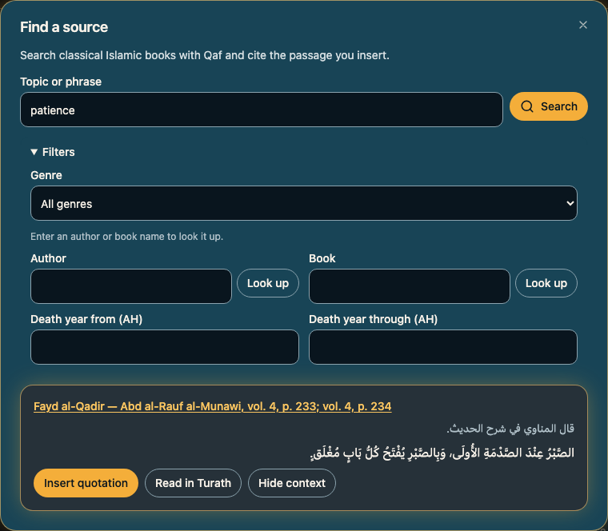
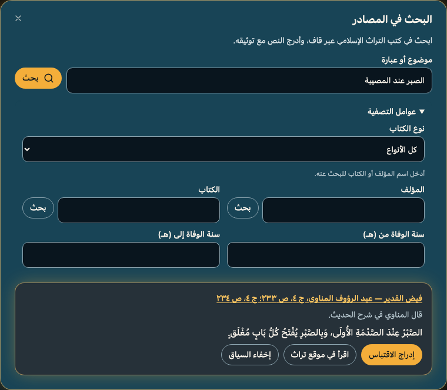
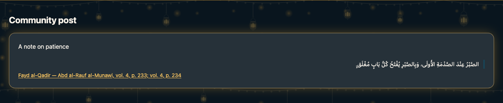
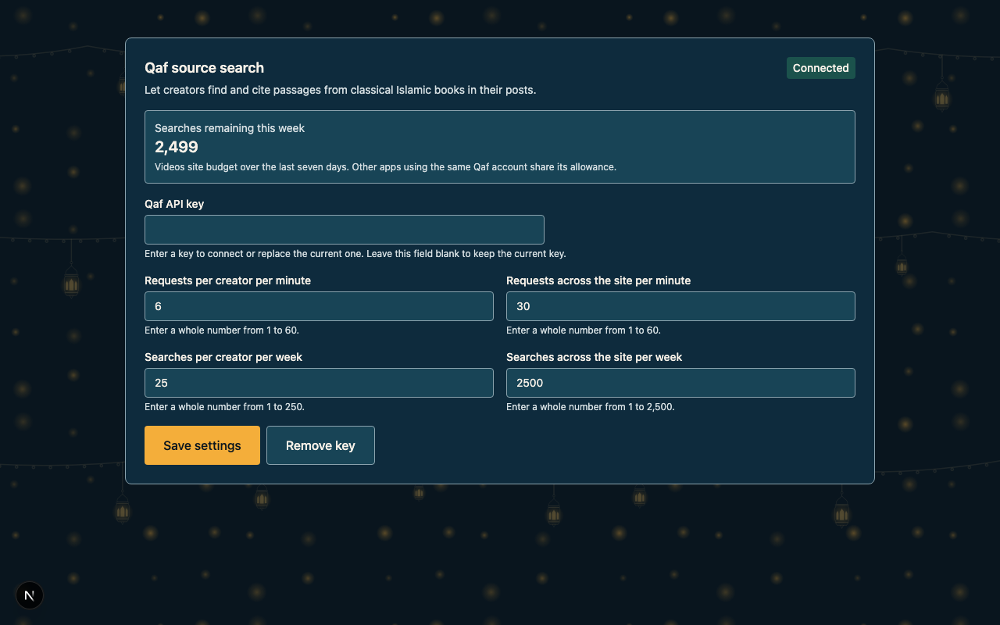
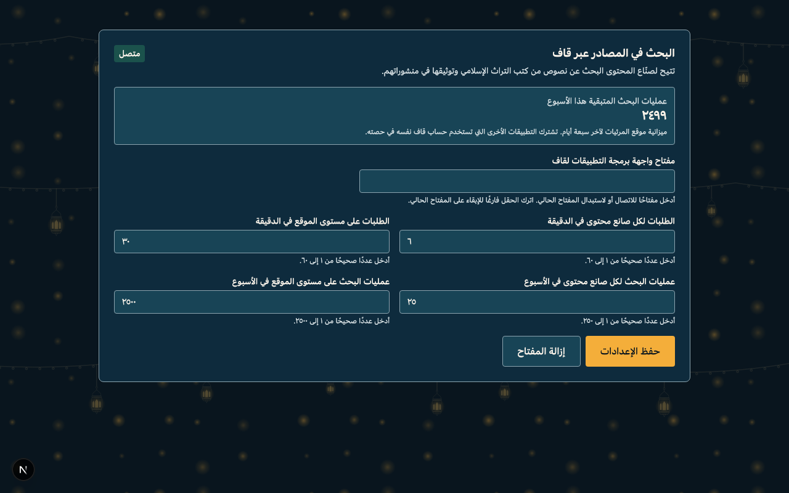

# Find a source in community posts

In Studio, open **Find a source** in a text or article draft. Search by topic or select text from the draft and use it as the query. Filter by genre, author, book, or Hijri death year. Read the surrounding text in the panel or open the print page in Turath.

**Insert quotation** adds the Arabic passage with a linked citation. The citation follows the post’s language and includes every printed page returned by Qaf.

A super admin can set or replace the write-only Qaf key and adjust request limits under **Platform settings** in Videos admin. The composer hides the helper when the key is unset. The weekly counter shows the videos site’s remaining budget.

## Dark mode examples

| Surface | English | العربية |
|---|---|---|
| Source search |  |  |
| Published quotation |  |  |
| Platform settings |  |  |
