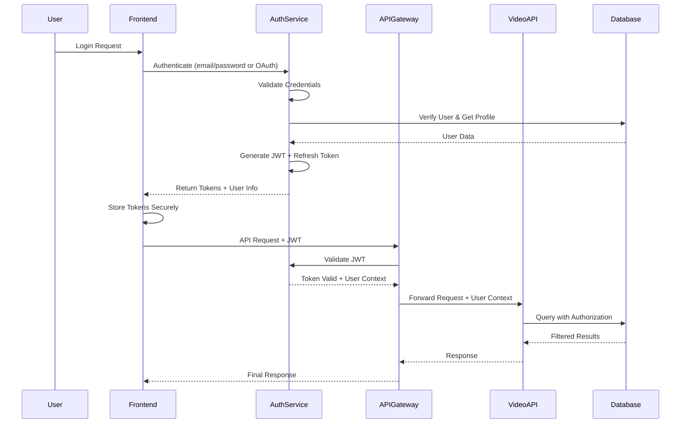
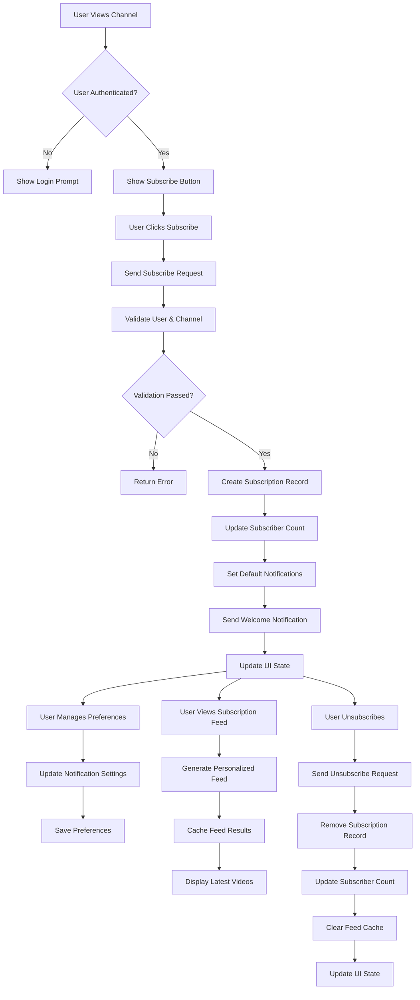
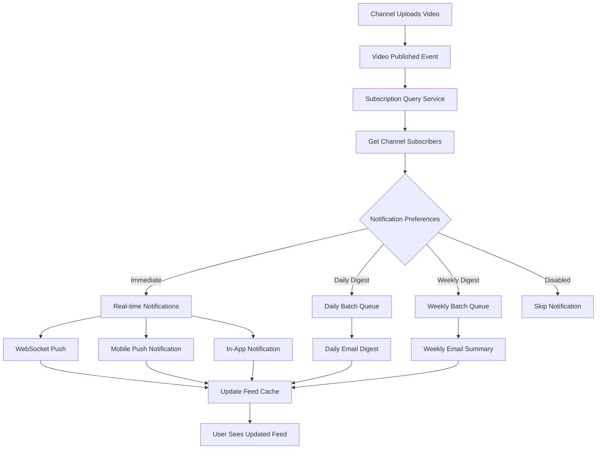

# Al Ummah Now - Technical Architecture

## System Architecture Overview

The Al Ummah Now platform is designed as a distributed microservices architecture deployed on Cloudflare infrastructure, with external media delivery via Bunny.net. This architecture ensures scalability, performance, and global reach for the Islamic content ecosystem.

## High-Level Architecture Diagram

```
┌─────────────────────────────────────────────────────────────────┐
│                     Al Ummah Now Ecosystem                      │
├─────────────────────────────────────────────────────────────────┤
│                        Client Layer                             │
│  ┌─────────────────┐  ┌─────────────────┐  ┌─────────────────┐ │
│  │   Web Frontend  │  │  Mobile Apps    │  │   Admin Panel   │ │
│  │                 │  │                 │  │                 │ │
│  │  - Video Portal │  │  - iOS/Android  │  │  - Content Mgmt │ │
│  │  - News Site    │  │  - Native Video │  │  - User Mgmt    │ │
│  │  - Academy      │  │  - Offline Mode │  │  - Analytics    │ │
│  └─────────────────┘  └─────────────────┘  └─────────────────┘ │
│           │                     │                     │         │
├───────────┼─────────────────────┼─────────────────────┼─────────┤
│                           API Gateway Layer                     │
│  ┌─────────────────────────────────────────────────────────────┐ │
│  │                    Cloudflare Workers                      │ │
│  │                                                            │ │
│  │  - Authentication & Authorization                         │ │
│  │  - Rate Limiting & Security                               │ │
│  │  - Request Routing & Load Balancing                       │ │
│  │  - API Versioning & Documentation                         │ │
│  └─────────────────────────────────────────────────────────────┘ │
│           │                     │                     │         │
├───────────┼─────────────────────┼─────────────────────┼─────────┤
│                          Microservices Layer                   │
│  ┌─────────────────┐  ┌─────────────────┐  ┌─────────────────┐ │
│  │   Video API     │  │   Auth Service  │  │   CMS API       │ │
│  │                 │  │                 │  │                 │ │
│  │  - Video CRUD   │  │  - User Auth    │  │  - Articles     │ │
│  │  - Comments     │  │  - Permissions  │  │  - News         │ │
│  │  - Playlists    │  │  - Sessions     │  │  - Editorial    │ │
│  │  - Analytics    │  │  - OAuth        │  │  - Publishing   │ │
│  └─────────────────┘  └─────────────────┘  └─────────────────┘ │
│           │                     │                     │         │
│  ┌─────────────────┐  ┌─────────────────┐  ┌─────────────────┐ │
│  │  Events Engine  │  │  Academy API    │  │   AI Service    │ │
│  │                 │  │                 │  │                 │ │
│  │  - Event Stream │  │  - Courses      │  │  - Chatbot      │ │
│  │  - Analytics    │  │  - Progress     │  │  - Recommendations│ │
│  │  - Recommendations│ │  - Certificates │  │  - Content AI   │ │
│  │  - Notifications│  │  - Assessments  │  │  - Moderation   │ │
│  └─────────────────┘  └─────────────────┘  └─────────────────┘ │
│           │                     │                     │         │
├───────────┼─────────────────────┼─────────────────────┼─────────┤
│                            Data Layer                           │
│  ┌─────────────────────────────────────────────────────────────┐ │
│  │                    Cloudflare Services                     │ │
│  │                                                            │ │
│  │  ┌──────────────┐ ┌──────────────┐ ┌──────────────┐       │ │
│  │  │ D1 Database  │ │   KV Store   │ │   R2 Storage │       │ │
│  │  │              │ │              │ │              │       │ │
│  │  │ - User Data  │ │ - Sessions   │ │ - Video Files│       │ │
│  │  │ - Videos     │ │ - Cache      │ │ - Images     │       │ │
│  │  │ - Content    │ │ - Config     │ │ - Documents  │       │ │
│  │  └──────────────┘ └──────────────┘ └──────────────┘       │ │
│  └─────────────────────────────────────────────────────────────┘ │
│           │                     │                     │         │
├───────────┼─────────────────────┼─────────────────────┼─────────┤
│                        External Services Layer                 │
│  ┌─────────────────────────────────────────────────────────────┐ │
│  │                External Integrations                       │ │
│  │                                                            │ │
│  │  ┌──────────────┐ ┌──────────────┐ ┌──────────────┐       │ │
│  │  │ Bunny.net    │ │  Email       │ │  Monitoring  │       │ │
│  │  │              │ │              │ │              │       │ │
│  │  │ - Video CDN  │ │ - Notifications│ │ - Logs      │       │ │
│  │  │ - Streaming  │ │ - Marketing  │ │ - Metrics    │       │ │
│  │  │ - Transcoding│ │ - Support    │ │ - Alerts     │       │ │
│  │  └──────────────┘ └──────────────┘ └──────────────┘       │ │
│  └─────────────────────────────────────────────────────────────┘ │
└─────────────────────────────────────────────────────────────────┘
```

## Core Service Architectures

### 1. Video Portal UI (Current Repository)

**Technology Stack**:
- **Framework**: Next.js 15 with App Router
- **Language**: TypeScript for type safety
- **Styling**: Tailwind CSS with custom Islamic design system
- **Video Player**: Video.js with custom controls and plugins
- **Authentication**: OpenAuth with JWT token management
- **Deployment**: Cloudflare Workers via OpenNext

**Application Structure**:
```
src/
├── app/                    # Next.js App Router
│   ├── [locale]/           # Internationalized routes
│   │   ├── (auth)/         # Authentication pages
│   │   ├── video/          # Video viewing pages
│   │   ├── channel/        # Channel pages
│   │   └── search/         # Search results
│   ├── api/                # API routes and middleware
│   └── globals.css         # Global styles
├── components/             # Reusable components
│   ├── ui/                 # Base UI components
│   ├── video/              # Video-related components
│   ├── navigation/         # Navigation components
│   └── auth/               # Authentication components
├── lib/                    # Utilities and configurations
│   ├── api/                # API client implementation
│   ├── auth/               # Authentication utilities
│   ├── utils/              # Helper functions
│   └── validations/        # Input validation schemas
└── types/                  # TypeScript type definitions
```

**API Client Architecture**:
```typescript
// Centralized API client with automatic authentication
class APIClient {
  private baseURL: string;
  private defaultHeaders: Record<string, string>;
  
  constructor(config: APIConfig) {
    this.baseURL = config.baseURL;
    this.defaultHeaders = {
      'Content-Type': 'application/json',
      'Accept': 'application/json'
    };
  }
  
  async request<T>(endpoint: string, options: RequestOptions): Promise<T> {
    // Automatic token refresh and retry logic
    // Error handling and logging
    // Request/response transformation
  }
}

// Service-specific API clients
export const VideosAPI = {
  list: (params?: ListParams, headers?: AuthHeaders) => 
    apiClient.get<VideoListResponse>('/api/videos', { params, headers }),
  
  getById: (id: string, headers?: AuthHeaders) =>
    apiClient.get<VideoObject>(`/api/videos/${id}`, { headers }),
  
  create: (data: VideoCreateRequest, headers: AuthHeaders) =>
    apiClient.post<VideoObject>('/api/videos', data, { headers }),
  
  // ... other video operations
};
```

### 2. Video API Service (AlUmmahNowVideos)

**Service Architecture**:
```typescript
// Fastify-based API server with TypeScript
import Fastify from 'fastify';
import { TypeBoxTypeProvider } from '@fastify/type-provider-typebox';

const server = Fastify({
  logger: true,
  ajv: {
    customOptions: {
      strict: 'log',
      keywords: ['kind', 'modifier']
    }
  }
}).withTypeProvider<TypeBoxTypeProvider>();

// Plugin registration
await server.register(cors, { origin: true });
await server.register(helmet);
await server.register(rateLimit, {
  max: 100,
  timeWindow: '1 minute'
});
await server.register(authPlugin);
await server.register(videoRoutes, { prefix: '/api/videos' });
```

**Database Schema Design**:
```sql
-- Core entities with optimized indexing
CREATE TABLE users (
  id UUID PRIMARY KEY DEFAULT gen_random_uuid(),
  email VARCHAR(255) UNIQUE NOT NULL,
  display_name VARCHAR(100),
  avatar_url TEXT,
  email_verified BOOLEAN DEFAULT false,
  is_active BOOLEAN DEFAULT true,
  created_at TIMESTAMP WITH TIME ZONE DEFAULT NOW(),
  updated_at TIMESTAMP WITH TIME ZONE DEFAULT NOW(),
  
  -- Indexes for performance
  INDEX idx_users_email (email),
  INDEX idx_users_active (is_active, created_at)
);

CREATE TABLE channels (
  id UUID PRIMARY KEY DEFAULT gen_random_uuid(),
  user_id UUID NOT NULL REFERENCES users(id) ON DELETE CASCADE,
  name VARCHAR(100) NOT NULL,
  description TEXT,
  avatar_url TEXT,
  cover_url TEXT,
  is_main BOOLEAN DEFAULT false,
  subscribers_count INTEGER DEFAULT 0,
  videos_count INTEGER DEFAULT 0,
  is_verified BOOLEAN DEFAULT false,
  created_at TIMESTAMP WITH TIME ZONE DEFAULT NOW(),
  updated_at TIMESTAMP WITH TIME ZONE DEFAULT NOW(),
  
  -- Indexes for queries
  INDEX idx_channels_user (user_id),
  INDEX idx_channels_main (user_id, is_main),
  INDEX idx_channels_verified (is_verified, subscribers_count DESC)
);

CREATE TABLE videos (
  id UUID PRIMARY KEY DEFAULT gen_random_uuid(),
  title VARCHAR(255) NOT NULL,
  description TEXT,
  channel_id UUID NOT NULL REFERENCES channels(id),
  user_id UUID NOT NULL REFERENCES users(id),
  
  -- Video metadata
  video_url TEXT NOT NULL,
  thumbnail_url TEXT,
  duration_seconds INTEGER,
  file_size_bytes BIGINT,
  resolution VARCHAR(20), -- e.g., "1920x1080"
  format VARCHAR(10), -- e.g., "mp4", "webm"
  
  -- Engagement metrics
  views_count INTEGER DEFAULT 0,
  likes_count INTEGER DEFAULT 0,
  dislikes_count INTEGER DEFAULT 0,
  comments_count INTEGER DEFAULT 0,
  shares_count INTEGER DEFAULT 0,
  
  -- Status and visibility
  is_public BOOLEAN DEFAULT true,
  is_live BOOLEAN DEFAULT false,
  is_featured BOOLEAN DEFAULT false,
  processing_status video_processing_status DEFAULT 'pending',
  
  -- SEO and categorization
  tags TEXT[], -- Array of tags
  category VARCHAR(50),
  language VARCHAR(10) DEFAULT 'en',
  
  -- Timestamps
  published_at TIMESTAMP WITH TIME ZONE,
  created_at TIMESTAMP WITH TIME ZONE DEFAULT NOW(),
  updated_at TIMESTAMP WITH TIME ZONE DEFAULT NOW(),
  
  -- Indexes for performance
  INDEX idx_videos_channel (channel_id, published_at DESC),
  INDEX idx_videos_user (user_id, created_at DESC),
  INDEX idx_videos_public (is_public, published_at DESC),
  INDEX idx_videos_featured (is_featured, published_at DESC),
  INDEX idx_videos_category (category, published_at DESC),
  INDEX idx_videos_search (title, description), -- Full-text search
  INDEX idx_videos_engagement (views_count DESC, likes_count DESC)
);

-- Enum for video processing status
CREATE TYPE video_processing_status AS ENUM (
  'pending',
  'processing',
  'transcoding',
  'completed',
  'failed',
  'archived'
);
```

**Video Processing Pipeline**:
```typescript
// Queue-based video processing
export class VideoProcessor {
  private queue: Queue;
  private storage: R2Bucket;
  
  async processVideo(videoId: string, fileData: Buffer): Promise<void> {
    try {
      // 1. Upload original file to R2
      await this.storage.put(`videos/originals/${videoId}`, fileData);
      
      // 2. Queue transcoding jobs
      await this.queue.send({
        type: 'transcode',
        videoId,
        resolutions: ['360p', '720p', '1080p'],
        formats: ['mp4', 'webm']
      });
      
      // 3. Generate thumbnail
      await this.queue.send({
        type: 'thumbnail',
        videoId,
        timestamps: [0, 30, 60] // Multiple thumbnail options
      });
      
      // 4. Extract metadata
      await this.queue.send({
        type: 'metadata',
        videoId
      });
      
    } catch (error) {
      await this.handleProcessingError(videoId, error);
    }
  }
}
```

### 3. Authentication Service (AlUmmahNowAuth)

**OpenAuth Implementation**:
```typescript
// OpenAuth configuration for Al Ummah Now
import { createAuthConfig } from '@openauthjs/openauth';

export const authConfig = createAuthConfig({
  baseURL: 'https://auth.alummahnow.net',
  providers: {
    google: {
      clientId: process.env.GOOGLE_CLIENT_ID!,
      clientSecret: process.env.GOOGLE_CLIENT_SECRET!,
      scopes: ['openid', 'email', 'profile']
    },
    apple: {
      clientId: process.env.APPLE_CLIENT_ID!,
      teamId: process.env.APPLE_TEAM_ID!,
      keyId: process.env.APPLE_KEY_ID!,
      privateKey: process.env.APPLE_PRIVATE_KEY!
    }
  },
  
  // JWT configuration
  jwt: {
    issuer: 'al-ummah-now',
    audience: ['video-portal', 'api-backend', 'mobile-app'],
    algorithms: ['RS256'],
    expiresIn: '15m' // Short-lived access tokens
  },
  
  // Refresh token configuration
  refresh: {
    expiresIn: '7d',
    rotateOnUse: true, // Security best practice
    revokeOnLogout: true
  },
  
  // Session management
  session: {
    store: 'cloudflare-kv', // Use Cloudflare KV for session storage
    cookie: {
      name: 'auth-session',
      httpOnly: true,
      secure: true,
      sameSite: 'lax'
    }
  }
});
```

**Multi-Factor Authentication**:
```typescript
// TOTP-based MFA implementation
import { authenticator } from 'otplib';

export class MFAService {
  async enableMFA(userId: string): Promise<{ secret: string; qrCode: string }> {
    const secret = authenticator.generateSecret();
    const qrCode = await this.generateQRCode(userId, secret);
    
    // Store encrypted secret
    await this.storeMFASecret(userId, secret);
    
    return { secret, qrCode };
  }
  
  async verifyMFA(userId: string, token: string): Promise<boolean> {
    const secret = await this.getMFASecret(userId);
    return authenticator.verify({ token, secret });
  }
  
  async generateBackupCodes(userId: string): Promise<string[]> {
    const codes = Array.from({ length: 10 }, () => 
      crypto.randomBytes(4).toString('hex').toUpperCase()
    );
    
    await this.storeBackupCodes(userId, codes);
    return codes;
  }
}
```

### 4. Events Processing Service (AlUmmahNowProcessor)

**Event-Driven Architecture**:
```typescript
// Event streaming with Cloudflare Workers and Queues
export interface VideoEvent {
  type: 'video_view' | 'video_like' | 'video_comment' | 'video_share';
  userId?: string;
  videoId: string;
  channelId: string;
  sessionId: string;
  timestamp: Date;
  metadata: Record<string, any>;
}

export class EventProcessor {
  private queue: CloudflareQueue;
  private analytics: AnalyticsEngine;
  
  async processEvent(event: VideoEvent): Promise<void> {
    // Real-time processing
    await this.updateRealTimeMetrics(event);
    
    // Queue for batch processing
    await this.queue.send({
      batch: 'analytics',
      event,
      processAt: new Date(Date.now() + 5000) // 5-second delay for batching
    });
    
    // Trigger real-time updates
    await this.notifySubscribers(event);
  }
  
  async updateRealTimeMetrics(event: VideoEvent): Promise<void> {
    switch (event.type) {
      case 'video_view':
        await this.incrementViewCount(event.videoId);
        await this.trackUserEngagement(event.userId, event.videoId);
        break;
      
      case 'video_like':
        await this.incrementLikeCount(event.videoId);
        await this.updateRecommendations(event.userId, event.videoId);
        break;
    }
  }
}
```

**Recommendation Engine**:
```typescript
// Content-based and collaborative filtering
export class RecommendationEngine {
  async generateRecommendations(userId: string): Promise<VideoObject[]> {
    // Get user preferences and history
    const userProfile = await this.getUserProfile(userId);
    const viewHistory = await this.getViewHistory(userId);
    
    // Content-based filtering
    const contentBased = await this.getContentBasedRecommendations(
      userProfile, 
      viewHistory
    );
    
    // Collaborative filtering
    const collaborative = await this.getCollaborativeRecommendations(userId);
    
    // Combine and rank
    return this.rankRecommendations([...contentBased, ...collaborative]);
  }
  
  private async getContentBasedRecommendations(
    profile: UserProfile, 
    history: VideoObject[]
  ): Promise<VideoObject[]> {
    // Analyze content features: tags, categories, duration, etc.
    const features = this.extractContentFeatures(history);
    
    // Find similar content
    return this.findSimilarContent(features);
  }
}
```

## Search & Content Discovery Architecture

### Search Query Flow Diagram

```
┌─────────────────────────────────────────────────────────────────┐
│                     Search & Discovery Flow                     │
├─────────────────────────────────────────────────────────────────┤
│  User Query                                                     │
│  ┌─────────────────────────────────────────────────────────────┐ │
│  │  Search Input + Filters                                     │ │
│  │  ┌───────────────┐ ┌───────────────┐ ┌───────────────────┐ │ │
│  │  │   Query Text  │ │   Category    │ │   Advanced        │ │ │
│  │  │               │ │   Language    │ │   Date Range      │ │ │
│  │  │   "islamic    │ │   Duration    │ │   Sort Options    │ │ │
│  │  │   lectures"   │ │               │ │                   │ │ │
│  │  └───────────────┘ └───────────────┘ └───────────────────┘ │ │
│  └─────────────────────────────────────────────────────────────┘ │
│           │                                                     │
│           ▼                                                     │
│  ┌─────────────────────────────────────────────────────────────┐ │
│  │  Frontend Processing Layer                                  │ │
│  │  ┌─────────────────┐ ┌─────────────────┐ ┌───────────────┐ │ │
│  │  │   Debounced     │ │   Filter        │ │   Query       │ │ │
│  │  │   Suggestions   │ │   Validation    │ │   Sanitization│ │ │
│  │  │                 │ │                 │ │               │ │ │
│  │  │   300ms delay   │ │   Type checking │ │   XSS protect │ │ │
│  │  │   Autocomplete  │ │   Range limits  │ │   Encoding    │ │ │
│  │  └─────────────────┘ └─────────────────┘ └───────────────┘ │ │
│  └─────────────────────────────────────────────────────────────┘ │
│           │                                                     │
│           ▼                                                     │
│  ┌─────────────────────────────────────────────────────────────┐ │
│  │  API Gateway Layer (Cloudflare Workers)                    │ │
│  │  ┌─────────────────┐ ┌─────────────────┐ ┌───────────────┐ │ │
│  │  │   Rate Limiting │ │   Authentication│ │   Caching     │ │ │
│  │  │                 │ │                 │ │               │ │ │
│  │  │   100 req/min   │ │   Optional for  │ │   Popular     │ │ │
│  │  │   per user      │ │   personalized │ │   queries     │ │ │
│  │  │                 │ │   results       │ │   TTL: 5min   │ │ │
│  │  └─────────────────┘ └─────────────────┘ └───────────────┘ │ │
│  └─────────────────────────────────────────────────────────────┘ │
│           │                                                     │
│           ▼                                                     │
│  ┌─────────────────────────────────────────────────────────────┐ │
│  │  Search Processing Engine                                   │ │
│  │  ┌─────────────────┐ ┌─────────────────┐ ┌───────────────┐ │ │
│  │  │   Query Parser  │ │   Filter Engine │ │   Ranking     │ │ │
│  │  │                 │ │                 │ │   Algorithm   │ │ │
│  │  │   Text analysis │ │   SQL WHERE     │ │               │ │ │
│  │  │   Tokenization  │ │   clause build  │ │   Relevance   │ │ │
│  │  │   Stemming      │ │   Index usage   │ │   + Popularity│ │ │
│  │  └─────────────────┘ └─────────────────┘ └───────────────┘ │ │
│  └─────────────────────────────────────────────────────────────┘ │
│           │                                                     │
│           ▼                                                     │
│  ┌─────────────────────────────────────────────────────────────┐ │
│  │  Database Query Layer                                       │ │
│  │  ┌─────────────────────────────────────────────────────────┐ │ │
│  │  │  SELECT * FROM videos                                   │ │ │
│  │  │  WHERE                                                  │ │ │
│  │  │    (title ILIKE '%islamic%' OR description ILIKE '%')   │ │ │
│  │  │    AND category = 'islamic-lectures'                    │ │ │
│  │  │    AND language = 'en'                                  │ │ │
│  │  │    AND created_at >= '2024-01-01'                       │ │ │
│  │  │    AND is_public = true                                 │ │ │
│  │  │  ORDER BY                                               │ │ │
│  │  │    ts_rank(search_vector, plainto_tsquery('islamic'))   │ │ │
│  │  │    DESC, views_count DESC                               │ │ │
│  │  │  LIMIT 20 OFFSET 0;                                     │ │ │
│  │  └─────────────────────────────────────────────────────────┘ │ │
│  └─────────────────────────────────────────────────────────────┘ │
│           │                                                     │
│           ▼                                                     │
│  ┌─────────────────────────────────────────────────────────────┐ │
│  │  Result Processing & Response                               │ │  
│  │  ┌─────────────────┐ ┌─────────────────┐ ┌───────────────┐ │ │
│  │  │   Format Results│ │   Add Metadata  │ │   Cache       │ │ │
│  │  │                 │ │                 │ │   Response    │ │ │
│  │  │   Pagination    │ │   Thumbnails    │ │               │ │ │
│  │  │   Total count   │ │   Channel info  │ │   TTL based   │ │ │
│  │  │   Cursor logic  │ │   View counts   │ │   on query    │ │ │
│  │  └─────────────────┘ └─────────────────┘ └───────────────┘ │ │
│  └─────────────────────────────────────────────────────────────┘ │
└─────────────────────────────────────────────────────────────────┘
```

### Search Implementation Components

**Frontend Search Components**:
```typescript
// Advanced search filters with bilingual support
interface SearchFiltersProps {
  filters: SearchFilters;
  onFiltersChange: (filters: SearchFilters) => void;
  onApplyFilters: () => void;
  onClearFilters: () => void;
  isOpen: boolean;
  onToggle: () => void;
}

interface SearchFilters {
  category?: string;           // 'islamic-lectures', 'quran-recitation', etc.
  language?: 'en' | 'ar' | 'all';
  dateFrom?: string;          // ISO date string
  dateTo?: string;            // ISO date string  
  duration?: 'short' | 'medium' | 'long' | 'all';
  sortBy?: 'relevance' | 'date' | 'views' | 'likes';
  sortOrder?: 'asc' | 'desc';
}

// Search suggestions with debouncing and keyboard navigation
export class SearchSuggestions {
  private debounceTimer: NodeJS.Timeout;
  
  async fetchSuggestions(query: string): Promise<SearchSuggestion[]> {
    clearTimeout(this.debounceTimer);
    
    return new Promise((resolve) => {
      this.debounceTimer = setTimeout(async () => {
        const suggestions = await VideosAPI.getSearchSuggestions(query, 5);
        resolve(suggestions);
      }, 300); // 300ms debounce
    });
  }
  
  handleKeyboardNavigation(event: KeyboardEvent, suggestions: SearchSuggestion[]) {
    switch (event.key) {
      case 'ArrowDown':
        this.selectNext(suggestions);
        break;
      case 'ArrowUp':
        this.selectPrevious(suggestions);
        break;
      case 'Enter':
        this.confirmSelection();
        break;
      case 'Escape':
        this.closeSuggestions();
        break;
    }
  }
}
```

### Content Discovery & Recommendation Pipeline

```
┌─────────────────────────────────────────────────────────────────┐
│                  Recommendation Pipeline                        │
├─────────────────────────────────────────────────────────────────┤
│  Data Collection                                                │
│  ┌─────────────────────────────────────────────────────────────┐ │
│  │  User Behavior Tracking                                     │ │
│  │  ┌───────────────┐ ┌───────────────┐ ┌───────────────────┐ │ │
│  │  │   View History│ │   Search       │ │   Engagement      │ │ │
│  │  │               │ │   Queries      │ │   Metrics         │ │ │
│  │  │   • Videos    │ │               │ │                   │ │ │
│  │  │   • Duration  │ │   • Terms     │ │   • Likes         │ │ │
│  │  │   • Completion│ │   • Filters   │ │   • Comments      │ │ │
│  │  │   • Skip rates│ │   • Results   │ │   • Shares        │ │ │
│  │  └───────────────┘ └───────────────┘ └───────────────────┘ │ │
│  └─────────────────────────────────────────────────────────────┘ │
│           │                                                     │
│           ▼                                                     │
│  ┌─────────────────────────────────────────────────────────────┐ │
│  │  Content Analysis                                           │ │
│  │  ┌─────────────────┐ ┌─────────────────┐ ┌───────────────┐ │ │
│  │  │   Metadata      │ │   Content       │ │   Social      │ │ │
│  │  │   Features      │ │   Features      │ │   Signals     │ │ │
│  │  │                 │ │                 │ │               │ │ │
│  │  │   • Category    │ │   • Tags        │ │   • Views     │ │ │
│  │  │   • Language    │ │   • Topics      │ │   • Likes     │ │ │
│  │  │   • Duration    │ │   • Speakers    │ │   • Comments  │ │ │
│  │  │   • Upload date │ │   • Quality     │ │   • Trending  │ │ │
│  │  └─────────────────┘ └─────────────────┘ └───────────────┘ │ │
│  └─────────────────────────────────────────────────────────────┘ │
│           │                                                     │
│           ▼                                                     │
│  ┌─────────────────────────────────────────────────────────────┐ │
│  │  Recommendation Algorithms                                  │ │
│  │  ┌─────────────────┐ ┌─────────────────┐ ┌───────────────┐ │ │
│  │  │   Content-Based │ │   Collaborative │ │   Trending    │ │ │
│  │  │   Filtering     │ │   Filtering     │ │   Algorithm   │ │ │
│  │  │                 │ │                 │ │               │ │ │
│  │  │   Similar       │ │   User          │ │   Time-based  │ │ │
│  │  │   content by    │ │   similarity    │ │   popularity  │ │ │
│  │  │   features      │ │   patterns      │ │   scoring     │ │ │
│  │  └─────────────────┘ └─────────────────┘ └───────────────┘ │ │
│  └─────────────────────────────────────────────────────────────┘ │
│           │                                                     │
│           ▼                                                     │
│  ┌─────────────────────────────────────────────────────────────┐ │
│  │  Ranking & Personalization                                 │ │
│  │  ┌─────────────────────────────────────────────────────────┐ │ │
│  │  │  final_score = (                                        │ │ │
│  │  │    content_similarity * 0.4 +                           │ │ │
│  │  │    user_preference_match * 0.3 +                        │ │ │
│  │  │    trending_factor * 0.2 +                              │ │ │
│  │  │    recency_boost * 0.1                                  │ │ │
│  │  │  ) * islamic_compliance_score                           │ │ │
│  │  └─────────────────────────────────────────────────────────┘ │ │
│  └─────────────────────────────────────────────────────────────┘ │
│           │                                                     │
│           ▼                                                     │
│  ┌─────────────────────────────────────────────────────────────┐ │
│  │  Output & Delivery                                          │ │
│  │  ┌─────────────────┐ ┌─────────────────┐ ┌───────────────┐ │ │
│  │  │   Trending      │ │   Related       │ │   Personalized│ │ │
│  │  │   Videos        │ │   Videos        │ │   Feed        │ │ │
│  │  │                 │ │                 │ │               │ │ │
│  │  │   Period-based  │ │   Context-aware │ │   User-specific│ │ │
│  │  │   (hour/day/    │ │   suggestions   │ │   homepage    │ │ │
│  │  │   week/month)   │ │   during play   │ │   content     │ │ │
│  │  └─────────────────┘ └─────────────────┘ └───────────────┘ │ │
│  └─────────────────────────────────────────────────────────────┘ │
└─────────────────────────────────────────────────────────────────┘
```

### Advanced Search API Implementation

**Search Endpoint with Filters**:
```typescript
// GET /api/videos/search
interface SearchRequest {
  query?: string;                 // Free text search
  category?: string;              // Content category filter
  language?: 'en' | 'ar' | 'all'; // Language preference  
  dateFrom?: string;              // Start date filter
  dateTo?: string;                // End date filter
  duration?: 'short' | 'medium' | 'long' | 'all';
  sortBy?: 'relevance' | 'date' | 'views' | 'likes';
  sortOrder?: 'asc' | 'desc';
  limit?: number;                 // Results per page
  cursor?: string;                // Pagination cursor
}

export class AdvancedSearchEngine {
  async search(request: SearchRequest): Promise<SearchResponse> {
    // Build dynamic SQL query with full-text search
    const query = this.buildSearchQuery(request);
    
    // Execute with proper indexing
    const results = await this.database.execute(query);
    
    // Apply post-processing filters
    const filtered = await this.applyContentFilters(results);
    
    // Add recommendation boost for personalized results
    const ranked = await this.applyRecommendationBoost(filtered, request);
    
    return {
      data: ranked,
      pagination: this.buildPaginationMeta(results, request),
      facets: await this.buildSearchFacets(request), // Category counts, etc.
      suggestions: await this.getRelatedSearches(request.query)
    };
  }
  
  private buildSearchQuery(request: SearchRequest): string {
    let sql = `
      SELECT v.*, c.name as channel_name, c.avatar_url as channel_avatar_url,
             ts_rank(v.search_vector, plainto_tsquery($1)) as relevance_score
      FROM videos v
      JOIN channels c ON v.channel_id = c.id
      WHERE v.is_public = true AND v.is_deleted = false
    `;
    
    const params: any[] = [request.query || ''];
    let paramIndex = 1;
    
    // Add text search condition
    if (request.query) {
      sql += ` AND (v.search_vector @@ plainto_tsquery($${paramIndex}))`;
    }
    
    // Add category filter
    if (request.category) {
      sql += ` AND v.category = $${++paramIndex}`;
      params.push(request.category);
    }
    
    // Add language filter
    if (request.language && request.language !== 'all') {
      sql += ` AND v.language = $${++paramIndex}`;
      params.push(request.language);
    }
    
    // Add date range filters
    if (request.dateFrom) {
      sql += ` AND v.published_at >= $${++paramIndex}`;
      params.push(request.dateFrom);
    }
    
    if (request.dateTo) {
      sql += ` AND v.published_at <= $${++paramIndex}`;
      params.push(request.dateTo);
    }
    
    // Add duration filter
    if (request.duration && request.duration !== 'all') {
      switch (request.duration) {
        case 'short':
          sql += ` AND v.duration_seconds < 240`; // < 4 minutes
          break;
        case 'medium':
          sql += ` AND v.duration_seconds BETWEEN 240 AND 1200`; // 4-20 minutes
          break;
        case 'long':
          sql += ` AND v.duration_seconds > 1200`; // > 20 minutes
          break;
      }
    }
    
    // Add ordering
    sql += this.buildOrderClause(request);
    
    // Add pagination
    sql += ` LIMIT ${request.limit || 20}`;
    if (request.cursor) {
      // Implement cursor-based pagination
      sql += ` OFFSET ${this.decodeCursor(request.cursor)}`;
    }
    
    return sql;
  }
}
```

### Trending Content Algorithm

**Trending Score Calculation**:
```typescript
interface TrendingMetrics {
  views: number;
  likes: number;  
  comments: number;
  shares: number;
  timeDecay: number;    // Exponential decay based on age
  categoryBoost: number; // Category-specific boost
}

export class TrendingAlgorithm {
  calculateTrendingScore(video: VideoObject, period: TrendingPeriod): number {
    const metrics = this.getMetricsForPeriod(video, period);
    
    // Base engagement score
    const engagementScore = (
      metrics.views * 1.0 +
      metrics.likes * 5.0 +
      metrics.comments * 3.0 +
      metrics.shares * 8.0
    );
    
    // Time decay factor (newer content gets boost)
    const ageHours = this.getAgeInHours(video.dateCreated);
    const timeDecay = Math.exp(-ageHours / 24); // Exponential decay over 24 hours
    
    // Category boost for religious content
    const categoryBoost = this.getCategoryBoost(video.category);
    
    // Islamic compliance factor (content moderation score)
    const complianceScore = video.complianceScore || 1.0;
    
    return engagementScore * timeDecay * categoryBoost * complianceScore;
  }
  
  async getTrendingVideos(
    period: 'hour' | 'day' | 'week' | 'month',
    category?: string,
    limit: number = 20
  ): Promise<VideoObject[]> {
    const timeWindow = this.getTimeWindow(period);
    
    // Get videos from the specified time window
    const candidates = await this.database.query(`
      SELECT v.*, 
             COUNT(vv.id) as period_views,
             COUNT(vl.id) as period_likes,
             COUNT(vc.id) as period_comments
      FROM videos v
      LEFT JOIN video_views vv ON v.id = vv.video_id 
        AND vv.created_at >= $1
      LEFT JOIN video_likes vl ON v.id = vl.video_id 
        AND vl.created_at >= $1  
      LEFT JOIN video_comments vc ON v.id = vc.video_id 
        AND vc.created_at >= $1
      WHERE v.is_public = true 
        AND v.published_at >= $2
        ${category ? 'AND v.category = $3' : ''}
      GROUP BY v.id
      ORDER BY (
        COUNT(vv.id) * 1.0 +
        COUNT(vl.id) * 5.0 + 
        COUNT(vc.id) * 3.0
      ) DESC
      LIMIT $${category ? '4' : '3'}
    `, [timeWindow.start, timeWindow.start, ...(category ? [category] : [])]);
    
    // Calculate trending scores and re-rank
    const scored = candidates.map(video => ({
      ...video,
      trendingScore: this.calculateTrendingScore(video, period)
    }));
    
    return scored
      .sort((a, b) => b.trendingScore - a.trendingScore)
      .slice(0, limit);
  }
}
```

### Search Performance Optimizations

**Database Indexing Strategy**:
```sql
-- Full-text search index for video content
CREATE INDEX idx_videos_search_vector ON videos 
USING gin(search_vector);

-- Composite indexes for common filter combinations
CREATE INDEX idx_videos_category_published ON videos 
(category, published_at DESC) 
WHERE is_public = true;

CREATE INDEX idx_videos_language_category ON videos 
(language, category, published_at DESC)
WHERE is_public = true;

-- Trending algorithm indexes  
CREATE INDEX idx_videos_engagement_score ON videos 
((views_count + likes_count * 5 + comments_count * 3) DESC, published_at DESC)
WHERE is_public = true;

-- Duration-based filtering
CREATE INDEX idx_videos_duration_category ON videos 
(duration_seconds, category, published_at DESC)
WHERE is_public = true;
```

**Caching Strategy for Search**:
```typescript
export class SearchCacheManager {
  private static readonly CACHE_KEYS = {
    TRENDING: (period: string, category?: string) => 
      `trending:${period}:${category || 'all'}`,
    POPULAR_SEARCHES: 'searches:popular',
    SEARCH_RESULTS: (queryHash: string) => `search:${queryHash}`,
    SUGGESTIONS: (query: string) => `suggestions:${btoa(query)}`
  };
  
  async getTrendingVideos(period: string, category?: string): Promise<VideoObject[]> {
    const cacheKey = SearchCacheManager.CACHE_KEYS.TRENDING(period, category);
    
    // Try cache first
    let cached = await this.kv.get(cacheKey);
    if (cached) {
      return JSON.parse(cached);
    }
    
    // Generate fresh data
    const trending = await this.trendingAlgorithm.getTrendingVideos(period, category);
    
    // Cache with appropriate TTL
    const ttl = this.getTTLForPeriod(period);
    await this.kv.put(cacheKey, JSON.stringify(trending), { expirationTtl: ttl });
    
    return trending;
  }
  
  private getTTLForPeriod(period: string): number {
    switch (period) {
      case 'hour': return 300;   // 5 minutes
      case 'day': return 1800;   // 30 minutes  
      case 'week': return 3600;  // 1 hour
      case 'month': return 7200; // 2 hours
      default: return 1800;
    }
  }
}
```

## Performance Architecture

### Caching Strategy

**Multi-Layer Caching**:
```typescript
// Hierarchical caching implementation
export class CacheManager {
  private layers = {
    l1: new Map(), // In-memory cache
    l2: null as CloudflareKV | null, // Edge cache
    l3: null as Database | null // Database cache
  };
  
  async get<T>(key: string): Promise<T | null> {
    // L1: Memory cache (fastest)
    if (this.layers.l1.has(key)) {
      return this.layers.l1.get(key);
    }
    
    // L2: Edge cache (fast)
    const edgeValue = await this.layers.l2?.get(key);
    if (edgeValue) {
      this.layers.l1.set(key, edgeValue);
      return JSON.parse(edgeValue);
    }
    
    // L3: Database (slower but persistent)
    const dbValue = await this.layers.l3?.getCached(key);
    if (dbValue) {
      await this.layers.l2?.put(key, JSON.stringify(dbValue), { expirationTtl: 3600 });
      this.layers.l1.set(key, dbValue);
      return dbValue;
    }
    
    return null;
  }
}
```

**Cache Invalidation Strategy**:
```typescript
// Event-driven cache invalidation
export class CacheInvalidator {
  async invalidateVideoCache(videoId: string): Promise<void> {
    const keys = [
      `video:${videoId}`,
      `video:${videoId}:comments`,
      `video:${videoId}:analytics`,
      `channel:${channelId}:videos`, // Assuming we have channelId
      'videos:trending',
      'videos:featured'
    ];
    
    await Promise.all(keys.map(key => this.invalidateKey(key)));
  }
  
  private async invalidateKey(key: string): Promise<void> {
    // Invalidate at all cache levels
    await Promise.all([
      this.memoryCache.delete(key),
      this.edgeCache.delete(key),
      this.databaseCache.invalidate(key)
    ]);
  }
}
```

### Video Delivery Optimization

**Adaptive Bitrate Streaming**:
```typescript
// Integration with Bunny.net for ABR streaming
export class VideoStreamingService {
  async getStreamingManifest(videoId: string, userAgent: string): Promise<StreamManifest> {
    const video = await this.getVideoMetadata(videoId);
    const deviceCapabilities = this.analyzeDevice(userAgent);
    
    return {
      formats: [
        {
          resolution: '360p',
          bitrate: '500k',
          url: `${video.baseUrl}/360p/playlist.m3u8`,
          codecs: 'avc1.42E01E,mp4a.40.2'
        },
        {
          resolution: '720p',
          bitrate: '2500k',
          url: `${video.baseUrl}/720p/playlist.m3u8`,
          codecs: 'avc1.64001F,mp4a.40.2'
        },
        {
          resolution: '1080p',
          bitrate: '5000k',
          url: `${video.baseUrl}/1080p/playlist.m3u8`,
          codecs: 'avc1.640028,mp4a.40.2',
          enabled: deviceCapabilities.supportsHD
        }
      ],
      defaultQuality: this.selectDefaultQuality(deviceCapabilities),
      adaptiveBitrate: true
    };
  }
}
```

## Security Architecture

### Authentication & Authorization Flow



### Content Security

**Upload Security Pipeline**:
```typescript
// Comprehensive file upload security
export class UploadSecurityService {
  async validateUpload(file: File, userId: string): Promise<ValidationResult> {
    const validations = await Promise.all([
      this.validateFileType(file),
      this.validateFileSize(file),
      this.scanForMalware(file),
      this.validateContent(file),
      this.checkUserQuota(userId)
    ]);
    
    return {
      isValid: validations.every(v => v.passed),
      errors: validations.filter(v => !v.passed).map(v => v.error),
      warnings: validations.filter(v => v.warning).map(v => v.warning)
    };
  }
  
  private async scanForMalware(file: File): Promise<ValidationResult> {
    // Integration with security scanning service
    const scanResult = await this.securityScanner.scan(file.buffer);
    
    return {
      passed: scanResult.clean,
      error: scanResult.clean ? null : 'File contains malicious content'
    };
  }
  
  private async validateContent(file: File): Promise<ValidationResult> {
    // AI-powered content analysis for Islamic compliance
    const analysis = await this.contentAnalyzer.analyze(file);
    
    return {
      passed: analysis.compliant,
      warning: analysis.needsReview ? 'Content flagged for manual review' : null
    };
  }
}
```

## Monitoring and Observability

### Comprehensive Logging Strategy

```typescript
// Structured logging with correlation IDs
export class Logger {
  private correlationId: string;
  
  constructor(correlationId?: string) {
    this.correlationId = correlationId || this.generateCorrelationId();
  }
  
  info(message: string, metadata: Record<string, any> = {}): void {
    this.log('INFO', message, metadata);
  }
  
  error(message: string, error: Error, metadata: Record<string, any> = {}): void {
    this.log('ERROR', message, {
      ...metadata,
      error: {
        name: error.name,
        message: error.message,
        stack: error.stack
      }
    });
  }
  
  private log(level: string, message: string, metadata: Record<string, any>): void {
    const logEntry = {
      timestamp: new Date().toISOString(),
      level,
      message,
      correlationId: this.correlationId,
      service: 'video-api',
      ...metadata
    };
    
    console.log(JSON.stringify(logEntry));
    
    // Send to external logging service
    this.sendToLoggingService(logEntry);
  }
}
```

### Performance Monitoring

```typescript
// Real-time performance tracking
export class PerformanceMonitor {
  async trackAPIRequest(
    endpoint: string,
    method: string,
    startTime: number,
    statusCode: number,
    userId?: string
  ): Promise<void> {
    const duration = Date.now() - startTime;
    
    const metrics = {
      endpoint,
      method,
      duration,
      statusCode,
      userId,
      timestamp: new Date().toISOString()
    };
    
    // Real-time metrics
    await this.analytics.writeDataPoint('api_request', metrics);
    
    // Alert on performance issues
    if (duration > 5000) { // 5 second threshold
      await this.alertService.send({
        type: 'performance_degradation',
        severity: 'high',
        message: `Slow API response: ${endpoint} took ${duration}ms`,
        metadata: metrics
      });
    }
  }
}
```

## Deployment Architecture

### CI/CD Pipeline

```yaml
# GitHub Actions workflow for deployment
name: Deploy Al Ummah Now

on:
  push:
    branches: [main]
  pull_request:
    branches: [main]

jobs:
  test:
    runs-on: ubuntu-latest
    steps:
      - uses: actions/checkout@v4
      - uses: actions/setup-node@v4
        with:
          node-version: '18'
          cache: 'npm'
      
      - name: Install dependencies
        run: npm ci
      
      - name: Run type checking
        run: npm run type-check
      
      - name: Run linting
        run: npm run lint
      
      - name: Run tests
        run: npm run test
      
      - name: Run E2E tests
        run: npm run test:e2e

  build:
    needs: test
    runs-on: ubuntu-latest
    steps:
      - uses: actions/checkout@v4
      - uses: actions/setup-node@v4
        with:
          node-version: '18'
          cache: 'npm'
      
      - name: Install dependencies
        run: npm ci
      
      - name: Build application
        run: npm run build
      
      - name: Upload build artifacts
        uses: actions/upload-artifact@v4
        with:
          name: build-artifacts
          path: .next/

  deploy-staging:
    needs: build
    runs-on: ubuntu-latest
    if: github.ref == 'refs/heads/main'
    environment: staging
    steps:
      - uses: actions/checkout@v4
      - name: Deploy to Cloudflare Workers (Staging)
        run: npx wrangler deploy --env staging
        env:
          CLOUDFLARE_API_TOKEN: ${{ secrets.CLOUDFLARE_API_TOKEN }}

  deploy-production:
    needs: [build, deploy-staging]
    runs-on: ubuntu-latest
    if: github.ref == 'refs/heads/main'
    environment: production
    steps:
      - uses: actions/checkout@v4
      - name: Deploy to Cloudflare Workers (Production)
        run: npx wrangler deploy --env production
        env:
          CLOUDFLARE_API_TOKEN: ${{ secrets.CLOUDFLARE_API_TOKEN }}
```

### Infrastructure as Code

```typescript
// Cloudflare infrastructure configuration
export const infraConfig = {
  // Cloudflare Workers configuration
  workers: {
    'video-portal-ui': {
      name: 'al-ummah-now-ui',
      route: 'alummahnow.net/*',
      vars: {
        ENVIRONMENT: 'production',
        API_BASE_URL: 'https://api.alummahnow.net'
      },
      secrets: ['JWT_SECRET', 'OPENAUTH_SECRET'],
      compatibility_date: '2024-01-01'
    },
    
    'video-api': {
      name: 'al-ummah-now-api',
      route: 'api.alummahnow.net/*',
      vars: {
        ENVIRONMENT: 'production'
      },
      bindings: {
        DB: 'al-ummah-now-db',
        BUCKET: 'al-ummah-now-storage',
        KV: 'al-ummah-now-cache'
      }
    }
  },
  
  // D1 Database configuration
  d1Databases: {
    'al-ummah-now-db': {
      name: 'al-ummah-now-production',
      migrations: './migrations'
    }
  },
  
  // R2 Storage configuration
  r2Buckets: {
    'al-ummah-now-storage': {
      name: 'al-ummah-now-storage-prod',
      cors: [
        {
          allowedOrigins: ['https://alummahnow.net'],
          allowedMethods: ['GET', 'PUT', 'POST'],
          allowedHeaders: ['*']
        }
      ]
    }
  },
  
  // KV Namespaces
  kvNamespaces: {
    'al-ummah-now-cache': {
      title: 'Al Ummah Now Cache',
      preview_id: 'cache-preview'
    }
  }
};
```

This technical architecture provides a robust, scalable foundation for the Al Ummah Now platform, ensuring high performance, security, and maintainability while leveraging modern cloud infrastructure and best practices.

## Subscription System Architecture

The Al Ummah Now subscription system enables users to follow channels, receive notifications, and access personalized content feeds. This system is designed for high scalability and real-time performance.

### Subscription System Overview Diagram

```
┌─────────────────────────────────────────────────────────────────┐
│                    Subscription System Architecture             │
├─────────────────────────────────────────────────────────────────┤
│                           Frontend Layer                       │
│  ┌─────────────────┐  ┌─────────────────┐  ┌─────────────────┐ │
│  │ Subscribe Button│  │ Subscription    │  │ Subscription    │ │
│  │                 │  │ Management      │  │ Feed            │ │
│  │ - Subscribe     │  │                 │  │                 │ │
│  │ - Unsubscribe   │  │ - View Subs     │  │ - Latest Videos │ │
│  │ - Notifications │  │ - Manage Prefs  │  │ - Feed Timeline │ │
│  │ - Status        │  │ - Bulk Actions  │  │ - Load More     │ │
│  └─────────────────┘  └─────────────────┘  └─────────────────┘ │
│           │                     │                     │         │
├───────────┼─────────────────────┼─────────────────────┼─────────┤
│                              API Layer                          │
│  ┌─────────────────────────────────────────────────────────────┐ │
│  │                  Subscription API                           │ │
│  │                                                            │ │
│  │  POST /api/channels/{id}/subscribe                        │ │
│  │  DELETE /api/channels/{id}/subscribe                      │ │
│  │  GET /api/subscriptions                                   │ │
│  │  PUT /api/subscriptions/{id}/preferences                  │ │
│  │  GET /api/subscriptions/feed                              │ │
│  └─────────────────────────────────────────────────────────────┘ │
│           │                     │                     │         │
├───────────┼─────────────────────┼─────────────────────┼─────────┤
│                          Business Logic Layer                   │
│  ┌─────────────────┐  ┌─────────────────┐  ┌─────────────────┐ │
│  │ Subscription    │  │ Notification    │  │ Feed Generator  │ │
│  │ Service         │  │ Service         │  │                 │ │
│  │                 │  │                 │  │                 │ │
│  │ - Subscribe     │  │ - Send Alerts   │  │ - Aggregate     │ │
│  │ - Unsubscribe   │  │ - Batch Process │  │ - Personalize   │ │
│  │ - Validate      │  │ - Preferences   │  │ - Rank Content  │ │
│  │ - Count Update  │  │ - Delivery      │  │ - Cache Results │ │
│  └─────────────────┘  └─────────────────┘  └─────────────────┘ │
│           │                     │                     │         │
├───────────┼─────────────────────┼─────────────────────┼─────────┤
│                            Data Layer                           │
│  ┌─────────────────────────────────────────────────────────────┐ │
│  │                    Database Tables                          │ │
│  │                                                            │ │
│  │  ┌────────────────┐ ┌──────────────┐ ┌──────────────────┐  │ │
│  │  │ subscriptions  │ │ subscription │ │ subscription     │  │ │
│  │  │                │ │ _preferences │ │ _feed_cache      │  │ │
│  │  │ - user_id      │ │              │ │                  │  │ │
│  │  │ - channel_id   │ │ - sub_id     │ │ - user_id        │  │ │
│  │  │ - created_at   │ │ - notifications│ │ - video_ids     │  │ │
│  │  │ - is_active    │ │ - email_alerts│ │ - last_updated   │  │ │
│  │  └────────────────┘ └──────────────┘ └──────────────────┘  │ │
│  └─────────────────────────────────────────────────────────────┘ │
└─────────────────────────────────────────────────────────────────┘
```

### Subscription Lifecycle Diagram



### Notification Fan-out Architecture



### Database Schema for Subscriptions

```sql
-- Subscription relationships
CREATE TABLE subscriptions (
  id UUID PRIMARY KEY DEFAULT gen_random_uuid(),
  user_id UUID NOT NULL REFERENCES users(id) ON DELETE CASCADE,
  channel_id UUID NOT NULL REFERENCES channels(id) ON DELETE CASCADE,
  created_at TIMESTAMP WITH TIME ZONE DEFAULT NOW(),
  updated_at TIMESTAMP WITH TIME ZONE DEFAULT NOW(),
  is_active BOOLEAN DEFAULT true,
  
  -- Prevent duplicate subscriptions
  UNIQUE(user_id, channel_id),
  
  -- Indexes for performance
  INDEX idx_subscriptions_user (user_id, is_active, created_at DESC),
  INDEX idx_subscriptions_channel (channel_id, is_active, created_at DESC),
  INDEX idx_subscriptions_active (is_active, created_at DESC)
);

-- Subscription notification preferences
CREATE TABLE subscription_preferences (
  id UUID PRIMARY KEY DEFAULT gen_random_uuid(),
  subscription_id UUID NOT NULL REFERENCES subscriptions(id) ON DELETE CASCADE,
  
  -- Notification settings
  notifications_enabled BOOLEAN DEFAULT true,
  email_notifications BOOLEAN DEFAULT false,
  push_notifications BOOLEAN DEFAULT true,
  in_app_notifications BOOLEAN DEFAULT true,
  
  -- Notification frequency
  notification_frequency notification_frequency_type DEFAULT 'immediate',
  
  -- Timestamps
  created_at TIMESTAMP WITH TIME ZONE DEFAULT NOW(),
  updated_at TIMESTAMP WITH TIME ZONE DEFAULT NOW(),
  
  -- One preference set per subscription
  UNIQUE(subscription_id)
);

-- Enum for notification frequency
CREATE TYPE notification_frequency_type AS ENUM (
  'immediate',
  'hourly',
  'daily',
  'weekly',
  'disabled'
);

-- Subscription feed cache for performance
CREATE TABLE subscription_feed_cache (
  id UUID PRIMARY KEY DEFAULT gen_random_uuid(),
  user_id UUID NOT NULL REFERENCES users(id) ON DELETE CASCADE,
  
  -- Cached feed data
  video_ids TEXT[], -- Array of video IDs in feed order
  last_updated TIMESTAMP WITH TIME ZONE DEFAULT NOW(),
  expires_at TIMESTAMP WITH TIME ZONE DEFAULT NOW() + INTERVAL '1 hour',
  
  -- Cache metadata
  total_videos INTEGER DEFAULT 0,
  feed_version VARCHAR(50) DEFAULT 'v1',
  
  -- One cache entry per user
  UNIQUE(user_id),
  
  -- Index for cleanup
  INDEX idx_feed_cache_expiry (expires_at)
);

-- Subscription statistics for analytics
CREATE TABLE subscription_stats (
  id UUID PRIMARY KEY DEFAULT gen_random_uuid(),
  channel_id UUID NOT NULL REFERENCES channels(id) ON DELETE CASCADE,
  
  -- Daily statistics
  stats_date DATE NOT NULL,
  new_subscribers INTEGER DEFAULT 0,
  unsubscribes INTEGER DEFAULT 0,
  total_subscribers INTEGER DEFAULT 0,
  active_subscribers INTEGER DEFAULT 0,
  
  -- Engagement metrics
  notification_clicks INTEGER DEFAULT 0,
  feed_views INTEGER DEFAULT 0,
  video_views_from_feed INTEGER DEFAULT 0,
  
  -- Timestamps
  created_at TIMESTAMP WITH TIME ZONE DEFAULT NOW(),
  
  -- One record per channel per day
  UNIQUE(channel_id, stats_date),
  
  -- Indexes for analytics queries
  INDEX idx_subscription_stats_channel (channel_id, stats_date DESC),
  INDEX idx_subscription_stats_date (stats_date DESC)
);
```

### Subscription Service Implementation

```typescript
// Core subscription service with business logic
export class SubscriptionService {
  private db: Database;
  private eventBus: EventBus;
  private notificationService: NotificationService;
  
  async subscribe(
    userId: string, 
    channelId: string, 
    preferences: SubscriptionPreferences = {}
  ): Promise<SubscriptionResult> {
    const trx = await this.db.beginTransaction();
    
    try {
      // Check if subscription already exists
      const existing = await trx
        .select('*')
        .from('subscriptions')
        .where({ user_id: userId, channel_id: channelId })
        .first();
        
      if (existing) {
        if (existing.is_active) {
          throw new Error('Already subscribed to this channel');
        } else {
          // Reactivate subscription
          await trx
            .update({ is_active: true, updated_at: new Date() })
            .from('subscriptions')
            .where({ id: existing.id });
        }
      } else {
        // Create new subscription
        await trx
          .insert({
            user_id: userId,
            channel_id: channelId,
            is_active: true
          })
          .into('subscriptions');
      }
      
      // Update channel subscriber count
      await trx
        .increment('subscribers_count', 1)
        .from('channels')
        .where({ id: channelId });
      
      // Create or update preferences
      await this.updateSubscriptionPreferences(
        userId, 
        channelId, 
        preferences, 
        trx
      );
      
      // Commit transaction
      await trx.commit();
      
      // Emit subscription event
      await this.eventBus.emit('user.subscribed', {
        userId,
        channelId,
        timestamp: new Date()
      });
      
      // Clear user's feed cache
      await this.clearFeedCache(userId);
      
      // Send welcome notification if enabled
      if (preferences.notifications_enabled !== false) {
        await this.notificationService.sendWelcomeNotification(
          userId, 
          channelId
        );
      }
      
      return { success: true, subscription_id: existing?.id };
      
    } catch (error) {
      await trx.rollback();
      throw error;
    }
  }
  
  async unsubscribe(userId: string, channelId: string): Promise<void> {
    const trx = await this.db.beginTransaction();
    
    try {
      // Deactivate subscription
      const result = await trx
        .update({ is_active: false, updated_at: new Date() })
        .from('subscriptions')
        .where({ 
          user_id: userId, 
          channel_id: channelId, 
          is_active: true 
        });
        
      if (result === 0) {
        throw new Error('Subscription not found or already inactive');
      }
      
      // Update channel subscriber count
      await trx
        .decrement('subscribers_count', 1)
        .from('channels')
        .where({ id: channelId });
      
      await trx.commit();
      
      // Emit unsubscription event
      await this.eventBus.emit('user.unsubscribed', {
        userId,
        channelId,
        timestamp: new Date()
      });
      
      // Clear user's feed cache
      await this.clearFeedCache(userId);
      
    } catch (error) {
      await trx.rollback();
      throw error;
    }
  }
  
  async generateSubscriptionFeed(
    userId: string, 
    limit: number = 20, 
    offset: number = 0
  ): Promise<VideoObject[]> {
    // Check cache first
    const cached = await this.getCachedFeed(userId);
    if (cached && !this.isCacheExpired(cached)) {
      return this.paginateResults(cached.video_ids, limit, offset);
    }
    
    // Generate fresh feed
    const subscriptions = await this.db
      .select('channel_id')
      .from('subscriptions')
      .where({ user_id: userId, is_active: true });
      
    if (subscriptions.length === 0) {
      return [];
    }
    
    const channelIds = subscriptions.map(s => s.channel_id);
    
    // Get latest videos from subscribed channels
    const videos = await this.db
      .select('videos.*', 'channels.name as channel_name')
      .from('videos')
      .join('channels', 'videos.channel_id', 'channels.id')
      .whereIn('videos.channel_id', channelIds)
      .where({ 'videos.is_public': true })
      .orderBy('videos.published_at', 'desc')
      .limit(1000); // Large limit for sorting
    
    // Apply personalization algorithm
    const personalizedFeed = await this.personalizeContent(userId, videos);
    
    // Cache the results
    await this.cacheFeed(userId, personalizedFeed.map(v => v.id));
    
    return this.paginateResults(personalizedFeed, limit, offset);
  }
  
  private async personalizeContent(
    userId: string, 
    videos: VideoObject[]
  ): Promise<VideoObject[]> {
    // Get user preferences and viewing history
    const userProfile = await this.getUserPreferences(userId);
    const viewHistory = await this.getViewingHistory(userId, 100);
    
    // Score videos based on multiple factors
    const scoredVideos = videos.map(video => ({
      ...video,
      score: this.calculatePersonalizationScore(video, userProfile, viewHistory)
    }));
    
    // Sort by score and recency
    return scoredVideos
      .sort((a, b) => {
        // Combine recency and personalization score
        const recencyWeight = 0.3;
        const personalizationWeight = 0.7;
        
        const aRecency = this.getRecencyScore(a.published_at);
        const bRecency = this.getRecencyScore(b.published_at);
        
        const aFinalScore = (aRecency * recencyWeight) + (a.score * personalizationWeight);
        const bFinalScore = (bRecency * recencyWeight) + (b.score * personalizationWeight);
        
        return bFinalScore - aFinalScore;
      })
      .slice(0, 200); // Limit to top 200 personalized results
  }
  
  private calculatePersonalizationScore(
    video: VideoObject, 
    userProfile: UserProfile, 
    viewHistory: VideoObject[]
  ): number {
    let score = 0;
    
    // Channel engagement history
    const channelViews = viewHistory.filter(v => v.channel_id === video.channel_id);
    score += Math.min(channelViews.length * 0.1, 1.0);
    
    // Category preference
    if (userProfile.preferredCategories?.includes(video.category)) {
      score += 0.3;
    }
    
    // Video performance metrics
    const engagementRate = video.likes_count / Math.max(video.views_count, 1);
    score += Math.min(engagementRate * 0.5, 0.2);
    
    // Duration preference
    const avgWatchTime = userProfile.averageWatchDuration || 600; // 10 minutes default
    const durationMatch = 1 - Math.abs(video.duration_seconds - avgWatchTime) / avgWatchTime;
    score += Math.max(durationMatch * 0.2, 0);
    
    return Math.min(score, 1.0);
  }
}
```

### Real-time Subscription Updates

```typescript
// WebSocket service for real-time subscription updates
export class SubscriptionWebSocketService {
  private connections: Map<string, WebSocket> = new Map();
  
  async notifySubscribers(channelId: string, event: SubscriptionEvent): Promise<void> {
    // Get all subscribers for the channel
    const subscribers = await this.db
      .select('user_id')
      .from('subscriptions')
      .join('subscription_preferences', 'subscriptions.id', 'subscription_preferences.subscription_id')
      .where({
        'subscriptions.channel_id': channelId,
        'subscriptions.is_active': true,
        'subscription_preferences.in_app_notifications': true
      });
    
    // Send real-time notifications
    const notifications = subscribers.map(async (subscriber) => {
      const connection = this.connections.get(subscriber.user_id);
      if (connection && connection.readyState === WebSocket.OPEN) {
        const message = {
          type: 'subscription_update',
          channelId,
          event,
          timestamp: new Date().toISOString()
        };
        
        connection.send(JSON.stringify(message));
        
        // Track notification delivery
        await this.trackNotificationDelivery(
          subscriber.user_id, 
          channelId, 
          'websocket',
          true
        );
      }
    });
    
    await Promise.all(notifications);
  }
  
  handleConnection(userId: string, ws: WebSocket): void {
    // Store connection
    this.connections.set(userId, ws);
    
    // Handle disconnection
    ws.on('close', () => {
      this.connections.delete(userId);
    });
    
    // Send initial subscription status
    this.sendSubscriptionStatus(userId, ws);
  }
  
  private async sendSubscriptionStatus(userId: string, ws: WebSocket): Promise<void> {
    const subscriptions = await this.db
      .select(
        'subscriptions.channel_id',
        'channels.name',
        'subscription_preferences.notifications_enabled'
      )
      .from('subscriptions')
      .join('channels', 'subscriptions.channel_id', 'channels.id')
      .leftJoin('subscription_preferences', 'subscriptions.id', 'subscription_preferences.subscription_id')
      .where({
        'subscriptions.user_id': userId,
        'subscriptions.is_active': true
      });
    
    const message = {
      type: 'subscription_status',
      subscriptions,
      timestamp: new Date().toISOString()
    };
    
    ws.send(JSON.stringify(message));
  }
}
```

This comprehensive subscription system architecture ensures scalable, real-time subscription management with personalized content delivery, robust notification handling, and optimal performance through intelligent caching strategies.