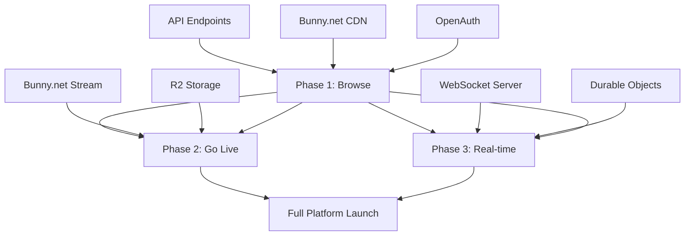

# Live Streaming - Phases Overview

## Executive Summary

The Al Ummah Now live streaming feature is implemented across **3 phases** with **39 total tasks** spanning approximately **6-7 weeks** of development. This document provides a high-level comparison of all phases to help with planning, resource allocation, and understanding dependencies.

## Phase Comparison

| Aspect | Phase 1 | Phase 2 | Phase 3 |
|--------|---------|---------|---------|
| **Name** | Browse Experience | Go Live Creator Tools | Real-time Features |
| **Goal** | Enable stream discovery | Enable creators to go live | Add real-time updates |
| **Tasks** | 12 tasks | 15 tasks | 12 tasks |
| **Duration** | 2 weeks | 2-3 weeks | 2 weeks |
| **Effort** | 62 hours | ~90 hours | ~75 hours |
| **Priority** | High (MVP) | High (Creator) | Medium (Enhancement) |
| **Dependencies** | API, CDN, Auth | Phase 1, Bunny.net Stream | Phase 1, WebSocket Server |
| **Users** | All viewers | Content creators | All users (enhancement) |
| **Complexity** | Low-Medium | Medium-High | High |

## Detailed Phase Breakdown

### Phase 1: Browse Experience

**Purpose**: Foundational user experience for discovering and browsing live streams.

**Key Deliverables**:
- StreamStatusBadge component
- ViewerCount component
- LiveStreamCard (LTR & RTL)
- useLiveStreams hook with React Query
- /en/live and /ar/live pages
- Tab navigation (Live/Scheduled/Past)
- Infinite scroll pagination
- Loading & empty states
- Comprehensive testing

**Technical Focus**:
- Component architecture
- Responsive design
- RTL support
- Performance optimization
- Accessibility

**Success Metrics**:
- Page load < 2s
- Lighthouse score > 90
- RTL pixel-perfect
- Test coverage > 85%

**Dependencies**:
- ✅ Shared types package
- ✅ API endpoints
- ✅ Bunny.net CDN
- ✅ OpenAuth

[Full Phase 1 Documentation →](phase1/README.md)

---

### Phase 2: Go Live Creator Tools

**Purpose**: Enable content creators to configure and start live streams.

**Key Deliverables**:
- GoLiveForm wizard (4 steps)
- Stream details form with Zod validation
- Thumbnail upload with preview
- RTMP setup display
- Review & confirm step
- Stream creation API integration
- /en/go-live and /ar/go-live pages
- Stream status management
- End stream flow
- Stream preview
- OBS Studio integration guide
- Error handling & recovery
- Analytics tracking
- End-to-end testing

**Technical Focus**:
- Multi-step form management
- File upload optimization
- Secure credential handling
- State persistence
- Form validation

**Success Metrics**:
- Stream creation success rate > 95%
- Form completion time < 3 minutes
- Zero credential leaks
- Error recovery rate > 90%

**Dependencies**:
- ✅ Phase 1 components
- ✅ Bunny.net Stream API
- ✅ R2 storage for thumbnails
- ✅ RTMP ingestion configured

[Full Phase 2 Documentation →](phase2/README.md)

---

### Phase 3: Real-time Features

**Purpose**: Enhance user engagement with real-time updates and interactions.

**Key Deliverables**:
- useLiveStreamWebSocket hook
- Auto-reconnection logic
- Channel subscription system
- Real-time viewer count with animations
- Status change notifications
- Presence tracking (who's watching)
- Optimistic updates
- Message throttling (100/min)
- Virtual scrolling for large lists
- Lazy loading for cards
- Connection status indicator
- Reconnection testing suite

**Technical Focus**:
- WebSocket management
- Real-time data synchronization
- Performance under load
- Network resilience
- Memory management

**Success Metrics**:
- Update latency < 100ms
- Connection uptime > 99.9%
- Reconnection time < 2s
- 60fps animations
- Memory usage < 50MB increase

**Dependencies**:
- ✅ Phase 1 UI components
- ✅ WebSocket server deployed
- ✅ Durable Objects configured
- ✅ KV storage for presence

[Full Phase 3 Documentation →](phase3/README.md)

## Task Distribution by Category

### Component Development
| Phase | UI Components | Hooks/Utilities | Pages | Total |
|-------|---------------|-----------------|-------|-------|
| Phase 1 | 4 | 1 | 2 | 7 |
| Phase 2 | 8 | 1 | 3 | 12 |
| Phase 3 | 3 | 4 | 0 | 7 |
| **Total** | **15** | **6** | **5** | **26** |

### Testing & Quality
| Phase | Unit Tests | Integration | E2E | Total |
|-------|------------|-------------|-----|-------|
| Phase 1 | 10 | 1 | 1 | 12 |
| Phase 2 | 12 | 2 | 1 | 15 |
| Phase 3 | 8 | 2 | 2 | 12 |
| **Total** | **30** | **5** | **4** | **39** |

## Timeline Visualization

```
Week 1-2     Week 3-4       Week 5-6       Week 7
├────────────┼──────────────┼──────────────┼────────┤
│  Phase 1   │   Phase 2    │   Phase 2    │ Phase 3│
│  (Browse)  │  (Go Live)   │  (Go Live)   │ (Real- │
│            │              │              │  time) │
│            │              │              │        │
│ Tasks 1.1- │ Tasks 2.1-   │ Tasks 2.8-   │Tasks   │
│ 1.12       │ 2.7          │ 2.15         │3.1-3.12│
│            │              │              │        │
│ Components │ Form Wizard  │ Testing &    │WebSocket│
│ & Pages    │ & Upload     │ Integration  │Features│
└────────────┴──────────────┴──────────────┴────────┘
```

## Critical Path Analysis

### Must Complete in Order
1. **Phase 1 Core Components** (Tasks 1.1-1.4)
   - Required for: All subsequent UI work
   - Blockers: None
   - Duration: 3 days

2. **Phase 1 Data Layer** (Task 1.5)
   - Required for: All pages and Phase 2
   - Blockers: API endpoints
   - Duration: 1 day

3. **Phase 1 Pages** (Tasks 1.6-1.7)
   - Required for: User testing, Phase 2 navigation
   - Blockers: Tasks 1.1-1.5
   - Duration: 3 days

4. **Phase 2 Wizard Foundation** (Task 2.1)
   - Required for: All Phase 2 tasks
   - Blockers: Phase 1 complete
   - Duration: 2 days

5. **Phase 2 Stream Creation** (Tasks 2.2-2.6)
   - Required for: Actually going live
   - Blockers: Task 2.1, Bunny.net config
   - Duration: 5 days

6. **Phase 3 WebSocket Foundation** (Tasks 3.1-3.3)
   - Required for: All Phase 3 features
   - Blockers: WebSocket server, Phase 1 complete
   - Duration: 3 days

### Can Parallelize
- **Phase 1**: Tasks 1.1-1.4 (components), Task 1.10-1.11 (states)
- **Phase 2**: Tasks 2.7-2.8 (pages), Tasks 2.12-2.14 (docs/analytics)
- **Phase 3**: Tasks 3.9-3.10 (performance), Tasks 3.11-3.12 (monitoring)

## Resource Requirements

### Development Team
| Role | Phase 1 | Phase 2 | Phase 3 | Total |
|------|---------|---------|---------|-------|
| Frontend Engineers | 2 | 2 | 3 | 2-3 |
| Backend Engineers | 0.5 | 1 | 1 | 1-2 |
| Designer | 0.5 | 1 | 0.5 | 1 |
| QA Engineer | 0.5 | 1 | 1 | 1 |
| **Total FTE** | **3.5** | **5** | **5.5** | **5-7** |

### Infrastructure
| Resource | Phase 1 | Phase 2 | Phase 3 | Purpose |
|----------|---------|---------|---------|---------|
| Cloudflare Workers | ✅ | ✅ | ✅ | App hosting |
| Bunny.net CDN | ✅ | ✅ | ✅ | Thumbnails |
| Bunny.net Stream | - | ✅ | ✅ | RTMP ingestion |
| R2 Storage | ✅ | ✅ | ✅ | Objects |
| KV Storage | - | - | ✅ | Presence |
| Durable Objects | - | - | ✅ | WebSocket |
| Queue | - | ✅ | ✅ | Events |

## Risk Assessment Matrix

| Risk | Phase 1 | Phase 2 | Phase 3 | Mitigation |
|------|---------|---------|---------|------------|
| **RTL Complexity** | High | Medium | Low | Start RTL from day 1 |
| **Performance** | Medium | Low | High | Virtual scrolling, optimization |
| **Browser Compat** | Low | Medium | High | Polyfills, progressive enhancement |
| **Network Issues** | Low | Medium | High | Retry logic, offline support |
| **Security** | Low | High | Medium | Input validation, encryption |
| **Scalability** | Low | Medium | High | Load testing, rate limiting |

## Success Criteria Summary

### Phase 1: Browse Experience
- [ ] Users can discover live streams
- [ ] Mobile-first responsive design
- [ ] RTL layout pixel-perfect
- [ ] Page load < 2s on 3G
- [ ] WCAG 2.1 AA compliant

### Phase 2: Go Live Creator Tools
- [ ] Creators can start streams in < 3 minutes
- [ ] Stream key security verified
- [ ] Form validation prevents errors
- [ ] OBS integration tested
- [ ] Error recovery works

### Phase 3: Real-time Features
- [ ] Updates appear within 100ms
- [ ] Connection auto-recovers
- [ ] 60fps animations
- [ ] Handles 1000+ concurrent users
- [ ] Memory efficient

## Phased Rollout Strategy

### Phase 1 Launch
**Target**: Internal beta
- Deploy to staging
- Test with team members
- Gather feedback
- Fix critical bugs
- Deploy to 10% of users
- Monitor metrics
- Scale to 100%

### Phase 2 Launch
**Target**: Selected creators
- Invite 10 trusted creators
- Monitor stream quality
- Gather creator feedback
- Optimize wizard flow
- Open to all verified creators
- Document best practices

### Phase 3 Launch
**Target**: All users
- Deploy WebSocket infrastructure
- Test at scale (load testing)
- Gradual rollout (10% → 50% → 100%)
- Monitor connection quality
- Optimize based on metrics

## Dependencies Between Phases



## Monitoring & Analytics

### Key Metrics to Track

**Phase 1 Metrics**:
- Page views on /live
- Stream card clicks
- Tab usage (Live/Scheduled/Past)
- Load time percentiles (p50, p95, p99)
- Error rate

**Phase 2 Metrics**:
- Go-live wizard starts
- Go-live wizard completions
- Stream creation success rate
- Average setup time
- Error types and frequency

**Phase 3 Metrics**:
- WebSocket connection count
- Average connection duration
- Reconnection frequency
- Message throughput
- Latency distribution

## Post-Launch Optimization

### Phase 1 Optimizations
- CDN cache tuning
- Image size optimization
- Bundle size reduction
- API response caching

### Phase 2 Optimizations
- Form step prefetching
- Upload chunk size tuning
- RTMP endpoint selection
- Error message improvements

### Phase 3 Optimizations
- WebSocket message batching
- Presence update throttling
- Memory leak prevention
- Connection pool management

## Documentation Status

### Completed
- ✅ Directory structure created
- ✅ Phase 1 README
- ✅ Main navigation README
- ✅ This phases overview
- ✅ Sample architecture files (Tasks 1.1, 1.2)
- ✅ Sample UX file (Task 1.1)

### In Progress
- 🚧 Phase 1 architecture files (2/12 complete)
- 🚧 Phase 1 UX files (1/12 complete)

### Pending
- 📝 Phase 2 README
- 📝 Phase 2 architecture files (0/15)
- 📝 Phase 2 UX files (0/15)
- 📝 Phase 3 README
- 📝 Phase 3 architecture files (0/12)
- 📝 Phase 3 UX files (0/12)

## Next Actions

### For Implementation
1. Start with Phase 1, Task 1.1 (StreamStatusBadge)
2. Follow architecture and UX specifications
3. Create RTL variant simultaneously
4. Write tests as you go
5. Update task status in phase README

### For Documentation
1. Complete Phase 1 architecture extraction
2. Complete Phase 1 UX extraction
3. Extract Phase 2 from ADR-002
4. Extract Phase 3 from source documents
5. Create Phase 2 & 3 READMEs

### For Planning
1. Review resource requirements
2. Assign tasks to team members
3. Set up project tracking (GitHub Projects)
4. Schedule design reviews
5. Plan phased rollout

## Related Documentation
- [Main README](README.md)
- [Phase 1 Details](phase1/README.md)
- [Phase 2 Details](phase2/README.md)
- [Phase 3 Details](phase3/README.md)
- [Project CLAUDE.md](/CLAUDE.md)

## Version History

| Version | Date | Changes |
|---------|------|---------|
| 1.0.0 | 2025-01-06 | Initial phases overview created |

---

**Last Updated**: January 6, 2025
**Status**: Documentation in progress (structure complete, content extraction ongoing)
