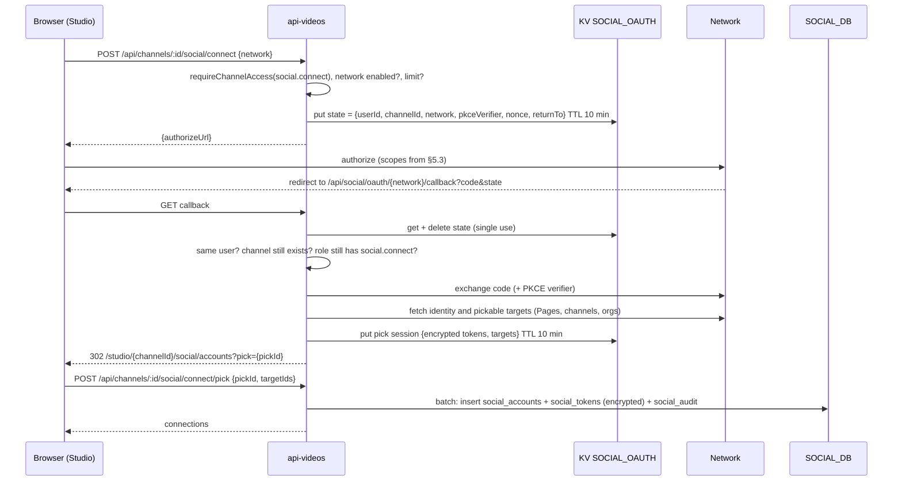
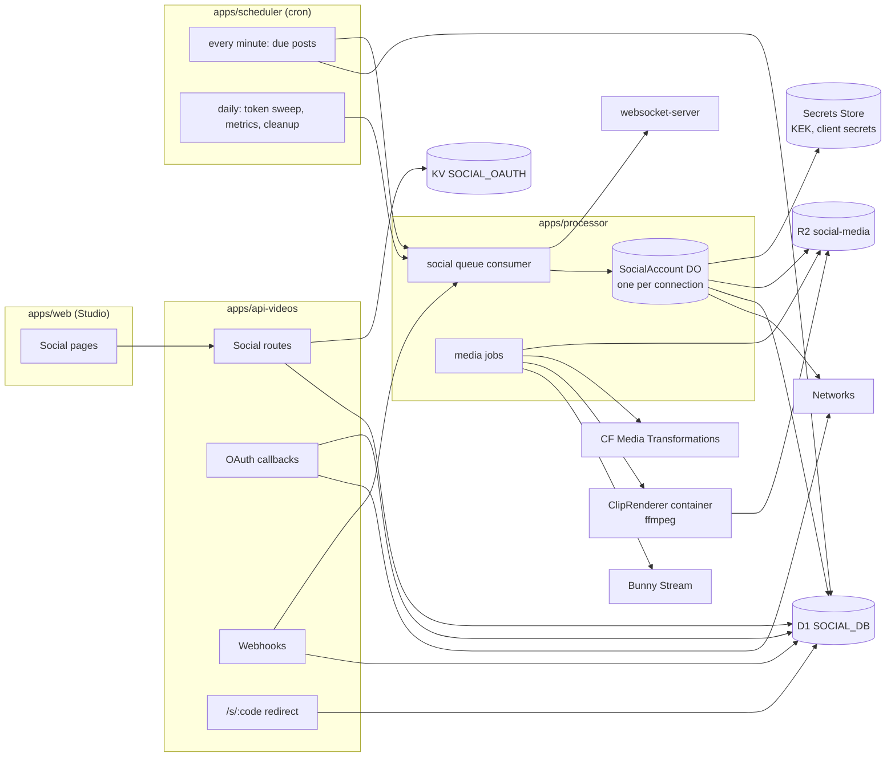

# Social media management for channels

**Status:** Draft for owner review. Not implemented.
**Date:** 2026-11-09
**Related:** web Creator Studio spec ([PR #476](https://github.com/Al-Ummah-Now/AlUmmahNow/pull/476)), channel roles spec ([PR #462](https://github.com/Al-Ummah-Now/AlUmmahNow/pull/462)), `docs/features/01-scheduled-publishing.md`, `docs/features/10-premiere.md`, `docs/features/community-posts.md`, `docs/analytics/README.md`, `docs/specs/AI-MODERATION.md`, `packages/shared-types/src/entitlements.ts`, `docs/design/THEMES.md`

In the API tables, **Exists** means the route or binding is on `main` today, **#462** / **#476** means that spec defines it and it isn't built, and **New** means this spec is the first to ask for it.

Network facts (limits, prices, scopes, review rules) were checked against official developer documentation on 2026-11-09 and are cited in §20. They change often: X moved to pay-per-use in 2026, and YouTube changed upload quota in June and its unverified-app rule in November 2026. The per-network rules live as data (§6.3) so a change is a data edit, and the processor reads live limits from the networks wherever an endpoint exposes them.

## 1. Summary

A channel's owner and team connect the channel's accounts on other networks (Facebook, Instagram, YouTube, X, Telegram and the rest) to Studio. From then on, Al Ummah Now can:

1. **Announce automatically** when a video is published, a premiere is scheduled or starts, or a live stream starts, with a per-network post that links back to the watch page.
2. **Cross-post on demand** from a composer: a link post, the video itself, a vertical clip cut from it, a thumbnail image, or a community post, each adjusted per network (length, aspect ratio, hashtags, language).
3. **Schedule** everything on one calendar, with best-time suggestions, recurring slots, and an approval step for editors.
4. **Measure** each post on the network and the traffic it sent to the watch page, inside Studio Analytics.
5. **Answer** comments, mentions and messages from the networks that allow it, in one inbox.

It lives in Creator Studio as a new rail item, **Social**, and follows the per-channel roles in #462. Platform staff control it from the videos admin (admin-web/admin-api): which networks are on, plan limits, abuse controls, and cost.

### Goals

- One flow for every network, with each network's rules applied before a post can be scheduled, never discovered at publish time.
- Nothing a channel publishes off-platform without a person with the right channel role having seen it, or having switched on an automatic rule.
- Tokens are encrypted, scoped to the minimum, refreshed without the creator noticing, and destroyed when the account, the channel, or the person's videos data goes.
- Every network that has a usable public API ships in the first build. Where an API is closed, paid, or behind an app review we haven't passed, the spec says exactly what unblocks it, and the product shows a working fallback (a "share kit"), not a dead button.

### Non-goals

- Managing personal profiles of viewers. Social is a channel feature. A viewer sharing a video uses the existing share sheet.
- Buying ads, boosting posts, or paid promotion on any network.
- Importing content from other networks into Al Ummah Now (YouTube import is a separate feature, `20-upload-from-url.md`).
- Site roles. Nothing here touches AlUmmahNowAuth's RBAC or tokens (#462 §2). Social sign-in on Auth is unrelated.
- Social listening across the whole network (keyword monitoring of strangers' posts). Only the channel's own posts, mentions and messages.

## 2. Research

Full notes, with sources and dates, are in [§20 Sources](#20-sources). This section has the conclusions that shape the design.

### 2.1 What the established tools do

| Product | Connect | Compose and schedule | Approvals and roles | Analytics | Inbox | Links |
|---|---|---|---|---|---|---|
| **YouTube Studio** [Y1] | Its own channel only | Schedules uploads and Posts, one at a time; no cross-network | Channel permissions (owner, manager, editor, viewer…) | Deep, own platform only | Comments | No |
| **Buffer** [B1] | 12 networks incl. Threads, Bluesky, Mastodon | Base post with per-network edits, queue of time slots, calendar | Approvals only on the Team plan | Per post and account | Community inbox and AI replies on every plan | UTM on Essentials and up; Start Page link in bio |
| **Hootsuite** [H1, H2] | Most networks | Composer, bulk, calendar, best time | Approvals only on Advanced; assignment and routing | Reports, link tracking (Professional+) | Inbox on all plans, automated replies (Professional+), assignment (Advanced) | Ow.ly links |
| **Later** [L1] | "Social sets" of 8 profiles incl. Snapchat | Visual calendar, best time per network | Internal and external approvals (Growth+) | Per post, link-in-bio analytics | Inbox (Growth+) | Linkin.bio |
| **Meta Business Suite** [M1] | Facebook, Instagram, WhatsApp only | Planner, "active times" suggestions | Business roles | Insights | Unified FB/IG/WhatsApp inbox with labels and automations | No |
| **Metricool** [MC1] | Most networks incl. Threads, Bluesky | Planner, best-time heat maps | Email approvals | Strong, with heat maps | Inbox | SmartLinks |
| **Publer** [P1] | Incl. Telegram, Mastodon, Bluesky | Recycling queues, CSV bulk, first comment, hashtag groups | Workspaces with roles and approvals | Per post | Limited | Link shortener |

Patterns this spec adopts: one composer with a base caption and per-network variants (§6.2); validation from live network metadata before the button is enabled (§6.9); calendar plus slot queue with drag to reschedule (§7.1); best times from the channel's own data with a network fallback (§7.2); a role-based approval step (§3.3); per-account health with reconnect prompts (§5.6, §17.2); automatic UTM and short links with click counts (§8.1); first comment and hashtag groups (§6.2); a unified inbox with assignment, saved replies and AI triage (§9); one-tap share kits where no API exists (§6.8); cost-aware posting for X (§6.3). Where we go further than all of them is the feature none of them can offer: we own the destination, so we can show what each network sent back as views and watch time on Al Ummah Now (§8.3).

### 2.2 Network feasibility

| Network | Publish | Analytics | Inbox | Gate today | What unblocks it | Status |
|---|---|---|---|---|---|---|
| **Telegram** (channels, groups) | Text, photo, video ≤ 50 MB, albums | Only what the bot sees (no channel stats for bots) | Comments in the linked discussion group | None | — | **Feasible now, free** [T1, T2] |
| **YouTube** | Upload video / Short, thumbnail, playlist | YouTube Analytics API | Comments (no DMs exist) | Google OAuth verification of sensitive scopes; **100 uploads/day per project** (shared by every channel) | Quota extension through Google's audit form | **Feasible now**, quota-bound [Y2, Y3, Y4]. **Posts (community) have no API: externally blocked** |
| **Bluesky** | Text, images, video, link cards | Like/repost/reply counts only | Notifications (mentions, replies) | None | — | **Feasible now, free** [BS1, BS2] |
| **Mastodon** | Text, media, CW | Counts only | Notifications | Per-instance app registration (automatic) | — | **Feasible now, free** [MA1, MA2] |
| **X** | Text, images, video, threads | Post metrics (reads are billed) | Mentions, DMs (billed) | Pay-per-use credits: **$0.015 per post, $0.20 if it contains a URL**, reads $0.005 | Money, not review | **Feasible now, paid** [X1, X2, X3] |
| **Facebook Pages** | Text, link, photos, video, Reels (30/day/Page) | Page and post insights | Page comments (webhooks); Messenger | Meta App Review (Advanced Access) + Business Verification | Submitting the production app with screencasts; Business Verification of our legal entity (typically 2–6 weeks) | **Externally blocked until Meta review** [F1, F2, F3] |
| **Instagram** (Business/Creator) | Image, carousel, Reel, Story; ~100 API posts/24 h | Media and account insights | Comments, mentions (webhooks), DMs (24 h window) | Same Meta review; Standard Access only works for accounts we own | Same Meta review | **Externally blocked until Meta review** [I1, I2, I3] |
| **Threads** | Text, image, video, carousel; 250/24 h | Views, likes, replies, reposts, quotes, link clicks, followers | Replies (manage, hide) | Meta App Review | Same Meta review | **Externally blocked until Meta review** [TH1, TH2] |
| **TikTok** | Direct Post (video, photos) | Basic video stats | **No comment/DM API** | App review + **Content Posting audit**; unaudited apps post **private-only**, 5 users/day | Passing the audit (typically 2–6 weeks) with the mandated UX (§6.3) | **Feasible now as private drafts; public posting externally blocked until audit** [TT1–TT4] |
| **LinkedIn** (company Pages) | Text, images, video, documents | Org and post analytics | Org comments | Community Management API approval; Development tier 500 calls/app/day; Standard tier is a second application | Approval of both tiers; requires a legal entity | **Externally blocked until LinkedIn approval** [LI1, LI2] |
| **WhatsApp Channels** | — | — | — | **No API for Channels** (Cloud API is business messaging only); unofficial web automation risks bans | Meta publishing an API | **Blocked; share kit (§6.8)** [W1] |
| **Snapchat** | — | — | — | Public Profile API is allowlist-only through a Snap partnership; Creative Kit needs a mobile app and the user finishes the post | A Snap partnership (open question 4) | **Blocked; share kit (§6.8)** [S1, S2] |

What this means: Telegram, YouTube, Bluesky, Mastodon and X can serve every channel the day the build ships. Facebook, Instagram, Threads, TikTok (public) and LinkedIn are built, tested in QA with test users, and switched on in production when each review passes (§15.3). The reviews need nothing from the code that this spec doesn't already require: every one of them asks for the screens, scopes and deletion callbacks described here, so submissions start as soon as the first build is on stage.

### 2.3 Audience: networks that matter for Arabic and Muslim audiences

Ad-reach estimates from DataReportal *Digital 2026* (published November 2025, data from late 2025) [D1]. TikTok counts adults only. These are reach, not daily use.

| Country | YouTube | Facebook | Instagram | TikTok | Snapchat | X |
|---|---|---|---|---|---|---|
| Saudi Arabia | 27.5M | 17.7M | 18.2M | 38.6M | 25.3M | 15.0M |
| UAE | 8.4M | 9.7M | 8.1M | 12.5M | 5.1M | 2.9M |
| Egypt | 49.3M | 51.6M | 21.7M | 48.8M | 20.6M | 4.6M |
| Indonesia | 151M | 121M | 108M | 180M | 4.0M | 22.9M |
| Pakistan | 54.3M | 52.9M | 22.4M | 79.9M | 41.1M | 2.9M |
| Turkey | 57.9M | 34.7M | 62.3M | 44.9M | 16.2M | 18.5M |
| Malaysia | 23.6M | 23.0M | 16.1M | 30.7M | 1.7M | 4.8M |

Consequences for the product:

- **TikTok, YouTube and Facebook** are the largest everywhere; **Instagram** leads in Turkey; **X and Snapchat** are unusually strong in the Gulf (Saudi X reach is 15M). Snapchat being closed is a real gap for Gulf channels; the share kit covers it until a partnership exists.
- **Telegram and WhatsApp channels** are where many Islamic lecture and reminder channels already broadcast. DataReportal's reach figures don't cover them, but Telegram has a free, open API, so it is the first network in the connect list for Arabic channels.
- **Arabic text.** On X, Arabic letters (U+0600–U+06FF, U+0750–U+077F) weigh 1, so an Arabic post gets the full 280; Arabic presentation forms such as ﷺ (U+FDFA) and ﷽ (U+FDFD), and emoji, weigh 2 [X4]. Hashtags with different spellings (أ/ا, ة/ه, ى/ي) are different tags; the composer suggests the variant the channel used before and never rewrites the person's text.
- **Timing.** In Ramadan, Saudi engagement peaks after Taraweeh and again before Suhoor, and posts just before Iftar underperform [R1, R2]. Weekends differ (Friday–Saturday in Saudi Arabia, Saturday–Sunday in the UAE since 2022), so "Friday" isn't one rule. No current source quantifies Jumu'ah peaks; the spec avoids the khutbah window by default and learns from each channel's own data (§7.2).
- **Policy.** Meta moved "shaheed" to contextual enforcement after the Oversight Board's 2024 opinion [MP1], but Arabic religious content still meets over-enforcement under Dangerous Organisations rules. Removal notices and appeal states from the networks are shown in Social (post detail and inbox) rather than as silent failures. YouTube channels set as Made for Kids (children's Qur'an channels) can't use YouTube Posts at all, which doesn't affect uploads.

## 3. Personas and permissions

### 3.1 Personas

| Persona | Channel role (#462) | What they want from Social |
|---|---|---|
| **Sheikh Yusuf**, runs a lecture channel alone | Owner | Every new lecture announced on Facebook, Telegram and X without thinking about it, in Arabic, with a clip on Instagram and TikTok |
| **Nour**, social lead at a mosque media team | Admin | Connects the mosque's accounts once, plans Ramadan content a month ahead on a calendar, approves volunteers' drafts, reports reach weekly |
| **Bilal**, volunteer editor | Editor | Cuts a 45-second clip from Friday's khutbah, writes captions in both languages, submits for approval |
| **Huda**, community moderator | Moderator | Answers questions under the channel's Facebook and Instagram posts, hides abuse, never publishes |
| **Platform staff** | Site admin, on the videos admin | Turns a network off when its API breaks, stops a channel that spams, watches X and YouTube quota spend |

### 3.2 Capabilities

New capabilities are added to the #462 matrix (`packages/shared-types/src/channel-roles.ts`), with the same `can()` and `requireChannelAccess`. They are channel capabilities and are never written to Auth or a token.

| Capability | Owner | Admin | Editor | Moderator |
|---|:-:|:-:|:-:|:-:|
| `social.view`: see Social, connected accounts (name and avatar only), calendar and queue | Yes | Yes | Yes | Yes |
| `social.connect`: connect, reconnect and disconnect accounts, change account defaults | Yes | Yes | No | No |
| `social.compose`: create and edit drafts, request approval | Yes | Yes | Yes | No |
| `social.publish`: schedule or publish without approval, approve or reject others' posts, delete a published post on the network | Yes | Yes | Setting (§3.3) | No |
| `social.automate`: create and change automatic rules (§7) | Yes | Yes | No | No |
| `social.inbox`: read and reply in the inbox, hide or delete comments on the network | Yes | Yes | No | Yes |
| `social.analytics`: per-post and per-account metrics | Yes | Yes | No | No |
| `social.settings`: channel Social settings (approval policy, UTM, default hashtags, time zone) | Yes | Yes | No | No |

Notes:

- `social.analytics` follows `analytics.view` (owner and admin), as Studio decision 6 did.
- Moderators get the inbox because it is comment moderation, which they already have on-platform (`comment.moderate`). They can't compose posts.
- A member removed from the channel loses all of this on the next request (#462 §5.3). Accounts they connected **stay connected**, because the account belongs to the channel, and the audit log records who connected it. The owner can reconnect it under their own login on the network if they want to break the link to that person's network identity (§5.6).

### 3.3 Approval policy

A channel setting, `social.approval`, edited by `social.settings`:

| Value | Meaning |
|---|---|
| `editors` (default) | Posts written by an editor need approval by an owner or admin. Owners' and admins' own posts don't |
| `everyone` | Every post needs a second person with `social.publish`, including an admin's. The author can't approve their own post. Channels with one owner and no admins can't pick this |
| `none` | Editors can schedule and publish directly. `social.publish` is then granted to editors |

Automatic rules (§7) were approved when they were created, by someone with `social.automate`. Each generated post shows in the queue before it goes out (it can be edited or cancelled until then), but needs no second approval.

### 3.4 Audit

Every social action is written to `social_audit` in `SOCIAL_DB` (§12), in the same D1 batch as the change, so a change and its record can't disagree. It is a separate table from #462's `channel_audit` because the two live in different databases (`CHANNEL_ROLES_DB` and `SOCIAL_DB`) and D1 can't batch across databases. The Studio **Settings → Permissions → Activity** tab reads both and merges them by time, with a filter for Social.

Actions: `account_connected`, `account_reconnected`, `account_disconnected`, `account_revoked_by_network`, `account_expired`, `post_created`, `post_edited`, `post_submitted`, `post_approved`, `post_rejected`, `post_scheduled`, `post_unscheduled`, `post_published`, `post_failed`, `post_deleted_on_network`, `rule_created`, `rule_changed`, `rule_paused`, `rule_deleted`, `inbox_reply`, `inbox_hidden`, `inbox_deleted`, `settings_changed`, `platform_suspended`, `platform_unsuspended`, `post_blocked_by_moderation`.

Each row has `actor_id` (or `system` for rules and the scheduler), `account_id`, `post_id`, and a `detail_json` that never contains tokens, message text from strangers, or email addresses. Rows are kept for one year, like #462 §10.

## 4. Information architecture in Studio

A new rail item **Social**, between Comments and Playlists, at `/[locale]/studio/{channelId}/social`. It is hidden for anyone without `social.view`, and for every channel when the platform switch is off (§11.1).

```text
/studio/{channelId}/social                         goes to social/calendar
/studio/{channelId}/social/calendar                ?view=month|week|list&date=YYYY-MM-DD&account=...
/studio/{channelId}/social/queue                   ?status=drafts|awaiting|scheduled|published|failed
/studio/{channelId}/social/compose                 new post; ?from=video:{id}|post:{id}|live:{id}
/studio/{channelId}/social/posts/{postId}          post detail: preview, per-network status, metrics, history
/studio/{channelId}/social/inbox                   ?account=...&type=comments|mentions|messages&state=open|done
/studio/{channelId}/social/analytics               ?range=7d|28d|90d|365d&account=...
/studio/{channelId}/social/automation              rules
/studio/{channelId}/social/accounts                connect, reconnect, disconnect
/studio/{channelId}/social/settings                approval, UTM, defaults, time zone
```

Tabs inside Social: **Calendar, Queue, Inbox, Analytics, Automation, Accounts, Settings**, each removed when the role can't use it (#476 §5.3). A **Create post** button sits at the top of the Social area on every tab, like Upload on the rail.

Other entry points:

- Video editor (#476 §4.5): a **Share to social** card showing auto-post status for this video and a **Create post** button (`compose?from=video:{id}`).
- Content → Posts: **Share to social** in each community post's menu.
- Content → Live: an **Announce** toggle per stream.
- Dashboard: a **Social** card with posts waiting for approval, failures, and reconnect warnings.
- Studio Analytics → Traffic sources: the `social` source links to Social → Analytics.

## 5. Connecting accounts

### 5.1 The model

A **connection** is one account on one network, attached to one channel. A channel can have several connections per network (two Facebook Pages, an Arabic and an English X account). One network account can be attached to several Al Ummah Now channels: each attachment is its own connection with its own token, and disconnecting one doesn't affect the others.

Types of target per network:

| Network | Target connected | How |
|---|---|---|
| Facebook | A Page | OAuth (Facebook Login for Business), then pick Pages |
| Instagram | A professional (Business or Creator) account | Instagram API with Instagram Login (no Page needed), or through the linked Facebook Page |
| Threads | A Threads profile | Threads OAuth |
| YouTube | A YouTube channel | Google OAuth, pick the channel if the Google account has several |
| X | An X account | OAuth 2.0 with PKCE |
| TikTok | A TikTok account | TikTok Login Kit OAuth |
| LinkedIn | A company Page (and optionally the person's profile) | LinkedIn OAuth, pick organisations the person administers |
| Telegram | A channel or group | Add the platform bot as an admin, then a link code (§5.4) |
| Bluesky | A Bluesky account (any PDS) | AT Protocol OAuth (§5.5) |
| Mastodon | An account on any instance | Per-instance OAuth with dynamic app registration (§5.5) |
| WhatsApp Channels | none | No API. Share kit only (§6.8) |
| Snapchat | none | No posting API. Share kit only (§6.8) |

### 5.2 OAuth flow



Rules:

- `state` is 32 random bytes, bound to the user id and channel id, single use, 10 minutes. The callback refuses a state created by another user, a channel the user lost access to in the meantime, or a network that was switched off.
- PKCE (S256) is used everywhere the network supports it (X, Google, TikTok, Bluesky, Mastodon, LinkedIn where available), even for confidential clients.
- The callback is on api-videos so the client secret never reaches the browser. Redirect URIs are fixed per environment (§15.2). No wildcard or user-supplied redirect.
- Scopes are requested **per feature the channel turned on**. A channel that never uses the inbox never grants message scopes. Turning the inbox on later triggers a reconnect with the extra scopes (incremental authorization where the network supports it: Google `include_granted_scopes`, Meta re-request).
- The pick step exists because one login can return many targets (all of a person's Pages). Nothing is stored until the person picks. Tokens for unpicked targets are discarded.
- The connected account's network-side id is unique per channel: connecting the same Page twice to one channel updates the existing connection (reconnect) instead of creating a duplicate.

### 5.3 Scopes (least privilege)

Requested scopes, by feature. **Base** is always requested; the others only when the channel enables that feature.

| Network | Base (connect + publish) | Analytics | Inbox | Notes |
|---|---|---|---|---|
| Facebook | `pages_show_list`, `pages_manage_posts`, `pages_read_engagement`, `publish_video`, `business_management` (only to list Pages owned through a Business) | `read_insights` | `pages_manage_engagement`, `pages_read_user_engagement`, `pages_messaging` | Person needs CREATE_CONTENT (and MODERATE for inbox) task on the Page [F1] |
| Instagram (Instagram Login, recommended) | `instagram_business_basic`, `instagram_business_content_publish` | `instagram_business_manage_insights` | `instagram_business_manage_comments`, `instagram_business_manage_messages` | Works for Business and Creator accounts with no Facebook Page [I2]. The Facebook Login path (`instagram_basic`, `instagram_content_publish`, `instagram_manage_insights`, `instagram_manage_comments`, `instagram_manage_messages`) is used only when the account is already reached through a connected Page |
| Threads | `threads_basic`, `threads_content_publish`, `threads_delete` | `threads_manage_insights` | `threads_read_replies`, `threads_manage_replies` | [TH1] |
| YouTube | `youtube.upload`, `youtube.readonly` | `yt-analytics.readonly` | `youtube.force-ssl` (comments insert/moderate) | `access_type=offline`, `include_granted_scopes=true` [Y2] |
| X | `tweet.read`, `tweet.write`, `users.read`, `media.write`, `offline.access` | (same; metrics via `tweet.read`) | `dm.read`, `dm.write` | Access token 2 h; refresh tokens rotate [X2] |
| TikTok | `user.info.basic`, `video.publish` (Direct Post), `video.upload` (inbox draft fallback) | `video.list` | — (no API) | `creator_info/query` before every post [TT2] |
| LinkedIn | `w_organization_social`, `r_organization_admin` | `r_organization_social` | `r_organization_social_feed`, `w_organization_social_feed` | Member must be ADMINISTRATOR or CONTENT_ADMIN of the Page; `w_member_social` only if the person chooses to post as themselves [LI1] |
| Bluesky | `atproto transition:generic` | — | (same) | Granular atproto scopes replace `transition:generic` when the PDS supports them |
| Mastodon | `read:accounts write:statuses write:media` | `read:statuses` | `read:notifications write:conversations` | Instance may cap scopes |
| Telegram | Bot admin right `can_post_messages` (`can_edit_messages` to edit) | — | `can_delete_messages` in the discussion group | Not OAuth (§5.4) |

### 5.4 Telegram

Telegram has no OAuth for channels. The platform runs one bot per environment (`@AlUmmahNowBot`, `@AlUmmahNowQABot`, `@AlUmmahNowStageBot`).

1. Studio shows: "Add @AlUmmahNowBot to your channel as an administrator with **Post messages** (and, for the inbox, **Delete messages**), then post this code in the channel: `AUN-7Q4K-93`". The code is 8 characters, single use, valid 30 minutes, stored in KV against the channel id and user id.
2. Telegram calls our webhook (`POST /api/social/webhooks/telegram`, checked with `X-Telegram-Bot-Api-Secret-Token`) with a `my_chat_member` update (bot promoted) and the `channel_post` with the code.
3. The webhook matches the code, checks that the bot's admin rights include `can_post_messages`, deletes the code message from the channel, stores the connection (`chat_id`, title, username), and confirms in Studio over the existing realtime socket (`social_account_connected` event).
4. If the bot is later demoted or removed, the `my_chat_member` update marks the connection `revoked` and notifies the channel (§9).

The bot token is a platform secret, not per channel. A channel's connection stores only the `chat_id`. Groups (for a linked discussion group, used by the inbox) connect the same way.

### 5.5 Bluesky and Mastodon

- **Bluesky:** AT Protocol OAuth. The client metadata document is served by api-videos at `https://videos.alummahnow.net/.well-known/atproto-client/{env}.json` (public, cacheable). Tokens are DPoP-bound, so the DPoP private key (ES256) is stored encrypted with the tokens and used for every call. The person enters their handle; we resolve it to their PDS and authorization server. App passwords are not accepted: they grant full account access and can't be scoped.
- **Mastodon:** the person enters their instance (`mastodon.social`, `ummah.social`, …). On first use of an instance, api-videos registers an app there (`POST /api/v1/apps`, scopes `read write:statuses write:media`, redirect URI fixed) and stores the client id and secret, encrypted, in `social_instance_apps`. Instances that refuse registration, or block our domain, show the instance's error. A platform deny list blocks instances known for abuse (§11.3).

### 5.6 Token storage, encryption and refresh

**Storage.** Tokens are never in R2, KV (except the 10-minute pick session, itself encrypted), logs, queue messages or analytics. They are in `social_tokens` (§12) as ciphertext.

**Encryption.** AES-256-GCM through WebCrypto, envelope style:

- A per-environment key-encryption key in Cloudflare Secrets Store, `social-token-kek` (binding `SOCIAL_TOKEN_KEK`), available only to api-videos (connect, callback) and processor (publishing, refresh, inbox). Not bound to web, admin-web, scheduler or websocket-server.
- Each token row has its own random data key, wrapped by the KEK. The row stores `kek_version`, wrapped data key, 12-byte IV and ciphertext. Additional authenticated data is `account_id|channel_id|network|token_kind`, so a ciphertext copied to another row fails to decrypt.
- Key rotation: a new KEK version is added to Secrets Store as `social-token-kek-v{n}`; a resumable job rewraps the data keys (not the tokens). Old versions are removed after the job reports zero rows.
- Decrypted tokens live only in the memory of the request or Durable Object that uses them.

**Refresh.** One Durable Object per connection, `SocialAccount` (§10.3), owns that connection's tokens. Every network call goes through it, so:

- Only one refresh happens at a time. This matters for networks with **rotating, single-use refresh tokens** (X, TikTok, Bluesky): two Workers refreshing in parallel would invalidate each other.
- Access tokens are refreshed when they have under 10% of their life left, or after a 401 that the network documents as expiry.
- Meta long-lived user tokens (60 days) and Instagram Login tokens are re-extended by the daily sweep when they are older than 7 days and have been used in the last 60. Page tokens derived from a long-lived user token don't expire, but are re-derived on each sweep to catch revoked permissions.
- The scheduler's daily sweep (§10.2) also calls each network's token introspection or a cheap "who am I" call for connections idle for 30 days, so a dead connection is found before a scheduled post needs it.

**States** of a connection: `active`, `needs_reconnect` (refresh failed, a scope was removed, password changed on the network, or Meta's 90-day re-consent), `revoked` (the network or the person revoked it), `disconnected` (by us, tokens destroyed), `suspended` (by platform staff). Posts targeting a non-active connection don't go out; they move to `failed` with the reason, and the channel is notified once (§9), not once per post.

### 5.7 Disconnect and revocation

Disconnect (Studio, `social.connect`):

1. Calls the network's revoke endpoint where one exists (Google `oauth2/revoke`, X `oauth2/revoke`, TikTok `oauth/revoke`, Meta `DELETE /{user-id}/permissions`, Mastodon `oauth/revoke`, Bluesky token revocation; Telegram: the bot leaves the chat).
2. Deletes the token rows in the same batch as marking the connection `disconnected`, regardless of whether the revoke call succeeded. A failed revoke is retried by a queue message for 24 hours, then logged.
3. Cancels its scheduled posts (they move to `drafts` with a note), pauses rules that target only this account, and removes it from rules that target several.
4. Keeps published-post records and metrics for analytics history (the post ids and counts, no tokens), deleted with the channel or after the retention period (§13.4).

**Deauthorize callbacks.** Meta's *Deauthorize* and *Data deletion* callbacks, TikTok's and Google's revocation notifications (Google's Cross-Account Protection / RISC), X's account activity where available, and Telegram's `my_chat_member` all land on `POST /api/social/webhooks/{network}`. Each verifies the network's signature, then marks matching connections `revoked` and destroys their tokens. Meta's data deletion callback returns a status URL and confirmation code as Meta requires.

### 5.8 Deleting channels and people

| Event | Effect on Social |
|---|---|
| **Channel deleted** (`channelDelete.ts`) | Every connection on the channel is disconnected as in §5.7 (revoke, destroy tokens), scheduled posts cancelled, rules deleted, inbox items deleted, media in `social-media` R2 deleted. Published-post records and metrics are deleted. Audit rows age out as in #462 §12 |
| **Person erases their videos data** (`DELETE /api/privacy/data`, `eraseUserData`) | Their own channels are deleted, so the row above applies. On channels they were only a member of: drafts they wrote and never submitted are deleted; posts already approved or published stay with the channel and their `created_by` becomes `DELETED_USER_ID`; connections they made stay (they belong to the channel) and `connected_by` becomes `DELETED_USER_ID`. Their audit rows are anonymised |
| **Auth `account.deleted`** (#462 §12) | Same as erasure, through the same internal route |
| **Member removed from channel** | Loses access immediately. Their drafts stay, visible to admins, so work isn't lost |
| **Data export** (`collectUserData`) | Adds the person's own drafts and the audit rows where they are the actor. No tokens, no inbox content |

## 6. Composer

### 6.1 What can be posted

| Source | What the composer builds | Default per network |
|---|---|---|
| **Video** (`from=video:{id}`) | A link post to the watch page, the video file itself, a vertical clip from it, or the thumbnail as an image post | Facebook, X, LinkedIn, Telegram, Bluesky, Mastodon, Threads: link post with the thumbnail card. Instagram: clip as Reel (no link posts exist). TikTok: clip. YouTube: the video itself (Shorts if ≤ 3 min and vertical) |
| **Short** (vertical video already on the platform) | The short as native vertical video everywhere that takes video | Native video |
| **Community post** (`from=post:{id}`) | Text, image(s), poll as text with a link, quiz as text with a link | Text with link to the post page; images attached where allowed |
| **Live stream or premiere** (`from=live:{id}`) | Announcement: "Live now" or "Premieres at …", thumbnail, link | Link post; Instagram and TikTok get a Story (where the API allows) or are skipped |
| **Blank** | Free text, images, a link to any page of the channel | |

### 6.2 Layout

The composer has one **base** caption and per-network tabs. Each tab starts as "Same as base" and can be customised; once customised it stops following base edits (with a "Reset to base" link), the pattern Buffer, Hootsuite and Publer use.

Fields:

- **Accounts:** chips for every connected account; selecting one adds its tab.
- **Caption** (base, and per network), with a counter that uses that network's counting rules (§6.4).
- **Language:** English, Arabic, or both. "Both" makes two captions side by side (§6.5).
- **Media:** from the source video (link card, full video, clip, thumbnail, custom frame), or uploaded images (up to the network's limit).
- **Link:** the watch page or post page, with UTM added automatically (§8.1). Shown to the person as the short link.
- **Hashtags:** suggested from the video's tags, category and channel defaults; network-specific placement (end of caption, or first comment on Instagram).
- **Mentions:** typed per network, since handles differ per network. No cross-network mention mapping.
- **First comment** (Instagram, Facebook, YouTube, LinkedIn, X as a reply): optional.
- **Network options:** per network, from §6.3 (privacy level and interaction settings on TikTok, Reel vs. post vs. Story on Instagram, Short vs. video and privacy on YouTube, silent message and pin on Telegram, content warning on Mastodon, alt text everywhere).
- **When:** Publish now, Schedule (date and time in the channel's time zone, best-time chips, §7.2), Add to queue slot, or Save draft.

### 6.3 Per-network rules

The composer refuses to schedule a post that breaks a hard limit and warns on soft ones. The rules are data, in `packages/shared-types/src/social-networks.ts`, so web, api-videos and processor check the same table.

| Network | Text | Media | Video | Hard limits and required UX | Source |
|---|---|---|---|---|---|
| **Facebook** | ~63,206 chars; feed folds after ~125 | Up to 10 photos | Feed video; **Reels 3–90 s, 9:16, 1080×1920, 24–60 fps, H.264/H.265, AAC 48 kHz** | **30 API Reels per Page per 24 h** | [F1, F2] |
| **Instagram** | Caption 2,200; ≤ 30 hashtags; ≤ 20 @mentions | JPEG only, 4:5 to 1.91:1, ≤ 8 MB, 320–1440 px; carousel ≤ 20 items | **Reels 3 s–15 min, ≤ 300 MB**, 9:16; Stories video 3–60 s, ≤ 100 MB | Publishing limit from `content_publishing_limit` (documented as 100 per 24 h, carousel counts 1; docs also say 50 in one place, so we read it live). Media URL must be publicly fetchable. Containers expire after 24 h | [I1, I3] |
| **Threads** | 500 | JPEG/PNG ≤ 8 MB; carousel 2–20 | MOV/MP4 ≤ 5 min, ≤ 1 GB, 9:16 recommended | 250 posts and 1,000 replies per 24 h (read `threads_publishing_limit`) | [TH1] |
| **YouTube** | Title 100, description 5,000 | Thumbnail ≤ 2 MB | ≤ 256 GB / 12 h; Short = vertical ≤ 3 min | **100 `videos.insert` per day per project**; with no privacy set, uploads default to public, so we always send `privacyStatus` explicitly | [Y2, Y3] |
| **X** | **280 weighted** (Arabic letters 1, presentation forms and emoji 2, URL 23) | 4 images ≤ 5 MB; GIF ≤ 15 MB | ≤ 2 min 20 s for most accounts via API (up to 20 min / 8 GB for long-video accounts), chunked upload ≤ 5 MB chunks | 100 posts per 15 min per user; 10,000 per 24 h per app. **Cost shown in the composer: "$0.20 because this post contains a link"** (§18) | [X1–X4] |
| **TikTok** | Title 2,200 UTF-16 units | Photos WebP/JPEG ≤ 20 MB | MP4/WebM/MOV, 23–60 fps, 360–4096 px, ≤ 10 min via API (per creator: `max_video_post_duration_sec`), ≤ 4 GB | **Required UX** (TikTok's content-sharing guidelines): show the creator's nickname; privacy dropdown from `creator_info` **with no default**; comment, duet and stitch toggles off by default and disabled when the creator has disabled them; commercial-content disclosure ("Your brand" / "Branded content", branded content can't be private); Music Usage Confirmation consent text; preview; notice that processing takes minutes; no watermark; `is_aigc` label when the person marks AI-generated content. ~15 posts per creator per day; 6 init requests per minute | [TT1–TT4] |
| **LinkedIn** | 3,000 | Images; documents | Videos API multi-part upload, wait for AVAILABLE | `Linkedin-Version` header pinned and bumped before each sunset (202511 sunsets 2026-11-16) | [LI1, LI2] |
| **Telegram** | 4,096; caption 1,024 | Photo ≤ 10 MB; albums 2–10 | **Upload ≤ 50 MB** on the cloud Bot API | ~20 messages per minute per group; ~30 per second per bot overall | [T1, T2] |
| **Bluesky** | 300 graphemes | 4 images; blob ≤ 50 MB on the PDS | Limits per user from `app.bsky.video.getUploadLimits` | 5,000 write points per hour, 35,000 per day per account | [BS1, BS2] |
| **Mastodon** | Instance limit (default 500, URL = 23) | Instance limits from `/api/v2/instance` | Instance limits | 300 calls per 5 min; 30 media uploads per 30 min; `Idempotency-Key` honoured for 1 h (we send it) | [MA1, MA2] |

Soft warnings: Facebook text past the fold, Instagram hashtags past 5 (reach guidance), a link in an Instagram caption (not clickable), a post with no media on networks where link cards are weak (Instagram, TikTok can't post text at all), X posts with links (cost).

### 6.4 Counting characters

- **X** uses weighted counting after NFC normalisation: code points up to U+10FF weigh 1 (Latin, Arabic U+0600–U+06FF, Arabic Supplement U+0750–U+077F), everything else weighs 2 (CJK, emoji, and Arabic presentation forms such as ﷺ U+FDFA and ﷽ U+FDFD), and every URL counts as 23 regardless of length. The counter uses the `twitter-text` v3 weighting configuration, vendored as data, not an approximation. The composer warns when a presentation-form ligature costs double and offers the spelled-out form (صلى الله عليه وسلم).
- **Bluesky** counts grapheme clusters (300). **Mastodon** counts characters with every URL as 23 (500 default, read from the instance's `/api/v2/instance` `configuration.statuses.max_characters`). **Threads** 500 characters. **Instagram** and **TikTok** captions 2,200. **Facebook** has a high limit but truncates in feed after about 125 characters; the preview shows the fold. **LinkedIn** 3,000. **Telegram** 4,096 for text, 1,024 for a media caption.
- Counting is done with `Intl.Segmenter` (graphemes) so combining Arabic marks (tashkeel) and emoji sequences count the way the network counts them, and is unit tested against each network's own examples.

### 6.5 Arabic, English and bidi text

- "Both" languages produces either **one bilingual post** (Arabic first, a blank line, then English; or the reverse, per channel setting) or **two separate posts** to two accounts (an Arabic account and an English account). The composer suggests two posts when the channel has two accounts on the same network tagged with different languages (§5 account defaults: `language: ar|en|both`).
- Each caption field is `dir="auto"` and shows the preview in the direction the network will render it.
- Mixed lines (Arabic text with an English hashtag, @handle or URL) are previewed with Unicode isolates (`U+2068 … U+2069`) around the Latin run so the person sees where punctuation will land. Isolates and other invisible direction controls are **stripped before sending**: networks count them as characters and they break hashtag and mention parsing. To fix a line that will render badly, the composer suggests moving the Latin run to its own line, which renders correctly everywhere.
- Arabic hashtags are allowed and suggested (`#رمضان`, `#خطبة_الجمعة`). Hashtags can't contain spaces; the composer replaces spaces with `_` and strips tashkeel and tatweel from hashtags (they break matching on most networks), and keeps Arabic-Indic digits as typed.
- The video's localised title and description (`titleLocalized`, `descriptionLocalized`) prefill the matching language.
- The **watch link** uses the locale of the post's language (`/ar/video/{id}` for Arabic posts), so a reader lands in their language.

### 6.6 Media preparation

Networks need different files. Al Ummah Now's videos live in Bunny Stream; the processor prepares derived files and stores them in a new R2 bucket, `social-media`.

Constraints found in research that decide the design:

- **Bunny Stream has no clip, trim or crop API.** It offers MP4 fallback renditions (`https://{pull-zone}/{videoId}/play_{240…1080}p.mp4`), enabled per library and only for videos encoded after enabling, up to 1080p [BN1, BN2].
- **Cloudflare Media Transformations** (`/cdn-cgi/media/…`) can trim and centre-crop, but takes inputs **under 100 MB and up to 10 minutes long**, starts a clip **within the first 10 minutes**, and outputs **at most 60 s** [CF1]. A lecture clip from minute 40, or a 90 s Reel, is out of its reach. It is still the right tool for frames and thumbnails.
- So clips are rendered by **ffmpeg in a Cloudflare Container** (`ClipRenderer`, a container class attached to the processor through a Durable Object), reading the 720p or 1080p MP4 fallback by HTTP range requests and writing to R2. One path for every clip, any start point, up to 3 minutes, with crop, blurred letterbox and burned-in captions from the video's subtitles. Cloudflare Containers was in public beta at the time of writing [CF2]; it is the one Cloudflare dependency here that isn't GA, and the fallback if it's unavailable is a ≤ 60 s clip from the first 10 minutes through Media Transformations, offered with that limit stated in the clip editor.
- **Older videos without MP4 fallback.** Turning on MP4 fallback in each Bunny library is part of rollout (§15.3). Videos encoded earlier get it through a resumable re-encode job, oldest-popular first, and until then their composer offers link posts and thumbnails only, with the reason shown.

| Output | Used for | How it's made |
|---|---|---|
| **Full MP4** | YouTube, Facebook video, X, LinkedIn, Telegram, Bluesky, Mastodon, Threads video | Bunny's MP4 fallback rendition (highest ≤ 1080p), streamed from Bunny into the network upload or into R2 when the network pulls from a URL |
| **Vertical clip** (9:16, start and end chosen in the composer, ≤ 90 s by default, up to 3 min where the network allows) | Instagram Reels, TikTok, YouTube Shorts, Facebook Reels (≤ 90 s), Threads, X | ffmpeg in the `ClipRenderer` container: range-reads the MP4 fallback, trims, crops or letterboxes, optionally burns in captions, encodes H.264/AAC 1080×1920 30 fps, writes to R2 (§6.6.1) |
| **Frame or thumbnail image** | Image posts, link cards, Telegram photo, custom frames | The video's existing thumbnail from the images pipeline, or a frame at a chosen time through Media Transformations `mode=frame`, resized per network (1080×1080, 1080×1350, 1200×675) |
| **Captions** | YouTube (captions track); burned into clips for Reels, TikTok and Shorts when the person ticks it | The video's existing subtitles (`05-subtitles-captions.md`), as SRT/VTT for YouTube, or rendered into the clip by ffmpeg with an Arabic-capable font (Noto Naskh Arabic / Noto Sans, shaped by libass with HarfBuzz) |

**Crop.** The composer shows a 9:16 frame over the video with a draggable horizontal position (centre by default) and a keyboard alternative (WCAG 2.5.7). The chosen offset becomes the crop. Letterbox (blurred background) is offered when the subject doesn't fit.

**Public URLs for pull-based networks.** Instagram, Threads, Facebook (Reels by URL) and TikTok (`PULL_FROM_URL`) fetch media from a URL. Those URLs are served from `https://media.videos.alummahnow.net/social/{random}` (R2 custom domain on the `social-media` bucket), with unguessable 128-bit object names, `Cache-Control: private`, and the object deleted 24 hours after the post publishes. TikTok requires the URL prefix to be verified in the TikTok developer portal; the `media.` subdomain is verified once per environment.

**Size and time budget.** The processor never holds a whole video in memory. Uploads to networks that take bytes (YouTube resumable, X chunked, LinkedIn multipart, Telegram via `sendVideo` multipart) stream from Bunny or R2 in chunks through the `SocialAccount` Durable Object, which resumes from the last acknowledged chunk if a Worker invocation ends.

**Telegram size limit.** The cloud Bot API accepts uploads up to 50 MB. Clips are always under it. A full video over 50 MB is posted as the thumbnail with the watch link, never truncated, and the composer says so. This is a deliberate choice rather than a gap: a self-hosted Bot API server (2 GB uploads) could run in a container, but a full lecture uploaded into Telegram is a view lost to the channel on Al Ummah Now, and the link post is what the channel wants by default (open question 3).

#### 6.6.1 Clip jobs

A clip is a job (`social_media_jobs`): `queued → rendering → ready | failed`. The composer shows progress over the realtime socket and lets the person keep writing.

- **Renderer.** `ClipRenderer` is a Cloudflare Container image (ffmpeg with libass, HarfBuzz and the Noto Arabic and Latin fonts), driven by a Durable Object class in the processor. The processor's `SocialMediaJob` handler starts an instance, passes a signed Bunny MP4 URL, the trim, crop and caption parameters, and a one-time R2 upload URL; the container streams input by range requests and uploads the result. Instances sleep after 2 minutes idle; at most 5 run at once per environment (a setting), and jobs queue behind them.
- **Limits.** Clip length up to 3 minutes; source any length; a render taking more than 10 minutes fails with a retry button.
- **Fallback.** If the container service is unavailable, clips of up to 60 s starting in the first 10 minutes of a video are made with Media Transformations (§6.6 constraints), and the clip editor says why longer or later clips are unavailable right now. A post can't be scheduled until its media is `ready`, except for automatic rules, where the job runs ahead of the scheduled time and the post waits for it (and fails with a clear reason if it never becomes ready).

### 6.7 Previews

Each network tab shows a preview built from that network's current layout: avatar and name from the connection, caption with the network's truncation ("… more" fold), link card or media in the network's aspect ratio, hashtags styled as links. Previews are approximations and say so in small text. Arabic previews render right to left as the network does.

### 6.8 Share kit (networks without a posting API)

For WhatsApp Channels and Snapchat, and for any network the platform has switched off or the channel hasn't connected, the composer offers a **share kit**: the caption (copy button), the media (download button for the clip, image or thumbnail), the short link, and an **Open in app** deep link (`https://wa.me/?text=…`, `https://www.snapchat.com/scan?attachmentUrl=…` for Creative Kit web sharing). A share-kit post can be scheduled as a **reminder**: at the time, the person who scheduled it gets a notification with the kit. Clicks on its short link are still counted, so analytics covers these networks too.

### 6.9 Validation before publishing

Before a post can be scheduled, api-videos checks:

1. Every hard rule in §6.3 for every target.
2. The target connections are `active` and have the scopes the post needs.
3. The source still exists and is public (or will be public at the scheduled time: a scheduled video can be announced for a time at or after its publish time, never before).
4. Plan limits (§11.2) and the platform rate limits (§11.3).
5. Outbound moderation (§11.4).

The same checks run again in the processor just before publishing, because things change between scheduling and sending.

## 7. Scheduling, queue and automation

### 7.1 Calendar and queue

- **Calendar** (month, week, list) shows scheduled, published and failed posts per day, coloured by status with a text label (never colour alone), and filterable by account. It also shows the channel's scheduled videos and premieres (from the existing scheduled-videos data) as read-only markers, so posts can be planned around them. Dragging a scheduled post to another day reschedules it (owner, admin, or the author while it's a draft), with a **Move to…** menu as the keyboard alternative.
- **Queue** is the list view with status tabs: Drafts, Awaiting approval, Scheduled, Published, Failed.
- **Queue slots** (Buffer's pattern): the channel defines weekly slots per account (for example Sat–Thu 08:00 and 20:00, Fri 13:30 after Jumu'ah). "Add to queue" puts the post in the next free slot. Slots are created from best-time suggestions with one click.
- **Recurring posts:** a post can repeat weekly or monthly (for example "Every Friday 11:00: Surah Al-Kahf reminder" or "every Monday: this week's lectures"). Each occurrence is generated 7 days ahead as its own scheduled post, editable on its own. Recurrence uses an RRULE subset (`FREQ=WEEKLY|MONTHLY;BYDAY;BYMONTHDAY;UNTIL|COUNT`).
- **Hijri dates:** the calendar can show Hijri dates under Gregorian ones (Umm al-Qura calendar via `Intl.DateTimeFormat('ar-SA-u-ca-islamic-umalqura')`), and recurrence can be "yearly on 1 Ramadan" using the same calendar. Hijri dates computed this way can differ by a day from local moon sighting; the UI says "approximately" and the person confirms the date.

### 7.2 Time zones and best time

- Every channel has a Social time zone (default: the channel owner's `scheduledPublishTimezone`). Times are stored in UTC with the IANA zone the person chose, and shown with the zone. DST changes keep the wall-clock time for recurring posts.
- **Best time** suggestions, per account, in order of preference:
  1. The account's own audience-online data where the network exposes it (Instagram `online_followers`, Facebook Page insights).
  2. The channel's own published-post history: median engagement by weekday and hour over the last 90 days, once it has at least 20 posts on that account.
  3. A starting table per network and region from published research (§2.3), adjusted for Arab audiences: evenings after Isha, Friday after Jumu'ah (never inside the khutbah window, about 12:00–13:30 local), and during Ramadan after Taraweeh and before Suhoor rather than just before Iftar. Ramadan dates come from the Hijri calendar above.
- **Prayer-relative slots.** A queue slot can be set relative to a prayer in a chosen city ("30 minutes after Isha in Riyadh"), computed daily with the `adhan` library (MIT) using the method common to that country (Umm al-Qura for Saudi Arabia, Egyptian General Authority for Egypt, and so on, editable). The slot moves with the prayer time through the year.
- Suggestions are shown as three chips with a one-line reason ("Your followers are most active Thursdays at 21:00"). They're suggestions; nothing moves on its own.

### 7.3 Automatic rules

A rule says: **when** this happens on the channel, **post** this template to these accounts, **with** this timing. Created in Social → Automation by `social.automate`.

| Trigger | Source | Default template |
|---|---|---|
| `video.published` | Scheduler publish, or Publish now | "{title}\n\n{link}" with thumbnail card; Reel/TikTok clip from the first 60 s, if those accounts are in the rule |
| `premiere.scheduled` | Premiere created (`10-premiere.md`) | "Premieres {date, local}: {title} {link}" |
| `premiere.starting` | 15 min before (configurable 5–60) | "Starting in 15 minutes: {title} {link}" |
| `live.started` | Live stream goes live | "Live now: {title} {link}" |
| `community_post.published` | New community post | Post text truncated per network + link |
| `short.published` | New short | The short as native vertical video |

Each rule has filters (only public videos, only a playlist, only a category, only videos longer or shorter than N minutes, language), a delay (0 to 24 h after the trigger, or "next queue slot"), per-network template overrides, and a **hold for review** option (the generated post waits in Awaiting approval instead of being scheduled).

**How triggers reach Social.** The existing events already exist or are being added: the scheduler publishes videos and emits queue events (`apps/scheduler/src/publisher.ts`), Publish now writes the video in api-videos, and live state changes in api-videos. Each of these sends a `SocialTrigger` message to the new `al-ummah-now-social` queue with `{channelId, trigger, sourceId, occurredAt}`. The processor matches rules, renders templates, validates (§6.9), and creates scheduled posts. A trigger message is idempotent on `(rule_id, source_id, trigger)` (unique index), so a retried event never posts twice.

**Unpublish.** If a video is made private or deleted before its auto-post goes out, the post is cancelled. If it's already out, the channel gets a notification offering to delete the post on the networks (one click, `social.publish`). It is never deleted automatically, because the network post may have its own discussion.

### 7.4 Publishing and retries

1. The scheduler's minute cron (§10.2) selects posts due in the next minute and sends one `SocialPublish` message per **target** (a post to five accounts is five targets) to the `al-ummah-now-social` queue.
2. The processor's handler calls the target's `SocialAccount` Durable Object, which re-validates, gets a fresh token, prepares media (or waits for the media job), and calls the network.
3. Success: stores the network's post id and permalink, marks the target `published`, and emits `social_post_published` to the channel's Studio sockets.
4. Failure: classified as

| Class | Examples | Action |
|---|---|---|
| `retryable` | 5xx, timeouts, 429, Meta "temporarily unavailable", media still processing on the network | Retry with exponential backoff and jitter: 1, 2, 5, 15, 30, 60 min, then fail. Respect `Retry-After` and rate-limit reset headers |
| `auth` | 401 expired, revoked, scope missing | Try one refresh; if it fails, connection → `needs_reconnect`, target fails with "Reconnect {account}" |
| `content` | Caption too long, media rejected, duplicate post (X), policy rejection | Fail at once with the network's message translated to a known reason where possible |
| `quota` | YouTube daily quota exhausted, X credits exhausted, Instagram 24-hour publishing limit | Reschedule to the time the quota resets if within 24 h of the planned time, otherwise fail. Platform admins are alerted (§11.5) |

5. **No double posts.** Before each attempt, the DO writes `attempt_id` and state `sending` for the target. If a Worker dies after the network accepted the post but before we stored the id, the next attempt first looks for the post on the network (by our UTM `utm_content` token in the link, or the network's idempotency key where one exists: Telegram has none, X none, so the lookup is a "recent posts" read limited to 15 minutes) before sending again. Where a network offers no way to look, the target is marked `unknown` and the person is asked to check, rather than risk a duplicate.
6. **Container networks** (Instagram, Threads, TikTok, YouTube processing): the DO creates the container, then polls its status with an alarm (every 10 s for 5 min, then every minute up to the network's limit) before the publish call. No Worker waits in a loop.

### 7.5 Failure notifications

New notification keys, in a new `social` category (on by default, toggle in notification settings), delivered through the existing notification centre and push (`apps/processor/src/push`):

| Key | To | English | Arabic |
|---|---|---|---|
| `socialPostFailed` | Author and approvers | Your post to {account} didn't go out: {reason}. | لم يُنشر منشورك على {account}: {reason}. |
| `socialAccountNeedsReconnect` | Owner and admins | {account} needs to be reconnected before scheduled posts can go out. | يجب إعادة ربط {account} قبل نشر المنشورات المجدولة. |
| `socialPostAwaitingApproval` | Approvers | {author} sent a post for approval. | أرسل {author} منشوراً للموافقة. |
| `socialPostApproved` | Author | Your post was approved and scheduled for {time}. | تمت الموافقة على منشورك وجدولته في {time}. |
| `socialPostRejected` | Author | Your post was returned with a note: {note}. | أُعيد منشورك مع ملاحظة: {note}. |
| `socialShareKitReminder` | Scheduler of the reminder | Time to post to {network}. Your caption and media are ready. | حان وقت النشر على {network}. النص والوسائط جاهزة. |
| `socialAccountRevoked` | Owner and admins | {account} was disconnected on {network}. | تم فصل {account} من {network}. |

`dedupeKey` is the target id (failure), the connection id plus day (reconnect), or the post id (approval). Reconnect warnings are sent at most once a day per connection.

## 8. Analytics

### 8.1 Links and attribution

Every link we generate points to a short link on our domain, `https://videos.alummahnow.net/s/{code}`, one code per **target** (post × account). The short link:

- Redirects (302, `Cache-Control: no-store`) to the watch or post page with `utm_source={network}&utm_medium=social&utm_campaign={campaign}&utm_content={targetCode}`. `campaign` defaults to `aun_auto` for rules and `aun_social` for manual posts, and can be set per post (for example `ramadan_1448`).
- Counts the click server-side as an aggregate counter (no cookie, no user id, no IP stored): D1 `analytics_daily` counters `social_click` with dimension `target:{code}` and `network:{network}`. This works without the viewer's analytics consent because it is a count of requests to our own redirect, like a page view counter, with nothing about the person.
- Lets us see clicks for networks with no analytics API (WhatsApp, Snapchat share kits, Telegram, Mastodon).

**On the watch page**, the traffic-source classifier from #476 §8.4 adds a `social` source: the first page of a visit whose URL has `utm_medium=social` is classed `social` with dimension `utm_source` (the network) instead of `external`. The `utm_content` code is passed to the view event, and the processor adds `traffic_social` counters per network and per target code, for the video and the channel, under the same consent rules as §8.4 (aggregate, needs analytics consent). Without consent the click counter in the redirect still counts.

The UTM parameters are stripped from the address bar after reading (`history.replaceState`), so shared copies of the page don't carry the attribution forward.

### 8.2 Metrics pulled from networks

A daily job per connection (and an extra pull at 1 h, 24 h and 7 days after each post) reads metrics through the `SocialAccount` DO and stores daily snapshots.

| Network | Per post | Per account | Notes |
|---|---|---|---|
| Facebook | Impressions, reach, reactions, comments, shares, clicks, video views (Reels plays) | Followers, Page reach, online times (when Meta provides them) | `read_insights` [F1] |
| Instagram | Reach, views, likes, comments, saves, shares, Reel plays and watch time | Followers, reach, profile views, online followers | Insights scopes [I1] |
| Threads | Views, likes, replies, reposts, quotes, shares, link clicks | Followers, demographics (≥ 100 followers) | No data before 2024-04-13 [TH2] |
| YouTube | Views, watch time, likes, comments, average view duration | Subscribers, views | YouTube Analytics API, `videos.batchGetStats` (1 unit) [Y4] |
| X | Impressions, likes, reposts, replies, quotes, bookmarks, link clicks | Followers | Every read costs credits; pulled at 24 h and 7 days only (§18) [X1] |
| TikTok | Views, likes, comments, shares | Followers, likes | Display API basic stats [TT1] |
| LinkedIn | Impressions, clicks, reactions, comments, shares | Followers | Org analytics [LI1] |
| Telegram | View count on channel posts (`views` field when the bot reads the post via forwarded/edited updates); otherwise our short-link clicks | Subscriber count (`getChatMemberCount`) | No channel statistics for bots [T1] |
| Bluesky, Mastodon | Like, repost, reply counts | Followers | No impressions exist |
| WhatsApp, Snapchat (share kit) | Our short-link clicks only | — | — |

Metrics are normalised to a common set where a network supports them: `impressions`, `reach`, `views` (video), `likes`, `comments`, `shares` (reposts/retweets/forwards), `saves`, `clicks` (the network's own link clicks), `followers` (account level), plus `aun_clicks` (our short link) and `aun_views` (views on Al Ummah Now with `traffic_social` for that target). Network-specific extras are kept in `extra_json` and shown on the post detail page.

### 8.3 Dashboards

**Social → Analytics:**

- Range selector (7, 28, 90, 365 days) and account filter.
- Summary cards: posts published, total reach, engagements, link clicks to Al Ummah Now, views on Al Ummah Now from social, follower change.
- **Funnel per network:** impressions → engagements → clicks → views on Al Ummah Now → watch time on Al Ummah Now. This is the number that matters to a creator: what each network sent back.
- Top posts table (sortable by reach, clicks, views on AUN).
- Best times heat map (weekday × hour, from the channel's own data).
- Follower growth per account.
- Every chart has a text summary and a table alternative (#476 §7.2).

**Elsewhere:**

- Studio Analytics → Traffic sources gets the `social` source with a per-network breakdown.
- Video analytics (#476 §4.6) gets a "Social posts" card listing the posts about the video with their clicks and AUN views.
- Post detail shows per-target metrics over time.

Metric retention follows the plan entitlement `analytics.retentionDays` like the rest of Studio Analytics.

## 9. Inbox

### 9.1 Scope per network

| Network | Comments on our posts | Mentions | Direct messages | How |
|---|---|---|---|---|
| Facebook | Read, reply, hide, delete | Page mentions | Messenger (24 h window) | Webhooks (`feed`, `mention`, `messages`) |
| Instagram | Read, reply, hide, delete | @mentions in posts and comments | DMs (24 h window) | Webhooks (`comments`, `mentions`, `messages`) |
| Threads | Read replies, reply, hide | Mentions | — (no DM API) | Webhooks and polling |
| YouTube | Read, reply, hold for review, reject | — | — (YouTube has no DMs) | Polling (`commentThreads.list`, 1 unit; reply 50 units) |
| X | Replies to our posts | Mentions | DMs | Polling; **every read is billed** ($0.005 per post read), so X inbox is off by default and an admin-controlled option with its own budget (§11.5, §18) |
| TikTok | — | — | — | **No API. Externally blocked.** Unblocks if TikTok opens comment APIs to posting apps |
| LinkedIn | Org post comments, reply, delete | Org mentions | — | Polling (Development tier call caps apply) |
| Telegram | Comments in the channel's linked discussion group; reply, delete | — | Messages to the bot are not the channel's DMs; not used | Bot webhook (`message` in the group) |
| Bluesky | Replies, quote posts | Mentions | Chat API exists but needs a separate scope; not used | Polling `listNotifications` |
| Mastodon | Replies | Mentions | Direct-visibility mentions | Polling notifications |
| WhatsApp, Snapchat | — | — | — | No API |

### 9.2 How it works

- **Push first.** Networks with webhooks (Meta: Page `feed`, Instagram `comments`, `mentions`, `messages`; Threads replies; YouTube has none; X account activity is paid) deliver to `POST /api/social/webhooks/{network}`, verified by signature (`X-Hub-Signature-256` for Meta). The handler stores the item and returns 200 within the network's deadline, doing nothing slow inline.
- **Poll the rest**, with the `SocialAccount` DO's alarm: every 5 minutes for accounts with activity in the last day, hourly otherwise, within each network's quota (YouTube comment reads cost 1 unit per call; budgeted in §11.5).
- Items are threads (a post and its comments, or a DM conversation), with states `open`, `done`, `spam`. Assignment to a team member is supported (`assigned_to`).
- **Replies** go out through the same DO as posts, as the connected account. A reply to a DM honours the network's window (Instagram and Messenger: 24 hours after the person's last message; replies outside the window are refused with that reason).
- **Hide and delete** comments on the network where the API allows (Facebook, Instagram, YouTube "hold for review" / reject, Threads hide, Telegram delete in the discussion group). Mastodon and Bluesky can't delete others' replies; the inbox offers mute/block instead.
- **Saved replies:** a per-channel library of canned replies, in both languages.
- **Moderation assist:** incoming items go through the same Workers AI classifier as on-platform comments (`AI-MODERATION.md`) to tag likely spam, scams and abuse; tagged items are sorted into a Filtered view, never auto-deleted.
- **Privacy:** inbox content is personal data of people who aren't our users. It's kept 90 days after the thread is marked done (or 180 days of inactivity), then deleted. It's never used for anything except showing it to the channel team. Authors' network handles and display names are stored; profile photos are loaded live from the network, not copied.

## 10. Architecture

### 10.1 Components



No new Worker is added. Each existing app takes the part that matches what it already does:

| App | New responsibility |
|---|---|
| `api-videos` | Social REST routes for Studio, OAuth start and callbacks, webhooks, Telegram bot webhook, `/s/{code}` redirect, the AT Protocol client metadata document, emitting `SocialTrigger` from Publish now, live state changes and community posts |
| `scheduler` | Minute cron also selects due social targets and sends `SocialPublish`; selects posts for `premiere.starting` triggers. Daily cron (03:00 UTC) sends token-sweep, metrics, retention-cleanup and recurrence-expansion messages. Emits `SocialTrigger` after a scheduled video is published |
| `processor` | Consumer of the new `al-ummah-now-social` queue; hosts the `SocialAccount` and `SocialPlatformBudget` Durable Object classes, the network adapters, and the `ClipRenderer` container class for media jobs; inbox polling via DO alarms |
| `web` | Studio Social pages; `social` traffic source and UTM capture in the analytics helper; `/s/{code}` is served by api-videos through the existing web→API routing |
| `admin-api` / `admin-web` | Platform Social admin (§11) |
| `websocket-server` | Delivers `social_*` events to the channel's Studio sessions (existing per-user socket; no new DO) |

### 10.2 Queue and scheduler

**Queue** `al-ummah-now-social` (and `-stage`, `-qa`), consumer in processor, `max_batch_size` 10, `max_batch_timeout` 5 s, `max_retries` 6, DLQ `al-ummah-now-dlq` (existing). Separate from `al-ummah-now-videos` so a network outage backing up social retries can never delay video processing.

Message types (added to `MessageType` in shared-types):

| Type | Payload | Sent by |
|---|---|---|
| `SocialTrigger` | `{channelId, trigger, sourceId, occurredAt}` | api-videos, scheduler |
| `SocialPublish` | `{targetId, attempt}` | scheduler, api-videos (Publish now) |
| `SocialMediaJob` | `{jobId}` | api-videos (composer), processor (rules) |
| `SocialMetricsPull` | `{accountId, targetIds?}` | scheduler |
| `SocialTokenSweep` | `{accountId}` | scheduler |
| `SocialRevoke` | `{network, revokeHandle}` (handle is an opaque id of an encrypted row kept 24 h for retry, never a token) | api-videos |
| `SocialWebhookItem` | `{network, accountId, itemRef}` | api-videos webhooks |
| `SocialCleanup` | `{kind}` | scheduler |

**Scheduling query.** Due targets are in D1 with an index on `(status, scheduled_at)`. The scheduler reads `status='scheduled' AND scheduled_at <= now + 60s` in pages of 200, flips them to `queued` with a guarded update (`WHERE status='scheduled'`), and sends a message per row. The guard is the lock; the existing `SchedulerLock` DO is not needed for this.

**Why D1 and not the R2 hour buckets** that scheduled videos use: social posts are edited, moved and filtered often (calendar drag, status tabs, approval), need indexes by channel, status and time, and are small rows. D1 fits; R2 objects keyed by hour don't.

### 10.3 The `SocialAccount` Durable Object

One instance per connection, id `idFromName(accountId)`, class in processor.

Responsibilities:

1. **Token custody.** Decrypts tokens on demand, refreshes under its own single-threaded execution (no two refreshes), writes back new ciphertext. Keeps nothing decrypted in storage.
2. **Rate limiting.** Keeps the network's per-account budget (for example Instagram's 100 API-published posts per 24 h, Threads 250 posts per 24 h, X per-user post caps, YouTube per-project units counted in the platform DO below), and the reset times from response headers. Requests over budget are scheduled with an alarm instead of sent.
3. **Long operations.** Chunked uploads and container polling, resumed by alarm after a Worker invocation ends.
4. **Inbox polling** by alarm for networks without webhooks.

A second DO, `SocialPlatformBudget`, one per network per environment, tracks **app-level** budgets shared by all channels: YouTube's 100 `videos.insert` calls and 10,000 units per day per project (reset at midnight Pacific; uploads beyond the day's budget wait for the reset, and the quota extension request is part of rollout), X API credits, Meta app-level rate limit (`X-App-Usage` header), TikTok daily caps. Each `SocialAccount` asks it for a reservation before a costly call. When a budget is nearly exhausted, it degrades in this order: inbox polling, metrics pulls, then manual posts are queued until the reset, and automatic rules last. Publishing a post someone scheduled always comes before reading metrics.

### 10.4 Network adapters

`apps/processor/src/social/adapters/{network}.ts`, each implementing:

```ts
interface SocialAdapter {
  network: SocialNetwork;
  limits: NetworkRules;                                // from shared-types
  refresh(tokens: Tokens): Promise<Tokens>;
  revoke(tokens: Tokens): Promise<void>;
  publish(ctx: PublishContext): Promise<PublishResult>; // may return {pending: containerId}
  checkPending(ctx, containerId): Promise<PublishResult>;
  findRecent(ctx, marker: string): Promise<PublishResult | null>; // for §7.4 step 5
  deletePost(ctx, networkPostId): Promise<void>;
  metrics(ctx, networkPostIds: string[]): Promise<MetricSnapshot[]>;
  accountMetrics(ctx): Promise<AccountSnapshot>;
  inbox?: { poll(ctx, cursor): Promise<InboxPage>; reply(ctx, item, text): Promise<void>; hide?(...); delete?(...) };
  classifyError(err: NetworkError): 'retryable' | 'auth' | 'content' | 'quota';
}
```

Adapters use `fetch` only, with no network SDKs (most don't run on Workers, and they hide rate-limit headers we need). Each adapter has a recorded-fixture test suite (§16.2).

## 11. Platform admin (videos admin)

A **Social** section in admin-web, behind a new admin-api permission `social:manage` (site admins), and `social:review` for the outbound review queue (site moderators). These are videos-side admin permissions in admin-api's role→permission map, not Auth RBAC.

### 11.1 Networks

A table of networks with, per environment:

- **Enabled** (on/off). Off hides the network from the connect list and pauses its scheduled posts (they stay scheduled and go out when it's turned back on, if still within 24 h, otherwise they fail with "network paused by Al Ummah Now"). This is the kill switch for an API outage or a policy change.
- **Features** enabled: publish, automation, analytics, inbox (each can be off independently, for example inbox off while Meta's app review for messages is pending).
- **App status:** which app review / audit stage the network app is at (free text plus a "verified" flag), shown to channels as "Instagram inbox coming once Meta approves our app" rather than hiding the reason.
- **Health:** last success, error rate over 1 h and 24 h, open circuit breaker (§14.1).

Stored in `global_settings` (existing R2 bucket used by site settings), cached 60 s by api-videos and processor.

### 11.2 Plan limits

New entitlements in `packages/shared-types/src/entitlements.ts`, edited in the existing plans UI (#427/#428):

| Key | Type | Default | At limit |
|---|---|---|---|
| `social.enabled` | boolean | true | Social hidden |
| `social.accounts.max` | number (accounts per channel) | 10 | Connect refused; existing accounts kept |
| `social.monthlyPosts` | number (targets per channel per month) | 300 | Scheduling refused until next month; automatic rules pause with a notice |
| `social.scheduledPosts.max` | number (pending scheduled targets) | 200 | Scheduling refused |
| `social.automation` | boolean | true | Rules can't be created; existing rules pause |
| `social.inbox` | boolean | true | Inbox hidden |
| `social.analytics.retentionDays` | number | follows `analytics.retentionDays` | Older snapshots hidden, deleted by cleanup |
| `social.x.monthlyLinkPosts` | number (X posts containing a link, per channel per month) | 20 | X posts are offered without the link (clip or thumbnail only); see §18 |

Limits are the **channel owner's** plan, as #462 §8.

### 11.3 Abuse controls

- **Rate limits** (`RATE_LIMIT_KV`, existing pattern): per channel, 60 targets per hour and 300 per day across networks (below plan limits, for burst control); per user, 20 connect attempts per hour; Telegram link codes 10 per hour per channel.
- **New-channel hold:** channels younger than 7 days or with no published video have outbound posts held for review (§11.4) until a moderator clears the channel once.
- **Link policy:** links in captions must point to Al Ummah Now, or to domains in a platform allow list, or be reviewed. URL shorteners from elsewhere are refused (they hide destinations).
- **Mastodon instance deny list** and **Telegram chat deny list**.
- **Suspend Social for a channel** (staff action): pauses all posts and rules, disconnects nothing, shows a banner with the reason and an appeal link (the existing moderation appeal flow). Audited as `platform_suspended`.
- **Bulk duplicate detection:** the same caption to more than 10 channels' accounts within an hour (by hash) is held for review; this catches spam rings using many channels.

### 11.4 Moderation of outbound posts

Outbound posts carry our name on other networks: our app is the one Meta, TikTok and X see. Each post's caption, images and link destination go through the Workers AI moderation pipeline from `AI-MODERATION.md` (text classifier, image classifier, the Islamic-context rules there) before scheduling and again before sending:

| Result | Action |
|---|---|
| Clean | Proceeds |
| Borderline | Proceeds, flagged in the admin Social review list for spot checks |
| Likely violating (hate, takfir, incitement, scam, adult, graphic violence) | Held. Status `blocked_review`; the channel sees "Held for review by Al Ummah Now". A moderator approves or rejects with a reason in the admin queue |
| Known-bad (hash match, deny-listed link) | Refused at once, `post_blocked_by_moderation` audited |

The source video itself was already moderated when uploaded; outbound moderation covers what's new in the post (captions, uploaded images, clip choice is not re-moderated).

### 11.5 Cost and quota monitoring

The admin Social page shows, per network and environment:

- YouTube Data API units used today vs. the project quota, and the projection.
- X API spend this month vs. the budget cap, posts and reads.
- Meta, TikTok, Threads app-level usage headers (percent of limit).
- Cloudflare: Media Transformations usage, R2 `social-media` storage, queue operations, DO requests and duration.
- Alerts (existing `cost-monitoring` patterns, `docs/cost-monitoring/`) at 70% and 90% of any budget, and a hard stop for X spend at 100% of the monthly cap (manual posts to X queue until next month or until an admin raises the cap).

## 12. Data model

### 12.1 D1: `SOCIAL_DB`

A new D1 database for api-videos and processor, `al-ummah-now-social` (`-stage`, `-qa`), migrations in `apps/api-videos/migrations/social/`, append-only per the CI migration gate, with a schema snapshot like the other databases. Scheduler binds it too (read due targets, flip status).

```sql
-- 0001_social.sql
CREATE TABLE social_accounts (
  id TEXT PRIMARY KEY,                    -- sac_...
  channel_id TEXT NOT NULL,
  network TEXT NOT NULL,                  -- facebook|instagram|threads|youtube|x|tiktok|linkedin|telegram|bluesky|mastodon
  external_id TEXT NOT NULL,              -- page id, ig user id, chat id, did, ...
  external_kind TEXT NOT NULL,            -- page|ig_business|ig_creator|yt_channel|profile|org|tg_channel|tg_group
  instance TEXT,                          -- mastodon instance host, bluesky PDS host
  display_name TEXT NOT NULL,
  handle TEXT,
  avatar_url TEXT,
  language TEXT CHECK (language IN ('ar','en','both')) DEFAULT 'both',
  scopes TEXT NOT NULL,                   -- space-separated, as granted
  features TEXT NOT NULL DEFAULT 'publish', -- publish,analytics,inbox
  status TEXT NOT NULL CHECK (status IN ('active','needs_reconnect','revoked','disconnected','suspended')),
  status_reason TEXT,
  connected_by TEXT NOT NULL,
  connected_at TEXT NOT NULL,
  last_ok_at TEXT,
  updated_at TEXT NOT NULL
);
CREATE UNIQUE INDEX idx_sac_unique ON social_accounts (channel_id, network, external_id) WHERE status != 'disconnected';
CREATE INDEX idx_sac_channel ON social_accounts (channel_id, status);
CREATE INDEX idx_sac_external ON social_accounts (network, external_id);  -- webhooks and deauth callbacks

CREATE TABLE social_tokens (
  account_id TEXT NOT NULL,
  kind TEXT NOT NULL CHECK (kind IN ('access','refresh','page','dpop_key','user_long_lived')),
  kek_version INTEGER NOT NULL,
  wrapped_dek BLOB NOT NULL,
  iv BLOB NOT NULL,
  ciphertext BLOB NOT NULL,
  expires_at TEXT,
  updated_at TEXT NOT NULL,
  PRIMARY KEY (account_id, kind)
);

CREATE TABLE social_instance_apps (      -- Mastodon dynamic registrations
  network TEXT NOT NULL,
  instance TEXT NOT NULL,
  client_id TEXT NOT NULL,
  kek_version INTEGER NOT NULL,
  wrapped_dek BLOB NOT NULL,
  iv BLOB NOT NULL,
  client_secret_ct BLOB NOT NULL,
  created_at TEXT NOT NULL,
  PRIMARY KEY (network, instance)
);

CREATE TABLE social_posts (
  id TEXT PRIMARY KEY,                    -- spo_...
  channel_id TEXT NOT NULL,
  source_kind TEXT CHECK (source_kind IN ('video','short','community_post','live','premiere','none')),
  source_id TEXT,
  rule_id TEXT,                           -- set when generated by a rule
  recurrence_id TEXT,
  base_json TEXT NOT NULL,                -- base caption(s) per language, link, hashtags, media refs
  campaign TEXT,
  status TEXT NOT NULL CHECK (status IN ('draft','awaiting_approval','scheduled','publishing','published','partially_published','failed','cancelled','blocked_review')),
  scheduled_at TEXT,                      -- UTC
  timezone TEXT,                          -- IANA zone chosen
  created_by TEXT NOT NULL,
  approved_by TEXT,
  approved_at TEXT,
  rejection_note TEXT,
  created_at TEXT NOT NULL,
  updated_at TEXT NOT NULL
);
CREATE INDEX idx_spo_channel_status ON social_posts (channel_id, status, scheduled_at);
CREATE INDEX idx_spo_source ON social_posts (source_kind, source_id);
CREATE UNIQUE INDEX idx_spo_rule_once ON social_posts (rule_id, source_id) WHERE rule_id IS NOT NULL AND recurrence_id IS NULL;

CREATE TABLE social_targets (
  id TEXT PRIMARY KEY,                    -- stg_...
  post_id TEXT NOT NULL,
  account_id TEXT NOT NULL,
  network TEXT NOT NULL,
  short_code TEXT NOT NULL UNIQUE,        -- /s/{code}
  variant_json TEXT NOT NULL,             -- per-network caption, options, media refs; NULL fields follow base
  status TEXT NOT NULL CHECK (status IN ('scheduled','queued','sending','pending_network','published','failed','cancelled','unknown','share_kit_reminder')),
  scheduled_at TEXT,
  attempt INTEGER NOT NULL DEFAULT 0,
  attempt_id TEXT,
  last_error_class TEXT,
  last_error TEXT,                        -- network message, truncated 500 chars, no tokens
  network_post_id TEXT,
  network_container_id TEXT,
  permalink TEXT,
  published_at TEXT,
  updated_at TEXT NOT NULL
);
CREATE INDEX idx_stg_due ON social_targets (status, scheduled_at);
CREATE INDEX idx_stg_post ON social_targets (post_id);
CREATE INDEX idx_stg_account ON social_targets (account_id, status);
CREATE INDEX idx_stg_network_post ON social_targets (network, network_post_id);

CREATE TABLE social_media_jobs (
  id TEXT PRIMARY KEY,
  channel_id TEXT NOT NULL,
  video_id TEXT NOT NULL,
  kind TEXT NOT NULL CHECK (kind IN ('full_mp4','clip','image')),
  params_json TEXT NOT NULL,              -- start, end, crop offset, size, letterbox
  status TEXT NOT NULL CHECK (status IN ('queued','rendering','ready','failed')),
  r2_key TEXT,
  bunny_derived_video_id TEXT,
  bytes INTEGER,
  error TEXT,
  created_at TEXT NOT NULL,
  expires_at TEXT                         -- 24 h after the last target using it publishes
);
CREATE INDEX idx_smj_status ON social_media_jobs (status, created_at);

CREATE TABLE social_rules (
  id TEXT PRIMARY KEY,
  channel_id TEXT NOT NULL,
  name TEXT NOT NULL,
  trigger TEXT NOT NULL,
  filters_json TEXT NOT NULL,
  template_json TEXT NOT NULL,            -- base + per-network overrides
  account_ids TEXT NOT NULL,              -- JSON array
  delay_minutes INTEGER NOT NULL DEFAULT 0,
  use_queue_slot INTEGER NOT NULL DEFAULT 0,
  hold_for_review INTEGER NOT NULL DEFAULT 0,
  status TEXT NOT NULL CHECK (status IN ('active','paused')),
  created_by TEXT NOT NULL,
  created_at TEXT NOT NULL,
  updated_at TEXT NOT NULL
);
CREATE INDEX idx_srl_channel_trigger ON social_rules (channel_id, trigger, status);

CREATE TABLE social_recurrences (
  id TEXT PRIMARY KEY,
  channel_id TEXT NOT NULL,
  template_post_id TEXT NOT NULL,
  rrule TEXT NOT NULL,
  calendar TEXT NOT NULL DEFAULT 'gregory' CHECK (calendar IN ('gregory','islamic-umalqura')),
  timezone TEXT NOT NULL,
  generated_until TEXT,
  status TEXT NOT NULL CHECK (status IN ('active','paused','ended')),
  created_by TEXT NOT NULL,
  created_at TEXT NOT NULL
);

CREATE TABLE social_slots (
  id TEXT PRIMARY KEY,
  channel_id TEXT NOT NULL,
  account_id TEXT NOT NULL,
  weekday INTEGER NOT NULL CHECK (weekday BETWEEN 0 AND 6),
  local_time TEXT NOT NULL,               -- HH:MM in the channel's social timezone
  created_at TEXT NOT NULL
);
CREATE INDEX idx_ssl_account ON social_slots (account_id);

CREATE TABLE social_metrics_daily (
  target_id TEXT,                         -- NULL for account-level rows
  account_id TEXT NOT NULL,
  day TEXT NOT NULL,
  impressions INTEGER, reach INTEGER, views INTEGER, likes INTEGER, comments INTEGER,
  shares INTEGER, saves INTEGER, clicks INTEGER, followers INTEGER,
  extra_json TEXT,
  pulled_at TEXT NOT NULL,
  PRIMARY KEY (account_id, day, target_id)
);

CREATE TABLE social_inbox_threads (
  id TEXT PRIMARY KEY,
  channel_id TEXT NOT NULL,
  account_id TEXT NOT NULL,
  kind TEXT NOT NULL CHECK (kind IN ('comment','mention','message')),
  external_thread_id TEXT NOT NULL,
  target_id TEXT,                         -- our post it's under, when known
  author_handle TEXT,
  author_name TEXT,
  last_item_at TEXT NOT NULL,
  reply_window_ends_at TEXT,              -- DMs with a 24 h window
  state TEXT NOT NULL CHECK (state IN ('open','done','spam','filtered')),
  assigned_to TEXT,
  delete_after TEXT NOT NULL
);
CREATE UNIQUE INDEX idx_sit_ext ON social_inbox_threads (account_id, external_thread_id);
CREATE INDEX idx_sit_channel ON social_inbox_threads (channel_id, state, last_item_at);

CREATE TABLE social_inbox_items (
  id TEXT PRIMARY KEY,
  thread_id TEXT NOT NULL,
  external_id TEXT NOT NULL,
  direction TEXT NOT NULL CHECK (direction IN ('in','out')),
  author_handle TEXT,
  text TEXT,
  media_json TEXT,                        -- URLs on the network, not copies
  ai_label TEXT,
  sent_by TEXT,                           -- our user id for outgoing replies
  created_at TEXT NOT NULL
);
CREATE UNIQUE INDEX idx_sii_ext ON social_inbox_items (thread_id, external_id);

CREATE TABLE social_saved_replies (
  id TEXT PRIMARY KEY, channel_id TEXT NOT NULL, title TEXT NOT NULL, body TEXT NOT NULL,
  language TEXT, created_by TEXT NOT NULL, created_at TEXT NOT NULL
);

CREATE TABLE social_settings (
  channel_id TEXT PRIMARY KEY,
  approval TEXT NOT NULL DEFAULT 'editors' CHECK (approval IN ('editors','everyone','none')),
  timezone TEXT,
  utm_campaign_default TEXT,
  default_hashtags_json TEXT,
  bilingual_order TEXT NOT NULL DEFAULT 'ar_first' CHECK (bilingual_order IN ('ar_first','en_first')),
  suspended_reason TEXT,                  -- set by platform staff
  updated_by TEXT NOT NULL,
  updated_at TEXT NOT NULL
);

CREATE TABLE social_audit (
  id TEXT PRIMARY KEY,
  channel_id TEXT NOT NULL,
  actor_id TEXT NOT NULL,                 -- user id, 'system', or 'platform:{adminId}'
  action TEXT NOT NULL,
  account_id TEXT,
  post_id TEXT,
  detail_json TEXT,
  created_at TEXT NOT NULL
);
CREATE INDEX idx_sau_channel ON social_audit (channel_id, created_at);
CREATE INDEX idx_sau_actor ON social_audit (actor_id);
```

Short-link resolution reads `social_targets.short_code` (unique index). Hot codes are cached in the edge cache for 5 minutes (the destination never changes for a code).

### 12.2 R2

| Bucket | Objects | Lifetime |
|---|---|---|
| `social-media` (new, `-stage`, `-qa`), custom domain `media.videos.alummahnow.net` (and env equivalents) | `clips/{jobId}.mp4`, `images/{jobId}.jpg`, `pull/{random128}.{ext}` (pull-URL copies) | Deleted 24 h after the last target using them publishes, or 7 days after creation if never used. Lifecycle rule deletes anything older than 30 days as a backstop |
| `global_settings` (existing) | `social/networks.json` (§11.1) | Permanent |

### 12.3 KV

`SOCIAL_OAUTH` (new): OAuth state (10 min), pick sessions (10 min, encrypted), Telegram link codes (30 min). Nothing else.

## 13. API

### 13.1 Studio routes (api-videos)

All authenticated, `private, no-store`, OpenAPI via chanfana like the existing routes, under `/api/channels/:channelId/social`.

| Method and path | Capability | Purpose |
|---|---|---|
| `GET /accounts` | `social.view` | Connections (no tokens, no scopes for non-`social.connect`) |
| `POST /connect` `{network, instance?, handle?, features[]}` | `social.connect` | Start OAuth; returns `{authorizeUrl}` or, for Telegram, `{code, botUsername, expiresAt}` |
| `POST /connect/pick` `{pickId, targetIds[]}` | `social.connect` | Finish a multi-target connect |
| `POST /accounts/:accountId/reconnect` `{features[]}` | `social.connect` | Re-run OAuth, keeping the connection id |
| `PATCH /accounts/:accountId` `{language?, features?}` | `social.connect` | Account defaults |
| `DELETE /accounts/:accountId` | `social.connect` | Disconnect (§5.7) |
| `GET /posts?status&from&to&accountId&cursor` | `social.view` | Calendar and queue |
| `POST /posts` (body below) | `social.compose` | Create draft or schedule (`intent: draft|submit|schedule|publish_now|queue_slot`) |
| `GET /posts/:postId` | `social.view` | Detail with targets, metrics, history |
| `PATCH /posts/:postId` | `social.compose` (own draft), `social.publish` (scheduled) | Edit, reschedule |
| `POST /posts/:postId/approve` `{scheduledAt?}` | `social.publish`, not the author when policy is `everyone` | Approve |
| `POST /posts/:postId/reject` `{note}` | `social.publish` | Return to author |
| `POST /posts/:postId/cancel` | `social.publish`, or author for own unapproved | Unschedule |
| `DELETE /posts/:postId/targets/:targetId/network` | `social.publish` | Delete the published post on the network |
| `POST /posts/:postId/retry` | `social.publish` | Retry failed targets |
| `POST /validate` (same body as create) | `social.compose` | Dry-run validation for live composer feedback |
| `POST /media-jobs` `{videoId, kind, params}` | `social.compose` | Start a clip or image job |
| `GET /media-jobs/:jobId` | `social.compose` | Job status |
| `GET /best-times?accountId` | `social.compose` | Suggestions (§7.2) |
| `GET/PUT /slots` | `social.settings` | Queue slots |
| `GET/POST/PATCH/DELETE /rules[/:ruleId]` | `social.automate` (`GET`: `social.view`) | Automation |
| `GET/POST/PATCH/DELETE /recurrences[/:id]` | `social.publish` | Recurring posts |
| `GET /analytics?range&accountId` | `social.analytics` | Dashboard data |
| `GET /analytics/posts?range&sort` | `social.analytics` | Top posts |
| `GET /inbox?accountId&kind&state&cursor` | `social.inbox` | Threads |
| `GET /inbox/:threadId` | `social.inbox` | Items |
| `POST /inbox/:threadId/reply` `{text, savedReplyId?}` | `social.inbox` | Reply |
| `POST /inbox/:threadId/items/:itemId/hide` / `delete` | `social.inbox` | Moderate on the network |
| `PATCH /inbox/:threadId` `{state?, assignedTo?}` | `social.inbox` | Triage |
| `GET/POST/PATCH/DELETE /saved-replies[/:id]` | `social.inbox` | Canned replies |
| `GET/PUT /settings` | `social.view` / `social.settings` | Channel settings |

Create body:

```json
{
  "intent": "schedule",
  "source": { "kind": "video", "id": "vid_123" },
  "base": {
    "captions": { "ar": "محاضرة جديدة: تفسير سورة الكهف", "en": "New lecture: Tafsir of Surah Al-Kahf" },
    "languageMode": "bilingual",
    "link": { "kind": "watch" },
    "hashtags": ["#تفسير", "#Quran"],
    "media": { "kind": "link_card" }
  },
  "targets": [
    { "accountId": "sac_fb1" },
    { "accountId": "sac_ig1", "variant": { "media": { "kind": "clip", "jobId": "smj_9" }, "options": { "igType": "reel", "shareToFeed": true }, "firstComment": "#رمضان #تفسير" } },
    { "accountId": "sac_x_ar", "variant": { "captions": { "ar": "تفسير سورة الكهف — محاضرة جديدة" }, "languageMode": "ar" } },
    { "accountId": "sac_tt1", "variant": { "media": { "kind": "clip", "jobId": "smj_9" }, "options": { "privacy": "PUBLIC_TO_EVERYONE", "allowComment": true, "allowDuet": false, "allowStitch": false, "brandedContent": false } } }
  ],
  "scheduledAt": "2026-11-13T10:30:00Z",
  "timezone": "Asia/Riyadh",
  "campaign": "kahf_series"
}
```

Errors use the existing error envelope. Validation errors are per target: `{ "targets": { "sac_x_ar": [{ "code": "caption_too_long", "limit": 280, "count": 301 }] } }`.

### 13.2 Public and callback routes (api-videos)

| Method and path | Auth | Purpose |
|---|---|---|
| `GET /api/social/oauth/:network/callback` | `state` | OAuth callback (§5.2) |
| `POST /api/social/webhooks/:network` | Network signature | Webhooks, deauthorize and data-deletion callbacks |
| `GET /api/social/webhooks/:network` | Verify token | Meta subscription verification |
| `GET /s/:code` | Public | Short link redirect (§8.1) |
| `GET /.well-known/atproto-client/:env.json` | Public | Bluesky client metadata |
| `GET /api/social/meta/data-deletion/:confirmationCode` | Public | Meta deletion status page |

### 13.3 Admin routes (admin-api)

| Method and path | Permission | Purpose |
|---|---|---|
| `GET/PUT /admin/social/networks` | `social:manage` | §11.1 |
| `GET /admin/social/usage` | `social:manage` | §11.5 |
| `GET /admin/social/review?status` | `social:review` | Held posts |
| `POST /admin/social/review/:postId/approve` / `reject` `{reason}` | `social:review` | Decide |
| `POST /admin/social/channels/:channelId/suspend` / `unsuspend` `{reason}` | `social:manage` | §11.3 |
| `GET /admin/social/channels/:channelId` | `social:manage` | Connections (no tokens), recent posts, audit |
| `GET/PUT /admin/social/deny-lists` | `social:manage` | Instances, chats, domains |

admin-api reads `SOCIAL_DB` (bound read-write for review status and suspension only).

### 13.4 Retention

| Data | Kept |
|---|---|
| Tokens | Until disconnect, revocation or channel deletion. Destroyed immediately then |
| Connections (disconnected) | 30 days (to show history), then deleted |
| Posts and targets | Life of the channel, subject to `social.analytics.retentionDays` for metrics |
| Metrics snapshots | `social.analytics.retentionDays` |
| Inbox | 90 days after done, 180 days inactive |
| Media in R2 | §12.2 |
| Audit | 1 year |
| OAuth state, pick sessions, link codes | Minutes (KV TTL) |

## 14. Security and privacy

- **Least privilege:** scopes per feature (§5.3); the KEK only in api-videos and processor; admin-api never sees tokens; tokens never leave the server, never in logs (the logger's redaction list gains `access_token`, `refresh_token`, `client_secret`, `code`, `code_verifier`, `id_token`, `DPoP`).
- **Webhook verification:** Meta `X-Hub-Signature-256` (HMAC-SHA256 with the app secret, constant-time compare), Telegram secret token header, TikTok signature header, Google RISC JWT verification. Unverified requests get 401 and are counted.
- **SSRF:** Mastodon instance and Bluesky PDS hosts are user input. Requests to them go through a guarded fetch: HTTPS only, public DNS only (no private, loopback or link-local ranges, checked after resolution), 10 s timeout, 1 MB response cap, no redirects to other hosts.
- **Open redirect:** `/s/{code}` only redirects to the URL stored for the code, which is always a page on our own domain plus UTM. No query-supplied destinations.
- **CSRF and clickjacking on connect:** connect starts with an authenticated POST; callback is bound to the state's user; the pick page refuses a `pickId` from another user.
- **Content Security Policy:** Studio previews render captions as text only (no HTML from user input), and remote avatars via the existing image proxy.
- **Separation from Auth:** no Auth change. Channel capabilities are checked in api-videos from `CHANNEL_ROLES_DB`; site roles grant nothing here.
- **GDPR:** this processing is on behalf of the channel (controller for its social accounts); Al Ummah Now is processor for the channel's social data and controller for the platform's own logs. `docs/compliance/GDPR.md` gets a Social section: purposes, retention (§13.4), sub-processors (each network, for the data we send it), and the inbox's handling of non-user personal data. The privacy policy names the networks and links to their terms, as Google's API Services User Data Policy and Meta's Platform Terms require.
- **Google's Limited Use** policy: data from YouTube APIs is used only to provide the features the channel sees, never for ads or training, and YouTube data is refreshed or deleted within the 30-day window YouTube's API Developer Policies require for stored API data (metrics snapshots older than 30 days keep only our own aggregates, not raw YouTube responses).

### 14.1 Observability

- **Logs** with the shared logger, prefixes `[SOCIAL:CONNECT]`, `[SOCIAL:PUBLISH]`, `[SOCIAL:DO]`, `[SOCIAL:WEBHOOK]`, `[SOCIAL:MEDIA]`, `[SOCIAL:INBOX]`, carrying `channelId`, `accountId`, `targetId`, `network`, `attempt` and the error class. Never tokens or message text.
- **Metrics** (Analytics Engine, existing client telemetry dataset from #432 or a new `social_ops` dataset): publish attempts, successes, failures by class and network; latency from scheduled time to published; refresh failures; webhook verification failures; queue backlog; DO alarm lag.
- **Circuit breaker per network:** more than 50% failures of class `retryable` over 5 minutes with at least 20 attempts opens the breaker for 10 minutes; targets are delayed, not failed, and the admin page shows it.
- **Alerts:** publish success rate below 95% over 1 h (per network), scheduled-to-published p95 above 5 minutes, DLQ messages from the social queue, token-refresh failures above 5% in a day, any budget above 90%.
- **Status for creators:** each failed target shows the exact reason and a fix ("Reconnect", "Shorten caption", "Retry"), and a network-level incident shows a banner in Social ("Instagram is having problems; posts will retry").

## 15. Configuration and rollout

### 15.1 Bindings

| App | New bindings |
|---|---|
| api-videos | `SOCIAL_DB` (D1), `SOCIAL_OAUTH` (KV), `SOCIAL_QUEUE` (producer), `SOCIAL_MEDIA` (R2), `SOCIAL_TOKEN_KEK` (Secrets Store), per-network client ids/secrets (Secrets Store) |
| processor | `SOCIAL_DB`, `SOCIAL_QUEUE` (consumer and producer), `SOCIAL_MEDIA`, `SOCIAL_TOKEN_KEK`, per-network secrets, DO classes `SocialAccount`, `SocialPlatformBudget` and `ClipRenderer` (container, image built from `apps/processor/containers/clip-renderer/Dockerfile`), migration tag `social-v1` |
| scheduler | `SOCIAL_DB`, `SOCIAL_QUEUE` (producer) |
| admin-api | `SOCIAL_DB` |
| web | none (calls api-videos) |

All in `wrangler.jsonc`, `wrangler.qa.jsonc` and the stage/production env blocks, checked by the existing wrangler config gate.

### 15.2 Network apps and secrets per environment

One developer app per network per environment where the network allows several (Meta, Google, TikTok, X, LinkedIn: separate QA/stage/production apps so QA can never post with production credentials), with redirect URIs:

| Env | Redirect URI base |
|---|---|
| QA | `https://videos.api.qa.alummahnow.net/api/social/oauth/{network}/callback` |
| Stage | `https://videos.api.stage.alummahnow.net/api/social/oauth/{network}/callback` |
| Production | `https://videos.api.alummahnow.net/api/social/oauth/{network}/callback` |

Secrets Store names (per env store): `social-token-kek`, `social-meta-app-id`, `social-meta-app-secret`, `social-meta-webhook-verify-token`, `social-threads-app-id`, `social-threads-app-secret`, `social-google-client-id`, `social-google-client-secret`, `social-x-client-id`, `social-x-client-secret`, `social-tiktok-client-key`, `social-tiktok-client-secret`, `social-linkedin-client-id`, `social-linkedin-client-secret`, `social-telegram-bot-token`, `social-telegram-webhook-secret`, `social-bluesky-client-key` (ES256 private key for `private_key_jwt`). Mastodon needs none (dynamic registration).

Meta, TikTok and Google app review is done against the **production** app with a reviewer account on production; QA and stage apps stay in development mode with the test users each network allows (Meta app roles/test users, TikTok sandbox, Google test users, X developer account).

### 15.3 Feature flags and order

- Flag `social` in app-config (existing `feature-flags.ts`), off by default in production, on in QA. Per-network enabling is the admin switch (§11.1).
- **Before the flag goes on:** MP4 fallback enabled in every Bunny Stream library, and the re-encode job for older videos started (§6.6); the YouTube quota extension request filed; the `media.` subdomain verified with TikTok for `PULL_FROM_URL`; privacy policy and data-deletion URL published (all reviews require them).
- **Everything in this spec ships in the first build**, in this order of merges (each one behind the flag, each one complete): data model + roles capabilities → connect and token custody for all networks → composer + media jobs → scheduling, queue, rules, notifications → analytics → inbox → admin. The flag is turned on in production when the release E2E suite (§16.3) is green on stage.
- Networks whose app review isn't granted yet ship with the network switch **off** in production and **on** in QA (development-mode apps), and turn on in production the day the review passes, with no code change. Their state is shown in the connect list as "Available soon: waiting for {network} approval".

## 16. Test plan

### 16.1 Unit (vitest)

- `can()` table extended with every `social.*` capability per role (§3.2), and approval policy combinations (§3.3), including "author can't approve own post" under `everyone`.
- Character counting per network (§6.4) against each network's published examples: X weighted counting with Arabic, emoji, URLs; Bluesky graphemes with tashkeel and emoji ZWJ sequences; Mastodon URL weighting.
- Hashtag normalisation (spaces, tashkeel, tatweel, Arabic-Indic digits), bidi isolate insertion.
- Rules for every network in `social-networks.ts`: each hard limit refuses, each soft limit warns.
- Token envelope: encrypt/decrypt round trip, AAD mismatch fails, KEK version rotation, no plaintext in the stored row.
- RRULE expansion with DST changes in `Europe/London` and `America/New_York`, and the Umm al-Qura yearly rule.
- Error classification for every adapter from recorded error fixtures.
- Best-time calculation from synthetic history.
- UTM and short-link generation; `/s/{code}` never redirects off-domain.
- SSRF guard: private IPs, IPv6 link-local, DNS rebinding (resolved after redirect refused), oversized responses.

### 16.2 Integration (Workers runtime, `@cloudflare/vitest-pool-workers`)

- Each adapter against a **local mock server** that replays recorded, scrubbed responses from the real API (fixtures recorded once from sandbox/test accounts, stored in `apps/processor/test/fixtures/social/{network}/`), including rate-limit headers, 429s, container polling, chunked upload resumes and token rotation.
- `SocialAccount` DO: concurrent refresh requests produce one refresh; a Worker killed mid-upload resumes from the last chunk; alarm-driven container polling; budget reservations from `SocialPlatformBudget`.
- Publish idempotency: duplicate `SocialPublish` messages produce one post; a crash after the network accepted produces no second post (`findRecent`).
- Webhooks: valid and invalid signatures for Meta, Telegram secret, TikTok; deauthorize destroys tokens.
- Channel deletion and privacy erasure revoke and destroy tokens and delete media (asserted by reading D1 and R2 after).

### 16.3 E2E (Playwright)

**QA, against network sandboxes** (release suite, `apps/web/e2e/release/social/*.spec.ts`), using throwaway `@e2e.alummahnow.net` users and dedicated test accounts on each network:

| Network | Test account | What runs on every QA deploy |
|---|---|---|
| Telegram | A private test channel with the QA bot as admin | Connect by code, publish link post and thumbnail, publish video (under 50 MB), delete it, inbox reply in the discussion group. **Fully real**: Telegram has no sandbox but a private channel is harmless |
| Bluesky | A test account on a PDS we run for tests, or a dedicated bsky.social account | Connect (OAuth), post with link card, delete |
| Mastodon | A test account on an instance we control (a small GoToSocial/Mastodon on the QA box) | Register app, connect, post, delete |
| Meta (Facebook, Instagram, Threads) | Meta test users and a test Page in the QA app (development mode) | Connect, pick Page, publish to the test Page, Instagram test account Reel from a clip, Threads post; webhook for a comment from a second test user |
| X | The development app's own account | Connect, post, delete. Limited to a few posts per run to stay within the plan's write caps |
| TikTok | Sandbox with target users | Connect, upload a clip; unaudited apps post `SELF_ONLY`, which is what the test asserts |
| YouTube | A test Google account in the QA project's test users | Connect, upload a short private video, delete (1,600+ units; run once a day, not per deploy) |
| LinkedIn | Development app, test Page | Connect, post, delete |

Each spec asserts what the creator sees (status chips, permalink opens, metrics appear after the next pull) and cleans up what it posted.

**Mock mode** for PR previews and local runs: `SOCIAL_MOCK=1` points every adapter at the mock server from §16.2, so PR E2E runs need no network accounts and never post.

**Studio UI** specs (both locales, phone and desktop, all themes, as #476 §9.5):

1. Owner connects Telegram, creates a rule for `video.published`, publishes a video, sees the post in the queue then Published, opens the permalink.
2. Editor composes a bilingual post with a clip and submits; admin approves; post goes out at the scheduled time (clock moved in the mock).
3. Composer refuses an over-long Arabic X caption with the weighted count shown.
4. Calendar drag and keyboard "Move to…" reschedule.
5. Disconnect cancels scheduled posts and shows them as drafts.
6. Moderator sees only Inbox and Calendar, replies to a comment, can't open Compose (route returns no-access).
7. Platform admin turns a network off; the connect button disappears and scheduled posts pause.
8. RTL screenshots of every Social page (visual snapshots, Linux, like the existing suite).

**Release suite on stage** runs the mock-mode Studio specs plus Telegram real-post (cheap, harmless) and one Bluesky post, so every production release proves publishing end to end.

### 16.4 Manual checks before turning on each network in production

Connect, post, delete, metrics appear, reconnect after revoking on the network's own settings page, disconnect revokes on the network side. Recorded in `docs/test-cases/social/`.

## 17. UI

### 17.1 Design direction

Social follows the Studio frame (#476 §4.2, §7) and the theme packages: every surface uses semantic tokens, per-component styling from the active theme package, light and dark. The bar is the sign-in page: depth, layered surfaces, gradients and borders from the theme, not flat grey cards. Network identity appears as small official marks (from each network's brand kit, as their guidelines require) on chips and previews only; the Social pages themselves stay in the channel's theme, never in network colours.

Phone (below 768 px): the Social tabs become a scrollable tab strip under the Studio top bar; the composer becomes a full-screen sheet with steps (Accounts → Write → Media → When) and a sticky bottom bar (Save draft · Next); previews become a swipeable carousel; the calendar defaults to list view.

All screens: en and ar; logical properties; rail and drawer on the right in Arabic; user text `dir="auto"`; handles and URLs `dir="ltr"`.

### 17.2 Accounts

```text
┌ Studio rail ┐┌───────────────────────────────────────────────────────────────┐
│ Dashboard   ││ Social                                        [ + Create post ]│
│ Content     ││ Calendar  Queue  Inbox  Analytics  Automation [Accounts] Settings│
│ Analytics   │├───────────────────────────────────────────────────────────────┤
│ Comments    ││ Connected                                                      │
│▶Social      ││ ┌───────────────────────────────────────────────────────────┐ │
│ Playlists   ││ │ [f] Masjid Al-Noor          Page · Arabic+English  ● Active│ │
│ Custom...   ││ │     Publish · Analytics · Inbox      [Settings] [Disconnect]│ │
│             ││ ├───────────────────────────────────────────────────────────┤ │
│             ││ │ [ig] @masjidalnoor          Business       ▲ Reconnect     │ │
│             ││ │     Token expired on 3 Nov. 2 scheduled posts are waiting.  │ │
│             ││ ├───────────────────────────────────────────────────────────┤ │
│             ││ │ [tg] قناة مسجد النور  t.me/alnoor   Channel  ● Active       │ │
│             ││ └───────────────────────────────────────────────────────────┘ │
│             ││ Add an account                                                 │
│             ││ [f Facebook] [ig Instagram] [@ Threads] [▶ YouTube] [X]        │
│             ││ [♪ TikTok] [in LinkedIn] [tg Telegram] [🦋 Bluesky] [🐘 Mastodon]│
│             ││ Without an API (share kit): [WhatsApp Channels] [Snapchat]     │
│             ││ Waiting for approval: [♪ TikTok — public posting soon]         │
│ Settings    ││ 3 of 10 accounts on your plan                                  │
└─────────────┘└───────────────────────────────────────────────────────────────┘
```

States: empty ("Connect your first account" with the three networks most used by the channel's audience first, §2.3), connecting (spinner on the tile), pick targets (list of Pages / channels / organisations with checkboxes), limit reached, network paused by Al Ummah Now, waiting for approval, needs reconnect, revoked on network, suspended.

Telegram connect sheet:

```text
┌ Connect Telegram ───────────────────────────────────┐
│ 1  Open your channel → Administrators → Add admin   │
│    Search  @AlUmmahNowBot          [Copy] [Open ↗]   │
│ 2  Allow: ☑ Post messages  ☑ Delete messages        │
│ 3  Post this code in the channel:                   │
│        ┌──────────────┐                             │
│        │ AUN-7Q4K-93  │ [Copy]    expires in 29:41  │
│        └──────────────┘                             │
│    ◌ Waiting for the code…                          │
└─────────────────────────────────────────────────────┘
```

### 17.3 Composer (desktop)

```text
┌ Create post ───────────────────────────────────────────────────────────────────┐
│ From: ▶ تفسير سورة الكهف — الحلقة ٣  (video, published)              [Change]   │
│ Accounts: [✓ f Masjid] [✓ ig @masjid] [✓ X عربي] [✓ X English] [✓ tg] [ ♪ ]      │
├──────────────────────────────────────────┬─────────────────────────────────────┤
│ [Base] [f] [ig] [X عربي] [X EN] [tg]       │ Preview  [f] [ig] [X] [tg]   ◀ ▶     │
│ Language: (•) Both  ( ) العربية  ( ) English│ ┌─────────────────────────────────┐ │
│ ┌ العربية ───────────────────────────────┐│ │ (◉) Masjid Al-Noor · now          │ │
│ │ الحلقة الثالثة من تفسير سورة الكهف…     ││ │ الحلقة الثالثة من تفسير سورة…    │ │
│ └──────────────────────── 212 / 63,206 ─┘│ │ New: episode 3 of the Tafsir…    │ │
│ ┌ English ───────────────────────────────┐│ │ ┌─────────────────────────────┐ │ │
│ │ Episode 3 of our Tafsir of Al-Kahf…     ││ │ │      [ thumbnail 1.91:1 ]   │ │ │
│ └────────────────────────────────────────┘│ │ │ videos.alummahnow.net        │ │ │
│ Link  videos.alummahnow.net/s/k3P9   ⓘ UTM │ │ └─────────────────────────────┘ │ │
│ Hashtags [#تفسير ×] [#Quran ×] [+ suggest] │ └─────────────────────────────────┘ │
│ Media (•) Link card ( ) Clip ( ) Video     │ Approximate preview                 │
│       ( ) Thumbnail image                  │                                     │
│ ⚠ X English: 291/280 — shorten by 11       │                                     │
├──────────────────────────────────────────┴─────────────────────────────────────┤
│ When: ( ) Now (•) Schedule [Fri 13 Nov 13:30 ▾] Asia/Riyadh  Best: [Fri 13:30]  │
│       ( ) Next queue slot  ( ) Repeat…                [Fri 21:00] [Sat 20:30]    │
│                                   [Save draft]  [Submit for approval ▸]          │
└──────────────────────────────────────────────────────────────────────────────────┘
```

The primary button reads **Schedule** / **Publish now** for people who can publish, and **Submit for approval** otherwise.

Clip editor (opens from Media → Clip):

```text
┌ Clip for Reels, TikTok, Shorts ─────────────────────────────────────┐
│ ┌───────────┐   Start 12:04  End 12:49   Length 45 s (max 90 s)       │
│ │ ┌───────┐ │   ◀── crop position ──▶   [Centre]  ( ) Blur background   │
│ │ │ 9:16  │ │   [◀ 1 s] [1 s ▶] keyboard: ←/→ moves crop                │
│ │ └───────┘ │   ▕▔▔▔▔▔▔▔▔▔▔▔[████]▔▔▔▔▔▔▔▔▔▔▔▔▔▔▔▔▏ timeline        │
│ └───────────┘   Captions: ☑ burn in  [العربية ▾]  (from the subtitles) │
│                                      [Cancel]  [Make clip]            │
└──────────────────────────────────────────────────────────────────────┘
```

The caption language list shows only languages the video has subtitles for; with none, the checkbox is replaced by "Add subtitles to burn in captions" linking to the video editor.

### 17.4 Composer (phone)

```text
┌──────────────────────────┐   ┌──────────────────────────┐   ┌──────────────────────────┐
│ ✕  Create post   1/4     │   │ ←  Write          2/4    │   │ ←  When           4/4    │
│ Accounts                 │   │ [Base][f][ig][X][tg] ▸   │   │ (•) Schedule             │
│ ☑ f  Masjid Al-Noor      │   │ ┌──────────────────────┐ │   │ Fri 13 Nov · 13:30       │
│ ☑ ig @masjidalnoor       │   │ │ الحلقة الثالثة…      │ │   │ Asia/Riyadh              │
│ ☑ X  عربي                │   │ └────────────── 212 ─┘ │   │ Best: [13:30] [21:00]    │
│ ☐ X  English             │   │ ┌──────────────────────┐ │   │ ( ) Now                  │
│ ☑ tg قناة مسجد النور     │   │ │ Episode 3 of…        │ │   │ ( ) Next slot            │
│                          │   │ └──────────────────────┘ │   │ ( ) Repeat…              │
│                          │   │ [Preview ▸]              │   │                          │
├──────────────────────────┤   ├──────────────────────────┤   ├──────────────────────────┤
│ [Save draft]    [Next ▸] │   │ [Save draft]    [Next ▸] │   │ [Save draft] [Submit ▸]  │
└──────────────────────────┘   └──────────────────────────┘   └──────────────────────────┘
```

### 17.5 Calendar

```text
┌ Calendar ─────────────────────────────── [Month|Week|List]  ◀ November 2026 ▶  [All accounts ▾] ┐
│  Sat 7        Sun 8        Mon 9        Tue 10       Wed 11       Thu 12        Fri 13           │
│  ٢٦ جمادى…    ٢٧           ٢٨           ٢٩           ١ رجب        ٢             ٣                │
│ ┌─────────┐               ┌─────────┐                ▶ Video      ┌─────────┐  ┌─────────┐      │
│ │✓ 20:30  │               │◷ 09:00  │                  premiere   │! 21:00  │  │◷ 13:30  │      │
│ │ f ig tg │               │ X X     │                  20:00      │ ig Failed│  │ f ig X tg│     │
│ │Published│               │Awaiting │                             │Reconnect │  │Scheduled │     │
│ └─────────┘               └─────────┘                             └─────────┘  └─────────┘      │
│ Legend: ✓ Published  ◷ Scheduled  ⧗ Awaiting approval  ! Failed  ▶ Video/premiere (read-only)    │
└──────────────────────────────────────────────────────────────────────────────────────────────────┘
```

### 17.6 Queue and post detail

```text
┌ Queue ─ [Drafts 3] [Awaiting 2] [Scheduled 14] [Published] [Failed 1] ───────── [Search…] ┐
│ ☐  When              Post                                  Accounts      By       Status  │
│ ☐  Fri 13 Nov 13:30  تفسير سورة الكهف — الحلقة ٣            f ig X tg     Bilal    ⧗ Awaiting│
│                                                                        [Approve] [Return] │
│ ☐  Fri 13 Nov 21:00  Khutbah clip: patience                 ig ♪ ▶       Rule     ◷ Sched. │
│ ☐  Thu 12 Nov 21:00  Live now: Tafsir Q&A                   ig           Nour     ! Failed │
│                      Instagram: reconnect @masjidalnoor        [Reconnect] [Retry]         │
└────────────────────────────────────────────────────────────────────────────────────────────┘
```

Post detail: preview per target, status timeline (created → submitted → approved → scheduled → published, with who and when), permalink per target, metrics chart per target, Delete on network, Duplicate.

### 17.7 Inbox

```text
┌ Inbox ─ [All accounts ▾] [Comments] [Mentions] [Messages]   Open 12 · Done · Filtered 3 ┐
│ ┌ Threads ───────────────────────┐┌ ig · comment on "Khutbah clip: patience" ─────────┐ │
│ │● ig  Ahmad: جزاكم الله خيرا…   ││ Ahmad (@ahmad_k) · 2 h                              │ │
│ │  f   Sara: When is the next…   ││ جزاكم الله خيرا، متى الدرس القادم؟                 │ │
│ │  X   @omar: @masjid link pls   ││                                                     │ │
│ │  tg  Yusuf: is there audio?    ││ ─────────────────────────────────────────────────── │ │
│ │                                ││ Reply as @masjidalnoor                              │ │
│ │                                ││ ┌───────────────────────────────────────────────┐   │ │
│ │                                ││ │ وإياكم، الدرس القادم الجمعة بعد العشاء…       │   │ │
│ │                                ││ └───────────────────────────────────────────────┘   │ │
│ │                                ││ [Saved replies ▾] [Hide] [Delete]  [Done] [Send ▸]   │ │
│ └────────────────────────────────┘└─────────────────────────────────────────────────────┘ │
└──────────────────────────────────────────────────────────────────────────────────────────┘
```

On phone the thread list and the thread are two screens.

### 17.8 Analytics

```text
┌ Social analytics ─ [28 days ▾] [All accounts ▾] ─────────────────────────────────────────┐
│ ┌Posts──┐ ┌Reach────┐ ┌Engagements┐ ┌Clicks to AUN┐ ┌Views on AUN┐ ┌Followers┐            │
│ │  46   │ │ 182,400 │ │  9,310    │ │   3,904     │ │   2,811    │ │ +1,204  │            │
│ └───────┘ └─────────┘ └───────────┘ └─────────────┘ └────────────┘ └─────────┘            │
│ What each network sent back                                                             │
│ Network   Impressions  Engagements  Clicks  Views on AUN  Watch time                    │
│ Facebook      96,000        4,100     1,920        1,410      212 h   ███████████        │
│ Telegram           —            —     1,050          880      190 h   ███████            │
│ Instagram     61,000        4,600       410          300       31 h   ██                 │
│ X             25,400          610       524          221       18 h   █                  │
│ [Top posts table]   [Best times heat map]   [Follower growth]   [View as table]          │
└──────────────────────────────────────────────────────────────────────────────────────────┘
```

### 17.9 Automation and settings

```text
┌ Automation ───────────────────────────────────────────────── [+ New rule] ┐
│ ● When a video is published → f ig X tg   after 0 min   Active  [Edit] [Pause]│
│   Only public · Arabic and English · Reel/TikTok: first 60 s clip              │
│ ● 15 min before a premiere → f X tg                     Active  [Edit] [Pause]│
│ ○ When I go live → ig f                                  Paused  [Edit] [Resume]│
└───────────────────────────────────────────────────────────────────────────────┘

┌ Social settings ─────────────────────────────────────────────────────────────┐
│ Approval        (•) Editors' posts need approval  ( ) Every post  ( ) None    │
│ Time zone       [Asia/Riyadh ▾]                                               │
│ Bilingual order (•) Arabic first  ( ) English first                           │
│ Default hashtags [#مسجد_النور ×] [+]                                          │
│ Campaign name   [aun_social]   Links use UTM tags so Analytics can count them │
│ Queue slots     Sat–Thu 08:00, 20:00 · Fri 13:30          [Edit slots]        │
└───────────────────────────────────────────────────────────────────────────────┘
```

### 17.10 Strings

All new strings go in `packages/shared-types/src/i18n-static` under `social.*`, reviewed by a native Arabic speaker (#476 §7.1). Network names stay in their official Latin form in Arabic UI (Facebook, Instagram, X, Telegram, TikTok), wrapped in `dir="ltr"` isolates inside Arabic sentences, matching how Arabic users see them in the apps.

## 18. Cost estimate

Assumptions for a first year: **1,000 channels** using Social, 4 connected accounts each, **60 targets per channel per month** (60,000 targets), 15% of them to X, 10,000 clips a month averaging 45 s, 20,000 full-video uploads to networks a month at ~200 MB each.

| Item | Unit price | Monthly volume | Monthly cost |
|---|---|---|---|
| **X posts with a link** | $0.20 per post [X1] | 9,000 | **$1,800** |
| The same X posts without a link (clip or thumbnail only; any URL in the text is billed as a link) | $0.015 | 9,000 | $135 instead of $1,800 |
| X metrics reads (2 pulls per post) | $0.005 per post read | 18,000 | $90 |
| YouTube, Meta (Facebook, Instagram, Threads), TikTok, LinkedIn, Telegram, Bluesky, Mastodon APIs | Free | — | $0 |
| Cloudflare Containers (ffmpeg clips) | ~$0.00002 per vCPU-second plus memory [CF2] | 10,000 clips × ~60 vCPU-s | ~$15 |
| Media Transformations (frames, thumbnails) | $0.50 per 1,000 units, 5,000 free [CF1] | ~30,000 frames | ~$13 |
| Bunny egress for full-video uploads | ~$0.005–0.01 per GB | ~4 TB | ~$20–40 |
| R2 `social-media` (24 h lifetime) | $0.015/GB-month + operations | < 200 GB average, ~200k ops | ~$5 |
| Queues, D1, Durable Objects, Workers requests | Workers Paid usage | ~500k queue ops, ~5M DO requests | ~$10–20 |
| Workers AI (outbound moderation and inbox triage) | 10,000 free neurons/day, then $0.011 per 1,000 | Mostly within free tier | ~$0–10 |
| **Total without X** | | | **≈ $80–120 per month** |
| **Total with X at the volume above** | | | **≈ $2,000 per month** |

X is the only cost that matters, and it scales with use. That's why the spec has a platform X budget with a hard stop (§11.5), a per-channel allowance (`social.x.monthlyLinkPosts`, open question 2), a composer that shows the cost of a link before scheduling, and an X option to post the clip or thumbnail natively with no link ($0.015) and the watch link in the channel's X bio. Telegram, Facebook and the rest drive more traffic per post for Arabic audiences in any case (§2.3).

The allowance is the `social.x.monthlyLinkPosts` entitlement in §11.2.

## 19. Open questions

Only product decisions. Each has a recommendation that the spec already follows, so building can start on "agreed".

1. **Which networks do you care about most, and in what order should we spend review effort?** Everything is built either way; this sets the order of Meta, TikTok, LinkedIn and Snap submissions and the order of the connect list. *Recommended:* Telegram, Facebook, Instagram, YouTube, X, TikTok, Threads, then LinkedIn, Bluesky and Mastodon. Submit Meta and TikTok on the first stage build, since they take weeks.
2. **Who pays for X?** Posts with links cost $0.20 each. *Recommended:* the platform pays within a monthly cap of $300, set in admin; every plan gets `social.x.monthlyLinkPosts` = 20 per channel per month, and X posts without links (clip or thumbnail with the channel's link in its X bio) are unlimited within the cap. X inbox stays off until you decide to fund reads.
3. **Native video or links back by default?** Uploading full videos to YouTube and Facebook grows those platforms rather than ours. *Recommended:* automatic rules default to link posts and short vertical clips that point back to the watch page; full native uploads are available per post and per rule but off by default.
4. **Snapchat partnership.** Snapchat reaches 25M in Saudi Arabia but its posting API needs a Snap partnership. *Recommended:* apply to Snap's Public Profile API partner programme now; share kit until accepted.
5. **Legal entity for reviews.** Meta Business Verification, TikTok's audit and LinkedIn's Community Management API all need a registered business, its documents, a privacy policy and a data-deletion URL. *Recommended:* use the Al Ummah Now legal entity, with you as the business admin on Meta Business Manager, TikTok for Developers and LinkedIn; we prepare every screencast and form.

## 20. Sources

All accessed 2026-11-09 unless a date is given. [2°] marks a secondary source used where no official page was available.

**YouTube**
- [Y1] YouTube Help, schedule Posts and channel permissions — https://support.google.com/youtube/answer/9409631
- [Y2] YouTube Data API `videos.insert` — https://developers.google.com/youtube/v3/docs/videos/insert
- [Y3] YouTube Data API quota costs — https://developers.google.com/youtube/v3/determine_quota_cost
- [Y4] YouTube Data API revision history (2025-12-04 quota change, 2026-06-01 upload bucket, 2026-06-03 `videos.batchGetStats`, 2026-11-02 unverified-app rule lifted, 2026-11-03 Shorts thumbnails) — https://developers.google.com/youtube/v3/revision_history

**X**
- [X1] X API pricing (pay-per-use, $0.015 per post, $0.20 with URL) — https://docs.x.com/x-api/getting-started/pricing ; move to pay-per-use 2026-02-06 [2°] gigazine 2026-02-09
- [X2] OAuth 2.0 Authorization Code with PKCE — https://docs.x.com/fundamentals/authentication/oauth-2-0/authorization-code
- [X3] Rate limits and chunked media upload — https://docs.x.com/x-api/fundamentals/rate-limits ; https://docs.x.com/x-api/media/quickstart/media-upload-chunked
- [X4] Counting characters and twitter-text v3 config — https://docs.x.com/fundamentals/counting-characters ; https://raw.githubusercontent.com/twitter/twitter-text/master/config/v3.json

**Meta**
- [F1] Pages API posts and permissions — https://developers.facebook.com/docs/pages-api/posts
- [F2] Reels publishing — https://developers.facebook.com/docs/video-api/guides/reels-publishing
- [F3] Long-lived tokens — https://developers.facebook.com/docs/facebook-login/guides/access-tokens/get-long-lived ; Business Verification timing [2°] Meta developer forum, April 2026
- [I1] Instagram content publishing — https://developers.facebook.com/docs/instagram-platform/content-publishing
- [I2] Instagram API with Instagram Login and business login tokens — https://developers.facebook.com/docs/instagram-platform/instagram-api-with-instagram-login ; https://developers.facebook.com/docs/instagram-platform/instagram-api-with-instagram-login/business-login
- [I3] IG User media reference (specs) — https://developers.facebook.com/docs/instagram-platform/instagram-graph-api/reference/ig-user/media
- [TH1] Threads API overview — https://developers.facebook.com/docs/threads/overview
- [TH2] Threads insights — https://developers.facebook.com/docs/threads/insights
- [W1] WhatsApp Channels have no API — https://developers.secure.facebook.com/community/threads/839137344932813 ; [2°] whapi.cloud, getkanal (2026)
- [M1] Meta Business Suite features [2°] Buffer guide
- [MP1] Oversight Board policy advisory opinion on "shaheed" (March 2024) — https://www.oversightboard.com/?p=27868

**TikTok**
- [TT1] Content Posting API, get started (updated 2026-08-04) — https://developers.tiktok.com/doc/content-posting-api-get-started
- [TT2] Direct Post reference (updated 2026-10-27) — https://developers.tiktok.com/doc/content-posting-api-reference-direct-post
- [TT3] Media transfer guide (updated 2026-08-04) — https://developers.tiktok.com/doc/content-posting-api-media-transfer-guide
- [TT4] Content sharing guidelines (updated 2026-08-04) — https://developers.tiktok.com/doc/content-sharing-guidelines ; audit duration and unaudited 5-user cap [2°]

**Others**
- [T1] Telegram Bot API (10.4) — https://core.telegram.org/bots/api
- [T2] Telegram Bots FAQ (limits) — https://core.telegram.org/bots/faq
- [LI1] LinkedIn increasing access, Community Management tiers (2026-10-14) — https://learn.microsoft.com/en-us/linkedin/marketing/increasing-access
- [LI2] LinkedIn Posts API — https://learn.microsoft.com/en-us/linkedin/marketing/integrations/community-management/shares/posts-api
- [BS1] Bluesky rate limits — https://raw.githubusercontent.com/bluesky-social/bsky-docs/main/docs/advanced-guides/rate-limits.md
- [BS2] Bluesky `app.bsky.video.getUploadLimits` — https://docs.bsky.app/docs/api/app-bsky-video-get-upload-limits ; video length and size increases in August 2026 [2°, unverified]
- [MA1] Mastodon statuses API — https://docs.joinmastodon.org/methods/statuses/
- [MA2] Mastodon rate limits — https://docs.joinmastodon.org/api/rate-limits/
- [S1] Snapchat Public Profile API — https://developers.snap.com/api/marketing-api/Public-Profile-API/Introduction ; allowlist-only [2°]
- [S2] Snap Creative Kit and Spotlight — https://snapkit.com/news/extending-creative-kit-into-spotlight

**Tools**
- [B1] Buffer pricing — https://buffer.com/pricing
- [H1] Hootsuite plans — https://www.hootsuite.com/plans
- [H2] Hootsuite new features, April 2026 — https://blog.hootsuite.com/new-features-apr-2026/
- [L1] Later pricing — https://later.com/pricing/
- [MC1] Metricool [2°] — https://metricool.com/de/beste-zeit-fuer-facebook-posts/ ; https://releasebot.io/updates/metricool (September 2026)
- [P1] Publer features [2°] Publer blog

**Audience and timing**
- [D1] DataReportal, Digital 2026 country reports (Saudi Arabia, UAE, Egypt, Indonesia, Pakistan, Turkey, Malaysia), published November 2025 — https://datareportal.com/reports/digital-2026-saudi-arabia (and the matching country URLs). Digital 2027 editions are starting to appear and should replace these figures when complete.
- [R1] Arab News, Ramadan engagement in Saudi Arabia (March 2026) — https://www.arabnews.pk/node/2636507
- [R2] Asharq Al-Awsat on Facebook Ramadan data (c. 2019–20, dated) — https://english.aawsat.com/home/article/1743016/ramadan-middle-east-fasting-and-facebook-data-shows

**Media**
- [CF1] Cloudflare Media Transformations (limits, pricing) — https://developers.cloudflare.com/stream/transform-videos/ ; open beta announcement 2025-03-07 — https://blog.cloudflare.com/media-transformations-for-video-open-beta/
- [CF2] Cloudflare Containers — https://developers.cloudflare.com/containers/ (pricing and status to be rechecked when the build starts)
- [BN1] Bunny Stream storage structure (MP4 fallback URLs) — https://bunny.net/docs/stream-video-storage-structure
- [BN2] Bunny Stream security and token authentication; changelog — https://bunny.net/docs/stream/security ; https://bunny.net/docs/stream/changelog
